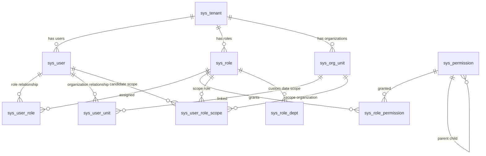

# System Architecture

> This reference owns current system boundaries, module responsibilities, dependencies, identity trust and extension invariants. The [Wiki](wiki/index.en.md) owns procedures, the [API contract](api-contract.en.md) owns interface details, and [Docker deployment](docker-deployment.en.md) owns deployment parameters. Current source/configuration defines implementation; this reference does not certify whole-system business acceptance.

---

## Table of Contents

- [1. System Positioning](#1-system-positioning)
- [2. Technology Baseline](#2-technology-baseline)
- [3. System Boundaries](#3-system-boundaries)
- [4. Module Map](#4-module-map)
- [5. Dependency Graph](#5-dependency-graph)
- [6. Local Architecture Design](#6-local-architecture-design)
- [7. Data Flow](#7-data-flow)
- [8. External Dependencies](#8-external-dependencies)
- [9. Infrastructure](#9-infrastructure)
- [10. Docker Deployment Architecture](#10-docker-deployment-architecture)
- [11. RBAC Permission System](#11-rbac-permission-system)
- [12. Key Constraints](#12-key-constraints)
- [13. Extension Points](#13-extension-points)
- [14. Development and Verification Entry Points](#14-development-and-verification-entry-points)

---

## 1. System Positioning

Omni-Stack is a Spring Cloud and Vue 3 microservices scaffolding platform with shared libraries, independent business services and module-based project generation.

- Architecture → Patterns → Code: architecture owns boundaries, patterns own implementation conventions, and the Wiki owns operations and recovery.
- Common has 10 modules: the data/SPI core plus 9 integration libraries. Eight declare custom `AutoConfiguration.imports`; reactive Redis only packages a dependency and YAML defaults.
- Gateway verifies the login JWT for protected business requests; downstream services authorize the preauthenticated identity. Browser authorization sessions and internal-service tokens have separate boundaries.
- Transactional Outbox commits business updates and pending messages together locally. Relay and consumption may still fail; commit is not delivery.

---

## 2. Technology Baseline

The [parent POM](../omni-backend/pom.xml), module POMs, frontend lockfile and formal Compose own version/build facts. [ADR](adr/0001-scaffold-upgrade-foundations.md) owns design decisions.

### 2.1 Spring Boot and JDK

The current parent uses Spring Boot 4.0.6, JDK 25, Spring Cloud 2025.1.1 and Spring Cloud Alibaba 2025.1.0.0; code uses `jakarta.*`. Maven Wrapper runs in local Docker with compiler release=25. Virtual threads, AOT and Native Image benefits require separate verification.

### 2.2 Gateway

Gateway uses WebFlux, reactive Redis and `spring.cloud.gateway.server.webflux`. Explicit `lb://` routes discover Nacos instances and preserve the full path. Its only direct shared-library dependency is `omni-common-redis-reactive`; it does not depend on core, Servlet Web or the blocking Redis shared library.

### 2.3 Nacos

Formal Compose uses Nacos v3.1.1 with MySQL `nacos_config`. Discovery/config clients share consistent private authentication parameters. Formal Compose owns service addresses, health checks and ports.

### 2.4 Workflow

`omni-common-workflow` encapsulates Flowable 8.0.0, running only in the independent `omni-workflow` service. Other business domains request approval through interfaces rather than importing the engine runtime. [Workflow facts](workflow.en.md) own publish locks, model validation, candidates and countersign rules.

### 2.5 Scheduling and Message Relay

XXL-JOB 3.3.1 separates Admin from executors; `omni-common-job` is a library. Executor Bean activation includes classpath and `xxl.job.executor.enabled` conditions. Registration retries and logs exhaustion; this does not itself mean whole-application startup failed. [Scheduling facts](scheduling.en.md) and [MQ reliability](mq-reliability.en.md) own registration and compensation.

---

## 3. System Boundaries

| Boundary | Frontend | Backend |
|---|---|---|
| Responsibility | Presentation, interaction, routing, form UX and user state | Business rules, authoritative validation, authorization, persistence, consistency and audit |
| Validation | Early required-field and format feedback | Actual input, identity, tenant, permission, version and business-state checks |
| Constraint | Local calculations, button visibility and route access cannot decide server data correctness or authorization | New code follows [backend patterns](backend-patterns.en.md) and does not rely on client validation |

[Frontend patterns](frontend-patterns.en.md) own frontend facts. Passing a form, seeing a menu, decoding JWT locally and verifying server business behavior provide different kinds of evidence.

---

## 4. Module Map

### 4.1 Common Ecosystem (10 Common Modules)

| Module | Current responsibility and boundary |
|---|---|
| `omni-common-core` | `R<T>`, PageResult, BaseEntity, exceptions and XSS/job/MQ/internal-call SPIs; production dependencies exclude Spring, while tests use Spring Boot test |
| `omni-common` | Jackson, MVC, exceptions, XSS, Feign retry, trace and optional observability; consumers supply dependencies and conditions for optional capabilities |
| `omni-common-mybatis` | MyBatis-Plus 3.5.16, MySQL and default pagination; services may supply their own interceptor chain |
| `omni-common-redis` | Servlet blocking Redis, serialization and RedisUtils |
| `omni-common-redis-reactive` | WebFlux reactive Redis dependency and timeout YAML default; no custom auto-configuration entry |
| `omni-common-job` | XXL-JOB executor, Admin client and system-job metadata; no domain job logic |
| `omni-common-mqlog` | Outbox, relay, sending strategies and management queries; optional dependencies do not automatically provide every capability to a consumer |
| `omni-common-operlog` | @OperLog aspect and reliable/direct sending; Auth security audit uses sys_audit_log and does not import this library |
| `omni-common-workflow` | Flowable auto-configuration and approval SPI, only for the Workflow engine service |
| `omni-common-service` | Servlet identity, internal APIs, TenantLine/DataScope, Auth settings clients and XSS settings retrieval; currently used by CRM/SRM/Procurement/Asset, while Auth/Base/Workflow retain their own configuration |

### 4.2 Microservice Modules (8)

The port column shows default host business ports. Spring Boot containers use `8080` internally.

| Service | Port | Owned business and fact reference |
|---|---|---|
| `omni-auth` | 8100 | Tenant users, RBAC, security audit, login/authorization server, social login and XSS settings; [core flows](core-flows.en.md) |
| `omni-base` | 8101 | Dictionary, operation logs, jobs and MQ management; [scheduling](scheduling.en.md), [MQ](mq-reliability.en.md) |
| `omni-gateway` | 8102 | Explicit routes, login JWT, identity-header handling and security headers; [API contract](api-contract.en.md) |
| `omni-workflow` | 8103 | Models, instances, approvals, candidates and todos; [Workflow](workflow.en.md) |
| `omni-crm` | 8104 | Leads, customers, contacts, opportunities, activities and conversion; [CRM](crm.en.md) |
| `omni-srm` | 8105 | Suppliers, evaluation, risk, Portal Saga and quotation collaboration; [SRM](srm.en.md), [design](design/srm-design.en.md) |
| `omni-procurement` | 8106 | Materials, requisitions, RFQs, purchase orders and receipts; [Procurement design](design/procurement-design.en.md) |
| `omni-asset` | 8107 | Receipt ingestion, allocation/return, transfer, disposal and history; [Asset design](design/asset-design.en.md) |

`omni-db-migrator` is a separate executable module for one-shot database creation, Liquibase, seeds and vendor-component bootstrap. It is not a ninth long-running business microservice. The parent reactor has 19 child modules, or 20 Maven projects including the parent.

### 4.3 Frontend Module

`omni-frontend` is a Vue 3, Pinia 3, Vue Router 5, Element Plus, Axios and Vite 8 SPA. Development and Nginx static serving both default to `3000`. [Frontend patterns](frontend-patterns.en.md) own four-language resources and session/menu responsibilities.

---

## 5. Dependency Graph

This table summarizes direct `com.omni` dependencies in current POMs, not startup order or all third-party dependencies. Optional entries are marked.

| Consumer module | Direct shared-library dependencies |
|---|---|
| common-core, common-job, common-redis-reactive, db-migrator | No other com.omni dependency |
| common, common-mybatis, common-redis, common-operlog, common-workflow | common-core |
| common-mqlog | common-core; common-job (optional) |
| common-service | common-core, common, common-mybatis, common-redis |
| auth | common-core, common, common-mybatis, common-redis, common-job, common-mqlog |
| base | Shared libraries in the auth row + common-operlog |
| workflow | Shared libraries in the base row + common-workflow |
| crm, srm, procurement, asset | Shared libraries in the base row + common-service |
| gateway | common-redis-reactive |

Module names omit the `omni-` prefix. Core has no other shared-library dependency; that does not imply every library or Gateway depends on core. Maven reactor orders actual dependencies, rather than treating the textual `<modules>` order as the sole dependency relation.

### Module-to-Whole Relationship

The [catalog](../scaffold/catalog/modules.yaml) separately owns generated-project module closures, for example `asset → procurement,srm`, `procurement → srm`, `srm → workflow`, `workflow/crm/gateway → base` and `base → auth → platform`. These dependencies select generated resources; they are not Maven direct dependencies or a complete runtime call graph.

For business calls, Auth supplies identity/permissions and settings. SRM coordinates Auth roles through Portal Saga. Procurement uses Workflow approval and SRM quotation collaboration, and publishes receipt events. Asset consumes integrated receipt events and requests Workflow approval. Synchronous interfaces, Outbox events and historical backfill have separate transaction/idempotency boundaries, not a cross-database atomic transaction.

---

## 6. Local Architecture Design

### 6.1 omni-auth Security Filter Chain

[AuthorizationServerConfig](../omni-backend/omni-auth/src/main/java/com/omni/auth/config/AuthorizationServerConfig.java) explicitly defines two chains:

| Chain | Matching and state |
|---|---|
| Order 1 | Authorization, Token, JWKS, OIDC, device and other protocol endpoints in oauth2EndpointsMatcher(); HttpSessionSecurityContextRepository stores browser authorization context; unauthenticated authorization/device-verification entries redirect to the frontend |
| Order 2 | Complement of the protocol endpoints; ordinary business is STATELESS, preauthentication establishes identity, and /internal/** uses InternalApiFilter and INTERNAL_SERVICE |

DeviceClientAuthenticationFilter and SasConsentOriginFilter handle public device clients and consent-submission Origin respectively. The business chain publicly permits named login, session-login, registration, CAPTCHA, tenant-list and social-callback paths. Management-port health/info/prometheus are public; other actuator endpoints require ADMIN. Configuration and the [API contract](api-contract.en.md) own full paths and protocol exceptions.

JWT login, browser-authorization HttpSession, external social login and internal-service tokens are validated separately. Redis CAPTCHA, blacklist and online state do not prove that authorization HttpSession is persisted in Redis.

### 6.2 omni-gateway WebFlux Pipeline

[CorsConfig](../omni-backend/omni-gateway/src/main/java/com/omni/gateway/config/CorsConfig.java) and [SecurityHeadersFilter](../omni-backend/omni-gateway/src/main/java/com/omni/gateway/config/SecurityHeadersFilter.java) are WebFilters. [AuthFilter](../omni-backend/omni-gateway/src/main/java/com/omni/gateway/filter/AuthFilter.java) is a GlobalFilter in the routing filter chain, order=-100. These two filter systems cannot be combined into one numbered execution order.

- Public paths remove client-supplied trusted identity headers and Bearer Authorization, retain OAuth client Basic credentials and set the forwarding marker. A public-path list neither creates routes nor grants downstream permissions.
- Protected paths extract Bearer, verify signature, expiration and valid user/tenant claims, and query reactive Redis blacklist state. Success replaces identity headers, removes the original Token and signs an assertion.
- Missing/weak signing secrets return 503 for production protected requests. Security exceptions return 401; other downstream failures are not all rewritten as JWT failures. Test-profile exceptions are not production policy.
- WebFilters set security headers and trace before response commit. A fallback response correlation ID without a real span does not prove complete distributed tracing.

[JwkKeyProvider](../omni-backend/omni-gateway/src/main/java/com/omni/gateway/config/JwkKeyProvider.java) currently constructs its own WebClient. auth.jwks.uri configures the endpoint; Compose supplies `http://omni-auth:8080/oauth2/jwks`. TTL defaults to 5m. It caches the first RSA key; volatile provides visibility, not kid-based selection or merged concurrent refresh. This does not guarantee key rotation. The current constructor does not establish that every WebFlux application lacks an injectable Builder.

### 6.3 Servlet Business Services Security Model

Downstream preauthentication builds Authentication for protected business identity. Roles receive ROLE_, permissions become corresponding authorities, and method authorization uses that object rather than revalidating the original JWT per method. Public, management and internal-protocol paths match separately; not every HTTP request needs the same assertion.

Current `X-Gateway-Assertion` uses HmacSHA256 over `userId|tenantId|username|issuedAt`, validates the signature, positive-integer identity and ±300 second window, and compares plaintext identity headers. It does not sign roles/scopes, method, path or body and has no one-use nonce. Role/permission headers still rely on Gateway stripping/injection and a trusted service network. The `X-Gateway-Forwarded` marker alone is not identity proof.

Missing/invalid assertions may return 401; some direct-access checks return 403. When internal API, DataScope, XSS and related capabilities are enabled, common-service also validates private internal tokens and path configuration; invalid configuration fails startup. Startup configuration failure, request denial and Gateway-not-ready 503 are different states.

Business services still supply domain table mappings, endpoint permissions, AccessGuard/ownership, explicit tenant parameters and transaction constraints. One interceptor does not cover every SQL statement. [Core flows](core-flows.en.md), [backend patterns](backend-patterns.en.md) and domain facts own implementation constraints.

---

## 7. Data Flow

### 7.1 User Login Request Flow

```text
Browser -> Frontend -> Gateway(public route) -> Auth
Auth -> CAPTCHA / tenant-user authentication -> JWT
Frontend -> Gateway(protected route) -> preauthentication -> business service
```

[Core flows](core-flows.en.md) and the [API contract](api-contract.en.md) own CAPTCHA consumption, tenant-local user validation, default roles, Token revocation and protocol differences. The [authentication guide](guides/authentication.en.md) owns operations/recovery. This overview is not a method-call inventory or new login acceptance evidence.

### 7.2 MQ Reliable Message Delivery Flow

```text
business transaction -> sys_mq_message(PENDING)
mqRelayHandler -> MqMessageRelayService -> MessageSender -> Broker
```

`ReliableMessageRelay.send(bindingName, payload, tenantId)` requires explicit tenantId and commits locally with business writes. The relay scans across tenants; management queries still filter tenantId. Integrated domain consumers separately validate tenants and maintain their own Inbox/idempotency and local transactions; do not assume every consumer has the same implementation.

[MQ reliability](mq-reliability.en.md) owns sending states, backoff, resend and consumer idempotency. [Outbox development](wiki/outbox-development.en.md) owns source walkthroughs. Broker acceptance, completed business consumption and local Outbox commit are separate stages.

---

## 8. External Dependencies

The table separates default formal-Compose host mappings from container ports. Omitted ports do not imply a component has no other internal ports.

| Component | Version | Default host → container |
|---|---|---|
| MySQL | 8.4 | 3306 → 3306 |
| Redis | 7.4 | 6379 → 6379 |
| Nacos | v3.1.1 | 8080 → 8080; 8848 → 8848; 9848 → 9848 |
| RocketMQ NameServer | 5.3.2 | 19876 → 9876 |
| RocketMQ Broker | 5.3.2 | 10909,10911,10912 → same-number ports |
| XXL-JOB Admin | 3.3.1 | 18080 → 8080 |
| Sentinel Dashboard (separate, optional) | 1.8.8 | 8858; absent from formal base Compose |

MySQL, Redis, Nacos, RocketMQ and XXL-JOB default host bindings use 127.0.0.1; see Compose for Gateway/Frontend mappings. Redis owns CAPTCHA, blacklist, online state and caches; Nacos owns discovery/configuration, while MySQL uses separate databases. [Observability facts](observability.en.md) own optional observability and Alertmanager UI boundaries. Versions/ports are configuration facts, not current container or external-service acceptance.

---

## 9. Infrastructure

### 9.1 Docker Compose Orchestration

[compose.yaml](../compose.yaml) includes infrastructure, application and observability definitions under standard project name omni-stack. Long-running services combine core/workflow/crm/supply-chain/full; MQ/Job infrastructure also has independent profiles. The catalog owns preset closure; profile names alone do not prove all runtime capabilities.

Healthy MySQL allows the one-shot Migrator to run. Its successful exit satisfies the migration gate for Nacos, XXL-JOB and applications. Application dependencies are not one linear chain: Gateway waits for Auth/Redis; domains wait for their respective Auth, Workflow and upstream domains; Frontend currently has no depends_on. Auth/Base/Workflow do not all declare Nacos/XXL-JOB health waits, so registration/readiness needs separate confirmation.

Persistence volume keys are `omni-mysql-data`, `omni-redis-data` and `omni-rocketmq-data`; project/configuration determines actual names. Container start, health, successful migration, task registration and business availability are separate checks. This documentation review did not restart applications or execute migrations.

### 9.2 Database Schema

[MigrationTargetCatalog](../omni-backend/omni-db-migrator/src/main/java/com/omni/dbmigrator/migration/MigrationTargetCatalog.java) owns the current nine targets, each entered through `database/changelog/<id>/db.changelog-<id>.yaml`. This table records ownership rather than duplicating full table/column/index inventories.

| id | Database | Owned facts |
|---|---|---|
| auth | omni_auth | Users, tenants, RBAC, authorization, security audit, portal roles and settings |
| base | omni_base | Dictionary, jobs, operation logs and other base business |
| workflow | omni_workflow | Process business tables and vendor Flowable migrations |
| crm | omni_crm | CRM aggregates and conversion/activity history |
| srm | omni_srm | Suppliers, portal, evaluation/risk and quotation collaboration |
| procurement | omni_procurement | Requisitions, RFQs, purchase orders, receipts and Inbox |
| asset | omni_asset | Assets, history, transfer, disposal and Inbox |
| nacos | nacos_config | Nacos vendor schema and bootstrap |
| xxl-job | xxl_job | XXL-JOB vendor schema and bootstrap |

Each of the seven business databases has its own Outbox. The sole shared DDL entry is [0001-mq-schema.yaml](../database/changelog/common/0001-mq-schema.yaml), included by each business changelog. Formal Workflow Compose disables Flowable schema auto-update and uses the vendor migration chain.

`database/changelog/` owns schema, indexes, constraints and forward upgrades. `scripts/sql/seed/` owns idempotent data, guarded by `database/seed/manifest.yaml` digests and natural-key assertions. Domain facts/design sources and migrations own complete structures; architectural excerpts or historical manual SQL are not a second authoritative version.

---

## 10. Docker Deployment Architecture

### 10.1 Container Network Topology

Containers communicate through Compose's `<project>_default` bridge, service names and internal ports. The usual business entry is Frontend → Gateway → Servlet services; internal calls, management ports and component protocols do not all traverse Gateway. Common modules are libraries, not separate containers.

Business host ports are 8100–8107, application containers use 8080 and Frontend uses 3000. Default Servlet business host mappings listen only on 127.0.0.1. [Docker deployment](docker-deployment.en.md) owns complete exposure/persistence; an identity assertion does not replace the network boundary.

### 10.2 Service Discovery Mechanism

Gateway sets discovery.locator.enabled=false and uses explicit routes. Nacos registers container addresses/internal ports, and `lb://` resolves instances. An empty Compose SPRING_CLOUD_NACOS_DISCOVERY_IP lets the client detect its address. Public paths, route existence, successful registration and downstream readiness are distinct.

### 10.3 Environment Variable Override Strategy

Compose injects container addresses/private settings over corresponding application.yml properties. Auth/Base/Workflow and domain services do not use entirely identical variable names; check actual mappings. [Deployment documentation](docker-deployment.en.md) owns AUTH_JWKS_URI, GATEWAY_ASSERTION_SECRET, database/Redis/Nacos authentication and optional Job/MQ switches. [Quick start](guides/quick-start.en.md) owns initialization.

---

## 11. RBAC Permission System

### 11.1 Design Philosophy

Auth owns user-role-permission and organization relationships. Functional authorization defines available operations; data scope limits accessible rows, while tenant isolation is independent. Usernames are tenant-unique, permissions use full resource:action codes, and role names are not wildcard permissions.

This conceptual association diagram does not enumerate all tables, columns or current DDL foreign keys:



SAME_UNIT/UNIT_AND_BELOW in `sys_user_role_scope.scope_mode` belongs to role-assignment scope and Workflow candidate resolution. It is not the six-value dataScope enum.

### 11.2 Functional Permission Architecture

`GET /api/auth/menus` takes non-ROLE_ permissions from Authentication authorities. MenuController first recursively selects DIRECTORY/MENU types. Permission filtering recursively checks DIRECTORY children, but checks each MENU's own code and preserves its existing children without another recursive child-permission check. An empty permission set returns an empty menu. BUTTON/API are not dynamic menu nodes.

MenuNode.path describes permission-tree hierarchy, not a page URL. Frontend derives paths from permissionCode, for example `system:user → /admin/system/user`. v-permission uses display:none rather than removing DOM. Method @PreAuthorize uses preauthenticated authorities; row-ownership interfaces such as personal jobs use their own checks rather than a mechanical endpoint annotation. Menu/button visibility does not replace backend authorization.

### 11.3 Data Permission Architecture

| dataScope | Current scope-layer meaning | Priority |
|---|---|---|
| ALL | No scope-layer row condition; interface/tenant policy separately determines cross-tenant access | 1 |
| TENANT | No further organization/self restriction within the tenant; tenant constraints still apply | 2 |
| DEPT_AND_BELOW | Current primary organization and enabled descendants | 3 |
| DEPT | Current primary organization | 4 |
| CUSTOM | Organization trees configured by participating CUSTOM roles | 5 |
| SELF | Self | 6 |

For ordinary Auth requests, DataScopeResolveFilter calls resolution without permissionCode, validates an enabled user in the tenant and merges relevant roles. /internal/ does not establish that ordinary context. The permission-aware internal interface merges only roles granting the target permission and returns 403 without a grant. Empty/invalid parameters and upstream unavailability are separate failures. These entries are not one unconditional all-role merge.

Auth's MyBatis chain is DataPermission → OptimisticLock → Pagination, without a general TenantLine. Corresponding Mapper/Service statements and checks own tenant conditions. The local handler maps only sys_user/sys_org_unit/sys_role and adds no row conditions for ALL/TENANT or absent context. User SELF uses id, organizations use current/visible units, and role SELF produces a nonmatching condition.

Current common-service can register TenantLine → DataPermission → OptimisticLock → Pagination under enabled configuration. Tenant policies cover only crm_/srm_/proc_/ast_, excluding sys_mq_message. Request identity and method data scope are established separately and cleared in finally. Domains own aggregate/child mappings, SELF columns, organization mappings and write AccessGuard; this is not universal zero-intrusion SQL protection.

OnlineUserServiceImpl checks online-user scope: ALL can span tenants, while other scopes validate the tenant first. That interface behavior does not imply domain SQL also spans tenants. [Core flows](core-flows.en.md) own detailed request boundaries.

### 11.4 RBAC Management Flows

Auth maintains roles, permission trees and user-role/organization relationships. New write endpoints, permission seeds, frontend actions and domain scopes must correspond. The [permissions guide](guides/permissions.en.md) owns operations, screenshots and denial branches; architecture does not duplicate an operating tutorial.

---

## 12. Key Constraints

1. The project targets JDK 25. Use Maven Wrapper in Docker with JAVA_HOME set and build current dependencies through the parent reactor.
2. Gateway uses `spring.cloud.gateway.server.webflux` and reactive dependencies; do not import Servlet/blocking Redis shared libraries.
3. Do not mix blocking/reactive Redis in a service. Check library dependencies, auto-configuration entries, activation properties and required implementations separately.
4. Synchronous business calls use OpenFeign/internal tokens. Gateway JWKS, OAuth providers and XXL-JOB Admin clients have distinct protocol boundaries.
5. With Job/MQ enabled, verify Admin, executor group, handler, Broker and bindings separately. Container health does not prove successful relay or job execution.
6. Services validate input, permissions, tenant, DataScope, version and transactions rather than relying on frontend checks or an annotation's presence.
7. Ordinary business Controllers return `R<T>`; the [API contract](api-contract.en.md) owns protocol, redirect and observability exceptions. Do not duplicate shared types or date/money conventions.
8. Record configuration, source, unit tests, integration tests, real browsers and actual business results as distinct evidence. Diagrams/digests/static configuration do not certify full acceptance.

---

## 13. Extension Points

### 13.1 Adding a New OAuth2 Social Login Provider

SocialLoginServiceImpl discovers OAuth2ProviderHandler strategies through a Map; configuration, handlers and username prefixes must agree. Current GitHub/Google/Gitee new users still follow tenant uniqueness and default-role rules. An implementation entry does not prove three external positive authorizations. [Core flows](core-flows.en.md) own protocols; the [authentication guide](guides/authentication.en.md) owns operations.

### 13.2 Adding XSS Protection to a New Service

A new Servlet service supplies XssConfigProvider SPI. Enabled common-service configuration can supply caching and Auth settings retrieval; existing services may customize it. omni-common registers defense, while actual Beans/classpath/switches determine activation. Isolate `xss:enabled:{tenantId}` and `xss:rules:{tenantId}` by tenant and invalidate on configuration writes. [Backend patterns](backend-patterns.en.md) own order/lifecycle; a dependency declaration alone does not prove every request is protected.

### 13.3 Adding a New User Task Type

UserJobHandlerRegistry discovers Map entries. The @Component Bean name must equal sys_user_job_type.type_code. User jobs share userJobExecuteHandler, while system jobs declare both @XxlJob and @SystemJobMeta. Scheduling facts own registration compensation, and the [scheduling guide](guides/scheduling.en.md) owns extension steps.

---

## 14. Development and Verification Entry Points

The [scaffold development guide](guides/scaffold-development.en.md) owns service, CRUD, module and preset onboarding. Current CLI create-service previews by default and writes a bundle only with --apply. service validate checks the lockfile and content digests. service integrate renders read-only by default; --apply performs the cross-file transaction. Bundle validation is not business execution or a full compilation check.

Integration plans cover Maven, Gateway, Compose, catalog, migration targets/seeds, menu/icons, documentation and the review queue. Current [service-integration.ts](../tools/omni-cli/src/service-integration.ts) and the renderer cover zh-CN, en-US, ja-JP and ko-KR frontend locales. When the target has .git, all four locale files participate in the pre-write dirty-file check. New documents/translations remain present-unverified; actual semantic review can be recorded as owner-authorized AI_REVIEW without mandatory human review. Locale registration and file guards do not prove translated domain terminology, page acceptance or business acceptance.

Implementation entries: [preset-generator.ts](../tools/omni-cli/src/preset-generator.ts), [CLI](../tools/omni-cli/src/cli.ts). Regression entries: [service-integration.test.ts](../tools/omni-cli/test/service-integration.test.ts), [preset-generator.test.ts](../tools/omni-cli/test/preset-generator.test.ts). Builds, tests, applications and browsers run in local Docker under [AGENTS.md](../AGENTS.md). Unchanged successful builds may be reused with exact equivalence evidence; generated artifacts still need validation at their actual scope.

---
