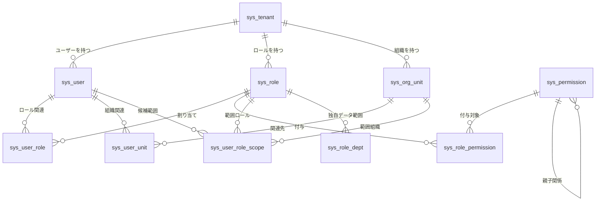

# システムアーキテクチャ

> 本書は現在のシステム境界、モジュールの責務、依存、ID の信頼関係と拡張時の不変条件を管理します。操作は [Wiki](wiki/index.jp.md)、インターフェース詳細は [API 契約](api-contract.jp.md)、デプロイ値は [Docker デプロイ](docker-deployment.jp.md)で管理します。実装の根拠は現在のソースと設定であり、本書はシステム全体の業務検証済み証明ではありません。

---

## 目次

- [1. システムの位置づけ](#1-システムの位置づけ)
- [2. 技術基準](#2-技術基準)
- [3. システム境界](#3-システム境界)
- [4. モジュールマップ](#4-モジュールマップ)
- [5. 依存関係グラフ](#5-依存関係グラフ)
- [6. 局所アーキテクチャ設計](#6-局所アーキテクチャ設計)
- [7. データフロー](#7-データフロー)
- [8. 外部依存](#8-外部依存)
- [9. インフラストラクチャ](#9-インフラストラクチャ)
- [10. Docker デプロイアーキテクチャ](#10-docker-デプロイアーキテクチャ)
- [11. RBAC 権限体系](#11-rbac-権限体系)
- [12. 主要制約](#12-主要制約)
- [13. 拡張ポイント](#13-拡張ポイント)
- [14. 開発と検証の入口](#14-開発と検証の入口)

---

## 1. システムの位置づけ

Omni-Stack は Spring Cloud と Vue 3 を基盤とし、共通ライブラリ、独立した業務サービス、モジュール別のプロジェクト生成を提供するスキャフォールドです。

- Architecture → Patterns → Code：アーキテクチャは境界、規約は実装ルール、Wiki は操作と復旧を管理します。
- Common は10モジュールで、データ/SPI の core と9つの統合ライブラリから構成されます。統合ライブラリのうち8つが独自の `AutoConfiguration.imports` を宣言し、リアクティブ Redis は依存と YAML 既定値だけをまとめます。
- 保護された業務リクエストのログイン JWT は Gateway が検証し、下流は事前認証された ID を認可します。ブラウザー認可セッションと内部サービスのトークンは別の境界です。
- Transactional Outbox は業務更新と送信待ち記録を同じローカルトランザクションで確定します。中継や消費は失敗し得るため、コミットは配信完了を意味しません。

---

## 2. 技術基準

バージョンとビルドの事実は[親 POM](../omni-backend/pom.xml)、モジュール POM、フロントエンドのロックファイルと正式な Compose が管理します。設計判断は [ADR](adr/0001-scaffold-upgrade-foundations.md)を参照してください。

### 2.1 Spring Boot と JDK

現在の親は Spring Boot 4.0.6、JDK 25、Spring Cloud 2025.1.1、Spring Cloud Alibaba 2025.1.0.0 を使用し、コードは `jakarta.*` を使います。Maven Wrapper はローカル Docker で実行し、コンパイラーの release=25 です。仮想スレッド、AOT、Native Image の効果は別途検証します。

### 2.2 Gateway

Gateway は WebFlux、リアクティブ Redis と `spring.cloud.gateway.server.webflux` を使います。明示的な `lb://` ルートが Nacos のインスタンスを解決し、完全なパスを保持します。直接依存する共通ライブラリは `omni-common-redis-reactive` だけで、core、Servlet Web、ブロッキング Redis 共通ライブラリには依存しません。

### 2.3 Nacos

正式な Compose は Nacos v3.1.1 と MySQL `nacos_config` を使用します。検出・設定クライアントの非公開認証値を統一し、アドレス、ヘルスチェック、ポートは正式な Compose が管理します。

### 2.4 Workflow

`omni-common-workflow` が Flowable 8.0.0 をまとめ、独立した `omni-workflow` だけで実行します。他の業務ドメインはインターフェース経由で承認を依頼し、エンジンランタイムを取り込みません。公開ロック、モデル検証、候補者、合議承認は [Workflow の事実](workflow.jp.md)が管理します。

### 2.5 スケジューリングとメッセージ中継

XXL-JOB 3.3.1 は Admin とエグゼキューターを分離し、`omni-common-job` はライブラリです。エグゼキューター Bean の有効化には classpath と `xxl.job.executor.enabled` の条件があります。登録は再試行し、上限後に失敗を記録しますが、それだけでアプリ全体の起動失敗とは限りません。登録と補償は[スケジューリング](scheduling.jp.md)と [MQ 信頼性](mq-reliability.jp.md)が管理します。

---

## 3. システム境界

| 境界 | フロントエンド | バックエンド |
|---|---|---|
| 責務 | 表示、操作、ルート、フォーム UX、ユーザー状態 | 業務ルール、サーバーによる最終検証、認可、永続化、一貫性、監査 |
| 検証 | 必須入力や形式の早期フィードバック | 実入力、ID、テナント、権限、バージョン、業務状態 |
| 制約 | ローカル計算、ボタン表示、ルートアクセスでサーバーのデータ正当性や認可を決めない | 新規コードは[バックエンド規約](backend-patterns.jp.md)に従い、クライアント検証に依存しない |

画面実装の事実は[フロントエンド規約](frontend-patterns.jp.md)が管理します。フォーム通過、メニュー表示、クライアント JWT デコード、サーバー業務の検証は異なる証拠です。

---

## 4. モジュールマップ

### 4.1 Common エコシステム（10 個の共通モジュール）

| モジュール | 現在の責務と境界 |
|---|---|
| `omni-common-core` | `R<T>`、PageResult、BaseEntity、例外、XSS/ジョブ/MQ/内部呼び出し SPI。本番依存に Spring はなく、テストは Spring Boot test を使用 |
| `omni-common` | Jackson、MVC、例外、XSS、Feign 再試行、trace、任意の観測設定。optional 能力には利用サービスの依存と有効化条件が必要 |
| `omni-common-mybatis` | MyBatis-Plus 3.5.16、MySQL、既定ページネーション。サービス独自のインターセプター列で置換可能 |
| `omni-common-redis` | Servlet 向けブロッキング Redis、シリアライズ、RedisUtils |
| `omni-common-redis-reactive` | WebFlux 向け Redis 依存と timeout の YAML 既定値。独自自動設定入口はない |
| `omni-common-job` | XXL-JOB エグゼキューター、Admin クライアント、システムジョブメタデータ。ドメインジョブのロジックは含まない |
| `omni-common-mqlog` | Outbox、中継、送信戦略、管理クエリ。optional 依存だけで利用側の全能力が有効になるわけではない |
| `omni-common-operlog` | @OperLog アスペクトと信頼送信/直接送信。Auth のセキュリティ監査は sys_audit_log が管理し、このライブラリを取り込まない |
| `omni-common-workflow` | Flowable 自動設定と承認 SPI。Workflow エンジンサービス専用 |
| `omni-common-service` | Servlet ID、内部 API、TenantLine/DataScope、Auth 設定クライアント、XSS 設定取得。現在 CRM/SRM/Procurement/Asset が使用し、Auth/Base/Workflow は独自設定を維持 |

### 4.2 マイクロサービスモジュール（8 個）

ポート欄は既定のホスト業務ポートで、Spring Boot コンテナ内部は `8080` です。

| サービス | ポート | 所有する業務と事実の入口 |
|---|---|---|
| `omni-auth` | 8100 | テナントユーザー、RBAC、セキュリティ監査、ログイン/認可サーバー、ソーシャルログイン、XSS 設定。[主要フロー](core-flows.jp.md) |
| `omni-base` | 8101 | 辞書、操作ログ、ジョブ、MQ 管理。[スケジューリング](scheduling.jp.md)、[MQ](mq-reliability.jp.md) |
| `omni-gateway` | 8102 | 明示ルート、ログイン JWT、ID ヘッダー処理、安全応答ヘッダー。[API 契約](api-contract.jp.md) |
| `omni-workflow` | 8103 | モデル、インスタンス、承認、候補者、未処理タスク。[Workflow](workflow.jp.md) |
| `omni-crm` | 8104 | リード、顧客、連絡先、商談、活動、変換。[CRM](crm.jp.md) |
| `omni-srm` | 8105 | サプライヤー、評価、リスク、Portal Saga、見積協働。[SRM](srm.jp.md)、[設計](design/srm-design.jp.md) |
| `omni-procurement` | 8106 | 品目、購買申請、RFQ、発注、入荷。[調達設計](design/procurement-design.jp.md) |
| `omni-asset` | 8107 | 検収計上、割当/返却、移管、廃棄、履歴。[資産設計](design/asset-design.jp.md) |

`omni-db-migrator` は別の実行モジュールで、一度限りのデータベース作成、Liquibase、シード、vendor コンポーネントの初期化を担当します。第9の常駐業務サービスではありません。親 reactor は19子モジュール、親を含め20 Maven プロジェクトです。

### 4.3 フロントエンドモジュール

`omni-frontend` は Vue 3、Pinia 3、Vue Router 5、Element Plus、Axios、Vite 8 の SPA です。開発と Nginx 静的配信は共に既定 `3000`。四言語資産、セッション、メニューの責務は[フロントエンド規約](frontend-patterns.jp.md)を参照してください。

---

## 5. 依存関係グラフ

現在の POM の直接 `com.omni` 依存を要約します。起動順や第三者依存の全一覧ではなく、optional を明記します。

| 利用モジュール | 直接の共通ライブラリ依存 |
|---|---|
| common-core、common-job、common-redis-reactive、db-migrator | 他の com.omni 依存なし |
| common、common-mybatis、common-redis、common-operlog、common-workflow | common-core |
| common-mqlog | common-core、common-job（optional） |
| common-service | common-core、common、common-mybatis、common-redis |
| auth | common-core、common、common-mybatis、common-redis、common-job、common-mqlog |
| base | auth 行の共通ライブラリ + common-operlog |
| workflow | base 行の共通ライブラリ + common-workflow |
| crm、srm、procurement、asset | base 行の共通ライブラリ + common-service |
| gateway | common-redis-reactive |

表では `omni-` 接頭辞を省略します。core に他の共通依存がないことは、全ライブラリや Gateway が core に依存する意味ではありません。Maven reactor は実依存を並べ、`<modules>` の文字列順だけを依存関係にしません。

### モジュールと全体の関係

[catalog](../scaffold/catalog/modules.yaml) は生成プロジェクトの依存閉包を別途管理します。例は `asset → procurement,srm`、`procurement → srm`、`srm → workflow`、`workflow/crm/gateway → base`、`base → auth → platform`。生成資産の選択関係であり、Maven 直接依存や全ランタイム呼び出し図ではありません。

業務呼び出しでは Auth が ID/権限/設定を提供し、SRM が Portal Saga で Auth のロールを調整します。調達は Workflow 承認と SRM の見積協働を利用して入荷イベントを発行し、資産は接続済み入荷イベントを消費して Workflow 承認を依頼します。同期 API、Outbox、過去データ補完は各自のトランザクションと冪等性境界を持ち、複数 DB の原子的トランザクションにはなりません。

---

## 6. 局所アーキテクチャ設計

### 6.1 omni-auth セキュリティフィルターチェーン

[AuthorizationServerConfig](../omni-backend/omni-auth/src/main/java/com/omni/auth/config/AuthorizationServerConfig.java) は2本を明示定義します。

| チェーン | 対象と状態 |
|---|---|
| Order 1 | oauth2EndpointsMatcher() の認可、Token、JWKS、OIDC、デバイス等。HttpSessionSecurityContextRepository がブラウザー認可文脈を保存し、未認証の認可/デバイス検証入口は画面へリダイレクト |
| Order 2 | プロトコル入口の補集合。通常業務は STATELESS、事前認証で ID を構成し、/internal/** は InternalApiFilter と INTERNAL_SERVICE を使用 |

DeviceClientAuthenticationFilter は公開デバイスクライアント、SasConsentOriginFilter は同意提出 Origin を処理します。業務チェーンはログイン、session-login、登録、CAPTCHA、テナント一覧、ソーシャルコールバック等の指定パスを公開します。管理ポートの health/info/prometheus は公開、他の actuator は ADMIN が必要です。完全なパスとプロトコル例外は設定と [API 契約](api-contract.jp.md)が管理します。

JWT ログイン、ブラウザー認可 HttpSession、外部ソーシャルログイン、内部サービストークンは別々に検証します。Redis の CAPTCHA、ブラックリスト、オンライン状態は、認可 HttpSession の Redis 永続化を証明しません。

### 6.2 omni-gateway WebFlux パイプライン

[CorsConfig](../omni-backend/omni-gateway/src/main/java/com/omni/gateway/config/CorsConfig.java) と [SecurityHeadersFilter](../omni-backend/omni-gateway/src/main/java/com/omni/gateway/config/SecurityHeadersFilter.java) は WebFilter、[AuthFilter](../omni-backend/omni-gateway/src/main/java/com/omni/gateway/filter/AuthFilter.java) はルートフィルター列の GlobalFilter、order=-100 です。両体系を単一の番号付き実行順に混ぜません。

- 公開パスはクライアントの信頼対象 ID ヘッダーと Bearer Authorization を除去し、OAuth クライアント Basic 資格情報を残して転送マーカーを設定します。公開リストはルートや下流権限を作りません。
- 保護パスは Bearer の署名、有効期限、有効なユーザー/テナント claims とリアクティブ Redis のブラックリストを確認します。成功後に ID ヘッダーを置換し、元 Token を除去してアサーションに署名します。
- 本番の保護リクエストで署名キーが欠落/弱い場合は503、安全例外は401です。他の下流失敗をすべて JWT 失敗に変更しません。test profile の例外は本番方針ではありません。
- WebFilter は応答コミット前に安全ヘッダーと trace を設定します。実 span がない応答相関 ID は完全な分散追跡の証明ではありません。

[JwkKeyProvider](../omni-backend/omni-gateway/src/main/java/com/omni/gateway/config/JwkKeyProvider.java) は現在 WebClient を自分で作成し、auth.jwks.uri を使用します。Compose は `http://omni-auth:8080/oauth2/jwks`、TTL 既定は5mです。最初の RSA key をキャッシュし、volatile は可視性だけを提供します。kid 選択や同時更新の集約はなく、鍵のローテーションを保証しません。この構築方式から全 WebFlux アプリで Builder 注入が不可能とは推論しません。

### 6.3 Servlet 業務サービスのセキュリティモデル

保護業務の ID は下流の事前認証で Authentication になります。ロールに ROLE_ を付け、権限を authority とし、メソッド認可はそのオブジェクトを使います。各メソッドで元 JWT を再検証する意味ではありません。公開・管理・内部プロトコルは別に一致判定し、すべての HTTP に同じアサーションを要求するわけではありません。

現在の `X-Gateway-Assertion` は `userId|tenantId|username|issuedAt` に HmacSHA256 を使い、署名、正整数 ID、±300秒と明文 ID ヘッダーの一致を確認します。roles/scopes、メソッド、パス、本文は署名せず、一度限りの nonce もありません。ロール/権限ヘッダーは Gateway の除去・注入と信頼するサービスネットワークに依存します。`X-Gateway-Forwarded` だけでは ID を証明しません。

アサーション欠落/不正は401、一部の直接アクセス判定は403です。common-service は内部 API、DataScope、XSS 等が有効なら非公開内部トークンとパス設定も検証し、不正設定は起動失敗になります。起動設定失敗、要求拒否、Gateway 未準備503は異なる状態です。

業務サービスはドメインテーブルの対応付け、入口権限、AccessGuard/行所有権、明示テナント、トランザクション制約を実装します。単一インターセプターが全 SQL を覆うわけではありません。[主要フロー](core-flows.jp.md)、[バックエンド規約](backend-patterns.jp.md)と各ドメインが実装制約を管理します。

---

## 7. データフロー

### 7.1 ユーザーログインリクエストフロー

```text
Browser -> Frontend -> Gateway(public route) -> Auth
Auth -> CAPTCHA / tenant-user authentication -> JWT
Frontend -> Gateway(protected route) -> preauthentication -> business service
```

CAPTCHA 消費、テナント内ユーザー検証、既定ロール、Token 取消、プロトコル差異は[主要フロー](core-flows.jp.md)と [API 契約](api-contract.jp.md)、操作・復旧は[認証ガイド](guides/authentication.jp.md)が管理します。この概観はメソッド一覧や新しいログイン検証記録ではありません。

### 7.2 MQ 信頼メッセージ配信フロー

```text
business transaction -> sys_mq_message(PENDING)
mqRelayHandler -> MqMessageRelayService -> MessageSender -> Broker
```

`ReliableMessageRelay.send(bindingName, payload, tenantId)` は tenantId を明示し、業務更新とローカルに確定します。中継はテナントを横断し、管理照会は tenantId で絞ります。接続済みドメインの消費側は個別にテナント、Inbox/冪等性、ローカルトランザクションを検証し、全消費側が同じ実装とは仮定しません。

送信状態、バックオフ、再送、消費冪等性は [MQ 信頼性](mq-reliability.jp.md)、ソース説明は [Outbox 開発](wiki/outbox-development.jp.md)が管理します。Broker 受信、業務消費完了、ローカル Outbox コミットは別段階です。

---

## 8. 外部依存

正式な Compose の既定ホスト対応とコンテナポートを区別します。省略したポートがコンポーネント内部に存在しないという意味ではありません。

| コンポーネント | バージョン | 既定ホスト → コンテナ |
|---|---|---|
| MySQL | 8.4 | 3306 → 3306 |
| Redis | 7.4 | 6379 → 6379 |
| Nacos | v3.1.1 | 8080 → 8080；8848 → 8848；9848 → 9848 |
| RocketMQ NameServer | 5.3.2 | 19876 → 9876 |
| RocketMQ Broker | 5.3.2 | 10909、10911、10912 → 同番号 |
| XXL-JOB Admin | 3.3.1 | 18080 → 8080 |
| Sentinel Dashboard（別途任意） | 1.8.8 | 8858；正式な基盤 Compose には含めない |

MySQL、Redis、Nacos、RocketMQ、XXL-JOB の既定ホストバインドは127.0.0.1です。Gateway/Frontend は Compose を参照します。Redis は CAPTCHA、ブラックリスト、オンライン状態、キャッシュ、Nacos は検出・設定、MySQL は分離 DB を所有します。任意観測と Alertmanager UI は[観測の事実](observability.jp.md)が管理します。バージョン/ポートは設定事実であり、現コンテナや外部サービスの検証済み証明ではありません。

---

## 9. インフラストラクチャ

### 9.1 Docker Compose オーケストレーション

[compose.yaml](../compose.yaml) は基盤、アプリ、観測を include し、標準プロジェクト名は omni-stack です。常駐サービスは core/workflow/crm/supply-chain/full を組み合わせ、MQ/Job 基盤には独立 profile もあります。閉包は catalog が所有し、profile 名だけで全実行能力を推測しません。

MySQL 正常後に一度限りの Migrator を実行し、正常終了後に Nacos、XXL-JOB、各アプリの対応する移行ゲートを満たします。依存は一本の列ではありません。Gateway は Auth/Redis、ドメインは各 Auth、Workflow、上流ドメインを待ち、Frontend は現在 depends_on を持ちません。Auth/Base/Workflow が一律 Nacos/XXL-JOB の正常待機を宣言するわけではなく、登録・準備は別途確認します。

永続化の volume キーは `omni-mysql-data`、`omni-redis-data`、`omni-rocketmq-data` で、実名はプロジェクトと設定に従います。起動、正常性、移行成功、ジョブ登録、業務利用可否は別検査です。この文書レビューではアプリ再起動や移行を実行していません。

### 9.2 データベーススキーマ

[MigrationTargetCatalog](../omni-backend/omni-db-migrator/src/main/java/com/omni/dbmigrator/migration/MigrationTargetCatalog.java) が現在の9対象を管理し、入口は `database/changelog/<id>/db.changelog-<id>.yaml` です。表は所有関係を記録し、全テーブル数・列・索引一覧を複製しません。

| id | データベース | 所有する事実 |
|---|---|---|
| auth | omni_auth | ユーザー、テナント、RBAC、認可、安全監査、ポータルロール、設定 |
| base | omni_base | 辞書、ジョブ、操作ログ等の基礎業務 |
| workflow | omni_workflow | プロセス業務テーブルと vendor Flowable 移行 |
| crm | omni_crm | CRM 集約と変換/活動履歴 |
| srm | omni_srm | サプライヤー、ポータル、評価/リスク、見積協働 |
| procurement | omni_procurement | 購買申請、RFQ、発注、入荷、Inbox |
| asset | omni_asset | 資産、履歴、移管、廃棄、Inbox |
| nacos | nacos_config | Nacos vendor 構造と初期化 |
| xxl-job | xxl_job | XXL-JOB vendor 構造と初期化 |

7業務 DB はそれぞれ独立 Outbox を持ちます。共有 DDL の唯一入口は [0001-mq-schema.yaml](../database/changelog/common/0001-mq-schema.yaml) で、各業務 changelog が参照します。正式な Workflow Compose は Flowable の schema 自動更新を無効にし、vendor 移行列を使用します。

構造、索引、制約、前進のみの移行は `database/changelog/`、冪等データは `scripts/sql/seed/` が所有し、`database/seed/manifest.yaml` のハッシュと自然キー検証で管理します。完全な構造はドメイン事実/設計と移行を参照し、アーキテクチャの抜粋や旧手動 SQL を第二の正規版にしません。

---

## 10. Docker デプロイアーキテクチャ

### 10.1 コンテナネットワークトポロジ

Compose の `<project>_default` bridge、サービス名、内部ポートで通信します。通常の業務入口は Frontend → Gateway → Servlet サービスです。内部呼び出し、管理ポート、コンポーネントプロトコルが全部 Gateway を通るわけではありません。Common はライブラリで、独立コンテナではありません。

業務ホストは8100–8107、アプリ内部は8080、Frontend は3000です。Servlet 業務の既定ホスト対応は127.0.0.1だけで待ち受けます。公開と永続化は [Docker デプロイ](docker-deployment.jp.md)が管理し、ID アサーションはネットワーク境界の代わりにはなりません。

### 10.2 サービスディスカバリメカニズム

Gateway は discovery.locator.enabled=false とし、明示ルートを使います。Nacos がコンテナアドレス/内部ポートを登録し、`lb://` が解決します。Compose の SPRING_CLOUD_NACOS_DISCOVERY_IP が空ならクライアントが検出します。公開パス、ルート存在、登録成功、下流の準備は別々です。

### 10.3 環境変数オーバーライド戦略

Compose がコンテナアドレス/非公開設定を application.yml の対応属性に上書きします。Auth/Base/Workflow とドメインで変数名は完全には同じでなく、実ファイルの対応を確認します。AUTH_JWKS_URI、GATEWAY_ASSERTION_SECRET、DB/Redis/Nacos 認証、任意 Job/MQ は[デプロイ説明](docker-deployment.jp.md)、初期化は[クイックスタート](guides/quick-start.jp.md)が管理します。

---

## 11. RBAC 権限体系

### 11.1 設計哲学

Auth はユーザー・ロール・権限と組織の関連を所有します。機能認可は実行できる操作、データ範囲は可視行を決め、テナント分離は独立条件です。ユーザー名はテナント内一意、権限は完全 resource:action で、ロール名をワイルドカード権限としません。

次は概念関連であり、全表・列・現 DDL の外部キーを表しません。



`sys_user_role_scope.scope_mode` の SAME_UNIT/UNIT_AND_BELOW はロール割当範囲と Workflow 候補者解決に使い、dataScope の6値と同じ列挙型ではありません。

### 11.2 機能権限アーキテクチャ

`GET /api/auth/menus` は Authentication authorities から ROLE_ 以外を取得します。MenuController はまず DIRECTORY/MENU 型を再帰選択します。権限判定は DIRECTORY 子を再帰検査しますが、MENU は自分のコードを検査して既存 children を保持し、子の権限をもう一度再帰検査しません。権限集合が空ならメニューも空です。BUTTON/API は動的メニューノードになりません。

MenuNode.path は権限ツリーの階層で、画面 URL ではありません。画面は permissionCode から生成し、例は `system:user → /admin/system/user`。v-permission は display:none を使い、DOM を削除しません。@PreAuthorize は事前認証 authorities を使用し、個人ジョブ等の行所有権 API は専用判定を使います。同じ入口注釈を機械的に追加しません。メニュー/ボタン表示はバックエンド認可を代替しません。

### 11.3 データ権限アーキテクチャ

| dataScope | 現在の範囲層の意味 | 優先度 |
|---|---|---|
| ALL | 範囲層の行条件を追加しない。テナント横断可否は API/テナント方針が別に決定 | 1 |
| TENANT | テナント内を組織/本人でさらに縮小しない。テナント条件は必要 | 2 |
| DEPT_AND_BELOW | 現主組織と有効な子孫 | 3 |
| DEPT | 現主組織 | 4 |
| CUSTOM | 対象 CUSTOM ロールが設定した組織ツリー集合 | 5 |
| SELF | 本人 | 6 |

Auth 通常要求の DataScopeResolveFilter は permissionCode なしで解析し、有効ユーザーのテナント所属を検証して関連ロールを統合します。/internal/ はその通常文脈を作りません。permission-aware 内部 API は対象権限を付与するロールだけを統合し、付与がなければ403です。空/不正パラメーターと上流利用不可は別処理で、両入口を無条件の全ロール統合にまとめません。

Auth の MyBatis は DataPermission → OptimisticLock → Pagination で、一般 TenantLine はありません。テナント条件は各 Mapper/Service の実文と検証が担当します。局所ハンドラーは sys_user/sys_org_unit/sys_role だけに対応し、ALL/TENANT または文脈なしでは行条件を追加しません。ユーザー SELF は id、組織は現/可視組織、ロール SELF は不一致条件です。

現在の common-service は有効設定に応じて TenantLine → DataPermission → OptimisticLock → Pagination を登録します。テナント方針は crm_/srm_/proc_/ast_ だけを対象とし、sys_mq_message は除外します。要求 ID とメソッド範囲は別に作成し、finally で解放します。集約/子表、SELF 列、組織対応、更新 AccessGuard はドメインが担当し、全 SQL に侵入なしで適用するものではありません。

OnlineUserServiceImpl のオンラインユーザー判定は ALL でテナント横断、他は先にテナントを検証します。これは当該 API の事実で、ドメイン SQL も横断できる意味ではありません。詳細境界は[主要フロー](core-flows.jp.md)を参照してください。

### 11.4 RBAC 管理フロー

Auth がロール、権限ツリー、ユーザーとロール/組織の関連を維持します。新規更新入口、権限シード、画面操作、ドメイン範囲を対応させます。操作・画像・拒否分岐は[権限ガイド](guides/permissions.jp.md)が管理し、アーキテクチャ文書に操作手順を複製しません。

---

## 12. 主要制約

1. JDK 25 を対象とし、ローカル Docker の Maven Wrapper と JAVA_HOME を使い、親 reactor で現依存をビルドします。
2. Gateway は `spring.cloud.gateway.server.webflux` とリアクティブ依存を使い、Servlet/ブロッキング Redis 共通ライブラリを導入しません。
3. 同一サービスで両 Redis を混在させず、依存、自動設定入口、属性、必要実装を個別に確認します。
4. 同期業務は OpenFeign/内部トークンを使用し、JWKS、OAuth 提供者、XXL-JOB Admin は各プロトコル境界に従います。
5. Job/MQ 有効時は Admin、実行グループ、handler、Broker、binding を別々に確認し、コンテナ正常だけで中継/ジョブ成功としません。
6. 入力、権限、テナント、DataScope、バージョン、トランザクションはサービスが検証し、画面や注釈の存在だけに依存しません。
7. 通常業務 Controller は `R<T>` を返し、プロトコル、リダイレクト、観測等の例外は [API 契約](api-contract.jp.md)に従います。共有型、日時/金額規約を重複定義しません。
8. 設定、ソース、単体、統合、実ブラウザー、実業務を別の証拠として記録し、図やハッシュ、静的設定で全体検証を証明しません。

---

## 13. 拡張ポイント

### 13.1 新規 OAuth2 ソーシャルログインプロバイダーの追加

SocialLoginServiceImpl が Map から OAuth2ProviderHandler を検出し、設定、ハンドラー、ユーザー名接頭辞を一致させます。現在の GitHub/Google/Gitee 新規ユーザーもテナント一意性と既定ロール規則に従います。実装入口は3提供者の外部正常認可を証明しません。プロトコルは[主要フロー](core-flows.jp.md)、操作は[認証ガイド](guides/authentication.jp.md)が管理します。

### 13.2 新サービスへの XSS 防護追加

新 Servlet サービスは XssConfigProvider SPI を提供します。有効な common-service 設定はキャッシュと Auth 設定取得を提供でき、既存サービスは独自実装も持ちます。omni-common が登録し、実 Bean/classpath/スイッチが有効化を決めます。`xss:enabled:{tenantId}` と `xss:rules:{tenantId}` をテナント別に分け、設定更新で失効します。順序と寿命は[バックエンド規約](backend-patterns.jp.md)に従い、依存宣言だけで全要求の防護済みとしません。

### 13.3 新規ユーザータスクタイプの追加

UserJobHandlerRegistry が Map で検出し、@Component Bean 名は sys_user_job_type.type_code と一致させます。ユーザージョブは userJobExecuteHandler を共有し、システムジョブは @XxlJob と @SystemJobMeta の両方を宣言します。登録補償はスケジューリングの事実、手順は[ガイド](guides/scheduling.jp.md)が管理します。

---

## 14. 開発と検証の入口

サービス、CRUD、モジュール、プリセットの導入手順は[スキャフォールド開発ガイド](guides/scaffold-development.jp.md)が管理します。現 CLI の create-service は既定プレビュー、--apply で生成物を書き、service validate はロックと内容ハッシュを検証します。service integrate は既定で読取専用レンダリング、--apply で複数ファイルのトランザクションを実行します。パッケージ検証は業務実行や全コンパイル検証ではありません。

接続計画は Maven、Gateway、Compose、catalog、移行対象/seed、メニュー/アイコン、文書、レビューキューを扱います。現 [service-integration.ts](../tools/omni-cli/src/service-integration.ts) とレンダラーは zh-CN、en-US、ja-JP、ko-KR の画面 locale に対応します。対象に .git がある場合、四つの locale ファイルすべてを書込前の未コミット変更検査に含めます。新規文書/訳文は present-unverified を保ち、実際の意味レビュー後に所有者が承認した AI_REVIEW を記録でき、人手レビューは必須ではありません。四言語の登録とファイル保護は業務用語の翻訳、画面検証、業務検証の証明ではありません。

実装：[preset-generator.ts](../tools/omni-cli/src/preset-generator.ts)、[CLI](../tools/omni-cli/src/cli.ts)。回帰入口：[service-integration.test.ts](../tools/omni-cli/test/service-integration.test.ts)、[preset-generator.test.ts](../tools/omni-cli/test/preset-generator.test.ts)。ビルド、テスト、アプリ、ブラウザーは [AGENTS.md](../AGENTS.md) に従いローカル Docker で実行します。不変の成功ビルドは正確な等価証拠で再利用できますが、生成成果物は実範囲に合わせた検証が必要です。

---
