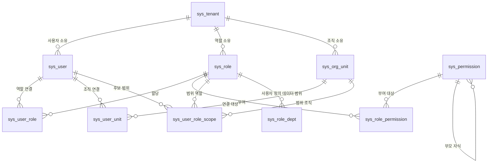

# 시스템 아키텍처

> 현재 시스템 경계, 모듈 책임, 의존성, 신원 신뢰와 확장 불변 조건을 관리합니다. 절차는 [Wiki](wiki/index.kr.md), 인터페이스 상세는 [API 계약](api-contract.kr.md), 배포 값은 [Docker 배포](docker-deployment.kr.md)가 관리합니다. 현재 소스·설정이 구현 근거이며 이 문서는 전체 시스템 업무 검증을 증명하지 않습니다.

---

## 목차

- [1. 시스템 포지셔닝](#1-시스템-포지셔닝)
- [2. 기술 기준](#2-기술-기준)
- [3. 시스템 경계](#3-시스템-경계)
- [4. 모듈 맵](#4-모듈-맵)
- [5. 의존성 그래프](#5-의존성-그래프)
- [6. 로컬 아키텍처 설계](#6-로컬-아키텍처-설계)
- [7. 데이터 흐름](#7-데이터-흐름)
- [8. 외부 의존성](#8-외부-의존성)
- [9. 인프라스트럭처](#9-인프라스트럭처)
- [10. Docker 배포 아키텍처](#10-docker-배포-아키텍처)
- [11. RBAC 권한 체계](#11-rbac-권한-체계)
- [12. 주요 제약사항](#12-주요-제약사항)
- [13. 확장 포인트](#13-확장-포인트)
- [14. 개발 및 검증 진입점](#14-개발-및-검증-진입점)

---

## 1. 시스템 포지셔닝

Omni-Stack은 Spring Cloud와 Vue 3 기반으로 공통 라이브러리, 독립 업무 서비스, 모듈별 프로젝트 생성을 제공하는 스캐폴드입니다.

- Architecture → Patterns → Code: 아키텍처는 경계, 패턴은 구현 규칙, Wiki는 운영과 복구를 관리합니다.
- Common은 데이터/SPI core와 통합 라이브러리 9개로 총 10개 모듈입니다. 8개가 자체 `AutoConfiguration.imports`를 선언하며 리액티브 Redis는 의존성과 YAML 기본값만 묶습니다.
- 보호된 업무 요청의 로그인 JWT는 Gateway가 검증하고 하위 서비스가 사전 인증 신원을 인가합니다. 브라우저 인가 세션과 내부 서비스 토큰은 별도 경계입니다.
- Transactional Outbox는 업무 변경과 전송 대기 기록을 같은 로컬 트랜잭션으로 커밋합니다. 중계·소비는 여전히 실패할 수 있으며 커밋은 전달 완료가 아닙니다.

---

## 2. 기술 기준

버전·빌드 사실은 [부모 POM](../omni-backend/pom.xml), 모듈 POM, 프런트엔드 잠금 파일과 정식 Compose가 관리하며 설계 결정은 [ADR](adr/0001-scaffold-upgrade-foundations.md)에 둡니다.

### 2.1 Spring Boot와 JDK

현재 부모는 Spring Boot 4.0.6, JDK 25, Spring Cloud 2025.1.1, Spring Cloud Alibaba 2025.1.0.0을 사용하며 코드는 `jakarta.*`를 사용합니다. Maven Wrapper는 로컬 Docker에서 실행하고 컴파일 release=25입니다. 가상 스레드, AOT, Native Image 효과는 별도로 검증합니다.

### 2.2 Gateway

Gateway는 WebFlux, 리액티브 Redis, `spring.cloud.gateway.server.webflux`를 사용합니다. 명시적 `lb://` 경로가 Nacos 인스턴스를 조회하고 전체 경로를 유지합니다. 직접 공통 라이브러리 의존성은 `omni-common-redis-reactive`뿐이며 core, Servlet Web, 블로킹 Redis 공통 라이브러리에 의존하지 않습니다.

### 2.3 Nacos

정식 Compose는 Nacos v3.1.1과 MySQL `nacos_config`를 사용합니다. 검색·설정 클라이언트의 비공개 인증 값을 맞추며 주소, 상태 검사, 포트는 정식 Compose가 관리합니다.

### 2.4 Workflow

`omni-common-workflow`가 Flowable 8.0.0을 묶어 독립 `omni-workflow`에서만 실행합니다. 다른 업무 도메인은 인터페이스로 승인을 요청하고 엔진 런타임을 도입하지 않습니다. 게시 잠금, 모델 검증, 후보자와 합의 승인은 [Workflow 사실](workflow.kr.md)이 관리합니다.

### 2.5 스케줄링과 메시지 중계

XXL-JOB 3.3.1은 Admin과 실행기를 분리하며 `omni-common-job`은 라이브러리입니다. 실행기 Bean 활성 조건에는 classpath와 `xxl.job.executor.enabled`가 포함됩니다. 등록은 재시도 후 실패를 기록하지만 그것만으로 전체 앱 시작 실패를 뜻하지 않습니다. 등록·보상 규칙은 [스케줄링](scheduling.kr.md)과 [MQ 신뢰성](mq-reliability.kr.md)이 관리합니다.

---

## 3. 시스템 경계

| 경계 | 프런트엔드 | 백엔드 |
|---|---|---|
| 책임 | 표시, 상호작용, 경로, 폼 UX와 사용자 상태 | 업무 규칙, 최종 검증, 인가, 영속화, 일관성과 감사 |
| 검증 | 필수 입력·형식 오류의 빠른 안내 | 실제 입력, 신원, 테넌트, 권한, 버전, 업무 상태 확인 |
| 제약 | 로컬 계산, 버튼 가시성, 경로 접근으로 서버 데이터 정확성이나 인가를 결정하지 않음 | 신규 코드는 [백엔드 패턴](backend-patterns.kr.md)을 따르며 클라이언트 검증에 의존하지 않음 |

프런트엔드 사실은 [프런트엔드 패턴](frontend-patterns.kr.md)이 관리합니다. 폼 통과, 메뉴 표시, 클라이언트 JWT 디코딩, 서버 업무 검증은 서로 다른 증거입니다.

---

## 4. 모듈 맵

### 4.1 Common 생태계 (10개 공통 모듈)

| 모듈 | 현재 책임과 경계 |
|---|---|
| `omni-common-core` | `R<T>`, PageResult, BaseEntity, 예외, XSS/작업/MQ/내부 호출 SPI; 운영 의존성에는 Spring이 없지만 테스트는 Spring Boot test 사용 |
| `omni-common` | Jackson, MVC, 예외, XSS, Feign 재시도, trace, 선택 관측 설정; optional 기능의 의존성과 활성 조건은 사용하는 서비스가 제공 |
| `omni-common-mybatis` | MyBatis-Plus 3.5.16, MySQL, 기본 페이징; 서비스 자체 인터셉터 체인으로 대체 가능 |
| `omni-common-redis` | Servlet 블로킹 Redis, 직렬화와 RedisUtils |
| `omni-common-redis-reactive` | WebFlux 리액티브 Redis 의존성과 timeout YAML 기본값; 자체 자동 구성 진입점 없음 |
| `omni-common-job` | XXL-JOB 실행기, Admin 클라이언트, 시스템 작업 메타데이터; 도메인 작업 로직 없음 |
| `omni-common-mqlog` | Outbox, 중계, 전송 전략, 관리 조회; optional 의존성만으로 사용하는 서비스의 모든 기능이 활성화되지는 않음 |
| `omni-common-operlog` | @OperLog 관점과 신뢰 전송/직접 전송; Auth 보안 감사는 sys_audit_log가 관리하며 이 라이브러리를 도입하지 않음 |
| `omni-common-workflow` | Flowable 자동 구성과 승인 SPI; Workflow 엔진 서비스 전용 |
| `omni-common-service` | Servlet 신원, 내부 API, TenantLine/DataScope, Auth 설정 클라이언트, XSS 설정 조회; 현재 CRM/SRM/Procurement/Asset이 사용하며 Auth/Base/Workflow는 자체 설정 유지 |

### 4.2 마이크로서비스 모듈 (8개)

포트 열은 기본 호스트 업무 포트이며 Spring Boot 컨테이너 내부는 `8080`입니다.

| 서비스 | 포트 | 소유 업무와 사실 진입점 |
|---|---|---|
| `omni-auth` | 8100 | 테넌트 사용자, RBAC, 보안 감사, 로그인/인가 서버, 소셜 로그인, XSS 설정; [핵심 흐름](core-flows.kr.md) |
| `omni-base` | 8101 | 사전, 운영 로그, 작업, MQ 관리; [스케줄링](scheduling.kr.md), [MQ](mq-reliability.kr.md) |
| `omni-gateway` | 8102 | 명시 경로, 로그인 JWT, 신원 헤더 처리, 보안 응답 헤더; [API 계약](api-contract.kr.md) |
| `omni-workflow` | 8103 | 모델, 인스턴스, 승인, 후보자, 할 일; [Workflow](workflow.kr.md) |
| `omni-crm` | 8104 | 리드, 고객, 연락처, 영업 기회, 활동과 전환; [CRM](crm.kr.md) |
| `omni-srm` | 8105 | 공급업체, 평가, 위험, Portal Saga, 견적 협업; [SRM](srm.kr.md), [설계](design/srm-design.kr.md) |
| `omni-procurement` | 8106 | 자재, 구매 요청, RFQ, 구매 주문과 입고; [조달 설계](design/procurement-design.kr.md) |
| `omni-asset` | 8107 | 입고 반영, 할당/반환, 이동, 처분과 이력; [자산 설계](design/asset-design.kr.md) |

`omni-db-migrator`는 별도 실행 모듈로 일회성 DB 생성, Liquibase, 시드와 vendor 구성 요소 초기화를 담당합니다. 9번째 상주 업무 서비스가 아닙니다. 부모 reactor는 자식 19개이며 부모를 포함하면 Maven 프로젝트 20개입니다.

### 4.3 프런트엔드 모듈

`omni-frontend`는 Vue 3, Pinia 3, Vue Router 5, Element Plus, Axios, Vite 8 SPA입니다. 개발과 Nginx 정적 서비스는 모두 기본 `3000`입니다. 네 언어 리소스, 세션·메뉴 책임은 [프런트엔드 패턴](frontend-patterns.kr.md)이 관리합니다.

---

## 5. 의존성 그래프

현재 POM의 직접 `com.omni` 의존성 요약이며 시작 순서나 모든 외부 의존성 목록이 아닙니다. optional 항목을 명시합니다.

| 사용 모듈 | 직접 공통 라이브러리 의존성 |
|---|---|
| common-core, common-job, common-redis-reactive, db-migrator | 다른 com.omni 의존성 없음 |
| common, common-mybatis, common-redis, common-operlog, common-workflow | common-core |
| common-mqlog | common-core; common-job (optional) |
| common-service | common-core, common, common-mybatis, common-redis |
| auth | common-core, common, common-mybatis, common-redis, common-job, common-mqlog |
| base | auth 행의 공통 라이브러리 + common-operlog |
| workflow | base 행의 공통 라이브러리 + common-workflow |
| crm, srm, procurement, asset | base 행의 공통 라이브러리 + common-service |
| gateway | common-redis-reactive |

표는 `omni-` 접두사를 생략합니다. core가 다른 공통 라이브러리에 의존하지 않는다고 모든 라이브러리나 Gateway가 core에 의존하는 것은 아닙니다. Maven reactor는 실제 의존성을 정렬하며 `<modules>`의 문자열 순서만을 의존 관계로 취급하지 않습니다.

### 모듈과 전체의 관계

[catalog](../scaffold/catalog/modules.yaml)이 생성 프로젝트 의존성 클로저를 따로 관리합니다. 예는 `asset → procurement,srm`, `procurement → srm`, `srm → workflow`, `workflow/crm/gateway → base`, `base → auth → platform`입니다. 생성 리소스 선택 관계이며 Maven 직접 의존성이나 모든 런타임 호출 그래프가 아닙니다.

업무 호출에서 Auth는 신원/권한/설정을 제공합니다. SRM은 Portal Saga로 Auth 역할을 조정합니다. 조달은 Workflow 승인과 SRM 견적 협업을 사용하고 입고 이벤트를 발행하며 자산은 연결된 입고 이벤트를 소비하고 Workflow 승인을 요청합니다. 동기 API, Outbox 이벤트, 과거 데이터 보완은 각각 트랜잭션·멱등 경계를 가지며 여러 DB의 원자적 트랜잭션이 아닙니다.

---

## 6. 로컬 아키텍처 설계

### 6.1 omni-auth 보안 필터 체인

[AuthorizationServerConfig](../omni-backend/omni-auth/src/main/java/com/omni/auth/config/AuthorizationServerConfig.java)가 두 체인을 명시합니다.

| 체인 | 대상과 상태 |
|---|---|
| Order 1 | oauth2EndpointsMatcher()의 인가, Token, JWKS, OIDC, 장치 등 프로토콜 엔드포인트; HttpSessionSecurityContextRepository가 브라우저 인가 문맥을 저장하며 미인증 인가/장치 확인 진입점은 화면으로 리디렉션 |
| Order 2 | 프로토콜 진입점의 여집합; 일반 업무는 STATELESS, 사전 인증이 신원을 구성하며 /internal/**는 InternalApiFilter와 INTERNAL_SERVICE 사용 |

DeviceClientAuthenticationFilter는 공개 장치 클라이언트, SasConsentOriginFilter는 동의 제출 Origin을 처리합니다. 업무 체인은 로그인, session-login, 등록, CAPTCHA, 테넌트 목록, 소셜 콜백 등의 지정 경로를 공개합니다. 관리 포트 health/info/prometheus는 공개하고 나머지 actuator는 ADMIN이 필요합니다. 전체 경로와 프로토콜 예외는 설정과 [API 계약](api-contract.kr.md)이 관리합니다.

JWT 로그인, 브라우저 인가 HttpSession, 외부 소셜 로그인, 내부 서비스 토큰은 따로 검증합니다. Redis CAPTCHA, 블랙리스트, 온라인 상태로 인가 HttpSession의 Redis 영속화를 증명할 수 없습니다.

### 6.2 omni-gateway WebFlux 파이프라인

[CorsConfig](../omni-backend/omni-gateway/src/main/java/com/omni/gateway/config/CorsConfig.java)와 [SecurityHeadersFilter](../omni-backend/omni-gateway/src/main/java/com/omni/gateway/config/SecurityHeadersFilter.java)는 WebFilter이며 [AuthFilter](../omni-backend/omni-gateway/src/main/java/com/omni/gateway/filter/AuthFilter.java)는 경로 필터 체인의 GlobalFilter, order=-100입니다. 두 필터 체계를 하나의 번호 순서로 혼합하지 않습니다.

- 공개 경로는 클라이언트의 신뢰 대상 신원 헤더와 Bearer Authorization을 제거하고 OAuth 클라이언트 Basic 자격을 유지하며 전달 마커를 설정합니다. 공개 목록은 경로나 하위 권한을 만들지 않습니다.
- 보호 경로는 Bearer 서명, 만료, 유효 사용자/테넌트 claims와 리액티브 Redis 블랙리스트를 검사합니다. 성공하면 신원 헤더를 교체하고 원 Token을 제거해 어서션을 서명합니다.
- 운영 보호 요청에서 서명 키가 없거나 약하면 503, 보안 예외는 401입니다. 다른 하위 실패를 모두 JWT 오류로 바꾸지 않습니다. test profile 예외는 운영 정책이 아닙니다.
- WebFilter는 응답 커밋 전에 보안 헤더·trace를 설정하며 실제 span이 없는 응답 상관 ID는 전체 분산 추적 증거가 아닙니다.

[JwkKeyProvider](../omni-backend/omni-gateway/src/main/java/com/omni/gateway/config/JwkKeyProvider.java)는 현재 WebClient를 직접 만들고 auth.jwks.uri를 사용합니다. Compose는 `http://omni-auth:8080/oauth2/jwks`, TTL 기본은 5m입니다. 첫 RSA key를 캐시하며 volatile은 가시성만 보장합니다. kid 선택이나 동시 갱신 병합은 없으므로 키 로테이션을 보장하지 않습니다. 현재 생성 방식으로 모든 WebFlux 앱에서 Builder 주입이 불가능하다고 추론하지 않습니다.

### 6.3 Servlet 업무 서비스 보안 모델

보호 업무 신원은 하위 사전 인증이 Authentication으로 만듭니다. 역할은 ROLE_, 권한은 해당 authority가 되며 메서드 인가는 그 객체를 사용하고 매번 원 JWT를 다시 검증하지 않습니다. 공개·관리·내부 프로토콜은 따로 매칭하며 모든 HTTP에 동일 어서션이 필요하지는 않습니다.

현재 `X-Gateway-Assertion`은 `userId|tenantId|username|issuedAt`에 HmacSHA256을 적용해 서명, 양의 정수 신원,±300초와 일반 신원 헤더 일치를 검사합니다. roles/scopes, 메서드, 경로, 본문은 서명하지 않으며 일회용 nonce도 없습니다. 역할/권한 헤더는 Gateway 제거·주입과 신뢰 서비스 네트워크에 의존합니다. `X-Gateway-Forwarded`만으로 신원을 증명하지 않습니다.

어서션 누락/불일치는 401, 일부 직접 접근 검사는 403입니다. common-service는 내부 API, DataScope, XSS 등이 활성화되면 비공개 내부 토큰과 경로 설정도 검증하고 잘못된 설정은 시작 실패가 됩니다. 시작 설정 실패, 요청 거부, Gateway 준비 전 503은 서로 다른 상태입니다.

업무 서비스는 도메인 테이블 매핑, 엔드포인트 권한, AccessGuard/행 소유권, 명시 테넌트, 트랜잭션 제약을 구현합니다. 하나의 인터셉터가 모든 SQL을 덮지는 않습니다. [핵심 흐름](core-flows.kr.md), [백엔드 패턴](backend-patterns.kr.md)과 도메인 사실이 구현 제약을 관리합니다.

---

## 7. 데이터 흐름

### 7.1 사용자 로그인 요청 흐름

```text
Browser -> Frontend -> Gateway(public route) -> Auth
Auth -> CAPTCHA / tenant-user authentication -> JWT
Frontend -> Gateway(protected route) -> preauthentication -> business service
```

CAPTCHA 소비, 테넌트 내 사용자 검증, 기본 역할, Token 취소와 프로토콜 차이는 [핵심 흐름](core-flows.kr.md)과 [API 계약](api-contract.kr.md), 운영·복구는 [인증 가이드](guides/authentication.kr.md)가 관리합니다. 이 개요는 메서드 호출 목록이나 새 로그인 검증 기록이 아닙니다.

### 7.2 MQ 신뢰 메시지 전송 흐름

```text
business transaction -> sys_mq_message(PENDING)
mqRelayHandler -> MqMessageRelayService -> MessageSender -> Broker
```

`ReliableMessageRelay.send(bindingName, payload, tenantId)`는 tenantId를 명시하고 업무 쓰기와 로컬 커밋합니다. 중계는 여러 테넌트를 스캔하지만 관리 조회는 tenantId로 제한합니다. 연결된 도메인 소비자는 각각 테넌트, Inbox/멱등성, 로컬 트랜잭션을 검증하며 모든 소비자가 같은 구현이라고 가정하지 않습니다.

전송 상태, 백오프, 재전송, 소비 멱등성은 [MQ 신뢰성](mq-reliability.kr.md), 소스 설명은 [Outbox 개발](wiki/outbox-development.kr.md)이 관리합니다. Broker 수신, 업무 소비 완료, 로컬 Outbox 커밋은 별도 단계입니다.

---

## 8. 외부 의존성

정식 Compose 기본 호스트 매핑과 컨테이너 포트를 구분합니다. 생략된 포트가 구성 요소 내부에도 없다는 뜻은 아닙니다.

| 구성 요소 | 버전 | 기본 호스트 → 컨테이너 |
|---|---|---|
| MySQL | 8.4 | 3306 → 3306 |
| Redis | 7.4 | 6379 → 6379 |
| Nacos | v3.1.1 | 8080 → 8080; 8848 → 8848; 9848 → 9848 |
| RocketMQ NameServer | 5.3.2 | 19876 → 9876 |
| RocketMQ Broker | 5.3.2 | 10909,10911,10912 → 같은 번호 |
| XXL-JOB Admin | 3.3.1 | 18080 → 8080 |
| Sentinel Dashboard(별도 선택) | 1.8.8 | 8858; 정식 기반 Compose에 포함되지 않음 |

MySQL, Redis, Nacos, RocketMQ, XXL-JOB 기본 호스트 바인딩은 127.0.0.1입니다. Gateway/Frontend는 Compose를 확인합니다. Redis는 CAPTCHA, 블랙리스트, 온라인 상태, 캐시를, Nacos는 검색·설정을 소유하며 MySQL은 DB를 분리합니다. 선택 관측과 Alertmanager UI는 [관측 사실](observability.kr.md)이 관리합니다. 버전/포트는 설정 사실이며 현재 컨테이너나 외부 서비스 검증 증거가 아닙니다.

---

## 9. 인프라스트럭처

### 9.1 Docker Compose 오케스트레이션

[compose.yaml](../compose.yaml)은 기반, 앱, 관측을 include하며 표준 프로젝트명은 omni-stack입니다. 상주 서비스는 core/workflow/crm/supply-chain/full을 조합하고 MQ/Job 기반에는 독립 profile도 있습니다. 프리셋 클로저는 catalog가 관리하므로 profile 이름만으로 모든 실행 기능을 추측하지 않습니다.

MySQL 정상 후 일회성 Migrator가 실행되고 정상 종료해야 Nacos, XXL-JOB 및 앱의 해당 마이그레이션 게이트를 만족합니다. 앱 의존성은 하나의 직선이 아닙니다. Gateway는 Auth/Redis를, 도메인은 해당 Auth·Workflow·상위 도메인을 기다리며 Frontend는 현재 depends_on이 없습니다. Auth/Base/Workflow가 Nacos/XXL-JOB 정상 대기를 일괄 선언하지 않으므로 등록·준비는 따로 확인합니다.

영속 volume 키는 `omni-mysql-data`, `omni-redis-data`, `omni-rocketmq-data`이며 실제 이름은 프로젝트·설정이 정합니다. 컨테이너 시작, 정상 상태, 마이그레이션 성공, 작업 등록, 업무 사용 가능성은 별도 검사입니다. 이번 문서 검토는 앱을 재시작하거나 마이그레이션을 실행하지 않았습니다.

### 9.2 데이터베이스 스키마

[MigrationTargetCatalog](../omni-backend/omni-db-migrator/src/main/java/com/omni/dbmigrator/migration/MigrationTargetCatalog.java)가 현재 9개 대상을 관리하며 각 진입점은 `database/changelog/<id>/db.changelog-<id>.yaml`입니다. 이 표는 책임을 기록하고 전체 테이블 수·열·인덱스 목록을 복제하지 않습니다.

| id | 데이터베이스 | 소유 사실 |
|---|---|---|
| auth | omni_auth | 사용자, 테넌트, RBAC, 인가, 보안 감사, 포털 역할, 설정 |
| base | omni_base | 사전, 작업, 운영 로그 등 기반 업무 |
| workflow | omni_workflow | 프로세스 업무 테이블과 vendor Flowable 마이그레이션 |
| crm | omni_crm | CRM 집계와 전환/활동 이력 |
| srm | omni_srm | 공급업체, 포털, 평가/위험, 견적 협업 |
| procurement | omni_procurement | 구매 요청, RFQ, 구매 주문, 입고, Inbox |
| asset | omni_asset | 자산, 이력, 이동, 처분, Inbox |
| nacos | nacos_config | Nacos vendor 구조와 초기화 |
| xxl-job | xxl_job | XXL-JOB vendor 구조와 초기화 |

업무 DB 7개는 각각 Outbox를 가집니다. 유일 공통 DDL 진입점은 [0001-mq-schema.yaml](../database/changelog/common/0001-mq-schema.yaml)이며 각 업무 changelog가 참조합니다. 정식 Workflow Compose는 Flowable schema 자동 갱신을 끄고 vendor 마이그레이션 체인을 사용합니다.

구조, 인덱스, 제약, 전진 업그레이드는 `database/changelog/`, 멱등 데이터는 `scripts/sql/seed/`가 소유하며 `database/seed/manifest.yaml` 해시와 자연 키 검증으로 관리합니다. 완전한 구조는 도메인 사실/설계와 마이그레이션에서 관리하며 아키텍처 발췌나 과거 수동 SQL을 두 번째 공식 버전으로 삼지 않습니다.

---

## 10. Docker 배포 아키텍처

### 10.1 컨테이너 네트워크 토폴로지

Compose `<project>_default` bridge, 서비스 이름, 내부 포트로 통신합니다. 일반 업무 진입점은 Frontend → Gateway → Servlet 서비스이며 내부 호출, 관리 포트, 구성 요소 프로토콜이 전부 Gateway를 통과하지는 않습니다. Common은 라이브러리이며 별도 컨테이너가 아닙니다.

업무 호스트는 8100–8107, 앱 내부는 8080, Frontend는 3000입니다. 기본 Servlet 업무 호스트 매핑은 127.0.0.1에서만 수신합니다. 공개·영속화는 [Docker 배포](docker-deployment.kr.md)가 관리하며 신원 어서션은 네트워크 경계를 대체하지 않습니다.

### 10.2 서비스 검색 메커니즘

Gateway는 discovery.locator.enabled=false와 명시 경로를 사용합니다. Nacos에 컨테이너 주소/내부 포트를 등록하고 `lb://`가 해석합니다. Compose SPRING_CLOUD_NACOS_DISCOVERY_IP가 비어 있으면 클라이언트가 주소를 감지합니다. 공개 경로, 경로 존재, 등록 성공, 하위 준비는 서로 다릅니다.

### 10.3 환경 변수 재정의 전략

Compose가 컨테이너 주소/비공개 설정을 application.yml 대응 속성에 덮어씁니다. Auth/Base/Workflow와 도메인의 변수명이 완전히 같지는 않으므로 실제 매핑을 확인합니다. AUTH_JWKS_URI, GATEWAY_ASSERTION_SECRET, DB/Redis/Nacos 인증, 선택 Job/MQ는 [배포 설명](docker-deployment.kr.md), 초기화는 [빠른 시작](guides/quick-start.kr.md)이 관리합니다.

---

## 11. RBAC 권한 체계

### 11.1 설계 철학

Auth는 사용자-역할-권한과 조직 연결을 소유합니다. 기능 인가는 실행 가능한 작업을, 데이터 범위는 접근 행을 결정하며 테넌트 격리는 별도 조건입니다. 사용자 이름은 테넌트 내 고유하고 권한은 전체 resource:action 코드이며 역할명을 와일드카드 권한으로 취급하지 않습니다.

다음 개념 관계는 전체 테이블·열·현재 DDL 외래 키를 표현하지 않습니다.



`sys_user_role_scope.scope_mode`의 SAME_UNIT/UNIT_AND_BELOW는 역할 할당 범위와 Workflow 후보 해석에 쓰며 dataScope 6값과 같은 열거형이 아닙니다.

### 11.2 기능 권한 아키텍처

`GET /api/auth/menus`는 Authentication authorities에서 ROLE_ 외 권한을 얻습니다. MenuController는 먼저 DIRECTORY/MENU 타입을 재귀 선택합니다. 권한 단계에서는 DIRECTORY 자식을 재귀 검사하지만 MENU는 자신의 코드만 확인하고 기존 children을 보존하며 자식 권한을 다시 재귀 확인하지 않습니다. 권한 집합이 비면 메뉴도 비고 BUTTON/API는 동적 메뉴 노드가 아닙니다.

MenuNode.path는 권한 트리 계층이며 페이지 URL이 아닙니다. 프런트엔드는 permissionCode로 경로를 만들며 예는 `system:user → /admin/system/user`입니다. v-permission은 display:none을 쓰고 DOM을 제거하지 않습니다. @PreAuthorize는 사전 인증 authorities를 사용하며 개인 작업 같은 행 소유권 API는 전용 검사를 사용하므로 같은 엔드포인트 어노테이션을 기계적으로 추가하지 않습니다. 메뉴/버튼 가시성은 백엔드 인가를 대체하지 않습니다.

### 11.3 데이터 권한 아키텍처

| dataScope | 현재 범위 계층 의미 | 우선순위 |
|---|---|---|
| ALL | 범위 계층 행 조건을 추가하지 않음; 테넌트 간 허용은 API/테넌트 정책이 별도 결정 | 1 |
| TENANT | 테넌트 내 조직/본인 축소가 더 없으며 테넌트 제약은 여전히 필요 | 2 |
| DEPT_AND_BELOW | 현재 주 조직과 활성 하위 조직 | 3 |
| DEPT | 현재 주 조직 | 4 |
| CUSTOM | 참여 CUSTOM 역할이 설정한 조직 트리 집합 | 5 |
| SELF | 본인 | 6 |

Auth 일반 요청 DataScopeResolveFilter는 permissionCode 없이 해석하고 활성 사용자의 테넌트 소속을 확인해 관련 역할을 병합합니다. /internal/은 해당 일반 문맥을 만들지 않습니다. permission-aware 내부 API는 대상 권한을 부여한 역할만 병합하며 부여가 없으면 403입니다. 비어 있거나 잘못된 매개변수와 상위 불가용은 별도 처리합니다. 두 진입점을 무조건 모든 역할 병합으로 합치지 않습니다.

Auth MyBatis 체인은 DataPermission → OptimisticLock → Pagination이며 일반 TenantLine이 없습니다. 테넌트 조건은 해당 Mapper/Service의 실제 문장과 검사가 담당합니다. 로컬 처리기는 sys_user/sys_org_unit/sys_role만 매핑하고 ALL/TENANT나 문맥 부재 시 행 조건을 추가하지 않습니다. 사용자 SELF는 id, 조직은 현재/가시 조직, 역할 SELF는 불일치 조건입니다.

현재 common-service는 활성 설정에 따라 TenantLine → DataPermission → OptimisticLock → Pagination을 등록할 수 있습니다. 테넌트 정책은 crm_/srm_/proc_/ast_만 대상으로 하고 sys_mq_message는 제외합니다. 요청 신원과 메서드 범위를 따로 만들고 finally에서 정리합니다. 집계/자식 테이블, SELF 열, 조직 매핑과 쓰기 AccessGuard는 도메인 책임이며 모든 SQL에 무개입 보호를 제공하는 것은 아닙니다.

OnlineUserServiceImpl 온라인 사용자 검사는 ALL이면 테넌트를 넘고 나머지는 테넌트를 먼저 확인합니다. 이는 해당 API 사실이며 도메인 SQL도 테넌트를 넘는다는 뜻이 아닙니다. 상세 경계는 [핵심 흐름](core-flows.kr.md)이 관리합니다.

### 11.4 RBAC 관리 흐름

Auth가 역할, 권한 트리, 사용자-역할/조직 연결을 유지합니다. 새 쓰기 엔드포인트, 권한 시드, 화면 작업, 도메인 범위를 맞춰야 합니다. 절차·이미지·거부 분기는 [권한 가이드](guides/permissions.kr.md)가 관리하며 아키텍처에 별도 운영 튜토리얼을 복제하지 않습니다.

---

## 12. 주요 제약사항

1. JDK 25를 대상으로 Docker Maven Wrapper와 JAVA_HOME을 사용하고 부모 reactor에서 현재 의존성을 빌드합니다.
2. Gateway는 `spring.cloud.gateway.server.webflux`와 리액티브 의존성을 쓰며 Servlet/블로킹 Redis 공통 라이브러리를 도입하지 않습니다.
3. 같은 서비스에서 두 Redis를 섞지 않고 의존성, 자동 구성 진입점, 활성 속성, 필요한 구현을 각각 확인합니다.
4. 동기 업무는 OpenFeign/내부 토큰을 사용하며 JWKS, OAuth 제공자, XXL-JOB Admin은 각 프로토콜 경계를 따릅니다.
5. Job/MQ 활성 시 Admin, 실행기 그룹, handler, Broker, binding을 따로 확인하며 컨테이너 정상으로 중계/작업 성공을 증명하지 않습니다.
6. 입력, 권한, 테넌트, DataScope, 버전, 트랜잭션은 서비스가 검증하며 화면이나 어노테이션 존재만 믿지 않습니다.
7. 일반 업무 Controller는 `R<T>`를 반환하고 프로토콜·리디렉션·관측 예외는 [API 계약](api-contract.kr.md)에 따릅니다. 공유 타입과 날짜/금액 규칙을 중복 정의하지 않습니다.
8. 설정, 소스, 단위 테스트, 통합 테스트, 실제 브라우저, 실제 업무를 구분해 기록하며 다이어그램·해시·정적 설정으로 전체 검증을 증명하지 않습니다.

---

## 13. 확장 포인트

### 13.1 새 OAuth2 소셜 로그인 공급자 추가

SocialLoginServiceImpl이 Map에서 OAuth2ProviderHandler를 찾으며 설정, 핸들러, 사용자 이름 접두사를 맞춥니다. 현재 GitHub/Google/Gitee 신규 사용자도 테넌트 고유성과 기본 역할 규칙을 따릅니다. 구현 진입점은 세 제공자의 실제 외부 정상 인가를 증명하지 않습니다. 프로토콜은 [핵심 흐름](core-flows.kr.md), 운영은 [인증 가이드](guides/authentication.kr.md)가 관리합니다.

### 13.2 새 서비스에 XSS 보호 추가

신규 Servlet 서비스는 XssConfigProvider SPI를 제공합니다. 활성 common-service 설정은 캐시와 Auth 설정 조회를 제공할 수 있으며 기존 서비스는 자체 구현도 사용합니다. omni-common이 등록하고 실제 Bean/classpath/스위치가 활성화를 결정합니다. `xss:enabled:{tenantId}`와 `xss:rules:{tenantId}`를 테넌트별로 격리하고 설정 쓰기에서 무효화합니다. 순서·수명은 [백엔드 패턴](backend-patterns.kr.md)에 따르며 의존성 선언만으로 모든 요청이 보호됐다고 하지 않습니다.

### 13.3 새 사용자 작업 유형 추가

UserJobHandlerRegistry가 Map으로 구현을 찾고 @Component Bean 이름은 sys_user_job_type.type_code와 같아야 합니다. 사용자 작업은 userJobExecuteHandler를 공유하고 시스템 작업은 @XxlJob와 @SystemJobMeta를 함께 선언합니다. 등록 보상은 스케줄링 사실, 확장 절차는 [가이드](guides/scheduling.kr.md)가 관리합니다.

---

## 14. 개발 및 검증 진입점

서비스, CRUD, 모듈, 프리셋 통합 절차는 [스캐폴드 개발 가이드](guides/scaffold-development.kr.md)가 관리합니다. 현재 CLI create-service는 기본 미리 보기이며 --apply에서 패키지를 씁니다. service validate는 잠금 파일과 내용 해시를 검사하며 service integrate는 기본 읽기 전용 렌더링, --apply에서 여러 파일 트랜잭션을 실행합니다. 패키지 검증은 업무 실행이나 전체 컴파일 검증이 아닙니다.

통합 계획은 Maven, Gateway, Compose, catalog, 마이그레이션 대상/seed, 메뉴/아이콘, 문서와 검토 큐를 다룹니다. 현재 [service-integration.ts](../tools/omni-cli/src/service-integration.ts)와 렌더러는 zh-CN, en-US, ja-JP, ko-KR 프런트엔드 locale을 지원합니다. 대상에 .git이 있으면 네 locale 파일이 모두 쓰기 전 미커밋 변경 검사에 포함됩니다. 새 문서/번역은 present-unverified를 유지하며 실제 의미 검토 후 소유자가 승인한 AI_REVIEW를 기록할 수 있고 사람 검토는 필수가 아닙니다. 네 언어 등록과 파일 보호가 업무 용어 번역, 화면 검증이나 업무 검증을 증명하지는 않습니다.

구현: [preset-generator.ts](../tools/omni-cli/src/preset-generator.ts), [CLI](../tools/omni-cli/src/cli.ts). 회귀 진입점: [service-integration.test.ts](../tools/omni-cli/test/service-integration.test.ts), [preset-generator.test.ts](../tools/omni-cli/test/preset-generator.test.ts). 빌드, 테스트, 앱, 브라우저는 [AGENTS.md](../AGENTS.md)에 따라 로컬 Docker에서 실행합니다. 바뀌지 않은 성공 빌드는 정확한 동등성 증거로 재사용할 수 있지만 생성 결과는 실제 범위에 맞게 검증해야 합니다.

---
