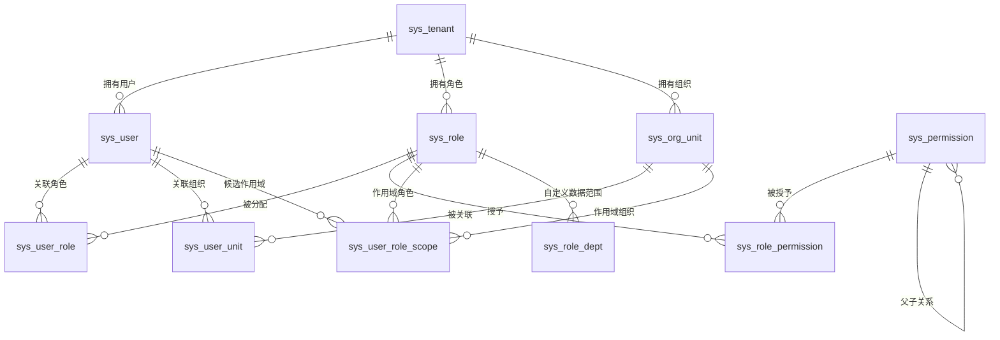

# 系统架构

> 本文维护当前系统边界、模块职责、依赖、身份信任链与扩展不变量。操作步骤归 [Wiki](wiki/index.md)，接口细节归 [API 契约](api-contract.md)，部署参数归 [Docker 部署](docker-deployment.md)。源码配置是当前实现依据，本文不代表整套系统已通过业务验收。

---

## 目录

- [1. 系统定位](#1-系统定位)
- [2. 技术基线](#2-技术基线)
- [3. 系统边界](#3-系统边界)
- [4. 模块地图](#4-模块地图)
- [5. 依赖关系图](#5-依赖关系图)
- [6. 局部架构设计](#6-局部架构设计)
- [7. 数据流](#7-数据流)
- [8. 外部依赖](#8-外部依赖)
- [9. 基础设施](#9-基础设施)
- [10. Docker 部署架构](#10-docker-部署架构)
- [11. RBAC 权限体系](#11-rbac-权限体系)
- [12. 关键约束](#12-关键约束)
- [13. 扩展点](#13-扩展点)
- [14. 开发接入与验证入口](#14-开发接入与验证入口)

---

## 1. 系统定位

Omni-Stack 是基于 Spring Cloud 与 Vue 3 的微服务脚手架平台，提供公共库、独立业务服务与按模块生成项目的能力。

- Architecture → Patterns → Code：架构维护边界，模式维护实现约定，Wiki 维护操作与恢复。
- Common 共10个模块：纯数据与 SPI 的 core，加9个集成库。其中8个声明自定义 `AutoConfiguration.imports`；响应式 Redis 模块只封装依赖与 YAML 默认值。
- 受保护业务请求由 Gateway 验证登录 JWT，下游以预认证身份执行各自授权；浏览器授权会话与内部服务令牌是独立边界。
- Transactional Outbox 将业务更新和待发送记录放入同一本地事务；中继与消费仍可能失败，提交不等于送达。

---

## 2. 技术基线

版本与构建事实由 [父 POM](../omni-backend/pom.xml)、模块 POM、前端锁文件和正式 Compose 管理；设计决策见 [ADR](adr/0001-scaffold-upgrade-foundations.md)。

### 2.1 Spring Boot 与 JDK

当前父 POM 使用 Spring Boot 4.0.6、JDK 25、Spring Cloud 2025.1.1、Spring Cloud Alibaba 2025.1.0.0；代码使用 `jakarta.*`。Maven Wrapper 在本机 Docker 中执行，编译 release=25。虚拟线程、AOT、Native Image 的收益须另行验证。

### 2.2 Gateway

Gateway 使用 WebFlux、响应式 Redis 和 `spring.cloud.gateway.server.webflux`。显式 `lb://` 路由经 Nacos 发现实例并保留完整路径；直接公共库依赖只有 `omni-common-redis-reactive`，没有 core、Servlet Web 或阻塞 Redis 公共库。

### 2.3 Nacos

正式 Compose 使用 Nacos v3.1.1 和 MySQL `nacos_config`；发现与配置客户端使用一致的私有认证参数。服务地址、健康检查和端口由正式 Compose 管理。

### 2.4 Workflow

Flowable 8.0.0 由 `omni-common-workflow` 封装，仅在独立 `omni-workflow` 运行。其他业务域经接口请求审批，不引入引擎运行时。发布锁、模型校验、候选与会签由 [Workflow 事实](workflow.md)维护。

### 2.5 Scheduling 与消息中继

XXL-JOB 3.3.1 的 Admin 与执行器分离；`omni-common-job` 是库。执行器 Bean 的启用条件包含 classpath 和 `xxl.job.executor.enabled`；注册有重试，耗尽后记录失败，不等于应用整体启动失败。任务与 Outbox 的注册、补偿规则见 [调度事实](scheduling.md)和 [MQ 可靠性](mq-reliability.md)。

---

## 3. 系统边界

| 边界 | 前端 | 后端 |
|---|---|---|
| 职责 | 展示、交互、路由、表单 UX 与用户状态 | 业务规则、权威验证、授权、持久化、一致性与审计 |
| 验证 | 提前提示必填与格式错误 | 校验实际输入、身份、租户、权限、版本与业务状态 |
| 约束 | 本地计算、按钮显隐和路由访问不能决定服务端数据正确性或授权 | 新代码遵守 [后端模式](backend-patterns.md)，不依赖客户端已完成验证 |

前端事实由 [前端模式](frontend-patterns.md)维护。表单通过、菜单可见、JWT 客户端解码与服务端业务验收是不同证据。

---

## 4. 模块地图

### 4.1 Common 生态（10 个公共模块）

| 模块 | 当前职责与边界 |
|---|---|
| `omni-common-core` | `R<T>`、PageResult、BaseEntity、异常与 XSS/任务/MQ/内部调用 SPI；生产依赖无 Spring，测试仍依赖 Spring Boot test |
| `omni-common` | Jackson、MVC、异常、XSS、Feign 重试、trace 与可选观测配置；optional 能力须由消费服务提供依赖与启用条件 |
| `omni-common-mybatis` | MyBatis-Plus 3.5.16、MySQL、默认分页；服务可提供自己的拦截器链 |
| `omni-common-redis` | Servlet 阻塞 Redis、序列化与 RedisUtils |
| `omni-common-redis-reactive` | WebFlux 响应式 Redis 依赖与 timeout 默认 YAML；无自定义自动配置入口 |
| `omni-common-job` | XXL-JOB 执行器、Admin 客户端与系统任务元数据；不包含领域任务逻辑 |
| `omni-common-mqlog` | Outbox、中继、发送策略与管理查询；可选依赖不自动成为消费服务全部能力 |
| `omni-common-operlog` | @OperLog 切面与可靠/直接发送；Auth 的安全审计由 sys_audit_log 管理，不引入此库 |
| `omni-common-workflow` | Flowable 自动配置与审批 SPI，仅供 Workflow 引擎服务 |
| `omni-common-service` | Servlet 身份、内部 API、TenantLine/DataScope、Auth 设置客户端与 XSS 配置回源；当前 CRM/SRM/Procurement/Asset 使用，Auth/Base/Workflow 保留自身配置 |

### 4.2 微服务模块（8 个）

端口列为默认宿主业务端口，Spring Boot 容器内部为 `8080`。

| 服务 | 端口 | 拥有的业务与事实入口 |
|---|---|---|
| `omni-auth` | 8100 | 租户用户、RBAC、安全审计、登录与授权服务器、社交登录、XSS 设置；[核心流程](core-flows.md) |
| `omni-base` | 8101 | 字典、操作日志、任务与 MQ 管理；[调度](scheduling.md)、[MQ](mq-reliability.md) |
| `omni-gateway` | 8102 | 显式路由、登录 JWT、身份头处理、安全响应头；[API 契约](api-contract.md) |
| `omni-workflow` | 8103 | 模型、实例、审批、候选与待办；[Workflow](workflow.md) |
| `omni-crm` | 8104 | 线索、客户、联系人、商机、活动与转换；[CRM](crm.md) |
| `omni-srm` | 8105 | 供应商、评估、风险、门户 Saga 与报价协作；[SRM](srm.md)、[设计](design/srm-design.md) |
| `omni-procurement` | 8106 | 物料、请购、RFQ、采购订单与收货；[采购设计](design/procurement-design.md) |
| `omni-asset` | 8107 | 资产入账、分配/退还、调拨、处置与历史；[资产设计](design/asset-design.md) |

`omni-db-migrator` 是另一个可执行模块，负责一次性建库、Liquibase、种子与第三方组件引导；它不是第九个常驻业务微服务。父 reactor 含19个子模块，连父项目共20个 Maven 项目。

### 4.3 前端模块

`omni-frontend` 是 Vue 3、Pinia 3、Vue Router 5、Element Plus、Axios 与 Vite 8 的 SPA；开发及 Nginx 静态服务默认均为 `3000`。四语言资源与会话/菜单职责见 [前端模式](frontend-patterns.md)。

---

## 5. 依赖关系图

下表是当前 POM 的直接 `com.omni` 依赖摘要，不表示启动顺序或全部第三方依赖；optional 项明确标注。

| 消费模块 | 直接公共库依赖 |
|---|---|
| common-core、common-job、common-redis-reactive、db-migrator | 无其他 com.omni 依赖 |
| common、common-mybatis、common-redis、common-operlog、common-workflow | common-core |
| common-mqlog | common-core；common-job（optional） |
| common-service | common-core、common、common-mybatis、common-redis |
| auth | common-core、common、common-mybatis、common-redis、common-job、common-mqlog |
| base | auth 行的公共库 + common-operlog |
| workflow | base 行的公共库 + common-workflow |
| crm、srm、procurement、asset | base 行的公共库 + common-service |
| gateway | common-redis-reactive |

表内模块名省略 `omni-` 前缀。core 不依赖其他公共库，并不意味着所有公共库或 Gateway 都依赖 core。Maven reactor 按实际依赖排序；不能把 `<modules>` 的文本顺序当作唯一依赖关系。

### 局部与整体关系

[catalog](../scaffold/catalog/modules.yaml) 另行管理生成项目的模块闭包，例如 `asset → procurement,srm`、`procurement → srm`、`srm → workflow`、`workflow/crm/gateway → base`、`base → auth → platform`。这表示生成资源选择的依赖，不等于 Maven 直接依赖或所有实际服务调用。

业务调用方面，Auth 提供身份/权限与配置；SRM 经 Portal Saga 协调 Auth 角色；采购经 Workflow 审批、SRM 协作报价，并发布收货事件；资产消费已接入的收货事件并经 Workflow 审批。同步接口、Outbox 事件与历史补偿各守自己的事务和幂等边界，不构成跨库原子事务。

---

## 6. 局部架构设计

### 6.1 omni-auth 安全过滤器链（Security Filter Chain）

[AuthorizationServerConfig](../omni-backend/omni-auth/src/main/java/com/omni/auth/config/AuthorizationServerConfig.java) 显式定义两条链：

| 链 | 匹配与状态 |
|---|---|
| Order 1 | oauth2EndpointsMatcher() 中的授权、Token、JWKS、OIDC、设备等协议端点；HttpSessionSecurityContextRepository 保存浏览器授权上下文，未认证授权/设备验证入口重定向前端 |
| Order 2 | 协议端点补集；普通业务为 STATELESS，预认证建立身份；/internal/** 经 InternalApiFilter 和 INTERNAL_SERVICE |

DeviceClientAuthenticationFilter 与 SasConsentOriginFilter 分别处理公有设备客户端和同意提交 Origin。业务链公开登录、session-login、注册、验证码、租户列表、社交回调等具名路径；管理端口的 health/info/prometheus 放行，其他 actuator 要求 ADMIN。完整路径和协议例外以配置及 [API 契约](api-contract.md)为准。

JWT 登录、浏览器授权 HttpSession、外部社交登录和内部服务令牌分别验证。Redis 的验证码、黑名单和在线状态不能证明授权 HttpSession 已在 Redis 持久化。

### 6.2 omni-gateway WebFlux 管道

[CorsConfig](../omni-backend/omni-gateway/src/main/java/com/omni/gateway/config/CorsConfig.java) 与 [SecurityHeadersFilter](../omni-backend/omni-gateway/src/main/java/com/omni/gateway/config/SecurityHeadersFilter.java) 是 WebFilter；[AuthFilter](../omni-backend/omni-gateway/src/main/java/com/omni/gateway/filter/AuthFilter.java) 是路由过滤链的 GlobalFilter，order=-100。两个过滤体系不能按一个编号顺序混排。

- 公开路径清除客户端可信身份头及 Bearer Authorization，保留 OAuth 客户端 Basic 凭据并设置转发标记；公开名单不创建路由或授予下游权限。
- 受保护路径提取 Bearer，验证签名、有效期与有效用户/租户声明，查询响应式 Redis 黑名单；成功后替换身份头、移除原 Token 并签发断言。
- 正式受保护请求缺少或使用弱签名密钥时返回503；安全异常返回401，其他下游错误不统一改写为 JWT 错误。测试 profile 的特例不构成生产策略。
- WebFilter 在响应提交前设置安全头和 trace；无真实 span 时的响应关联 ID 不证明完整分布式追踪。

[JwkKeyProvider](../omni-backend/omni-gateway/src/main/java/com/omni/gateway/config/JwkKeyProvider.java) 当前自行创建 WebClient；端点由 auth.jwks.uri 配置，Compose 为 `http://omni-auth:8080/oauth2/jwks`，TTL 默认5m。它缓存第一个 RSA key，volatile 仅保证可见性，没有按 kid 选键或合并并发刷新；不能据此保证密钥轮转。这里只描述当前构造方式，不推断所有 WebFlux 应用都不能注入 Builder。

### 6.3 Servlet 业务服务安全模型

受保护业务身份经下游预认证建立 Authentication，角色加 ROLE_，权限来自对应 authority；方法授权使用该认证对象，并不在每个方法重新验证原 JWT。公开、管理与内部协议路径分别匹配，不能声称所有 HTTP 都必须携带同一断言。

当前 `X-Gateway-Assertion` 对 `userId|tenantId|username|issuedAt` 做 HmacSHA256，验证签名、正整数身份与±300秒窗口，并比对明文身份头。它不签 roles/scopes、方法、路径或请求体，也没有一次性 nonce；角色与权限头仍依赖 Gateway 清理、注入及可信服务网络。`X-Gateway-Forwarded` 标记本身不构成身份凭证。

请求级断言缺失/不合法可401，部分直接访问检查为403；common-service 在启用内部 API、DataScope、XSS 等能力时还校验私有内部令牌和路径配置，非法配置导致启动失败。启动配置失败、请求拒绝、Gateway 未就绪503不可合并为一种状态。

业务服务仍须提供领域表映射、端点权限、AccessGuard/所有权、显式租户参数和事务约束；并非每条 SQL 都由同一个拦截器覆盖。实现约束见 [核心流程](core-flows.md)、[后端模式](backend-patterns.md)与各领域事实。

---

## 7. 数据流

### 7.1 用户登录请求流

```text
Browser -> Frontend -> Gateway(public route) -> Auth
Auth -> CAPTCHA / tenant-user authentication -> JWT
Frontend -> Gateway(protected route) -> preauthentication -> business service
```

验证码消费、租户内用户验证、默认角色、Token 撤销与协议差异归 [核心流程](core-flows.md)和 [API 契约](api-contract.md)；操作与恢复归[认证指南](guides/authentication.md)。该概览不是方法调用清单或新的登录验收记录。

### 7.2 MQ 消息可靠投递流

```text
business transaction -> sys_mq_message(PENDING)
mqRelayHandler -> MqMessageRelayService -> MessageSender -> Broker
```

`ReliableMessageRelay.send(bindingName, payload, tenantId)` 显式传入 tenantId，与业务写入共同本地提交；中继跨租户扫描。管理查询仍按 tenantId 过滤。已接入的领域消费者分别验证租户、维护 Inbox/幂等与本地事务；不能假定所有消费者都共享同一实现。

发送状态、退避、重发和消费幂等由 [MQ 可靠性](mq-reliability.md)维护，源码讲解归 [Outbox 开发](wiki/outbox-development.md)。Broker 接收、业务消费完成和本地 Outbox 提交是不同阶段。

---

## 8. 外部依赖

下表区分正式 Compose 的默认宿主映射与容器端口；没有列出端口不代表组件没有其他内部端口。

| 组件 | 版本 | 默认宿主 → 容器 |
|---|---|---|
| MySQL | 8.4 | 3306 → 3306 |
| Redis | 7.4 | 6379 → 6379 |
| Nacos | v3.1.1 | 8080 → 8080；8848 → 8848；9848 → 9848 |
| RocketMQ NameServer | 5.3.2 | 19876 → 9876 |
| RocketMQ Broker | 5.3.2 | 10909、10911、10912 → 同号端口 |
| XXL-JOB Admin | 3.3.1 | 18080 → 8080 |
| Sentinel Dashboard（单独可选） | 1.8.8 | 8858；不在正式基础 Compose 内 |

MySQL、Redis、Nacos、RocketMQ、XXL-JOB 默认宿主绑定127.0.0.1；Gateway/Frontend 的映射另见 Compose。Redis 拥有验证码、黑名单、在线状态与缓存；Nacos 拥有发现与配置，MySQL 分库存储。可选观测组件及 Alertmanager 界面边界由 [观测事实](observability.md)维护。版本/端口是配置事实，不代表当前容器或外部服务已通过验证。

---

## 9. 基础设施

### 9.1 Docker Compose 编排

[compose.yaml](../compose.yaml) include 基础设施、应用与观测定义，标准项目名 omni-stack；常驻服务按 core/workflow/crm/supply-chain/full 组合，MQ/Job 基础设施还存在独立 profile。预设闭包归 catalog，不能只按 profile 名猜测全部运行能力。

MySQL 健康后运行一次性 Migrator，成功退出后 Nacos、XXL-JOB 和应用才满足相应迁移门。应用依赖并非单一线性链：Gateway 等待 Auth/Redis；领域服务分别等待 Auth、Workflow 及上游领域；Frontend 当前没有 depends_on。Auth/Base/Workflow 未统一声明 Nacos/XXL-JOB 健康等待，客户端注册与就绪须独立确认。

持久化卷键为 `omni-mysql-data`、`omni-redis-data`、`omni-rocketmq-data`，实际卷名受项目与配置管理。容器启动、健康检查、迁移成功、任务注册和业务可用分别验证；本轮文档复核没有重新启动应用或执行迁移。

### 9.2 数据库 Schema

[MigrationTargetCatalog](../omni-backend/omni-db-migrator/src/main/java/com/omni/dbmigrator/migration/MigrationTargetCatalog.java) 管理当前九个目标；每个入口位于 `database/changelog/<id>/db.changelog-<id>.yaml`。本表记录职责，不复制完整表数、列或索引清单。

| id | 数据库 | 拥有的事实 |
|---|---|---|
| auth | omni_auth | 用户、租户、RBAC、授权、安全审计、门户角色与配置 |
| base | omni_base | 字典、任务与操作日志等基础业务 |
| workflow | omni_workflow | 流程业务表及 vendor Flowable 迁移 |
| crm | omni_crm | CRM 聚合与转换/活动历史 |
| srm | omni_srm | 供应商、门户、评估风险与报价协作 |
| procurement | omni_procurement | 请购、RFQ、采购订单、收货与 Inbox |
| asset | omni_asset | 资产、历史、调拨、处置与 Inbox |
| nacos | nacos_config | Nacos vendor 结构与引导 |
| xxl-job | xxl_job | XXL-JOB vendor 结构与引导 |

七个业务库分别包含自身 Outbox；DDL 唯一公共入口为 [0001-mq-schema.yaml](../database/changelog/common/0001-mq-schema.yaml)，由各业务 changelog 引用。Workflow 正式 Compose 禁止 Flowable 自动更新 schema，使用 vendor 迁移链。

结构、索引、约束与前向升级归 `database/changelog/`；幂等数据归 `scripts/sql/seed/`，由 `database/seed/manifest.yaml` 摘要与自然键断言约束。完整领域结构见各事实/设计源与迁移，不以架构摘录或历史手工 SQL 作为第二权威版本。

---

## 10. Docker 部署架构

### 10.1 容器网络拓扑

容器通过 Compose 的 `<project>_default` bridge、服务名和内部端口通信。通常业务入口为 Frontend → Gateway → Servlet 服务；内部调用、管理端口和组件协议不都经过 Gateway。Common 模块是库，不是独立容器。

业务宿主端口为8100–8107，应用容器为8080，Frontend 为3000。默认 Servlet 业务宿主映射仅监听127.0.0.1；完整暴露与持久化由 [Docker 部署](docker-deployment.md)维护，不能用一条身份断言代替网络边界。

### 10.2 服务发现机制

Gateway 设置 discovery.locator.enabled=false，只使用显式路由。Nacos 注册容器地址/内部端口，`lb://` 解析实例；Compose 的 SPRING_CLOUD_NACOS_DISCOVERY_IP 为空时由客户端检测。公开路径、路由存在、注册成功和下游就绪各不相同。

### 10.3 环境变量覆盖策略

Compose 传入容器地址和私有配置，覆盖 application.yml 中对应属性。Auth/Base/Workflow 与领域服务采用的变量命名不完全相同，须按实际文件确认映射。AUTH_JWKS_URI、GATEWAY_ASSERTION_SECRET、数据库/Redis/Nacos 认证及可选 Job/MQ 开关见[部署说明](docker-deployment.md)。初始化操作归[快速开始](guides/quick-start.md)。

---

## 11. RBAC 权限体系

### 11.1 设计理念

Auth 拥有用户—角色—权限和组织关联。功能授权回答可执行的操作，数据范围约束可访问的行；租户隔离仍是独立条件。用户名按租户唯一，权限使用完整 resource:action 编码，不把角色名当通配权限。

以下为概念关联，未表达全部表、列或现行 DDL 外键：



`sys_user_role_scope.scope_mode` 的 SAME_UNIT/UNIT_AND_BELOW 用于角色分配作用域和工作流候选解析，不能与 dataScope 六值混为一个枚举。

### 11.2 功能权限架构

`GET /api/auth/menus` 从 Authentication authorities 取非 ROLE_ 权限。MenuController 先递归筛选 DIRECTORY/MENU 类型；权限阶段对 DIRECTORY 递归过滤子节点，对 MENU 检查自身权限码并保留已有 children，不再递归做子节点权限检查；无权限集合返回空菜单。BUTTON/API 不成为动态菜单节点。

MenuNode.path 是权限树层级路径，不是页面 URL；前端由 permissionCode 生成路径，例如 `system:user → /admin/system/user`。v-permission 使用 display:none，不移除 DOM。方法 @PreAuthorize 使用预认证 authorities；个人任务等行所有权接口按其专用校验，不可机械添加同一端点注解。菜单和按钮显隐不能替代后台授权。

### 11.3 数据权限架构

| dataScope | 当前范围层含义 | 优先级 |
|---|---|---|
| ALL | 不加范围层行条件；是否跨租户由接口/租户策略另行决定 | 1 |
| TENANT | 本租户范围内不再按组织/本人缩小，仍需租户约束 | 2 |
| DEPT_AND_BELOW | 当前主组织与启用后代 | 3 |
| DEPT | 当前主组织 | 4 |
| CUSTOM | 参与 CUSTOM 角色配置的组织树集合 | 5 |
| SELF | 本人 | 6 |

Auth 普通请求的 DataScopeResolveFilter 调用不带 permissionCode 的解析，校验启用用户属于租户并合并相关角色；/internal/ 不建立该普通上下文。permission-aware 内部接口只合并授予目标权限的角色，无授予时403；空/非法参数与上游不可用分别处理。两种入口不能画成同一条无条件角色合并。

Auth 的 MyBatis 链为 DataPermission → OptimisticLock → Pagination，没有通用 TenantLine；租户条件由对应 Mapper/Service 负责，应以具体语句和校验为准。其局部处理器只映射 sys_user/sys_org_unit/sys_role，ALL/TENANT 或无上下文时不追加行条件；用户 SELF 按 id，组织按当前/可见组织，角色 SELF 返回不匹配条件。

当前 common-service 业务链可按启用配置注册 TenantLine → DataPermission → OptimisticLock → Pagination；租户策略分别只拦 crm_/srm_/proc_/ast_，不拦 sys_mq_message。请求身份与方法数据范围分别建立并在 finally 清理。聚合根/子表、SELF 列、组织映射与写入 AccessGuard 由领域负责，不是通用“所有 SQL 零侵入”。

在线用户由 OnlineUserServiceImpl 校验范围，ALL 可跨租户，其他范围先校验租户；这是该接口事实，不能推出领域 SQL 也跨租户。详细请求边界见 [核心流程](core-flows.md)。

### 11.4 RBAC 管理流程

角色、权限树、用户角色/组织关联由 Auth 维护；新增写端点、权限种子、前端操作和领域范围必须对应。操作、截图与拒绝分支统一归[权限指南](guides/permissions.md)，架构不复制第二套操作教程。

---

## 12. 关键约束

1. 项目构建目标 JDK 25，使用 Docker 中的 Maven Wrapper，并设置 JAVA_HOME；从父 reactor 执行当前依赖构建。
2. Gateway 使用 `spring.cloud.gateway.server.webflux` 和响应式依赖；不得引入 Servlet/阻塞 Redis 公共库。
3. 阻塞/响应式 Redis 不在同一服务混用；公共库依赖、自动配置入口、启用属性与所需实现分别核对。
4. 业务同步调用采用 OpenFeign/内部令牌；Gateway JWKS、OAuth 提供商和 XXL-JOB Admin 客户端是各自协议边界。
5. 启用 Job/MQ 后分别确认 Admin、执行器组、handler、Broker 与绑定就绪；容器健康不证明中继或任务已经成功。
6. 业务输入、权限、租户、DataScope、版本和事务仍由服务校验；不能依赖前端或仅凭注解存在。
7. 常规业务 Controller 返回 `R<T>`，协议端点、重定向与观测等例外见 [API 契约](api-contract.md)；共享类型、日期/金额约定不重复定义。
8. 配置、源码、单测、集成测试、真实浏览器与真实业务结果分别记证据；不以图表、摘要或静态配置冒称完整验收。

---

## 13. 扩展点

### 13.1 新增 OAuth2 社交登录提供商

OAuth2ProviderHandler 策略由 SocialLoginServiceImpl 的 Map 发现，配置、处理器与用户名前缀保持一致。当前 GitHub/Google/Gitee 的新用户仍受租户唯一性与默认角色规则约束；实现入口不证明三家外部正向授权已验收。协议事实见 [核心流程](core-flows.md)，操作归[认证指南](guides/authentication.md)。

### 13.2 新增 XSS 防护到新服务

新 Servlet 服务提供 XssConfigProvider SPI；common-service 的启用配置可提供缓存和 Auth 设置回源实现，已有服务也可能自定义。omni-common 注册防护，实际 Bean/classpath/开关决定激活。按租户隔离 `xss:enabled:{tenantId}` 与 `xss:rules:{tenantId}`，配置写入失效缓存。顺序与生命周期归[后端模式](backend-patterns.md)，不能仅凭依赖声明认定全部请求已防护。

### 13.3 新增用户任务类型

UserJobHandlerRegistry 用 Map 发现实现，@Component Bean 名必须等于 sys_user_job_type.type_code；用户任务共用 userJobExecuteHandler，系统任务同时声明 @XxlJob 与 @SystemJobMeta。调度事实拥有注册补偿，扩展操作归[调度指南](guides/scheduling.md)。

---

## 14. 开发接入与验证入口

[脚手架开发指南](guides/scaffold-development.md)拥有服务、CRUD、模块与预设接入步骤。当前 CLI 的 create-service 默认预览，--apply 才写生成包；service validate 校验锁文件与内容摘要；service integrate 默认只读渲染，--apply 才执行跨文件事务。包验证不是业务运行或全套编译验收。

接入计划涉及 Maven、Gateway、Compose、catalog、迁移目标/种子、菜单/图标、文档与复核队列。当前 [service-integration.ts](../tools/omni-cli/src/service-integration.ts) 与渲染器均覆盖 zh-CN、en-US、ja-JP、ko-KR 前端 locale；目标存在 .git 时，四个 locale 文件均纳入写前脏文件检查。新文档/译文仍为 present-unverified，实际语义复核通过后可按所有者授权记录 AI_REVIEW，无需人工复核。四语注册与文件保护不等于业务术语翻译、页面或业务验收。

实现入口：[preset-generator.ts](../tools/omni-cli/src/preset-generator.ts)、[CLI](../tools/omni-cli/src/cli.ts)。回归入口：[service-integration.test.ts](../tools/omni-cli/test/service-integration.test.ts)、[preset-generator.test.ts](../tools/omni-cli/test/preset-generator.test.ts)。构建、测试、应用和浏览器验证依照 [AGENTS.md](../AGENTS.md) 在本机 Docker 执行；源码不变的成功构建可凭确切等价证据复用，生成产物仍须匹配其实际范围验证。

---
