# Core Flows

> This reference maintains request/event call chains and state, transaction, authorization, idempotency and failure invariants. Procedures and screenshots belong to the [Wiki](wiki/index.en.md) and domain guides; see [source debugging](wiki/source-debugging.en.md) for breakpoints.
> For an architecture overview, see [architecture.en.md](architecture.en.md). For Docker deployment configuration, see [docker-deployment.en.md](docker-deployment.en.md). For API contracts, see [api-contract.en.md](api-contract.en.md).

## Flow 1: User Login (Username + Password + Captcha + JWT)

### Overview

`POST /api/auth/login` accepts username, password, required `tenantId`, and captcha through Gateway to Auth. This JWT login path calls `UserService.findByUsername()/verifyPassword()` directly and returns `R<LoginResult>` on success. Parsing `tenantId:username` belongs to the separate session authentication path.

### Sequence

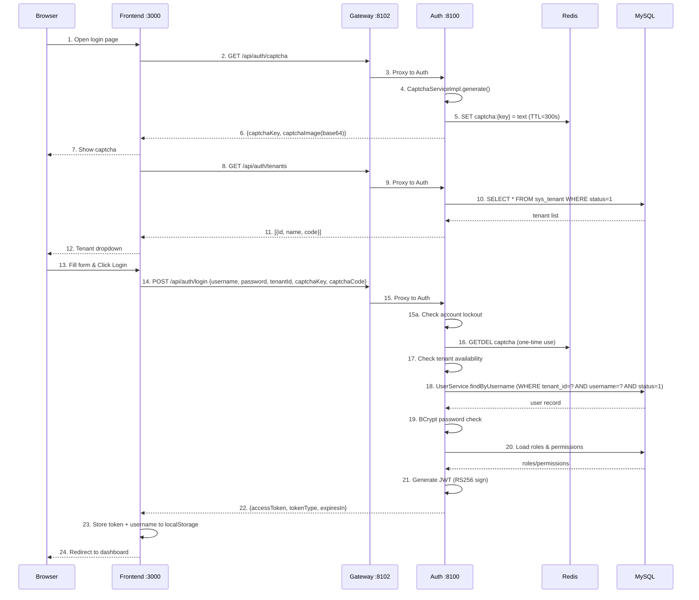

### Post-Login: Authenticated Request Flow

Protected requests carry `Authorization: Bearer <JWT>`. `AuthFilter` obtains the public key, verifies the signature and `exp`, and checks the Redis blacklist by `jti`. It then removes client identity headers and the forwarded Bearer header, and injects authenticated identity plus `X-Gateway-Assertion`. List-valued JWT `roles/scope` are converted to comma-separated identity headers by this filter.

Signature, expiry, or blacklist security rejection returns 401. Public-key, Redis, or downstream dependency failures are not all relabeled as JWT errors. In normal operation, a missing assertion secret, a secret shorter than 32 bytes, or assertion generation failure returns 503 and stops forwarding. Downstream services verify assertions under their own pre-authentication rules; the current payload binds user ID, tenant ID, username, and issue time.

```
Browser -> Frontend: request a protected resource
Frontend -> Gateway :8102: Authorization: Bearer <JWT>
Gateway: JwkKeyProvider obtains the RSA public key (default cache: 5 minutes)
Gateway: verify RS256 signature and exp
Gateway -> Redis: look up token:blacklist:{jti} by jti
Gateway: strip client identity headers and the forwarded Bearer header
Gateway -> Downstream: X-User-Id / X-Tenant-Id / X-User-Name
Gateway -> Downstream: X-User-Roles: <role-code>
Gateway -> Downstream: X-User-Scopes: <permission-code>
Gateway -> Downstream: X-Gateway-Assertion
Downstream: verify the Gateway assertion under its own pre-authentication rules
Downstream -> Gateway -> Frontend -> Browser: response
```

### Key Components

| Component | Source | Responsibility |
|---|---|---|
| `LoginForm.vue` | [omni-frontend/src/components/LoginForm.vue](../omni-frontend/src/components/LoginForm.vue) | Login form: captcha, tenant and credential submission |
| `user.ts` | [omni-frontend/src/stores/user.ts](../omni-frontend/src/stores/user.ts) | Persist token and username in localStorage |
| `request.ts` | [omni-frontend/src/api/request.ts](../omni-frontend/src/api/request.ts) | Request interceptor adds the Bearer token |
| `vite.config.ts` | [omni-frontend/vite.config.ts](../omni-frontend/vite.config.ts) | `/api` proxy target, default Gateway :8102 |
| `AuthController.java` | [omni-backend/omni-auth/src/main/java/com/omni/auth/controller/AuthController.java](../omni-backend/omni-auth/src/main/java/com/omni/auth/controller/AuthController.java) | Lockout, captcha, tenant availability, account/password, JWT, online record and security audit |
| `UserServiceImpl.java` | [omni-backend/omni-auth/src/main/java/com/omni/auth/service/impl/UserServiceImpl.java](../omni-backend/omni-auth/src/main/java/com/omni/auth/service/impl/UserServiceImpl.java) | Find a user by username/tenant and verify BCrypt password |
| `SysUserMapper.java` | [omni-backend/omni-auth/src/main/java/com/omni/auth/mapper/SysUserMapper.java](../omni-backend/omni-auth/src/main/java/com/omni/auth/mapper/SysUserMapper.java) | Account query constrains `tenant_id + username + status=1` |
| `OmniUserDetailsService.java` | [omni-backend/omni-auth/src/main/java/com/omni/auth/security/OmniUserDetailsService.java](../omni-backend/omni-auth/src/main/java/com/omni/auth/security/OmniUserDetailsService.java) | Spring Security/session authentication parses `tenantId:username`; not the ordinary JWT login query entry |
| `CaptchaServiceImpl.java` | [omni-backend/omni-auth/src/main/java/com/omni/auth/service/impl/CaptchaServiceImpl.java](../omni-backend/omni-auth/src/main/java/com/omni/auth/service/impl/CaptchaServiceImpl.java) | Generate image, store with configured TTL and validate via atomic GETDEL |
| `JwtTokenServiceImpl.java` | [omni-backend/omni-auth/src/main/java/com/omni/auth/service/impl/JwtTokenServiceImpl.java](../omni-backend/omni-auth/src/main/java/com/omni/auth/service/impl/JwtTokenServiceImpl.java) | Issue RS256 JWT with database roles and permissions |
| `AuthFilter.java` | [omni-backend/omni-gateway/src/main/java/com/omni/gateway/filter/AuthFilter.java](../omni-backend/omni-gateway/src/main/java/com/omni/gateway/filter/AuthFilter.java) | JWT expiry/signature/blacklist, identity stripping and Gateway assertion |
| `JwkKeyProvider.java` | [omni-backend/omni-gateway/src/main/java/com/omni/gateway/config/JwkKeyProvider.java](../omni-backend/omni-gateway/src/main/java/com/omni/gateway/config/JwkKeyProvider.java) | Fetch Auth `/oauth2/jwks` public key; default 5-minute cache |

### JWT Token Structure

This decoded password-login JWT example uses placeholders and is not a usable token. Values in `scope` are permission codes; the example grants no role any permission.

```json
{
  "header": {
    "alg": "RS256",
    "kid": "<key-id-from-jwk>"
  },
  "payload": {
    "sub": "1",
    "tenant_id": 1,
    "username": "admin",
    "roles": [
      "<role-code>"
    ],
    "scope": [
      "<permission-code>"
    ],
    "jti": "<token-id>",
    "iat": 1748000000,
    "exp": 1748000900
  }
}
```

| Claim | Current meaning |
|---|---|
| `sub` | User ID string |
| `tenant_id` | Numeric tenant ID |
| `username` | Username string |
| `roles` | Array of database role codes |
| `scope` | Array of database permission codes; not a space-delimited string |
| `jti` | Unique token ID for `token:blacklist:{jti}` |
| `iat` | Issue time in Unix seconds |
| `exp` | Expiry; default `iat + 900`, configured by `auth.token.access-token-ttl` |

### Multi-Tenant Login Mechanism

The public login DTO validates `tenantId` with `@NotNull`. Ordinary JWT login uses it to find an enabled user in that tenant. `POST /api/auth/session-login` constructs `tenantId:username`, authenticates through `AuthenticationManager` and `OmniUserDetailsService`, and creates and rotates HttpSession.

The default tenant 1 for an unprefixed username in `OmniUserDetailsService` is internal compatibility behavior. It does not permit omitting `tenantId` in a public login request. Check session authentication and access-token issuance separately for state, failure, and subsequent authorization use.

### Captcha Lifecycle

Captcha TTL defaults to 300 seconds via `auth.captcha.ttl-seconds`. Once `validate()` runs, atomic GETDEL consumes the value whether or not the case-insensitive comparison matches. Lockout is checked before captcha validation, so a rejected request does not always mean the captcha was consumed.

1. Generate: SpecCaptcha -> Base64 image
2. Store: captcha:{uuid}, expires under configured TTL
3. Validate: Redis GETDEL; absent -> code 400, message “验证码已过期”
4. Mismatch -> code 400, message “验证码错误”; retry requires a new captcha

### Current Status

`/api/auth/login` returns accessToken, Bearer type, and expiresIn, without refreshToken. Access TTL defaults to 900 seconds and is configurable. `JwkKeyProvider` currently selects and caches the first RSA key in JWKS; this does not establish complete kid-based multi-key rotation.

This section describes current source calls and failure boundaries. See the [Wiki](wiki/index.en.md) for real captcha login operations, screenshots, and recovery, and Flow 2 for OAuth2 session and authorization-code behavior.

## Flow 2: OAuth2 Authorization Code + PKCE Login

### Overview

The enterprise SSO entry uses authorization code + PKCE. The default client is `omni-frontend`; `VITE_OAUTH2_CLIENT_ID` can override the frontend value but must match a registration. Authentication is `NONE`. A newly created default client requires PKCE, requests `openid profile`, and has `requireAuthorizationConsent=false`. The initializer does not reset other settings of an existing registration.

Initiation generates a 64-character verifier, a `BASE64URL(SHA256(verifier))` challenge, and random state. It saves the parameters and opens `Login?oauth2=true`. The form submits the required tenant and real captcha to `/api/auth/session-login`, which establishes and rotates HttpSession. The frontend then opens the saved authorization URL. A frontend JWT login does not replace this server session.

### Sequence

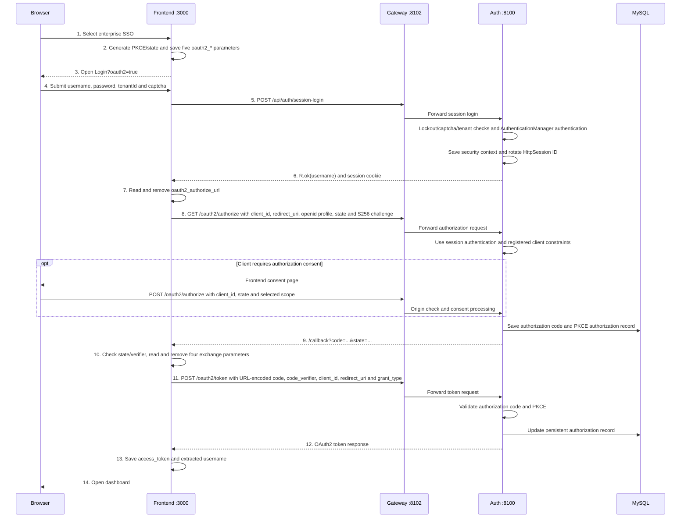

### Key Components

| Component | Source | Responsibility |
|---|---|---|
| `pkce.ts` | [omni-frontend/src/utils/pkce.ts](../omni-frontend/src/utils/pkce.ts) | Web Crypto generates a 64-character verifier, S256 challenge and state |
| `LoginForm.vue` | [omni-frontend/src/components/LoginForm.vue](../omni-frontend/src/components/LoginForm.vue) | Save five parameters; open the authorization URL after captcha-backed session login |
| `auth.ts` | [omni-frontend/src/api/auth.ts](../omni-frontend/src/api/auth.ts) | Build URL with openid profile/state/PKCE; exchange tokens using form encoding |
| `callback/index.vue` | [omni-frontend/src/views/callback/index.vue](../omni-frontend/src/views/callback/index.vue) | Check state/verifier; clear four parameters before exchange; save only access token and username |
| `user.ts` | [omni-frontend/src/stores/user.ts](../omni-frontend/src/stores/user.ts) | Persist token and username, without storing id_token/refresh_token |
| `OAuth2ClientInitializer.java` | [omni-backend/omni-auth/src/main/java/com/omni/auth/config/OAuth2ClientInitializer.java](../omni-backend/omni-auth/src/main/java/com/omni/auth/config/OAuth2ClientInitializer.java) | Create the default NONE + PKCE client; retain other existing registration settings |
| `AuthController.java` | [omni-backend/omni-auth/src/main/java/com/omni/auth/controller/AuthController.java](../omni-backend/omni-auth/src/main/java/com/omni/auth/controller/AuthController.java) | Check tenant/captcha/credentials; save and rotate HttpSession |
| `AuthorizationServerConfig.java` | [omni-backend/omni-auth/src/main/java/com/omni/auth/config/AuthorizationServerConfig.java](../omni-backend/omni-auth/src/main/java/com/omni/auth/config/AuthorizationServerConfig.java) | OAuth2 session security chain, JWK/JWT, custom claims and JDBC authorization/consent storage |
| `consent/index.vue` | [omni-frontend/src/views/consent/index.vue](../omni-frontend/src/views/consent/index.vue) | Submit client_id/state/selected scopes when needed, or deny by omitting scopes |
| `SasConsentOriginFilter.java` | [omni-backend/omni-auth/src/main/java/com/omni/auth/security/SasConsentOriginFilter.java](../omni-backend/omni-auth/src/main/java/com/omni/auth/security/SasConsentOriginFilter.java) | Compare supplied consent POST Origin scheme/host/port; return 403 on mismatch |

### PKCE Storage Keys

| sessionStorage Key | Purpose and Actual Removal |
|---|---|
| `oauth2_code_verifier` | 64-character verifier; removed before the token request after callback state/verifier checks |
| `oauth2_state` | Random state compared by the callback; removed with the verifier before exchange |
| `oauth2_client_id` | Saved client ID; read and removed before exchange |
| `oauth2_redirect_uri` | Current origin + /callback; read and removed before exchange |
| `oauth2_authorize_url` | Pending authorization URL; read and removed after successful session login |

### Failures and Boundaries

The callback returns to Login on an `error`, missing code, mismatched state, or missing verifier. Those early returns do not guarantee cleanup of saved parameters. Once the prerequisites pass, it removes all four exchange parameters before calling the token endpoint; a failed exchange does not leave a reusable verifier.

The token request is native `fetch('/oauth2/token')` with `application/x-www-form-urlencoded` and `credentials: 'include'`. Fields are `grant_type=authorization_code`, code, code_verifier, client_id and redirect_uri. It does not acquire Axios's `/api` prefix. The response uses the OAuth2 standard format rather than `R<T>`.

The default first-party client needs no additional consent page. Other clients follow their actual registration. For consent POSTs, `SasConsentOriginFilter` compares a supplied Origin with the forwarded scheme, host and port. This is not a universal CSRF-token check on every OAuth2 endpoint.

### Current Status

The default configuration supplies a JWK/JWT issuance path and `accessTokenCustomizer`; access tokens must not be described as universally opaque. Other clients remain governed by their `TokenSettings`. The SAS customizer writes a roles array and a space-joined business-permission `scope`. This differs from Flow1's permission array and from the authorization request's `openid profile` scopes.

The frontend response type declares id_token and refresh_token optional. The callback saves only access_token and the extracted username. Registering the `refresh_token` grant does not prove that every response includes one or that the frontend implements renewal. Access-token lifetime follows the registered client's TokenSettings, rather than inheriting Flow1's default.

These are the current source path and failure boundaries. See the [Wiki](wiki/index.en.md) for operations, expected results and recovery; source configuration does not replace end-to-end runtime evidence.

---

## Flow 3: OAuth2 Device Authorization Grant

### Overview

Device authorization supports devices without a browser or with limited input. A device obtains device_code/user_code, a user confirms in a browser, and the device polls the token endpoint. This repository supplies `/device` as a browser simulator and `/device/verify` as the user verification page.

The simulator currently sends `client_id=omni-device&scope=profile`. It builds `/device/verify?user_code=...` and its QR code from the current frontend origin, instead of directly using the SAS verification_uri. The user side needs authenticated HttpSession state; a frontend JWT does not replace the server session.

### Sequence

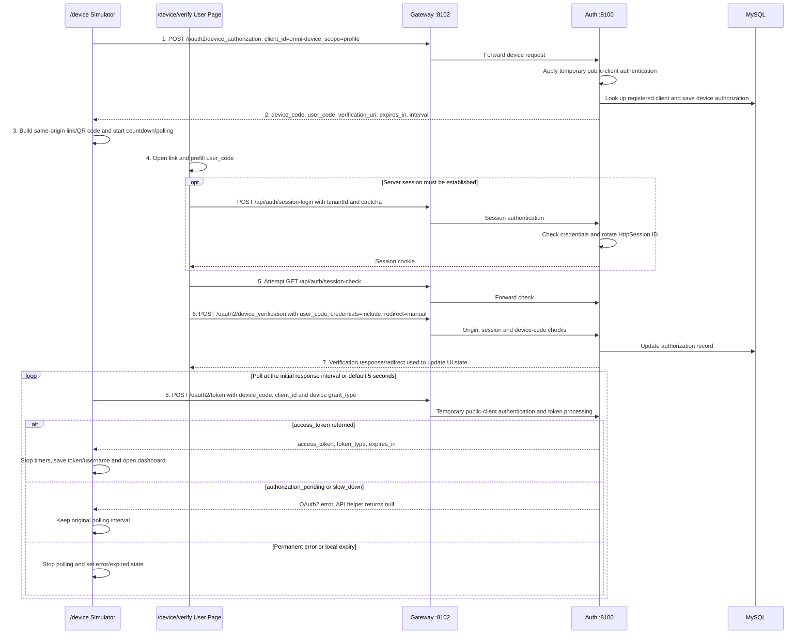

### Key Components

| Component | Source | Responsibility |
|---|---|---|
| `auth.ts` | [omni-frontend/src/api/auth.ts](../omni-frontend/src/api/auth.ts) | Request device authorization with scope=profile; map polling pending/slow_down to null |
| `device/index.vue` | [omni-frontend/src/views/device/index.vue](../omni-frontend/src/views/device/index.vue) | Build same-origin link/QR; fix the initial interval, count down and save token |
| `device/verify.vue` | [omni-frontend/src/views/device/verify.vue](../omni-frontend/src/views/device/verify.vue) | Captcha-backed session login, attempted session-check and user_code submission; update UI from response |
| `DeviceClientInitializer.java` | [omni-backend/omni-auth/src/main/java/com/omni/auth/config/DeviceClientInitializer.java](../omni-backend/omni-auth/src/main/java/com/omni/auth/config/DeviceClientInitializer.java) | Register omni-device; correct an existing client's consent=true to false |
| `AuthorizationServerConfig.java` | [omni-backend/omni-auth/src/main/java/com/omni/auth/config/AuthorizationServerConfig.java](../omni-backend/omni-auth/src/main/java/com/omni/auth/config/AuthorizationServerConfig.java) | Explicit device endpoints, HttpSession security context and JDBC authorization records |
| `DeviceClientAuthenticationFilter.java` | [omni-backend/omni-auth/src/main/java/com/omni/auth/security/DeviceClientAuthenticationFilter.java](../omni-backend/omni-auth/src/main/java/com/omni/auth/security/DeviceClientAuthenticationFilter.java) | Apply client authentication for device request/token only; restore original user authentication in finally |
| `SasConsentOriginFilter.java` | [omni-backend/omni-auth/src/main/java/com/omni/auth/security/SasConsentOriginFilter.java](../omni-backend/omni-auth/src/main/java/com/omni/auth/security/SasConsentOriginFilter.java) | Check supplied device-verification POST Origin against forwarded address; reject mismatch with 403 |

### Device Client Configuration

| Configuration | Current Value |
|---|---|
| Client ID | `omni-device` |
| Authentication | `NONE`, public client without clientSecret |
| Grant Types | `urn:ietf:params:oauth:grant-type:device_code` and `refresh_token` |
| Scopes | Registers `openid` and `profile`; simulator currently requests only `profile` |
| Require PKCE | `false` |
| Require Consent | `false`; initializer corrects an existing true value |
| Callback | No redirectUri; frontend builds the displayed verification link |

### Polling Behavior

| Response or Condition | Current Frontend Behavior |
|---|---|
| `authorization_pending` | Helper returns null; continue at the initial interval |
| `slow_down` | Also returns null; frontend does not increase the interval and has no implemented backoff |
| `expired_token` / local countdown expiry | Stop polling and enter error/expired state |
| `access_denied` / other permanent errors | Stop polling and enter error state |
| Recognized `Failed to fetch` / `NetworkError` / `timeout` | Wait for the next scheduled poll |
| access_token returned | Clear polling/countdown; save access token and extracted username |
| Page unmount | Clear both timers |

### Current Status

Device authorization, verification and token endpoints are configured in source. `DeviceClientAuthenticationFilter` installs its client principal only during the current device request/poll; `finally` restores the original authentication to avoid contaminating user HttpSession. Registering a refresh_token grant does not prove issuance on every response, and the simulator does not store or use a refresh token.

The verification page attempts a session check and updates its display from opaqueredirect, 302, some HTML responses, or a successful response. Frontend ready/success state is not proof of server authentication or token issuance. The page's Deny button changes only local denied state; it sends no SAS rejection and revokes no authorization record.

The frontend does not adjust its interval for slow_down. These limitations must not be presented as completed RFC behavior. Runtime acceptance requires the device to actually obtain a valid access token and use a protected resource. See the [Wiki](wiki/index.en.md) for operations, screenshots and failure recovery.

---

## Flow 4: OAuth2 Social Login (GitHub / Google / Gitee)

### Overview

The current login form exposes GitHub, Google and Gitee. The backend dispatches through a `Map<String, OAuth2ProviderHandler>` whose Spring Bean names match provider IDs. Handlers supply authorization URLs, token exchange and normalized profiles. `SocialLoginServiceImpl` coordinates tenants, identity links, users and JWT issuance. There is no current WeChat button or Handler; a table comment mentioning wechat is not implemented support.

The browser reaches `/api/auth/oauth2/{provider}?tenant_id=...` through Gateway. Auth checks the provider and tenant, creates signed state, and redirects to the provider. The callback validates state, exchanges the provider token, finds or creates the local user, then redirects to `/callback#token=...&username=...`. This social callback is a different path from Flow2's local authorization code + PKCE callback.

### Sequence

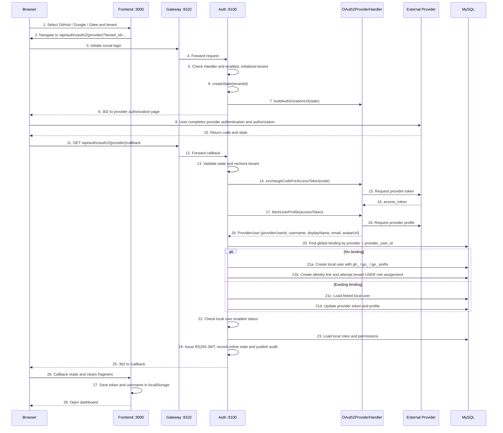

### Key Components

| Component | Source | Responsibility |
|---|---|---|
| `LoginForm.vue` | [omni-frontend/src/components/LoginForm.vue](../omni-frontend/src/components/LoginForm.vue) | Three provider entries and selected tenantId |
| `auth.ts` | [omni-frontend/src/api/auth.ts](../omni-frontend/src/api/auth.ts) | Build navigation URL through Gateway |
| `callback/index.vue` | [omni-frontend/src/views/callback/index.vue](../omni-frontend/src/views/callback/index.vue) | Read social fragment, clear address-bar fragment, save token and username |
| `SocialLoginController.java` | [omni-backend/omni-auth/src/main/java/com/omni/auth/controller/SocialLoginController.java](../omni-backend/omni-auth/src/main/java/com/omni/auth/controller/SocialLoginController.java) | Initiation/callback endpoints; redirect on success and handled business failure |
| `SocialLoginServiceImpl.java` | [omni-backend/omni-auth/src/main/java/com/omni/auth/service/impl/SocialLoginServiceImpl.java](../omni-backend/omni-auth/src/main/java/com/omni/auth/service/impl/SocialLoginServiceImpl.java) | Tenant checks, database transaction, user/link, roles, JWT, online record and audit |
| `OAuth2ProviderHandler.java` | [omni-backend/omni-auth/src/main/java/com/omni/auth/oauth/OAuth2ProviderHandler.java](../omni-backend/omni-auth/src/main/java/com/omni/auth/oauth/OAuth2ProviderHandler.java) | Dispatch by Bean name, which must match provider ID |
| `GitHubOAuth2Handler.java` | [omni-backend/omni-auth/src/main/java/com/omni/auth/oauth/GitHubOAuth2Handler.java](../omni-backend/omni-auth/src/main/java/com/omni/auth/oauth/GitHubOAuth2Handler.java) | GitHub authorization, token and profile mapping |
| `GoogleOAuth2Handler.java` | [omni-backend/omni-auth/src/main/java/com/omni/auth/oauth/GoogleOAuth2Handler.java](../omni-backend/omni-auth/src/main/java/com/omni/auth/oauth/GoogleOAuth2Handler.java) | Google authorization/profile; apply explicit proxy for valid HTTPS_PROXY; derive username from email prefix or sub |
| `GiteeOAuth2Handler.java` | [omni-backend/omni-auth/src/main/java/com/omni/auth/oauth/GiteeOAuth2Handler.java](../omni-backend/omni-auth/src/main/java/com/omni/auth/oauth/GiteeOAuth2Handler.java) | Gitee authorization, token and profile mapping |
| `ProviderUser.java` | [omni-backend/omni-auth/src/main/java/com/omni/auth/dto/ProviderUser.java](../omni-backend/omni-auth/src/main/java/com/omni/auth/dto/ProviderUser.java) | Normalize providerUserId, username, displayName, email and avatarUrl |
| `OAuth2StateUtils.java` | [omni-backend/omni-auth/src/main/java/com/omni/auth/util/OAuth2StateUtils.java](../omni-backend/omni-auth/src/main/java/com/omni/auth/util/OAuth2StateUtils.java) | Signature and timestamp checks, without one-time consumption or browser-session binding |
| `SysUserOauthProviderMapper.java` | [omni-backend/omni-auth/src/main/java/com/omni/auth/mapper/SysUserOauthProviderMapper.java](../omni-backend/omni-auth/src/main/java/com/omni/auth/mapper/SysUserOauthProviderMapper.java) | Query global link by provider + provider_user_id |
| `SysUserOauthProvider.java` | [omni-backend/omni-auth/src/main/java/com/omni/auth/entity/SysUserOauthProvider.java](../omni-backend/omni-auth/src/main/java/com/omni/auth/entity/SysUserOauthProvider.java) | Current fields, provider token and user association |
| `JwtTokenServiceImpl.java` | [omni-backend/omni-auth/src/main/java/com/omni/auth/service/impl/JwtTokenServiceImpl.java](../omni-backend/omni-auth/src/main/java/com/omni/auth/service/impl/JwtTokenServiceImpl.java) | Issue JWT from the local user and roles/permissions; claims are described in Flow1 |
| `OAuth2Properties.java` | [omni-backend/omni-auth/src/main/java/com/omni/auth/config/OAuth2Properties.java](../omni-backend/omni-auth/src/main/java/com/omni/auth/config/OAuth2Properties.java) | Provider endpoints, credentials and callback configuration |
| `compose.apps.yaml` | [compose.apps.yaml](../compose.apps.yaml) | Formal Docker callbacks for all three providers use Gateway :8102 |
| `0001-auth-schema.yaml` | [database/changelog/auth/0001-auth-schema.yaml](../database/changelog/auth/0001-auth-schema.yaml) | Schema, global unique key and user index |
| `auth.sql` | [scripts/sql/seed/auth.sql](../scripts/sql/seed/auth.sql) | Formal tenant1 USER seed defaults to SELF data scope |

### State Signing Mechanism

State has the format `tenantId|timestamp|hex(hmac)`, using milliseconds for timestamp. The signed payload contains only the tenant and time.

```text
payload = tenantId + "|" + timestamp
hmac = hex(HMAC-SHA256(payload, secretKey))
state = payload + "|" + hmac
```

The callback checks three-part format, recomputed HMAC and a parseable timestamp, rejecting when `now - timestamp > 10 * 60 * 1000`, then parses tenantId. There is no consumption marker, stored random nonce or browser-session binding. This proves signature integrity and the stated freshness check, rather than state replay prevention or binding to the initiating browser.

### Automatic User Creation Mechanism

1. Prefixes are GitHub `gh_`, Google `go_` and Gitee `ge_`. Google uses a nonblank email prefix when available, otherwise sub.
2. The initial username is `prefix + providerUsername`. On an insertion unique-key conflict, code retries once with `prefix + providerUsername + '_' + providerUserId`.
3. Nickname uses non-null displayName, otherwise providerUsername. Email and avatar come from the normalized profile.
4. A new user has null password, status 1 and the tenantId recovered from validated state.
5. User and identity link are written in the callback database transaction. A link unique-key conflict triggers lookup of the existing binding and its local user.
6. Code attempts the selected tenant's `USER` role and logs warn if absent or assignment throws. The formal tenant1 USER seed is SELF; actual data scope follows current role configuration.
7. An existing binding loads its original local user before updating provider token/profile. JWT tenant comes from that user; current state does not migrate it.
8. Local roles/permissions are loaded before JWT generation. Online-record failures only log warn, followed by login-success audit publication.

### sys_user_oauth_provider Table Design

| Field or Index | Type or Definition | Meaning |
|---|---|---|
| `id` | `BIGINT NOT NULL AUTO_INCREMENT` | Primary key |
| `user_id` | `BIGINT NOT NULL` | Local user ID |
| `provider` | `VARCHAR(32) NOT NULL` | Provider name; current Handlers are github/google/gitee |
| `provider_user_id` | `VARCHAR(100) NOT NULL` | Unique user ID from provider |
| `provider_username` | `VARCHAR(100)` | Nullable provider username |
| `provider_email` | `VARCHAR(200)` | Nullable provider email |
| `provider_avatar` | `VARCHAR(500)` | Nullable provider avatar |
| `access_token` | `VARCHAR(500)` | Most recently obtained provider access token, nullable |
| `create_time` | `DATETIME DEFAULT CURRENT_TIMESTAMP` | Creation time |
| `update_time` | `DATETIME DEFAULT CURRENT_TIMESTAMP ON UPDATE CURRENT_TIMESTAMP` | Update time, automatically refreshed on update |
| `uk_provider_user` | `UNIQUE (provider, provider_user_id)` | Global unique constraint for external identity |
| `idx_user_id` | `INDEX (user_id)` | Index for links by local user |

The table has no tenant_id column, and its unique key does not include a tenant. One provider identity is globally linked to one local user. First creation uses the state tenant; an existing binding reuses its user and tenant. This is not independent duplicate binding of the same provider identity per tenant.

`handleCallback()` uses a database transaction. Provider token exchange, network calls and online records do not roll back jointly with the local database. Unique-key/lookup handling does not establish idempotency of all external side effects.

### Error Handling

| Scenario | Actual Handling | Frontend Behavior |
|---|---|---|
| Nonblank error in callback | 302 to `/login?error=user_denied` | Generic third-party login failure prompt when message is absent |
| Missing code or state | 302 to `/login?error=invalid_callback` | Generic prompt; no guaranteed dedicated invalid-callback wording |
| BusinessException from state, provider API/profile or disabled user | 302 to `/login?error=social_login_failed&message=...`, with URL-encoded message | Read message; internal business codes 400/403/502 are not this callback's HTTP status |
| Missing Handler or unavailable tenant during initiation | Throw the relevant BusinessException outside callback redirect handling | Ordinary exception response handling |
| Non-BusinessException or redirect I/O failure | Not uniformly converted by that BusinessException catch | No guarantee of the same error-page redirect |

### Current Status

GitHub, Google and Gitee Handlers and local orchestration exist in source. This does not prove real-account authorization or end-to-end acceptance for all three providers. A controlled peer or available configuration cannot replace real provider callback evidence.

Formal [compose.apps.yaml](../compose.apps.yaml) sets all three callbacks to Gateway `http://localhost:8102/api/auth/oauth2/{provider}/callback`. Property-class and application.yml fallbacks still use Auth :8100. Provider registration must match the actual externally reachable callback. The successful frontend target follows frontendCallbackUrl, and the callback page clears the fragment after parsing it.

Adding a provider needs matching Handler Bean/provider ID, configuration, frontend entry and provider callback registration. An interface implementation alone is not complete integration. See the [Wiki](wiki/index.en.md) for operations, real-authorization evidence requirements and recovery.

## Flow 5: RBAC Functional Permissions — Dynamic Menu Loading and Button Authorization

### Overview

A protected route reads the permission snapshot in the current token and requests the tenant menu tree through Gateway. The backend filters menus; the frontend registers management routes whose components can be resolved and renders navigation. The `v-permission` directive controls button visibility, while server operations apply each endpoint's authorization rules.

### Sequence

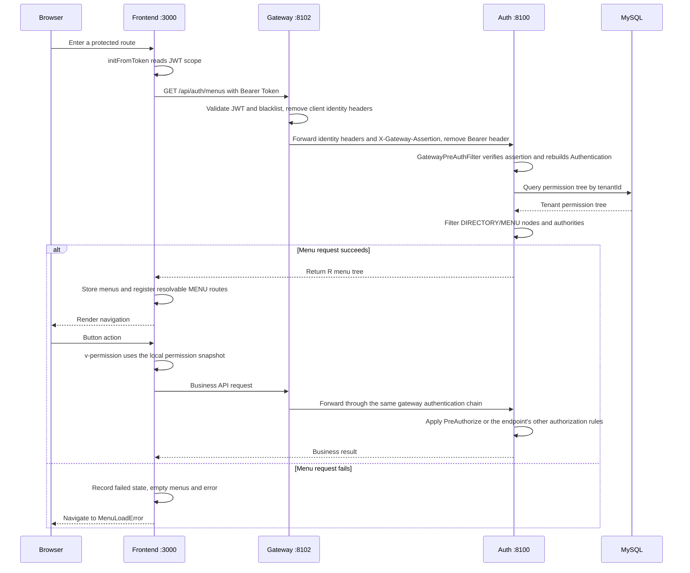

### Key Implementation Details

**Backend menu filtering**

1. PermissionServiceImpl.getPermissionTree(tenantId) explicitly queries the tenant's permission records, sorts by sort and builds the tree. MenuController first recursively retains DIRECTORY and MENU nodes.
2. Functional permissions are SecurityContext authorities without the ROLE_ prefix. Missing authentication or an empty permission set produces an empty menu result.
3. DIRECTORY recursively filters children and survives only when visible children remain. MENU checks exact membership of its own permissionCode and retains children from the preceding type filter.

**Menu state and dynamic routes**

- loadMenus merges concurrent requests and reuses the loaded state. Missing tenant_id produces an empty menu and loaded state. A request exception sets menusLoaded=true and menuLoadState=failed, stores the error and rethrows it.
- The route guard sends an initial loading failure to MenuLoadError. retryLoadMenus resets the loading flag, state and error before loading again. A failed state does not grant all menus.
- registerDynamicRoutes registers only MENU nodes with a resolvable component; DIRECTORY nodes only group items. Portal entries starting with srm:portal: are outside this registration path. Routes belong to admin; colons in the permission code become slashes in the path and hyphens in the name, and meta.permissionCode is retained.
- Logout resets the permission Store and removes registered dynamic routes.

**Buttons, tokens and server authorization**

```vue
<el-button v-permission="'system:user:create'" type="primary">Add</el-button>
<el-button v-permission="'system:user:update'" size="small">Edit</el-button>
<el-button v-permission="'system:user:delete'" size="small" type="danger">Delete</el-button>
```

- The directive checks nonempty bindings in mounted and updated: it sets display:none when permission is missing and clears display otherwise. An empty binding does not hide the element. Button visibility does not authorize a server operation.
- decodeJwt decodes without verifying signatures. getPermissionsFromToken returns scope unchanged and does not split strings into arrays. Password JWT scope arrays and SAS space-delimited strings therefore cannot be described as normalized by this frontend helper. Gateway performs signature and expiry checks.
- For ordinary Auth APIs, GatewayPreAuthFilter builds Authentication from forwarded role and permission headers. This does not reverify a forwarded Bearer JWT or reload database functional permissions on every request.
- Management endpoints follow their current Controller rules, such as @PreAuthorize with system:user:create for user creation. Public login/registration and MyJobController ownership checks have explicit separate paths; a single annotation rule does not describe every write endpoint.

### Current Status

- Menus, routes, buttons and server authorization follow the source behavior above. Page or button counts are not repository-wide coverage evidence.
- Functional permissions are a snapshot in an issued token. Rebuilding Authentication does not imply that a role change immediately adds permissions to or invalidates an old token.
- Permission codes use resource:action. The corresponding Controller and security configuration define endpoint rules, public paths and ownership checks.

Source entry points: [MenuController](../omni-backend/omni-auth/src/main/java/com/omni/auth/controller/MenuController.java), [PermissionServiceImpl](../omni-backend/omni-auth/src/main/java/com/omni/auth/service/impl/PermissionServiceImpl.java), [Gateway AuthFilter](../omni-backend/omni-gateway/src/main/java/com/omni/gateway/filter/AuthFilter.java), [Auth GatewayPreAuthFilter](../omni-backend/omni-auth/src/main/java/com/omni/auth/security/GatewayPreAuthFilter.java), [stores/permission.ts](../omni-frontend/src/stores/permission.ts), [router/index.ts](../omni-frontend/src/router/index.ts), [directives/permission.ts](../omni-frontend/src/directives/permission.ts), [utils/jwt.ts](../omni-frontend/src/utils/jwt.ts), [api/menu.ts](../omni-frontend/src/api/menu.ts), [UserController](../omni-backend/omni-auth/src/main/java/com/omni/auth/controller/UserController.java), [AuthController](../omni-backend/omni-auth/src/main/java/com/omni/auth/controller/AuthController.java), [MyJobController](../omni-backend/omni-base/src/main/java/com/omni/base/controller/MyJobController.java), [MenuControllerTest](../omni-backend/omni-auth/src/test/java/com/omni/auth/controller/MenuControllerTest.java)

## Flow 6: RBAC Data Permissions — Request-Level Row Data Filtering

### Overview

This flow traces ordinary request data scopes in Auth. DataScopeResolveFilter calls DataScopeServiceImpl to validate the enabled user and roles within the selected tenant and resolve the organization scope, then writes DataScopeContext. The SQL handler adds row predicates for registered tables. Explicit tenant predicates in business queries and service authorization for non-database data remain necessary.

**Request parsing and role merging**

1. The filter runs after Spring Security. /internal/ endpoints skip the ordinary request context and use their own explicit parameters and authentication. Missing X-User-Id skips context creation, without bypassing the endpoint security chain.
2. An identified request with an unparseable user ID or missing/unparseable tenant header receives HTTP 400. The resolver requires positive IDs and an enabled user belonging to the selected tenant; failure of that membership check is 403. Context is cleared in finally.
3. Ordinary resolveDataScope(userId, tenantId) merges enabled roles in that tenant. Priority is ALL(1), TENANT(2), DEPT_AND_BELOW(3), DEPT(4), CUSTOM(5), SELF(6), with lower numbers granting a wider scope. SELF remains when no wider scope is found.
4. The permissionCode overload queries only enabled roles that actually grant the exact full permission code and rejects a missing grant. This differs from merging all roles for an ordinary request. The returned DTO's securityVersion is a fingerprint of the resolved result.

### Sequence

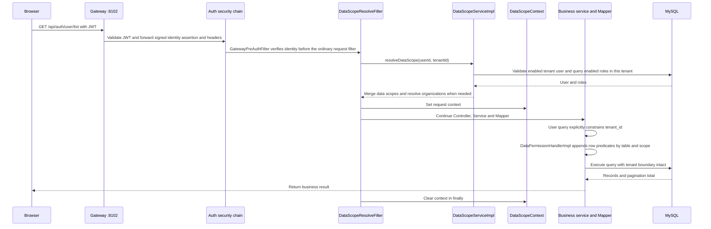

### DataScope Filter Conditions Reference

| effectiveScope | Additional sys_user row predicate | Boundary |
| --- | --- | --- |
| `ALL` | No additional row predicate | Does not remove an existing tenant WHERE; user listing still constrains tenantId |
| `TENANT` | No additional row predicate | The query explicitly supplies the tenant boundary |
| `DEPT` | `alias.primary_unit_id IN (...)` | Set containing the enabled primary organization |
| `DEPT_AND_BELOW` | `alias.primary_unit_id IN (...)` | Enabled primary organization and expanded organization set |
| `CUSTOM` | `alias.primary_unit_id IN (...)` | Same-tenant roots configured by CUSTOM roles and their expanded set |
| `SELF` | `alias.id = userId` | Current user |

Auth currently registers three table mappings. alias is the SQL alias, or the table name when none is supplied. The table below shows SELF and organization scopes; ALL/TENANT add no extra row predicate for these mappings.

| Table | SELF | DEPT / DEPT_AND_BELOW / CUSTOM |
| --- | --- | --- |
| `sys_user` | `id = userId` | `primary_unit_id IN (...)` |
| `sys_org_unit` | `id = primaryUnitId` | `id IN (...)` |
| `sys_role` | `id = -1` | No organization row predicate |

A missing required ID or empty IN set produces alias.id=-1 in the corresponding mapped rule. Missing context, null/unknown scope or an unregistered table produces no additional predicate. The handler does not automatically fail closed for every table and data source. UserServiceImpl.listUsers retains its tenant_id predicate even for ALL.

### Organization Unit Descendant Query

DEPT uses the enabled primary organization in the selected tenant. DEPT_AND_BELOW expands its materialized path. CUSTOM merges configured roots from participating roles whose dataScope is CUSTOM and looks up each root using the same tenantId.

The active method is SysOrgUnitMapper.selectDescendantIdsByTenantIdAndPath(tenantId, pathPrefix). Its SQL filters by tenant, path prefix and status=1; it does not exclude the root as the old example did.

```sql
SELECT id FROM sys_org_unit
WHERE tenant_id = #{tenantId}
  AND path LIKE CONCAT(#{pathPrefix}, '%')
  AND status = 1
```

resolveUnitTree also inserts the root ID. The CUSTOM root lookup selectByIdAndTenantId does not itself filter enabled status, so the descendant SQL does not establish that every CUSTOM root passed a status=1 check.

### In-Memory Filtering Mode (Online Users Scenario)

The Redis value at `online:{userId}` contains only `username|jti`; global keys do not establish tenant ownership. `OnlineUserController` retains the functional permissions `system:online:list` / `system:online:kick`. Both operations delegate data-scope checks to `OnlineUserServiceImpl`:

- `ALL` retains cross-tenant access; `TENANT` permits only the current tenant.
- `SELF` permits only the current user within the current tenant. `DEPT`, `DEPT_AND_BELOW` and `CUSTOM` require matching tenant ownership and a target `primaryUnitId` in the resolved organization set. An empty set grants no access.
- Listing checks tenant and primary organization against the user table. Non-`ALL` database queries include an explicit tenant predicate; Redis entries without a returned, visible user are removed.
- Forced logout loads and authorizes the target before reading or deleting the online key, blacklisting its recorded `jti`, and publishing a `LOGOUT` audit under the target user's tenant. The existing default blacklist duration is 24 hours.
- Missing valid identity, tenant or scope, or a missing/invisible kick target, raises business error code `403`. Denied kicks do not access Redis or publish a success audit event; Controller business exceptions are converted to `R.fail` by `AuthExceptionHandler`.

```java
@GetMapping("/list")
@PreAuthorize("hasAuthority('system:online:list')")
public R<List<OnlineUserVO>> list() {
    return R.ok(onlineUserService.listOnlineUsers());
}
```

Implementation and boundary regressions: [OnlineUserServiceImpl](../omni-backend/omni-auth/src/main/java/com/omni/auth/service/impl/OnlineUserServiceImpl.java), [OnlineUserServiceImplTest](../omni-backend/omni-auth/src/test/java/com/omni/auth/service/impl/OnlineUserServiceImplTest.java).

### Configuration Registration Order

MyBatisPlusConfig registers DataPermissionInterceptor, OptimisticLockerInnerInterceptor and PaginationInnerInterceptor in that order. This Auth configuration has no TenantLine. Data permissions precede pagination so the page query and COUNT use the relevant row predicates. Other business services use their own scope handlers and aggregate ownership rules.

```java
MybatisPlusInterceptor interceptor = new MybatisPlusInterceptor();
interceptor.addInnerInterceptor(new DataPermissionInterceptor(new DataPermissionHandlerImpl()));
interceptor.addInnerInterceptor(new OptimisticLockerInnerInterceptor());
interceptor.addInnerInterceptor(new PaginationInnerInterceptor(DbType.MYSQL));
```

### Current Status

- SQL mappings, ordinary request resolution and permission-specific resolution have the separate entry points described above. New tables and services must define their own tenant and ownership boundaries.
- Online-user listing and kicking retain the service checks in the preceding section; SQL interception does not replace Redis authorization.
- This flow links current source and regression entry points. Source explanation, unit tests and real database or HTTP/E2E acceptance must be evaluated at their actual evidence scope.

Source and regression entry points: [DataScopeResolveFilter](../omni-backend/omni-auth/src/main/java/com/omni/auth/security/DataScopeResolveFilter.java), [DataScopeServiceImpl](../omni-backend/omni-auth/src/main/java/com/omni/auth/service/impl/DataScopeServiceImpl.java), [DataScopeContext](../omni-backend/omni-auth/src/main/java/com/omni/auth/security/DataScopeContext.java), [DataPermissionHandlerImpl](../omni-backend/omni-auth/src/main/java/com/omni/auth/security/DataPermissionHandlerImpl.java), [MyBatisPlusConfig](../omni-backend/omni-auth/src/main/java/com/omni/auth/config/MyBatisPlusConfig.java), [SysRoleMapper](../omni-backend/omni-auth/src/main/java/com/omni/auth/mapper/SysRoleMapper.java), [SysOrgUnitMapper](../omni-backend/omni-auth/src/main/java/com/omni/auth/mapper/SysOrgUnitMapper.java), [UserServiceImpl](../omni-backend/omni-auth/src/main/java/com/omni/auth/service/impl/UserServiceImpl.java), [DataScopeServiceImplTest](../omni-backend/omni-auth/src/test/java/com/omni/auth/service/impl/DataScopeServiceImplTest.java), [DataScopeResolveFilterTest](../omni-backend/omni-auth/src/test/java/com/omni/auth/security/DataScopeResolveFilterTest.java)

## Flow 7: User Creation — Three Pathways

### Overview

The three creation paths are public self-registration, administrator creation protected by `system:user:create`, and first association during external social login. Each creates an enabled user (`status=1`) and attempts to assign the target tenant's enabled `USER` role. Data scope comes from that role record; the formal seed gives tenant 1's `USER` role `SELF`. None of the three constructors sets `primaryUnitId`. A missing default role produces a warning and skips assignment, so creation alone does not prove role membership.

### Sequence

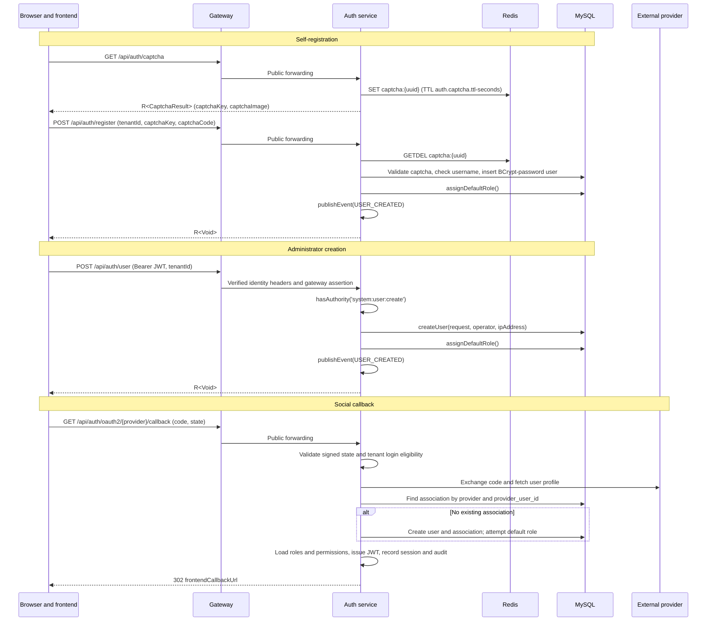

### Three Pathways Comparison

| Dimension | Self-registration | Administrator creation | Social auto-creation |
| --- | --- | --- | --- |
| Entry and permission | `POST /api/auth/register`, public | `POST /api/auth/user`, `system:user:create` | `GET /api/auth/oauth2/{provider}/callback`, callback parameters and state validated |
| Tenant source | Body `tenantId`; registration UI offers tenant selection | Body `tenantId`, selected by administrator | Signed state for a new user; association lookup uses provider and external user ID |
| Captcha | `captchaKey` + `captchaCode`; atomic `GETDEL`, consumed even on mismatch | Not required | No local captcha; provider code and profile required |
| Password and username validation | `RegisterRequest`: username 3–32, password 6–64 characters | `CreateUserRequest`: nonblank username without `@Size`; password at least 6 characters | Password is `null`; `gh_` / `go_` / `ge_` + external username |
| Collision and failure | Tenant-scoped duplicate precheck throws business code 400 | Tenant-scoped duplicate precheck throws business code 400 | A first `DuplicateKeyException` retries `{prefix}{login}_{providerUserId}` once; a second failure propagates |
| Default role implementation | Private `UserServiceImpl.assignDefaultRole()` | Same as self-registration | Independent query/insert inside `createNewUser()`; assignment exceptions are caught and logged |
| Role write exceptions | Missing role only warns; query or association-insert exceptions propagate | Same as self-registration; not every assignment failure is nonblocking | Assignment block catches exceptions; other creation/callback failures retain their own handling |
| After success | `R<Void>`; UI saves selected tenant and navigates to login | `R<Void>`; UI closes creation dialog and reloads list | Configured frontend callback; fragment contains encoded `token` and `username` |

### Key Components

| Source entry | Responsibility |
| --- | --- |
| [AuthController.java](../omni-backend/omni-auth/src/main/java/com/omni/auth/controller/AuthController.java) / [CaptchaResult.java](../omni-backend/omni-auth/src/main/java/com/omni/auth/dto/CaptchaResult.java) / [RegisterRequest.java](../omni-backend/omni-auth/src/main/java/com/omni/auth/dto/RegisterRequest.java) / [CaptchaServiceImpl.java](../omni-backend/omni-auth/src/main/java/com/omni/auth/service/impl/CaptchaServiceImpl.java) | Public registration and captcha DTO |
| [UserController.java](../omni-backend/omni-auth/src/main/java/com/omni/auth/controller/UserController.java) / [CreateUserRequest.java](../omni-backend/omni-auth/src/main/java/com/omni/auth/dto/CreateUserRequest.java) / [UserServiceImpl.java](../omni-backend/omni-auth/src/main/java/com/omni/auth/service/impl/UserServiceImpl.java) | Administrator creation and private default-role method |
| [SocialLoginController.java](../omni-backend/omni-auth/src/main/java/com/omni/auth/controller/SocialLoginController.java) / [SocialLoginServiceImpl.java](../omni-backend/omni-auth/src/main/java/com/omni/auth/service/impl/SocialLoginServiceImpl.java) / [SysUserOauthProviderMapper.java](../omni-backend/omni-auth/src/main/java/com/omni/auth/mapper/SysUserOauthProviderMapper.java) | Social callback, association and separate role assignment |
| [SysRoleMapper.java](../omni-backend/omni-auth/src/main/java/com/omni/auth/mapper/SysRoleMapper.java) / [auth.sql](../scripts/sql/seed/auth.sql) | Enabled-role lookup and formal role seed |
| [index.vue](../omni-frontend/src/views/register/index.vue) / [auth.ts](../omni-frontend/src/api/auth.ts) | Registration form and post-submit state |

### Current Status

- Captcha fields are `captchaKey` and `captchaImage`. `auth.captcha.ttl-seconds` controls TTL, default 300 seconds. Validation is case-insensitive; missing, expired or consumed keys are rejected. The registration UI reloads the captcha when submission finishes.
- All three creation entries publish `USER_CREATED` audit events. Social callbacks also check enabled status, load permissions, issue JWTs and attempt session recording. Existing external associations load the linked user; the association query itself has no tenant predicate.
- This section records source behavior and failure boundaries. See the authentication guide for real registration, role checks and provider authorization. Source paths and unit tests do not replace a real successful external callback.

[Authentication guide](guides/authentication.en.md)

---

## Flow 8: XSS Protection — Request Sanitization and Configuration Management

<a id="8a-xss-request-sanitization-automatically-executed-on-every-request"></a>

### 8A. XSS Request Sanitization (Enabled by Request Conditions)

XSS auto-configuration applies to Servlet web applications with an `XssConfigProvider` bean. The filter is registered for `/*`, but wraps requests and installs thread rules only when `X-Tenant-Id` parses, protection is enabled and rules are nonempty. A missing/blank/unparseable tenant header, null settings, disabled protection or empty rules continues the original request. Identity and permission checks belong to the respective security chains.

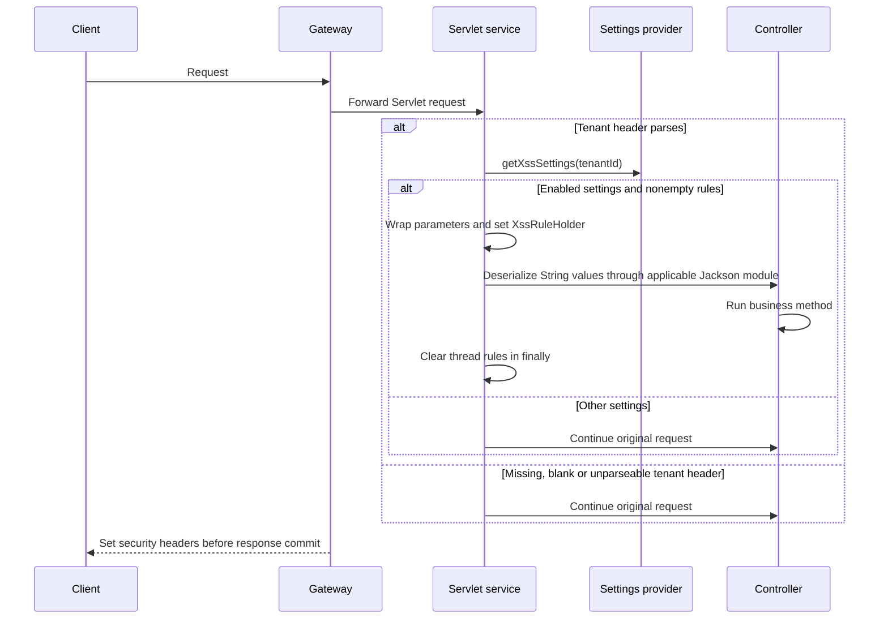

| ruleType | Current processing | Configuration and example |
| --- | --- | --- |
| `HTML_TAG` | Literal tag names split by `\|`; remove matched paired tags including their content, and matched individual opening or self-closing tags | With `script`, `<script>alert(1)</script>` → empty string |
| `EVENT_HANDLER` | Configured regex matches attribute names, followed by quoted or unquoted values; remove matches | With `on[a-zA-Z]+`, remove `onclick="..."` |
| `DANGEROUS_PROTOCOL` | Case-insensitive literal replacement of configured values split by `\|` | With `javascript:`, remove that protocol string |
| `CUSTOM_PATTERN` | Replace configured regex matches with empty strings | Only matched content is removed |

The wrapper overrides only `getParameter()` / `getParameterValues()`. JSON sanitization uses String deserializers, with separate Jackson 2 and Jackson 3 modules; Spring Boot 4 uses Jackson 3 by default. These entry points do not jointly sanitize headers, JSON field names, raw streams or parameter accessors that are not overridden. Rules run in order; unknown types return input unchanged, and runtime regex syntax errors warn before continuing other rules. Gateway security headers act on responses; the actual `Referrer-Policy` is `strict-origin-when-cross-origin`.

### 8B. XSS Configuration Management (Admin Operations)

| Method (base `/api/auth/xss-config`) | Permission | Behavior |
| --- | --- | --- |
| `GET /settings` | `system:xssconfig:list` | Management settings and all rules; creates disabled default record if absent |
| `PUT /toggle?enabled=true` | `system:xssconfig:update` | Writes switch; `enabled` is a required query parameter |
| `GET /rules/list?page=1&size=10` | `system:xssconfig:list` | Paginated current-tenant rules |
| `POST /rules` | `system:xssconfig:create` | Creates rule with `enabled=1` |
| `PUT /rules/{id}` | `system:xssconfig:update` | Updates non-null fields after rule-tenant check |
| `DELETE /rules/{id}` | `system:xssconfig:delete` | Deletes after rule-tenant check |
| `PUT /rules/{id}/toggle?enabled=false` | `system:xssconfig:update` | Toggles after rule-tenant check; `enabled` is a query parameter |

The controller explicitly passes the gateway-injected `X-Tenant-Id` to update, delete and toggle services. The service first requires a positive tenant ID, then checks that the rule exists and `rule.tenantId` matches. Missing and foreign-tenant rules both throw business code 404, mapped by `AuthExceptionHandler` to HTTP 200 + `R.code=404`, before database mutation or cache deletion. The three existing `@PreAuthorize` permission checks remain in place.

The creation DTO requires only nonblank `ruleName`, `ruleType` and `pattern`; the service runs `Pattern.compile()` on the pattern. Updates revalidate a supplied pattern. There is no ruleType enum validation here; the sanitizer skips unknown runtime types. Authoritative runtime reads include only rules with `enabled=1`, ordered by `sort_order`.

Auth's provider requires both Redis values for a hit. Missing either key or invalid rule JSON triggers `getAuthoritativeSettings()` and a 30-minute cache fill. Authoritative reads return disabled settings with no rules when configuration is absent or disabled, without creating a record; management `getSettings()` behaves differently.

The shared Servlet Starter provider tries Auth after a cache exception. A failed or ineffective authoritative lookup falls back to local tag, event-attribute and dangerous-protocol rules. Explicit disabled authoritative settings are preserved. Redis read errors in Auth's own provider propagate; the shared Starter fallback does not describe every implementation.

Every write method synchronously deletes `xss:enabled:{tenantId}` and `xss:rules:{tenantId}` inside its database transaction. Cache invalidation and database commit are separate operations. The security/audit guide owns UI operation and recovery steps.

[Security and audit guide](guides/system-security-audit.en.md)

### Key Components

| Source entry | Responsibility |
| --- | --- |
| [XssAutoConfiguration.java](../omni-backend/omni-common/src/main/java/com/omni/common/security/xss/XssAutoConfiguration.java) / [XssFilter.java](../omni-backend/omni-common/src/main/java/com/omni/common/security/xss/XssFilter.java) / [XssRuleHolder.java](../omni-backend/omni-common/src/main/java/com/omni/common/security/xss/XssRuleHolder.java) | Servlet conditional wiring and request-rule lifecycle |
| [XssHttpServletRequestWrapper.java](../omni-backend/omni-common/src/main/java/com/omni/common/security/xss/XssHttpServletRequestWrapper.java) / [XssStringDeserializer.java](../omni-backend/omni-common/src/main/java/com/omni/common/security/xss/XssStringDeserializer.java) / [XssStringDeserializer3.java](../omni-backend/omni-common/src/main/java/com/omni/common/security/xss/XssStringDeserializer3.java) | Parameter wrapping and Jackson 2/3 String sanitization |
| [XssSanitizer.java](../omni-backend/omni-common/src/main/java/com/omni/common/security/xss/XssSanitizer.java) / [SecurityHeadersFilter.java](../omni-backend/omni-gateway/src/main/java/com/omni/gateway/config/SecurityHeadersFilter.java) | Rule application and response headers with different boundaries |
| [XssConfigController.java](../omni-backend/omni-auth/src/main/java/com/omni/auth/controller/XssConfigController.java) / [XssConfigServiceImpl.java](../omni-backend/omni-auth/src/main/java/com/omni/auth/service/impl/XssConfigServiceImpl.java) / [XssConfigProviderImpl.java](../omni-backend/omni-auth/src/main/java/com/omni/auth/security/XssConfigProviderImpl.java) / [InternalXssController.java](../omni-backend/omni-auth/src/main/java/com/omni/auth/controller/internal/InternalXssController.java) | Auth authoritative settings, management writes and cache |
| [ServiceXssAutoConfiguration.java](../omni-backend/omni-common-service/src/main/java/com/omni/common/service/config/ServiceXssAutoConfiguration.java) / [CachedServiceXssConfigProvider.java](../omni-backend/omni-common-service/src/main/java/com/omni/common/service/xss/CachedServiceXssConfigProvider.java) / [DefaultXssSettingsFallback.java](../omni-backend/omni-common-service/src/main/java/com/omni/common/service/xss/DefaultXssSettingsFallback.java) / [AuthXssSettingsResolver.java](../omni-backend/omni-common-service/src/main/java/com/omni/common/service/client/AuthXssSettingsResolver.java) | Shared Starter caching, authoritative lookup and baseline |
| [XssRuleTenantBoundaryTest.java](../omni-backend/omni-auth/src/test/java/com/omni/auth/controller/XssRuleTenantBoundaryTest.java) / [XssJsonDeserializationTest.java](../omni-backend/omni-common/src/test/java/com/omni/common/security/xss/XssJsonDeserializationTest.java) / [XssHttpJsonIntegrationTest.java](../omni-backend/omni-common/src/test/java/com/omni/common/security/xss/XssHttpJsonIntegrationTest.java) | Cross-tenant, missing-rule and same-tenant regression entries for three writes |

### Current Status

- Source entries cover Servlet parameters, both JSON modules, rule management and response headers. Actual sanitization depends on headers, settings, effective rules and the accessor in use.
- Tenant isolation is enforced through explicit tenant queries and rule ownership checks. Auth's generic DataScope interceptor maps only user, organization and role tables.
- Distinguish MockMvc/in-memory substitutes, JSON/HTTP integration and real deployment verification. UI screenshots or a successful build do not prove every input or concurrency case.

---

## Flow 9: Data Dictionary Management — Type+Data Two-Level Structure CRUD

### Overview

Base stores tenant dictionaries in `sys_dict_type` and `sys_dict_data`. A type code is unique within its tenant; data rows refer to it through `typeCode`. Administrative pagination reads the database directly, while the lightweight options endpoint caches enabled data rows for authenticated users.

### Sequence

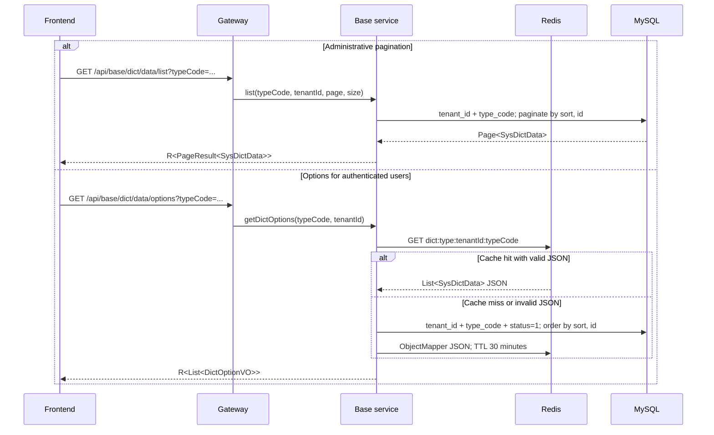

`GET /api/base/dict/data/list` requires `dict:data:list` and returns `R<PageResult<SysDictData>>`. `GET /api/base/dict/data/options` is protected by the authentication chain without a separate `dict:data:*` permission; its `R<List<DictOptionVO>>` contains only `value` and `label`.

Type lookup, update, deletion and status changes by ID, plus data update and deletion, explicitly pass the Gateway tenant to the service. The service requires a positive tenant ID and verifies ownership first. Missing and foreign-tenant resources both produce business code 404 before a result, write, cascade or cache invalidation.

### Key Components

| Source | Responsibility |
| --- | --- |
| [DictTypeController.java](../omni-backend/omni-base/src/main/java/com/omni/base/controller/DictTypeController.java) / [DictTypeServiceImpl.java](../omni-backend/omni-base/src/main/java/com/omni/base/service/impl/DictTypeServiceImpl.java) / [CreateDictTypeRequest.java](../omni-backend/omni-base/src/main/java/com/omni/base/dto/CreateDictTypeRequest.java) / [UpdateDictTypeRequest.java](../omni-backend/omni-base/src/main/java/com/omni/base/dto/UpdateDictTypeRequest.java) | Type queries, creation and ownership checks for ID resources |
| [DictDataController.java](../omni-backend/omni-base/src/main/java/com/omni/base/controller/DictDataController.java) / [DictDataServiceImpl.java](../omni-backend/omni-base/src/main/java/com/omni/base/service/impl/DictDataServiceImpl.java) / [CreateDictDataRequest.java](../omni-backend/omni-base/src/main/java/com/omni/base/dto/CreateDictDataRequest.java) / [UpdateDictDataRequest.java](../omni-backend/omni-base/src/main/java/com/omni/base/dto/UpdateDictDataRequest.java) / [DictOptionVO.java](../omni-backend/omni-base/src/main/java/com/omni/base/dto/DictOptionVO.java) | Administrative pagination, option caching and data ownership checks |
| [GatewayPreAuthFilter.java](../omni-backend/omni-base/src/main/java/com/omni/base/security/GatewayPreAuthFilter.java) / [SecurityConfig.java](../omni-backend/omni-base/src/main/java/com/omni/base/config/SecurityConfig.java) / [MybatisPlusAutoConfiguration.java](../omni-backend/omni-common-mybatis/src/main/java/com/omni/common/mybatis/config/MybatisPlusAutoConfiguration.java) | Gateway identity assertions, method permissions and Base configuration |
| [dict.ts](../omni-frontend/src/api/dict.ts) / [useDictOptions.ts](../omni-frontend/src/composables/useDictOptions.ts) / [index.vue](../omni-frontend/src/views/base/dict/index.vue) / [index.vue](../omni-frontend/src/views/srm/supplier/index.vue) | Typed frontend API, tenant cache and dictionary/supplier consumers |
| [0001-base-schema.yaml](../database/changelog/base/0001-base-schema.yaml) / [base.sql](../scripts/sql/seed/base.sql) / [auth.sql](../scripts/sql/seed/auth.sql) | Current schema, formal permissions and base seeds |
| [DictTenantBoundaryTest.java](../omni-backend/omni-base/src/test/java/com/omni/base/controller/DictTenantBoundaryTest.java) / [DictOperLogTenantBoundaryTest.java](../omni-backend/omni-base/src/test/java/com/omni/base/controller/DictOperLogTenantBoundaryTest.java) / [dict-options.test.ts](../omni-frontend/tests/base/dict-options.test.ts) | Regression entry points for dictionary IDs, log snapshots and client context |

### Cache Strategy

| Item | Current behavior |
| --- | --- |
| Key | `dict:type:{tenantId}:{typeCode}` |
| Storage | `StringRedisTemplate` stores strings; `ObjectMapper` encodes and decodes `List<SysDictData>` JSON |
| TTL | 30 minutes after a successful refill |

The option cache queries data rows with `status=1` without checking whether their parent type is enabled. Invalid cached JSON falls back to the database; JSON serialization failures only warn. Redis runtime read/write exceptions propagate.

Type update, deletion and status changes, and data creation, update and deletion, invalidate the corresponding key. Type creation does not invalidate the option cache. Manual refresh deletes the tenant/type key, queries enabled rows and refills it; the frontend module cache has its own lifecycle.

`deleteType()` validates ownership, deletes that tenant's related data and type, then invalidates the cache in a service method annotated `@Transactional`. The other dictionary write methods lack that annotation; the implementation does not establish atomic commits for all CRUD operations.

### Permission Tree

The formal permission seed defines the `base` directory, `base:dict` menu and 9 action permissions, granted to `SUPER_ADMIN` (role_id=1) in tenant 1. There are 6 type and 6 data endpoints, including the authentication-only `/options` endpoint. API contract section 12 owns the endpoint-to-permission mapping.

[API](api-contract.en.md)

### Current Status

- Type creation requires nonblank `typeCode/typeName` and checks code uniqueness within the tenant. The update DTO cannot change the type code. Data creation checks that its parent type exists in the current tenant; data updates cannot change `typeCode`.
- The formal `base.sql` seed defines 3 types and 7 data rows for tenant 1. Runtime records, other tenants and module extensions depend on their migrations and initialization.
- Base's own XSS provider reads Redis only and returns disabled settings when a key is missing or JSON cannot be parsed. This differs from the shared Servlet Starter's Auth fallback/baseline policy. Frontend pattern section 14 describes cache, identity changes and logout.

[useDictOptions](frontend-patterns.en.md)

---

## Flow 10: Operation Logs — AOP Collection + RocketMQ Async Write + Hot/Cold Archiving

### Overview

The operation-log aspect applies only to methods annotated `@OperLog` when its Servlet/AspectJ wiring conditions are satisfied; these can be queries or writes. It collects context, optional snapshots and differences, then calls the producer. The producer writes the Outbox or calls `StreamBridge.send()` on the current thread. Relay delivery and Base consumption happen asynchronously afterward.

<a id="10a-operation-log-recording-flow-triggered-on-every-write-operation"></a>

### 10A. Operation Log Recording Flow (Annotated Methods)

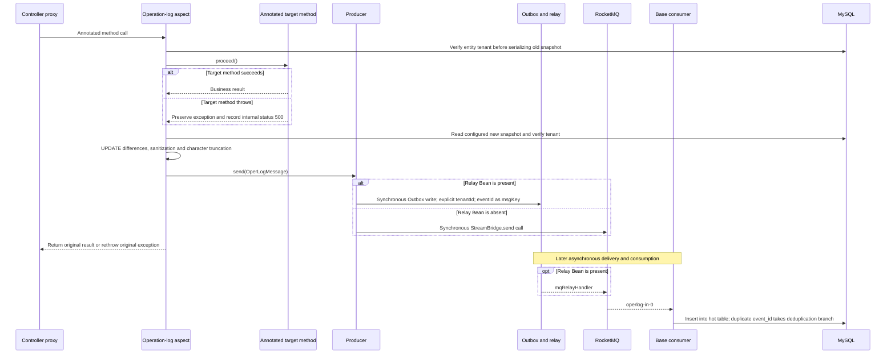

Old UPDATE/DELETE snapshots, new UPDATE snapshots and CREATE result-entity snapshots depend on `recordSnapshot/entityClass/idExpr`. An entity with a `tenantId` property is serialized only when it belongs to the request tenant; global entities without that property retain the existing behavior.

`OperLogSanitizer` cleans parameters, snapshots and error messages before sending; `excludeFields` adds exclusions. Long strings are truncated at 4000 characters. UPDATE extracts changed fields when both old and new JSON exist; unchanged values produce no difference.

Target exceptions are rethrown unchanged, with internal `response_status=500`; this is separate from later HTTP or `R.code` mapping. Post-processing and producer failures only warn. The pre-operation Mapper snapshot read happens before the target invocation, so collection failures are not universally isolated from business execution.

Direct sending is used only when no `ReliableMessageRelay` Bean is available. An Outbox send failure does not switch to direct sending. The relationship between Controller logging and service transactions depends on the actual invocation boundary; an Outbox does not prove that both always share one transaction.

<a id="10b-operation-log-archiving-flow-scheduled-daily-at-0200"></a>

### 10B. Operation Log Archiving Flow (Metadata Default: Daily at 02:00)

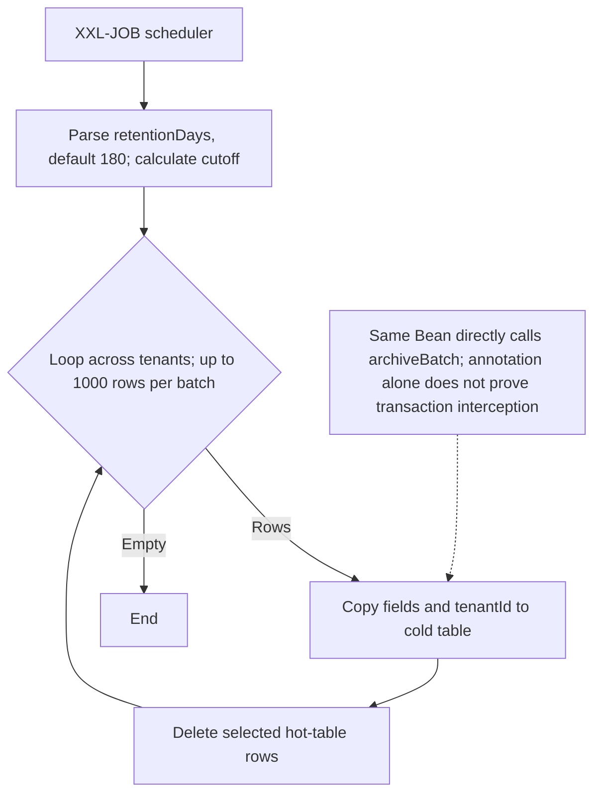

The handler declares both `@XxlJob("operLogArchiveHandler")` and `@SystemJobMeta`, with default cron `0 0 2 * * ?` and batch size 1000. Execution depends on registration, configuration and enablement in the job center.

Retention comes from numeric JSON `retentionDays`; missing or invalid input falls back to 180. Metadata min/max values do not establish runtime range validation in this parser. Selection spans tenants, and copies preserve each row's `tenantId`.

There is no `AtomicBoolean` reentry guard. The entry point invokes `archiveBatch()` within the same Bean; its `@Transactional` annotation does not prove atomic copy/delete through this path. A batch error is logged and stops the loop, yet the entry can still print a completion log. That log does not prove full archival success.

### Key Components

| Source | Responsibility |
| --- | --- |
| [OperLog.java](../omni-backend/omni-common-core/src/main/java/com/omni/common/core/operlog/OperLog.java) / [OperType.java](../omni-backend/omni-common-core/src/main/java/com/omni/common/core/operlog/OperType.java) / [OperLogMessage.java](../omni-backend/omni-common-core/src/main/java/com/omni/common/core/operlog/OperLogMessage.java) | Annotation options, operation types and message structure |
| [OperLogAutoConfiguration.java](../omni-backend/omni-common-operlog/src/main/java/com/omni/common/operlog/config/OperLogAutoConfiguration.java) / [OperLogAspect.java](../omni-backend/omni-common-operlog/src/main/java/com/omni/common/operlog/aspect/OperLogAspect.java) / [EntityDiffer.java](../omni-backend/omni-common-operlog/src/main/java/com/omni/common/operlog/diff/EntityDiffer.java) / [OperLogSanitizer.java](../omni-backend/omni-common-operlog/src/main/java/com/omni/common/operlog/sanitize/OperLogSanitizer.java) | Wiring conditions, snapshot ownership, differences and sanitization |
| [OperLogProducer.java](../omni-backend/omni-common-operlog/src/main/java/com/omni/common/operlog/producer/OperLogProducer.java) / [ReliableMessageRelay.java](../omni-backend/omni-common-core/src/main/java/com/omni/common/core/mq/ReliableMessageRelay.java) | Synchronous producer entry and explicit-tenant Outbox contract |
| [OperLogConsumer.java](../omni-backend/omni-base/src/main/java/com/omni/base/consumer/OperLogConsumer.java) / [OperLogServiceImpl.java](../omni-backend/omni-base/src/main/java/com/omni/base/service/impl/OperLogServiceImpl.java) / [OperLogController.java](../omni-backend/omni-base/src/main/java/com/omni/base/controller/OperLogController.java) | Hot-table consumption, duplicate events and tenant queries |
| [OperLogArchiver.java](../omni-backend/omni-base/src/main/java/com/omni/base/service/OperLogArchiver.java) / [0001-base-schema.yaml](../database/changelog/base/0001-base-schema.yaml) | System job, hot/cold schema and migration boundaries |
| [AuditEventListener.java](../omni-backend/omni-auth/src/main/java/com/omni/auth/event/AuditEventListener.java) / [AuditLogServiceImpl.java](../omni-backend/omni-auth/src/main/java/com/omni/auth/service/impl/AuditLogServiceImpl.java) / [pom.xml](../omni-backend/omni-auth/pom.xml) | Auth security-audit listener and its separate persistence path |

### Audit Trail Dimensions

| Dimension | Field | Meaning |
| --- | --- | --- |
| Actor | `oper_username` | Current authenticated name |
| Time | `oper_time` | Local time when the aspect builds the message |
| Action | `module/oper_type/request_url` | Annotation type and request entry |
| Change | `old_value/new_value` | Optional sanitized snapshots or differences |
| Origin | `ip_address/user_agent` | Request context |
| Duration | `execution_time` | Aspect start until entering finally; includes preliminary collection, excludes post-processing and sending |
| Outcome | `response_status/error_msg` | Internal target success/exception marker, separate from final HTTP mapping |

### Complementary Relationship with Audit Logs

| Record | Storage | Owner and collection path |
| --- | --- | --- |
| Operation log | `sys_oper_log/sys_oper_log_archive` | common-operlog aspect/producer; Base consumption and archiving |
| Security audit | `sys_audit_log` | Auth: ApplicationEventPublisher → AuditEventListener → AuditLogService |
| Login records | Read-only projection of login events in `sys_audit_log` | Auth queries LOGIN_SUCCESS / LOGIN_FAILED |

The security-audit listener persists through `@Async("auditExecutor")` and catches failures. It is separate from the RocketMQ consumer chain above. Auth does not depend on common-operlog, and login records have no separate `sys_login_log` table.

### Current Status

- Base's log list explicitly filters the hot table by `tenant_id` and requires `base:operlog:list`. This endpoint does not merge cold-table records into pagination.
- The aspect generates an `eventId` for new messages; legacy messages without one receive a stable legacy identifier in the service. Hot and cold tables each have their own unique `event_id` key. The consumer catches duplicate-key failures; other failures are rethrown for middleware handling.
- Targeted regressions cover the actual dictionary Controller/Service and the actual aspect in tenant-leak scenarios. Source inspection and unit regressions do not replace real MQ, database archival-transaction or scheduling-concurrency verification.

[MQ](mq-reliability.en.md) / [XXL-JOB](scheduling.en.md) / [Source and constraints](guides/system-security-audit.en.md)

---

## Flow 11: User Task Creation — Workbench Self-Service to XXL-JOB Direct Registration

### Overview

The workbench manages the current user's personal jobs through `/api/base/my-job`. Creation reads the global enabled-type catalog, inserts a local job, registers the shared XXL-JOB handler and backfills its ID. Scheduler acceptance and real execution are separate stages.

### Sequence

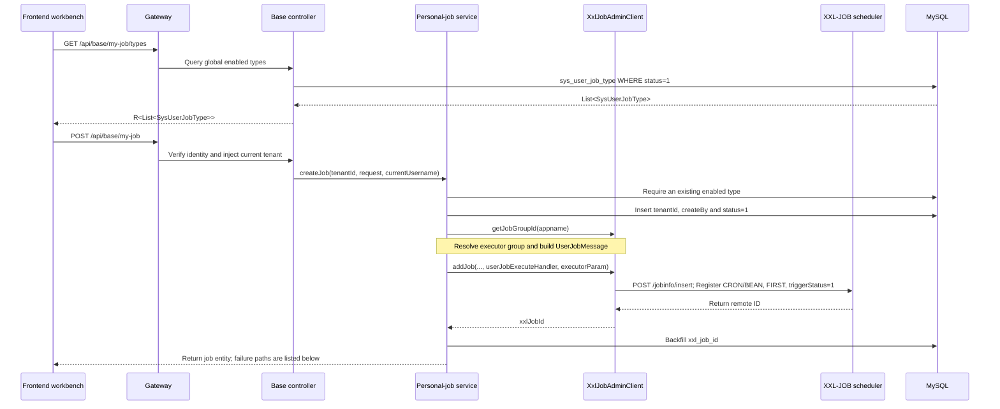

### Error Handling

| Trigger | Current handling |
| --- | --- |
| Blank jobName/jobType/cronExpression | Create DTO applies `@NotBlank`; this is not complete Cron or parameter Schema validation |
| Type missing or disabled | Business code 400 before insertion; an enabled catalog entry does not prove handler deployment |
| Executor-group lookup fails | Delete the newly inserted local row and throw business code 500 |
| Registration or ID backfill fails | Clean up by exact remote ID or executor group+handler+executorParam; delete local only after confirmed absence, otherwise retain the recovery association and report an error |
| Executor-parameter construction fails | This call follows insertion but is outside the registration-compensation try; there is no cleanup branch here, so rollback is not universally atomic |

### Key Components

| Source | Responsibility |
| --- | --- |
| [MyJobController.java](../omni-backend/omni-base/src/main/java/com/omni/base/controller/MyJobController.java) / [CreateUserJobRequest.java](../omni-backend/omni-base/src/main/java/com/omni/base/dto/CreateUserJobRequest.java) / [UpdateUserJobRequest.java](../omni-backend/omni-base/src/main/java/com/omni/base/dto/UpdateUserJobRequest.java) / [UserJobServiceImpl.java](../omni-backend/omni-base/src/main/java/com/omni/base/service/impl/UserJobServiceImpl.java) / [UserJobTypeServiceImpl.java](../omni-backend/omni-base/src/main/java/com/omni/base/service/impl/UserJobTypeServiceImpl.java) | Authenticated entry, DTO validation, type selection and row ownership |
| [index.vue](../omni-frontend/src/views/home/index.vue) / [myJob.ts](../omni-frontend/src/api/myJob.ts) | Workbench job API and form submission |
| [CronGenerator.vue](../omni-frontend/src/components/CronGenerator.vue) / [DynamicFormRenderer.vue](../omni-frontend/src/components/DynamicFormRenderer.vue) / [schema.ts](../omni-frontend/src/types/schema.ts) | 7 Cron frequency types and standard/compatible Schema fields |
| [XxlJobAdminClient.java](../omni-backend/omni-common-job/src/main/java/com/omni/common/job/XxlJobAdminClient.java) / [XxlJobProperties.java](../omni-backend/omni-common-job/src/main/java/com/omni/common/job/XxlJobProperties.java) / [XxlJobAutoConfiguration.java](../omni-backend/omni-common-job/src/main/java/com/omni/common/job/config/XxlJobAutoConfiguration.java) | Executor configuration, registration, remote lookup and compensation |
| [0001-base-schema.yaml](../database/changelog/base/0001-base-schema.yaml) / [base.sql](../scripts/sql/seed/base.sql) / [UserJobSeedSyncRunner.java](../omni-backend/omni-base/src/main/java/com/omni/base/job/UserJobSeedSyncRunner.java) | Formal job schema, seeds and startup synchronization |

### Ownership Model

`MyJobController` uses row ownership rather than method-specific `@PreAuthorize`. Lists and statistics fix the current tenant and `createBy`; creation obtains tenant and creator from the trusted header and authentication context.

Update, delete, status, manual trigger and log queries call `verifyOwnership(id, tenantId, username)`, requiring both entity `tenantId` and `createBy` to match. A missing job produces business code 404; a foreign tenant or creator produces 403. The same username does not permit cross-tenant access.

The log endpoint verifies the parent job first and then fixes `jobId` in its query. `UserJobLogServiceImpl` currently does not add its `tenantId` argument to SQL; the endpoint guard is separate from an independent SQL tenant predicate in that service.

### Current Status

- All personal jobs register `userJobExecuteHandler`; `jobType` identifies a handler Bean. The global `sys_user_job_type` catalog is separate from tenant dictionaries.
- When an XXL ID is associated, Cron/parameter updates, status and deletion call the remote service before local persistence. Renaming alone does not update the scheduler description. A lost acceptance response or unknown cleanup retains the local association for reconciliation.
- Startup synchronization scans enabled local rows without XXL IDs, rather than identifying only formal seeds. It does not reconcile unknown registration results and does not justify blindly restarting or creating another job.

[XXL-JOB](scheduling.en.md) / [Wiki](guides/scheduling.en.md)

---

## Flow 12: User Task Execution — XXL-JOB Trigger to Frontend Notification

### Overview

XXL-JOB passes `UserJobMessage` JSON to the shared execution entry, which routes by `jobType` to a `UserJobHandler`. Handler outcomes, log persistence, last execution time and frontend notifications have separate failure boundaries. Trigger acceptance does not prove they all completed.

### Sequence

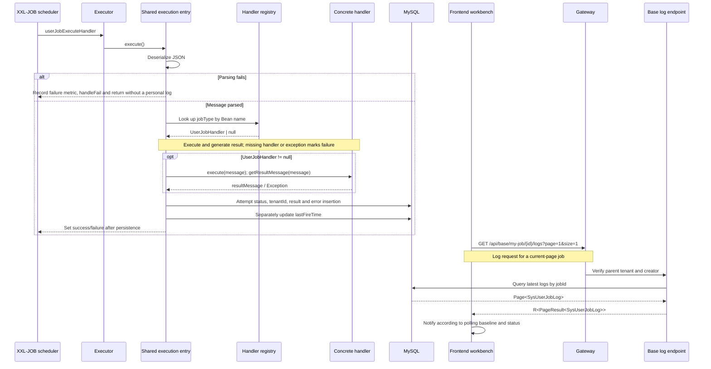

### Frontend Polling Mechanism

| Path | Interval/condition | Scope | Notification and stop |
| --- | --- | --- | --- |
| Manual-trigger wait | Every 2 seconds, at most 15 attempts | The manually triggered job | Notify and stop on a log newer than the pre-trigger baseline; stop after the limit |
| Page-entry check | After mounting, inspect the last 2 minutes | Latest log of each current-page job | Requires fireTime and resultMessage; there is no persisted read receipt |
| Periodic polling | Every 10 seconds | status=1 jobs in current filtered/paginated tableData | Initialize baseline silently; later larger IDs notify and refresh list/statistics |

Requests use Gateway/Base APIs; the browser does not query MySQL directly. The global polling timer belongs to this page and does not cover all jobs or other pages. List/statistics refresh only after a new log qualifies for notification.

The three paths have no shared persistent deduplication state, so notifications are not guaranteed to appear exactly once. Unmounting clears timers and ID baselines. Returning can display recent logs again, and closing the page ends this polling.

`ElNotification` chooses result or error text by status and lasts 3000 milliseconds. Client-side `cron-parser` computes the displayed next execution time; it does not prove the scheduler's next actual trigger.

### Execution Parameter JSON Format

| Field | Purpose |
| --- | --- |
| `jobId` | Identify the local job and log parent |
| `tenantId` | Pass explicitly to the handler and log |
| `jobType` | Match the UserJobHandler Bean name |
| `jobName` | Name snapshot from registration and notification title |
| `jobParams` | Optional JSON string; concrete handlers own validation |

The generic entry does not fully validate fields in otherwise valid JSON or reload the live job to verify current ownership before execution. It explicitly passes message context without establishing an HTTP tenant ThreadLocal. Extensions must validate their parameters and business boundaries.

Successful result text is limited to 500 characters and caught execution-error text to 2000. `execute_time_ms` starts after deserialization and covers lookup, execution and result generation, excluding log insertion and last-time updates.

Built-in `DrinkWaterRemindHandler` reads `cupShape`; missing or invalid input uses the source's `中杯` default. Its reminder and fallback strings are Chinese and do not automatically follow frontend locale.

### Error Handling

| Case | Current outcome |
| --- | --- |
| JSON deserialization fails | Record failure metric, handleFail and return before a personal log or lastFireTime update |
| Handler missing | Set status=0 and attempt error-log persistence, time update and failure reporting |
| execute/getResultMessage throws | Catch as status=0; this catch does not roll back business effects |
| Log insertion or last-time update fails | Outside the handler catch, without a shared transaction; errors can interrupt final result reporting, and both writes are not guaranteed atomic |
| Persistence completes normally | handleSuccess for status=1 or handleFail for status=0; frontend discovery of a new log remains separate |

### Key Components

| Source | Responsibility |
| --- | --- |
| [UserJobExecuteHandler.java](../omni-backend/omni-base/src/main/java/com/omni/base/job/UserJobExecuteHandler.java) / [UserJobHandlerRegistry.java](../omni-backend/omni-base/src/main/java/com/omni/base/job/UserJobHandlerRegistry.java) | Shared executor entry, Bean-name routing and outcome branches |
| [UserJobMessage.java](../omni-backend/omni-common-core/src/main/java/com/omni/common/core/job/UserJobMessage.java) / [UserJobHandler.java](../omni-backend/omni-common-core/src/main/java/com/omni/common/core/job/UserJobHandler.java) | Five-field message and handler SPI |
| [DrinkWaterRemindHandler.java](../omni-backend/omni-base/src/main/java/com/omni/base/job/handler/DrinkWaterRemindHandler.java) / [base.sql](../scripts/sql/seed/base.sql) | Built-in reminder parameters and actual text |
| [MyJobController.java](../omni-backend/omni-base/src/main/java/com/omni/base/controller/MyJobController.java) / [UserJobLogServiceImpl.java](../omni-backend/omni-base/src/main/java/com/omni/base/service/impl/UserJobLogServiceImpl.java) / [SysUserJobLogMapper.java](../omni-backend/omni-base/src/main/java/com/omni/base/mapper/SysUserJobLogMapper.java) | Parent ownership, log query and statistics SQL |
| [index.vue](../omni-frontend/src/views/home/index.vue) / [myJob.ts](../omni-frontend/src/api/myJob.ts) | Current-page polling, manual wait and notifications |
| [JobMetrics.java](../omni-backend/omni-common-job/src/main/java/com/omni/common/job/JobMetrics.java) | Execution/parsing metrics entry |

### Current Status

- Handler names must exactly match global type codes; catalog entries and deployed Beans are separate conditions. The shared user handler has no system-job metadata annotation.
- Personal-log tenantId comes from execution parameters; workbench reads verify the parent job first. Log lists sort by descending ID, and statistics restrict tenant/creator through the job relation.
- This section describes implementation boundaries. Source inspection and existing unit checks do not establish a new real Cron, browser-notification or external-effect acceptance run.

[XXL-JOB](scheduling.en.md) / [Wiki](guides/scheduling.en.md)

---

## Flow 13: CRM Idempotent Lead Conversion — Customer + Contact + Opportunity + Outbox

### Overview

`POST /api/crm/lead/{id}/convert` requires `crm:lead:convert` and resolves the current user's data scope with that same full permission code. The service first locks a visible, nondeleted lead in the current tenant, then checks for a conversion. An initial conversion requires `QUALIFIED` and a matching version; an existing conversion returns its original IDs with `idempotentReplay=true`, without further business or Outbox writes.

The DTO requires version, customerMode and contactMode. CREATE/LINK branches validate modes and linked IDs; a linked contact must belong to the selected customer. An optional opportunity uses DISCOVERY in the tenant's default pipeline and the tenant's default currency.

### Sequence

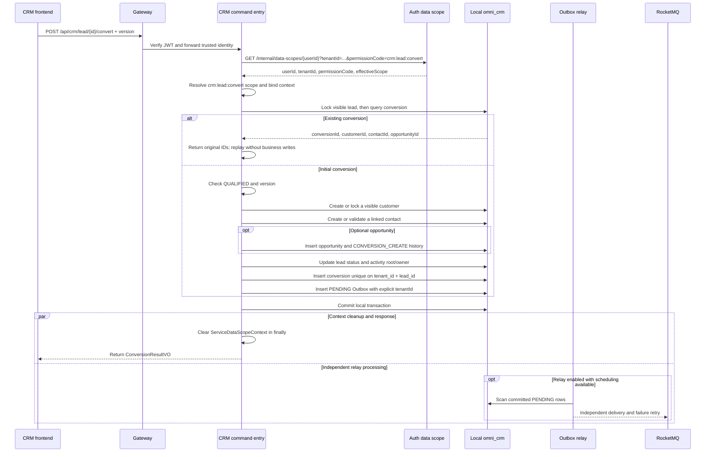

### Consistency Boundaries

| Object | Owner source |
| --- | --- |
| New customer | Current lead's owner snapshot |
| New contact | Selected customer's owner snapshot, which may differ from the lead |
| New opportunity | Current lead's owner snapshot |
| Moved activities | Change root to CUSTOMER, copy selected customer owner and increment activity version |

- The unique `crm_lead_conversion(tenant_id,lead_id)` constraint and visible-lead row lock protect conversion together. Replay still passes endpoint DTO, functional-permission and lead-visibility checks; inside the service it returns before status/version validation.
- `convert()` is `@Transactional`. The default four-argument `ReliableMessageTemplate.send()` joins through REQUIRED and inserts a local PENDING message. Relay and broker delivery are separate; a disabled or unscheduled relay leaves enqueueing distinct from delivery.
- Linking an existing customer/contact does not reassign its owner. Conversion does not call `CrmOwnerResolver` to revalidate inherited owners with Auth; other create/assignment commands' owner checks are separate behavior.
- The conversion payload contains only leadId, customerId, contactId and opportunityId (possibly null). eventId, tenantId, aggregateVersion and actorUserId belong to the envelope. eventId is also passed as msgKey, which does not itself establish business idempotency. The payload excludes contact details and remarks.
- The conversion `@OperLog` disables entity snapshots and explicitly excludes customerName, contactName and opportunityName parameters. Flow 10 defines sanitization and exception boundaries; this is not a guarantee that every sensitive text is recognized.
- Invalid modes/relations produce business code 400, invisible resources 404, and initial status/version conflicts 409. Auth scope rejection or inconsistent scope produces 403; Feign service errors produce 503, without broadening the data scope.

Source and regressions: [LeadController.java](../omni-backend/omni-crm/src/main/java/com/omni/crm/controller/LeadController.java) / [LeadServiceImpl.java](../omni-backend/omni-crm/src/main/java/com/omni/crm/service/impl/LeadServiceImpl.java) / [CrmRequests.java](../omni-backend/omni-crm/src/main/java/com/omni/crm/dto/CrmRequests.java) / [CrmTenantInitializerImpl.java](../omni-backend/omni-crm/src/main/java/com/omni/crm/service/impl/CrmTenantInitializerImpl.java) / [ReliableMessageTemplate.java](../omni-backend/omni-common-mqlog/src/main/java/com/omni/common/mqlog/template/ReliableMessageTemplate.java) / [LeadServiceImplTest.java](../omni-backend/omni-crm/src/test/java/com/omni/crm/service/impl/LeadServiceImplTest.java)

[Reliable-message boundaries](mq-reliability.en.md)

---

## Flow 14: CRM Opportunity Advancement and Permission Isolation — Stage History + Customer Activation

### Overview

Opportunity stages use `crm:opportunity:stage`; reopening uses `crm:opportunity:reopen`. Ordinary update DTOs do not accept stage/status. Repository configuration enables tenant and data-scope policies. The service constrains commands with visible-row locks and versioned updates, then appends stage history and local Outbox records.

### State Advancement

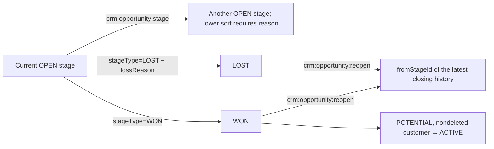

### Command Execution Rules

1. Gateway forwards trusted identity, and CRM's shared identity chain and method permissions protect commands. `@ServiceDataScope` resolves the command's full permissionCode from Auth, validates userId/tenantId/permissionCode/effectiveScope, and clears context in finally.
2. The current interceptor chain is TenantLine → DataPermission → OptimisticLocker → Pagination. TenantLine handles crm_*; DataPermission adds owner scopes for five aggregates. ALL/TENANT removes only owner predicates and retains the current tenant boundary.
3. changeStage locks a visible opportunity and checks version/current OPEN. Source and target stages must be enabled, the target must share the pipeline, and the same stage is rejected. A lower sort requires reason; LOST additionally requires lossReason. Advancement is not limited to the next stage.
4. Update stage/status/probability, close time and loss reason using id/version/deleted=0 while incrementing version; a row count other than 1 throws 409. Append history and enqueue stage-changed/won/lost events, with event type determined by target stageType.
5. A win invokes dedicated customer SQL that ignores only DataPermission, retains TenantLine and requires customerId/POTENTIAL/deleted=0. The call does not require one affected row; other customer states are not forced to ACTIVE.
6. Reopen reads fromStageId from the latest history ending in WON/LOST, resolves that currently enabled stage, sets OPEN/probability, clears close time/loss reason and performs a versioned update. It appends REOPEN history and emits an event based on the selected stage type.
7. Customer, stage-history and Outbox writes belong to the service method's local transaction. Row-lock code and unit cases alone do not prove current-database concurrency, rollback or external MQ acceptance.

### PII Return Rules

- Dedicated Lead, Customer and Contact paginated lists always use masked assembly. Details use `crm:pii:view` to decide whether protected contact/address fields are returned in full.
- Dedicated Activity lists/timelines replace nonblank content with `[REDACTED]`; null and blank content remain unchanged. Details apply the PII permission.
- Customer 360 independently checks each contact/opportunity/activity/lead block's list permission and dataScope; ungranted blocks are not queried. Visible contacts and activities also use the detail PII flag, so this is not unconditional masking of every collection.
- All four edit pages reload details first, disable sensitive inputs without PII permission and omit those fields from submitted payloads. Conversion also omits contactMobile/contactEmail. Backend command permissions and data-scope checks continue to authorize writes.

Source and regressions: [OpportunityController.java](../omni-backend/omni-crm/src/main/java/com/omni/crm/controller/OpportunityController.java) / [OpportunityServiceImpl.java](../omni-backend/omni-crm/src/main/java/com/omni/crm/service/impl/OpportunityServiceImpl.java) / [CrmCustomerMapper.java](../omni-backend/omni-crm/src/main/java/com/omni/crm/mapper/CrmCustomerMapper.java) / [CrmStateMachine.java](../omni-backend/omni-crm/src/main/java/com/omni/crm/domain/CrmStateMachine.java) / [ServicePersistenceAutoConfiguration.java](../omni-backend/omni-common-service/src/main/java/com/omni/common/service/config/ServicePersistenceAutoConfiguration.java) / [CrmViewAssembler.java](../omni-backend/omni-crm/src/main/java/com/omni/crm/dto/CrmViewAssembler.java) / [CrmPermissionScopeExecutor.java](../omni-backend/omni-crm/src/main/java/com/omni/crm/service/support/CrmPermissionScopeExecutor.java) / [OpportunityServiceImplTest.java](../omni-backend/omni-crm/src/test/java/com/omni/crm/service/impl/OpportunityServiceImplTest.java) / [PiiMaskerTest.java](../omni-backend/omni-crm/src/test/java/com/omni/crm/security/PiiMaskerTest.java)

[crm/lead/index.vue](../omni-frontend/src/views/crm/lead/index.vue) / [crm/customer/index.vue](../omni-frontend/src/views/crm/customer/index.vue) / [crm/contact/index.vue](../omni-frontend/src/views/crm/contact/index.vue) / [crm/activity/index.vue](../omni-frontend/src/views/crm/activity/index.vue)

This section uses current source and bound unit results. Real MySQL concurrency/rollback, browser behavior and external delivery require their corresponding acceptance evidence.

---

Deployment and troubleshooting steps are in [Authentication](guides/authentication.en.md), [Docker Deployment](docker-deployment.en.md) and [Operations](guides/operations-upgrade.en.md). Social callbacks use a browser-reachable Gateway; Compose services use internal service names. The flows on this page define Auth audit events, JWT/JWK, functional permissions and data-scope boundaries.

## Flow 15: SRM Supplier Admission Approval

`POST /api/srm/supplier` requires `srm:supplier:create` and the data scope resolved with that same permission. Admin creation writes the PENDING_REVIEW supplier, initial risk data and registration Outbox, then resolves the current tenant model published under `category=SRM_SUPPLIER_ONBOARDING`. Creation and rejected-supplier submit synchronously call Workflow inside their local `@Transactional` methods; these call sites do not run after commit.

The actual start endpoint is `POST /api/internal/workflow/process-instance/start`. Its response contains processInstanceId, requestId, businessType, businessKey and replayed. Workflow commits independently; a local rollback cannot undo an already committed remote process.

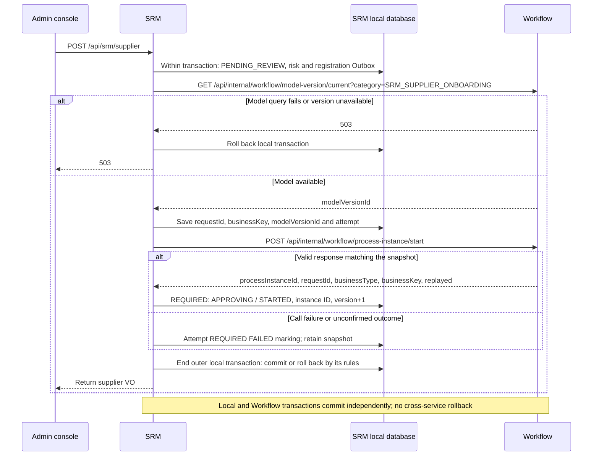

- Model resolution precedes the start-error catch: a missing valid model or query failure throws 503 and may roll back creation. Start-call errors instead attempt FAILED marking and are caught by prepareAndStart; if the outer transaction commits, the supplier remains PENDING_REVIEW. FAILED means local start confirmation is missing and does not prove the remote process is absent.
- SRM stores requestId, businessKey=`{supplierId}:{attempt}`, modelVersionId, attempt and start state. startUserId/startUserName come from the current identity into the command, without persistent supplier start-user snapshot fields. Workflow coordinates replay through unique tenant+requestId and tenant+businessType+businessKey constraints and checks matching model and starter intent.
- Admin `/{id}/submit` and Portal `/profile/submit` accept only REJECTED and create a new attempt. Neither currently exposes a same-snapshot Workflow start retry for PENDING_REVIEW/FAILED; Portal enrollment/retry belongs to the role-assignment Saga. Resubmission cannot be described as generic failed-start recovery.
- Completion travels through the Workflow local Outbox and an independent relay. In one transaction SRM registers/locks the `(tenantId,eventId)` Inbox and checks producer, businessType, businessKey, instance and payload intent. Only matching APPROVING/STARTED advances to APPROVED/REJECTED and writes the result Outbox. Processed, old-attempt, terminal or instance-mismatched events do not advance again; valid completion arriving before local start confirmation throws a retryable exception instead of being marked processed.
- `RequiredWorkflowModelInitializer` checks four required models for default tenant 1 and corrects/publishes matching enabled models returned by its query. Missing default models or publication failure prevent Workflow startup; this does not guarantee every new tenant already has all models.
- Creation assembles its response from the in-memory supplier. After a start failure, the database start marker and incremented version are not fully synchronized back into that entity. Re-read details for state and current version; the create response is not a complete persistent start snapshot.

Source and regressions: [SupplierController.java](../omni-backend/omni-srm/src/main/java/com/omni/srm/controller/SupplierController.java) / [SupplierServiceImpl.java](../omni-backend/omni-srm/src/main/java/com/omni/srm/service/impl/SupplierServiceImpl.java) / [SupplierWorkflowCoordinator.java](../omni-backend/omni-srm/src/main/java/com/omni/srm/workflow/SupplierWorkflowCoordinator.java) / [SupplierWorkflowStateServiceImpl.java](../omni-backend/omni-srm/src/main/java/com/omni/srm/workflow/SupplierWorkflowStateServiceImpl.java) / [SupplierWorkflowCompletionServiceImpl.java](../omni-backend/omni-srm/src/main/java/com/omni/srm/service/impl/SupplierWorkflowCompletionServiceImpl.java) / [WorkflowInternalClient.java](../omni-backend/omni-srm/src/main/java/com/omni/srm/client/WorkflowInternalClient.java) / [RequiredWorkflowModelInitializer.java](../omni-backend/omni-workflow/src/main/java/com/omni/workflow/config/RequiredWorkflowModelInitializer.java) / [InternalWorkflowServiceImpl.java](../omni-backend/omni-workflow/src/main/java/com/omni/workflow/service/impl/InternalWorkflowServiceImpl.java) / [WorkflowProcessStartRequestServiceImpl.java](../omni-backend/omni-workflow/src/main/java/com/omni/workflow/service/impl/WorkflowProcessStartRequestServiceImpl.java) / [SrmViewAssembler.java](../omni-backend/omni-srm/src/main/java/com/omni/srm/dto/SrmViewAssembler.java)

### Flow 15.1: Requisition Approval Rule Configuration and Match Simulation

Rules bind model category `purchase`; running instances use businessType `PROCUREMENT_REQUISITION`. The UI selects a process name and version, while the protocol still sends modelVersionId.

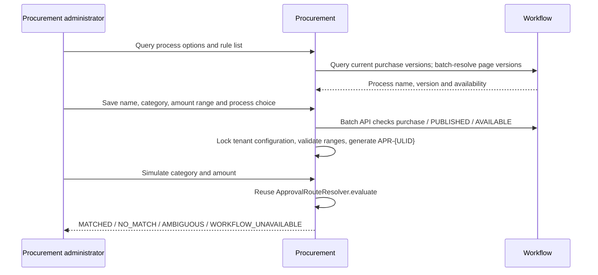

- Create/update validates a current purchase published model. List metadata resolves deduplicated modelVersionId values in batches of at most 200; Workflow failure retains local rules with UNAVAILABLE. Match simulation returns an approval graph only when the model and safe preview are available.
- Amount intervals are half-open. Exact category matches take precedence; `*` is used only without an exact hit. Multiple matches in the selected layer yield AMBIGUOUS even with priority ordering. The server generates route_code; an API request may supply priority, otherwise it uses the category maximum plus 10.
- Coverage divides 0 to infinity and includes model availability. Disable/delete impact simulation excludes the target in memory. Tenant initialization may still prepare default configuration, so simulation does not imply an entire request without initialization writes.

Source and regressions: [ApprovalRouteController.java](../omni-backend/omni-procurement/src/main/java/com/omni/procurement/controller/ApprovalRouteController.java) / [ApprovalRouteServiceImpl.java](../omni-backend/omni-procurement/src/main/java/com/omni/procurement/service/impl/ApprovalRouteServiceImpl.java) / [ApprovalRouteInsightServiceImpl.java](../omni-backend/omni-procurement/src/main/java/com/omni/procurement/service/impl/ApprovalRouteInsightServiceImpl.java) / [ApprovalRouteResolver.java](../omni-backend/omni-procurement/src/main/java/com/omni/procurement/domain/ApprovalRouteResolver.java) / [ApprovalRouteCoverageAnalyzer.java](../omni-backend/omni-procurement/src/main/java/com/omni/procurement/domain/ApprovalRouteCoverageAnalyzer.java) / [ApprovalRuleWizard.vue](../omni-frontend/src/views/procurement/approval-route/components/ApprovalRuleWizard.vue)

## Flow 16: Procurement Requisition Approval and Async Write-Back

Submit and `/{id}/retry-start` both require `procurement:requisition:submit` and its data scope. submit itself holds no transaction: it calls transactional prepareSubmit first, then invokes Workflow with the committed snapshot.

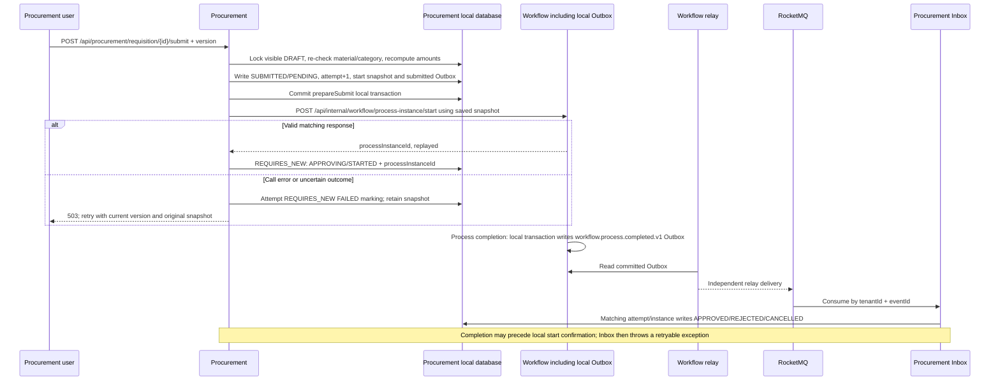

- prepareSubmit accepts only DRAFT and the current version. It re-checks active materials/categories, requires one category, positive quantities and nonnegative prices, rounds each line HALF_UP to four decimals before summing, and checks DECIMAL(19,4). Routing is server-side; the client does not choose a model.
- Start errors or inconsistent responses attempt SUBMITTED/FAILED marking and do not establish that Workflow never started. retry-start requires that state and current version, reusing requestId/businessKey/modelVersionId/attempt, amount and requester without rerouting or incrementing the attempt. Editing REJECTED returns it to DRAFT; the next submit starts a new attempt.
- Completion consumption updates business state, result Outbox and Inbox in one transaction. Different payload intent under the same eventId yields 409. Early completion throws a retryable exception; old attempts and terminal events are ignored idempotently. Outbox insertion and actual relay delivery are separate stages.
- The list silently refreshes every five seconds only while the page is visible and its current rows include APPROVING. After 60 seconds it shows slow synchronization and refresh controls; the timer continues. The notice does not establish that Workflow has completed, cover every page, or recover SUBMITTED startup.

Procurement owns RFQ invitations and SRM owns quotations. SRM saves the quotation, lines, request idempotency ledger and quotation Outbox in one transaction; Procurement Inbox advances invitation quotation versions and ignores older versions. Award re-reads and validates the current quotation ID/version, invitation and lines, then creates the purchase order with quotation snapshots, advances RFQ and writes domain Outbox within the Procurement local transaction.

Source and regressions: [RequisitionController.java](../omni-backend/omni-procurement/src/main/java/com/omni/procurement/controller/RequisitionController.java) / [RequisitionServiceImpl.java](../omni-backend/omni-procurement/src/main/java/com/omni/procurement/service/impl/RequisitionServiceImpl.java) / [RequisitionWorkflowStateServiceImpl.java](../omni-backend/omni-procurement/src/main/java/com/omni/procurement/service/impl/RequisitionWorkflowStateServiceImpl.java) / [RequisitionWorkflowCoordinator.java](../omni-backend/omni-procurement/src/main/java/com/omni/procurement/workflow/RequisitionWorkflowCoordinator.java) / [WorkflowCompletionServiceImpl.java](../omni-backend/omni-procurement/src/main/java/com/omni/procurement/service/impl/WorkflowCompletionServiceImpl.java) / [index.vue](../omni-frontend/src/views/procurement/requisition/index.vue) / [QuotationServiceImpl.java](../omni-backend/omni-srm/src/main/java/com/omni/srm/service/impl/QuotationServiceImpl.java) / [QuotationSubmittedServiceImpl.java](../omni-backend/omni-procurement/src/main/java/com/omni/procurement/service/impl/QuotationSubmittedServiceImpl.java) / [RfqServiceImpl.java](../omni-backend/omni-procurement/src/main/java/com/omni/procurement/service/impl/RfqServiceImpl.java) / [PurchaseOrderServiceImpl.java](../omni-backend/omni-procurement/src/main/java/com/omni/procurement/service/impl/PurchaseOrderServiceImpl.java) / [RequisitionWorkflowCoordinatorTest.java](../omni-backend/omni-procurement/src/test/java/com/omni/procurement/workflow/RequisitionWorkflowCoordinatorTest.java) / [RequisitionWorkflowStateServiceImplTest.java](../omni-backend/omni-procurement/src/test/java/com/omni/procurement/service/impl/RequisitionWorkflowStateServiceImplTest.java) / [WorkflowCompletionServiceImplTest.java](../omni-backend/omni-procurement/src/test/java/com/omni/procurement/service/impl/WorkflowCompletionServiceImplTest.java)

These statements cover current source and bound unit reports. Real MySQL concurrency/rollback, Workflow/MQ delivery, browser polling and SRM registration with a real CAPTCHA still require their respective acceptance evidence.

---

## Flow 17: Procurement Goods Receipt to Asset Card Creation, Transfer and Disposal

Procurement, Asset and Workflow commit separate local transactions connected by Outbox and Inbox. Source import, approval confirmation and physical business completion are separate steps.

### Receipt Import and Historical Compensation

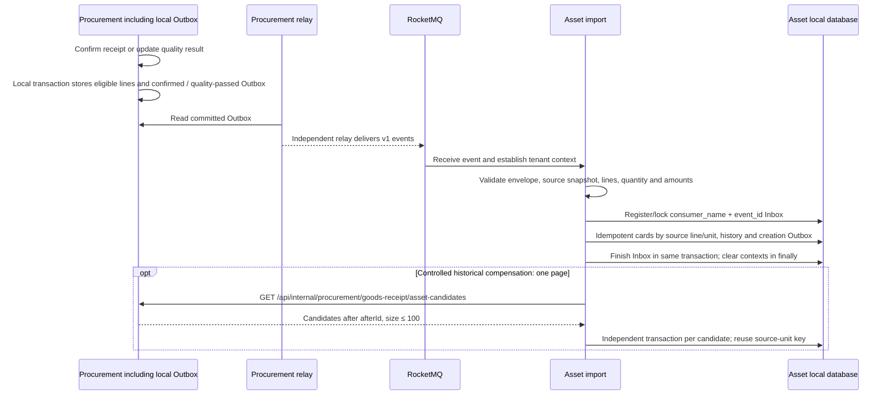

- Receipt confirmation publishes only lines currently eligible for asset conversion; later quality-passed events contain newly passed eligible lines. Asset supports `procurement.goods-receipt.confirmed.v1` and `procurement.goods-receipt.quality-passed.v1`.
- Import validates source IDs, owner, currency, line snapshots and amount equations first. Valid non-PASS or non-assetManaged lines are skipped; missing fields, invalid amounts or duplicate source lines reject the batch. Eligible receivedQuantity must be an exact positive integer matching assetQuantity, no greater than Integer.MAX_VALUE. unitPrice and totalPrice must be positive.
- Inbox uniqueness is `(consumer_name,event_id)`, with separate tenant and JSON-intent checks. Cross-tenant collisions or different intent under one event ID are rejected. Asset uniqueness is `(tenant_id,source_gr_line_id,source_unit_sequence)` across realtime and backfill. The service re-reads a source unit after idempotent insertion instead of deciding creation from JDBC counts alone.
- New cards are IN_STOCK and inherit receipt owners. Each purchaseAmount is unitPrice rounded HALF_UP to two decimals. Only new cards add history and asset.created.v1 Outbox; realtime assets, history, Inbox and Outbox share one local transaction.
- Compensation uses internally authenticated `POST /api/internal/asset/procurement/backfill`. Header/query tenantId must match; afterId is an exclusive receipt-line cursor and size is 1–100. One call handles one page and returns nextAfterId/hasMore. The caller saves the cursor and continues; there is no automatic startup full-scan implementation. Candidates commit individually, so earlier effects survive a mid-page failure and source keys deduplicate retries.

Source: [GoodsReceiptServiceImpl.java](../omni-backend/omni-procurement/src/main/java/com/omni/procurement/service/impl/GoodsReceiptServiceImpl.java) / [ProcurementGoodsReceiptConsumer.java](../omni-backend/omni-asset/src/main/java/com/omni/asset/consumer/ProcurementGoodsReceiptConsumer.java) / [ProcurementAssetImportServiceImpl.java](../omni-backend/omni-asset/src/main/java/com/omni/asset/service/impl/ProcurementAssetImportServiceImpl.java) / [AssetReceiptImportMapper.java](../omni-backend/omni-asset/src/main/java/com/omni/asset/mapper/AssetReceiptImportMapper.java) / [ProcurementAssetBackfillServiceImpl.java](../omni-backend/omni-asset/src/main/java/com/omni/asset/service/impl/ProcurementAssetBackfillServiceImpl.java) / [InternalProcurementBackfillController.java](../omni-backend/omni-asset/src/main/java/com/omni/asset/controller/InternalProcurementBackfillController.java) / [InternalAssetCandidateController.java](../omni-backend/omni-procurement/src/main/java/com/omni/procurement/controller/InternalAssetCandidateController.java) / [InternalAssetCandidateServiceImpl.java](../omni-backend/omni-procurement/src/main/java/com/omni/procurement/service/impl/InternalAssetCandidateServiceImpl.java) / [0001-asset-schema.yaml](../database/changelog/asset/0001-asset-schema.yaml)

### Transfer/Disposal Approval and Business Completion

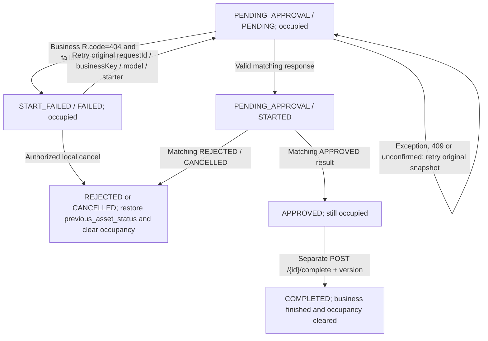

- Creation automatically resolves the current tenant published ASSET_TRANSFER/ASSET_DISPOSAL model. The user does not select its version. A local prepare transaction stores requestId, operation ID as businessKey, model and starter, then occupies the asset under tenant/id/version/status and both active_operation_* fields being null. Allowed sources are IN_STOCK/ALLOCATED/IN_USE; conflict yields 409. Workflow is called after commit, with REQUIRES_NEW confirmation.
- Network exceptions, business 409, invalid responses or local confirmation failure retain PENDING_APPROVAL/PENDING and occupancy. Only business R.code=404 enters explicit failure marking; local cancellation requires successfully saved START_FAILED/FAILED. An HTTP404 Feign exception remains an unknown result. Retry preserves requestId, businessKey, model and starter.
- The approval Inbox checks tenant, business type/key, instance and payload intent. Valid completion before local start confirmation throws a retryable exception; processed or current-state/instance mismatches are ignored idempotently. APPROVED retains occupancy until a separate complete permission and current version are provided. Transfer completion sets current user/unit and IN_USE without changing management owners; disposal ends as DISPOSED or SCRAPPED. Rejection/cancellation restores previous_asset_status, records history and clears occupancy in one transaction.
- Asset candidates use the corresponding transfer:create/disposal:create scope and eligible states. User candidates validate Auth tenant and organizational membership; supplier candidates require tenant APPROVED. These do not all apply the asset owner predicate. SELF transfer:create candidates use current_user_id, while commands also re-check writable target units and user membership. Candidate visibility does not guarantee write authorization.
- purchaseAmount, residualValue and source-event amounts use JSON decimal strings, with dedicated string deserializers for residual-value requests. Candidates, retry, cancel and complete have their own permissions; workflow approval authority does not replace asset-command authority.

Source: [AssetTransferController.java](../omni-backend/omni-asset/src/main/java/com/omni/asset/controller/AssetTransferController.java) / [AssetDisposalController.java](../omni-backend/omni-asset/src/main/java/com/omni/asset/controller/AssetDisposalController.java) / [AssetTransferServiceImpl.java](../omni-backend/omni-asset/src/main/java/com/omni/asset/service/impl/AssetTransferServiceImpl.java) / [AssetDisposalServiceImpl.java](../omni-backend/omni-asset/src/main/java/com/omni/asset/service/impl/AssetDisposalServiceImpl.java) / [AssetOperationWorkflowStateServiceImpl.java](../omni-backend/omni-asset/src/main/java/com/omni/asset/service/impl/AssetOperationWorkflowStateServiceImpl.java) / [WorkflowCompletionServiceImpl.java](../omni-backend/omni-asset/src/main/java/com/omni/asset/service/impl/WorkflowCompletionServiceImpl.java) / [AssetWorkflowCoordinator.java](../omni-backend/omni-asset/src/main/java/com/omni/asset/workflow/AssetWorkflowCoordinator.java) / [AssetWorkflowModelGuard.java](../omni-backend/omni-asset/src/main/java/com/omni/asset/workflow/AssetWorkflowModelGuard.java) / [AstAssetMapper.java](../omni-backend/omni-asset/src/main/java/com/omni/asset/mapper/AstAssetMapper.java) / [AssetOptionsController.java](../omni-backend/omni-asset/src/main/java/com/omni/asset/controller/AssetOptionsController.java) / [AssetOptionServiceImpl.java](../omni-backend/omni-asset/src/main/java/com/omni/asset/service/impl/AssetOptionServiceImpl.java) / [AssetDataPermissionHandler.java](../omni-backend/omni-asset/src/main/java/com/omni/asset/security/AssetDataPermissionHandler.java) / [AssetViews.java](../omni-backend/omni-asset/src/main/java/com/omni/asset/dto/AssetViews.java) / [AssetOperationRequests.java](../omni-backend/omni-asset/src/main/java/com/omni/asset/dto/AssetOperationRequests.java)

## Flow 18: SRM Portal Invitation Enrollment and Role Assignment Saga

Account self-registration belongs to Auth, validating a real CAPTCHA and tenant username before login. Flow 1 describes default USER-assignment boundaries. SRM enrollment uses an existing authenticated identity, requestId and inviteToken; it does not create the Auth account.

```mermaid
sequenceDiagram
    participant U as Portal user
    participant G as Gateway
    participant A as Auth
    participant S as SRM
    participant SO as SRM Outbox/relay
    participant AO as Auth receipt and Outbox/relay
    participant M as RocketMQ
    participant W as Workflow
    U->>A: POST /api/auth/register with tenant + captcha, then login
    A-->>U: Authenticated identity
    U->>G: POST /api/srm/portal/enroll + requestId + inviteToken
    G->>S: Forward trusted tenant/user
    S->>S: Local transaction consumes invite, creates REGISTERING + PENDING_ROLE_ASSIGN
    S->>SO: Same transaction writes srm.portal-role.assign-requested.v1
    SO-->>M: Independent relay delivery
    M->>A: tenantId, requestId, supplierId, userId, SUPPLIER
    A->>A: Validate original tenant/request identity and assign SUPPLIER idempotently
    A->>AO: Same transaction saves receipt and success/failure result Outbox
    AO-->>M: Independent relay delivery
    M->>S: auth.portal-role.assigned.v1 / auth.portal-role.assign-failed.v1
    alt SUCCESS
        S->>S: Same local transaction writes ACTIVE PortalUser,PENDING_REVIEW,COMPLETED
        S->>W: Prepare/start admission in same local transaction: see Flow15
    else FAILED
        S->>S: REGISTERING_FAILED + ROLE_ASSIGN_FAILED + nextRetryTime
    end
    U->>S: GET /api/srm/portal/enrollment
    S-->>U: Saga state#59; relogin offered after COMPLETED
    Note over S,W: Model lookup failure can roll back SRM result#59; Auth role is independently committed and message needs redelivery
```

- Replay by tenant/requestId checks the applicant and normalized creditCode. An existing active enrollment also returns its original request without consuming another invite. There is no whole-request-body idempotency hash here. New supplier internal owners are null; the Portal userId is stored only in the Portal association.
- Raw invitation tokens are returned only when created, with SHA-256 persisted. enroll OperLog explicitly excludes inviteToken; role messages omit passwords, CAPTCHA and raw invitations. Consume SQL guards tenant, version, ACTIVE, expiry and remaining uses. Invalid invitations yield 404, expired/exhausted 410, and concurrency conflicts 409.
- Auth uses `sys_portal_role_request(tenant_id,request_id)` to check original supplier/user/role intent. It allows SUPPLIER only and validates an enabled tenant user and role. Assignment, receipt and result Outbox share one transaction. Completed replay republishes a result Outbox with an eventId derived deterministically from requestId and event type.
- SRM checks envelope/payload requestId and tenantId plus supplier/user/SUPPLIER. Success creates an ACTIVE PortalUser, writes PENDING_REVIEW/COMPLETED, then invokes admission Workflow in that same local transaction; a valid start reaches APPROVING. Model lookup failure can roll back local Saga completion, while start-call failure can commit COMPLETED with PENDING_REVIEW/FAILED. Saga completion does not mean admission APPROVED; Flow 15 defines recovery boundaries.
- Failure records REGISTERING_FAILED/ROLE_ASSIGN_FAILED and nextRetryTime. `POST /api/srm/portal/enrollment/retry` reuses the requestId only for failed role assignment after backoff, without consuming another invite. Early retry yields 429; PENDING/COMPLETED returns existing state. A late failure after completion is ignored.
- Within SRM Portal permissions, the seeded USER role serves enrollment. Profile/evaluation require SUPPLIER, the specific permission and an ACTIVE PortalUser for the current tenant/user. SrmPortalScope temporarily binds TENANT scope and restores it; the SRM result consumer clears identity/scope in finally, while Auth role processing uses explicit tenant conditions.
- The Portal retains requestId by tenant/username and polls every five seconds during PENDING_ROLE_ASSIGN. COMPLETED offers logout and relogin to obtain the role. A database role grant does not rewrite the current JWT.

Source: [AuthController.java](../omni-backend/omni-auth/src/main/java/com/omni/auth/controller/AuthController.java) / [UserServiceImpl.java](../omni-backend/omni-auth/src/main/java/com/omni/auth/service/impl/UserServiceImpl.java) / [PortalRoleAssignConsumer.java](../omni-backend/omni-auth/src/main/java/com/omni/auth/consumer/PortalRoleAssignConsumer.java) / [PortalRoleAssignmentServiceImpl.java](../omni-backend/omni-auth/src/main/java/com/omni/auth/service/impl/PortalRoleAssignmentServiceImpl.java) / [SysPortalRoleRequestMapper.java](../omni-backend/omni-auth/src/main/java/com/omni/auth/mapper/SysPortalRoleRequestMapper.java) / [PortalController.java](../omni-backend/omni-srm/src/main/java/com/omni/srm/controller/PortalController.java) / [PortalInviteServiceImpl.java](../omni-backend/omni-srm/src/main/java/com/omni/srm/service/impl/PortalInviteServiceImpl.java) / [SrmSupplierInviteMapper.java](../omni-backend/omni-srm/src/main/java/com/omni/srm/mapper/SrmSupplierInviteMapper.java) / [SupplierPortalServiceImpl.java](../omni-backend/omni-srm/src/main/java/com/omni/srm/service/impl/SupplierPortalServiceImpl.java) / [PortalRoleResultConsumer.java](../omni-backend/omni-srm/src/main/java/com/omni/srm/consumer/PortalRoleResultConsumer.java) / [PortalRoleResultServiceImpl.java](../omni-backend/omni-srm/src/main/java/com/omni/srm/service/impl/PortalRoleResultServiceImpl.java) / [SrmPortalScope.java](../omni-backend/omni-srm/src/main/java/com/omni/srm/security/SrmPortalScope.java) / [index.vue](../omni-frontend/src/views/supplier-portal/index.vue)

This section describes contracts from source and existing unit reports. Real MySQL concurrency/transactions, broker delivery, native UI and enrollment with a real CAPTCHA require their respective acceptance evidence.
