# コアビジネスフロー

> 本文書はリクエスト・イベントの呼出関係と、状態・トランザクション・認可・冪等性・失敗時の不変条件を管理します。操作と画像は [Wiki](wiki/index.jp.md)および業務ガイド、ブレークポイントは[ソースデバッグ](wiki/source-debugging.jp.md)を参照してください。
> アーキテクチャの概要については [architecture.jp.md](architecture.jp.md) を参照してください。Docker デプロイメントの設定については [docker-deployment.jp.md](docker-deployment.jp.md) を参照してください。API 契約については [api-contract.jp.md](api-contract.jp.md) を参照してください。

## Flow 1: ユーザーログイン（ユーザー名 + パスワード + CAPTCHA + JWT）

### 概要

`POST /api/auth/login` はユーザー名、パスワード、必須の `tenantId`、CAPTCHA を Gateway 経由で Auth へ送ります。この JWT ログインは `UserService.findByUsername()/verifyPassword()` を直接呼び、成功時に `R<LoginResult>` を返します。`tenantId:username` の解析は別のセッション認証経路です。

### シーケンス

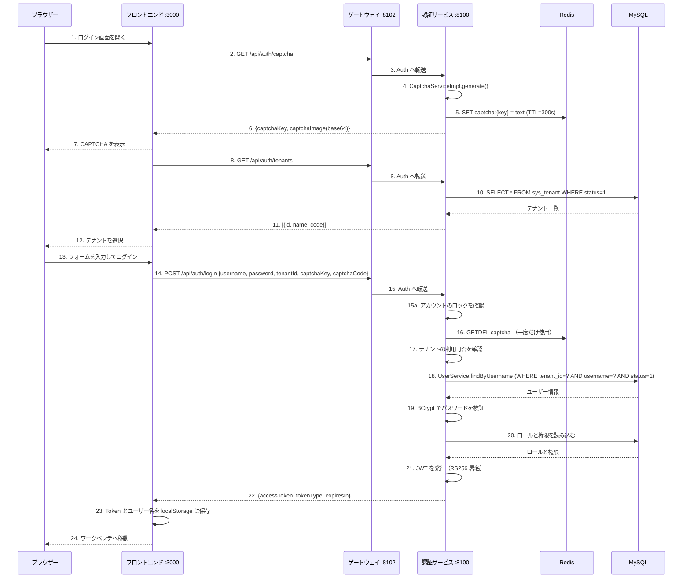

### ログイン後：認証済みリクエストフロー

保護対象の要求は `Authorization: Bearer <JWT>` を付けます。`AuthFilter` は公開鍵を取得し、署名と `exp` を検証して `jti` で Redis ブラックリストを確認します。その後、クライアントの身元ヘッダーと転送する Bearer ヘッダーを除去し、認証済みの身元と `X-Gateway-Assertion` を設定します。このフィルターは JWT のリスト型 `roles/scope` をコンマ区切りの身元ヘッダーに変換します。

署名・期限・ブラックリストによるセキュリティ拒否は 401 です。公開鍵、Redis、下流の依存先障害を一律に JWT エラーとしません。通常実行で断言用の秘密値がない、32 バイト未満、または断言の生成に失敗した場合は 503 で転送を止めます。下流は各自の事前認証規則で断言を検証します。現在の payload はユーザー ID、テナント ID、ユーザー名、発行時刻を結び付けます。

```
ブラウザー -> フロントエンド：保護対象のリソースを要求
フロントエンド -> ゲートウェイ :8102：Authorization: Bearer <JWT>
ゲートウェイ：JwkKeyProvider が RSA 公開鍵を取得（既定キャッシュ 5 分）
ゲートウェイ：RS256 署名と exp を検証
ゲートウェイ -> Redis：jti で token:blacklist:{jti} を照会
ゲートウェイ：クライアントの身元ヘッダーと転送用 Bearer ヘッダーを除去
ゲートウェイ -> 下流：X-User-Id / X-Tenant-Id / X-User-Name
ゲートウェイ -> 下流：X-User-Roles: <role-code>
ゲートウェイ -> 下流：X-User-Scopes: <permission-code>
ゲートウェイ -> 下流：X-Gateway-Assertion
下流：自身の事前認証規則でゲートウェイの断言を検証
下流 -> ゲートウェイ -> フロントエンド -> ブラウザー：応答
```

### 主要コンポーネント

| コンポーネント | ソース | 責務 |
|---|---|---|
| `LoginForm.vue` | [omni-frontend/src/components/LoginForm.vue](../omni-frontend/src/components/LoginForm.vue) | ログインフォーム：CAPTCHA、テナント、認証情報の送信 |
| `user.ts` | [omni-frontend/src/stores/user.ts](../omni-frontend/src/stores/user.ts) | Token とユーザー名を localStorage に保存 |
| `request.ts` | [omni-frontend/src/api/request.ts](../omni-frontend/src/api/request.ts) | 要求インターセプターで Bearer Token を追加 |
| `vite.config.ts` | [omni-frontend/vite.config.ts](../omni-frontend/vite.config.ts) | `/api` のプロキシ先、既定 Gateway :8102 |
| `AuthController.java` | [omni-backend/omni-auth/src/main/java/com/omni/auth/controller/AuthController.java](../omni-backend/omni-auth/src/main/java/com/omni/auth/controller/AuthController.java) | ロック、CAPTCHA、テナント利用可否、アカウント/パスワード、JWT、オンライン記録と監査 |
| `UserServiceImpl.java` | [omni-backend/omni-auth/src/main/java/com/omni/auth/service/impl/UserServiceImpl.java](../omni-backend/omni-auth/src/main/java/com/omni/auth/service/impl/UserServiceImpl.java) | ユーザー名とテナントで検索し、BCrypt でパスワード検証 |
| `SysUserMapper.java` | [omni-backend/omni-auth/src/main/java/com/omni/auth/mapper/SysUserMapper.java](../omni-backend/omni-auth/src/main/java/com/omni/auth/mapper/SysUserMapper.java) | アカウント検索は `tenant_id + username + status=1` |
| `OmniUserDetailsService.java` | [omni-backend/omni-auth/src/main/java/com/omni/auth/security/OmniUserDetailsService.java](../omni-backend/omni-auth/src/main/java/com/omni/auth/security/OmniUserDetailsService.java) | Spring Security/セッション認証で `tenantId:username` を解析。通常の JWT ログインの検索入口ではない |
| `CaptchaServiceImpl.java` | [omni-backend/omni-auth/src/main/java/com/omni/auth/service/impl/CaptchaServiceImpl.java](../omni-backend/omni-auth/src/main/java/com/omni/auth/service/impl/CaptchaServiceImpl.java) | 画像生成、設定 TTL で保存、原子的 GETDEL で検証 |
| `JwtTokenServiceImpl.java` | [omni-backend/omni-auth/src/main/java/com/omni/auth/service/impl/JwtTokenServiceImpl.java](../omni-backend/omni-auth/src/main/java/com/omni/auth/service/impl/JwtTokenServiceImpl.java) | DB のロールと権限から RS256 JWT を発行 |
| `AuthFilter.java` | [omni-backend/omni-gateway/src/main/java/com/omni/gateway/filter/AuthFilter.java](../omni-backend/omni-gateway/src/main/java/com/omni/gateway/filter/AuthFilter.java) | JWT の期限/署名/ブラックリスト、身元ヘッダー除去と断言 |
| `JwkKeyProvider.java` | [omni-backend/omni-gateway/src/main/java/com/omni/gateway/config/JwkKeyProvider.java](../omni-backend/omni-gateway/src/main/java/com/omni/gateway/config/JwkKeyProvider.java) | Auth `/oauth2/jwks` の公開鍵を取得し、既定で 5 分キャッシュ |

### JWT Token 構造

次はパスワードログイン JWT のデコード構造例です。プレースホルダーを使い、有効な Token ではありません。`scope` の値は権限コードであり、この例でロールに権限を付与しません。

```json
{
  "header": {
    "alg": "RS256",
    "kid": "<key-id-from-jwk>"
  },
  "payload": {
    "sub": "1",
    "tenant_id": 1,
    "username": "admin",
    "roles": [
      "<role-code>"
    ],
    "scope": [
      "<permission-code>"
    ],
    "jti": "<token-id>",
    "iat": 1748000000,
    "exp": 1748000900
  }
}
```

| Claim | 現在の意味 |
|---|---|
| `sub` | ユーザー ID の文字列 |
| `tenant_id` | 数値型のテナント ID |
| `username` | ユーザー名の文字列 |
| `roles` | DB のロールコード配列 |
| `scope` | DB の権限コード配列。スペース区切り文字列ではない |
| `jti` | `token:blacklist:{jti}` 用の一意な Token ID |
| `iat` | Unix 秒の発行時刻 |
| `exp` | 期限。既定は `iat + 900`、`auth.token.access-token-ttl` で設定 |

### マルチテナントログイン機構

公開ログイン DTO は `@NotNull` で `tenantId` を検証します。通常の JWT ログインは指定テナントの有効ユーザーを検索します。`POST /api/auth/session-login` は `tenantId:username` を組み立て、`AuthenticationManager` と `OmniUserDetailsService` で認証し、HttpSession を作成して ID を更新します。

`OmniUserDetailsService` のプレフィックスなしユーザー名に対する既定テナント 1 は内部の互換処理です。公開ログイン要求の `tenantId` を省略できるわけではありません。セッション認証とアクセストークン発行の状態、失敗、その後の認可用途をそれぞれ確認します。

### CAPTCHA ライフサイクル

CAPTCHA の TTL は `auth.captcha.ttl-seconds` で設定し、既定は 300 秒です。`validate()` に入ると原子的 GETDEL で取得・削除し、大文字小文字を無視した照合の成否にかかわらず一度消費します。ロック確認は CAPTCHA 検証より前なので、拒否された要求が必ず消費したとは限りません。

1. 生成：SpecCaptcha -> Base64 画像
2. 保存：captcha:{uuid}、設定 TTL で期限切れ
3. 検証：Redis GETDEL。不在 -> code 400、メッセージ「验证码已过期」
4. 不一致 -> code 400、メッセージ「验证码错误」。再試行は新しい CAPTCHA が必要

### 現在のステータス

`/api/auth/login` は accessToken、Bearer 型、expiresIn を返し、refreshToken は返しません。アクセス TTL は既定 900 秒で変更可能です。`JwkKeyProvider` は現在 JWKS の最初の RSA 鍵を選択してキャッシュします。kid に応じた完全な複数鍵ローテーションを実装したことにはなりません。

本節は現在のソース呼出しと失敗境界の説明です。実 CAPTCHA ログインの操作・画像・復旧は [Wiki](wiki/index.jp.md)、OAuth2 セッションと認可コードは Flow 2 を参照してください。

## Flow 2: OAuth2 Authorization Code + PKCE ログイン

### 概要

企業 SSO の入口は認可コード + PKCE を使います。既定クライアントは `omni-frontend` です。`VITE_OAUTH2_CLIENT_ID` でフロントエンドの値を変更できますが、登録済みの値と一致する必要があります。認証方式は `NONE`。既定クライアントを新規作成すると PKCE 必須、要求スコープは `openid profile`、`requireAuthorizationConsent=false` となります。初期化処理は既存登録のその他の設定をリセットしません。

開始時に 64 文字の verifier、`BASE64URL(SHA256(verifier))` challenge、ランダム state を生成し、パラメーターを保存して `Login?oauth2=true` に進みます。フォームは必須テナントと実 CAPTCHA を `/api/auth/session-login` に送り、HttpSession を作成して ID を更新します。その後、保存した認可 URL を開きます。フロントエンドの JWT ログインはこのサーバーセッションの代わりにはなりません。

### シーケンス

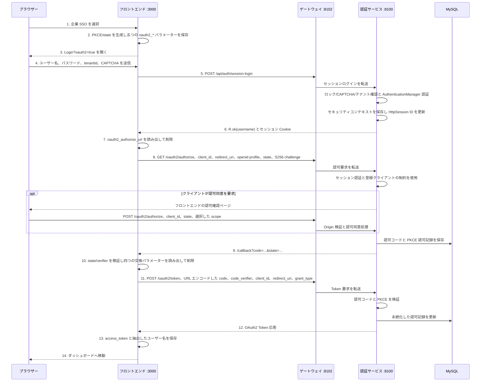

### 主要コンポーネント

| コンポーネント | ソース | 責務 |
|---|---|---|
| `pkce.ts` | [omni-frontend/src/utils/pkce.ts](../omni-frontend/src/utils/pkce.ts) | Web Crypto で 64 文字 verifier、S256 challenge、state を生成 |
| `LoginForm.vue` | [omni-frontend/src/components/LoginForm.vue](../omni-frontend/src/components/LoginForm.vue) | 五つのパラメーターを保存し、CAPTCHA 付きセッションログイン後に認可 URL を開く |
| `auth.ts` | [omni-frontend/src/api/auth.ts](../omni-frontend/src/api/auth.ts) | openid profile/state/PKCE 付き URL を作り、フォーム形式で Token を交換 |
| `callback/index.vue` | [omni-frontend/src/views/callback/index.vue](../omni-frontend/src/views/callback/index.vue) | state/verifier を検証し交換前に四つを削除。保存はアクセストークンとユーザー名のみ |
| `user.ts` | [omni-frontend/src/stores/user.ts](../omni-frontend/src/stores/user.ts) | token と username を永続化。id_token/refresh_token は保存しない |
| `OAuth2ClientInitializer.java` | [omni-backend/omni-auth/src/main/java/com/omni/auth/config/OAuth2ClientInitializer.java](../omni-backend/omni-auth/src/main/java/com/omni/auth/config/OAuth2ClientInitializer.java) | 既定 NONE + PKCE クライアントを作成し、既存登録の他の設定を維持 |
| `AuthController.java` | [omni-backend/omni-auth/src/main/java/com/omni/auth/controller/AuthController.java](../omni-backend/omni-auth/src/main/java/com/omni/auth/controller/AuthController.java) | テナント/CAPTCHA/認証情報を確認し HttpSession を保存、ID を更新 |
| `AuthorizationServerConfig.java` | [omni-backend/omni-auth/src/main/java/com/omni/auth/config/AuthorizationServerConfig.java](../omni-backend/omni-auth/src/main/java/com/omni/auth/config/AuthorizationServerConfig.java) | OAuth2 セッションのセキュリティチェーン、JWK/JWT、claims、JDBC 認可/同意記録 |
| `consent/index.vue` | [omni-frontend/src/views/consent/index.vue](../omni-frontend/src/views/consent/index.vue) | 必要時に client_id/state/選択 scope を送信。scope なしで拒否 |
| `SasConsentOriginFilter.java` | [omni-backend/omni-auth/src/main/java/com/omni/auth/security/SasConsentOriginFilter.java](../omni-backend/omni-auth/src/main/java/com/omni/auth/security/SasConsentOriginFilter.java) | consent POST に存在する Origin の scheme/host/port を照合し不一致は 403 |

### PKCE ストレージキー

| sessionStorage キー | 用途と実際の削除時点 |
|---|---|
| `oauth2_code_verifier` | 64 文字 verifier。コールバックの state/verifier 検証後、Token 要求前に削除 |
| `oauth2_state` | コールバックで照合するランダム state。verifier と共に交換前に削除 |
| `oauth2_client_id` | 開始時のクライアント ID。コールバックで読み出し交換前に削除 |
| `oauth2_redirect_uri` | 現在の origin + /callback。読み出して交換前に削除 |
| `oauth2_authorize_url` | 遷移先の認可 URL。セッションログイン成功後に読み出して削除 |

### 失敗と境界

コールバックは `error`、code 不在、state 不一致、verifier 不在でログインへ戻ります。これらの早期 return では保存パラメーターの削除を保証しません。前提検証を通過すると四つの交換パラメーターを先に削除してから Token エンドポイントを呼ぶため、交換失敗後に古い verifier を再利用できるとは限りません。

Token 要求は `application/x-www-form-urlencoded`、`credentials: 'include'` を指定したネイティブ `fetch('/oauth2/token')` です。フィールドは `grant_type=authorization_code`、code、code_verifier、client_id、redirect_uri。Axios の `/api` プレフィックスは付かず、応答は `R<T>` ではなく OAuth2 標準形式です。

既定の第一者クライアントは追加同意を要求しません。他のクライアントは実登録の設定に従います。consent POST の `SasConsentOriginFilter` は存在する Origin と転送アドレスのプロトコル、ホスト、ポートを照合します。全 OAuth2 エンドポイントに対する汎用 CSRF Token 検証ではありません。

### 現在のステータス

既定設定は JWK/JWT 発行経路と `accessTokenCustomizer` を提供しており、アクセストークンを一律 opaque と記述できません。他のクライアントはそれぞれの `TokenSettings` に従います。SAS カスタマイザーはロール配列とスペース区切りの業務権限 `scope` を書き込みます。これは Flow1 の権限配列とも、認可要求の `openid profile` とも異なります。

フロントエンドの応答型では id_token と refresh_token は任意です。コールバックが保存するのは access_token と抽出したユーザー名のみです。`refresh_token` grant の登録だけでは毎回の返却やフロントエンドの更新機能を証明しません。アクセス有効期間は登録クライアントの TokenSettings に従い、Flow1 の既定値を引き継ぎません。

ここでは現在のソース経路と失敗境界を説明します。操作、期待結果、復旧は [Wiki](wiki/index.jp.md) を参照してください。ソース設定はエンドツーエンドの実行証拠の代わりにはなりません。

---

## Flow 3: OAuth2 Device Authorization Grant

### 概要

デバイス認可はブラウザーを持たない機器や入力が制限された機器を対象にします。機器が device_code/user_code を取得し、ユーザーがブラウザーで確認した後、機器が Token エンドポイントをポーリングします。本リポジトリはブラウザーの模擬機器 `/device` とユーザー検証ページ `/device/verify` を提供します。

現在の模擬機器は `client_id=omni-device&scope=profile` を送信します。SAS の verification_uri をそのまま使わず、現在のフロントエンド origin から `/device/verify?user_code=...` と QR コードを組み立てます。ユーザー側には認証済み HttpSession が必要で、フロントエンド JWT はサーバーセッションを代替しません。

### シーケンス図

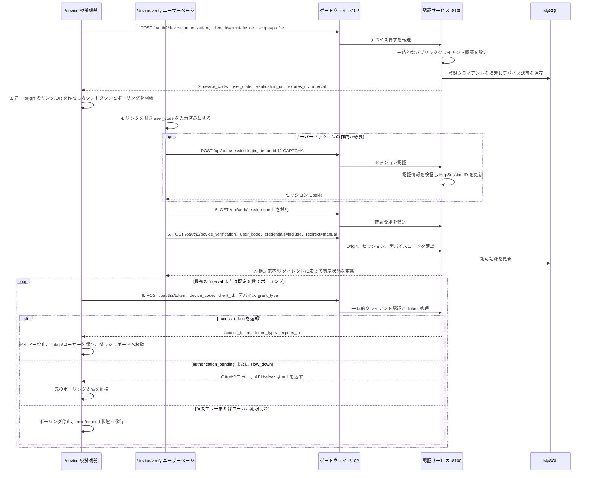

### 主要コンポーネント

| コンポーネント | ソース | 責務 |
|---|---|---|
| `auth.ts` | [omni-frontend/src/api/auth.ts](../omni-frontend/src/api/auth.ts) | scope=profile でデバイス認可要求。pending/slow_down を null に変換 |
| `device/index.vue` | [omni-frontend/src/views/device/index.vue](../omni-frontend/src/views/device/index.vue) | 同一 origin のリンク/QR、初期 interval の固定、カウントダウンと Token 保存 |
| `device/verify.vue` | [omni-frontend/src/views/device/verify.vue](../omni-frontend/src/views/device/verify.vue) | CAPTCHA セッションログイン、session-check 試行、user_code 送信、応答から UI を更新 |
| `DeviceClientInitializer.java` | [omni-backend/omni-auth/src/main/java/com/omni/auth/config/DeviceClientInitializer.java](../omni-backend/omni-auth/src/main/java/com/omni/auth/config/DeviceClientInitializer.java) | omni-device を登録。既存クライアントの consent=true を false に修正 |
| `AuthorizationServerConfig.java` | [omni-backend/omni-auth/src/main/java/com/omni/auth/config/AuthorizationServerConfig.java](../omni-backend/omni-auth/src/main/java/com/omni/auth/config/AuthorizationServerConfig.java) | デバイスエンドポイントの有効化、HttpSession のコンテキスト、JDBC 認可記録 |
| `DeviceClientAuthenticationFilter.java` | [omni-backend/omni-auth/src/main/java/com/omni/auth/security/DeviceClientAuthenticationFilter.java](../omni-backend/omni-auth/src/main/java/com/omni/auth/security/DeviceClientAuthenticationFilter.java) | 要求/デバイス Token 内だけクライアント認証を設定。finally で元のユーザー認証を復元 |
| `SasConsentOriginFilter.java` | [omni-backend/omni-auth/src/main/java/com/omni/auth/security/SasConsentOriginFilter.java](../omni-backend/omni-auth/src/main/java/com/omni/auth/security/SasConsentOriginFilter.java) | デバイス検証 POST の Origin があれば転送先アドレスと比較。不一致は 403 |

### デバイスクライアント設定

| 設定項目 | 現在の値 |
|---|---|
| Client ID | `omni-device` |
| 認証方式 | `NONE`、パブリッククライアント、clientSecret なし |
| 認可タイプ | `urn:ietf:params:oauth:grant-type:device_code` と `refresh_token` |
| スコープ | 登録は `openid`、`profile`。現在の模擬機器は `profile` のみ要求 |
| PKCE 必須 | `false` |
| 認可同意必須 | `false`。初期化処理が既存の true を修正 |
| コールバック | redirectUri を使わず、表示用検証リンクはフロントエンドで作成 |

### ポーリング動作

| 応答/条件 | 現在のフロントエンド動作 |
|---|---|
| `authorization_pending` | helper が null を返し、初期の間隔で継続 |
| `slow_down` | 同様に null。フロントエンドは間隔を延長せず、バックオフは未実装 |
| `expired_token` / ローカルカウントダウン終了 | ポーリングを止め error/expired へ移行 |
| `access_denied` / その他の恒久エラー | ポーリングを止め error へ移行 |
| 識別した `Failed to fetch` / `NetworkError` / `timeout` | 次の定期ポーリングまで待機 |
| access_token を取得 | ポーリング/カウントダウンを解除し、アクセストークンと抽出ユーザー名を保存 |
| ページのアンマウント | 両タイマーを解除 |

### 現在のステータス

デバイス認可、検証、Token エンドポイントはソースで設定されています。`DeviceClientAuthenticationFilter` のクライアント主体は現在の要求/ポーリング内だけ有効で、`finally` で元の認証を復元してユーザー HttpSession の汚染を防ぎます。refresh_token grant の登録は毎回の発行を証明せず、模擬機器はリフレッシュトークン を保存・使用しません。

検証ページはセッション確認を試み、opaqueredirect、302、一部の HTML、成功応答に応じて表示を更新します。フロントエンドの ready/success はサーバー認証や Token 発行の証拠ではありません。「拒否」ボタンはローカル denied 状態のみ変更し、SAS への拒否送信も認可記録の取り消しも行いません。

slow_down に応じた間隔調整は未実装です。これらの制限を RFC 動作の実装完了として記述できません。実行時の検収には、機器による有効アクセストークンの実取得と保護リソースへのアクセスが必要です。操作、画像、失敗からの復旧は [Wiki](wiki/index.jp.md) を参照してください。

---

## Flow 4: OAuth2 ソーシャルログイン（GitHub / Google / Gitee）

### 概要

現在のログインフォームは GitHub、Google、Gitee の三つの入口を提供します。バックエンドは provider ID と同名の Spring Bean を `Map<String, OAuth2ProviderHandler>` で振り分けます。Handler が認可 URL、Token 交換、正規化したプロフィールを提供し、`SocialLoginServiceImpl` がテナント、外部 ID との関連付け、ユーザー、JWT を調整します。現在 WeChat ボタンも Handler もなく、テーブル注釈の wechat は実装済みの対応を意味しません。

ブラウザーは Gateway 経由で `/api/auth/oauth2/{provider}?tenant_id=...` にアクセスします。Auth はプロバイダーとテナントを検証し、署名付き state を生成して外部へリダイレクトします。コールバックで state 検証、外部 Token 交換、ローカルユーザー検索/作成を行い、成功時に `/callback#token=...&username=...` へ戻ります。これは Flow2 のローカル認可コード + PKCE コールバックとは別経路です。

### シーケンス図

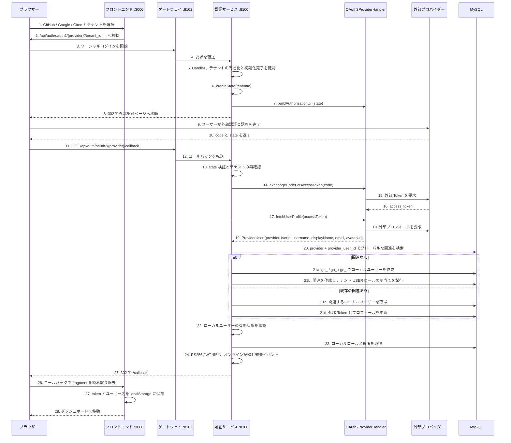

### 主要コンポーネント

| コンポーネント | ソース | 責務 |
|---|---|---|
| `LoginForm.vue` | [omni-frontend/src/components/LoginForm.vue](../omni-frontend/src/components/LoginForm.vue) | 三つのプロバイダー入口と選択 tenantId |
| `auth.ts` | [omni-frontend/src/api/auth.ts](../omni-frontend/src/api/auth.ts) | Gateway 経由の遷移 URL を作成 |
| `callback/index.vue` | [omni-frontend/src/views/callback/index.vue](../omni-frontend/src/views/callback/index.vue) | ソーシャル fragment の読取り、アドレス欄からの除去、Token/ユーザー名保存 |
| `SocialLoginController.java` | [omni-backend/omni-auth/src/main/java/com/omni/auth/controller/SocialLoginController.java](../omni-backend/omni-auth/src/main/java/com/omni/auth/controller/SocialLoginController.java) | 開始/コールバック。成功と処理対象の業務失敗はリダイレクト |
| `SocialLoginServiceImpl.java` | [omni-backend/omni-auth/src/main/java/com/omni/auth/service/impl/SocialLoginServiceImpl.java](../omni-backend/omni-auth/src/main/java/com/omni/auth/service/impl/SocialLoginServiceImpl.java) | テナント検証、DB トランザクション、ユーザー/関連、ロール、JWT、オンライン記録、監査 |
| `OAuth2ProviderHandler.java` | [omni-backend/omni-auth/src/main/java/com/omni/auth/oauth/OAuth2ProviderHandler.java](../omni-backend/omni-auth/src/main/java/com/omni/auth/oauth/OAuth2ProviderHandler.java) | Bean 名で振分け。provider ID と同じ名前が必要 |
| `GitHubOAuth2Handler.java` | [omni-backend/omni-auth/src/main/java/com/omni/auth/oauth/GitHubOAuth2Handler.java](../omni-backend/omni-auth/src/main/java/com/omni/auth/oauth/GitHubOAuth2Handler.java) | GitHub 認可、Token とプロフィールの変換 |
| `GoogleOAuth2Handler.java` | [omni-backend/omni-auth/src/main/java/com/omni/auth/oauth/GoogleOAuth2Handler.java](../omni-backend/omni-auth/src/main/java/com/omni/auth/oauth/GoogleOAuth2Handler.java) | Google 認可/プロフィール。有効 HTTPS_PROXY なら明示プロキシを設定。メール前半または sub からユーザー名を生成 |
| `GiteeOAuth2Handler.java` | [omni-backend/omni-auth/src/main/java/com/omni/auth/oauth/GiteeOAuth2Handler.java](../omni-backend/omni-auth/src/main/java/com/omni/auth/oauth/GiteeOAuth2Handler.java) | Gitee 認可、Token とプロフィールの変換 |
| `ProviderUser.java` | [omni-backend/omni-auth/src/main/java/com/omni/auth/dto/ProviderUser.java](../omni-backend/omni-auth/src/main/java/com/omni/auth/dto/ProviderUser.java) | providerUserId、username、displayName、email、avatarUrl に統一 |
| `OAuth2StateUtils.java` | [omni-backend/omni-auth/src/main/java/com/omni/auth/util/OAuth2StateUtils.java](../omni-backend/omni-auth/src/main/java/com/omni/auth/util/OAuth2StateUtils.java) | 署名とタイムスタンプを検証。一度限りの消費やブラウザーセッション結合は含まない |
| `SysUserOauthProviderMapper.java` | [omni-backend/omni-auth/src/main/java/com/omni/auth/mapper/SysUserOauthProviderMapper.java](../omni-backend/omni-auth/src/main/java/com/omni/auth/mapper/SysUserOauthProviderMapper.java) | provider + provider_user_id でグローバルな関連を取得 |
| `SysUserOauthProvider.java` | [omni-backend/omni-auth/src/main/java/com/omni/auth/entity/SysUserOauthProvider.java](../omni-backend/omni-auth/src/main/java/com/omni/auth/entity/SysUserOauthProvider.java) | 現在のフィールド、外部 Token とユーザー関連 |
| `JwtTokenServiceImpl.java` | [omni-backend/omni-auth/src/main/java/com/omni/auth/service/impl/JwtTokenServiceImpl.java](../omni-backend/omni-auth/src/main/java/com/omni/auth/service/impl/JwtTokenServiceImpl.java) | ローカルユーザーとロール/権限から JWT を発行。claims は Flow1 |
| `OAuth2Properties.java` | [omni-backend/omni-auth/src/main/java/com/omni/auth/config/OAuth2Properties.java](../omni-backend/omni-auth/src/main/java/com/omni/auth/config/OAuth2Properties.java) | 外部エンドポイント、認証情報、コールバック設定 |
| `compose.apps.yaml` | [compose.apps.yaml](../compose.apps.yaml) | 正式 Docker の三つのコールバックを Gateway :8102 に設定 |
| `0001-auth-schema.yaml` | [database/changelog/auth/0001-auth-schema.yaml](../database/changelog/auth/0001-auth-schema.yaml) | スキーマ、グローバル一意キーとユーザー索引 |
| `auth.sql` | [scripts/sql/seed/auth.sql](../scripts/sql/seed/auth.sql) | 正式シードのテナント1 USER は既定のデータ範囲 SELF |

### State 署名メカニズム

state の形式は `tenantId|timestamp|hex(hmac)`、timestamp はミリ秒です。署名 payload に含むのはテナントと時刻のみです。

```text
payload = tenantId + "|" + timestamp
hmac = hex(HMAC-SHA256(payload, secretKey))
state = payload + "|" + hmac
```

コールバックは三分割形式、再計算 HMAC、解析可能な timestamp を確認し、`now - timestamp > 10 * 60 * 1000` なら拒否して tenantId を解析します。消費済み記録、保存するランダム nonce、ブラウザーセッションとの結合はありません。署名の完全性とこの時効検証を説明できますが、state のリプレイ防止や開始ブラウザーとの結合を実装済みとは言えません。

### 自動ユーザー作成メカニズム

1. プレフィックスは GitHub `gh_`、Google `go_`、Gitee `ge_`。Google は空白でないメール前半を優先し、なければ sub を使います。
2. 初回ユーザー名は `prefix + providerUsername`。挿入の一意キー競合時は `prefix + providerUsername + '_' + providerUserId` でもう一度だけ試します。
3. ニックネームは null でない displayName、なければ providerUsername。メールと画像は正規化プロフィールから取得します。
4. 新規ユーザーの password は null、status は 1、tenantId は検証済み state から取得します。
5. ユーザーと外部 ID の関連をコールバックの DB トランザクション内で書き込みます。関連の一意キー競合時は既存関連とそのローカルユーザーを再取得します。
6. 選択テナントの `USER` ロール割当てを試み、不在または例外は warn を記録します。正式シードのテナント1 USER は SELF ですが、実際のデータ範囲は現在のロール設定に従います。
7. 既存関連は元のユーザーを先に取得してから外部 Token/プロフィールを更新します。JWT のテナントはそのユーザー由来で、今回の state による自動移動はしません。
8. ローカルロール/権限の取得後に JWT を生成します。オンライン記録失敗は warn のみで、その後ログイン成功監査を発行します。

### sys_user_oauth_provider テーブル設計

| フィールド/索引 | 型/定義 | 意味 |
|---|---|---|
| `id` | `BIGINT NOT NULL AUTO_INCREMENT` | 主キー |
| `user_id` | `BIGINT NOT NULL` | ローカルユーザー ID |
| `provider` | `VARCHAR(32) NOT NULL` | プロバイダー名。現在の Handler は github/google/gitee |
| `provider_user_id` | `VARCHAR(100) NOT NULL` | 外部プロバイダーの一意ユーザー ID |
| `provider_username` | `VARCHAR(100)` | 外部ユーザー名、null 可 |
| `provider_email` | `VARCHAR(200)` | 外部メール、null 可 |
| `provider_avatar` | `VARCHAR(500)` | 外部アバター、null 可 |
| `access_token` | `VARCHAR(500)` | 直近に取得した外部アクセストークン、null 可 |
| `create_time` | `DATETIME DEFAULT CURRENT_TIMESTAMP` | 作成時刻 |
| `update_time` | `DATETIME DEFAULT CURRENT_TIMESTAMP ON UPDATE CURRENT_TIMESTAMP` | 更新時刻。更新時に自動更新 |
| `uk_provider_user` | `UNIQUE (provider, provider_user_id)` | 外部 ID のグローバル一意制約 |
| `idx_user_id` | `INDEX (user_id)` | ローカルユーザー別の関連を検索する索引 |

このテーブルには tenant_id 列がなく、一意キーにもテナントは含みません。一つの外部 ID は全体で一つのローカルユーザーに関連します。初回は state のテナントで作成し、既存関連では元のユーザーとテナントを再利用します。同じ外部 ID をテナントごとに独立して重複関連付けできるわけではありません。

`handleCallback()` は DB トランザクションを使います。外部 Token 交換、ネットワーク呼出し、オンライン記録はローカル DB と一体ではロールバックしません。一意キーと再取得処理だけで全外部副作用の冪等性は証明できません。

### エラーハンドリング

| 条件 | 実際の処理 | フロントエンド表示 |
|---|---|---|
| コールバックに空でない error | 302 で `/login?error=user_denied` | message がなければ汎用の外部ログイン失敗表示 |
| code または state がない | 302 で `/login?error=invalid_callback` | 汎用表示。専用の無効コールバック文言は保証しない |
| state、外部 API/プロフィール、無効ユーザー等の BusinessException | URL エンコード message 付きの `/login?error=social_login_failed&message=...` へ 302 | message を表示。内部業務コード 400/403/502 はコールバックの HTTP 状態ではない |
| 開始時に Handler 不在、テナント利用不可 | 対象 BusinessException をスロー。コールバックのリダイレクト処理外 | 通常の例外応答処理 |
| BusinessException 以外、リダイレクト I/O 失敗 | この BusinessException catch では一律変換しない | 同じエラーページへの遷移を保証しない |

### 現在のステータス

GitHub、Google、Gitee Handler とローカル処理はソースに存在します。これは三社の実アカウント認可やエンドツーエンド検収の完了を証明しません。管理された peer や設定の存在は実プロバイダーのコールバック証拠の代わりにはなりません。

正式な [compose.apps.yaml](../compose.apps.yaml) は三社のコールバックを Gateway `http://localhost:8102/api/auth/oauth2/{provider}/callback` に設定します。属性クラスと application.yml の後備値は Auth :8100 のままです。外部への登録は実際の公開コールバックと一致させる必要があります。成功時のフロントエンド遷移先は frontendCallbackUrl に従い、コールバックページは解析後に fragment を除去します。

プロバイダー追加には Handler Bean/provider ID の一致、設定、フロントエンド入口、外部コールバック登録が必要です。インターフェース実装だけでは接続完了になりません。操作、実認可の証拠要件と復旧は [Wiki](wiki/index.jp.md) を参照してください。

## Flow 5: RBAC 機能権限 — 動的メニュー読み込みとボタン認可

### 概要

保護対象ルートは現在のトークンに含まれる権限スナップショットを読み、Gateway 経由でテナントのメニューツリーを要求します。バックエンドがメニューを絞り込み、フロントエンドはコンポーネントを解決できる管理ルートを登録してナビゲーションを描画します。`v-permission` はボタン表示を制御し、サーバーの操作は各エンドポイントの認可規則に従います。

### シーケンス

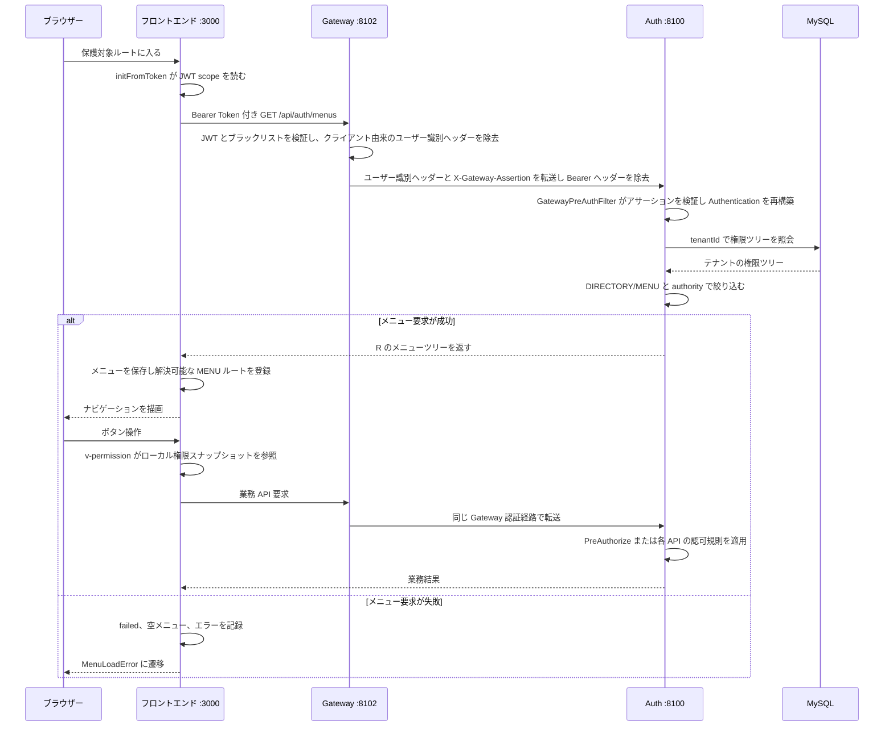

### 主要な実装詳細

**バックエンドのメニュー絞り込み**

1. PermissionServiceImpl.getPermissionTree(tenantId) はテナントを明示して権限レコードを照会し、sort 順でツリーを構築します。MenuController は最初に DIRECTORY と MENU を再帰的に保持します。
2. 機能権限は SecurityContext 内で ROLE_ 接頭辞を持たない authority です。認証情報がない場合や権限集合が空の場合は空のメニュー結果になります。
3. DIRECTORY は children を再帰的に絞り込み、可視の子が残る場合のみ保持します。MENU は自身の permissionCode が権限集合に厳密一致するかを確認し、先行する型フィルター後の children を保持します。

**メニュー状態と動的ルート**

- loadMenus は並行要求をまとめ、loaded 状態を再利用します。tenant_id がない場合は空メニューと loaded 状態になります。要求例外では menusLoaded=true、menuLoadState=failed とし、エラーを保存して再スローします。
- ルートガードは初回読み込み失敗を MenuLoadError に送ります。retryLoadMenus は読み込みフラグ、状態、エラーをリセットして再取得します。失敗状態が全メニューの許可になることはありません。
- registerDynamicRoutes はコンポーネントを解決できる MENU だけを登録し、DIRECTORY はグループ化だけに使います。srm:portal: で始まるポータル項目はこの登録経路の対象外です。ルートは admin の下に登録し、権限コードのコロンをパスではスラッシュ、名前ではハイフンに置き換え、meta.permissionCode を保持します。
- ログアウト時に権限 Store をリセットし、登録した動的ルートを削除します。

**ボタン、トークン、サーバーの認可**

```vue
<el-button v-permission="'system:user:create'" type="primary">新規作成</el-button>
<el-button v-permission="'system:user:update'" size="small">編集</el-button>
<el-button v-permission="'system:user:delete'" size="small" type="danger">削除</el-button>
```

- ディレクティブは mounted と updated で空でないバインド値を確認し、権限がなければ display:none、そうでなければ display を空にします。空バインドでは要素を隠しません。ボタン表示はサーバー操作の認可ではありません。
- decodeJwt はデコードのみで署名を検証しません。getPermissionsFromToken は scope をそのまま返し、文字列を配列に分割しません。パスワード JWT の scope 配列と SAS の空白区切り文字列を、このフロントエンド関数が統一すると説明してはいけません。署名と期限は Gateway が検証します。
- Auth の通常 API では GatewayPreAuthFilter が転送されたロール・権限ヘッダーから Authentication を構築します。転送された Bearer JWT の再検証や、要求ごとの DB 機能権限再取得ではありません。
- 管理 API は現在の Controller の規則に従います。例えばユーザー作成は system:user:create の @PreAuthorize を使います。公開ログイン・登録や MyJobController のタスク所有者確認には明示的な別経路があり、全書き込み API を一つのアノテーション規則で表すことはできません。

### 現在のステータス

- メニュー、ルート、ボタン、サーバー認可は上記のソース動作に従います。ページ数やボタン数をリポジトリ全体の網羅証拠にしません。
- 機能権限は発行済みトークン内のスナップショットです。Authentication の再構築から、ロール変更が古いトークンの権限追加や失効に即時反映されるとは推定できません。
- 権限コードは resource:action です。API 規則、公開経路、所有者確認は対応する Controller とセキュリティ設定で定義します。

ソースの入口: [MenuController](../omni-backend/omni-auth/src/main/java/com/omni/auth/controller/MenuController.java), [PermissionServiceImpl](../omni-backend/omni-auth/src/main/java/com/omni/auth/service/impl/PermissionServiceImpl.java), [Gateway AuthFilter](../omni-backend/omni-gateway/src/main/java/com/omni/gateway/filter/AuthFilter.java), [Auth GatewayPreAuthFilter](../omni-backend/omni-auth/src/main/java/com/omni/auth/security/GatewayPreAuthFilter.java), [stores/permission.ts](../omni-frontend/src/stores/permission.ts), [router/index.ts](../omni-frontend/src/router/index.ts), [directives/permission.ts](../omni-frontend/src/directives/permission.ts), [utils/jwt.ts](../omni-frontend/src/utils/jwt.ts), [api/menu.ts](../omni-frontend/src/api/menu.ts), [UserController](../omni-backend/omni-auth/src/main/java/com/omni/auth/controller/UserController.java), [AuthController](../omni-backend/omni-auth/src/main/java/com/omni/auth/controller/AuthController.java), [MyJobController](../omni-backend/omni-base/src/main/java/com/omni/base/controller/MyJobController.java), [MenuControllerTest](../omni-backend/omni-auth/src/test/java/com/omni/auth/controller/MenuControllerTest.java)

## Flow 6: RBAC データ権限 — リクエストレベルの行データフィルタリング

### 概要

このフローは Auth の通常リクエストにおけるデータ範囲を追跡します。DataScopeResolveFilter は DataScopeServiceImpl を呼び、選択テナント内の有効なユーザーとロールを検証して組織範囲を解析し、 DataScopeContext に保存します。SQL ハンドラーは登録済みテーブルに行条件を追加します。業務クエリの明示的なテナント条件と、DB 以外のデータに対するサービス認可も必要です。

**リクエスト解析とロール統合**

1. フィルターは Spring Security の後で実行します。/internal/ API は通常リクエストコンテキストを作らず、自身の明示パラメーターと認証を使います。X-User-Id がない場合はコンテキスト作成を省略しますが、API のセキュリティチェーンを迂回するわけではありません。
2. 識別済みリクエストのユーザー ID が解析不能、またはテナントヘッダーが欠落・解析不能なら HTTP 400 を返します。解析サービスは正の ID と、選択テナントに属する有効ユーザーを要求し、所属検証に失敗すると 403 です。コンテキストは finally で削除します。
3. 通常の resolveDataScope(userId, tenantId) は同テナントの有効ロールを統合します。優先順位は ALL(1)、TENANT(2)、DEPT_AND_BELOW(3)、DEPT(4)、CUSTOM(5)、SELF(6) で、数値が小さいほど広い範囲です。より広い範囲がなければ SELF を維持します。
4. permissionCode を持つオーバーロードは、完全な権限コードを実際に付与する有効ロールだけを照会し、付与がなければ拒否します。通常リクエストで全ロールを統合する方式とは異なります。返却 DTO の securityVersion は解析結果のフィンガープリントです。

### シーケンス

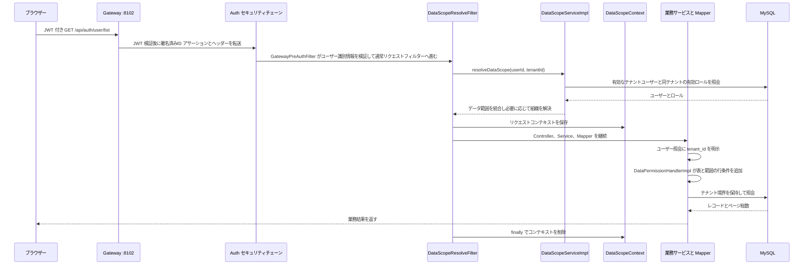

### DataScope フィルタリング条件対照表

| effectiveScope | sys_user に追加する行条件 | 境界 |
| --- | --- | --- |
| `ALL` | 追加行条件なし | 既存のテナント WHERE を除去せず、ユーザー一覧は tenantId を制限 |
| `TENANT` | 追加行条件なし | クエリ自身がテナント境界を明示 |
| `DEPT` | `alias.primary_unit_id IN (...)` | 有効な主組織の ID 集合 |
| `DEPT_AND_BELOW` | `alias.primary_unit_id IN (...)` | 有効な主組織と展開した組織集合 |
| `CUSTOM` | `alias.primary_unit_id IN (...)` | CUSTOM ロールが設定した同テナントの起点ノードと展開集合 |
| `SELF` | `alias.id = userId` | 現在のユーザー |

Auth は現在三つのテーブルを登録しています。alias は SQL 別名、別名がなければテーブル名です。下表は SELF と組織範囲の違いを示し、ALL/TENANT はいずれも追加の行条件を付けません。

| テーブル | SELF | DEPT / DEPT_AND_BELOW / CUSTOM |
| --- | --- | --- |
| `sys_user` | `id = userId` | `primary_unit_id IN (...)` |
| `sys_org_unit` | `id = primaryUnitId` | `id IN (...)` |
| `sys_role` | `id = -1` | 組織の行条件を追加しない |

等値条件の ID がない場合や IN 集合が空の場合、対応する登録規則は alias.id=-1 を生成します。コンテキスト欠落、scope が null・未知、テーブル未登録では条件を追加しません。全テーブルと全データソースが自動でフェイルクローズするハンドラーではありません。UserServiceImpl.listUsers の tenant_id 条件は ALL でも保持します。

### 組織ユニットの子孫クエリ

DEPT は選択テナントの有効な主組織を使い、DEPT_AND_BELOW はそのマテリアライズドパスを展開します。CUSTOM は対象ロールの dataScope=CUSTOM に設定された起点ノードを統合し、同じ tenantId で各起点ノードを取得します。

実際のメソッドは SysOrgUnitMapper.selectDescendantIdsByTenantIdAndPath(tenantId, pathPrefix) です。SQL はテナント、パス接頭辞、status=1 で絞り込み、旧例のように起点ノードを除外しません。

```sql
SELECT id FROM sys_org_unit
WHERE tenant_id = #{tenantId}
  AND path LIKE CONCAT(#{pathPrefix}, '%')
  AND status = 1
```

resolveUnitTree は起点ノード ID も補います。CUSTOM 起点ノードを取得する selectByIdAndTenantId 自体には有効状態の条件がないため、子孫 SQL から全 CUSTOM 起点ノードも status=1 を検証済みとは判断できません。

### メモリフィルタリングモード（オンラインユーザーシナリオ）

Redis の `online:{userId}` には `username|jti` しかなく、グローバルキーだけではテナント所属を判定できません。`OnlineUserController` は機能権限 `system:online:list` / `system:online:kick` を維持し、一覧と強制ログアウトのデータ範囲を `OnlineUserServiceImpl` で統一して検証します：

- `ALL` はテナント横断を維持し、`TENANT` は現在のテナントだけを許可します。
- `SELF` は現在のテナント内の本人だけを許可します。`DEPT`、`DEPT_AND_BELOW`、`CUSTOM` はテナント一致と、対象の `primaryUnitId` が解決済み組織集合に含まれることを要求します。空集合は許可しません。
- 一覧ではユーザーテーブルのテナントと主組織を確認します。非 `ALL` のクエリはテナント条件を明示し、取得できないユーザーや不可視ユーザーの Redis 項目を除外します。
- 強制ログアウトは対象ユーザーを取得して認可した後、オンラインキーの読み取り・削除、記録された `jti` のブラックリスト追加、対象テナントの `LOGOUT` 監査を実行します。既存のブラックリスト既定期限は 24 時間です。
- 有効な本人情報・テナント・範囲の欠落、または強制ログアウト対象の不在・不可視は業務エラーコード `403` です。拒否時は Redis にアクセスせず、成功監査を発行しません。Controller 内の業務例外は `AuthExceptionHandler` が `R.fail` に変換します。

```java
@GetMapping("/list")
@PreAuthorize("hasAuthority('system:online:list')")
public R<List<OnlineUserVO>> list() {
    return R.ok(onlineUserService.listOnlineUsers());
}
```

実装と境界回帰：[OnlineUserServiceImpl](../omni-backend/omni-auth/src/main/java/com/omni/auth/service/impl/OnlineUserServiceImpl.java)、[OnlineUserServiceImplTest](../omni-backend/omni-auth/src/test/java/com/omni/auth/service/impl/OnlineUserServiceImplTest.java)。

### 設定登録順序

MyBatisPlusConfig の登録順は DataPermissionInterceptor、OptimisticLockerInnerInterceptor、PaginationInnerInterceptor です。この Auth 設定に TenantLine はありません。行条件をページ照会と COUNT に反映するため、データ権限をページネーションより先に登録します。他の業務サービスは自身の範囲ハンドラーと集約所有権規則を使います。

```java
MybatisPlusInterceptor interceptor = new MybatisPlusInterceptor();
interceptor.addInnerInterceptor(new DataPermissionInterceptor(new DataPermissionHandlerImpl()));
interceptor.addInnerInterceptor(new OptimisticLockerInnerInterceptor());
interceptor.addInnerInterceptor(new PaginationInnerInterceptor(DbType.MYSQL));
```

### 現在のステータス

- SQL マッピング、通常リクエスト解析、特定権限に基づく解析には上記の別々の入口があります。新規テーブルやサービスは自身のテナント・所有権境界を明示する必要があります。
- オンラインユーザーの一覧と強制ログアウトは前節のサービス検証を維持します。SQL インターセプトは Redis の認可を置き換えません。
- 現在のソースと回帰の入口を示しています。ソース説明、単体テスト、実 DB または HTTP/E2E の受け入れは実際の証拠範囲で評価します。

ソースと回帰の入口: [DataScopeResolveFilter](../omni-backend/omni-auth/src/main/java/com/omni/auth/security/DataScopeResolveFilter.java), [DataScopeServiceImpl](../omni-backend/omni-auth/src/main/java/com/omni/auth/service/impl/DataScopeServiceImpl.java), [DataScopeContext](../omni-backend/omni-auth/src/main/java/com/omni/auth/security/DataScopeContext.java), [DataPermissionHandlerImpl](../omni-backend/omni-auth/src/main/java/com/omni/auth/security/DataPermissionHandlerImpl.java), [MyBatisPlusConfig](../omni-backend/omni-auth/src/main/java/com/omni/auth/config/MyBatisPlusConfig.java), [SysRoleMapper](../omni-backend/omni-auth/src/main/java/com/omni/auth/mapper/SysRoleMapper.java), [SysOrgUnitMapper](../omni-backend/omni-auth/src/main/java/com/omni/auth/mapper/SysOrgUnitMapper.java), [UserServiceImpl](../omni-backend/omni-auth/src/main/java/com/omni/auth/service/impl/UserServiceImpl.java), [DataScopeServiceImplTest](../omni-backend/omni-auth/src/test/java/com/omni/auth/service/impl/DataScopeServiceImplTest.java), [DataScopeResolveFilterTest](../omni-backend/omni-auth/src/test/java/com/omni/auth/security/DataScopeResolveFilterTest.java)

## Flow 7: ユーザー作成 — 3 つの経路

### 概要

作成経路は、公開セルフ登録、`system:user:create` で保護された管理者作成、外部ソーシャルログインでの初回関連付けです。いずれも `status=1` のユーザーを作成し、対象テナントで有効な `USER` ロールの付与を試みます。データ範囲はロールレコードに従い、正式シードのテナント 1 の `USER` は `SELF` です。3 経路とも `primaryUnitId` を設定しません。デフォルトロールがなければ警告して付与を省略するため、ユーザー作成だけでロール所属は保証されません。

### シーケンス図

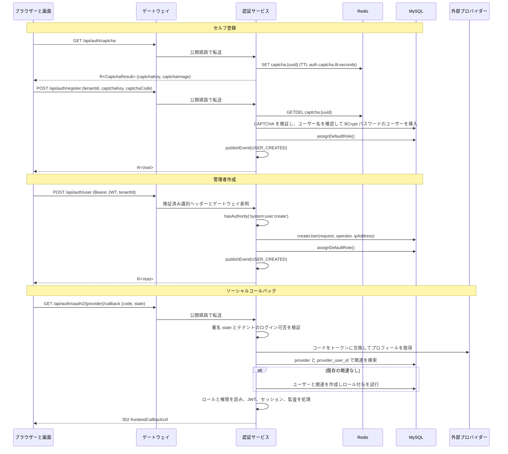

### 3 つの経路の比較

| 項目 | セルフ登録 | 管理者作成 | ソーシャル自動作成 |
| --- | --- | --- | --- |
| 入口と権限 | `POST /api/auth/register`、公開 | `POST /api/auth/user`、`system:user:create` | `GET /api/auth/oauth2/{provider}/callback`、パラメーターと state を検証 |
| テナント | 本文の `tenantId`。画面で選択 | 管理者が本文の `tenantId` を指定 | 新規ユーザーは署名 state のテナント。関連検索は提供者と外部ユーザー ID |
| CAPTCHA | `captchaKey` + `captchaCode`。原子的 `GETDEL`、不一致でも消費 | 不要 | ローカル CAPTCHA は不要。提供者のコードとプロフィールが必要 |
| パスワードとユーザー名 | `RegisterRequest`：ユーザー名 3–32、パスワード 6–64 文字 | `CreateUserRequest`：ユーザー名は非空、`@Size` なし。パスワードは 6 文字以上 | パスワードは `null`。`gh_` / `go_` / `ge_` + 外部ユーザー名 |
| 重複と失敗 | テナント内の重複事前確認で業務コード 400 | テナント内の重複事前確認で業務コード 400 | 最初の `DuplicateKeyException` で `{prefix}{login}_{providerUserId}` を一度再試行。再失敗は伝播 |
| デフォルトロール実装 | private の `UserServiceImpl.assignDefaultRole()` | セルフ登録と共通 | `createNewUser()` 内で独立に検索・挿入。付与例外を捕捉して警告 |
| ロール書き込み例外 | ロール不在は警告。検索や関連挿入の例外は伝播 | セルフ登録と同じ。すべての失敗を非阻害とは扱わない | 付与ブロックは例外を捕捉。他の作成・コールバック失敗は各経路で処理 |
| 成功後 | `R<Void>`。画面は選択テナントを保存しログインへ移動 | `R<Void>`。ダイアログを閉じ一覧を再読込 | 設定された画面コールバックへ移動。fragment にエンコード済み `token` と `username` |

### 主要コンポーネント

| ソース入口 | 責務 |
| --- | --- |
| [AuthController.java](../omni-backend/omni-auth/src/main/java/com/omni/auth/controller/AuthController.java) / [CaptchaResult.java](../omni-backend/omni-auth/src/main/java/com/omni/auth/dto/CaptchaResult.java) / [RegisterRequest.java](../omni-backend/omni-auth/src/main/java/com/omni/auth/dto/RegisterRequest.java) / [CaptchaServiceImpl.java](../omni-backend/omni-auth/src/main/java/com/omni/auth/service/impl/CaptchaServiceImpl.java) | 公開登録と CAPTCHA DTO |
| [UserController.java](../omni-backend/omni-auth/src/main/java/com/omni/auth/controller/UserController.java) / [CreateUserRequest.java](../omni-backend/omni-auth/src/main/java/com/omni/auth/dto/CreateUserRequest.java) / [UserServiceImpl.java](../omni-backend/omni-auth/src/main/java/com/omni/auth/service/impl/UserServiceImpl.java) | 管理者作成と private ロール付与 |
| [SocialLoginController.java](../omni-backend/omni-auth/src/main/java/com/omni/auth/controller/SocialLoginController.java) / [SocialLoginServiceImpl.java](../omni-backend/omni-auth/src/main/java/com/omni/auth/service/impl/SocialLoginServiceImpl.java) / [SysUserOauthProviderMapper.java](../omni-backend/omni-auth/src/main/java/com/omni/auth/mapper/SysUserOauthProviderMapper.java) | ソーシャルコールバック、関連と独立したロール付与 |
| [SysRoleMapper.java](../omni-backend/omni-auth/src/main/java/com/omni/auth/mapper/SysRoleMapper.java) / [auth.sql](../scripts/sql/seed/auth.sql) | 有効ロール検索と正式シード |
| [index.vue](../omni-frontend/src/views/register/index.vue) / [auth.ts](../omni-frontend/src/api/auth.ts) | 登録フォームと送信後の状態 |

### 現在のステータス

- CAPTCHA の返却フィールドは `captchaKey` と `captchaImage`。TTL は `auth.captcha.ttl-seconds`、既定 300 秒です。大文字小文字を区別せず、不在・期限切れ・消費済みのキーは拒否します。登録画面は送信終了後に CAPTCHA を再読込します。
- 3 経路とも `USER_CREATED` 監査イベントを発行します。ソーシャルコールバックは有効状態を確認し、権限読込、JWT 発行、オンライン記録を試みます。既存の外部関連はローカルユーザーを読み込み、関連検索自体にテナント条件はありません。
- 本文はソースの挙動と失敗境界を記録します。実登録、ロール確認、提供者の認可は認証ガイドを参照してください。ソースや単体テストは実際の外部コールバック成功の代わりにはなりません。

[認証ガイド](guides/authentication.jp.md)

---

## Flow 8: XSS 対策 — リクエストサニタイゼーションと設定管理

<a id="8a-xss-リクエストサニタイゼーション各リクエストで自動実行"></a>

### 8A. XSS リクエストサニタイゼーション（要求条件に応じて適用）

XSS 自動構成は `XssConfigProvider` Bean がある Servlet Web 環境に適用されます。フィルターは `/*` に登録されますが、`X-Tenant-Id` が解析可能で、設定が有効かつルールが空でない場合にだけ要求をラップしスレッドルールを設定します。ヘッダーの不在・空・解析不能、設定 null、無効、ルールなしの場合は元の要求を続行します。識別と権限はそれぞれのセキュリティチェーンが検証します。

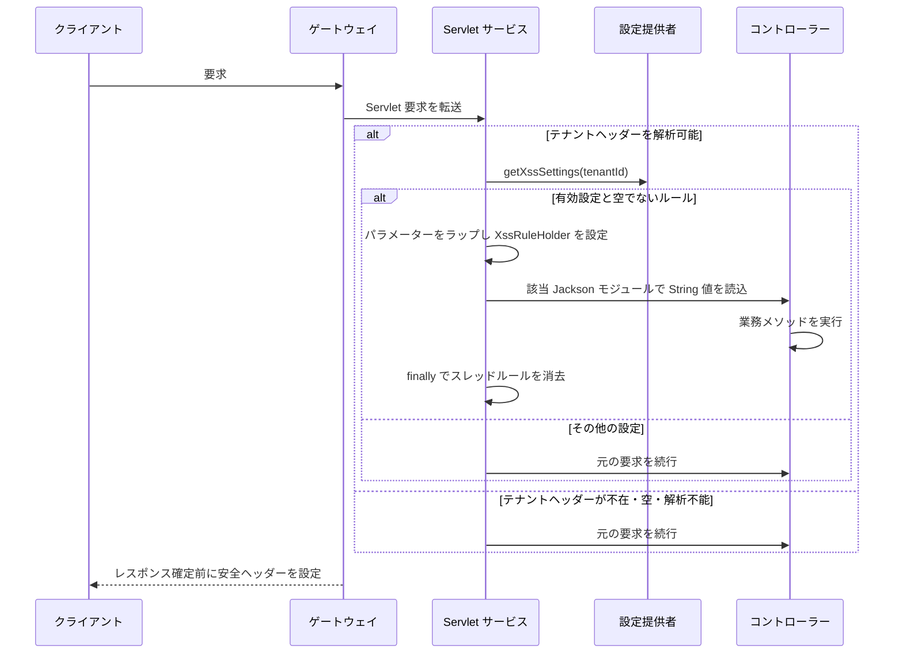

| ruleType | 現在の処理 | 設定と例 |
| --- | --- | --- |
| `HTML_TAG` | `\|` 区切りのタグ名をリテラル照合。対応するペアタグと中身、単独の開始タグや自己閉じタグを削除 | `script` 設定時、`<script>alert(1)</script>` → 空文字列 |
| `EVENT_HANDLER` | 設定正規表現で属性名を照合し、引用符あり・なしの属性値ごと削除 | `on[a-zA-Z]+` 設定時に `onclick="..."` を削除 |
| `DANGEROUS_PROTOCOL` | `\|` 区切り設定値を大文字小文字を区別せずリテラル置換 | `javascript:` 設定時にその文字列を削除 |
| `CUSTOM_PATTERN` | 設定正規表現の一致箇所を空文字列へ置換 | 実際の一致箇所だけを削除 |

ラッパーは `getParameter()` / `getParameterValues()` のみを上書きします。JSON は String デシリアライザーで処理し、Jackson 2 と Spring Boot 4 既定の Jackson 3 に個別モジュールがあります。ヘッダー、JSON フィールド名、生ストリーム、未上書きのパラメーター読取 API はこれらの入口で一括処理されません。ルールは順次適用され、不明な型は元の入力を返し、実行時の正規表現構文エラーは警告後に他のルールへ進みます。Gateway の安全ヘッダーはレスポンス側の対策で、実際の `Referrer-Policy` は `strict-origin-when-cross-origin` です。

### 8B. XSS 設定管理（管理者操作）

| メソッド（基底 `/api/auth/xss-config`） | 権限 | 挙動 |
| --- | --- | --- |
| `GET /settings` | `system:xssconfig:list` | 管理設定と全ルール。不在なら無効の既定レコードを作成 |
| `PUT /toggle?enabled=true` | `system:xssconfig:update` | スイッチ更新。`enabled` は必須クエリ |
| `GET /rules/list?page=1&size=10` | `system:xssconfig:list` | 現在テナントのルールをページ取得 |
| `POST /rules` | `system:xssconfig:create` | `enabled=1` で作成 |
| `PUT /rules/{id}` | `system:xssconfig:update` | ルール所属を確認して非 null フィールドのみ更新 |
| `DELETE /rules/{id}` | `system:xssconfig:delete` | 所属確認後に削除 |
| `PUT /rules/{id}/toggle?enabled=false` | `system:xssconfig:update` | 所属確認後に切替。`enabled` はクエリ |

Controller は Gateway が注入した `X-Tenant-Id` を更新・削除・切替サービスへ明示的に渡します。サービスは正のテナント ID を要求し、ルールの存在と `rule.tenantId` の一致を確認します。不在と他テナントは共に業務コード 404 とし、`AuthExceptionHandler` が HTTP 200 + `R.code=404` を返します。DB 更新やキャッシュ削除前に停止し、既存 3 箇所の `@PreAuthorize` も維持されます。

作成 DTO は `ruleName`、`ruleType`、`pattern` の非空だけを要求し、サービスが pattern に `Pattern.compile()` を実行します。更新時は pattern が指定された場合に再検証します。ruleType の列挙検証はなく、不明な実行型はサニタイザーが無視します。権威ある実行設定は `enabled=1` のルールのみを `sort_order` 昇順で取得します。

Auth provider は Redis の 2 値が揃って初めてヒットとします。一方のキー不在や不正なルール JSON は `getAuthoritativeSettings()` に回源し 30 分間キャッシュします。権威読取は設定不在・無効なら無効と空ルールを返し、レコードを作成しません。管理用 `getSettings()` とは挙動が異なります。

共有 Servlet Starter provider はキャッシュ例外後に Auth を試し、回源失敗や有効な結果がない場合はタグ・イベント属性・危険プロトコルのローカル基線を返します。権威設定の明示的な無効は維持します。Auth 自身の Redis 読取例外は伝播し、共有 Starter の代替策をすべての実装に適用できません。

各書込メソッドは DB トランザクション内で `xss:enabled:{tenantId}` と `xss:rules:{tenantId}` を同期削除します。キャッシュ失効と DB コミットは別の操作です。画面操作と復旧は安全・監査ガイドに集約します。

[安全・監査ガイド](guides/system-security-audit.jp.md)

### 主要コンポーネント

| ソース入口 | 責務 |
| --- | --- |
| [XssAutoConfiguration.java](../omni-backend/omni-common/src/main/java/com/omni/common/security/xss/XssAutoConfiguration.java) / [XssFilter.java](../omni-backend/omni-common/src/main/java/com/omni/common/security/xss/XssFilter.java) / [XssRuleHolder.java](../omni-backend/omni-common/src/main/java/com/omni/common/security/xss/XssRuleHolder.java) | Servlet 条件構成とルールの要求ライフサイクル |
| [XssHttpServletRequestWrapper.java](../omni-backend/omni-common/src/main/java/com/omni/common/security/xss/XssHttpServletRequestWrapper.java) / [XssStringDeserializer.java](../omni-backend/omni-common/src/main/java/com/omni/common/security/xss/XssStringDeserializer.java) / [XssStringDeserializer3.java](../omni-backend/omni-common/src/main/java/com/omni/common/security/xss/XssStringDeserializer3.java) | パラメーターと Jackson 2/3 の String 処理 |
| [XssSanitizer.java](../omni-backend/omni-common/src/main/java/com/omni/common/security/xss/XssSanitizer.java) / [SecurityHeadersFilter.java](../omni-backend/omni-gateway/src/main/java/com/omni/gateway/config/SecurityHeadersFilter.java) | 異なる境界を持つルール処理と安全ヘッダー |
| [XssConfigController.java](../omni-backend/omni-auth/src/main/java/com/omni/auth/controller/XssConfigController.java) / [XssConfigServiceImpl.java](../omni-backend/omni-auth/src/main/java/com/omni/auth/service/impl/XssConfigServiceImpl.java) / [XssConfigProviderImpl.java](../omni-backend/omni-auth/src/main/java/com/omni/auth/security/XssConfigProviderImpl.java) / [InternalXssController.java](../omni-backend/omni-auth/src/main/java/com/omni/auth/controller/internal/InternalXssController.java) | Auth の権威設定、管理更新とキャッシュ |
| [ServiceXssAutoConfiguration.java](../omni-backend/omni-common-service/src/main/java/com/omni/common/service/config/ServiceXssAutoConfiguration.java) / [CachedServiceXssConfigProvider.java](../omni-backend/omni-common-service/src/main/java/com/omni/common/service/xss/CachedServiceXssConfigProvider.java) / [DefaultXssSettingsFallback.java](../omni-backend/omni-common-service/src/main/java/com/omni/common/service/xss/DefaultXssSettingsFallback.java) / [AuthXssSettingsResolver.java](../omni-backend/omni-common-service/src/main/java/com/omni/common/service/client/AuthXssSettingsResolver.java) | 共有 Starter のキャッシュ、回源と基線 |
| [XssRuleTenantBoundaryTest.java](../omni-backend/omni-auth/src/test/java/com/omni/auth/controller/XssRuleTenantBoundaryTest.java) / [XssJsonDeserializationTest.java](../omni-backend/omni-common/src/test/java/com/omni/common/security/xss/XssJsonDeserializationTest.java) / [XssHttpJsonIntegrationTest.java](../omni-backend/omni-common/src/test/java/com/omni/common/security/xss/XssHttpJsonIntegrationTest.java) | 3 書込操作の他テナント、不在、同一テナント回帰入口 |

### 現在のステータス

- Servlet パラメーター、2 種の JSON モジュール、ルール管理、安全ヘッダーのソース入口があります。実際の処理はヘッダー、設定、有効ルール、読取方法に依存します。
- テナント隔離は明示的なテナント検索とルール所属確認で実施します。Auth の汎用 DataScope が対象とするのはユーザー・組織・ロールの各表です。
- MockMvc とメモリ代替、JSON/HTTP 統合、実配置検証は区別します。画面やビルド成功だけで全入力・並行処理の検証を示すものではありません。

---

## Flow 9: データディクショナリ管理 — タイプ+データ 2 段階構造 CRUD

### 概要

Base は `sys_dict_type` と `sys_dict_data` にテナント別の辞書を保存する。タイプコードはテナント内で一意で、データは `typeCode` でタイプに関連付ける。管理用ページ検索は DB を直接参照し、認証済みユーザー向けの軽量選択肢 API は有効なデータ行をキャッシュする。

### シーケンス

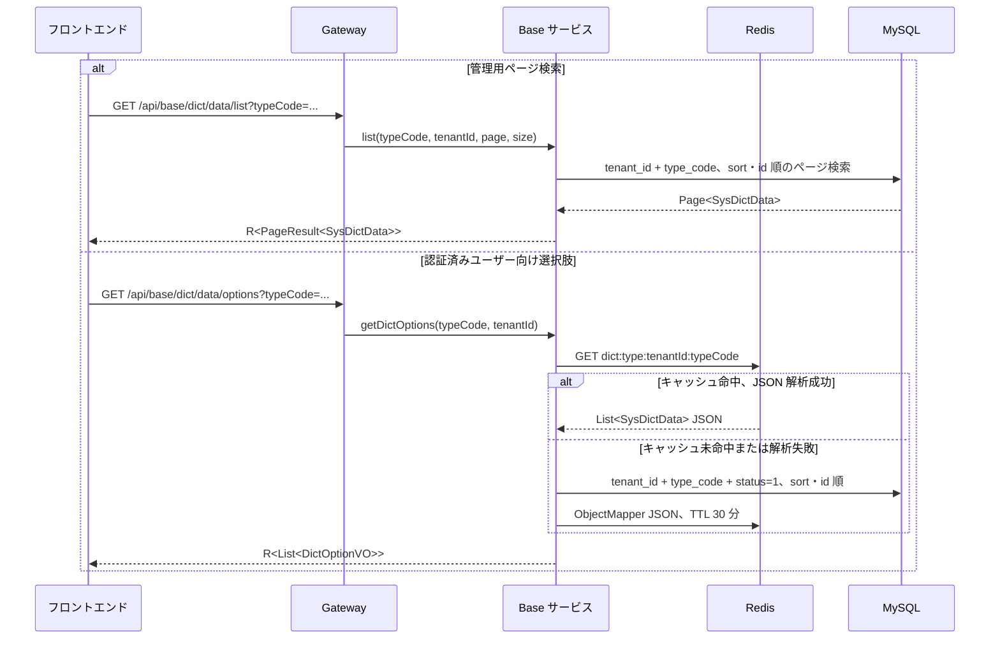

`GET /api/base/dict/data/list` は `dict:data:list` を要求し、`R<PageResult<SysDictData>>` を返す。`GET /api/base/dict/data/options` は認証チェーンで保護されるが、個別の `dict:data:*` 権限は不要で、`R<List<DictOptionVO>>` に含むのは `value` と `label` のみ。

タイプの ID 指定取得・更新・削除・状態変更と、データの更新・削除は Gateway のテナントを明示的にサービスへ渡す。サービスは正のテナント ID とリソースの所属を先に検証する。存在しない ID と他テナントの ID はともに業務コード 404 となり、返却・書き込み・連鎖削除・キャッシュ無効化は検証後に実行する。

### 主要コンポーネント

| ソース | 責務 |
| --- | --- |
| [DictTypeController.java](../omni-backend/omni-base/src/main/java/com/omni/base/controller/DictTypeController.java) / [DictTypeServiceImpl.java](../omni-backend/omni-base/src/main/java/com/omni/base/service/impl/DictTypeServiceImpl.java) / [CreateDictTypeRequest.java](../omni-backend/omni-base/src/main/java/com/omni/base/dto/CreateDictTypeRequest.java) / [UpdateDictTypeRequest.java](../omni-backend/omni-base/src/main/java/com/omni/base/dto/UpdateDictTypeRequest.java) | タイプ検索・作成と ID リソースの所属検証 |
| [DictDataController.java](../omni-backend/omni-base/src/main/java/com/omni/base/controller/DictDataController.java) / [DictDataServiceImpl.java](../omni-backend/omni-base/src/main/java/com/omni/base/service/impl/DictDataServiceImpl.java) / [CreateDictDataRequest.java](../omni-backend/omni-base/src/main/java/com/omni/base/dto/CreateDictDataRequest.java) / [UpdateDictDataRequest.java](../omni-backend/omni-base/src/main/java/com/omni/base/dto/UpdateDictDataRequest.java) / [DictOptionVO.java](../omni-backend/omni-base/src/main/java/com/omni/base/dto/DictOptionVO.java) | 管理用ページ検索・選択肢キャッシュ・データ所属検証 |
| [GatewayPreAuthFilter.java](../omni-backend/omni-base/src/main/java/com/omni/base/security/GatewayPreAuthFilter.java) / [SecurityConfig.java](../omni-backend/omni-base/src/main/java/com/omni/base/config/SecurityConfig.java) / [MybatisPlusAutoConfiguration.java](../omni-backend/omni-common-mybatis/src/main/java/com/omni/common/mybatis/config/MybatisPlusAutoConfiguration.java) | Gateway の認証情報検証・メソッド権限・Base 独自設定 |
| [dict.ts](../omni-frontend/src/api/dict.ts) / [useDictOptions.ts](../omni-frontend/src/composables/useDictOptions.ts) / [index.vue](../omni-frontend/src/views/base/dict/index.vue) / [index.vue](../omni-frontend/src/views/srm/supplier/index.vue) | 型付きフロントエンド API・テナントキャッシュ・辞書と仕入先の利用箇所 |
| [0001-base-schema.yaml](../database/changelog/base/0001-base-schema.yaml) / [base.sql](../scripts/sql/seed/base.sql) / [auth.sql](../scripts/sql/seed/auth.sql) | 現行スキーマ・正式権限・基本シード |
| [DictTenantBoundaryTest.java](../omni-backend/omni-base/src/test/java/com/omni/base/controller/DictTenantBoundaryTest.java) / [DictOperLogTenantBoundaryTest.java](../omni-backend/omni-base/src/test/java/com/omni/base/controller/DictOperLogTenantBoundaryTest.java) / [dict-options.test.ts](../omni-frontend/tests/base/dict-options.test.ts) | 辞書 ID・ログスナップショット・クライアント文脈の分離回帰テスト |

### キャッシュ戦略

| 項目 | 現在の動作 |
| --- | --- |
| キー | `dict:type:{tenantId}:{typeCode}` |
| 保存形式 | `StringRedisTemplate` が文字列を保存し、`ObjectMapper` が `List<SysDictData>` の JSON を変換 |
| TTL | 正常な再格納から 30 分 |

選択肢の再取得はデータ行の `status=1` のみを条件とし、親タイプの有効状態は確認しない。キャッシュ JSON の解析失敗は DB にフォールバックする。JSON 生成失敗は警告のみだが、Redis の読み書き実行時例外は上位へ伝播する。

タイプ更新・削除・状態変更と、データ作成・更新・削除は対象キーを削除する。タイプ作成には選択肢キャッシュの無効化呼び出しがない。手動更新はテナントとタイプのキーを削除し、有効データを取得して再格納する。フロントエンドのモジュールキャッシュは独自のライフサイクルを持つ。

`deleteType()` は `@Transactional` を付けたサービスメソッドで所属検証、同一テナントの関連データ削除、タイプ削除、キャッシュ無効化を実行する。他の辞書書き込みメソッドにはこの注釈がなく、すべての CRUD が原子的にコミットされるとはいえない。

### 権限ツリー

正式権限シードは `base` ディレクトリ、`base:dict` メニュー、9 個の操作権限を定義し、テナント 1 の `SUPER_ADMIN`（role_id=1）に付与する。タイプ 6、データ 6 の計 12 エンドポイントで、`/options` は認証のみを要求する。各エンドポイントの権限対応は API 契約の第 12 節を正とする。

[API](api-contract.jp.md)

### 現在のステータス

- タイプ作成は空白でない `typeCode/typeName` を要求し、テナント内のコード重複を検証する。更新 DTO はタイプコードを変更できない。データ作成は現テナントの親タイプの存在を確認し、データ更新 DTO は `typeCode` を変更できない。
- 正式 `base.sql` はテナント 1 に 3 タイプと 7 データ行を定義する。実行時のデータ、他テナント、モジュール拡張はそれぞれの移行・初期化結果による。
- Base 独自の XSS provider は Redis のみを読み、キー欠落や JSON 解析失敗時は無効設定を返す。共有 Servlet Starter の Auth フォールバック／基準設定とは異なる。フロントエンドのキャッシュ・認証変更・ログアウトはフロントエンド規約第 14 節を参照。

[useDictOptions](frontend-patterns.jp.md)

---

## Flow 10: 操作ログ — AOP 収集 + RocketMQ 非同期書き込み + ホット/コールドアーカイブ

### 概要

`@OperLog` 付きで Servlet/AspectJ などの構成条件を満たすメソッドだけが操作ログ切面の対象となる。読み取り操作も対象にできる。切面は文脈、任意のスナップショットと差分を収集して producer を呼ぶ。producer は現在のスレッドで Outbox へ書き込むか `StreamBridge.send()` を呼び、relay 配信と Base の消費は後続の非同期処理となる。

<a id="10a-操作ログ記録フロー書き込み操作のたびにトリガー"></a>

### 10A. 操作ログ記録フロー（注釈付きメソッドが対象）

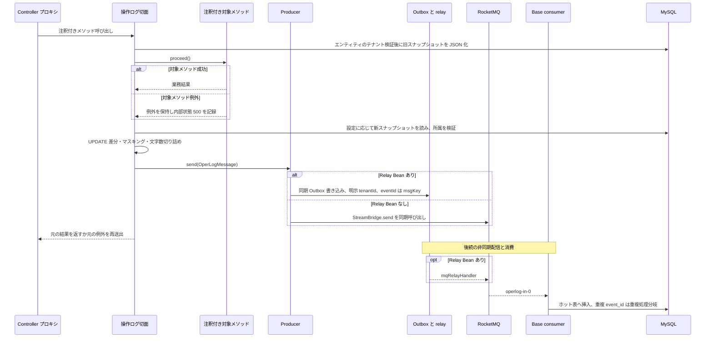

UPDATE/DELETE の旧スナップショット、UPDATE の新スナップショット、CREATE の戻り値から得るエンティティは `recordSnapshot/entityClass/idExpr` の条件に従う。`tenantId` 属性を持つエンティティは要求テナントと一致した場合だけ JSON 化し、属性のないグローバルエンティティは既存動作を維持する。

パラメーター、スナップショット、例外メッセージは送信前に `OperLogSanitizer` が処理し、`excludeFields` で除外を追加できる。長い文字列は 4000 文字で切り詰める。UPDATE は新旧 JSON が両方あれば変更フィールドを抽出し、変更なしなら差分は空になる。

対象例外はそのまま再送出し、ログ内部の `response_status` は 500 とする。これは後続の HTTP や `R.code` の値とは別である。後処理と producer の例外は警告に留めるが、操作前 Mapper 読み取りは対象呼び出しの前にあり、すべての収集障害から業務を隔離する保証はない。

`ReliableMessageRelay` Bean がない場合のみ直接送信する。Outbox 送信が失敗しても直接送信へ切り替えない。Controller 切面の送信とサービスのトランザクション関係は実際の呼び出し境界に依存し、Outbox の名称だけでは常に同一トランザクションとはいえない。

<a id="10b-操作ログアーカイブフロー毎日-0200-定期実行"></a>

### 10B. 操作ログアーカイブフロー（メタデータ既定値は毎日 02:00）

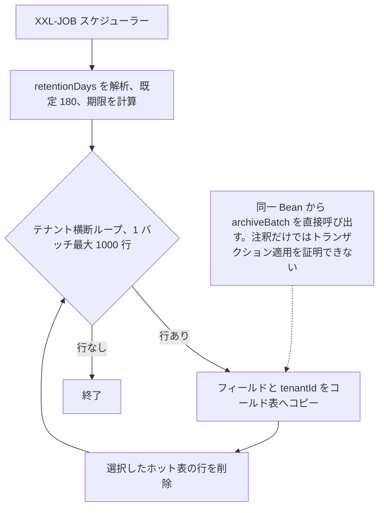

ハンドラーは `@XxlJob("operLogArchiveHandler")` と `@SystemJobMeta` を併記し、既定 cron は `0 0 2 * * ?`、バッチサイズは 1000。実行にはジョブセンターの登録・設定・有効化が必要となる。

保存日数は JSON の数値 `retentionDays` から読み、未指定・解析失敗時は 180。メタデータの min/max は、このパーサーが実行時に範囲検証する証拠にはならない。検索はテナントを限定せず、コピー時には各行の `tenantId` を保持する。

現在の実装に `AtomicBoolean` の再入防止はない。同一 Bean 内で `archiveBatch()` を呼ぶため、`@Transactional` の存在だけではこの経路の原子的なコピー／削除を証明できない。バッチ例外はログ記録後にループを止めるが、入口は完了ログを出せる。そのログは全件成功の証拠ではない。

### 主要コンポーネント

| ソース | 責務 |
| --- | --- |
| [OperLog.java](../omni-backend/omni-common-core/src/main/java/com/omni/common/core/operlog/OperLog.java) / [OperType.java](../omni-backend/omni-common-core/src/main/java/com/omni/common/core/operlog/OperType.java) / [OperLogMessage.java](../omni-backend/omni-common-core/src/main/java/com/omni/common/core/operlog/OperLogMessage.java) | 注釈オプション・操作種別・メッセージ構造 |
| [OperLogAutoConfiguration.java](../omni-backend/omni-common-operlog/src/main/java/com/omni/common/operlog/config/OperLogAutoConfiguration.java) / [OperLogAspect.java](../omni-backend/omni-common-operlog/src/main/java/com/omni/common/operlog/aspect/OperLogAspect.java) / [EntityDiffer.java](../omni-backend/omni-common-operlog/src/main/java/com/omni/common/operlog/diff/EntityDiffer.java) / [OperLogSanitizer.java](../omni-backend/omni-common-operlog/src/main/java/com/omni/common/operlog/sanitize/OperLogSanitizer.java) | 構成条件・スナップショット所属検証・差分・マスキング |
| [OperLogProducer.java](../omni-backend/omni-common-operlog/src/main/java/com/omni/common/operlog/producer/OperLogProducer.java) / [ReliableMessageRelay.java](../omni-backend/omni-common-core/src/main/java/com/omni/common/core/mq/ReliableMessageRelay.java) | 同期送信入口と明示テナント Outbox 契約 |
| [OperLogConsumer.java](../omni-backend/omni-base/src/main/java/com/omni/base/consumer/OperLogConsumer.java) / [OperLogServiceImpl.java](../omni-backend/omni-base/src/main/java/com/omni/base/service/impl/OperLogServiceImpl.java) / [OperLogController.java](../omni-backend/omni-base/src/main/java/com/omni/base/controller/OperLogController.java) | ホット表への消費・重複イベント・テナント検索 |
| [OperLogArchiver.java](../omni-backend/omni-base/src/main/java/com/omni/base/service/OperLogArchiver.java) / [0001-base-schema.yaml](../database/changelog/base/0001-base-schema.yaml) | システムジョブ・ホット／コールドスキーマ・移行境界 |
| [AuditEventListener.java](../omni-backend/omni-auth/src/main/java/com/omni/auth/event/AuditEventListener.java) / [AuditLogServiceImpl.java](../omni-backend/omni-auth/src/main/java/com/omni/auth/service/impl/AuditLogServiceImpl.java) / [pom.xml](../omni-backend/omni-auth/pom.xml) | Auth のセキュリティ監査リスナーと独立した保存経路 |

### 監査証跡ディメンション

| 観点 | フィールド | 意味 |
| --- | --- | --- |
| 操作主体 | `oper_username` | 現在の認証名 |
| 時刻 | `oper_time` | 切面がメッセージを構築したローカル時刻 |
| 操作 | `module/oper_type/request_url` | 注釈の操作種別と要求入口 |
| 変更 | `old_value/new_value` | 任意のマスキング済みスナップショットまたは差分 |
| 送信元 | `ip_address/user_agent` | 要求文脈 |
| 所要時間 | `execution_time` | 切面開始から finally に入るまで。前処理を含み後処理と送信は含まない |
| 結果 | `response_status/error_msg` | 対象メソッドの成功／例外を示す内部値。最終 HTTP 変換とは別 |

### 監査ログとの補完関係

| 記録 | 保存先 | 所有者と収集経路 |
| --- | --- | --- |
| 操作ログ | `sys_oper_log/sys_oper_log_archive` | common-operlog 切面／producer、Base が消費・アーカイブ |
| セキュリティ監査 | `sys_audit_log` | Auth: ApplicationEventPublisher → AuditEventListener → AuditLogService |
| ログイン記録 | `sys_audit_log` のログインイベントの読み取り専用投影 | Auth が LOGIN_SUCCESS / LOGIN_FAILED を検索 |

セキュリティ監査リスナーは `@Async("auditExecutor")` で DB に保存し、例外を捕捉する。上記 RocketMQ 消費チェーンとは別経路である。Auth は common-operlog に依存せず、ログイン記録用の独立した `sys_login_log` 表もない。

### 現在のステータス

- Base のログ一覧はホット表を明示的な `tenant_id` 条件で検索し、`base:operlog:list` を要求する。この API はコールド表をページ結果に統合しない。
- 新しいメッセージの `eventId` は切面で生成し、ID のない旧メッセージにはサービスが安定した legacy ID を生成する。ホット表とコールド表にはそれぞれ `event_id` の一意キーがある。consumer は重複キー例外を処理し、その他の例外をミドルウェアへ再送出する。
- 対象回帰テストは実際の辞書 Controller/Service と切面でテナント情報漏えいを検証する。ソース確認と単体回帰は実 MQ、DB アーカイブのトランザクション、スケジュール並行実行の検証を代替しない。

[MQ](mq-reliability.jp.md) / [XXL-JOB](scheduling.jp.md) / [ソースと制約](guides/system-security-audit.jp.md)

---

## Flow 11: ユーザータスク作成 — ワークベンチセルフサービスから XXL-JOB 直接登録

### 概要

ワークベンチは `/api/base/my-job` で現ユーザーの個人ジョブを管理する。作成は共通の有効タイプを参照し、ローカル行を挿入してから XXL-JOB の共通ハンドラーを登録し、ID を書き戻す。受理と実際の実行は別段階となる。

### シーケンス図

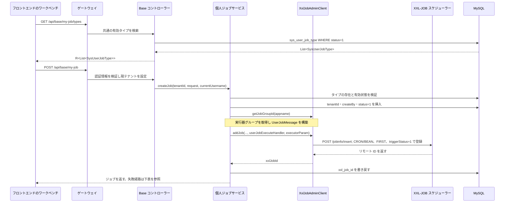

### エラーハンドリング

| 発生条件 | 現在の処理 |
| --- | --- |
| jobName/jobType/cronExpression が空白 | 作成 DTO の `@NotBlank` 検証。Cron やパラメーター Schema 全体の検証ではない |
| タイプが欠落または無効 | 挿入前に業務コード 400。有効なカタログ行だけではハンドラーの配備を証明しない |
| 実行器グループの取得失敗 | 挿入済みローカル行を削除し、業務コード 500 |
| 登録または ID 書き戻し失敗 | 正確なリモート ID または実行器グループ+handler+executorParam で補償。不在確認後にローカルを削除し、不明時は復旧用関連を残してエラー |
| 実行パラメーターの構築失敗 | 挿入後かつ登録補償の try 外で呼ぶ。この位置に削除分岐はなく、すべての失敗が原子的にロールバックされるわけではない |

### 主要コンポーネント

| ソース | 責務 |
| --- | --- |
| [MyJobController.java](../omni-backend/omni-base/src/main/java/com/omni/base/controller/MyJobController.java) / [CreateUserJobRequest.java](../omni-backend/omni-base/src/main/java/com/omni/base/dto/CreateUserJobRequest.java) / [UpdateUserJobRequest.java](../omni-backend/omni-base/src/main/java/com/omni/base/dto/UpdateUserJobRequest.java) / [UserJobServiceImpl.java](../omni-backend/omni-base/src/main/java/com/omni/base/service/impl/UserJobServiceImpl.java) / [UserJobTypeServiceImpl.java](../omni-backend/omni-base/src/main/java/com/omni/base/service/impl/UserJobTypeServiceImpl.java) | 認証済み入口・DTO 検証・タイプ選択・行単位の所有権 |
| [index.vue](../omni-frontend/src/views/home/index.vue) / [myJob.ts](../omni-frontend/src/api/myJob.ts) | ワークベンチ API とフォーム送信 |
| [CronGenerator.vue](../omni-frontend/src/components/CronGenerator.vue) / [DynamicFormRenderer.vue](../omni-frontend/src/components/DynamicFormRenderer.vue) / [schema.ts](../omni-frontend/src/types/schema.ts) | 7 種の Cron 頻度と標準／互換 Schema の動的フィールド |
| [XxlJobAdminClient.java](../omni-backend/omni-common-job/src/main/java/com/omni/common/job/XxlJobAdminClient.java) / [XxlJobProperties.java](../omni-backend/omni-common-job/src/main/java/com/omni/common/job/XxlJobProperties.java) / [XxlJobAutoConfiguration.java](../omni-backend/omni-common-job/src/main/java/com/omni/common/job/config/XxlJobAutoConfiguration.java) | 実行器設定・登録・リモート検索と補償 |
| [0001-base-schema.yaml](../database/changelog/base/0001-base-schema.yaml) / [base.sql](../scripts/sql/seed/base.sql) / [UserJobSeedSyncRunner.java](../omni-backend/omni-base/src/main/java/com/omni/base/job/UserJobSeedSyncRunner.java) | 正式スキーマ・シード・起動時同期 |

### 所有権モデル

`MyJobController` は行単位の所有権検証を行い、メソッドの `@PreAuthorize` で代替しない。一覧と統計は現テナントと `createBy` に固定し、作成は信頼できるヘッダーと認証文脈からテナントと作成者を得る。

更新・削除・状態変更・手動起動・ログ検索は `verifyOwnership(id, tenantId, username)` を呼び、エンティティの `tenantId` と `createBy` の両方を照合する。欠落ジョブは業務コード 404、他テナントまたは他作成者は 403。同名ユーザーでもテナントを越えて操作できない。

ログ入口は親ジョブの所有権を確認し、`jobId` を固定して検索する。現在の `UserJobLogServiceImpl` は `tenantId` 引数を SQL 条件に追加していない。入口の所有権検証とサービス独自の SQL テナント条件は区別する。

### 現在のステータス

- 個人ジョブはすべて `userJobExecuteHandler` を登録し、`jobType` でハンドラー Bean を特定する。共通の `sys_user_job_type` はテナント辞書とは別のカタログである。
- XXL ID が関連付けられている場合、Cron／パラメーター更新・状態変更・削除はリモート操作を先に行う。名称だけの変更はスケジューラーの説明を更新しない。受理応答欠落や補償結果不明時はローカル関連を保持して照合する。
- 起動時同期は有効かつ XXL ID のないローカル行を検索し、正式シードだけを区別しているわけではない。不明な登録結果の照合を代替せず、確認なしの再起動・再作成の根拠にはならない。

[XXL-JOB](scheduling.jp.md) / [Wiki](guides/scheduling.jp.md)

---

## Flow 12: ユーザータスク実行 — XXL-JOB トリガーからフロントエンド通知

### 概要

XXL-JOB は `UserJobMessage` JSON を共通実行入口へ渡し、`jobType` で `UserJobHandler` に振り分ける。処理結果・ログ保存・最終実行時刻・画面通知にはそれぞれ失敗境界があり、起動の受理は全段階の完了を証明しない。

### シーケンス図

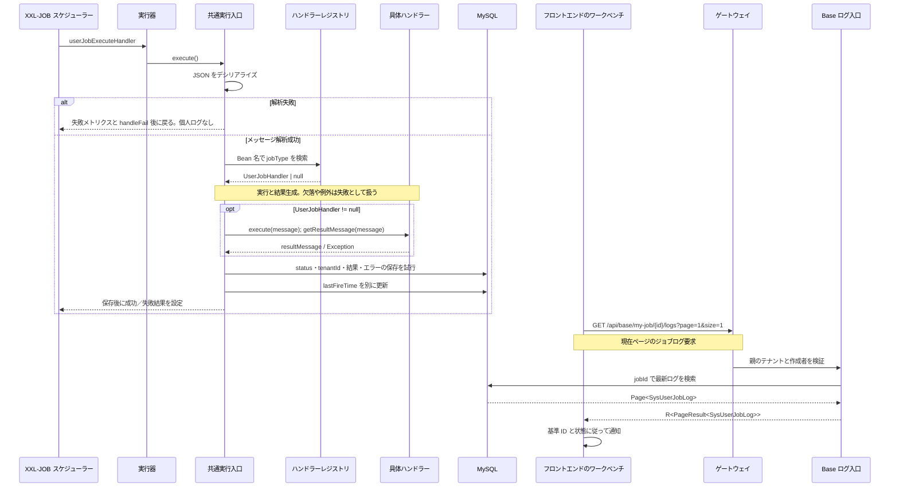

### フロントエンドポーリングメカニズム

| 経路 | 周期／条件 | 対象 | 通知と終了 |
| --- | --- | --- | --- |
| 手動起動の待機 | 2 秒ごと、最大 15 回 | 手動起動したジョブ | 起動前の基準より新しいログで通知して停止。上限でも停止 |
| ページ入場時の確認 | マウント後、直近 2 分 | 現在ページの各ジョブの最新ログ | fireTime と resultMessage が必要。永続的な既読記録はない |
| 周期ポーリング | 10 秒ごと | 現在の絞り込み／ページ tableData で status=1 のジョブ | 最初は基準を設定するだけ。後続の大きい ID で通知し一覧／統計を更新 |

要求は Gateway/Base API を通り、ブラウザーは MySQL に直接接続しない。全体ポーリングはこのページのタイマーを指し、全ジョブや別ページを走査しない。通知対象の新ログがなければ一覧／統計は毎回更新しない。

3 経路に共通の永続的な重複防止状態はなく、通知の一回限りの表示は保証しない。アンマウントでタイマーと ID 基準を消去する。再入場では最近のログを再表示でき、ページを閉じればこのポーリングは終了する。

`ElNotification` は状態に応じて結果またはエラーを選び、3000 ミリ秒表示する。次回実行時刻はクライアントの `cron-parser` による表示用計算で、実際のスケジューラー起動時刻の証拠ではない。

### 実行パラメーター JSON 形式

| フィールド | 用途 |
| --- | --- |
| `jobId` | ローカルジョブとログの親を特定 |
| `tenantId` | ハンドラーへ明示的に渡してログへ保存 |
| `jobType` | UserJobHandler の Bean 名を照合 |
| `jobName` | 登録時名称のスナップショットと通知タイトル |
| `jobParams` | 任意の JSON 文字列。具体的検証はハンドラーが担当 |

共通入口は構文上有効な JSON の全フィールドを一律検証せず、実行前にジョブを再取得して現在の所有権を照合しない。メッセージ文脈を明示的に渡し、HTTP のテナント ThreadLocal は設定しない。拡張側はパラメーターと業務境界を検証する必要がある。

成功結果は最大 500 文字、捕捉した実行エラーは最大 2000 文字。`execute_time_ms` はデシリアライズ後から検索・実行・結果生成までを計測し、ログ挿入と最終時刻更新は含まない。

内蔵 `DrinkWaterRemindHandler` は `cupShape` を読み、欠落・解析失敗時はソースの `中杯` を使う。リマインダーと代替文は中国語で、フロントエンド言語に自動追従しない。

### エラーハンドリング

| 状況 | 現在の結果 |
| --- | --- |
| JSON デシリアライズ失敗 | 失敗メトリクスと handleFail 後に戻り、個人ログと lastFireTime は更新しない |
| ハンドラーなし | status=0 とし、エラーログ保存・時刻更新・失敗報告を試行 |
| execute/getResultMessage の例外 | status=0 として捕捉するが、業務作用を自動ロールバックしない |
| ログ挿入または最終時刻更新失敗 | ハンドラー catch 外で共通トランザクションもない。最終結果設定を中断でき、2 回の書き込みの原子性は保証されない |
| 通常の保存完了 | status=1 なら handleSuccess、0 なら handleFail。画面が新ログを取得する段階は別 |

### 主要コンポーネント

| ソース | 責務 |
| --- | --- |
| [UserJobExecuteHandler.java](../omni-backend/omni-base/src/main/java/com/omni/base/job/UserJobExecuteHandler.java) / [UserJobHandlerRegistry.java](../omni-backend/omni-base/src/main/java/com/omni/base/job/UserJobHandlerRegistry.java) | 共通実行入口・Bean 名振り分け・結果分岐 |
| [UserJobMessage.java](../omni-backend/omni-common-core/src/main/java/com/omni/common/core/job/UserJobMessage.java) / [UserJobHandler.java](../omni-backend/omni-common-core/src/main/java/com/omni/common/core/job/UserJobHandler.java) | 5 フィールドのメッセージと SPI |
| [DrinkWaterRemindHandler.java](../omni-backend/omni-base/src/main/java/com/omni/base/job/handler/DrinkWaterRemindHandler.java) / [base.sql](../scripts/sql/seed/base.sql) | 内蔵リマインダーのパラメーターと実際の文 |
| [MyJobController.java](../omni-backend/omni-base/src/main/java/com/omni/base/controller/MyJobController.java) / [UserJobLogServiceImpl.java](../omni-backend/omni-base/src/main/java/com/omni/base/service/impl/UserJobLogServiceImpl.java) / [SysUserJobLogMapper.java](../omni-backend/omni-base/src/main/java/com/omni/base/mapper/SysUserJobLogMapper.java) | 親所有権・ログ検索・統計 SQL |
| [index.vue](../omni-frontend/src/views/home/index.vue) / [myJob.ts](../omni-frontend/src/api/myJob.ts) | 現在ページのポーリング・手動待機・通知 |
| [JobMetrics.java](../omni-backend/omni-common-job/src/main/java/com/omni/common/job/JobMetrics.java) | 実行／解析メトリクス入口 |

### 現在のステータス

- ハンドラー名は共通タイプコードに完全一致させる。カタログ行と配備 Bean は別条件であり、共通ユーザーハンドラーにシステムジョブメタデータ注釈はない。
- 個人ログの tenantId は実行パラメーターから来る。ワークベンチは親を先に検証する。ログ一覧は ID 降順で、統計はジョブ関連を通じて現テナントと作成者を限定する。
- 本節は現在の実装と境界を示す。ソース確認と既存単体検証は、この回で実 Cron・ブラウザー通知・外部作用を新たに実証したことを意味しない。

[XXL-JOB](scheduling.jp.md) / [Wiki](guides/scheduling.jp.md)

---

## Flow 13: CRM リード冪等変換 — Customer + Contact + Opportunity + Outbox

### 概要

`POST /api/crm/lead/{id}/convert` は `crm:lead:convert` を要求し、同じ完全な権限コードで現ユーザーのデータ範囲を解決する。サービスは現テナントの可視かつ未削除のリードをロックしてから変換記録を調べる。初回は `QUALIFIED` と一致する version が必要で、既存変換は元の ID と `idempotentReplay=true` を返し、業務／Outbox を再書き込みしない。

DTO は version、customerMode、contactMode を必須とする。サービスの CREATE/LINK 分岐がモードと関連 ID を検証し、関連付ける連絡先は選択顧客に属する必要がある。任意の商談はテナント既定パイプラインの DISCOVERY と既定通貨を使う。

### シーケンス

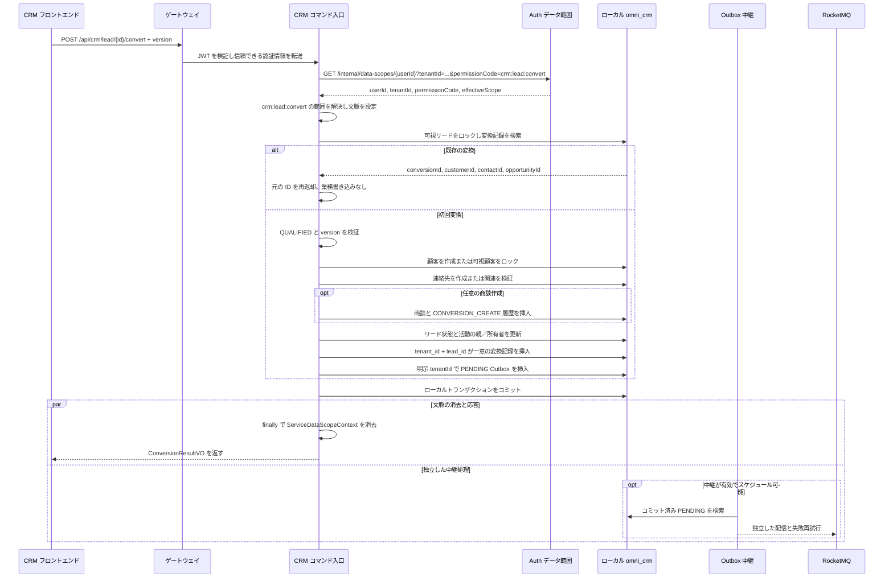

### 整合性境界

| 対象 | 所有者の参照元 |
| --- | --- |
| 新規顧客 | 現リードの owner スナップショット |
| 新規連絡先 | 選択顧客の owner。リードとは異なる場合がある |
| 新規商談 | 現リードの owner スナップショット |
| 移動した活動 | 親を CUSTOMER に変更し、選択顧客の owner を反映して活動 version を増加 |

- `crm_lead_conversion(tenant_id,lead_id)` の一意制約と可視リードの行ロックで変換を保護する。再返却にも DTO、機能権限、リード可視性の検証が必要で、サービス内では状態／version 検証より先に既存結果を返す。
- `convert()` は `@Transactional`。既定の 4 引数 `ReliableMessageTemplate.send()` は REQUIRED で現在のトランザクションに参加し、ローカル PENDING のみを書く。中継とブローカー配信は別であり、中継の無効化や未スケジュール時に保存を配信済みと扱わない。
- 既存顧客／連絡先の関連付けは owner を再割り当てしない。変換は `CrmOwnerResolver` を呼んで継承 owner を Auth へ再照会しない。他の作成／割り当てコマンドの owner 検証とは別の動作である。
- 変換 payload は leadId、customerId、contactId、opportunityId（null 可）のみ。eventId、tenantId、aggregateVersion、actorUserId はエンベロープに属する。eventId は msgKey としても渡すが、それ自体が業務の冪等性を保証しない。連絡先情報や備考は payload に含まない。
- 変換の `@OperLog` はエンティティスナップショットを無効化し、customerName、contactName、opportunityName を明示的に除外する。マスキングと例外境界は Flow 10 に従い、すべての機密テキストの識別を保証しない。
- 不正モード／関連は業務コード 400、不可視リソースは 404、初回の状態／version 競合は 409。Auth の拒否や不整合な範囲は 403、Feign サービス例外は 503 となり、データ範囲を広げない。

ソースと回帰テスト: [LeadController.java](../omni-backend/omni-crm/src/main/java/com/omni/crm/controller/LeadController.java) / [LeadServiceImpl.java](../omni-backend/omni-crm/src/main/java/com/omni/crm/service/impl/LeadServiceImpl.java) / [CrmRequests.java](../omni-backend/omni-crm/src/main/java/com/omni/crm/dto/CrmRequests.java) / [CrmTenantInitializerImpl.java](../omni-backend/omni-crm/src/main/java/com/omni/crm/service/impl/CrmTenantInitializerImpl.java) / [ReliableMessageTemplate.java](../omni-backend/omni-common-mqlog/src/main/java/com/omni/common/mqlog/template/ReliableMessageTemplate.java) / [LeadServiceImplTest.java](../omni-backend/omni-crm/src/test/java/com/omni/crm/service/impl/LeadServiceImplTest.java)

[メッセージ配送の境界](mq-reliability.jp.md)

---

## Flow 14: CRM 商談推進と権限分離 — Stage History + Customer 活性化

### 概要

商談ステージは `crm:opportunity:stage`、再開は `crm:opportunity:reopen` の独立コマンドを使い、通常の更新 DTO は stage/status を受け付けない。リポジトリ設定はテナントとデータ範囲を有効化する。可視行ロックと version 条件付き更新で制約し、履歴とローカル Outbox を追加する。

### 状態遷移

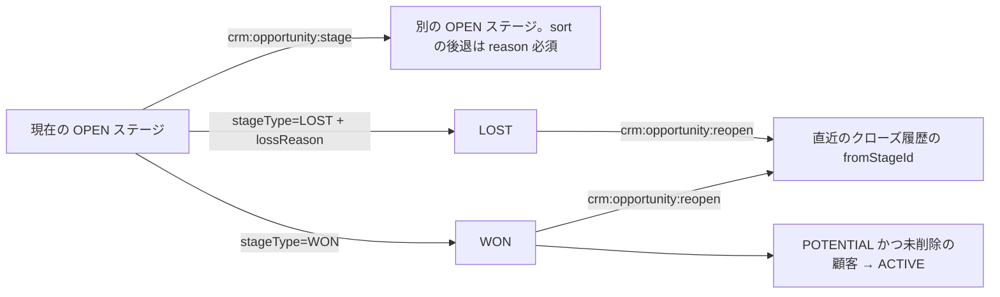

### コマンド実行規則

1. Gateway は信頼できる認証情報を転送し、CRM の共通認証チェーンとメソッド権限が入口を保護する。`@ServiceDataScope` は完全な permissionCode で Auth を参照し、userId／tenantId／permissionCode／effectiveScope を照合して finally で文脈を消去する。
2. 現在の順序は TenantLine → DataPermission → OptimisticLocker → Pagination。TenantLine は crm_*、DataPermission は 5 つの owner 集約を扱う。ALL/TENANT でも owner 条件だけを除き、現テナントの境界を維持する。
3. changeStage は可視商談をロックして version と現在の OPEN を検証する。元／対象ステージは有効で、対象は同じ pipeline に属し、同一ステージは拒否する。sort の後退は reason、LOST はさらに lossReason が必要で、次のステージだけに進む制約ではない。
4. id/version/deleted=0 条件で stage/status/probability、クローズ時刻、失注理由を更新し version を増やす。更新行数が 1 以外なら 409。履歴を追加し、対象 stageType で stage-changed/won/lost イベントを決める。
5. 受注は DataPermission だけを無視する顧客専用 SQL を呼び、TenantLine と customerId/POTENTIAL/deleted=0 を維持する。この呼び出しは更新行数 1 を必須とせず、他の顧客状態を ACTIVE に強制しない。
6. 再開は直近の toStatus=WON/LOST 履歴の fromStageId を読み、現在有効なステージを取得する。OPEN と確度を設定しクローズ時刻／失注理由を消去して version 条件で更新し、REOPEN 履歴と選択ステージ種別に応じたイベントを追加する。
7. 顧客、ステージ履歴、Outbox の書き込みはサービスメソッドのローカルトランザクションに属する。行ロックのソースと単体ケースだけでは、現 DB の並行処理・ロールバックや外部 MQ の実証にはならない。

### PII 返却規則

- Lead／Customer／Contact 専用のページ一覧は常にマスキングして返す。詳細は `crm:pii:view` により連絡先・住所などの保護フィールドを完全表示するか決める。
- Activity 専用一覧／タイムラインは空白以外の content を `[REDACTED]` にする。null と空白は保持し、詳細は PII 権限を適用する。
- Customer 360 は連絡先／商談／活動／リード各ブロックで list 権限と dataScope を個別に検証し、権限のないブロックは検索しない。可視連絡先と活動には詳細の PII フラグも使うため、全コレクションの無条件マスキングとはいえない。
- 4 つの編集画面は詳細を再取得し、PII 権限がなければ機密入力を無効化して送信 payload から省く。変換も contactMobile/contactEmail を省く。書き込みの認可は引き続きバックエンドのコマンド権限とデータ範囲が担う。

ソースと回帰テスト: [OpportunityController.java](../omni-backend/omni-crm/src/main/java/com/omni/crm/controller/OpportunityController.java) / [OpportunityServiceImpl.java](../omni-backend/omni-crm/src/main/java/com/omni/crm/service/impl/OpportunityServiceImpl.java) / [CrmCustomerMapper.java](../omni-backend/omni-crm/src/main/java/com/omni/crm/mapper/CrmCustomerMapper.java) / [CrmStateMachine.java](../omni-backend/omni-crm/src/main/java/com/omni/crm/domain/CrmStateMachine.java) / [ServicePersistenceAutoConfiguration.java](../omni-backend/omni-common-service/src/main/java/com/omni/common/service/config/ServicePersistenceAutoConfiguration.java) / [CrmViewAssembler.java](../omni-backend/omni-crm/src/main/java/com/omni/crm/dto/CrmViewAssembler.java) / [CrmPermissionScopeExecutor.java](../omni-backend/omni-crm/src/main/java/com/omni/crm/service/support/CrmPermissionScopeExecutor.java) / [OpportunityServiceImplTest.java](../omni-backend/omni-crm/src/test/java/com/omni/crm/service/impl/OpportunityServiceImplTest.java) / [PiiMaskerTest.java](../omni-backend/omni-crm/src/test/java/com/omni/crm/security/PiiMaskerTest.java)

[crm/lead/index.vue](../omni-frontend/src/views/crm/lead/index.vue) / [crm/customer/index.vue](../omni-frontend/src/views/crm/customer/index.vue) / [crm/contact/index.vue](../omni-frontend/src/views/crm/contact/index.vue) / [crm/activity/index.vue](../omni-frontend/src/views/crm/activity/index.vue)

本節は現ソースとハッシュで関連付けた単体結果を用いる。実 MySQL の並行処理／ロールバック、ブラウザー、外部配信は各実証範囲で確認する。

---

配置・調査手順は[認証](guides/authentication.jp.md)、[Docker 配置](docker-deployment.jp.md)、[運用](guides/operations-upgrade.jp.md)へ移しました。外部コールバックはブラウザーから到達可能な Gateway を通り、Compose 内部はサービス名で接続します。Auth 監査、JWT/JWK、機能権限とデータ範囲の境界は本ページの各 Flow を基準とします。

## Flow 15: SRM サプライヤー参入承認

`POST /api/srm/supplier` は `srm:supplier:create` と、同じ権限コードで解決したデータ範囲を要求します。管理画面からの作成では PENDING_REVIEW のサプライヤー、初期リスクデータ、登録 Outbox を書き込み、その後、現在のテナントで `category=SRM_SUPPLIER_ONBOARDING` の公開済みモデルを解決します。作成と否認後の submit はローカル `@Transactional` メソッド内で Workflow を同期呼び出しします。この呼び出しはコミット後の処理ではありません。

実際の開始 API は `POST /api/internal/workflow/process-instance/start` です。応答フィールドは processInstanceId、requestId、businessType、businessKey、replayed です。Workflow は独立してコミットするため、ローカルのロールバックではコミット済みのリモートプロセスを取り消せません。

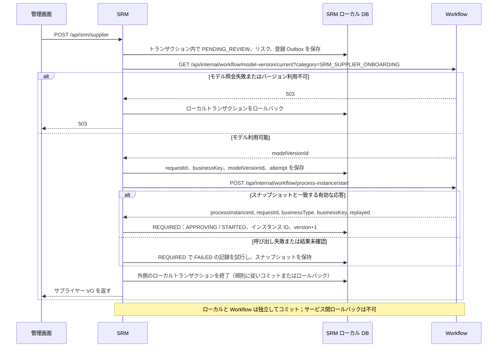

- モデル解決は開始エラーを捕捉する前に実行されます。有効なモデルがない場合や照会失敗時は 503 を投げ、作成がロールバックされる可能性があります。開始呼び出しの例外は FAILED の記録を試みた後に prepareAndStart が捕捉し、外側がコミットした場合は PENDING_REVIEW が残ります。FAILED はローカルで開始を未確認という意味であり、リモートプロセスの不存在を証明しません。
- SRM は requestId、businessKey=`{supplierId}:{attempt}`、modelVersionId、attempt、開始状態を保存します。startUserId/startUserName は現在の ID 情報からコマンドへ渡され、サプライヤーに開始者スナップショットの永続フィールドはありません。Workflow は tenant+requestId と tenant+businessType+businessKey の二つの一意制約で再実行を調整し、モデルと開始者の意図の一致を検証します。
- 管理側 `/{id}/submit` と Portal `/profile/submit` は REJECTED のみを受け付け、新しい試行を開始します。現在の両入口には PENDING_REVIEW/FAILED から元のスナップショットを再使用する Workflow 開始リトライはありません。Portal enrollment/retry はロール付与 Saga 用です。再提出を開始失敗の汎用復旧入口として説明できません。
- 完了イベントは Workflow のローカル Outbox と独立した中継を通ります。SRM は同一トランザクションで `(tenantId,eventId)` Inbox を登録・ロックし、producer、businessType、businessKey、インスタンス、ペイロードの意図を検証します。一致する APPROVING/STARTED のみが APPROVED/REJECTED に進み、結果 Outbox を保存します。処理済み、旧試行、終端状態、インスタンス不一致では再更新しません。ローカル開始確認より早い有効イベントは再試行可能な例外を投げ、処理済みにはしません。
- `RequiredWorkflowModelInitializer` は既定テナント 1 の必須モデル四つを確認し、照会で取得した対応する有効モデルを修正・公開します。既定モデルの欠落や公開失敗は Workflow の起動を失敗させます。全新規テナントに全モデルが存在する保証ではありません。
- 作成応答はメモリ内の supplier から組み立てます。開始失敗後の DB の開始マーカーと増加した version は、このエンティティに完全には同期されません。状態と現在の version は詳細を再読して確認し、作成応答を完全な永続開始スナップショットと扱わないでください。

ソースと回帰: [SupplierController.java](../omni-backend/omni-srm/src/main/java/com/omni/srm/controller/SupplierController.java) / [SupplierServiceImpl.java](../omni-backend/omni-srm/src/main/java/com/omni/srm/service/impl/SupplierServiceImpl.java) / [SupplierWorkflowCoordinator.java](../omni-backend/omni-srm/src/main/java/com/omni/srm/workflow/SupplierWorkflowCoordinator.java) / [SupplierWorkflowStateServiceImpl.java](../omni-backend/omni-srm/src/main/java/com/omni/srm/workflow/SupplierWorkflowStateServiceImpl.java) / [SupplierWorkflowCompletionServiceImpl.java](../omni-backend/omni-srm/src/main/java/com/omni/srm/service/impl/SupplierWorkflowCompletionServiceImpl.java) / [WorkflowInternalClient.java](../omni-backend/omni-srm/src/main/java/com/omni/srm/client/WorkflowInternalClient.java) / [RequiredWorkflowModelInitializer.java](../omni-backend/omni-workflow/src/main/java/com/omni/workflow/config/RequiredWorkflowModelInitializer.java) / [InternalWorkflowServiceImpl.java](../omni-backend/omni-workflow/src/main/java/com/omni/workflow/service/impl/InternalWorkflowServiceImpl.java) / [WorkflowProcessStartRequestServiceImpl.java](../omni-backend/omni-workflow/src/main/java/com/omni/workflow/service/impl/WorkflowProcessStartRequestServiceImpl.java) / [SrmViewAssembler.java](../omni-backend/omni-srm/src/main/java/com/omni/srm/dto/SrmViewAssembler.java)

### Flow 15.1: 購買申請承認ルールの設定とマッチング試算

ルールが結び付くモデル分類は `purchase`、実行インスタンスの businessType は `PROCUREMENT_REQUISITION` です。画面ではプロセス名とバージョンを選び、プロトコルでは modelVersionId を送信します。

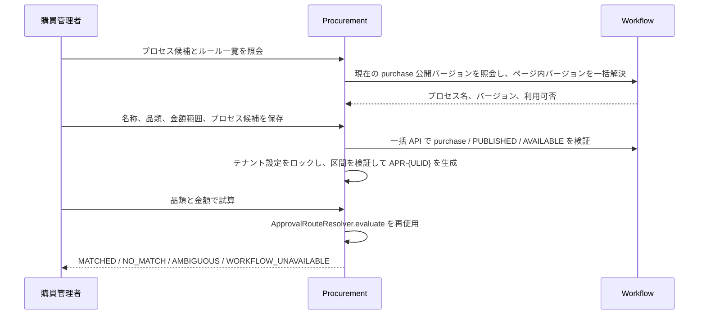

- 作成・更新では現在の purchase 公開モデルを検証します。一覧のメタデータは重複除去した modelVersionId を最大 200 件ずつ一括解決し、Workflow 障害時もローカルルールを残して UNAVAILABLE とします。試算で承認図を返すのはモデルと安全なプレビューが利用可能な場合のみです。
- 金額範囲は半開区間です。まず完全一致の品類を探し、該当しない場合のみ `*` を使います。同じ階層で複数に該当すると priority 順でも AMBIGUOUS となります。route_code はサーバーが生成します。API は明示 priority を許可し、省略時は品類内最大値に 10 を加えます。
- カバレッジは 0 から無限までの区間とモデル利用可否を評価します。無効化・削除の影響試算はメモリ内で対象を除外します。ただしテナント初期化が既定設定を準備する場合があり、試算という名称だけで要求全体に初期化の書き込みがないとは判断できません。

ソースと回帰: [ApprovalRouteController.java](../omni-backend/omni-procurement/src/main/java/com/omni/procurement/controller/ApprovalRouteController.java) / [ApprovalRouteServiceImpl.java](../omni-backend/omni-procurement/src/main/java/com/omni/procurement/service/impl/ApprovalRouteServiceImpl.java) / [ApprovalRouteInsightServiceImpl.java](../omni-backend/omni-procurement/src/main/java/com/omni/procurement/service/impl/ApprovalRouteInsightServiceImpl.java) / [ApprovalRouteResolver.java](../omni-backend/omni-procurement/src/main/java/com/omni/procurement/domain/ApprovalRouteResolver.java) / [ApprovalRouteCoverageAnalyzer.java](../omni-backend/omni-procurement/src/main/java/com/omni/procurement/domain/ApprovalRouteCoverageAnalyzer.java) / [ApprovalRuleWizard.vue](../omni-frontend/src/views/procurement/approval-route/components/ApprovalRuleWizard.vue)

## Flow 16: Procurement 購買申請承認と非同期ライトバック

提出と `/{id}/retry-start` はいずれも `procurement:requisition:submit` と対応するデータ範囲を要求します。submit 自体はトランザクションを保持せず、先にトランザクション付き prepareSubmit を呼び、コミット済みスナップショットで Workflow を呼びます。

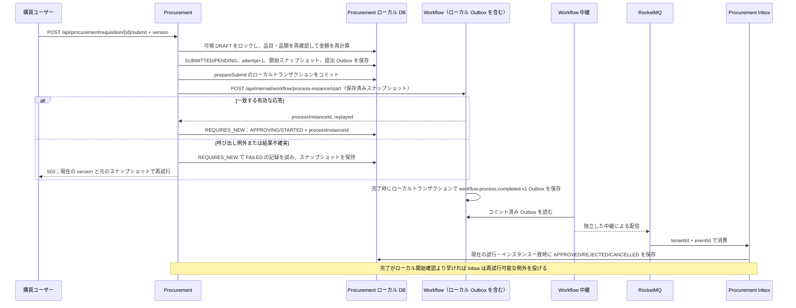

- prepareSubmit は DRAFT と現在の version のみを受け付けます。有効な品目・品類を再確認し、単一品類、正の数量、非負の単価を要求します。各行を HALF_UP で小数 4 桁に丸めて合計し、DECIMAL(19,4) を検証します。ルーティングはサーバーが行い、クライアントはモデルを選びません。
- 開始例外や不整合応答では SUBMITTED/FAILED の記録を試みますが、Workflow 未開始の証明にはなりません。retry-start はその状態と現在の version を要求し、requestId/businessKey/modelVersionId/attempt、金額、申請者を再使用します。ルート再選択や試行数増加は行いません。REJECTED の編集で DRAFT に戻り、次の提出が新しい試行を始めます。
- 完了消費は同一トランザクションで業務状態、結果 Outbox、Inbox を更新します。同じ eventId に異なるペイロード意図があれば 409 です。早着イベントは再試行可能な例外、旧試行や終端イベントは冪等に無視します。Outbox の挿入と中継による実配信は別段階です。
- 一覧は画面が可視で現在ページに APPROVING がある場合のみ 5 秒ごとに静かに更新します。60 秒後に同期遅延と更新操作を表示し、タイマーは継続します。この表示は Workflow 完了を証明せず、全ページや SUBMITTED の開始復旧を対象にしません。

RFQ 招待は Procurement、見積は SRM が管理します。SRM は同一トランザクションで見積、明細、要求冪等台帳、見積 Outbox を保存します。Procurement Inbox は見積バージョンに従って招待を更新し、古い版を無視します。選定では現在の見積 ID・版、招待、明細を再確認し、Procurement ローカルトランザクション内で見積スナップショット付き注文を作成し、RFQ と業務 Outbox を更新します。

ソースと回帰: [RequisitionController.java](../omni-backend/omni-procurement/src/main/java/com/omni/procurement/controller/RequisitionController.java) / [RequisitionServiceImpl.java](../omni-backend/omni-procurement/src/main/java/com/omni/procurement/service/impl/RequisitionServiceImpl.java) / [RequisitionWorkflowStateServiceImpl.java](../omni-backend/omni-procurement/src/main/java/com/omni/procurement/service/impl/RequisitionWorkflowStateServiceImpl.java) / [RequisitionWorkflowCoordinator.java](../omni-backend/omni-procurement/src/main/java/com/omni/procurement/workflow/RequisitionWorkflowCoordinator.java) / [WorkflowCompletionServiceImpl.java](../omni-backend/omni-procurement/src/main/java/com/omni/procurement/service/impl/WorkflowCompletionServiceImpl.java) / [index.vue](../omni-frontend/src/views/procurement/requisition/index.vue) / [QuotationServiceImpl.java](../omni-backend/omni-srm/src/main/java/com/omni/srm/service/impl/QuotationServiceImpl.java) / [QuotationSubmittedServiceImpl.java](../omni-backend/omni-procurement/src/main/java/com/omni/procurement/service/impl/QuotationSubmittedServiceImpl.java) / [RfqServiceImpl.java](../omni-backend/omni-procurement/src/main/java/com/omni/procurement/service/impl/RfqServiceImpl.java) / [PurchaseOrderServiceImpl.java](../omni-backend/omni-procurement/src/main/java/com/omni/procurement/service/impl/PurchaseOrderServiceImpl.java) / [RequisitionWorkflowCoordinatorTest.java](../omni-backend/omni-procurement/src/test/java/com/omni/procurement/workflow/RequisitionWorkflowCoordinatorTest.java) / [RequisitionWorkflowStateServiceImplTest.java](../omni-backend/omni-procurement/src/test/java/com/omni/procurement/service/impl/RequisitionWorkflowStateServiceImplTest.java) / [WorkflowCompletionServiceImplTest.java](../omni-backend/omni-procurement/src/test/java/com/omni/procurement/service/impl/WorkflowCompletionServiceImplTest.java)

対象は現在のソースと紐付いた単体報告です。実 MySQL の並行性・ロールバック、Workflow/MQ 配信、ブラウザーのポーリング、実 CAPTCHA による SRM 登録は個別の受け入れ証拠が必要です。

---

## Flow 17: Procurement 入荷から Asset カード作成・移管・廃棄まで

Procurement、Asset、Workflow はそれぞれローカルトランザクションをコミットし、Outbox と Inbox で接続します。取得元の取り込み、承認確認、実物の業務完了は別の手順です。

### 入荷の取り込みと履歴補完

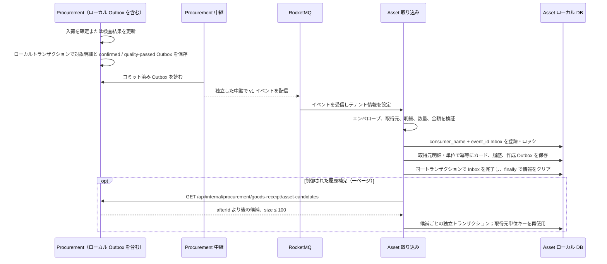

- Procurement は入荷確定時点で資産化条件に合う明細のみをイベントに含め、後続の検査合格イベントには新たに合格した対象明細を含めます。Asset は `procurement.goods-receipt.confirmed.v1` と `procurement.goods-receipt.quality-passed.v1` を扱います。
- 取り込みは取得元 ID、owner、通貨、明細、金額の等式を先に検証します。有効な非 PASS・非 assetManaged 明細はスキップし、欠落フィールド、不正金額、取得元明細の重複はバッチを拒否します。対象の receivedQuantity は正確な正整数で assetQuantity と一致し、Integer.MAX_VALUE 以下である必要があります。unitPrice と totalPrice は正の値です。
- Inbox の一意キーは `(consumer_name,event_id)` で、tenant と JSON の業務意図も検証します。テナントをまたぐ衝突や同じイベント ID の異なる意図は拒否します。資産は `(tenant_id,source_gr_line_id,source_unit_sequence)` でリアルタイムと履歴補完を重複排除します。冪等挿入後に取得元単位を再読し、JDBC の件数だけで新規作成とは判断しません。
- 新カードは IN_STOCK で入荷 owner を継承し、purchaseAmount は unitPrice を HALF_UP で小数 2 桁に丸めます。新カードだけが作成履歴と asset.created.v1 Outbox を追加し、リアルタイムの資産、履歴、Inbox、Outbox は同一ローカルトランザクションです。
- 補完入口は内部認証付き `POST /api/internal/asset/procurement/backfill` です。ヘッダーとクエリの tenantId は一致し、afterId は排他的な入荷明細カーソル、size は 1–100 です。一回一ページで nextAfterId/hasMore を返し、呼び出し側がカーソルを保存して続けます。起動時に自動で全件走査する実装はありません。候補単位でコミットするため、途中失敗でも先行した副作用は残り、再試行を取得元キーで重複排除します。

ソース: [GoodsReceiptServiceImpl.java](../omni-backend/omni-procurement/src/main/java/com/omni/procurement/service/impl/GoodsReceiptServiceImpl.java) / [ProcurementGoodsReceiptConsumer.java](../omni-backend/omni-asset/src/main/java/com/omni/asset/consumer/ProcurementGoodsReceiptConsumer.java) / [ProcurementAssetImportServiceImpl.java](../omni-backend/omni-asset/src/main/java/com/omni/asset/service/impl/ProcurementAssetImportServiceImpl.java) / [AssetReceiptImportMapper.java](../omni-backend/omni-asset/src/main/java/com/omni/asset/mapper/AssetReceiptImportMapper.java) / [ProcurementAssetBackfillServiceImpl.java](../omni-backend/omni-asset/src/main/java/com/omni/asset/service/impl/ProcurementAssetBackfillServiceImpl.java) / [InternalProcurementBackfillController.java](../omni-backend/omni-asset/src/main/java/com/omni/asset/controller/InternalProcurementBackfillController.java) / [InternalAssetCandidateController.java](../omni-backend/omni-procurement/src/main/java/com/omni/procurement/controller/InternalAssetCandidateController.java) / [InternalAssetCandidateServiceImpl.java](../omni-backend/omni-procurement/src/main/java/com/omni/procurement/service/impl/InternalAssetCandidateServiceImpl.java) / [0001-asset-schema.yaml](../database/changelog/asset/0001-asset-schema.yaml)

### 移管・廃棄の承認と業務完了

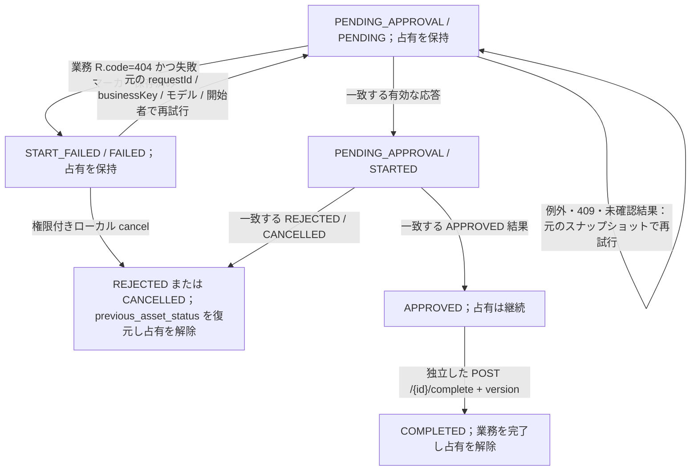

- 作成時に現在テナントの ASSET_TRANSFER/ASSET_DISPOSAL 公開モデルを自動解決し、利用者はモデル版を選びません。prepare のローカルトランザクションが requestId、申請 ID の businessKey、モデル、開始者を保存し、tenant/id/version/status と両 active_operation_* が null の条件で占有します。対象状態は IN_STOCK/ALLOCATED/IN_USE で、競合は 409 です。コミット後に Workflow を呼び、確認は REQUIRES_NEW で書き込みます。
- 通信例外、業務 409、不正応答、ローカル確認失敗は PENDING_APPROVAL/PENDING と占有を保持します。業務 R.code=404 のみが明示的失敗記録に進み、START_FAILED/FAILED の保存成功後だけローカル取消を許可します。HTTP404 の Feign 例外は結果不明です。再試行は元の requestId、businessKey、モデル、開始者を保持します。
- 承認 Inbox はテナント、業務種別・キー、インスタンス、ペイロード意図を確認します。開始確認より早い有効イベントは再試行可能な例外、処理済みや現状態・インスタンス不一致は冪等に無視します。APPROVED は別の complete 権限と現在版が渡るまで占有を保持します。移管完了は current user/unit と IN_USE を設定し管理 owner は変えず、廃棄完了は DISPOSED/SCRAPPED です。否認・取消は同一トランザクションで以前の状態、履歴、占有解除を処理します。
- 資産候補は transfer:create/disposal:create の範囲と対象状態で絞ります。ユーザー候補は Auth テナント・組織所属を検証し、サプライヤー候補は同テナントの APPROVED です。全候補に資産 owner 条件が適用されるわけではありません。SELF transfer:create 候補は current_user_id を使い、命令は対象組織の書込可否とユーザー所属を再検証するため、候補の可視性だけでは書込権限を保証しません。
- purchaseAmount、residualValue、取得元イベントの金額は JSON 十進文字列です。残価要求は専用の文字列デシリアライザを使います。候補、再試行、取消、完了には各権限が必要で、ワークフロー承認権限では資産命令権限を代替できません。

ソース: [AssetTransferController.java](../omni-backend/omni-asset/src/main/java/com/omni/asset/controller/AssetTransferController.java) / [AssetDisposalController.java](../omni-backend/omni-asset/src/main/java/com/omni/asset/controller/AssetDisposalController.java) / [AssetTransferServiceImpl.java](../omni-backend/omni-asset/src/main/java/com/omni/asset/service/impl/AssetTransferServiceImpl.java) / [AssetDisposalServiceImpl.java](../omni-backend/omni-asset/src/main/java/com/omni/asset/service/impl/AssetDisposalServiceImpl.java) / [AssetOperationWorkflowStateServiceImpl.java](../omni-backend/omni-asset/src/main/java/com/omni/asset/service/impl/AssetOperationWorkflowStateServiceImpl.java) / [WorkflowCompletionServiceImpl.java](../omni-backend/omni-asset/src/main/java/com/omni/asset/service/impl/WorkflowCompletionServiceImpl.java) / [AssetWorkflowCoordinator.java](../omni-backend/omni-asset/src/main/java/com/omni/asset/workflow/AssetWorkflowCoordinator.java) / [AssetWorkflowModelGuard.java](../omni-backend/omni-asset/src/main/java/com/omni/asset/workflow/AssetWorkflowModelGuard.java) / [AstAssetMapper.java](../omni-backend/omni-asset/src/main/java/com/omni/asset/mapper/AstAssetMapper.java) / [AssetOptionsController.java](../omni-backend/omni-asset/src/main/java/com/omni/asset/controller/AssetOptionsController.java) / [AssetOptionServiceImpl.java](../omni-backend/omni-asset/src/main/java/com/omni/asset/service/impl/AssetOptionServiceImpl.java) / [AssetDataPermissionHandler.java](../omni-backend/omni-asset/src/main/java/com/omni/asset/security/AssetDataPermissionHandler.java) / [AssetViews.java](../omni-backend/omni-asset/src/main/java/com/omni/asset/dto/AssetViews.java) / [AssetOperationRequests.java](../omni-backend/omni-asset/src/main/java/com/omni/asset/dto/AssetOperationRequests.java)

## Flow 18: SRM ポータル招待登録とロール割り当て Saga

アカウント自己登録は Auth の独立した処理で、実 CAPTCHA とテナント内ユーザー名を検証してからログインします。既定 USER 割り当ての実装範囲は Flow 1 に記載します。SRM 登録は既存の認証 ID、requestId、inviteToken を使い、Auth アカウントは作成しません。

```mermaid
sequenceDiagram
    participant U as ポータルユーザー
    participant G as Gateway
    participant A as Auth
    participant S as SRM
    participant SO as SRM Outbox・中継
    participant AO as Auth 受領記録・Outbox・中継
    participant M as RocketMQ
    participant W as Workflow
    U->>A: POST /api/auth/register（tenant + captcha）後にログイン
    A-->>U: ログイン済み ID
    U->>G: POST /api/srm/portal/enroll + requestId + inviteToken
    G->>S: 信頼された tenant/user を転送
    S->>S: トランザクション内で招待を消費し REGISTERING + PENDING_ROLE_ASSIGN を作成
    S->>SO: 同一トランザクションで srm.portal-role.assign-requested.v1 を保存
    SO-->>M: 独立した中継配信
    M->>A: tenantId, requestId, supplierId, userId, SUPPLIER
    A->>A: tenant/requestId の元の ID を検証し SUPPLIER を冪等に付与
    A->>AO: 同一トランザクションで受領記録と成功・失敗 Outbox を保存
    AO-->>M: 独立した中継配信
    M->>S: auth.portal-role.assigned.v1 / auth.portal-role.assign-failed.v1
    alt SUCCESS
        S->>S: 同じローカルトランザクションで ACTIVE PortalUser・PENDING_REVIEW・COMPLETED を保存
        S->>W: 同じローカルトランザクションで参入審査を準備・開始（Flow15）
    else FAILED
        S->>S: REGISTERING_FAILED + ROLE_ASSIGN_FAILED + nextRetryTime
    end
    U->>S: GET /api/srm/portal/enrollment
    S-->>U: Saga 状態；COMPLETED 後に再ログインを案内
    Note over S,W: モデル照会失敗は SRM 更新をロールバック可能；Auth ロールは独立コミット済みでメッセージ再配信が必要
```

- tenant/requestId の再実行は申請者と正規化 creditCode を検証します。既存の有効登録も元の要求を返し、招待を再消費しません。要求全体の冪等 hash はありません。新 Supplier の内部 owner は null、Portal userId はポータル関連にのみ保存します。
- 招待原文は作成応答でのみ返し、SHA-256 を永続化します。enroll の OperLog は inviteToken を明示除外し、ロールメッセージにパスワード・CAPTCHA・招待原文はありません。消費 SQL はテナント、版、ACTIVE、有効期限、残回数を制限し、無効 404、期限切れ・使い切り 410、競合 409 です。
- Auth は `sys_portal_role_request(tenant_id,request_id)` で元の supplier/user/role 意図を確認します。SUPPLIER のみを許可し、有効なテナントユーザーとロールを検証します。ロール付与、受領記録、結果 Outbox は同一トランザクションです。完了済み再実行は結果 Outbox を再送し、eventId は requestId とイベント種別から決定的に生成します。
- SRM はエンベロープ・ペイロードの requestId、tenantId と supplier/user/SUPPLIER を確認します。成功で ACTIVE PortalUser、PENDING_REVIEW/COMPLETED を保存し、同じローカルトランザクションで参入 Workflow を呼び、有効な開始で APPROVING になります。モデル照会失敗はローカル Saga 完了をロールバックし得ますが、開始呼び出し失敗では COMPLETED と PENDING_REVIEW/FAILED がコミットされ得ます。Saga 完了は参入 APPROVED ではなく、復旧範囲は Flow 15 に従います。
- 失敗時は REGISTERING_FAILED/ROLE_ASSIGN_FAILED と nextRetryTime を保存します。`POST /api/srm/portal/enrollment/retry` はロール付与失敗かつ待機期限後のみ元の requestId を再送し、招待は再消費しません。早過ぎる再試行は 429、PENDING/COMPLETED は既存状態を返し、完了後の遅い失敗は無視します。
- SRM ポータル権限内では既定 USER は enroll 用です。企業情報・評価には SUPPLIER、対応権限、現在テナント・ユーザーの ACTIVE PortalUser 関連が必要です。SrmPortalScope は一時的な TENANT 範囲を設定し復元します。SRM 結果消費は finally で ID・範囲をクリアし、Auth ロール処理は明示 tenant 条件を使います。
- ポータルは tenant/username ごとに requestId を保持し、PENDING_ROLE_ASSIGN 中は 5 秒ごとに照会します。COMPLETED はロール取得のためログアウトと再ログインを案内します。DB のロール付与だけで現在 JWT は書き換わりません。

ソース: [AuthController.java](../omni-backend/omni-auth/src/main/java/com/omni/auth/controller/AuthController.java) / [UserServiceImpl.java](../omni-backend/omni-auth/src/main/java/com/omni/auth/service/impl/UserServiceImpl.java) / [PortalRoleAssignConsumer.java](../omni-backend/omni-auth/src/main/java/com/omni/auth/consumer/PortalRoleAssignConsumer.java) / [PortalRoleAssignmentServiceImpl.java](../omni-backend/omni-auth/src/main/java/com/omni/auth/service/impl/PortalRoleAssignmentServiceImpl.java) / [SysPortalRoleRequestMapper.java](../omni-backend/omni-auth/src/main/java/com/omni/auth/mapper/SysPortalRoleRequestMapper.java) / [PortalController.java](../omni-backend/omni-srm/src/main/java/com/omni/srm/controller/PortalController.java) / [PortalInviteServiceImpl.java](../omni-backend/omni-srm/src/main/java/com/omni/srm/service/impl/PortalInviteServiceImpl.java) / [SrmSupplierInviteMapper.java](../omni-backend/omni-srm/src/main/java/com/omni/srm/mapper/SrmSupplierInviteMapper.java) / [SupplierPortalServiceImpl.java](../omni-backend/omni-srm/src/main/java/com/omni/srm/service/impl/SupplierPortalServiceImpl.java) / [PortalRoleResultConsumer.java](../omni-backend/omni-srm/src/main/java/com/omni/srm/consumer/PortalRoleResultConsumer.java) / [PortalRoleResultServiceImpl.java](../omni-backend/omni-srm/src/main/java/com/omni/srm/service/impl/PortalRoleResultServiceImpl.java) / [SrmPortalScope.java](../omni-backend/omni-srm/src/main/java/com/omni/srm/security/SrmPortalScope.java) / [index.vue](../omni-frontend/src/views/supplier-portal/index.vue)

本節はソースと既存単体報告による契約説明です。実 MySQL の並行性・トランザクション、Broker 配信、ネイティブ画面、実 CAPTCHA の登録には各受け入れ証拠が必要です。
