# 핵심 비즈니스 플로우

> 요청·이벤트 호출 관계와 상태, 트랜잭션, 인가, 멱등성, 실패 불변 조건을 관리합니다. 절차·이미지는 [Wiki](wiki/index.kr.md)와 도메인 가이드, 중단점은 [소스 디버깅](wiki/source-debugging.kr.md)을 참조하세요.
> 아키텍처 개요는 [architecture.kr.md](architecture.kr.md)를 참조하십시오. Docker 배포 구성은 [docker-deployment.kr.md](docker-deployment.kr.md)를 참조하십시오. API 계약은 [api-contract.kr.md](api-contract.kr.md)를 참조하십시오.

## Flow 1: 사용자 로그인 (사용자명 + 비밀번호 + 캡차 + JWT)

### 개요

`POST /api/auth/login`은 사용자명, 비밀번호, 필수 `tenantId`, 캡차를 Gateway를 거쳐 Auth에 전달합니다. 이 JWT 로그인 경로는 `UserService.findByUsername()/verifyPassword()`를 직접 호출하고 성공하면 `R<LoginResult>`를 반환합니다. `tenantId:username` 파싱은 별도의 세션 인증 경로입니다.

### 시퀀스

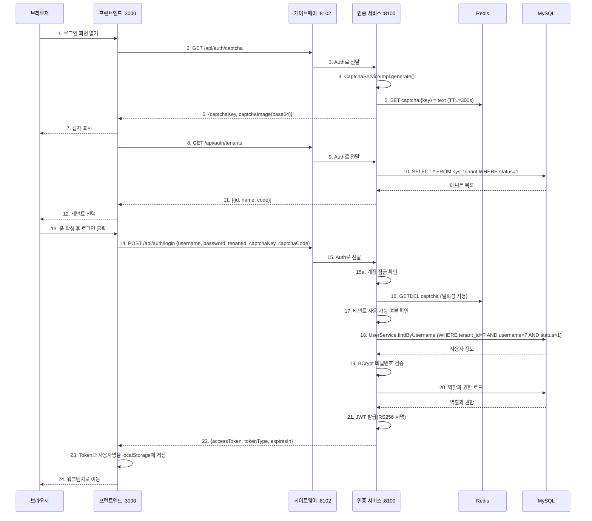

### 로그인 후: 인증된 요청 플로우

보호된 요청에는 `Authorization: Bearer <JWT>`를 넣습니다. `AuthFilter`는 공개 키를 가져와 서명과 `exp`를 검증하고 `jti`로 Redis 블랙리스트를 확인합니다. 이어 클라이언트 신원 헤더와 전달할 Bearer 헤더를 제거하고 인증된 신원과 `X-Gateway-Assertion`을 설정합니다. JWT의 목록형 `roles/scope`는 이 필터에서 쉼표로 구분한 신원 헤더로 변환합니다.

서명, 만료, 블랙리스트로 인한 보안 거부는 401입니다. 공개 키, Redis, 하위 의존성 장애를 모두 JWT 오류로 취급하지 않습니다. 일반 실행에서 단언용 비밀값이 없거나 32바이트 미만이거나 단언 생성에 실패하면 503으로 전달을 중단합니다. 하위 서비스는 각자의 사전 인증 규칙으로 단언을 검증합니다. 현재 payload는 사용자 ID, 테넌트 ID, 사용자명, 발급 시각을 묶습니다.

```
브라우저 -> 프런트엔드: 보호 리소스 요청
프런트엔드 -> 게이트웨이 :8102: Authorization: Bearer <JWT>
게이트웨이: JwkKeyProvider에서 RSA 공개 키 조회(기본 캐시 5분)
게이트웨이: RS256 서명과 exp 검증
게이트웨이 -> Redis: jti로 token:blacklist:{jti} 조회
게이트웨이: 클라이언트 신원 헤더와 전달용 Bearer 헤더 제거
게이트웨이 -> 하위 서비스: X-User-Id / X-Tenant-Id / X-User-Name
게이트웨이 -> 하위 서비스: X-User-Roles: <role-code>
게이트웨이 -> 하위 서비스: X-User-Scopes: <permission-code>
게이트웨이 -> 하위 서비스: X-Gateway-Assertion
하위 서비스: 자체 사전 인증 규칙으로 게이트웨이 단언 검증
하위 서비스 -> 게이트웨이 -> 프런트엔드 -> 브라우저: 응답
```

### 주요 구성 요소

| 구성 요소 | 소스 | 역할 |
|---|---|---|
| `LoginForm.vue` | [omni-frontend/src/components/LoginForm.vue](../omni-frontend/src/components/LoginForm.vue) | 로그인 폼: 캡차, 테넌트, 자격 증명 제출 |
| `user.ts` | [omni-frontend/src/stores/user.ts](../omni-frontend/src/stores/user.ts) | Token과 사용자명을 localStorage에 저장 |
| `request.ts` | [omni-frontend/src/api/request.ts](../omni-frontend/src/api/request.ts) | 요청 인터셉터가 Bearer Token 추가 |
| `vite.config.ts` | [omni-frontend/vite.config.ts](../omni-frontend/vite.config.ts) | `/api` 프록시 대상, 기본 Gateway :8102 |
| `AuthController.java` | [omni-backend/omni-auth/src/main/java/com/omni/auth/controller/AuthController.java](../omni-backend/omni-auth/src/main/java/com/omni/auth/controller/AuthController.java) | 잠금, 캡차, 테넌트 사용 가능 여부, 계정/비밀번호, JWT, 온라인 기록과 감사 |
| `UserServiceImpl.java` | [omni-backend/omni-auth/src/main/java/com/omni/auth/service/impl/UserServiceImpl.java](../omni-backend/omni-auth/src/main/java/com/omni/auth/service/impl/UserServiceImpl.java) | 사용자명·테넌트로 조회하고 BCrypt로 비밀번호 검증 |
| `SysUserMapper.java` | [omni-backend/omni-auth/src/main/java/com/omni/auth/mapper/SysUserMapper.java](../omni-backend/omni-auth/src/main/java/com/omni/auth/mapper/SysUserMapper.java) | 계정 쿼리에 `tenant_id + username + status=1` 적용 |
| `OmniUserDetailsService.java` | [omni-backend/omni-auth/src/main/java/com/omni/auth/security/OmniUserDetailsService.java](../omni-backend/omni-auth/src/main/java/com/omni/auth/security/OmniUserDetailsService.java) | Spring Security/세션 인증에서 `tenantId:username` 파싱. 일반 JWT 로그인 조회 진입점이 아님 |
| `CaptchaServiceImpl.java` | [omni-backend/omni-auth/src/main/java/com/omni/auth/service/impl/CaptchaServiceImpl.java](../omni-backend/omni-auth/src/main/java/com/omni/auth/service/impl/CaptchaServiceImpl.java) | 이미지 생성, 설정 TTL로 저장, 원자적 GETDEL 검증 |
| `JwtTokenServiceImpl.java` | [omni-backend/omni-auth/src/main/java/com/omni/auth/service/impl/JwtTokenServiceImpl.java](../omni-backend/omni-auth/src/main/java/com/omni/auth/service/impl/JwtTokenServiceImpl.java) | DB 역할과 권한으로 RS256 JWT 발급 |
| `AuthFilter.java` | [omni-backend/omni-gateway/src/main/java/com/omni/gateway/filter/AuthFilter.java](../omni-backend/omni-gateway/src/main/java/com/omni/gateway/filter/AuthFilter.java) | JWT 만료/서명/블랙리스트, 신원 헤더 제거와 단언 |
| `JwkKeyProvider.java` | [omni-backend/omni-gateway/src/main/java/com/omni/gateway/config/JwkKeyProvider.java](../omni-backend/omni-gateway/src/main/java/com/omni/gateway/config/JwkKeyProvider.java) | Auth `/oauth2/jwks` 공개 키 조회, 기본 5분 캐시 |

### JWT Token 구조

다음은 비밀번호 로그인 JWT의 디코딩 구조 예시입니다. 자리표시자를 사용하며 유효한 Token이 아닙니다. `scope` 값은 권한 코드이고 이 예시가 역할에 권한을 부여하지는 않습니다.

```json
{
  "header": {
    "alg": "RS256",
    "kid": "<key-id-from-jwk>"
  },
  "payload": {
    "sub": "1",
    "tenant_id": 1,
    "username": "admin",
    "roles": [
      "<role-code>"
    ],
    "scope": [
      "<permission-code>"
    ],
    "jti": "<token-id>",
    "iat": 1748000000,
    "exp": 1748000900
  }
}
```

| Claim | 현재 의미 |
|---|---|
| `sub` | 사용자 ID 문자열 |
| `tenant_id` | 숫자형 테넌트 ID |
| `username` | 사용자명 문자열 |
| `roles` | DB 역할 코드 배열 |
| `scope` | DB 권한 코드 배열. 공백 구분 문자열이 아님 |
| `jti` | `token:blacklist:{jti}`에 사용하는 고유 Token ID |
| `iat` | Unix 초 단위 발급 시각 |
| `exp` | 만료 시각. 기본 `iat + 900`, `auth.token.access-token-ttl`로 설정 |

### 다중 테넌트 로그인 메커니즘

공개 로그인 DTO는 `@NotNull`로 `tenantId`를 검증합니다. 일반 JWT 로그인은 해당 테넌트의 활성 사용자를 조회합니다. `POST /api/auth/session-login`은 `tenantId:username`을 만들고 `AuthenticationManager`와 `OmniUserDetailsService`로 인증한 뒤 HttpSession을 생성하고 ID를 갱신합니다.

`OmniUserDetailsService`에서 접두사 없는 사용자명에 기본 테넌트 1을 적용하는 것은 내부 호환 처리입니다. 공개 로그인 요청에서 `tenantId`를 생략할 수 있다는 뜻이 아닙니다. 세션 인증과 액세스 Token 발급의 상태, 실패 및 후속 인가 용도를 각각 확인합니다.

### 캡차 수명 주기

캡차 TTL은 `auth.captcha.ttl-seconds`로 설정하며 기본값은 300초입니다. `validate()`에 들어가면 원자적 GETDEL로 읽고 삭제하므로 대소문자 구분 없는 비교의 성공 여부와 무관하게 한 번 소비됩니다. 계정 잠금을 먼저 확인하므로 거부된 모든 요청이 캡차를 소비한 것은 아닙니다.

1. 생성: SpecCaptcha -> Base64 이미지
2. 저장: captcha:{uuid}, 설정 TTL로 만료
3. 검증: Redis GETDEL. 없음 -> code 400, 메시지 “验证码已过期”
4. 불일치 -> code 400, 메시지 “验证码错误”. 다시 시도하려면 새 캡차 필요

### 현재 상태

`/api/auth/login`은 accessToken, Bearer 유형, expiresIn을 반환하며 refreshToken을 반환하지 않습니다. 액세스 TTL은 기본 900초이며 설정할 수 있습니다. `JwkKeyProvider`는 현재 JWKS의 첫 RSA 키를 선택해 캐시합니다. kid 기반의 완전한 다중 키 교체가 구현되었다고 볼 수는 없습니다.

이 절은 현재 소스 호출과 실패 경계를 설명합니다. 실제 캡차 로그인 작업·이미지·복구는 [Wiki](wiki/index.kr.md), OAuth2 세션·인가 코드는 Flow 2를 참조하세요.

## Flow 2: OAuth2 Authorization Code + PKCE 로그인

### 개요

기업 SSO 진입점은 인가 코드 + PKCE를 사용합니다. 기본 클라이언트는 `omni-frontend`입니다. `VITE_OAUTH2_CLIENT_ID`로 프런트엔드 값을 바꿀 수 있지만 등록 값과 일치해야 합니다. 인증 방식은 `NONE`입니다. 새 기본 클라이언트는 PKCE를 요구하고 `openid profile`을 요청하며 `requireAuthorizationConsent=false`입니다. 초기화기는 기존 등록의 다른 설정을 초기화하지 않습니다.

시작 시 64자 verifier, `BASE64URL(SHA256(verifier))` challenge, 임의 state를 생성하고 파라미터를 저장한 뒤 `Login?oauth2=true`로 이동합니다. 폼은 필수 테넌트와 실제 캡차를 `/api/auth/session-login`에 보내 HttpSession을 만들고 ID를 갱신합니다. 이어 저장한 인가 URL을 엽니다. 프런트엔드 JWT 로그인은 이 서버 세션을 대신하지 않습니다.

### 시퀀스

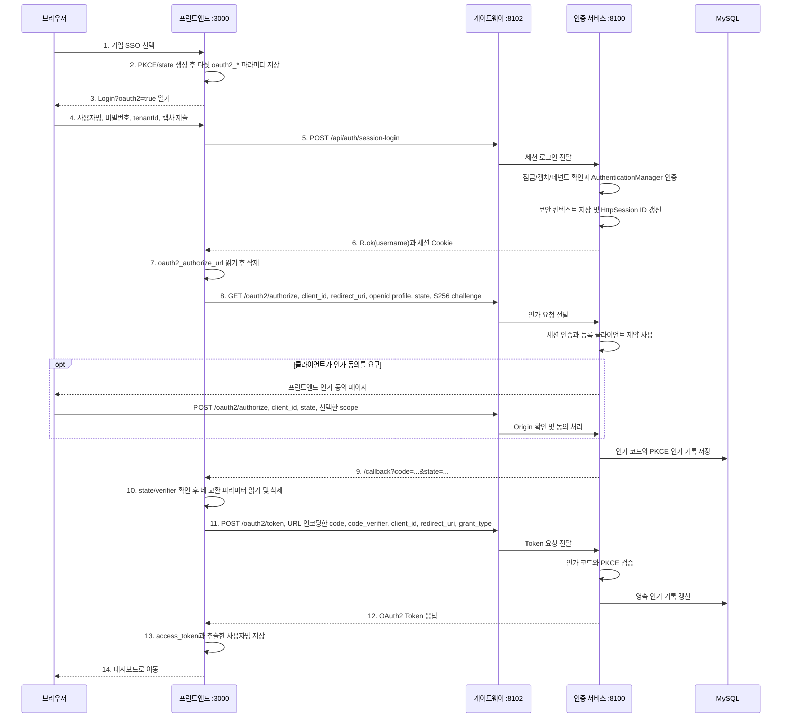

### 주요 구성 요소

| 구성 요소 | 소스 | 역할 |
|---|---|---|
| `pkce.ts` | [omni-frontend/src/utils/pkce.ts](../omni-frontend/src/utils/pkce.ts) | Web Crypto로 64자 verifier, S256 challenge, state 생성 |
| `LoginForm.vue` | [omni-frontend/src/components/LoginForm.vue](../omni-frontend/src/components/LoginForm.vue) | 다섯 파라미터 저장, 캡차 세션 로그인 뒤 인가 URL 열기 |
| `auth.ts` | [omni-frontend/src/api/auth.ts](../omni-frontend/src/api/auth.ts) | openid profile/state/PKCE URL 구성, 폼 인코딩으로 Token 교환 |
| `callback/index.vue` | [omni-frontend/src/views/callback/index.vue](../omni-frontend/src/views/callback/index.vue) | state/verifier 확인 후 교환 전에 네 파라미터 삭제. 액세스 Token과 사용자명만 저장 |
| `user.ts` | [omni-frontend/src/stores/user.ts](../omni-frontend/src/stores/user.ts) | token과 username 영속화. id_token/refresh_token은 저장하지 않음 |
| `OAuth2ClientInitializer.java` | [omni-backend/omni-auth/src/main/java/com/omni/auth/config/OAuth2ClientInitializer.java](../omni-backend/omni-auth/src/main/java/com/omni/auth/config/OAuth2ClientInitializer.java) | 기본 NONE + PKCE 클라이언트 생성, 기존 등록의 다른 설정 유지 |
| `AuthController.java` | [omni-backend/omni-auth/src/main/java/com/omni/auth/controller/AuthController.java](../omni-backend/omni-auth/src/main/java/com/omni/auth/controller/AuthController.java) | 테넌트/캡차/인증 정보 확인, HttpSession 저장 및 ID 갱신 |
| `AuthorizationServerConfig.java` | [omni-backend/omni-auth/src/main/java/com/omni/auth/config/AuthorizationServerConfig.java](../omni-backend/omni-auth/src/main/java/com/omni/auth/config/AuthorizationServerConfig.java) | OAuth2 세션 보안 체인, JWK/JWT, claims, JDBC 인가/동의 저장 |
| `consent/index.vue` | [omni-frontend/src/views/consent/index.vue](../omni-frontend/src/views/consent/index.vue) | 필요 시 client_id/state/선택 scope 제출, scope 생략으로 거부 |
| `SasConsentOriginFilter.java` | [omni-backend/omni-auth/src/main/java/com/omni/auth/security/SasConsentOriginFilter.java](../omni-backend/omni-auth/src/main/java/com/omni/auth/security/SasConsentOriginFilter.java) | consent POST의 Origin이 있으면 scheme/host/port 확인, 불일치 시 403 |

### PKCE 저장 키

| sessionStorage 키 | 용도와 실제 삭제 시점 |
|---|---|
| `oauth2_code_verifier` | 64자 verifier. 콜백 state/verifier 확인 후 Token 요청 전에 삭제 |
| `oauth2_state` | 콜백이 비교할 임의 state. verifier와 함께 교환 전에 삭제 |
| `oauth2_client_id` | 시작할 때 저장한 클라이언트 ID. 콜백에서 읽고 교환 전에 삭제 |
| `oauth2_redirect_uri` | 현재 origin + /callback. 읽은 뒤 교환 전에 삭제 |
| `oauth2_authorize_url` | 열어야 할 인가 URL. 세션 로그인 성공 후 읽고 삭제 |

### 실패와 경계

콜백은 `error`, code 누락, state 불일치, verifier 누락 시 로그인으로 돌아갑니다. 이 조기 반환 분기들은 저장 파라미터 정리를 보장하지 않습니다. 선행 확인을 통과하면 네 교환 파라미터를 먼저 삭제하고 Token 엔드포인트를 호출하므로 교환 실패 뒤 이전 verifier를 재사용할 수 있다고 가정하면 안 됩니다.

Token 요청은 `application/x-www-form-urlencoded`, `credentials: 'include'`를 지정한 네이티브 `fetch('/oauth2/token')`입니다. 필드는 `grant_type=authorization_code`, code, code_verifier, client_id, redirect_uri입니다. Axios의 `/api` 접두사는 붙지 않으며 응답은 `R<T>`가 아닌 OAuth2 표준 형식입니다.

기본 자사 클라이언트는 추가 동의 페이지를 요구하지 않습니다. 다른 클라이언트는 실제 등록 설정을 따릅니다. consent POST의 `SasConsentOriginFilter`는 Origin이 있으면 전달 주소의 프로토콜, 호스트, 포트와 비교합니다. 모든 OAuth2 엔드포인트에 대한 일반 CSRF Token 검증을 의미하지 않습니다.

### 현재 상태

기본 설정은 JWK/JWT 발급 경로와 `accessTokenCustomizer`를 제공하므로 액세스 Token을 모두 opaque라고 설명할 수 없습니다. 다른 클라이언트는 각 `TokenSettings`를 따릅니다. SAS 커스터마이저는 역할 배열과 공백으로 연결한 업무 권한 `scope`를 기록합니다. 이는 Flow1의 권한 배열 및 인가 요청의 `openid profile`과 다릅니다.

프런트엔드 응답 타입에서 id_token과 refresh_token은 선택 사항입니다. 콜백은 access_token과 추출한 사용자명만 저장합니다. `refresh_token` grant 등록만으로 매 응답의 반환이나 프런트엔드 갱신 구현을 입증할 수 없습니다. 액세스 유효 기간은 등록 클라이언트의 TokenSettings를 따르며 Flow1 기본값을 그대로 쓰지 않습니다.

현재 소스 경로와 실패 경계를 설명한 절입니다. 작업, 예상 결과, 복구는 [Wiki](wiki/index.kr.md)를 참조하세요. 소스 설정은 종단 간 실행 증거를 대신하지 않습니다.

---

## Flow 3: OAuth2 Device Authorization Grant

### 개요

디바이스 인가는 브라우저가 없거나 입력이 제한된 장치를 위한 흐름입니다. 장치가 device_code/user_code를 받고 사용자가 브라우저에서 확인하면 장치는 Token 엔드포인트를 폴링합니다. 이 저장소는 브라우저 모의 장치 `/device`와 사용자 확인 페이지 `/device/verify`를 제공합니다.

현재 모의 장치는 `client_id=omni-device&scope=profile`을 보냅니다. SAS verification_uri를 그대로 쓰는 대신 현재 프런트엔드 origin으로 `/device/verify?user_code=...` 링크와 QR 코드를 만듭니다. 사용자 측에는 인증된 HttpSession이 필요하며 프런트엔드 JWT는 서버 세션을 대신하지 않습니다.

### 시퀀스

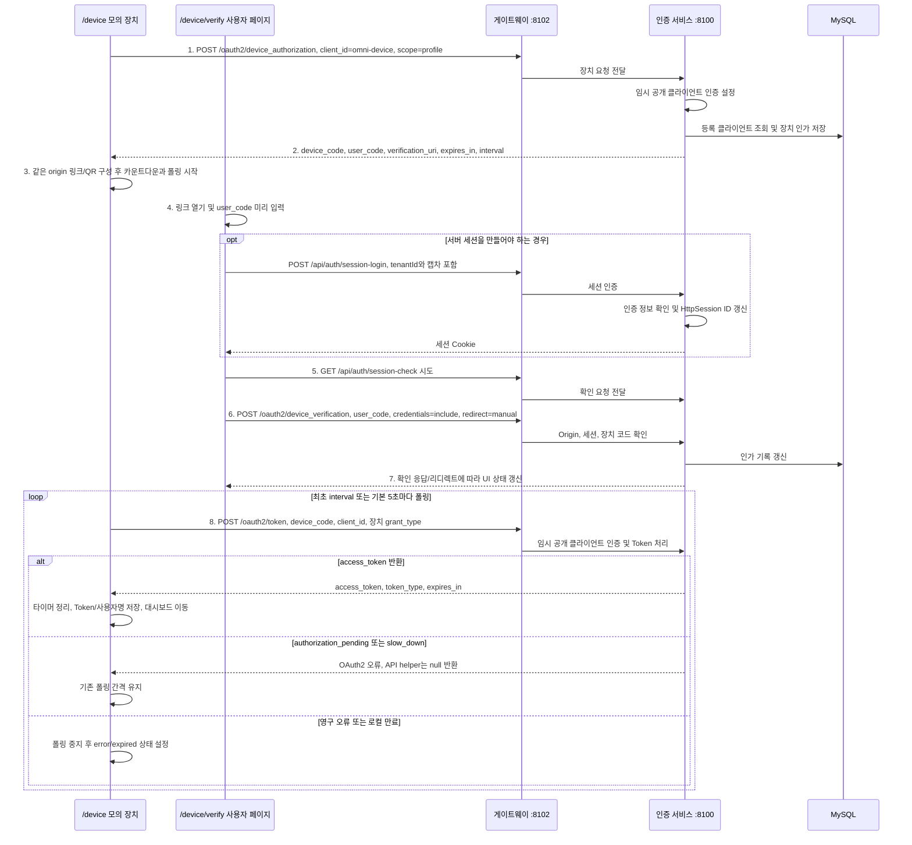

### 주요 구성 요소

| 구성 요소 | 소스 | 역할 |
|---|---|---|
| `auth.ts` | [omni-frontend/src/api/auth.ts](../omni-frontend/src/api/auth.ts) | scope=profile로 장치 인가 요청, 폴링 pending/slow_down을 null로 변환 |
| `device/index.vue` | [omni-frontend/src/views/device/index.vue](../omni-frontend/src/views/device/index.vue) | 같은 origin 링크/QR 구성, 최초 interval 고정, 카운트다운과 Token 저장 |
| `device/verify.vue` | [omni-frontend/src/views/device/verify.vue](../omni-frontend/src/views/device/verify.vue) | 캡차 세션 로그인, session-check 시도, user_code 제출 및 응답으로 UI 갱신 |
| `DeviceClientInitializer.java` | [omni-backend/omni-auth/src/main/java/com/omni/auth/config/DeviceClientInitializer.java](../omni-backend/omni-auth/src/main/java/com/omni/auth/config/DeviceClientInitializer.java) | omni-device 등록, 기존 클라이언트 consent=true를 false로 수정 |
| `AuthorizationServerConfig.java` | [omni-backend/omni-auth/src/main/java/com/omni/auth/config/AuthorizationServerConfig.java](../omni-backend/omni-auth/src/main/java/com/omni/auth/config/AuthorizationServerConfig.java) | 장치 엔드포인트 활성화, HttpSession 보안 컨텍스트와 JDBC 인가 기록 |
| `DeviceClientAuthenticationFilter.java` | [omni-backend/omni-auth/src/main/java/com/omni/auth/security/DeviceClientAuthenticationFilter.java](../omni-backend/omni-auth/src/main/java/com/omni/auth/security/DeviceClientAuthenticationFilter.java) | 장치 요청/Token 요청에만 클라이언트 인증 적용, finally에서 원래 사용자 인증 복구 |
| `SasConsentOriginFilter.java` | [omni-backend/omni-auth/src/main/java/com/omni/auth/security/SasConsentOriginFilter.java](../omni-backend/omni-auth/src/main/java/com/omni/auth/security/SasConsentOriginFilter.java) | 장치 확인 POST에 Origin이 있으면 전달 주소와 비교, 불일치 시 403 |

### 디바이스 클라이언트 구성

| 설정 항목 | 현재 값 |
|---|---|
| Client ID | `omni-device` |
| 인증 방식 | `NONE`, 공개 클라이언트, clientSecret 없음 |
| 인가 유형 | `urn:ietf:params:oauth:grant-type:device_code`와 `refresh_token` |
| 스코프 | `openid`, `profile` 등록. 현재 모의 장치는 `profile`만 요청 |
| PKCE 요구 | `false` |
| 동의 요구 | `false`, 초기화기가 기존 true를 수정 |
| 콜백 | redirectUri 미사용, 표시할 확인 링크는 프런트엔드가 생성 |

### 폴링 동작

| 응답/조건 | 현재 프런트엔드 동작 |
|---|---|
| `authorization_pending` | helper가 null 반환, 최초 간격으로 계속 |
| `slow_down` | 동일하게 null 반환. 프런트엔드의 간격 증가와 백오프는 미구현 |
| `expired_token` / 로컬 카운트다운 만료 | 폴링 중지, error/expired 상태로 이동 |
| `access_denied` / 다른 영구 오류 | 폴링 중지, error 상태로 이동 |
| 식별된 `Failed to fetch` / `NetworkError` / `timeout` | 다음 정기 폴링까지 대기 |
| access_token 반환 | 폴링/카운트다운 정리, 액세스 Token과 추출한 사용자명 저장 |
| 페이지 언마운트 | 두 타이머 정리 |

### 현재 상태

장치 인가, 확인, Token 엔드포인트는 소스에 설정되어 있습니다. `DeviceClientAuthenticationFilter`의 클라이언트 주체는 현재 요청/폴링에만 유효하며 `finally`가 원래 인증을 복구해 사용자 HttpSession 오염을 방지합니다. refresh_token grant 등록은 매 응답 발급을 증명하지 않으며 모의 장치는 갱신 Token을 저장하거나 사용하지 않습니다.

확인 페이지는 세션 확인을 시도하고 opaqueredirect, 302, 일부 HTML 또는 성공 응답으로 표시 상태를 갱신합니다. 프런트엔드 ready/success는 서버 인증이나 Token 발급의 증거가 아닙니다. 거부 버튼은 로컬 denied 상태만 바꾸고 SAS 거부 요청을 보내거나 인가 기록을 취소하지 않습니다.

slow_down에 따른 간격 조정은 미구현입니다. 이 제한을 RFC 동작 구현 완료로 설명하면 안 됩니다. 실행 검수에는 장치의 유효 액세스 Token 실제 획득과 보호 리소스 접근이 필요합니다. 작업, 이미지, 실패 복구는 [Wiki](wiki/index.kr.md)를 참조하세요.

---

## Flow 4: OAuth2 소셜 로그인 (GitHub / Google / Gitee)

### 개요

현재 로그인 폼은 GitHub, Google, Gitee 세 진입점을 제공합니다. 백엔드는 provider ID와 이름이 같은 Spring Bean을 `Map<String, OAuth2ProviderHandler>`로 분기합니다. Handler는 인가 URL, Token 교환, 정규화 프로필을 제공하고 `SocialLoginServiceImpl`은 테넌트, 외부 신원 연결, 사용자와 JWT를 조정합니다. 현재 WeChat 버튼과 Handler는 없으며 테이블 주석의 wechat은 구현된 지원을 의미하지 않습니다.

브라우저는 Gateway를 거쳐 `/api/auth/oauth2/{provider}?tenant_id=...`로 이동합니다. Auth는 공급자와 테넌트를 확인하고 서명 state를 만든 뒤 외부로 리디렉트합니다. 콜백에서 state 검증, 외부 Token 교환, 로컬 사용자 조회/생성을 수행하고 성공하면 `/callback#token=...&username=...`로 돌아갑니다. 이 소셜 콜백은 Flow2의 로컬 인가 코드 + PKCE 콜백과 별도 경로입니다.

### 시퀀스

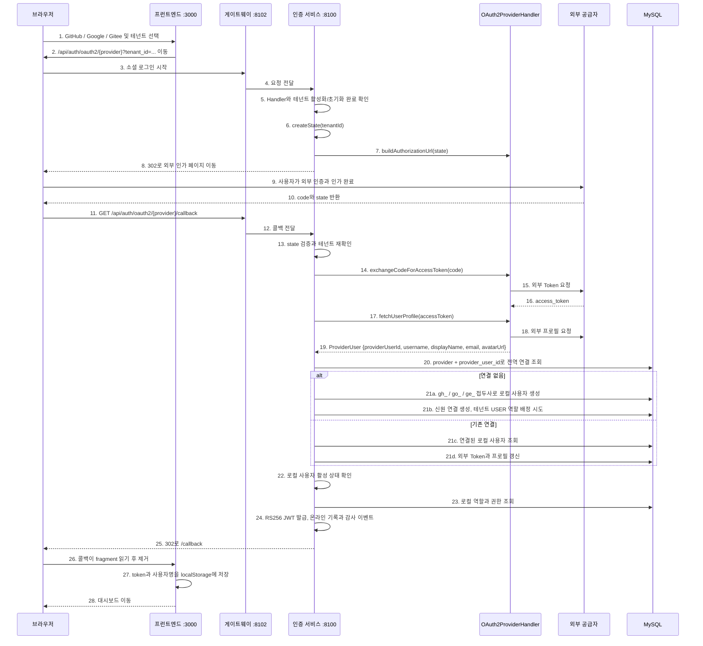

### 주요 구성 요소

| 구성 요소 | 소스 | 역할 |
|---|---|---|
| `LoginForm.vue` | [omni-frontend/src/components/LoginForm.vue](../omni-frontend/src/components/LoginForm.vue) | 세 공급자 진입점과 선택한 tenantId |
| `auth.ts` | [omni-frontend/src/api/auth.ts](../omni-frontend/src/api/auth.ts) | Gateway를 통한 이동 URL 구성 |
| `callback/index.vue` | [omni-frontend/src/views/callback/index.vue](../omni-frontend/src/views/callback/index.vue) | 소셜 fragment 읽기, 주소창 fragment 제거, Token과 사용자명 저장 |
| `SocialLoginController.java` | [omni-backend/omni-auth/src/main/java/com/omni/auth/controller/SocialLoginController.java](../omni-backend/omni-auth/src/main/java/com/omni/auth/controller/SocialLoginController.java) | 시작/콜백 엔드포인트, 성공과 처리된 업무 실패 시 리디렉트 |
| `SocialLoginServiceImpl.java` | [omni-backend/omni-auth/src/main/java/com/omni/auth/service/impl/SocialLoginServiceImpl.java](../omni-backend/omni-auth/src/main/java/com/omni/auth/service/impl/SocialLoginServiceImpl.java) | 테넌트 확인, DB 트랜잭션, 사용자/연결, 역할, JWT, 온라인 기록과 감사 |
| `OAuth2ProviderHandler.java` | [omni-backend/omni-auth/src/main/java/com/omni/auth/oauth/OAuth2ProviderHandler.java](../omni-backend/omni-auth/src/main/java/com/omni/auth/oauth/OAuth2ProviderHandler.java) | Bean 이름으로 분기하며 provider ID와 일치해야 함 |
| `GitHubOAuth2Handler.java` | [omni-backend/omni-auth/src/main/java/com/omni/auth/oauth/GitHubOAuth2Handler.java](../omni-backend/omni-auth/src/main/java/com/omni/auth/oauth/GitHubOAuth2Handler.java) | GitHub 인가, Token과 프로필 매핑 |
| `GoogleOAuth2Handler.java` | [omni-backend/omni-auth/src/main/java/com/omni/auth/oauth/GoogleOAuth2Handler.java](../omni-backend/omni-auth/src/main/java/com/omni/auth/oauth/GoogleOAuth2Handler.java) | Google 인가/프로필, 유효 HTTPS_PROXY 시 명시 프록시 설정, 이메일 앞부분 또는 sub로 사용자명 생성 |
| `GiteeOAuth2Handler.java` | [omni-backend/omni-auth/src/main/java/com/omni/auth/oauth/GiteeOAuth2Handler.java](../omni-backend/omni-auth/src/main/java/com/omni/auth/oauth/GiteeOAuth2Handler.java) | Gitee 인가, Token과 프로필 매핑 |
| `ProviderUser.java` | [omni-backend/omni-auth/src/main/java/com/omni/auth/dto/ProviderUser.java](../omni-backend/omni-auth/src/main/java/com/omni/auth/dto/ProviderUser.java) | providerUserId, username, displayName, email, avatarUrl 정규화 |
| `OAuth2StateUtils.java` | [omni-backend/omni-auth/src/main/java/com/omni/auth/util/OAuth2StateUtils.java](../omni-backend/omni-auth/src/main/java/com/omni/auth/util/OAuth2StateUtils.java) | 서명과 시각 확인, 일회 소비나 브라우저 세션 바인딩은 없음 |
| `SysUserOauthProviderMapper.java` | [omni-backend/omni-auth/src/main/java/com/omni/auth/mapper/SysUserOauthProviderMapper.java](../omni-backend/omni-auth/src/main/java/com/omni/auth/mapper/SysUserOauthProviderMapper.java) | provider + provider_user_id로 전역 연결 조회 |
| `SysUserOauthProvider.java` | [omni-backend/omni-auth/src/main/java/com/omni/auth/entity/SysUserOauthProvider.java](../omni-backend/omni-auth/src/main/java/com/omni/auth/entity/SysUserOauthProvider.java) | 현재 필드, 외부 Token과 사용자 연결 |
| `JwtTokenServiceImpl.java` | [omni-backend/omni-auth/src/main/java/com/omni/auth/service/impl/JwtTokenServiceImpl.java](../omni-backend/omni-auth/src/main/java/com/omni/auth/service/impl/JwtTokenServiceImpl.java) | 로컬 사용자 및 역할/권한으로 JWT 발급, claims는 Flow1 참조 |
| `OAuth2Properties.java` | [omni-backend/omni-auth/src/main/java/com/omni/auth/config/OAuth2Properties.java](../omni-backend/omni-auth/src/main/java/com/omni/auth/config/OAuth2Properties.java) | 외부 엔드포인트, 인증 정보와 콜백 설정 |
| `compose.apps.yaml` | [compose.apps.yaml](../compose.apps.yaml) | 정식 Docker에서 세 콜백은 Gateway :8102 사용 |
| `0001-auth-schema.yaml` | [database/changelog/auth/0001-auth-schema.yaml](../database/changelog/auth/0001-auth-schema.yaml) | 스키마, 전역 고유 키와 사용자 인덱스 |
| `auth.sql` | [scripts/sql/seed/auth.sql](../scripts/sql/seed/auth.sql) | 정식 테넌트1 USER 시드의 기본 데이터 범위는 SELF |

### State 서명 메커니즘

state 형식은 `tenantId|timestamp|hex(hmac)`이며 timestamp는 밀리초입니다. 서명 payload에는 테넌트와 시각만 포함됩니다.

```text
payload = tenantId + "|" + timestamp
hmac = hex(HMAC-SHA256(payload, secretKey))
state = payload + "|" + hmac
```

콜백은 세 부분 형식, 다시 계산한 HMAC, 파싱 가능한 timestamp를 확인하고 `now - timestamp > 10 * 60 * 1000`이면 거부한 뒤 tenantId를 파싱합니다. 소비 표시, 저장된 임의 nonce 또는 브라우저 세션 바인딩은 없습니다. 서명 무결성과 이 시효 확인을 설명할 수 있지만 state 재사용 방지나 시작 브라우저 바인딩을 구현했다고 할 수는 없습니다.

### 자동 사용자 생성 메커니즘

1. 접두사는 GitHub `gh_`, Google `go_`, Gitee `ge_`입니다. Google은 공백이 아닌 이메일 앞부분을 우선하고 없으면 sub를 사용합니다.
2. 최초 사용자명은 `prefix + providerUsername`입니다. 삽입 고유 키 충돌 시 `prefix + providerUsername + '_' + providerUserId`로 한 번 더 시도합니다.
3. 닉네임은 null이 아닌 displayName, 없으면 providerUsername입니다. 이메일과 아바타는 정규화 프로필에서 가져옵니다.
4. 새 사용자 password는 null, status는 1, tenantId는 검증된 state에서 가져옵니다.
5. 사용자와 외부 신원 연결은 콜백 DB 트랜잭션에 기록됩니다. 연결 고유 키 충돌 시 기존 연결과 로컬 사용자를 다시 조회합니다.
6. 선택 테넌트의 `USER` 역할 배정을 시도하며 없거나 예외가 발생하면 warn을 기록합니다. 정식 테넌트1 USER 시드는 SELF이고 실제 데이터 범위는 현재 역할 설정을 따릅니다.
7. 기존 연결은 원래 로컬 사용자를 먼저 조회한 뒤 외부 Token/프로필을 갱신합니다. JWT 테넌트는 해당 사용자에서 가져오며 이번 state에 맞춰 자동 이전하지 않습니다.
8. 로컬 역할/권한 조회 뒤 JWT를 발급합니다. 온라인 기록 실패는 warn만 남기고 이어 로그인 성공 감사 이벤트를 발행합니다.

### sys_user_oauth_provider 테이블 설계

| 필드/인덱스 | 타입/정의 | 의미 |
|---|---|---|
| `id` | `BIGINT NOT NULL AUTO_INCREMENT` | 기본 키 |
| `user_id` | `BIGINT NOT NULL` | 로컬 사용자 ID |
| `provider` | `VARCHAR(32) NOT NULL` | 공급자 이름, 현재 Handler는 github/google/gitee |
| `provider_user_id` | `VARCHAR(100) NOT NULL` | 외부 공급자의 고유 사용자 ID |
| `provider_username` | `VARCHAR(100)` | 외부 사용자명, null 허용 |
| `provider_email` | `VARCHAR(200)` | 외부 이메일, null 허용 |
| `provider_avatar` | `VARCHAR(500)` | 외부 아바타, null 허용 |
| `access_token` | `VARCHAR(500)` | 최근 획득한 외부 액세스 Token, null 허용 |
| `create_time` | `DATETIME DEFAULT CURRENT_TIMESTAMP` | 생성 시각 |
| `update_time` | `DATETIME DEFAULT CURRENT_TIMESTAMP ON UPDATE CURRENT_TIMESTAMP` | 갱신 시각, 수정 시 자동 갱신 |
| `uk_provider_user` | `UNIQUE (provider, provider_user_id)` | 외부 신원의 전역 고유 제약 |
| `idx_user_id` | `INDEX (user_id)` | 로컬 사용자별 연결 조회 인덱스 |

이 테이블에는 tenant_id 열이 없고 고유 키에도 테넌트가 없습니다. 한 외부 신원은 전역적으로 한 로컬 사용자에 연결됩니다. 최초 생성은 state 테넌트를 사용하고 기존 연결은 원래 사용자와 테넌트를 재사용합니다. 같은 외부 신원을 테넌트별로 독립 중복 연결하는 구조가 아닙니다.

`handleCallback()`은 DB 트랜잭션을 사용합니다. 외부 Token 교환, 네트워크 호출과 온라인 기록은 로컬 DB와 함께 롤백되지 않습니다. 고유 키/재조회 처리만으로 모든 외부 부수 효과의 멱등성을 입증할 수는 없습니다.

### 오류 처리

| 상황 | 실제 처리 | 프런트엔드 동작 |
|---|---|---|
| 콜백에 비어 있지 않은 error | `/login?error=user_denied`로 302 | message가 없으면 일반 외부 로그인 실패 안내 |
| code 또는 state 누락 | `/login?error=invalid_callback`로 302 | 일반 안내, 별도의 잘못된 콜백 문구를 보장하지 않음 |
| state, 외부 API/프로필, 비활성 사용자 등의 BusinessException | URL 인코딩 message와 함께 `/login?error=social_login_failed&message=...`로 302 | message 표시, 내부 업무 코드 400/403/502는 이 콜백의 HTTP 상태가 아님 |
| 시작 단계 Handler 없음 또는 테넌트 이용 불가 | 해당 BusinessException 발생, 콜백 리디렉트 처리 밖 | 일반 예외 응답 처리 |
| BusinessException 이외 또는 리디렉트 I/O 실패 | 이 BusinessException catch에서 일괄 변환하지 않음 | 동일한 오류 페이지 이동을 보장하지 않음 |

### 현재 상태

GitHub, Google, Gitee Handler와 로컬 조정 로직은 소스에 존재합니다. 이것이 세 공급자의 실제 계정 인가나 종단 간 검수 완료를 증명하지는 않습니다. 통제된 peer나 설정의 존재는 실제 공급자 콜백 증거를 대신하지 않습니다.

정식 [compose.apps.yaml](../compose.apps.yaml)은 세 콜백을 Gateway `http://localhost:8102/api/auth/oauth2/{provider}/callback`으로 설정합니다. 속성 클래스와 application.yml의 폴백은 여전히 Auth :8100입니다. 외부 등록은 실제 외부 콜백과 일치해야 합니다. 성공 시 프런트엔드 대상은 frontendCallbackUrl을 따르고 콜백 페이지는 파싱 뒤 fragment를 제거합니다.

공급자 추가에는 Handler Bean/provider ID 일치, 설정, 프런트엔드 진입점과 외부 콜백 등록이 필요합니다. 인터페이스 구현만으로 연동 완료가 되지는 않습니다. 작업, 실제 인가 증거 요건과 복구는 [Wiki](wiki/index.kr.md)를 참조하세요.

## Flow 5: RBAC 기능 권한 — 동적 메뉴 로딩 및 버튼 인가

### 개요

보호된 라우트는 현재 토큰의 권한 스냅샷을 읽고 Gateway를 통해 테넌트 메뉴 트리를 요청합니다. 백엔드가 메뉴를 필터링하면 프론트엔드는 컴포넌트를 찾을 수 있는 관리 라우트를 등록하고 탐색 메뉴를 렌더링합니다. `v-permission`은 버튼 표시를 제어하며 서버 작업은 각 엔드포인트의 인가 규칙을 적용합니다.

### 시퀀스

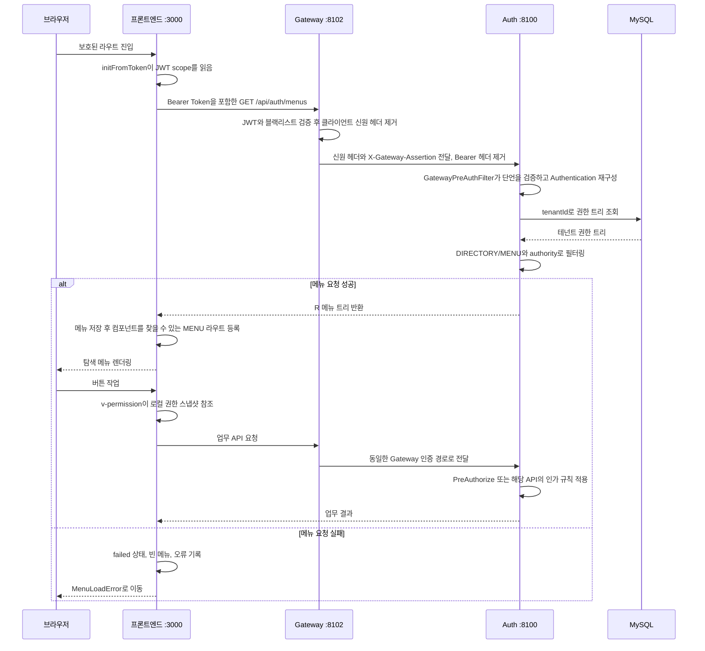

### 주요 구현 세부 사항

**백엔드 메뉴 필터링**

1. PermissionServiceImpl.getPermissionTree(tenantId)는 테넌트를 명시하여 권한 레코드를 조회하고 sort 순으로 트리를 만듭니다. MenuController는 먼저 DIRECTORY와 MENU 유형을 재귀적으로 유지합니다.
2. 기능 권한은 SecurityContext에서 ROLE_ 접두사가 없는 authority입니다. 인증 정보가 없거나 권한 집합이 비어 있으면 빈 메뉴 결과를 반환합니다.
3. DIRECTORY는 children을 재귀적으로 필터링하고 표시 가능한 자식이 남을 때만 유지합니다. MENU는 자신의 permissionCode가 권한 집합에 정확히 포함되는지 확인하고 앞선 유형 필터링을 거친 children을 유지합니다.

**메뉴 상태와 동적 라우트**

- loadMenus는 동시 요청을 합치고 loaded 상태를 재사용합니다. tenant_id가 없으면 빈 메뉴와 loaded 상태로 설정합니다. 요청 예외가 발생하면 menusLoaded=true, menuLoadState=failed로 설정하고 오류를 저장한 뒤 다시 던집니다.
- 라우트 가드는 최초 로딩 실패 시 MenuLoadError로 이동합니다. retryLoadMenus는 로딩 플래그, 상태, 오류를 초기화한 후 다시 불러옵니다. 실패 상태가 모든 메뉴를 허용하지는 않습니다.
- registerDynamicRoutes는 컴포넌트를 찾을 수 있는 MENU만 등록하고 DIRECTORY는 그룹화에만 사용합니다. srm:portal:로 시작하는 포털 항목은 이 등록 경로에서 제외됩니다. 라우트는 admin 아래에 등록하며 권한 코드의 콜론을 경로에서는 슬래시, 이름에서는 하이픈으로 바꾸고 meta.permissionCode를 유지합니다.
- 로그아웃 시 권한 Store를 초기화하고 등록된 동적 라우트를 제거합니다.

**버튼, 토큰, 서버 인가**

```vue
<el-button v-permission="'system:user:create'" type="primary">신규</el-button>
<el-button v-permission="'system:user:update'" size="small">편집</el-button>
<el-button v-permission="'system:user:delete'" size="small" type="danger">삭제</el-button>
```

- 디렉티브는 mounted와 updated에서 비어 있지 않은 바인딩을 확인합니다. 권한이 없으면 display:none을 설정하고 그 외에는 display를 비웁니다. 빈 바인딩은 요소를 숨기지 않습니다. 버튼 표시 여부는 서버 작업의 인가가 아닙니다.
- decodeJwt는 디코딩만 하며 서명을 검증하지 않습니다. getPermissionsFromToken은 scope를 그대로 반환하고 문자열을 배열로 나누지 않습니다. 따라서 비밀번호 JWT의 scope 배열과 SAS의 공백 구분 문자열이 이 프론트엔드 함수에서 정규화된다고 설명할 수 없습니다. 서명과 만료는 Gateway가 검증합니다.
- Auth의 일반 API에서 GatewayPreAuthFilter는 전달된 역할 및 권한 헤더로 Authentication을 만듭니다. 전달된 Bearer JWT를 다시 검증하거나 요청마다 DB의 기능 권한을 새로 조회하는 과정은 아닙니다.
- 관리 API는 현재 Controller의 규칙을 따릅니다. 예를 들어 사용자 생성은 system:user:create의 @PreAuthorize를 사용합니다. 공개 로그인·등록과 MyJobController의 작업 소유자 검증에는 명시적인 별도 경로가 있으므로 모든 쓰기 API를 하나의 어노테이션 규칙으로 설명할 수 없습니다.

### 현재 상태

- 메뉴, 라우트, 버튼, 서버 인가는 위 소스 동작을 따릅니다. 페이지나 버튼 개수는 저장소 전체의 검증 범위를 증명하지 않습니다.
- 기능 권한은 발급된 토큰의 스냅샷입니다. Authentication 재구성이 역할 변경을 기존 토큰의 권한 추가 또는 무효화에 즉시 반영한다는 의미는 아닙니다.
- 권한 코드는 resource:action 형식입니다. 해당 Controller와 보안 설정이 API 규칙, 공개 경로, 소유자 검증을 정의합니다.

소스 진입점: [MenuController](../omni-backend/omni-auth/src/main/java/com/omni/auth/controller/MenuController.java), [PermissionServiceImpl](../omni-backend/omni-auth/src/main/java/com/omni/auth/service/impl/PermissionServiceImpl.java), [Gateway AuthFilter](../omni-backend/omni-gateway/src/main/java/com/omni/gateway/filter/AuthFilter.java), [Auth GatewayPreAuthFilter](../omni-backend/omni-auth/src/main/java/com/omni/auth/security/GatewayPreAuthFilter.java), [stores/permission.ts](../omni-frontend/src/stores/permission.ts), [router/index.ts](../omni-frontend/src/router/index.ts), [directives/permission.ts](../omni-frontend/src/directives/permission.ts), [utils/jwt.ts](../omni-frontend/src/utils/jwt.ts), [api/menu.ts](../omni-frontend/src/api/menu.ts), [UserController](../omni-backend/omni-auth/src/main/java/com/omni/auth/controller/UserController.java), [AuthController](../omni-backend/omni-auth/src/main/java/com/omni/auth/controller/AuthController.java), [MyJobController](../omni-backend/omni-base/src/main/java/com/omni/base/controller/MyJobController.java), [MenuControllerTest](../omni-backend/omni-auth/src/test/java/com/omni/auth/controller/MenuControllerTest.java)

## Flow 6: RBAC 데이터 권한 — 요청 레벨 행 데이터 필터링

### 개요

이 흐름은 Auth의 일반 요청 데이터 범위를 추적합니다. DataScopeResolveFilter는 DataScopeServiceImpl을 호출하여 선택한 테넌트의 활성 사용자와 역할을 검증한 뒤 조직 범위를 해석하고 DataScopeContext에 저장합니다. SQL 핸들러는 등록된 테이블에 행 조건을 추가합니다. 업무 쿼리의 명시적인 테넌트 조건과 DB 외 데이터에 대한 서비스 인가도 필요합니다.

**요청 해석과 역할 병합**

1. 필터는 Spring Security 이후에 실행됩니다. /internal/ API는 일반 요청 컨텍스트를 만들지 않고 자체 명시적 매개변수와 인증을 사용합니다. X-User-Id가 없으면 컨텍스트 생성을 건너뛰지만 API의 보안 체인을 우회하지는 않습니다.
2. 식별된 요청의 사용자 ID를 해석할 수 없거나 테넌트 헤더가 없거나 해석 불가능하면 HTTP 400을 반환합니다. 해석 서비스는 양수 ID와 선택한 테넌트에 속한 활성 사용자를 요구하며 이 소속 검증에 실패하면 403입니다. 컨텍스트는 finally에서 제거합니다.
3. 일반 resolveDataScope(userId, tenantId)는 해당 테넌트의 활성 역할을 병합합니다. 우선순위는 ALL(1), TENANT(2), DEPT_AND_BELOW(3), DEPT(4), CUSTOM(5), SELF(6)이며 작은 숫자일수록 범위가 넓습니다. 더 넓은 범위가 없으면 SELF를 유지합니다.
4. permissionCode 오버로드는 정확한 전체 권한 코드를 실제로 부여하는 활성 역할만 조회하며 일치하는 부여가 없으면 거부합니다. 일반 요청에서 모든 역할을 병합하는 방식과 구별됩니다. 반환 DTO의 securityVersion은 해석 결과의 핑거프린트입니다.

### 시퀀스

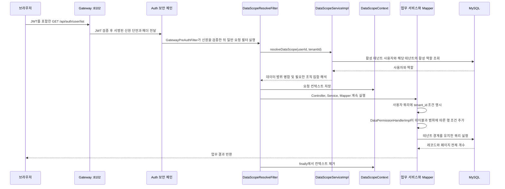

### DataScope 필터 조건 대조표

| effectiveScope | sys_user에 추가하는 행 조건 | 경계 |
| --- | --- | --- |
| `ALL` | 추가 행 조건 없음 | 기존 테넌트 WHERE를 제거하지 않으며 사용자 목록은 tenantId를 제한 |
| `TENANT` | 추가 행 조건 없음 | 쿼리 자체가 테넌트 경계를 명시 |
| `DEPT` | `alias.primary_unit_id IN (...)` | 활성 주 조직의 ID 집합 |
| `DEPT_AND_BELOW` | `alias.primary_unit_id IN (...)` | 활성 주 조직과 확장한 조직 집합 |
| `CUSTOM` | `alias.primary_unit_id IN (...)` | CUSTOM 역할에 설정된 동일 테넌트의 루트와 확장 집합 |
| `SELF` | `alias.id = userId` | 현재 사용자 |

Auth는 현재 세 테이블의 매핑을 등록합니다. alias는 SQL 별칭이며 별칭이 없으면 테이블 이름입니다. 다음 표는 SELF와 조직 범위의 차이를 나타내며 ALL/TENANT는 모두 추가 행 조건을 넣지 않습니다.

| 테이블 | SELF | DEPT / DEPT_AND_BELOW / CUSTOM |
| --- | --- | --- |
| `sys_user` | `id = userId` | `primary_unit_id IN (...)` |
| `sys_org_unit` | `id = primaryUnitId` | `id IN (...)` |
| `sys_role` | `id = -1` | 조직 행 조건을 추가하지 않음 |

등가 조건에 필요한 ID가 없거나 IN 집합이 비면 해당 매핑 규칙은 alias.id=-1을 만듭니다. 컨텍스트가 없거나 scope가 null·알 수 없는 값이거나 테이블이 등록되지 않으면 조건을 추가하지 않습니다. 이 핸들러가 모든 테이블과 데이터 소스에서 자동으로 실패 차단을 보장하지는 않습니다. UserServiceImpl.listUsers의 tenant_id 조건은 ALL에서도 유지됩니다.

### 조직 단위 후손 조회

DEPT는 선택한 테넌트의 활성 주 조직을 사용하고 DEPT_AND_BELOW는 해당 저장된 조직 경로(path)를 확장합니다. CUSTOM은 참여 역할 중 dataScope=CUSTOM에 설정된 루트를 합치고 동일한 tenantId로 각 루트를 조회합니다.

실제 메서드는 SysOrgUnitMapper.selectDescendantIdsByTenantIdAndPath(tenantId, pathPrefix)입니다. SQL은 테넌트, 경로 접두사, status=1로 필터링하며 이전 예제처럼 루트를 제외하지 않습니다.

```sql
SELECT id FROM sys_org_unit
WHERE tenant_id = #{tenantId}
  AND path LIKE CONCAT(#{pathPrefix}, '%')
  AND status = 1
```

resolveUnitTree는 루트 ID도 추가합니다. CUSTOM 루트를 조회하는 selectByIdAndTenantId 자체에는 활성 상태 필터가 없으므로 후손 SQL만으로 모든 CUSTOM 루트가 status=1 검증을 거쳤다고 판단할 수 없습니다.

### 메모리 필터링 모드 (온라인 사용자 시나리오)

Redis의 `online:{userId}` 값에는 `username|jti`만 있으므로 전역 키만으로 테넌트 소속을 판단할 수 없습니다. `OnlineUserController`는 기능 권한 `system:online:list` / `system:online:kick`을 유지하며 목록과 강제 로그아웃의 데이터 범위를 `OnlineUserServiceImpl`에서 통합 검증합니다:

- `ALL`은 테넌트 간 접근을 유지하고 `TENANT`는 현재 테넌트만 허용합니다.
- `SELF`는 현재 테넌트의 본인만 허용합니다. `DEPT`, `DEPT_AND_BELOW`, `CUSTOM`은 테넌트 일치와 대상 `primaryUnitId`가 해석된 조직 집합에 속할 것을 요구합니다. 빈 집합은 접근을 허용하지 않습니다.
- 목록은 사용자 테이블의 테넌트와 주 조직을 확인합니다. `ALL` 이외의 DB 쿼리는 테넌트 조건을 명시하며, 조회되지 않거나 보이지 않는 사용자의 Redis 항목을 제거합니다.
- 강제 로그아웃은 대상 사용자를 조회하고 인가한 다음 온라인 키 조회·삭제, 기록된 `jti`의 블랙리스트 등록, 대상 테넌트의 `LOGOUT` 감사를 수행합니다. 기존 블랙리스트 기본 기간은 24시간입니다.
- 유효한 사용자 식별 정보·테넌트·범위가 없거나 강제 로그아웃 대상이 없거나 보이지 않으면 업무 오류 코드 `403`이 발생합니다. 거부 시 Redis에 접근하거나 성공 감사를 발행하지 않습니다. Controller의 업무 예외는 `AuthExceptionHandler`가 `R.fail`로 변환합니다.

```java
@GetMapping("/list")
@PreAuthorize("hasAuthority('system:online:list')")
public R<List<OnlineUserVO>> list() {
    return R.ok(onlineUserService.listOnlineUsers());
}
```

구현과 경계 회귀: [OnlineUserServiceImpl](../omni-backend/omni-auth/src/main/java/com/omni/auth/service/impl/OnlineUserServiceImpl.java), [OnlineUserServiceImplTest](../omni-backend/omni-auth/src/test/java/com/omni/auth/service/impl/OnlineUserServiceImplTest.java).

### 구성 등록 순서

MyBatisPlusConfig는 DataPermissionInterceptor, OptimisticLockerInnerInterceptor, PaginationInnerInterceptor 순으로 등록합니다. 이 Auth 설정에는 TenantLine이 없습니다. 페이지 쿼리와 COUNT에 행 조건을 적용하도록 데이터 권한을 페이지네이션보다 먼저 등록합니다. 다른 업무 서비스는 자체 범위 핸들러와 집계 소유권 규칙을 사용합니다.

```java
MybatisPlusInterceptor interceptor = new MybatisPlusInterceptor();
interceptor.addInnerInterceptor(new DataPermissionInterceptor(new DataPermissionHandlerImpl()));
interceptor.addInnerInterceptor(new OptimisticLockerInnerInterceptor());
interceptor.addInnerInterceptor(new PaginationInnerInterceptor(DbType.MYSQL));
```

### 현재 상태

- SQL 매핑, 일반 요청 해석, 특정 권한을 기준으로 한 해석에는 위와 같은 별도 진입점이 있습니다. 새 테이블이나 서비스는 자체 테넌트와 소유권 경계를 명시해야 합니다.
- 온라인 사용자 목록과 강제 로그아웃은 앞 절의 서비스 검증을 유지합니다. SQL 가로채기는 Redis 인가를 대신하지 않습니다.
- 현재 소스와 회귀 진입점을 제공합니다. 소스 설명, 단위 테스트, 실제 DB 또는 HTTP/E2E 인수 검증은 실제 증거 범위에 따라 평가해야 합니다.

소스와 회귀 진입점: [DataScopeResolveFilter](../omni-backend/omni-auth/src/main/java/com/omni/auth/security/DataScopeResolveFilter.java), [DataScopeServiceImpl](../omni-backend/omni-auth/src/main/java/com/omni/auth/service/impl/DataScopeServiceImpl.java), [DataScopeContext](../omni-backend/omni-auth/src/main/java/com/omni/auth/security/DataScopeContext.java), [DataPermissionHandlerImpl](../omni-backend/omni-auth/src/main/java/com/omni/auth/security/DataPermissionHandlerImpl.java), [MyBatisPlusConfig](../omni-backend/omni-auth/src/main/java/com/omni/auth/config/MyBatisPlusConfig.java), [SysRoleMapper](../omni-backend/omni-auth/src/main/java/com/omni/auth/mapper/SysRoleMapper.java), [SysOrgUnitMapper](../omni-backend/omni-auth/src/main/java/com/omni/auth/mapper/SysOrgUnitMapper.java), [UserServiceImpl](../omni-backend/omni-auth/src/main/java/com/omni/auth/service/impl/UserServiceImpl.java), [DataScopeServiceImplTest](../omni-backend/omni-auth/src/test/java/com/omni/auth/service/impl/DataScopeServiceImplTest.java), [DataScopeResolveFilterTest](../omni-backend/omni-auth/src/test/java/com/omni/auth/security/DataScopeResolveFilterTest.java)

## Flow 7: 사용자 생성 — 세 가지 경로

### 개요

생성 경로는 공개 자체 등록, `system:user:create`로 보호되는 관리자 생성, 외부 소셜 로그인 첫 연결입니다. 각 경로는 `status=1` 사용자를 만들고 대상 테넌트에서 활성화된 `USER` 역할 배정을 시도합니다. 데이터 범위는 역할 레코드에 따르며 정식 시드의 테넌트 1 `USER`는 `SELF`입니다. 세 생성 경로 모두 `primaryUnitId`를 설정하지 않습니다. 기본 역할이 없으면 경고 후 배정을 건너뛰므로 사용자 생성만으로 역할 배정을 보장하지 않습니다.

### 시퀀스

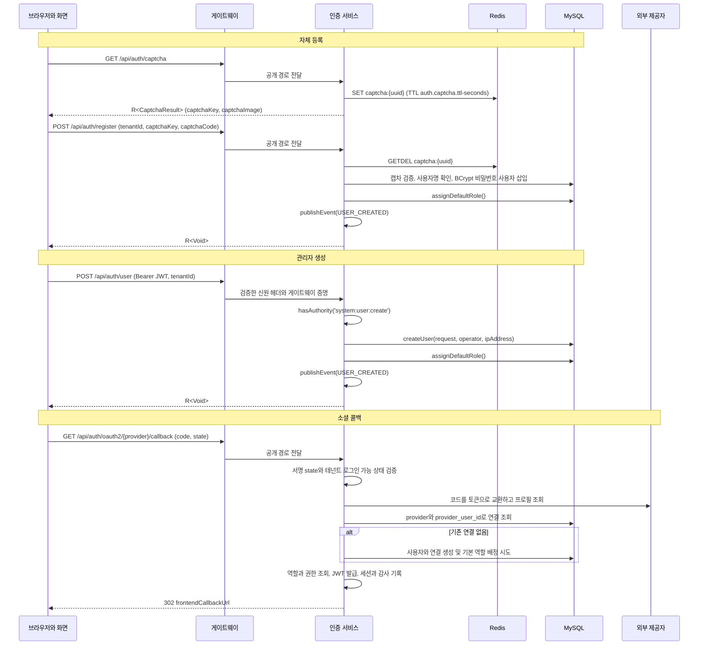

### 세 가지 경로 비교

| 항목 | 자체 등록 | 관리자 생성 | 소셜 자동 생성 |
| --- | --- | --- | --- |
| 입구와 권한 | `POST /api/auth/register`, 공개 | `POST /api/auth/user`, `system:user:create` | `GET /api/auth/oauth2/{provider}/callback`, 콜백 파라미터와 state 검증 |
| 테넌트 출처 | 본문 `tenantId`, 등록 화면에서 선택 | 관리자가 지정한 본문 `tenantId` | 새 사용자는 서명 state의 테넌트, 연결 조회는 제공자와 외부 사용자 ID |
| 캡차 | `captchaKey` + `captchaCode`, 원자적 `GETDEL`, 불일치해도 소비 | 불필요 | 로컬 캡차는 불필요, 제공자 코드와 프로필 필요 |
| 비밀번호와 사용자명 검증 | `RegisterRequest`: 사용자명 3–32자, 비밀번호 6–64자 | `CreateUserRequest`: 사용자명 비어 있지 않음, `@Size` 없음, 비밀번호 최소 6자 | 비밀번호 `null`, `gh_` / `go_` / `ge_` + 외부 사용자명 |
| 중복과 실패 | 테넌트 내 사전 중복 확인에서 업무 코드 400 | 테넌트 내 사전 중복 확인에서 업무 코드 400 | 첫 `DuplicateKeyException` 뒤 `{prefix}{login}_{providerUserId}`로 한 번 재시도, 재실패는 전파 |
| 기본 역할 구현 | private `UserServiceImpl.assignDefaultRole()` 호출 | 자체 등록과 동일 | `createNewUser()` 안에서 별도 조회와 삽입, 배정 예외는 잡아 경고 |
| 역할 쓰기 예외 | 역할 부재는 경고, 조회나 연결 삽입 예외는 전파 | 자체 등록과 동일, 모든 실패가 생성을 막지 않는다고 볼 수 없음 | 배정 블록에서 예외 처리, 다른 생성·콜백 실패는 각 경로대로 처리 |
| 성공 후 | `R<Void>`, 화면은 선택 테넌트를 저장하고 로그인으로 이동 | `R<Void>`, 생성 창을 닫고 목록 새로고침 | 설정된 화면 콜백으로 이동, fragment에 인코딩한 `token`과 `username` 포함 |

### 주요 구성 요소

| 소스 입구 | 역할 |
| --- | --- |
| [AuthController.java](../omni-backend/omni-auth/src/main/java/com/omni/auth/controller/AuthController.java) / [CaptchaResult.java](../omni-backend/omni-auth/src/main/java/com/omni/auth/dto/CaptchaResult.java) / [RegisterRequest.java](../omni-backend/omni-auth/src/main/java/com/omni/auth/dto/RegisterRequest.java) / [CaptchaServiceImpl.java](../omni-backend/omni-auth/src/main/java/com/omni/auth/service/impl/CaptchaServiceImpl.java) | 공개 등록과 캡차 DTO |
| [UserController.java](../omni-backend/omni-auth/src/main/java/com/omni/auth/controller/UserController.java) / [CreateUserRequest.java](../omni-backend/omni-auth/src/main/java/com/omni/auth/dto/CreateUserRequest.java) / [UserServiceImpl.java](../omni-backend/omni-auth/src/main/java/com/omni/auth/service/impl/UserServiceImpl.java) | 관리자 생성과 private 기본 역할 메서드 |
| [SocialLoginController.java](../omni-backend/omni-auth/src/main/java/com/omni/auth/controller/SocialLoginController.java) / [SocialLoginServiceImpl.java](../omni-backend/omni-auth/src/main/java/com/omni/auth/service/impl/SocialLoginServiceImpl.java) / [SysUserOauthProviderMapper.java](../omni-backend/omni-auth/src/main/java/com/omni/auth/mapper/SysUserOauthProviderMapper.java) | 소셜 콜백, 연결과 별도 역할 배정 |
| [SysRoleMapper.java](../omni-backend/omni-auth/src/main/java/com/omni/auth/mapper/SysRoleMapper.java) / [auth.sql](../scripts/sql/seed/auth.sql) | 활성 역할 조회와 정식 역할 시드 |
| [index.vue](../omni-frontend/src/views/register/index.vue) / [auth.ts](../omni-frontend/src/api/auth.ts) | 등록 폼과 제출 후 상태 |

### 현재 상태

- 캡차 반환 필드는 `captchaKey`와 `captchaImage`입니다. TTL은 `auth.captcha.ttl-seconds`로 제어하며 기본 300초입니다. 대소문자를 구분하지 않고, 없거나 만료·소비된 키는 거부합니다. 등록 화면은 제출이 끝나면 캡차를 다시 불러옵니다.
- 세 생성 입구 모두 `USER_CREATED` 감사 이벤트를 발행합니다. 소셜 콜백은 활성 상태 확인, 권한 조회, JWT 발급과 온라인 기록을 시도합니다. 기존 외부 연결은 연결된 사용자를 불러오며 연결 조회 자체에는 테넌트 조건이 없습니다.
- 여기서는 소스 동작과 실패 경계를 기록합니다. 실제 등록, 역할 확인과 제공자 승인은 인증 가이드를 참고합니다. 소스 경로나 단위 테스트는 실제 외부 승인 성공 콜백을 대체하지 않습니다.

[인증 가이드](guides/authentication.kr.md)

---

## Flow 8: XSS 방어 — 요청 정화 및 구성 관리

<a id="8a-xss-요청-정화-매-요청마다-자동-실행"></a>

### 8A. XSS 요청 정화 (요청 조건에 따라 적용)

XSS 자동 구성은 `XssConfigProvider` Bean이 있는 Servlet Web 환경에 적용됩니다. 필터는 `/*`에 등록되지만 `X-Tenant-Id`가 파싱되고 설정이 활성화되며 규칙이 비어 있지 않을 때만 요청을 감싸고 스레드 규칙을 설정합니다. 헤더 누락·빈 값·파싱 불가, 설정 null, 비활성 상태 또는 빈 규칙은 원래 요청을 계속합니다. 신원과 권한 검증은 각 보안 체인이 담당합니다.

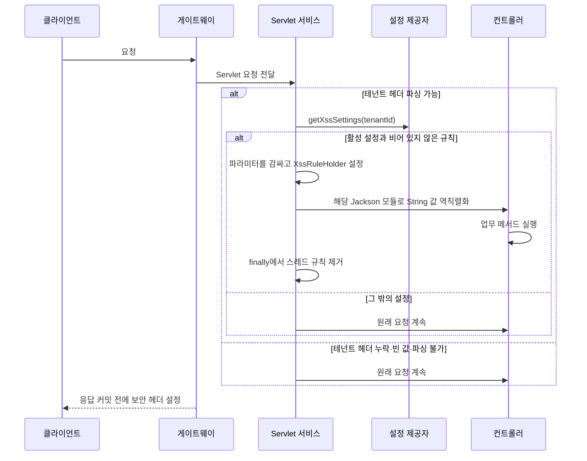

| ruleType | 현재 처리 | 설정과 예 |
| --- | --- | --- |
| `HTML_TAG` | `\|`로 나눈 태그명을 리터럴로 매칭, 짝 태그와 내용 및 매칭된 단독 시작·자체 닫힘 태그 제거 | `script` 설정 시 `<script>alert(1)</script>` → 빈 문자열 |
| `EVENT_HANDLER` | 설정 정규식으로 속성명을 매칭하고 따옴표 유무와 관계없이 값까지 제거 | `on[a-zA-Z]+` 설정 시 `onclick="..."` 제거 |
| `DANGEROUS_PROTOCOL` | `\|`로 나눈 설정값을 대소문자 구분 없이 리터럴 치환 | `javascript:` 설정 시 해당 프로토콜 문자열 제거 |
| `CUSTOM_PATTERN` | 설정 정규식과 일치하는 부분을 빈 문자열로 치환 | 실제 일치 부분만 제거 |

래퍼는 `getParameter()` / `getParameterValues()`만 재정의합니다. JSON은 String 역직렬화기로 처리하며 Jackson 2와 Spring Boot 4 기본 Jackson 3에 각각 모듈을 등록합니다. 헤더, JSON 필드명, 원시 스트림과 재정의하지 않은 파라미터 접근 메서드는 이 두 입구에서 일괄 정화되지 않습니다. 규칙은 순서대로 적용하고 알 수 없는 형식은 입력을 유지하며, 실행 중 정규식 구문 오류는 경고 후 다른 규칙을 계속합니다. Gateway 보안 헤더는 응답 측 조치이며 실제 `Referrer-Policy` 값은 `strict-origin-when-cross-origin`입니다.

### 8B. XSS 구성 관리 (관리자 작업)

| 메서드 (기본 `/api/auth/xss-config`) | 권한 | 동작 |
| --- | --- | --- |
| `GET /settings` | `system:xssconfig:list` | 관리 설정과 모든 규칙, 설정이 없으면 기본 비활성 레코드 생성 |
| `PUT /toggle?enabled=true` | `system:xssconfig:update` | 스위치 쓰기, `enabled`는 필수 쿼리 파라미터 |
| `GET /rules/list?page=1&size=10` | `system:xssconfig:list` | 현재 테넌트 규칙 페이지 조회 |
| `POST /rules` | `system:xssconfig:create` | `enabled=1`로 규칙 생성 |
| `PUT /rules/{id}` | `system:xssconfig:update` | 소속 테넌트 확인 후 null 아닌 필드만 갱신 |
| `DELETE /rules/{id}` | `system:xssconfig:delete` | 소속 확인 후 삭제 |
| `PUT /rules/{id}/toggle?enabled=false` | `system:xssconfig:update` | 소속 확인 후 상태 전환, `enabled`는 쿼리 파라미터 |

Controller는 Gateway가 주입한 `X-Tenant-Id`를 갱신·삭제·전환 서비스에 명시적으로 전달합니다. 서비스는 양의 테넌트 ID, 규칙 존재와 `rule.tenantId` 일치를 먼저 확인합니다. 없거나 다른 테넌트인 규칙은 모두 업무 코드 404를 던지고 `AuthExceptionHandler`가 HTTP 200 + `R.code=404`로 매핑합니다. DB 쓰기와 캐시 삭제 전에 멈추며 기존 세 `@PreAuthorize` 권한 검사도 유지합니다.

생성 DTO는 `ruleName`, `ruleType`, `pattern`의 빈 값만 검사하고 서비스가 pattern에 `Pattern.compile()`을 수행합니다. 갱신은 pattern을 제출할 때 재검증합니다. ruleType 열거형 검증은 없으며 알 수 없는 실행 형식은 정화기가 건너뜁니다. 권위 있는 실행 설정은 `enabled=1` 규칙만 `sort_order` 오름차순으로 읽습니다.

Auth provider는 Redis 두 값이 모두 있어야 적중으로 처리합니다. 키 하나가 없거나 규칙 JSON 파싱에 실패하면 `getAuthoritativeSettings()`로 원본을 읽고 30분 캐시를 채웁니다. 권위 조회는 설정이 없거나 꺼져 있으면 비활성 상태와 빈 규칙을 반환하며 레코드를 만들지 않습니다. 관리용 `getSettings()`와 동작이 다릅니다.

공유 Servlet Starter provider는 캐시 예외 후 Auth를 시도하고 원본 조회 실패나 유효한 결과 부재 시 태그·이벤트 속성·위험 프로토콜의 로컬 기본 규칙을 반환합니다. 명시적인 비활성 권위 설정은 유지합니다. Auth 자체 provider의 Redis 읽기 예외는 전파되므로 공유 Starter의 대체 처리를 모든 구현에 적용할 수 없습니다.

각 쓰기 메서드는 DB 트랜잭션 안에서 `xss:enabled:{tenantId}`와 `xss:rules:{tenantId}`를 동기 삭제합니다. 캐시 무효화와 DB 커밋은 별도 작업입니다. 화면 조작과 복구 절차는 보안·감사 가이드에서 관리합니다.

[보안·감사 가이드](guides/system-security-audit.kr.md)

### 주요 구성 요소

| 소스 입구 | 역할 |
| --- | --- |
| [XssAutoConfiguration.java](../omni-backend/omni-common/src/main/java/com/omni/common/security/xss/XssAutoConfiguration.java) / [XssFilter.java](../omni-backend/omni-common/src/main/java/com/omni/common/security/xss/XssFilter.java) / [XssRuleHolder.java](../omni-backend/omni-common/src/main/java/com/omni/common/security/xss/XssRuleHolder.java) | Servlet 조건 구성과 요청 규칙 수명 |
| [XssHttpServletRequestWrapper.java](../omni-backend/omni-common/src/main/java/com/omni/common/security/xss/XssHttpServletRequestWrapper.java) / [XssStringDeserializer.java](../omni-backend/omni-common/src/main/java/com/omni/common/security/xss/XssStringDeserializer.java) / [XssStringDeserializer3.java](../omni-backend/omni-common/src/main/java/com/omni/common/security/xss/XssStringDeserializer3.java) | 파라미터 래퍼와 Jackson 2/3 String 정화 |
| [XssSanitizer.java](../omni-backend/omni-common/src/main/java/com/omni/common/security/xss/XssSanitizer.java) / [SecurityHeadersFilter.java](../omni-backend/omni-gateway/src/main/java/com/omni/gateway/config/SecurityHeadersFilter.java) | 경계가 다른 규칙 처리와 응답 헤더 |
| [XssConfigController.java](../omni-backend/omni-auth/src/main/java/com/omni/auth/controller/XssConfigController.java) / [XssConfigServiceImpl.java](../omni-backend/omni-auth/src/main/java/com/omni/auth/service/impl/XssConfigServiceImpl.java) / [XssConfigProviderImpl.java](../omni-backend/omni-auth/src/main/java/com/omni/auth/security/XssConfigProviderImpl.java) / [InternalXssController.java](../omni-backend/omni-auth/src/main/java/com/omni/auth/controller/internal/InternalXssController.java) | Auth 권위 설정, 관리 쓰기와 캐시 |
| [ServiceXssAutoConfiguration.java](../omni-backend/omni-common-service/src/main/java/com/omni/common/service/config/ServiceXssAutoConfiguration.java) / [CachedServiceXssConfigProvider.java](../omni-backend/omni-common-service/src/main/java/com/omni/common/service/xss/CachedServiceXssConfigProvider.java) / [DefaultXssSettingsFallback.java](../omni-backend/omni-common-service/src/main/java/com/omni/common/service/xss/DefaultXssSettingsFallback.java) / [AuthXssSettingsResolver.java](../omni-backend/omni-common-service/src/main/java/com/omni/common/service/client/AuthXssSettingsResolver.java) | 공유 Starter 캐시, 원본 조회와 기본 규칙 |
| [XssRuleTenantBoundaryTest.java](../omni-backend/omni-auth/src/test/java/com/omni/auth/controller/XssRuleTenantBoundaryTest.java) / [XssJsonDeserializationTest.java](../omni-backend/omni-common/src/test/java/com/omni/common/security/xss/XssJsonDeserializationTest.java) / [XssHttpJsonIntegrationTest.java](../omni-backend/omni-common/src/test/java/com/omni/common/security/xss/XssHttpJsonIntegrationTest.java) | 세 쓰기 작업의 다른 테넌트·누락·동일 테넌트 회귀 입구 |

### 현재 상태

- Servlet 파라미터, 두 JSON 모듈, 규칙 관리와 보안 응답 헤더의 소스 입구가 있습니다. 실제 정화는 헤더, 설정, 유효 규칙과 읽기 경로에 따릅니다.
- 테넌트 격리는 명시적 테넌트 조회와 규칙 소속 검사로 적용합니다. Auth의 일반 DataScope 인터셉터는 사용자·조직·역할 테이블만 매핑합니다.
- MockMvc/메모리 대체, JSON/HTTP 통합과 실제 배포 검증을 구분합니다. 화면 캡처나 빌드 성공만으로 모든 입력과 동시성 검증을 증명하지 않습니다.

---

## Flow 9: 데이터 사전 관리 — 유형+데이터 2단계 구조 CRUD

### 개요

Base는 `sys_dict_type`과 `sys_dict_data`에 테넌트별 사전을 저장한다. 유형 코드는 테넌트 안에서 고유하며 데이터는 `typeCode`로 유형을 참조한다. 관리용 페이지 조회는 DB를 직접 읽고, 인증된 사용자의 경량 옵션 API는 활성 데이터 행을 캐시한다.

### 시퀀스

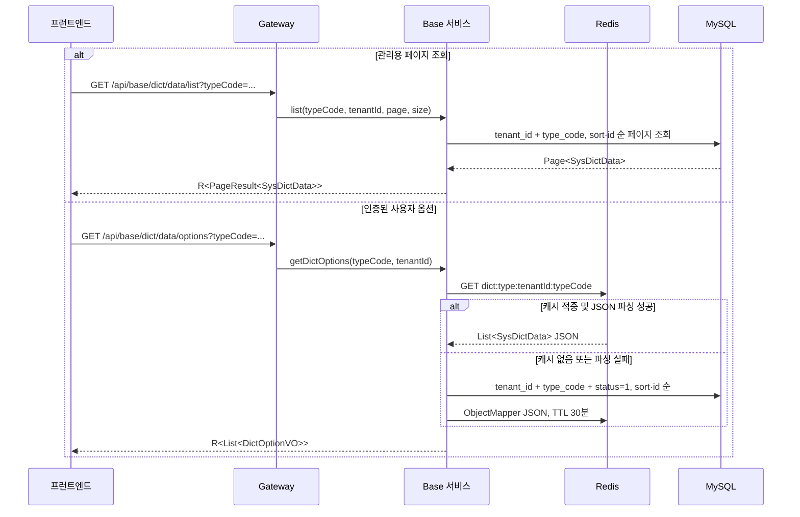

`GET /api/base/dict/data/list`는 `dict:data:list`가 필요하며 `R<PageResult<SysDictData>>`를 반환한다. `GET /api/base/dict/data/options`는 인증 체인으로 보호되지만 별도 `dict:data:*` 권한은 요구하지 않는다. `R<List<DictOptionVO>>`에는 `value`와 `label`만 포함된다.

유형의 ID 조회·수정·삭제·상태 변경 및 데이터 수정·삭제는 Gateway의 테넌트를 서비스에 명시적으로 전달한다. 서비스는 양수 테넌트 ID와 리소스 소유 테넌트를 먼저 검증한다. 없는 ID와 다른 테넌트 ID는 모두 비즈니스 코드 404이며, 반환·쓰기·연쇄 삭제·캐시 무효화는 검증 후 수행한다.

### 주요 구성 요소

| 소스 | 책임 |
| --- | --- |
| [DictTypeController.java](../omni-backend/omni-base/src/main/java/com/omni/base/controller/DictTypeController.java) / [DictTypeServiceImpl.java](../omni-backend/omni-base/src/main/java/com/omni/base/service/impl/DictTypeServiceImpl.java) / [CreateDictTypeRequest.java](../omni-backend/omni-base/src/main/java/com/omni/base/dto/CreateDictTypeRequest.java) / [UpdateDictTypeRequest.java](../omni-backend/omni-base/src/main/java/com/omni/base/dto/UpdateDictTypeRequest.java) | 유형 조회·생성 및 ID 리소스 소유 검증 |
| [DictDataController.java](../omni-backend/omni-base/src/main/java/com/omni/base/controller/DictDataController.java) / [DictDataServiceImpl.java](../omni-backend/omni-base/src/main/java/com/omni/base/service/impl/DictDataServiceImpl.java) / [CreateDictDataRequest.java](../omni-backend/omni-base/src/main/java/com/omni/base/dto/CreateDictDataRequest.java) / [UpdateDictDataRequest.java](../omni-backend/omni-base/src/main/java/com/omni/base/dto/UpdateDictDataRequest.java) / [DictOptionVO.java](../omni-backend/omni-base/src/main/java/com/omni/base/dto/DictOptionVO.java) | 관리 페이지 조회·옵션 캐시·데이터 소유 검증 |
| [GatewayPreAuthFilter.java](../omni-backend/omni-base/src/main/java/com/omni/base/security/GatewayPreAuthFilter.java) / [SecurityConfig.java](../omni-backend/omni-base/src/main/java/com/omni/base/config/SecurityConfig.java) / [MybatisPlusAutoConfiguration.java](../omni-backend/omni-common-mybatis/src/main/java/com/omni/common/mybatis/config/MybatisPlusAutoConfiguration.java) | Gateway 신원 검증·메서드 권한·Base 자체 구성 |
| [dict.ts](../omni-frontend/src/api/dict.ts) / [useDictOptions.ts](../omni-frontend/src/composables/useDictOptions.ts) / [index.vue](../omni-frontend/src/views/base/dict/index.vue) / [index.vue](../omni-frontend/src/views/srm/supplier/index.vue) | 타입 지정 프런트엔드 API·테넌트 캐시·사전과 공급업체 사용부 |
| [0001-base-schema.yaml](../database/changelog/base/0001-base-schema.yaml) / [base.sql](../scripts/sql/seed/base.sql) / [auth.sql](../scripts/sql/seed/auth.sql) | 현재 스키마·정식 권한·기본 시드 |
| [DictTenantBoundaryTest.java](../omni-backend/omni-base/src/test/java/com/omni/base/controller/DictTenantBoundaryTest.java) / [DictOperLogTenantBoundaryTest.java](../omni-backend/omni-base/src/test/java/com/omni/base/controller/DictOperLogTenantBoundaryTest.java) / [dict-options.test.ts](../omni-frontend/tests/base/dict-options.test.ts) | 사전 ID·로그 스냅샷·클라이언트 문맥 분리 회귀 테스트 |

### 캐시 전략

| 항목 | 현재 동작 |
| --- | --- |
| 키 | `dict:type:{tenantId}:{typeCode}` |
| 저장 | `StringRedisTemplate`으로 문자열 저장; `ObjectMapper`로 `List<SysDictData>` JSON 인코딩·디코딩 |
| TTL | 정상 재적재 후 30분 |

옵션 캐시의 DB 조회는 데이터 행의 `status=1`만 필터링하며 부모 유형의 활성 상태는 검사하지 않는다. 캐시 JSON 파싱 실패는 DB 조회로 전환한다. JSON 직렬화 실패는 경고만 남기지만 Redis 런타임 읽기·쓰기 예외는 상위로 전파한다.

유형 수정·삭제·상태 변경과 데이터 생성·수정·삭제는 해당 키를 삭제한다. 유형 생성에는 옵션 캐시 무효화 호출이 없다. 수동 갱신은 테넌트/유형 키 삭제 후 활성 데이터를 조회하고 재적재한다. 프런트엔드 모듈 캐시는 자체 수명 주기를 따른다.

`deleteType()`은 `@Transactional` 서비스 메서드에서 소유 검증, 같은 테넌트의 관련 데이터 삭제, 유형 삭제, 캐시 무효화를 수행한다. 다른 사전 쓰기 메서드에는 이 애너테이션이 없으므로 모든 CRUD가 원자적으로 커밋된다고 볼 수 없다.

### 권한 트리

정식 권한 시드는 `base` 디렉터리, `base:dict` 메뉴, 9개 동작 권한을 정의하며 테넌트 1의 `SUPER_ADMIN`(role_id=1)에 부여한다. 유형 6개와 데이터 6개로 총 12개 엔드포인트이며 `/options`는 인증만 필요하다. 엔드포인트별 권한 매핑은 API 계약 12절을 기준으로 한다.

[API](api-contract.kr.md)

### 현재 상태

- 유형 생성은 공백이 아닌 `typeCode/typeName`을 요구하며 테넌트 내 코드 중복을 검사한다. 수정 DTO에는 유형 코드 변경이 없다. 데이터 생성은 현재 테넌트의 부모 유형 존재를 확인하며 데이터 수정 DTO에는 `typeCode` 변경이 없다.
- 정식 `base.sql`은 테넌트 1에 유형 3개와 데이터 7개를 정의한다. 실제 실행 데이터, 다른 테넌트 및 모듈 확장은 각 마이그레이션과 초기화 결과에 따른다.
- Base 자체 XSS provider는 Redis만 읽으며 키 누락 또는 JSON 파싱 실패 시 비활성 설정을 반환한다. 이는 공유 Servlet Starter의 Auth 폴백/기준 정책과 다르다. 프런트엔드 캐시·신원 변경·로그아웃은 프런트엔드 규칙 14절을 참조한다.

[useDictOptions](frontend-patterns.kr.md)

---

## Flow 10: 작업 로그 — AOP 수집 + RocketMQ 비동기 쓰기 + 핫/콜드 아카이브

### 개요

`@OperLog`가 붙고 Servlet/AspectJ 등의 구성 조건을 충족한 메서드만 작업 로그 aspect에 진입하며, 조회와 쓰기 모두 대상이 될 수 있다. aspect가 문맥·선택적 스냅샷·차이를 수집한 뒤 producer를 호출한다. producer는 현재 스레드에서 Outbox를 쓰거나 `StreamBridge.send()`를 호출한다. relay 전달과 Base 소비는 이후 비동기 단계이다.

<a id="10a-작업-로그-기록-플로우-매-쓰기-작업-시-트리거"></a>

### 10A. 작업 로그 기록 플로우 (애너테이션 메서드)

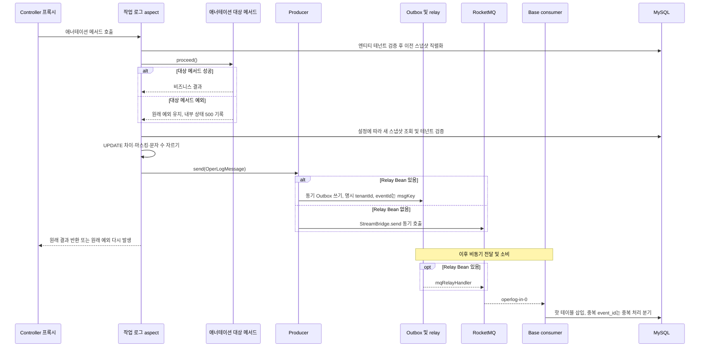

UPDATE/DELETE 이전 스냅샷, UPDATE 이후 스냅샷, CREATE 반환 엔티티 스냅샷은 `recordSnapshot/entityClass/idExpr` 조건을 따른다. `tenantId` 속성이 있는 엔티티는 요청 테넌트와 일치할 때만 직렬화하고, 속성이 없는 전역 엔티티는 기존 동작을 유지한다.

파라미터·스냅샷·오류 메시지는 전송 전 `OperLogSanitizer`로 정리하며 `excludeFields`로 제외 필드를 추가할 수 있다. 긴 문자열은 4000문자에서 자른다. UPDATE는 이전·이후 JSON이 모두 있으면 변경 필드를 추출하며 변경이 없으면 차이도 비어 있다.

대상 예외는 그대로 다시 발생시키고 로그 내부 `response_status`는 500으로 기록한다. 이는 이후 HTTP 또는 `R.code` 매핑과 별개다. 후처리와 producer 실패는 경고만 남기지만 작업 전 Mapper 스냅샷 읽기는 대상 호출 전에 있으므로 모든 수집 장애가 비즈니스와 격리된다고 보장할 수 없다.

`ReliableMessageRelay` Bean이 없을 때만 직접 전송한다. Outbox 전송 실패 후 직접 전송으로 전환하지 않는다. Controller aspect의 로그 전송과 서비스 트랜잭션 관계는 실제 호출 경계에 달려 있으며 Outbox라는 이름만으로 항상 같은 트랜잭션이라고 볼 수 없다.

<a id="10b-작업-로그-아카이브-플로우-매일-0200-정기-실행"></a>

### 10B. 작업 로그 아카이브 플로우 (메타데이터 기본값: 매일 02:00)

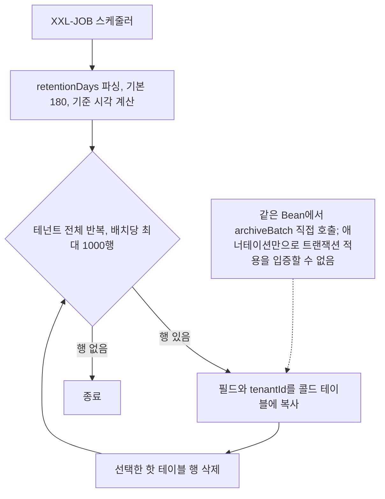

핸들러는 `@XxlJob("operLogArchiveHandler")`와 `@SystemJobMeta`를 함께 선언한다. 기본 cron은 `0 0 2 * * ?`, 배치 크기는 1000이다. 실제 실행은 작업 센터 등록·설정·활성화에 달려 있다.

보존 일수는 JSON 숫자 `retentionDays`를 읽고 누락·파싱 실패 시 180을 사용한다. 메타데이터 min/max가 이 파서의 런타임 범위 검증을 의미하지는 않는다. 조회는 테넌트 전체를 대상으로 하며 복사 시 각 행의 `tenantId`를 유지한다.

현재 코드에는 `AtomicBoolean` 재진입 방지가 없다. 같은 Bean 내부에서 `archiveBatch()`를 호출하므로 `@Transactional`만으로 이 경로의 원자적 복사·삭제를 입증할 수 없다. 배치 예외는 오류 기록 후 반복을 중단하지만 진입 메서드는 완료 로그를 출력할 수 있다. 이 로그는 전체 성공의 증거가 아니다.

### 주요 구성 요소

| 소스 | 책임 |
| --- | --- |
| [OperLog.java](../omni-backend/omni-common-core/src/main/java/com/omni/common/core/operlog/OperLog.java) / [OperType.java](../omni-backend/omni-common-core/src/main/java/com/omni/common/core/operlog/OperType.java) / [OperLogMessage.java](../omni-backend/omni-common-core/src/main/java/com/omni/common/core/operlog/OperLogMessage.java) | 애너테이션 옵션·작업 유형·메시지 구조 |
| [OperLogAutoConfiguration.java](../omni-backend/omni-common-operlog/src/main/java/com/omni/common/operlog/config/OperLogAutoConfiguration.java) / [OperLogAspect.java](../omni-backend/omni-common-operlog/src/main/java/com/omni/common/operlog/aspect/OperLogAspect.java) / [EntityDiffer.java](../omni-backend/omni-common-operlog/src/main/java/com/omni/common/operlog/diff/EntityDiffer.java) / [OperLogSanitizer.java](../omni-backend/omni-common-operlog/src/main/java/com/omni/common/operlog/sanitize/OperLogSanitizer.java) | 구성 조건·스냅샷 소유 검증·차이·마스킹 |
| [OperLogProducer.java](../omni-backend/omni-common-operlog/src/main/java/com/omni/common/operlog/producer/OperLogProducer.java) / [ReliableMessageRelay.java](../omni-backend/omni-common-core/src/main/java/com/omni/common/core/mq/ReliableMessageRelay.java) | 동기 producer 진입 및 명시 테넌트 Outbox 계약 |
| [OperLogConsumer.java](../omni-backend/omni-base/src/main/java/com/omni/base/consumer/OperLogConsumer.java) / [OperLogServiceImpl.java](../omni-backend/omni-base/src/main/java/com/omni/base/service/impl/OperLogServiceImpl.java) / [OperLogController.java](../omni-backend/omni-base/src/main/java/com/omni/base/controller/OperLogController.java) | 핫 테이블 소비·중복 이벤트·테넌트 조회 |
| [OperLogArchiver.java](../omni-backend/omni-base/src/main/java/com/omni/base/service/OperLogArchiver.java) / [0001-base-schema.yaml](../database/changelog/base/0001-base-schema.yaml) | 시스템 작업·핫/콜드 스키마·마이그레이션 경계 |
| [AuditEventListener.java](../omni-backend/omni-auth/src/main/java/com/omni/auth/event/AuditEventListener.java) / [AuditLogServiceImpl.java](../omni-backend/omni-auth/src/main/java/com/omni/auth/service/impl/AuditLogServiceImpl.java) / [pom.xml](../omni-backend/omni-auth/pom.xml) | Auth 보안 감사 리스너와 별도 저장 경로 |

### 감사 추적 차원

| 차원 | 필드 | 의미 |
| --- | --- | --- |
| 작업자 | `oper_username` | 현재 인증 이름 |
| 시간 | `oper_time` | aspect가 메시지를 생성한 로컬 시간 |
| 동작 | `module/oper_type/request_url` | 애너테이션 유형과 요청 진입점 |
| 변경 | `old_value/new_value` | 선택적 마스킹 스냅샷 또는 차이 |
| 출처 | `ip_address/user_agent` | 요청 문맥 |
| 소요 시간 | `execution_time` | aspect 시작부터 finally 진입까지; 사전 수집 포함, 후처리·전송 제외 |
| 결과 | `response_status/error_msg` | 대상 성공/예외 내부 표시, 최종 HTTP 매핑과 별개 |

### 감사 로그와의 보완 관계

| 기록 | 저장 | 소유자 및 수집 경로 |
| --- | --- | --- |
| 작업 로그 | `sys_oper_log/sys_oper_log_archive` | common-operlog aspect/producer, Base 소비·아카이브 |
| 보안 감사 | `sys_audit_log` | Auth: ApplicationEventPublisher → AuditEventListener → AuditLogService |
| 로그인 기록 | `sys_audit_log` 로그인 이벤트의 읽기 전용 투영 | Auth의 LOGIN_SUCCESS / LOGIN_FAILED 조회 |

보안 감사 리스너는 `@Async("auditExecutor")`로 DB에 저장하고 예외를 처리한다. 위 RocketMQ 소비 체인과는 별도 경로이다. Auth는 common-operlog에 의존하지 않으며 로그인 기록용 별도 `sys_login_log` 테이블도 없다.

### 현재 상태

- Base 로그 목록은 명시적인 `tenant_id` 조건으로 핫 테이블을 조회하며 `base:operlog:list` 권한을 요구한다. 이 API는 콜드 테이블을 페이지 결과에 합치지 않는다.
- 새 메시지는 aspect에서 `eventId`를 생성하고, ID가 없는 과거 메시지는 서비스에서 안정적인 legacy 식별자를 생성한다. 핫·콜드 테이블은 각각 `event_id` 고유 키를 가진다. consumer는 중복 키 예외를 처리하고 다른 예외는 미들웨어로 다시 발생시킨다.
- 대상 회귀 테스트는 실제 사전 Controller/Service와 실제 aspect의 테넌트 유출 상황을 검증한다. 소스 확인과 단위 회귀는 실제 MQ·DB 아카이브 트랜잭션·스케줄 동시성 검증을 대체하지 않는다.

[MQ](mq-reliability.kr.md) / [XXL-JOB](scheduling.kr.md) / [소스 및 제약](guides/system-security-audit.kr.md)

---

## Flow 11: 사용자 작업 생성 — 워크벤치 셀프서비스 생성에서 XXL-JOB 직접 등록까지

### 개요

워크벤치는 `/api/base/my-job`으로 현재 사용자의 개인 작업을 관리한다. 생성은 전역 활성 유형을 조회하고 로컬 행을 삽입한 후 XXL-JOB의 공통 handler를 등록하고 ID를 저장한다. 스케줄러 접수와 실제 실행은 별개 단계다.

### 시퀀스

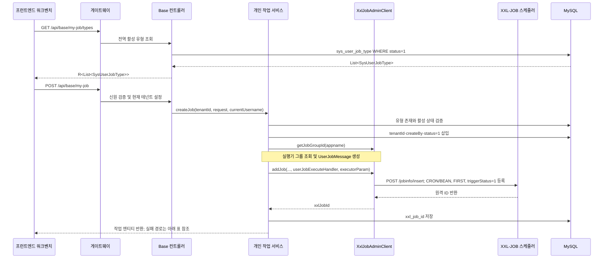

### 오류 처리

| 발생 조건 | 현재 처리 |
| --- | --- |
| jobName/jobType/cronExpression 공백 | 생성 DTO의 `@NotBlank` 검증; 전체 Cron 또는 파라미터 Schema 검증을 뜻하지 않음 |
| 유형 누락 또는 비활성 | 삽입 전 비즈니스 코드 400; 활성 카탈로그 행만으로 handler 배포를 입증하지 못함 |
| 실행기 그룹 조회 실패 | 방금 삽입한 로컬 행 삭제 후 비즈니스 코드 500 |
| 등록 또는 ID 저장 실패 | 정확한 원격 ID 또는 실행기 그룹+handler+executorParam으로 정리; 원격 부재 확인 후에만 로컬 삭제, 불명확하면 복구 연결 보존 및 오류 |
| 실행 파라미터 생성 실패 | 삽입 후이면서 등록 보상 try 밖의 호출; 이 위치에 정리 분기가 없으므로 모든 실패가 원자적으로 롤백된다고 볼 수 없음 |

### 주요 구성 요소

| 소스 | 책임 |
| --- | --- |
| [MyJobController.java](../omni-backend/omni-base/src/main/java/com/omni/base/controller/MyJobController.java) / [CreateUserJobRequest.java](../omni-backend/omni-base/src/main/java/com/omni/base/dto/CreateUserJobRequest.java) / [UpdateUserJobRequest.java](../omni-backend/omni-base/src/main/java/com/omni/base/dto/UpdateUserJobRequest.java) / [UserJobServiceImpl.java](../omni-backend/omni-base/src/main/java/com/omni/base/service/impl/UserJobServiceImpl.java) / [UserJobTypeServiceImpl.java](../omni-backend/omni-base/src/main/java/com/omni/base/service/impl/UserJobTypeServiceImpl.java) | 인증된 진입점·DTO 검증·유형 선택·행 소유권 |
| [index.vue](../omni-frontend/src/views/home/index.vue) / [myJob.ts](../omni-frontend/src/api/myJob.ts) | 워크벤치 작업 API 및 폼 제출 |
| [CronGenerator.vue](../omni-frontend/src/components/CronGenerator.vue) / [DynamicFormRenderer.vue](../omni-frontend/src/components/DynamicFormRenderer.vue) / [schema.ts](../omni-frontend/src/types/schema.ts) | Cron 빈도 7종과 표준/호환 Schema 동적 필드 |
| [XxlJobAdminClient.java](../omni-backend/omni-common-job/src/main/java/com/omni/common/job/XxlJobAdminClient.java) / [XxlJobProperties.java](../omni-backend/omni-common-job/src/main/java/com/omni/common/job/XxlJobProperties.java) / [XxlJobAutoConfiguration.java](../omni-backend/omni-common-job/src/main/java/com/omni/common/job/config/XxlJobAutoConfiguration.java) | 실행기 구성·등록·원격 조회 및 보상 |
| [0001-base-schema.yaml](../database/changelog/base/0001-base-schema.yaml) / [base.sql](../scripts/sql/seed/base.sql) / [UserJobSeedSyncRunner.java](../omni-backend/omni-base/src/main/java/com/omni/base/job/UserJobSeedSyncRunner.java) | 정식 작업 스키마·시드·시작 동기화 |

### 소유권 모델

`MyJobController`는 행 소유권을 메서드별 `@PreAuthorize`로 대체하지 않는다. 목록과 통계는 현재 테넌트 및 `createBy`로 고정하고, 생성은 신뢰하는 헤더와 인증 문맥에서 테넌트와 생성자를 얻는다.

수정·삭제·상태·수동 트리거·로그 조회는 `verifyOwnership(id, tenantId, username)`을 호출해 엔티티의 `tenantId`와 `createBy`를 모두 확인한다. 없는 작업은 비즈니스 코드 404, 다른 테넌트나 생성자는 403이다. 같은 사용자 이름이어도 테넌트 간 접근은 허용하지 않는다.

로그 진입점은 부모 작업 소유권 검증 후 `jobId`를 고정해 조회한다. 현재 `UserJobLogServiceImpl`은 `tenantId` 인자를 SQL 조건에 추가하지 않으므로 진입점 검증과 서비스 자체 SQL 테넌트 필터를 구분한다.

### 현재 상태

- 모든 개인 작업은 `userJobExecuteHandler`로 등록하고 `jobType`은 handler Bean 이름에 대응한다. 전역 `sys_user_job_type`은 테넌트 사전과 별도 카탈로그다.
- XXL ID가 연결된 경우 Cron/파라미터 수정·상태·삭제는 원격 호출 후 로컬 저장을 수행한다. 이름만 바꾸면 스케줄러 설명은 갱신하지 않는다. 접수 응답 손실이나 정리 결과 불명 시 로컬 연결을 유지하고 먼저 대조한다.
- 시작 동기화는 활성 상태이며 XXL ID가 없는 로컬 행을 조회하고 정식 시드만 구분하지 않는다. 등록 결과 불명 상태의 대조를 대신하거나 확인 없는 재시작·재생성을 정당화하지 않는다.

[XXL-JOB](scheduling.kr.md) / [Wiki](guides/scheduling.kr.md)

---

## Flow 12: 사용자 작업 실행 — XXL-JOB 트리거에서 프론트엔드 알림까지

### 개요

XXL-JOB는 `UserJobMessage` JSON을 공통 실행 진입점에 전달하고 `jobType`에 따라 `UserJobHandler`로 라우팅한다. handler 결과·로그 저장·마지막 실행 시각·프런트엔드 알림은 각각 실패 경계가 있으며 트리거 접수는 전체 완료를 입증하지 않는다.

### 시퀀스

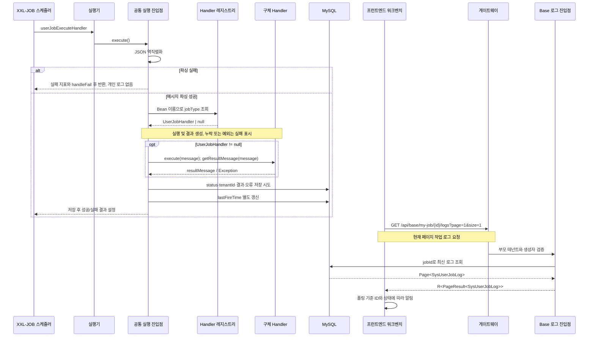

### 프론트엔드 폴링 메커니즘

| 경로 | 주기/조건 | 범위 | 알림 및 종료 |
| --- | --- | --- | --- |
| 수동 트리거 대기 | 2초마다, 최대 15회 | 수동 실행한 작업 | 트리거 전 기준보다 새 로그를 발견하면 알림 후 종료; 상한에서도 종료 |
| 페이지 진입 확인 | 마운트 후 최근 2분 확인 | 현재 페이지 각 작업의 최신 로그 | fireTime과 resultMessage 필요; 영속적인 읽음 기록 없음 |
| 주기 폴링 | 10초마다 | 현재 필터/페이지 tableData 중 status=1 작업 | 최초 기준은 알림 없이 설정; 이후 더 큰 ID면 알림 및 목록/통계 갱신 |

요청은 Gateway/Base API를 통하며 브라우저는 MySQL을 직접 조회하지 않는다. 전역 폴링은 이 페이지의 타이머를 뜻하며 모든 작업이나 다른 페이지를 스캔하지 않는다. 알림 대상 새 로그가 없으면 목록/통계도 매번 갱신하지 않는다.

세 경로에 공통 영속 중복 방지 상태가 없으므로 모든 알림이 한 번만 나타난다고 보장하지 않는다. unmount 시 타이머와 ID 기준을 지운다. 재진입하면 최근 로그가 다시 표시될 수 있고 페이지를 닫으면 이 폴링도 끝난다.

`ElNotification`은 상태에 따라 결과 또는 오류 텍스트를 선택하고 3000밀리초 표시한다. 다음 실행 시각은 클라이언트 `cron-parser`의 표시용 계산이며 실제 스케줄러의 다음 트리거를 입증하지 않는다.

### 실행 파라미터 JSON 형식

| 필드 | 용도 |
| --- | --- |
| `jobId` | 로컬 작업 및 로그 부모 식별 |
| `tenantId` | handler에 명시적으로 전달하고 로그에 저장 |
| `jobType` | UserJobHandler Bean 이름 매칭 |
| `jobName` | 등록 시 이름 스냅샷 및 알림 제목 |
| `jobParams` | 선택 JSON 문자열; 구체 검증은 handler 책임 |

공통 진입점은 문법상 유효한 JSON의 모든 필드를 일괄 검증하거나 실행 전 실제 작업을 다시 읽어 현재 소유권을 확인하지 않는다. 메시지 문맥을 명시적으로 전달하며 HTTP 테넌트 ThreadLocal은 설정하지 않는다. 확장 구현이 파라미터와 비즈니스 경계를 검증해야 한다.

성공 결과는 최대 500문자, 처리한 실행 오류는 최대 2000문자다. `execute_time_ms`는 역직렬화 후부터 조회·실행·결과 생성까지 측정하며 로그 삽입과 마지막 시각 갱신은 제외한다.

내장 `DrinkWaterRemindHandler`는 `cupShape`를 읽고 누락·파싱 실패 시 소스의 `中杯`를 사용한다. 알림과 대체 텍스트는 중국어이며 프런트엔드 로캘에 자동으로 따라가지 않는다.

### 오류 처리

| 상황 | 현재 결과 |
| --- | --- |
| JSON 역직렬화 실패 | 실패 지표와 handleFail 후 반환; 개인 로그와 lastFireTime 갱신 없음 |
| Handler 없음 | status=0으로 오류 로그 저장·시각 갱신·실패 결과 설정 시도 |
| execute/getResultMessage 예외 | status=0으로 처리하지만 이 catch가 비즈니스 효과를 자동 롤백하지 않음 |
| 로그 삽입 또는 마지막 시각 갱신 실패 | handler catch 밖이며 공통 트랜잭션 없음; 최종 결과 설정을 중단할 수 있고 두 쓰기의 원자성은 보장되지 않음 |
| 정상 저장 완료 | status=1이면 handleSuccess, 0이면 handleFail; 프런트엔드 새 로그 조회는 별도 단계 |

### 주요 구성 요소

| 소스 | 책임 |
| --- | --- |
| [UserJobExecuteHandler.java](../omni-backend/omni-base/src/main/java/com/omni/base/job/UserJobExecuteHandler.java) / [UserJobHandlerRegistry.java](../omni-backend/omni-base/src/main/java/com/omni/base/job/UserJobHandlerRegistry.java) | 공통 실행 진입점·Bean 이름 라우팅·결과 분기 |
| [UserJobMessage.java](../omni-backend/omni-common-core/src/main/java/com/omni/common/core/job/UserJobMessage.java) / [UserJobHandler.java](../omni-backend/omni-common-core/src/main/java/com/omni/common/core/job/UserJobHandler.java) | 5필드 메시지와 handler SPI |
| [DrinkWaterRemindHandler.java](../omni-backend/omni-base/src/main/java/com/omni/base/job/handler/DrinkWaterRemindHandler.java) / [base.sql](../scripts/sql/seed/base.sql) | 내장 알림 파라미터와 실제 텍스트 |
| [MyJobController.java](../omni-backend/omni-base/src/main/java/com/omni/base/controller/MyJobController.java) / [UserJobLogServiceImpl.java](../omni-backend/omni-base/src/main/java/com/omni/base/service/impl/UserJobLogServiceImpl.java) / [SysUserJobLogMapper.java](../omni-backend/omni-base/src/main/java/com/omni/base/mapper/SysUserJobLogMapper.java) | 부모 소유권·로그 조회·통계 SQL |
| [index.vue](../omni-frontend/src/views/home/index.vue) / [myJob.ts](../omni-frontend/src/api/myJob.ts) | 현재 페이지 폴링·수동 대기·알림 |
| [JobMetrics.java](../omni-backend/omni-common-job/src/main/java/com/omni/common/job/JobMetrics.java) | 실행/파싱 지표 진입점 |

### 현재 상태

- Handler 이름은 전역 유형 코드와 완전히 같아야 한다. 카탈로그 행과 배포된 Bean은 별도 조건이며 공통 사용자 handler에는 시스템 작업 메타데이터 애너테이션이 없다.
- 개인 로그 tenantId는 실행 파라미터에서 온다. 워크벤치는 먼저 부모를 검증한다. 로그는 ID 내림차순이며 통계는 작업 연관을 통해 현재 테넌트와 생성자로 제한한다.
- 이 절은 현재 구현과 경계를 설명한다. 소스 확인과 기존 단위 검증만으로 이번에 실제 Cron·브라우저 알림·외부 효과를 새로 검증했다고 주장하지 않는다.

[XXL-JOB](scheduling.kr.md) / [Wiki](guides/scheduling.kr.md)

---

## Flow 13: CRM 리드 멱등 변환 — Customer + Contact + Opportunity + Outbox

### 개요

`POST /api/crm/lead/{id}/convert`는 `crm:lead:convert`를 요구하고 같은 전체 권한 코드로 현재 사용자의 데이터 범위를 해석한다. 서비스는 현재 테넌트에서 보이며 삭제되지 않은 리드를 먼저 잠근 뒤 변환 기록을 확인한다. 최초 변환은 `QUALIFIED`와 일치하는 version이 필요하고, 기존 변환은 원래 ID와 `idempotentReplay=true`를 반환하며 비즈니스/Outbox를 다시 쓰지 않는다.

DTO는 version·customerMode·contactMode를 필수로 요구한다. 서비스 CREATE/LINK 분기가 모드와 연관 ID를 검증하며 연결한 연락처는 선택 고객에 속해야 한다. 선택적 영업 기회는 테넌트 기본 파이프라인의 DISCOVERY와 기본 통화를 사용한다.

### 시퀀스

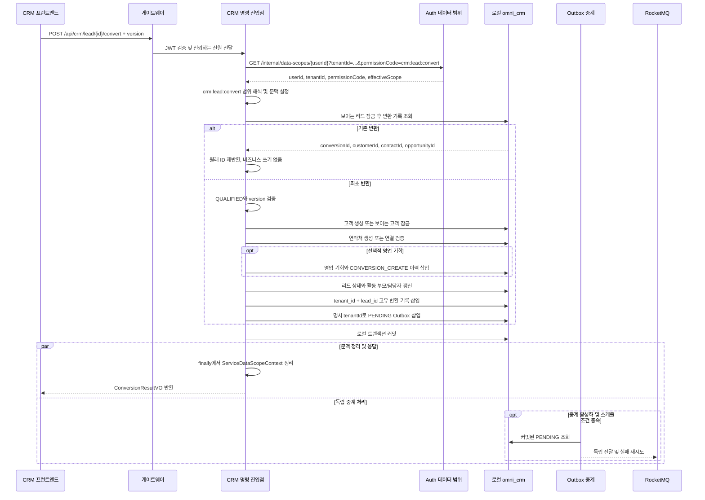

### 일관성 경계

| 대상 | 담당자 출처 |
| --- | --- |
| 새 고객 | 현재 리드의 owner 스냅샷 |
| 새 연락처 | 선택 고객의 owner 스냅샷; 리드와 다를 수 있음 |
| 새 영업 기회 | 현재 리드의 owner 스냅샷 |
| 이동한 활동 | 부모를 CUSTOMER로 바꾸고 선택 고객 owner를 반영하며 활동 version 증가 |

- `crm_lead_conversion(tenant_id,lead_id)` 고유 제약과 보이는 리드 행 잠금이 변환을 함께 보호한다. 재반환도 DTO·기능 권한·리드 가시성 검증을 통과해야 하며 서비스 안에서는 상태/version 검증 전에 기존 결과를 반환한다.
- `convert()`는 `@Transactional`이다. 기본 4인자 `ReliableMessageTemplate.send()`는 REQUIRED로 현재 트랜잭션에 참여해 로컬 PENDING만 삽입한다. 중계와 브로커 전달은 별도이며 중계 비활성 또는 미예약 상태에서 저장을 전달 완료로 볼 수 없다.
- 기존 고객/연락처 연결은 owner를 재할당하지 않는다. 변환은 `CrmOwnerResolver`를 호출해 상속 owner를 Auth에 다시 조회하지 않는다. 다른 생성/할당 명령의 owner 검증과 구분한다.
- 변환 payload는 leadId·customerId·contactId·opportunityId(null 가능)뿐이다. eventId·tenantId·aggregateVersion·actorUserId는 이벤트 봉투에 속한다. eventId는 msgKey로도 전달되지만 그 자체로 비즈니스 멱등성을 보장하지 않는다. payload에 연락처나 비고는 넣지 않는다.
- 변환의 `@OperLog`는 엔티티 스냅샷을 끄고 customerName·contactName·opportunityName 파라미터를 명시적으로 제외한다. 정리와 예외 경계는 Flow 10을 따르며 모든 민감 텍스트를 식별한다고 보장하지 않는다.
- 잘못된 모드/관계는 비즈니스 코드 400, 보이지 않는 리소스는 404, 최초 상태/version 충돌은 409다. Auth 범위 거부나 불일치는 403, Feign 서비스 예외는 503이며 데이터 범위를 넓히지 않는다.

소스 및 회귀 테스트: [LeadController.java](../omni-backend/omni-crm/src/main/java/com/omni/crm/controller/LeadController.java) / [LeadServiceImpl.java](../omni-backend/omni-crm/src/main/java/com/omni/crm/service/impl/LeadServiceImpl.java) / [CrmRequests.java](../omni-backend/omni-crm/src/main/java/com/omni/crm/dto/CrmRequests.java) / [CrmTenantInitializerImpl.java](../omni-backend/omni-crm/src/main/java/com/omni/crm/service/impl/CrmTenantInitializerImpl.java) / [ReliableMessageTemplate.java](../omni-backend/omni-common-mqlog/src/main/java/com/omni/common/mqlog/template/ReliableMessageTemplate.java) / [LeadServiceImplTest.java](../omni-backend/omni-crm/src/test/java/com/omni/crm/service/impl/LeadServiceImplTest.java)

[신뢰성 메시지 경계](mq-reliability.kr.md)

---

## Flow 14: CRM 기회 추진과 권한 격리 — Stage History + Customer 활성화

### 개요

영업 기회 단계는 `crm:opportunity:stage`, 재개는 `crm:opportunity:reopen` 명령을 사용하며 일반 수정 DTO는 stage/status를 받지 않는다. 저장소 구성은 테넌트와 데이터 범위 정책을 활성화한다. 서비스는 보이는 행 잠금과 version 조건 갱신으로 명령을 제한하고 단계 이력 및 로컬 Outbox를 추가한다.

### 상태 전이

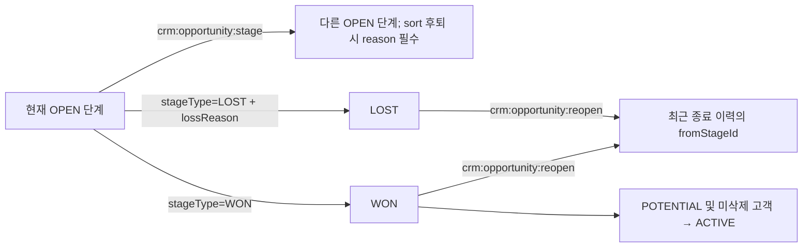

### 명령 실행 규칙

1. Gateway는 신뢰하는 신원을 전달하고 CRM 공통 신원 체인과 메서드 권한이 명령을 보호한다. `@ServiceDataScope`는 전체 permissionCode로 Auth 범위를 해석하고 userId/tenantId/permissionCode/effectiveScope를 검증하며 finally에서 문맥을 정리한다.
2. 현재 순서는 TenantLine → DataPermission → OptimisticLocker → Pagination이다. TenantLine은 crm_*, DataPermission은 owner 집계 5종을 처리한다. ALL/TENANT도 owner 조건만 생략하며 현재 테넌트 경계는 유지한다.
3. changeStage는 보이는 영업 기회를 잠그고 version과 현재 OPEN 상태를 검사한다. 원래/대상 단계는 활성 상태이고 대상은 같은 pipeline에 속해야 하며 동일 단계는 거부한다. sort 후퇴는 reason, LOST는 추가 lossReason이 필요하다. 다음 단계로만 이동하는 제약은 아니다.
4. id/version/deleted=0 조건으로 stage/status/probability·종료 시각·실패 사유를 갱신하고 version을 증가시킨다. 갱신 행 수가 1이 아니면 409다. 이력을 추가하고 대상 stageType에 따라 stage-changed/won/lost 이벤트를 기록한다.
5. 수주는 DataPermission만 무시하는 고객 전용 SQL을 호출하며 TenantLine과 customerId/POTENTIAL/deleted=0을 유지한다. 이 호출은 영향 행 수 1을 필수로 요구하지 않으며 다른 고객 상태를 ACTIVE로 강제하지 않는다.
6. 재개는 최근 toStatus=WON/LOST 이력의 fromStageId를 읽고 현재 활성 단계를 조회한다. OPEN·확률을 설정하고 종료 시각/실패 사유를 비운 뒤 version 조건으로 갱신한다. REOPEN 이력과 선택 단계 유형에 따른 이벤트를 추가한다.
7. 고객·단계 이력·Outbox 쓰기는 서비스 메서드의 로컬 트랜잭션에 속한다. 행 잠금 소스와 단위 사례만으로 현재 DB 동시성·롤백·외부 MQ 검증을 입증하지 못한다.

### PII 반환 규칙

- Lead·Customer·Contact 전용 페이지 목록은 항상 마스킹해 조립한다. 상세는 `crm:pii:view`에 따라 연락처·주소 등 보호 필드의 전체 값 반환을 결정한다.
- Activity 전용 목록/타임라인은 공백이 아닌 content를 `[REDACTED]`로 바꾸며 null과 공백은 유지한다. 상세는 PII 권한을 적용한다.
- Customer 360은 연락처/영업 기회/활동/리드 블록별 list 권한과 dataScope를 따로 검증하고 권한 없는 블록은 조회하지 않는다. 보이는 연락처와 활동에는 상세 PII 플래그도 적용하므로 모든 컬렉션을 무조건 마스킹한다고 볼 수 없다.
- 편집 화면 4개는 상세를 다시 조회하고 PII 권한이 없으면 민감 입력을 비활성화하며 제출 payload에서 해당 필드를 생략한다. 변환도 contactMobile/contactEmail을 생략한다. 쓰기 권한은 계속 백엔드 명령 권한과 데이터 범위 검증이 담당한다.

소스 및 회귀 테스트: [OpportunityController.java](../omni-backend/omni-crm/src/main/java/com/omni/crm/controller/OpportunityController.java) / [OpportunityServiceImpl.java](../omni-backend/omni-crm/src/main/java/com/omni/crm/service/impl/OpportunityServiceImpl.java) / [CrmCustomerMapper.java](../omni-backend/omni-crm/src/main/java/com/omni/crm/mapper/CrmCustomerMapper.java) / [CrmStateMachine.java](../omni-backend/omni-crm/src/main/java/com/omni/crm/domain/CrmStateMachine.java) / [ServicePersistenceAutoConfiguration.java](../omni-backend/omni-common-service/src/main/java/com/omni/common/service/config/ServicePersistenceAutoConfiguration.java) / [CrmViewAssembler.java](../omni-backend/omni-crm/src/main/java/com/omni/crm/dto/CrmViewAssembler.java) / [CrmPermissionScopeExecutor.java](../omni-backend/omni-crm/src/main/java/com/omni/crm/service/support/CrmPermissionScopeExecutor.java) / [OpportunityServiceImplTest.java](../omni-backend/omni-crm/src/test/java/com/omni/crm/service/impl/OpportunityServiceImplTest.java) / [PiiMaskerTest.java](../omni-backend/omni-crm/src/test/java/com/omni/crm/security/PiiMaskerTest.java)

[crm/lead/index.vue](../omni-frontend/src/views/crm/lead/index.vue) / [crm/customer/index.vue](../omni-frontend/src/views/crm/customer/index.vue) / [crm/contact/index.vue](../omni-frontend/src/views/crm/contact/index.vue) / [crm/activity/index.vue](../omni-frontend/src/views/crm/activity/index.vue)

이 절은 현재 소스와 해시로 연결한 단위 결과를 사용한다. 실제 MySQL 동시성/롤백·브라우저·외부 전달은 해당 검증 범위의 증거로 확인한다.

---

배포·문제 해결 단계는[인증](guides/authentication.kr.md), [Docker 배포](docker-deployment.kr.md), [운영](guides/operations-upgrade.kr.md)으로 옮겼습니다. 소셜 콜백은 브라우저에서 접근 가능한 Gateway를 거치고 Compose 내부는 서비스 이름으로 연결합니다. Auth 감사, JWT/JWK, 기능 권한, 데이터 범위의 경계는 이 페이지의 각 Flow를 기준으로 합니다.

## Flow 15: SRM 공급업체 진입 승인

`POST /api/srm/supplier` 는 `srm:supplier:create` 와 같은 권한 코드로 해석한 데이터 범위를 요구합니다. 관리 화면 생성은 PENDING_REVIEW 공급업체, 초기 위험 데이터와 등록 Outbox 를 기록한 뒤 현재 테넌트의 `category=SRM_SUPPLIER_ONBOARDING` 게시 모델을 해석합니다. 생성과 반려 후 submit 은 로컬 `@Transactional` 메서드 안에서 Workflow 를 동기 호출합니다. 이 호출 지점은 커밋 후 실행이 아닙니다.

실제 시작 API 는 `POST /api/internal/workflow/process-instance/start` 이며 응답은 processInstanceId, requestId, businessType, businessKey, replayed 를 포함합니다. Workflow 는 독립적으로 커밋하므로 로컬 롤백으로 이미 커밋된 원격 프로세스를 취소할 수 없습니다.

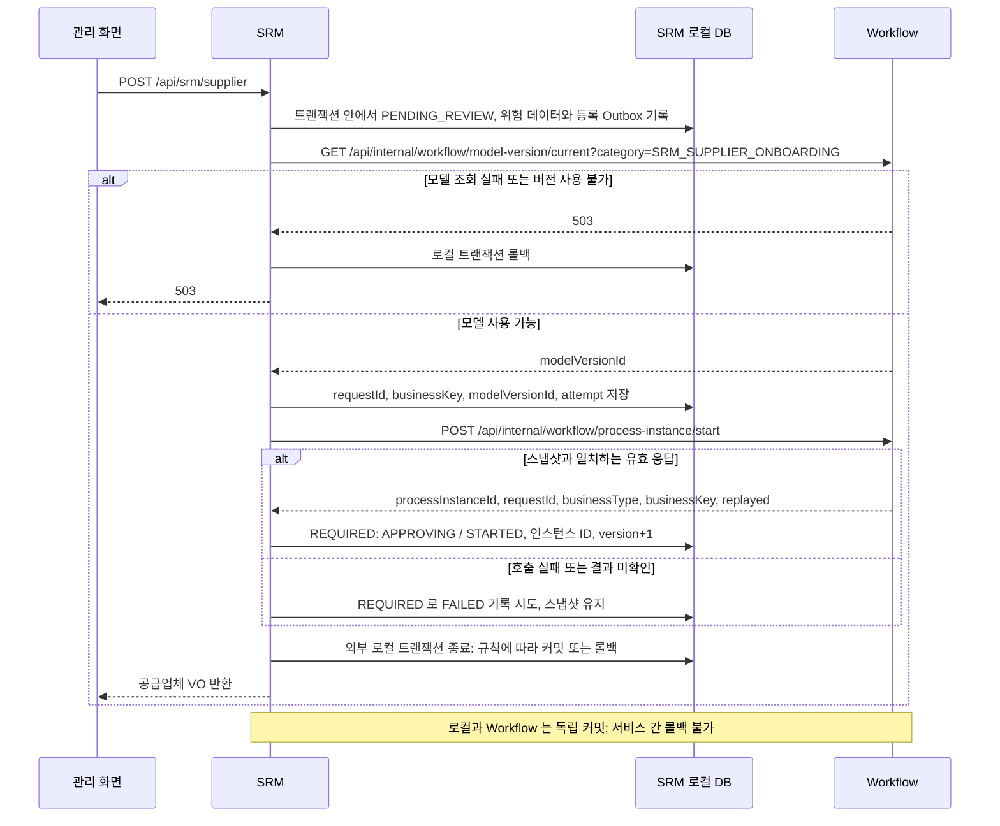

- 모델 해석은 시작 오류를 잡는 구문보다 먼저 실행됩니다. 유효 모델 부재나 조회 실패는 503 을 던져 생성이 롤백될 수 있습니다. 시작 호출 예외는 FAILED 기록을 시도한 후 prepareAndStart 가 처리하며, 외부 트랜잭션이 커밋되면 PENDING_REVIEW 가 남습니다. FAILED 는 로컬 시작 확인이 없다는 뜻이며 원격 프로세스가 없다는 증거가 아닙니다.
- SRM 은 requestId, businessKey=`{supplierId}:{attempt}`, modelVersionId, attempt 와 시작 상태를 저장합니다. startUserId/startUserName 은 현재 신원에서 명령으로 전달되며 공급업체 시작 사용자 스냅샷 필드로 영속화되지 않습니다. Workflow 는 tenant+requestId 및 tenant+businessType+businessKey 이중 고유 제약으로 재실행을 조정하고 모델과 시작 사용자 의도 일치를 검증합니다.
- 관리자 `/{id}/submit` 과 Portal `/profile/submit` 은 REJECTED 만 허용하며 새 시도를 시작합니다. 두 진입점 모두 현재 PENDING_REVIEW/FAILED 에 원래 스냅샷을 재사용하는 Workflow 시작 재시도를 제공하지 않습니다. Portal enrollment/retry 는 역할 할당 Saga 용입니다. 재제출을 일반적인 시작 실패 복구로 설명할 수 없습니다.
- 완료 이벤트는 Workflow 로컬 Outbox 와 독립 중계를 거칩니다. SRM 은 같은 트랜잭션에서 `(tenantId,eventId)` Inbox 를 등록·잠그고 producer, businessType, businessKey, 인스턴스와 페이로드 의도를 검증합니다. 일치하는 APPROVING/STARTED 만 APPROVED/REJECTED 로 전환하고 결과 Outbox 를 기록합니다. 처리 완료, 이전 시도, 종료 상태, 인스턴스 불일치는 다시 전환하지 않습니다. 로컬 시작 확인보다 이른 유효 완료는 재시도 가능한 예외를 던지며 처리 완료로 기록하지 않습니다.
- `RequiredWorkflowModelInitializer` 는 기본 테넌트 1 의 필수 모델 네 개를 확인하고 조회된 해당 활성 모델을 교정·게시합니다. 기본 모델 누락이나 게시 실패는 Workflow 시작을 실패시킵니다. 모든 신규 테넌트에 모든 모델이 존재함을 보장하지 않습니다.
- 생성 응답은 메모리의 supplier 로 조립합니다. 시작 실패 뒤 DB 의 시작 표시와 증가한 version 이 해당 엔티티로 완전히 동기화되지 않습니다. 상세를 다시 읽어 상태와 현재 version 을 확인해야 하며 생성 응답을 완전한 영속 시작 스냅샷으로 취급하면 안 됩니다.

소스와 회귀: [SupplierController.java](../omni-backend/omni-srm/src/main/java/com/omni/srm/controller/SupplierController.java) / [SupplierServiceImpl.java](../omni-backend/omni-srm/src/main/java/com/omni/srm/service/impl/SupplierServiceImpl.java) / [SupplierWorkflowCoordinator.java](../omni-backend/omni-srm/src/main/java/com/omni/srm/workflow/SupplierWorkflowCoordinator.java) / [SupplierWorkflowStateServiceImpl.java](../omni-backend/omni-srm/src/main/java/com/omni/srm/workflow/SupplierWorkflowStateServiceImpl.java) / [SupplierWorkflowCompletionServiceImpl.java](../omni-backend/omni-srm/src/main/java/com/omni/srm/service/impl/SupplierWorkflowCompletionServiceImpl.java) / [WorkflowInternalClient.java](../omni-backend/omni-srm/src/main/java/com/omni/srm/client/WorkflowInternalClient.java) / [RequiredWorkflowModelInitializer.java](../omni-backend/omni-workflow/src/main/java/com/omni/workflow/config/RequiredWorkflowModelInitializer.java) / [InternalWorkflowServiceImpl.java](../omni-backend/omni-workflow/src/main/java/com/omni/workflow/service/impl/InternalWorkflowServiceImpl.java) / [WorkflowProcessStartRequestServiceImpl.java](../omni-backend/omni-workflow/src/main/java/com/omni/workflow/service/impl/WorkflowProcessStartRequestServiceImpl.java) / [SrmViewAssembler.java](../omni-backend/omni-srm/src/main/java/com/omni/srm/dto/SrmViewAssembler.java)

### Flow 15.1: 구매 요청 승인 규칙 구성 및 매칭 시산

규칙은 모델 분류 `purchase` 에 연결하며 실행 인스턴스 businessType 은 `PROCUREMENT_REQUISITION` 입니다. 화면에서는 프로세스 이름과 버전을 선택하고 프로토콜은 modelVersionId 를 전송합니다.

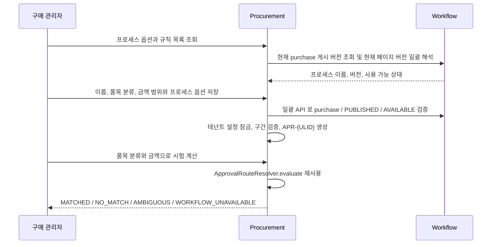

- 생성·수정은 현재 purchase 게시 모델을 검증합니다. 목록 메타데이터는 중복을 제거한 modelVersionId 를 최대 200 개씩 일괄 해석하며 Workflow 장애 시 로컬 규칙을 유지하고 UNAVAILABLE 로 표시합니다. 모델과 안전한 미리보기가 사용 가능할 때만 시험 계산에 승인 그래프를 반환합니다.
- 금액 범위는 반개구간입니다. 정확한 품목 분류를 먼저 매칭하고 해당 항목이 없을 때만 `*` 를 사용합니다. 같은 계층에서 여러 개가 일치하면 priority 정렬과 무관하게 AMBIGUOUS 입니다. 서버가 route_code 를 생성하며 API 가 priority 를 명시할 수 있고 생략 시 분류 내 최댓값에 10 을 더합니다.
- 커버리지는 0 부터 무한까지 구간을 나누고 모델 사용 가능 여부를 포함합니다. 비활성화·삭제 영향 계산은 메모리에서 대상 규칙을 제외합니다. 테넌트 초기화가 기본 설정을 준비할 수 있으므로 시험 계산이라는 이름만으로 요청 전체에 초기화 쓰기가 없다고 판단할 수 없습니다.

소스와 회귀: [ApprovalRouteController.java](../omni-backend/omni-procurement/src/main/java/com/omni/procurement/controller/ApprovalRouteController.java) / [ApprovalRouteServiceImpl.java](../omni-backend/omni-procurement/src/main/java/com/omni/procurement/service/impl/ApprovalRouteServiceImpl.java) / [ApprovalRouteInsightServiceImpl.java](../omni-backend/omni-procurement/src/main/java/com/omni/procurement/service/impl/ApprovalRouteInsightServiceImpl.java) / [ApprovalRouteResolver.java](../omni-backend/omni-procurement/src/main/java/com/omni/procurement/domain/ApprovalRouteResolver.java) / [ApprovalRouteCoverageAnalyzer.java](../omni-backend/omni-procurement/src/main/java/com/omni/procurement/domain/ApprovalRouteCoverageAnalyzer.java) / [ApprovalRuleWizard.vue](../omni-frontend/src/views/procurement/approval-route/components/ApprovalRuleWizard.vue)

## Flow 16: Procurement 구매 요청 승인과 비동기 라이트백

제출과 `/{id}/retry-start` 는 모두 `procurement:requisition:submit` 및 대응 데이터 범위를 요구합니다. submit 자체는 트랜잭션을 유지하지 않고 먼저 트랜잭션 prepareSubmit 을 호출한 뒤 커밋된 스냅샷으로 Workflow 를 호출합니다.

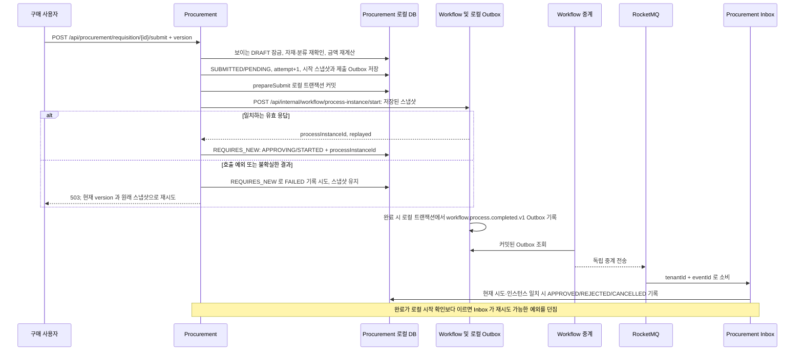

- prepareSubmit 은 DRAFT 및 현재 version 만 허용합니다. 활성 자재·분류를 다시 확인하고 단일 분류, 양수 수량과 음수가 아닌 단가를 요구합니다. 각 행을 HALF_UP 으로 소수 넷째 자리까지 반올림한 뒤 합산하고 DECIMAL(19,4) 범위를 검증합니다. 서버가 경로를 선택하며 클라이언트는 모델을 선택하지 않습니다.
- 시작 예외 또는 불일치 응답은 SUBMITTED/FAILED 기록을 시도하지만 Workflow 가 시작되지 않았다는 뜻은 아닙니다. retry-start 는 해당 상태와 현재 version 을 요구하며 requestId/businessKey/modelVersionId/attempt, 금액과 신청자를 재사용합니다. 경로 재선택이나 시도 증가가 없습니다. REJECTED 수정 후 DRAFT 로 돌아가며 다음 제출이 새 시도를 시작합니다.
- 완료 소비는 같은 트랜잭션에서 업무 상태, 결과 Outbox 와 Inbox 를 갱신합니다. 같은 eventId 에 다른 페이로드 의도가 있으면 409 입니다. 이른 이벤트는 재시도 가능한 예외이며 이전 시도와 종료 이벤트는 멱등하게 무시합니다. Outbox 기록과 실제 중계 전송은 별도 단계입니다.
- 목록은 페이지가 보이고 현재 페이지에 APPROVING 이 있을 때만 5 초마다 조용히 갱신합니다. 60 초 뒤 동기화 지연과 새로고침을 표시하며 타이머는 계속됩니다. 안내는 Workflow 완료를 증명하지 않으며 모든 페이지나 SUBMITTED 시작 복구를 포함하지 않습니다.

Procurement 는 RFQ 초대, SRM 은 견적의 권위 서비스입니다. SRM 은 같은 트랜잭션에서 견적, 행, 요청 멱등 원장과 견적 Outbox 를 저장합니다. Procurement Inbox 는 견적 버전으로 초대를 갱신하고 오래된 버전을 무시합니다. 선정은 현재 견적 ID·버전, 초대와 행을 재검증한 후 Procurement 로컬 트랜잭션에서 견적 스냅샷을 가진 주문을 생성하고 RFQ 전환 및 도메인 Outbox 를 기록합니다.

소스와 회귀: [RequisitionController.java](../omni-backend/omni-procurement/src/main/java/com/omni/procurement/controller/RequisitionController.java) / [RequisitionServiceImpl.java](../omni-backend/omni-procurement/src/main/java/com/omni/procurement/service/impl/RequisitionServiceImpl.java) / [RequisitionWorkflowStateServiceImpl.java](../omni-backend/omni-procurement/src/main/java/com/omni/procurement/service/impl/RequisitionWorkflowStateServiceImpl.java) / [RequisitionWorkflowCoordinator.java](../omni-backend/omni-procurement/src/main/java/com/omni/procurement/workflow/RequisitionWorkflowCoordinator.java) / [WorkflowCompletionServiceImpl.java](../omni-backend/omni-procurement/src/main/java/com/omni/procurement/service/impl/WorkflowCompletionServiceImpl.java) / [index.vue](../omni-frontend/src/views/procurement/requisition/index.vue) / [QuotationServiceImpl.java](../omni-backend/omni-srm/src/main/java/com/omni/srm/service/impl/QuotationServiceImpl.java) / [QuotationSubmittedServiceImpl.java](../omni-backend/omni-procurement/src/main/java/com/omni/procurement/service/impl/QuotationSubmittedServiceImpl.java) / [RfqServiceImpl.java](../omni-backend/omni-procurement/src/main/java/com/omni/procurement/service/impl/RfqServiceImpl.java) / [PurchaseOrderServiceImpl.java](../omni-backend/omni-procurement/src/main/java/com/omni/procurement/service/impl/PurchaseOrderServiceImpl.java) / [RequisitionWorkflowCoordinatorTest.java](../omni-backend/omni-procurement/src/test/java/com/omni/procurement/workflow/RequisitionWorkflowCoordinatorTest.java) / [RequisitionWorkflowStateServiceImplTest.java](../omni-backend/omni-procurement/src/test/java/com/omni/procurement/service/impl/RequisitionWorkflowStateServiceImplTest.java) / [WorkflowCompletionServiceImplTest.java](../omni-backend/omni-procurement/src/test/java/com/omni/procurement/service/impl/WorkflowCompletionServiceImplTest.java)

현재 소스와 연결된 단위 보고서 범위입니다. 실제 MySQL 동시성·롤백, Workflow/MQ 전송, 브라우저 폴링과 실제 CAPTCHA 를 이용한 SRM 등록은 각각의 인수 증거가 필요합니다.

---

## Flow 17: Procurement 입고에서 Asset 카드 생성·이동·처분까지

Procurement, Asset, Workflow 는 각각 로컬 트랜잭션을 커밋하고 Outbox 와 Inbox 로 연결합니다. 원본 가져오기, 승인 확인과 실물 업무 완료는 별도 단계입니다.

### 입고 가져오기와 과거 데이터 보완

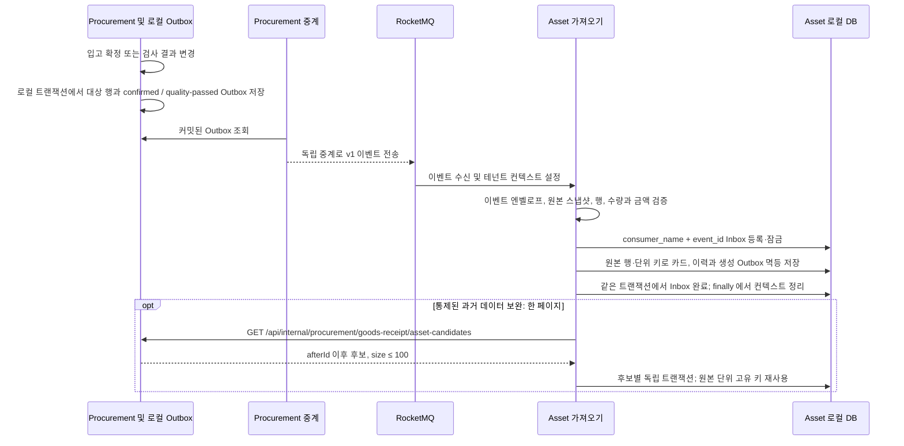

- Procurement 는 입고 확정 시 현재 자산화 조건을 만족하는 행만 이벤트에 넣고 후속 검사 합격 이벤트에는 새로 합격한 대상 행을 담습니다. Asset 은 `procurement.goods-receipt.confirmed.v1` 및 `procurement.goods-receipt.quality-passed.v1` 을 지원합니다.
- 가져오기는 원본 ID, owner, 통화, 행 스냅샷과 금액 등식을 먼저 검증합니다. 유효한 비 PASS 또는 비 assetManaged 행은 건너뛰지만 필드 누락, 잘못된 금액이나 원본 행 중복은 배치를 거부합니다. 대상 receivedQuantity 는 정확한 양의 정수로 assetQuantity 와 같고 Integer.MAX_VALUE 이하여야 합니다. unitPrice 와 totalPrice 는 양수입니다.
- Inbox 고유 키는 `(consumer_name,event_id)` 이며 tenant 와 JSON 업무 의도도 검증합니다. 테넌트 간 충돌이나 동일 이벤트 ID 의 다른 의도는 거부합니다. 자산 키 `(tenant_id,source_gr_line_id,source_unit_sequence)` 는 실시간과 보완을 함께 중복 제거합니다. 멱등 삽입 뒤 원본 단위를 다시 읽으며 JDBC 행 수만으로 생성 여부를 판단하지 않습니다.
- 새 카드는 IN_STOCK 이며 입고 owner 를 상속합니다. 카드별 purchaseAmount 는 unitPrice 를 HALF_UP 으로 소수 둘째 자리까지 반올림합니다. 새 카드만 생성 이력과 asset.created.v1 Outbox 를 추가하며 실시간 자산, 이력, Inbox 와 Outbox 는 같은 로컬 트랜잭션입니다.
- 보완 진입점은 내부 인증으로 보호된 `POST /api/internal/asset/procurement/backfill` 입니다. 헤더·쿼리 tenantId 가 같아야 하며 afterId 는 제외형 입고 행 커서, size 는 1–100 입니다. 한 호출은 한 페이지를 처리하고 nextAfterId/hasMore 를 반환하며 호출자가 커서를 저장해 계속합니다. 시작 시 자동 전체 스캔 구현은 없습니다. 후보별 커밋이므로 페이지 중간 실패에도 이전 부작용이 남고 원본 키로 재시도를 중복 제거합니다.

소스: [GoodsReceiptServiceImpl.java](../omni-backend/omni-procurement/src/main/java/com/omni/procurement/service/impl/GoodsReceiptServiceImpl.java) / [ProcurementGoodsReceiptConsumer.java](../omni-backend/omni-asset/src/main/java/com/omni/asset/consumer/ProcurementGoodsReceiptConsumer.java) / [ProcurementAssetImportServiceImpl.java](../omni-backend/omni-asset/src/main/java/com/omni/asset/service/impl/ProcurementAssetImportServiceImpl.java) / [AssetReceiptImportMapper.java](../omni-backend/omni-asset/src/main/java/com/omni/asset/mapper/AssetReceiptImportMapper.java) / [ProcurementAssetBackfillServiceImpl.java](../omni-backend/omni-asset/src/main/java/com/omni/asset/service/impl/ProcurementAssetBackfillServiceImpl.java) / [InternalProcurementBackfillController.java](../omni-backend/omni-asset/src/main/java/com/omni/asset/controller/InternalProcurementBackfillController.java) / [InternalAssetCandidateController.java](../omni-backend/omni-procurement/src/main/java/com/omni/procurement/controller/InternalAssetCandidateController.java) / [InternalAssetCandidateServiceImpl.java](../omni-backend/omni-procurement/src/main/java/com/omni/procurement/service/impl/InternalAssetCandidateServiceImpl.java) / [0001-asset-schema.yaml](../database/changelog/asset/0001-asset-schema.yaml)

### 이동·처분 승인과 업무 완료

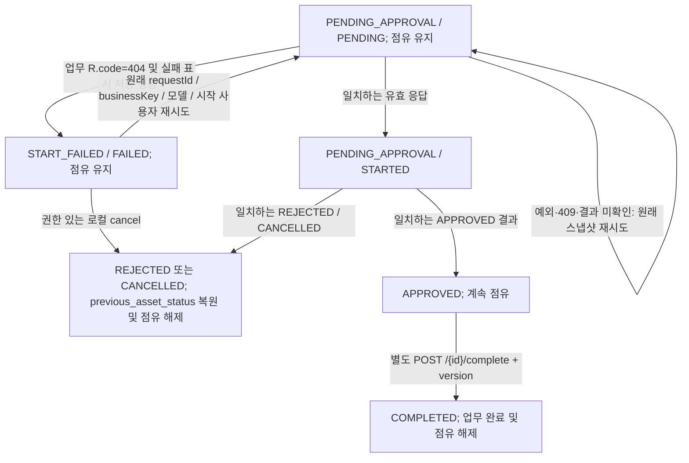

- 생성은 현재 테넌트의 ASSET_TRANSFER/ASSET_DISPOSAL 게시 모델을 자동 해석하며 사용자는 버전을 선택하지 않습니다. prepare 로컬 트랜잭션이 requestId, 신청 ID 를 businessKey 로, 모델과 시작 사용자를 저장한 뒤 tenant/id/version/status 및 두 active_operation_* null 조건으로 점유합니다. IN_STOCK/ALLOCATED/IN_USE 를 지원하고 충돌은 409 입니다. 커밋 후 Workflow 를 호출하고 확인은 REQUIRES_NEW 로 기록합니다.
- 네트워크 예외, 업무 409, 잘못된 응답 또는 로컬 확인 실패는 PENDING_APPROVAL/PENDING 과 점유를 유지합니다. 업무 R.code=404 만 명시 실패 기록 분기로 들어가고 START_FAILED/FAILED 저장 성공 후에만 로컬 취소를 허용합니다. HTTP404 Feign 예외는 여전히 결과 미확인입니다. 재시도는 원래 requestId, businessKey, 모델과 시작 사용자를 유지합니다.
- 승인 Inbox 는 테넌트, 업무 유형·키, 인스턴스와 페이로드 의도를 확인합니다. 시작 확인보다 이른 유효 이벤트는 재시도 가능한 예외이고 처리 완료나 현재 상태·인스턴스 불일치는 멱등 무시합니다. APPROVED 는 별도 complete 권한과 현재 버전이 제공될 때까지 점유합니다. 이동 완료는 current user/unit 및 IN_USE 를 설정하고 관리 owner 는 바꾸지 않으며 처분 완료는 DISPOSED/SCRAPPED 입니다. 반려·취소는 같은 트랜잭션에서 이전 상태, 이력과 점유 해제를 처리합니다.
- 자산 후보는 transfer:create/disposal:create 범위와 대상 상태로 필터링합니다. 사용자 후보는 Auth 테넌트·조직 소속을 검증하고 공급업체 후보는 현재 테넌트 APPROVED 를 요구합니다. 모두 자산 owner 조건을 적용하는 것은 아닙니다. SELF transfer:create 후보는 current_user_id 를 쓰지만 명령이 대상 부서 쓰기 권한과 사용자 소속을 다시 검사하므로 후보가 보인다고 쓰기가 보장되지는 않습니다.
- purchaseAmount, residualValue 와 원본 이벤트 금액은 JSON 십진 문자열이며 잔존 가치 요청은 전용 문자열 역직렬화기를 사용합니다. 후보, 재시도, 취소와 완료는 각각 권한이 필요하며 워크플로 승인 권한으로 자산 명령 권한을 대체할 수 없습니다.

소스: [AssetTransferController.java](../omni-backend/omni-asset/src/main/java/com/omni/asset/controller/AssetTransferController.java) / [AssetDisposalController.java](../omni-backend/omni-asset/src/main/java/com/omni/asset/controller/AssetDisposalController.java) / [AssetTransferServiceImpl.java](../omni-backend/omni-asset/src/main/java/com/omni/asset/service/impl/AssetTransferServiceImpl.java) / [AssetDisposalServiceImpl.java](../omni-backend/omni-asset/src/main/java/com/omni/asset/service/impl/AssetDisposalServiceImpl.java) / [AssetOperationWorkflowStateServiceImpl.java](../omni-backend/omni-asset/src/main/java/com/omni/asset/service/impl/AssetOperationWorkflowStateServiceImpl.java) / [WorkflowCompletionServiceImpl.java](../omni-backend/omni-asset/src/main/java/com/omni/asset/service/impl/WorkflowCompletionServiceImpl.java) / [AssetWorkflowCoordinator.java](../omni-backend/omni-asset/src/main/java/com/omni/asset/workflow/AssetWorkflowCoordinator.java) / [AssetWorkflowModelGuard.java](../omni-backend/omni-asset/src/main/java/com/omni/asset/workflow/AssetWorkflowModelGuard.java) / [AstAssetMapper.java](../omni-backend/omni-asset/src/main/java/com/omni/asset/mapper/AstAssetMapper.java) / [AssetOptionsController.java](../omni-backend/omni-asset/src/main/java/com/omni/asset/controller/AssetOptionsController.java) / [AssetOptionServiceImpl.java](../omni-backend/omni-asset/src/main/java/com/omni/asset/service/impl/AssetOptionServiceImpl.java) / [AssetDataPermissionHandler.java](../omni-backend/omni-asset/src/main/java/com/omni/asset/security/AssetDataPermissionHandler.java) / [AssetViews.java](../omni-backend/omni-asset/src/main/java/com/omni/asset/dto/AssetViews.java) / [AssetOperationRequests.java](../omni-backend/omni-asset/src/main/java/com/omni/asset/dto/AssetOperationRequests.java)

## Flow 18: SRM 포털 초대 등록과 역할 할당 Saga

계정 자체 등록은 Auth 의 독립 흐름이며 실제 CAPTCHA 와 테넌트 사용자 이름을 검증한 뒤 로그인합니다. 기본 USER 할당의 구현 범위는 Flow 1 에 설명합니다. SRM 등록은 기존 인증 신원, requestId 와 inviteToken 을 사용하고 Auth 계정을 만들지 않습니다.

```mermaid
sequenceDiagram
    participant U as 포털 사용자
    participant G as Gateway
    participant A as Auth
    participant S as SRM
    participant SO as SRM Outbox·중계
    participant AO as Auth 처리 기록·Outbox·중계
    participant M as RocketMQ
    participant W as Workflow
    U->>A: POST /api/auth/register: tenant + captcha 후 로그인
    A-->>U: 로그인한 신원
    U->>G: POST /api/srm/portal/enroll + requestId + inviteToken
    G->>S: 신뢰된 tenant/user 전달
    S->>S: 트랜잭션에서 초대를 소비하고 REGISTERING + PENDING_ROLE_ASSIGN 생성
    S->>SO: 같은 트랜잭션에서 srm.portal-role.assign-requested.v1 저장
    SO-->>M: 독립 중계 전송
    M->>A: tenantId, requestId, supplierId, userId, SUPPLIER
    A->>A: tenant/requestId 의 원래 신원을 검증하고 SUPPLIER 멱등 부여
    A->>AO: 같은 트랜잭션에서 처리 기록과 성공·실패 Outbox 저장
    AO-->>M: 독립 중계 전송
    M->>S: auth.portal-role.assigned.v1 / auth.portal-role.assign-failed.v1
    alt SUCCESS
        S->>S: 같은 로컬 트랜잭션에서 ACTIVE PortalUser,PENDING_REVIEW,COMPLETED 저장
        S->>W: 같은 로컬 트랜잭션에서 진입 승인 준비·시작: Flow15
    else FAILED
        S->>S: REGISTERING_FAILED + ROLE_ASSIGN_FAILED + nextRetryTime
    end
    U->>S: GET /api/srm/portal/enrollment
    S-->>U: Saga 상태#59; COMPLETED 뒤 재로그인 제공
    Note over S,W: 모델 조회 실패는 SRM 결과를 롤백할 수 있으나 Auth 역할은 독립 커밋되어 메시지 재전송 필요
```

- tenant/requestId 재실행은 신청자와 정규화 creditCode 를 검사합니다. 기존 활성 신청도 원래 요청을 반환하며 초대를 다시 소비하지 않습니다. 요청 본문 전체의 멱등 hash 는 없습니다. 새 Supplier 내부 owner 는 null 이고 Portal userId 는 포털 연관에만 기록합니다.
- 초대 원문은 생성 응답에서만 반환하고 SHA-256 을 영속화합니다. enroll OperLog 는 inviteToken 을 명시 제외하며 역할 메시지에 암호·CAPTCHA·초대 원문이 없습니다. 소비 SQL 은 테넌트, 버전, ACTIVE, 만료와 잔여 횟수를 제한하며 무효 404, 만료·소진 410, 동시성 충돌 409 입니다.
- Auth 는 `sys_portal_role_request(tenant_id,request_id)` 로 원래 supplier/user/role 의도를 확인합니다. SUPPLIER 만 허용하고 활성 테넌트 사용자와 역할을 검증합니다. 역할 쓰기, 처리 기록과 결과 Outbox 는 같은 트랜잭션입니다. 완료 재실행은 결과 Outbox 를 재발행하며 eventId 는 requestId 와 이벤트 유형으로 결정적으로 생성합니다.
- SRM 은 이벤트 엔벨로프·페이로드의 requestId, tenantId 및 supplier/user/SUPPLIER 를 확인합니다. 성공하면 ACTIVE PortalUser 와 PENDING_REVIEW/COMPLETED 를 저장한 뒤 같은 로컬 트랜잭션에서 진입 Workflow 를 호출하며 유효 시작은 APPROVING 이 됩니다. 모델 조회 실패는 로컬 Saga 완료를 롤백할 수 있지만 시작 호출 실패는 COMPLETED 와 PENDING_REVIEW/FAILED 를 커밋할 수 있습니다. Saga 완료가 진입 APPROVED 를 뜻하지 않으며 복구 범위는 Flow 15 를 따릅니다.
- 실패는 REGISTERING_FAILED/ROLE_ASSIGN_FAILED 와 nextRetryTime 을 기록합니다. `POST /api/srm/portal/enrollment/retry` 는 역할 할당 실패와 대기 만료 뒤에만 원래 requestId 를 재발행하고 초대는 다시 소비하지 않습니다. 이른 재시도는 429, PENDING/COMPLETED 는 기존 상태를 반환하고 완료 뒤 늦은 실패는 무시합니다.
- SRM 포털 권한 범위에서 기본 USER 는 enroll 용입니다. 기업 자료·평가는 SUPPLIER, 해당 권한과 현재 테넌트·사용자의 ACTIVE PortalUser 연관이 필요합니다. SrmPortalScope 는 임시 TENANT 범위를 설정하고 복원합니다. SRM 결과 소비자는 finally 에서 신원·범위를 정리하고 Auth 역할 처리는 명시 tenant 조건을 사용합니다.
- 포털은 tenant/username 별 requestId 를 유지하고 PENDING_ROLE_ASSIGN 중 5 초마다 조회합니다. COMPLETED 는 역할을 얻도록 로그아웃과 재로그인을 제공합니다. DB 역할 부여만으로 현재 JWT 를 바꾸지는 않습니다.

소스: [AuthController.java](../omni-backend/omni-auth/src/main/java/com/omni/auth/controller/AuthController.java) / [UserServiceImpl.java](../omni-backend/omni-auth/src/main/java/com/omni/auth/service/impl/UserServiceImpl.java) / [PortalRoleAssignConsumer.java](../omni-backend/omni-auth/src/main/java/com/omni/auth/consumer/PortalRoleAssignConsumer.java) / [PortalRoleAssignmentServiceImpl.java](../omni-backend/omni-auth/src/main/java/com/omni/auth/service/impl/PortalRoleAssignmentServiceImpl.java) / [SysPortalRoleRequestMapper.java](../omni-backend/omni-auth/src/main/java/com/omni/auth/mapper/SysPortalRoleRequestMapper.java) / [PortalController.java](../omni-backend/omni-srm/src/main/java/com/omni/srm/controller/PortalController.java) / [PortalInviteServiceImpl.java](../omni-backend/omni-srm/src/main/java/com/omni/srm/service/impl/PortalInviteServiceImpl.java) / [SrmSupplierInviteMapper.java](../omni-backend/omni-srm/src/main/java/com/omni/srm/mapper/SrmSupplierInviteMapper.java) / [SupplierPortalServiceImpl.java](../omni-backend/omni-srm/src/main/java/com/omni/srm/service/impl/SupplierPortalServiceImpl.java) / [PortalRoleResultConsumer.java](../omni-backend/omni-srm/src/main/java/com/omni/srm/consumer/PortalRoleResultConsumer.java) / [PortalRoleResultServiceImpl.java](../omni-backend/omni-srm/src/main/java/com/omni/srm/service/impl/PortalRoleResultServiceImpl.java) / [SrmPortalScope.java](../omni-backend/omni-srm/src/main/java/com/omni/srm/security/SrmPortalScope.java) / [index.vue](../omni-frontend/src/views/supplier-portal/index.vue)

소스와 기존 단위 보고서에 근거한 계약 설명입니다. 실제 MySQL 동시성·트랜잭션, Broker 전송, 네이티브 화면과 실제 CAPTCHA 등록은 각각의 인수 증거가 필요합니다.
