# 核心业务流程

> 本文维护关键请求/事件的调用链、状态、事务、权限、幂等与失败不变量。操作和截图见 [Wiki](wiki/index.md)及各业务指南；源码断点见[源码调试](wiki/source-debugging.md)。
> 架构概览详见 [architecture.md](architecture.md)。Docker 部署配置详见 [docker-deployment.md](docker-deployment.md)。API 契约详见 [api-contract.md](api-contract.md)。

## Flow 1: 用户登录（用户名 + 密码 + 验证码 + JWT）

### 概要

`POST /api/auth/login` 接收用户名、密码、必填 `tenantId` 和验证码，经 Gateway 到 Auth。该 JWT 登录路径直接调用 `UserService.findByUsername()/verifyPassword()`，成功返回 `R<LoginResult>`；`tenantId:username` 解析属于另一个会话认证路径。

### 时序图

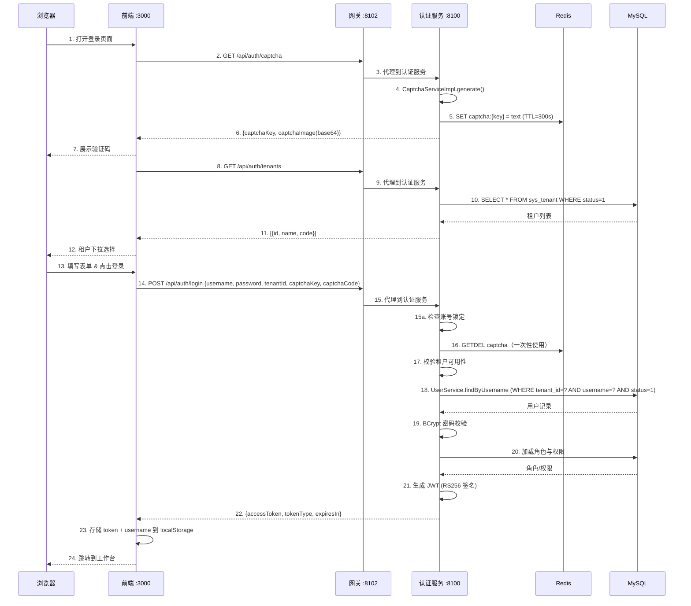

### 登录后：认证请求流程

受保护请求携带 `Authorization: Bearer <JWT>`。`AuthFilter` 获取公钥、验证签名与 `exp`、按 `jti` 检查 Redis 黑名单，然后移除客户端身份头与转发的 Bearer 头，注入认证身份及 `X-Gateway-Assertion`。JWT 中列表形式的 `roles/scope` 在该过滤器中转换为逗号分隔的身份头。

签名、过期或黑名单的安全拒绝返回 401；公钥、Redis 或下游依赖故障不会统一伪装成 JWT 错误。普通运行中，断言密钥缺失、少于 32 字节或签发失败时返回 503 并停止转发。下游按自己的预认证规则验证断言；当前断言 payload 绑定用户 ID、租户 ID、用户名和签发时刻。

```
浏览器 -> 前端：请求受保护资源
前端 -> 网关 :8102：Authorization: Bearer <JWT>
网关：JwkKeyProvider 获取 RSA 公钥（默认缓存 5 分钟）
网关：验证 RS256 签名与 exp
网关 -> Redis：按 jti 查询 token:blacklist:{jti}
网关：移除客户端身份头及转发的 Bearer 头
网关 -> 下游：X-User-Id / X-Tenant-Id / X-User-Name
网关 -> 下游：X-User-Roles: <role-code>
网关 -> 下游：X-User-Scopes: <permission-code>
网关 -> 下游：X-Gateway-Assertion
下游：按自己的预认证规则验证网关断言
下游 -> 网关 -> 前端 -> 浏览器：响应
```

### 关键组件

| 组件 | 源码 | 职责 |
|---|---|---|
| `LoginForm.vue` | [omni-frontend/src/components/LoginForm.vue](../omni-frontend/src/components/LoginForm.vue) | 登录表单：验证码、租户与凭据提交 |
| `user.ts` | [omni-frontend/src/stores/user.ts](../omni-frontend/src/stores/user.ts) | Token/用户名写入 localStorage |
| `request.ts` | [omni-frontend/src/api/request.ts](../omni-frontend/src/api/request.ts) | 请求拦截器附加 Bearer Token |
| `vite.config.ts` | [omni-frontend/vite.config.ts](../omni-frontend/vite.config.ts) | `/api` 代理目标，默认 Gateway :8102 |
| `AuthController.java` | [omni-backend/omni-auth/src/main/java/com/omni/auth/controller/AuthController.java](../omni-backend/omni-auth/src/main/java/com/omni/auth/controller/AuthController.java) | 锁定检查、验证码、租户可用性、账号/密码、JWT、在线记录和安全审计 |
| `UserServiceImpl.java` | [omni-backend/omni-auth/src/main/java/com/omni/auth/service/impl/UserServiceImpl.java](../omni-backend/omni-auth/src/main/java/com/omni/auth/service/impl/UserServiceImpl.java) | 按用户名与租户查用户，使用 BCrypt 校验密码 |
| `SysUserMapper.java` | [omni-backend/omni-auth/src/main/java/com/omni/auth/mapper/SysUserMapper.java](../omni-backend/omni-auth/src/main/java/com/omni/auth/mapper/SysUserMapper.java) | 账号查询限定 `tenant_id + username + status=1` |
| `OmniUserDetailsService.java` | [omni-backend/omni-auth/src/main/java/com/omni/auth/security/OmniUserDetailsService.java](../omni-backend/omni-auth/src/main/java/com/omni/auth/security/OmniUserDetailsService.java) | 供 Spring Security/会话认证解析 `tenantId:username`；不是普通 JWT 登录的查询入口 |
| `CaptchaServiceImpl.java` | [omni-backend/omni-auth/src/main/java/com/omni/auth/service/impl/CaptchaServiceImpl.java](../omni-backend/omni-auth/src/main/java/com/omni/auth/service/impl/CaptchaServiceImpl.java) | 生成图片；按配置 TTL 存 Redis；原子 GETDEL 校验 |
| `JwtTokenServiceImpl.java` | [omni-backend/omni-auth/src/main/java/com/omni/auth/service/impl/JwtTokenServiceImpl.java](../omni-backend/omni-auth/src/main/java/com/omni/auth/service/impl/JwtTokenServiceImpl.java) | 签发 RS256 JWT，角色与权限来自数据库 |
| `AuthFilter.java` | [omni-backend/omni-gateway/src/main/java/com/omni/gateway/filter/AuthFilter.java](../omni-backend/omni-gateway/src/main/java/com/omni/gateway/filter/AuthFilter.java) | JWT 过期/签名/黑名单检查，身份清理与网关签名断言 |
| `JwkKeyProvider.java` | [omni-backend/omni-gateway/src/main/java/com/omni/gateway/config/JwkKeyProvider.java](../omni-backend/omni-gateway/src/main/java/com/omni/gateway/config/JwkKeyProvider.java) | 从 Auth `/oauth2/jwks` 取公钥，默认缓存 5 分钟 |

### JWT Token 结构

以下是该密码登录 JWT 的解码结构示例，使用占位值，不是可用令牌。`scope` 中的值是权限编码；示例不授予任何角色权限。

```json
{
  "header": {
    "alg": "RS256",
    "kid": "<key-id-from-jwk>"
  },
  "payload": {
    "sub": "1",
    "tenant_id": 1,
    "username": "admin",
    "roles": [
      "<role-code>"
    ],
    "scope": [
      "<permission-code>"
    ],
    "jti": "<token-id>",
    "iat": 1748000000,
    "exp": 1748000900
  }
}
```

| 声明 | 当前含义 |
|---|---|
| `sub` | 用户 ID 字符串 |
| `tenant_id` | 租户 ID 数字 |
| `username` | 用户名字符串 |
| `roles` | 数据库角色编码数组 |
| `scope` | 数据库权限编码数组；不是空格拼接字符串 |
| `jti` | 唯一 Token ID，用于 `token:blacklist:{jti}` |
| `iat` | Unix 秒级签发时间 |
| `exp` | 到期时间；默认 `iat + 900`，由 `auth.token.access-token-ttl` 配置 |

### 多租户登录机制

公开登录 DTO 的 `tenantId` 由 `@NotNull` 校验，普通 JWT 登录按它查询同租户启用用户。`POST /api/auth/session-login` 才构造 `tenantId:username`，经 `AuthenticationManager` 和 `OmniUserDetailsService` 建立并轮换 HttpSession。

`OmniUserDetailsService` 对无冒号用户名默认租户 1，是内部兼容逻辑；不能据此省略公开登录请求的 `tenantId`。会话登录与访问令牌签发的状态、失败及后续授权用途分别核对。

### 验证码生命周期

验证码默认 TTL 为 300 秒，由 `auth.captcha.ttl-seconds` 配置。进入 `validate()` 后原子 GETDEL，无论匹配与否均消费一次，比较不区分大小写。账号锁定检查发生在验证码校验前，不要把每次被拒请求都视为已消费验证码。

1. 生成：SpecCaptcha -> Base64 图片
2. 保存：captcha:{uuid}，按 TTL 到期
3. 校验：Redis GETDEL；不存在 -> code 400，消息“验证码已过期”
4. 不匹配 -> code 400，消息“验证码错误”；再次提交需新验证码

### 当前状态

`/api/auth/login` 返回 accessToken、Bearer 类型及 expiresIn，不返回 refreshToken；默认访问有效期 900 秒，可配置。`JwkKeyProvider` 当前取 JWKS 第一个 RSA 密钥并缓存，不能据此声称已实现按 kid 选择的完整多密钥轮换。

本节说明当前源码调用与失败边界。实际验证码登录操作、截图与恢复步骤见 [Wiki](wiki/index.md)；OAuth2 会话及授权码流程继续见 Flow 2。

## Flow 2: OAuth2 授权码 + PKCE 登录

### 概述

前端的企业 SSO 入口使用授权码 + PKCE。默认客户端是 `omni-frontend`（`VITE_OAUTH2_CLIENT_ID` 可覆盖前端值，但必须匹配注册记录），认证方式为 `NONE`。新建默认客户端要求 PKCE，授权范围为 `openid profile`，`requireAuthorizationConsent=false`；已存在记录的其他配置不会被初始化器重置。

发起流程先生成 64 字符 verifier、`BASE64URL(SHA256(verifier))` challenge 和随机 state，保存授权参数，再进入 `Login?oauth2=true`。表单用必填租户和真实验证码调用 `/api/auth/session-login` 建立并轮换 HttpSession，随后打开保存的授权 URL。JWT 登录状态不能代替该服务端会话。

### 时序图

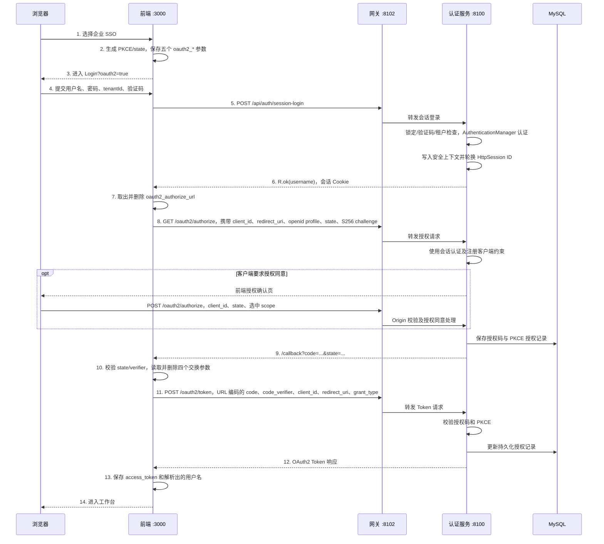

### 关键组件

| 组件 | 源码 | 职责 |
|---|---|---|
| `pkce.ts` | [omni-frontend/src/utils/pkce.ts](../omni-frontend/src/utils/pkce.ts) | Web Crypto 生成 64 字符 verifier、S256 challenge 与 state |
| `LoginForm.vue` | [omni-frontend/src/components/LoginForm.vue](../omni-frontend/src/components/LoginForm.vue) | 保存五个参数，使用验证码会话登录后打开授权 URL |
| `auth.ts` | [omni-frontend/src/api/auth.ts](../omni-frontend/src/api/auth.ts) | 构造含 openid profile/state/PKCE 的 URL；按表单编码交换 Token |
| `callback/index.vue` | [omni-frontend/src/views/callback/index.vue](../omni-frontend/src/views/callback/index.vue) | 校验 state/verifier，交换前清理四个参数；仅保存访问令牌和用户名 |
| `user.ts` | [omni-frontend/src/stores/user.ts](../omni-frontend/src/stores/user.ts) | 持久化 token、username；不保存 id_token/refresh_token |
| `OAuth2ClientInitializer.java` | [omni-backend/omni-auth/src/main/java/com/omni/auth/config/OAuth2ClientInitializer.java](../omni-backend/omni-auth/src/main/java/com/omni/auth/config/OAuth2ClientInitializer.java) | 创建默认 NONE + PKCE 客户端；保留既有注册的其他配置 |
| `AuthController.java` | [omni-backend/omni-auth/src/main/java/com/omni/auth/controller/AuthController.java](../omni-backend/omni-auth/src/main/java/com/omni/auth/controller/AuthController.java) | 校验租户/验证码/凭据，写入并轮换 HttpSession |
| `AuthorizationServerConfig.java` | [omni-backend/omni-auth/src/main/java/com/omni/auth/config/AuthorizationServerConfig.java](../omni-backend/omni-auth/src/main/java/com/omni/auth/config/AuthorizationServerConfig.java) | OAuth2 会话安全链、JWK/JWT、自定义 claims、JDBC 授权/同意存储 |
| `consent/index.vue` | [omni-frontend/src/views/consent/index.vue](../omni-frontend/src/views/consent/index.vue) | 按需提交 client_id/state/选中 scope，或不带 scope 拒绝 |
| `SasConsentOriginFilter.java` | [omni-backend/omni-auth/src/main/java/com/omni/auth/security/SasConsentOriginFilter.java](../omni-backend/omni-auth/src/main/java/com/omni/auth/security/SasConsentOriginFilter.java) | 对带 Origin 的 consent POST 检查 scheme/host/port，不匹配返回 403 |

### PKCE 存储键

| sessionStorage 键 | 用途与实际清理时机 |
|---|---|
| `oauth2_code_verifier` | 64 字符 verifier；回调通过 state/verifier 检查后，在发 Token 请求前删除 |
| `oauth2_state` | 回调比对的随机 state；与 verifier 一起在交换前删除 |
| `oauth2_client_id` | 发起时保存的客户端 ID；回调读取后在交换前删除 |
| `oauth2_redirect_uri` | 当前 origin + /callback；回调读取后在交换前删除 |
| `oauth2_authorize_url` | 待访问的授权 URL；会话登录成功后取出并删除 |

### 失败与边界

回调收到 `error`、缺少 code、state 不匹配或缺少 verifier 时返回登录页，且这些提前返回分支不会保证清理已存参数。通过前置检查后，四个交换参数先删除，再调用 Token 端点；交换失败也不能假定旧 verifier 仍可复用。

Token 请求是原生 `fetch('/oauth2/token')`，使用 `application/x-www-form-urlencoded`、`credentials: 'include'`；请求字段为 `grant_type=authorization_code`、code、code_verifier、client_id、redirect_uri。它不走 Axios 的 `/api` 前缀，响应遵循 OAuth2 标准，不能当成 `R<T>`。

默认第一方客户端不要求额外授权确认；其他客户端以实际注册的 consent 设置为准。对授权同意 POST，`SasConsentOriginFilter` 校验存在的 Origin 与转发地址的协议、主机和端口；该规则不等于所有 OAuth2 端点的通用 CSRF Token 校验。

### 当前状态

默认配置提供 JWK/JWT 签发路径和 `accessTokenCustomizer`，不能把访问令牌统一描述为 opaque；其他客户端仍以其 `TokenSettings` 为准。SAS 自定义器写入角色数组和以空格连接的业务权限 `scope`，与 Flow1 密码 JWT 的权限数组不同，也不同于授权请求的 `openid profile`。

前端响应类型把 id_token、refresh_token 声明为可选；回调只保存 access_token 和解析出的用户名。注册 `refresh_token` grant 不代表每次响应都含刷新令牌，更不代表前端已实现刷新。访问有效期由注册客户端的 TokenSettings 定义，不沿用 Flow1 的默认值。

上述是当前源码路径与失败边界。实际操作、预期与恢复见 [Wiki](wiki/index.md)；源码配置不替代端到端运行证据。

---

## Flow 3: OAuth2 设备授权许可

### 概述

设备授权流程适用于无浏览器或输入受限的设备。设备申请 device_code/user_code，用户在浏览器中确认，设备再轮询 Token 端点。仓库的 `/device` 是浏览器模拟器，`/device/verify` 是用户验证页。

当前模拟器请求 `client_id=omni-device&scope=profile`。它用当前前端 origin 自行构造 `/device/verify?user_code=...` 和二维码，而不是直接采用 SAS 返回的 verification_uri。用户端需要真实 HttpSession 认证；前端持有 JWT 不能代替服务端会话。

### 时序图

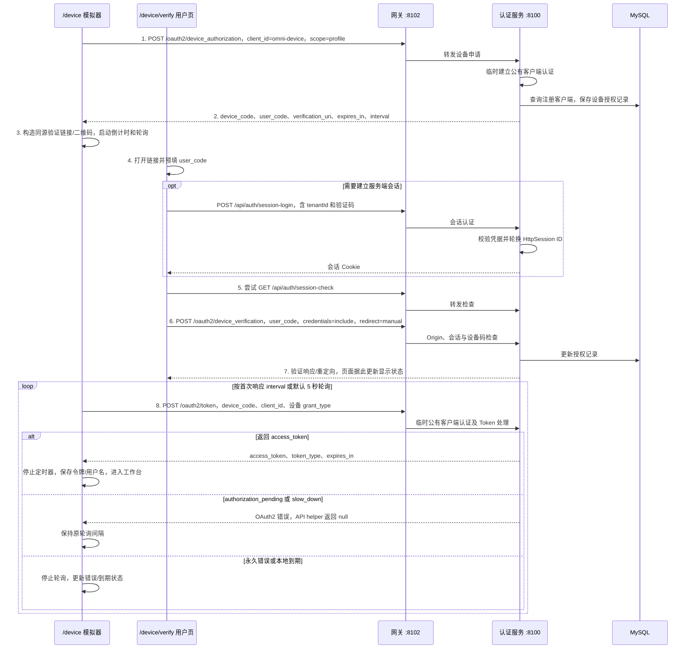

### 关键组件

| 组件 | 源码 | 职责 |
|---|---|---|
| `auth.ts` | [omni-frontend/src/api/auth.ts](../omni-frontend/src/api/auth.ts) | scope=profile 的设备申请；Token 轮询，pending/slow_down 统一为 null |
| `device/index.vue` | [omni-frontend/src/views/device/index.vue](../omni-frontend/src/views/device/index.vue) | 构造同源验证链接/二维码；固定初始 interval，倒计时和令牌保存 |
| `device/verify.vue` | [omni-frontend/src/views/device/verify.vue](../omni-frontend/src/views/device/verify.vue) | 验证码会话登录、尝试 session-check、提交 user_code 并根据响应更新 UI |
| `DeviceClientInitializer.java` | [omni-backend/omni-auth/src/main/java/com/omni/auth/config/DeviceClientInitializer.java](../omni-backend/omni-auth/src/main/java/com/omni/auth/config/DeviceClientInitializer.java) | 注册 omni-device；已有客户端的 consent=true 会被修正为 false |
| `AuthorizationServerConfig.java` | [omni-backend/omni-auth/src/main/java/com/omni/auth/config/AuthorizationServerConfig.java](../omni-backend/omni-auth/src/main/java/com/omni/auth/config/AuthorizationServerConfig.java) | 显式启用设备端点；使用 HttpSession 安全上下文和 JDBC 授权记录 |
| `DeviceClientAuthenticationFilter.java` | [omni-backend/omni-auth/src/main/java/com/omni/auth/security/DeviceClientAuthenticationFilter.java](../omni-backend/omni-auth/src/main/java/com/omni/auth/security/DeviceClientAuthenticationFilter.java) | 申请/设备 Token 请求内设置客户端认证；finally 还原原用户认证 |
| `SasConsentOriginFilter.java` | [omni-backend/omni-auth/src/main/java/com/omni/auth/security/SasConsentOriginFilter.java](../omni-backend/omni-auth/src/main/java/com/omni/auth/security/SasConsentOriginFilter.java) | 对带 Origin 的设备验证 POST 核对转发地址，不匹配拒绝 403 |

### 设备客户端配置

| 配置项 | 当前值 |
|---|---|
| Client ID | `omni-device` |
| 认证方式 | `NONE`，公有客户端，无 clientSecret |
| 授权类型 | `urn:ietf:params:oauth:grant-type:device_code` 和 `refresh_token` |
| 作用域 | 注册 `openid`、`profile`；当前模拟器仅请求 `profile` |
| 要求 PKCE | `false` |
| 要求授权同意 | `false`；初始化器会修正既有的 true |
| 回调地址 | 不使用 redirectUri；设备页显示的验证链接由前端构造 |

### 轮询行为

| 响应/条件 | 当前前端行为 |
|---|---|
| `authorization_pending` | helper 返回 null，按初始间隔继续 |
| `slow_down` | 同样返回 null；当前前端不增加间隔，不能声称已实现退避 |
| `expired_token` / 本地倒计时到期 | 停止轮询，进入错误/到期状态 |
| `access_denied` / 其他永久错误 | 停止轮询，进入错误状态 |
| 识别出的 `Failed to fetch` / `NetworkError` / `timeout` | 等待下一次定时轮询 |
| 返回 access_token | 清理轮询和倒计时，保存访问令牌与解析出的用户名 |
| 页面卸载 | 清理两个定时器 |

### 当前状态

设备申请、验证与 Token 端点已在源码中配置；`DeviceClientAuthenticationFilter` 的客户端主体只在当前申请/轮询请求内有效，`finally` 还原认证以免污染用户 HttpSession。注册 refresh_token grant 不证明每次会返回刷新令牌，模拟器也未实现刷新保存或使用。

验证页会尝试检查会话，并以 opaqueredirect、302、部分 HTML 或成功响应更新显示。前端 ready/success 状态不是服务端认证或换发令牌证据。页面的“拒绝”仅切换本地 denied 状态，不向 SAS 发送拒绝，也不撤销设备授权记录。

当前前端未对 slow_down 调整间隔；这些实现限制不能写成已完成的 RFC 行为。实际验收需要设备端真正取得有效访问令牌并访问受保护资源。操作、截图与失败恢复见 [Wiki](wiki/index.md)。

---

## Flow 4: OAuth2 社交登录（GitHub / Google / Gitee）

### 概述

当前登录表单提供 GitHub、Google、Gitee 三个入口，后端通过同名 Spring Bean 的 `Map<String, OAuth2ProviderHandler>` 分发。Handler 提供授权 URL、Token 交换与归一化资料获取，`SocialLoginServiceImpl` 负责租户、身份关联、用户和 JWT 编排。当前表单没有 WeChat 按钮，后端也没有对应 Handler；表字段注释出现 wechat 不代表已实现。

浏览器经 Gateway 访问 `/api/auth/oauth2/{provider}?tenant_id=...`，Auth 检查提供商及租户，生成签名 state 后跳转第三方。回调验证 state、交换第三方 Token、查找或创建本地用户，成功后跳转 `/callback#token=...&username=...`。这里的社交登录回调与 Flow2 的本地授权码 + PKCE 回调是不同路径。

### 时序图

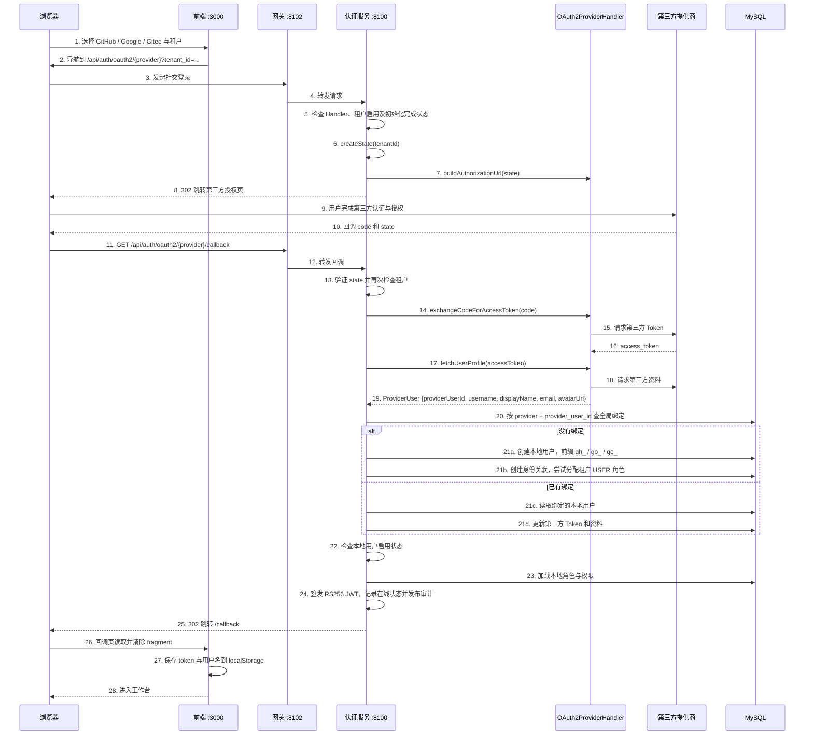

### 关键组件

| 组件 | 源码 | 职责 |
|---|---|---|
| `LoginForm.vue` | [omni-frontend/src/components/LoginForm.vue](../omni-frontend/src/components/LoginForm.vue) | 三个提供商入口和所选 tenantId |
| `auth.ts` | [omni-frontend/src/api/auth.ts](../omni-frontend/src/api/auth.ts) | 生成经 Gateway 发起的导航 URL |
| `callback/index.vue` | [omni-frontend/src/views/callback/index.vue](../omni-frontend/src/views/callback/index.vue) | 读取社交登录 fragment，清除地址栏 fragment，保存令牌和用户名 |
| `SocialLoginController.java` | [omni-backend/omni-auth/src/main/java/com/omni/auth/controller/SocialLoginController.java](../omni-backend/omni-auth/src/main/java/com/omni/auth/controller/SocialLoginController.java) | 发起/回调端点；成功和已处理业务失败均使用重定向 |
| `SocialLoginServiceImpl.java` | [omni-backend/omni-auth/src/main/java/com/omni/auth/service/impl/SocialLoginServiceImpl.java](../omni-backend/omni-auth/src/main/java/com/omni/auth/service/impl/SocialLoginServiceImpl.java) | 租户检查、数据库事务、用户/绑定、角色、JWT、在线记录与审计 |
| `OAuth2ProviderHandler.java` | [omni-backend/omni-auth/src/main/java/com/omni/auth/oauth/OAuth2ProviderHandler.java](../omni-backend/omni-auth/src/main/java/com/omni/auth/oauth/OAuth2ProviderHandler.java) | 按 Bean 名称分发，provider ID 与 Bean 名称须一致 |
| `GitHubOAuth2Handler.java` | [omni-backend/omni-auth/src/main/java/com/omni/auth/oauth/GitHubOAuth2Handler.java](../omni-backend/omni-auth/src/main/java/com/omni/auth/oauth/GitHubOAuth2Handler.java) | GitHub 授权、Token 与资料映射 |
| `GoogleOAuth2Handler.java` | [omni-backend/omni-auth/src/main/java/com/omni/auth/oauth/GoogleOAuth2Handler.java](../omni-backend/omni-auth/src/main/java/com/omni/auth/oauth/GoogleOAuth2Handler.java) | Google 授权/资料；有效 HTTPS_PROXY 时设置显式代理；用户名由邮箱前缀或 sub 派生 |
| `GiteeOAuth2Handler.java` | [omni-backend/omni-auth/src/main/java/com/omni/auth/oauth/GiteeOAuth2Handler.java](../omni-backend/omni-auth/src/main/java/com/omni/auth/oauth/GiteeOAuth2Handler.java) | Gitee 授权、Token 与资料映射 |
| `ProviderUser.java` | [omni-backend/omni-auth/src/main/java/com/omni/auth/dto/ProviderUser.java](../omni-backend/omni-auth/src/main/java/com/omni/auth/dto/ProviderUser.java) | 统一 providerUserId、username、displayName、email、avatarUrl |
| `OAuth2StateUtils.java` | [omni-backend/omni-auth/src/main/java/com/omni/auth/util/OAuth2StateUtils.java](../omni-backend/omni-auth/src/main/java/com/omni/auth/util/OAuth2StateUtils.java) | 签名及时间戳检查，不包含一次消费或浏览器会话绑定 |
| `SysUserOauthProviderMapper.java` | [omni-backend/omni-auth/src/main/java/com/omni/auth/mapper/SysUserOauthProviderMapper.java](../omni-backend/omni-auth/src/main/java/com/omni/auth/mapper/SysUserOauthProviderMapper.java) | 按 provider + provider_user_id 查询全局关联 |
| `SysUserOauthProvider.java` | [omni-backend/omni-auth/src/main/java/com/omni/auth/entity/SysUserOauthProvider.java](../omni-backend/omni-auth/src/main/java/com/omni/auth/entity/SysUserOauthProvider.java) | 当前字段、第三方 Token 与用户关联 |
| `JwtTokenServiceImpl.java` | [omni-backend/omni-auth/src/main/java/com/omni/auth/service/impl/JwtTokenServiceImpl.java](../omni-backend/omni-auth/src/main/java/com/omni/auth/service/impl/JwtTokenServiceImpl.java) | 使用本地用户及角色/权限签发 JWT，claims 见 Flow1 |
| `OAuth2Properties.java` | [omni-backend/omni-auth/src/main/java/com/omni/auth/config/OAuth2Properties.java](../omni-backend/omni-auth/src/main/java/com/omni/auth/config/OAuth2Properties.java) | 提供商端点、凭据及回调配置 |
| `compose.apps.yaml` | [compose.apps.yaml](../compose.apps.yaml) | 正式 Docker 三家回调设置为 Gateway :8102 |
| `0001-auth-schema.yaml` | [database/changelog/auth/0001-auth-schema.yaml](../database/changelog/auth/0001-auth-schema.yaml) | 表结构、全局唯一键和用户索引 |
| `auth.sql` | [scripts/sql/seed/auth.sql](../scripts/sql/seed/auth.sql) | 正式租户1 USER 角色的默认 SELF 数据范围 |

### State 签名机制

state 格式为 `tenantId|timestamp|hex(hmac)`，timestamp 使用毫秒。签名 payload 只含租户与时刻。

```text
payload = tenantId + "|" + timestamp
hmac = hex(HMAC-SHA256(payload, secretKey))
state = payload + "|" + hmac
```

回调检查三段格式、重新计算的 HMAC、可解析的时间戳，并在 `now - timestamp > 10 * 60 * 1000` 时拒绝；随后解析 tenantId。当前没有消费标记、随机 nonce 存储或浏览器会话绑定。因此只能说明签名完整性与上述时效检查，不能宣称 state 已防重放或绑定了发起浏览器。

### 自动用户创建机制

1. 用户名前缀为 GitHub `gh_`、Google `go_`、Gitee `ge_`；Google 优先取非空邮箱前缀，否则取 sub。
2. 首次用户名为 `prefix + providerUsername`。插入遇到唯一键冲突时，再尝试一次 `prefix + providerUsername + '_' + providerUserId`。
3. 昵称使用非 null 的 displayName，否则使用 providerUsername；邮箱、头像来自归一化资料。
4. 新用户 password 为 null，status 为 1，tenantId 来自验证后的 state。
5. 用户与第三方关联在回调数据库事务内写入。绑定唯一键冲突时，代码回查现有绑定并使用其本地用户。
6. 尝试分配所选租户的 `USER` 角色；缺失或分配异常时记录 warn。正式种子中的租户1 USER 为 SELF，实际数据范围以当前角色配置为准。
7. 已有绑定先加载原本地用户，再更新第三方 Token/资料；JWT 的租户来自该用户，不会按此次 state 自动迁移用户。
8. 加载本地角色/权限后生成 JWT；在线记录异常只 warn，随后发布登录成功审计。

### sys_user_oauth_provider 表设计

| 字段/索引 | 类型/定义 | 含义 |
|---|---|---|
| `id` | `BIGINT NOT NULL AUTO_INCREMENT` | 主键 |
| `user_id` | `BIGINT NOT NULL` | 本地用户 ID |
| `provider` | `VARCHAR(32) NOT NULL` | 提供商名称；当前 Handler 为 github/google/gitee |
| `provider_user_id` | `VARCHAR(100) NOT NULL` | 第三方唯一用户 ID |
| `provider_username` | `VARCHAR(100)` | 第三方用户名，可空 |
| `provider_email` | `VARCHAR(200)` | 第三方邮箱，可空 |
| `provider_avatar` | `VARCHAR(500)` | 第三方头像，可空 |
| `access_token` | `VARCHAR(500)` | 最近取得的第三方访问令牌，可空 |
| `create_time` | `DATETIME DEFAULT CURRENT_TIMESTAMP` | 创建时间 |
| `update_time` | `DATETIME DEFAULT CURRENT_TIMESTAMP ON UPDATE CURRENT_TIMESTAMP` | 更新时间，更新时自动刷新 |
| `uk_provider_user` | `UNIQUE (provider, provider_user_id)` | 第三方身份的全局唯一约束 |
| `idx_user_id` | `INDEX (user_id)` | 按本地用户查关联的索引 |

该表没有 tenant_id 列，唯一键也不含租户。同一提供商身份全局关联一个本地用户；首次创建使用 state 中的租户，已有绑定复用原用户及其租户。不能描述成每个租户可独立重复绑定同一第三方身份。

`handleCallback()` 使用数据库事务；对外 Token 交换、网络调用及在线记录并不与本地数据库共同回滚。数据库唯一键/回查处理也不等于所有外部副作用幂等。

### 错误处理

| 场景 | 实际处理 | 前端表现 |
|---|---|---|
| 回调携带非空 error | 302 到 `/login?error=user_denied` | 没有 message 时使用通用第三方登录失败提示 |
| 回调缺少 code 或 state | 302 到 `/login?error=invalid_callback` | 同样使用通用提示，不保证专门的“无效回调”文案 |
| State、提供商 API、资料或禁用用户等 BusinessException | 302 到 `/login?error=social_login_failed&message=...`，message 经 URL 编码 | 读取 message；内部业务码 400/403/502 不等于此回调的 HTTP 状态 |
| 发起阶段 Handler 不存在或租户不可登录 | 抛出相应 BusinessException；不进入回调重定向分支 | 由普通异常响应处理 |
| 非 BusinessException 或重定向 I/O 失败 | 不由上述 BusinessException catch 统一转换 | 不能保证都跳转同一错误页面 |

### 当前状态

GitHub、Google、Gitee Handler 和本地编排已在源码中实现；这不构成三家真实账号授权和端到端验收结论。受控 peer 或配置存在不能替代真实提供商回调证据。

正式 [compose.apps.yaml](../compose.apps.yaml) 将三家回调设为 Gateway `http://localhost:8102/api/auth/oauth2/{provider}/callback`；属性类及 application.yml 的后备值仍为 Auth :8100。外部提供商登记必须与实际对外回调一致。成功后的前端目标由 frontendCallbackUrl 配置，回调页解析后清除 fragment。

增加提供商需要一致的 Handler Bean/provider ID、配置、前端入口及第三方回调登记；仅新增接口实现不能视为完成接入。实际操作、真实授权证据要求与恢复见 [Wiki](wiki/index.md)。

## Flow 5: RBAC 功能权限 — 动态菜单加载与按钮鉴权

### 概述

受保护路由读取当前令牌中的权限快照，再经 Gateway 请求租户菜单树。后端筛选菜单，前端据此注册可解析的管理路由并渲染导航。`v-permission` 控制按钮显示，实际写操作继续由服务端按各接口的授权规则校验。

### 时序图

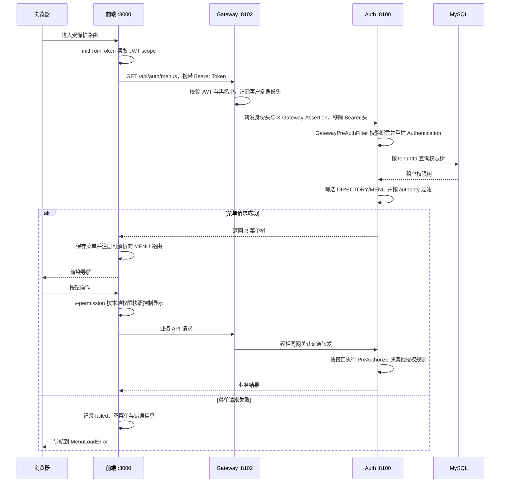

### 关键实现细节

**后端菜单筛选**

1. PermissionServiceImpl.getPermissionTree(tenantId) 显式按租户查询权限记录并按 sort 排序构树；MenuController 先递归保留 DIRECTORY、MENU 类型。
2. 功能权限来自 SecurityContext 中非 ROLE_ 前缀的 authority。没有认证信息或权限集合为空时，菜单结果为空。
3. DIRECTORY 先递归筛选 children，只有仍有可见子节点才保留；MENU 检查自身 permissionCode 是否精确存在于权限集合，并保留类型筛选后的 children。

**菜单状态与动态路由**

- loadMenus 合并并发请求；loaded 状态直接使用缓存。没有 tenant_id 时设为空菜单和 loaded；请求异常时设 menusLoaded=true、menuLoadState=failed，保留错误并重新抛出。
- 路由守卫在首次加载异常时转到 MenuLoadError。retryLoadMenus 重置加载标记、状态和错误后重新加载；不能把失败状态写成自动取得了全部菜单。
- registerDynamicRoutes 只为组件可解析的 MENU 注册路由，DIRECTORY 仅分组；以 srm:portal: 开头的门户项不在这条动态注册路径内。路由注册在 admin 下，路径把权限码的冒号替换为斜杠，名称替换为连字符，并保留 meta.permissionCode。
- 登出时重置权限 Store 并移除已登记的动态路由。

**按钮、令牌与服务端授权**

```vue
<el-button v-permission="'system:user:create'" type="primary">新增</el-button>
<el-button v-permission="'system:user:update'" size="small">编辑</el-button>
<el-button v-permission="'system:user:delete'" size="small" type="danger">删除</el-button>
```

- 指令在 mounted 和 updated 中检查非空绑定：无权限时设 display:none，否则清空 display。空绑定不会隐藏元素；隐藏按钮不构成服务端授权。
- decodeJwt 只解码、不验签；getPermissionsFromToken 原样返回 scope，没有把字符串拆为数组。密码 JWT 的 scope 数组与 SAS 的空格分隔字符串不能据此宣称已在该前端工具中统一。签名和失效校验由 Gateway 完成。
- Auth 的普通 API 通过 GatewayPreAuthFilter 从转发的角色、权限头构建 Authentication；这里不是再次校验转发的 Bearer JWT，也不是每次重查数据库刷新功能权限。
- 管理接口按当前 Controller 的 @PreAuthorize 等规则授权，例如用户创建的 system:user:create。公开登录/注册及 MyJobController 的任务归属校验属于各自明确的路径，不能概括为所有写接口都有同一种注解。

### 当前状态

- 菜单、路由、按钮和服务端授权分别依据上述源码行为；本文不把页面/按钮数量当作全仓库覆盖证明。
- 功能权限是已签发令牌中的快照，不能从重建 Authentication 推出角色修改后旧令牌立即获得新权限或立即失效。
- 权限编码采用 resource:action；具体接口、公开路径与归属规则以对应 Controller 和安全配置为准。

源码入口: [MenuController](../omni-backend/omni-auth/src/main/java/com/omni/auth/controller/MenuController.java), [PermissionServiceImpl](../omni-backend/omni-auth/src/main/java/com/omni/auth/service/impl/PermissionServiceImpl.java), [Gateway AuthFilter](../omni-backend/omni-gateway/src/main/java/com/omni/gateway/filter/AuthFilter.java), [Auth GatewayPreAuthFilter](../omni-backend/omni-auth/src/main/java/com/omni/auth/security/GatewayPreAuthFilter.java), [stores/permission.ts](../omni-frontend/src/stores/permission.ts), [router/index.ts](../omni-frontend/src/router/index.ts), [directives/permission.ts](../omni-frontend/src/directives/permission.ts), [utils/jwt.ts](../omni-frontend/src/utils/jwt.ts), [api/menu.ts](../omni-frontend/src/api/menu.ts), [UserController](../omni-backend/omni-auth/src/main/java/com/omni/auth/controller/UserController.java), [AuthController](../omni-backend/omni-auth/src/main/java/com/omni/auth/controller/AuthController.java), [MyJobController](../omni-backend/omni-base/src/main/java/com/omni/base/controller/MyJobController.java), [MenuControllerTest](../omni-backend/omni-auth/src/test/java/com/omni/auth/controller/MenuControllerTest.java)

## Flow 6: RBAC 数据权限 — 请求级行数据过滤

### 概述

本节追踪 Auth 的普通请求级数据范围。DataScopeResolveFilter 调用 DataScopeServiceImpl 校验当前租户内的启用用户和角色，并解析组织范围，写入 DataScopeContext；SQL 处理器按已注册表追加行条件。业务查询本身的租户条件和非数据库数据的服务层授权仍然必需，不能由“启用拦截器”替代。

**请求解析与角色合并**

1. 过滤器排在 Spring Security 之后；/internal/ 接口跳过普通请求上下文，由内部接口自己的显式参数和鉴权处理。没有 X-User-Id 时跳过设置上下文，这不等于跳过接口安全链。
2. 已识别请求的用户 ID 无法解析、租户头缺失或无法解析时直接返回 HTTP 400。解析服务验证 ID 为正数，并要求用户启用且属于目标租户；不满足该归属校验时为 403。上下文在 finally 中清除。
3. 普通 resolveDataScope(userId, tenantId) 合并本租户启用角色，优先级为 ALL(1)、TENANT(2)、DEPT_AND_BELOW(3)、DEPT(4)、CUSTOM(5)、SELF(6)，数值越小越宽；没有更宽范围时保留 SELF。
4. 带 permissionCode 的重载仅查询真正授予该完整权限码的启用角色，没有匹配授予时拒绝。它与普通请求的所有角色合并模式不同；返回 DTO 的 securityVersion 是解析结果指纹。

### 时序图

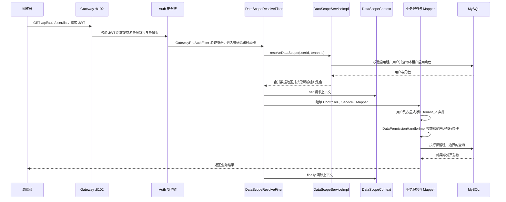

### DataScope 过滤条件对照表

| effectiveScope | sys_user 追加行条件 | 语义边界 |
| --- | --- | --- |
| `ALL` | 无额外行条件 | 不删除原有租户 WHERE；用户列表仍限制当前 tenantId |
| `TENANT` | 无额外行条件 | 租户限制由查询自身显式提供 |
| `DEPT` | `alias.primary_unit_id IN (...)` | 有效主组织的 ID 集合 |
| `DEPT_AND_BELOW` | `alias.primary_unit_id IN (...)` | 有效主组织与展开后的组织集合 |
| `CUSTOM` | `alias.primary_unit_id IN (...)` | CUSTOM 角色配置的同租户根与展开集合 |
| `SELF` | `alias.id = userId` | 当前用户 |

Auth 当前注册三张表的映射；alias 使用 SQL 别名，没有别名时使用表名。下表列出 SELF 和组织范围的差异，ALL/TENANT 均不追加额外行条件。

| 表 | SELF | DEPT / DEPT_AND_BELOW / CUSTOM |
| --- | --- | --- |
| `sys_user` | `id = userId` | `primary_unit_id IN (...)` |
| `sys_org_unit` | `id = primaryUnitId` | `id IN (...)` |
| `sys_role` | `id = -1` | 不追加组织行条件 |

等值所需 ID 缺失或 IN 集合为空时，已映射的对应规则生成 alias.id=-1。上下文为空、scope 为空/未知或表未注册时，该处理器不追加条件；不能把它描述为所有表、所有数据源均自动失败关闭。UserServiceImpl.listUsers 的 tenant_id 条件一直保留，包括 ALL。

### 组织单元后代查询

DEPT 使用当前租户内启用的主组织；DEPT_AND_BELOW 在该主组织上展开物化路径。CUSTOM 合并参与角色中 dataScope=CUSTOM 的配置根，并按同一 tenantId 查询根节点。

实际使用 SysOrgUnitMapper.selectDescendantIdsByTenantIdAndPath(tenantId, pathPrefix)，SQL 按租户、路径前缀和 status=1 筛选；不会按旧示例排除根节点。

```sql
SELECT id FROM sys_org_unit
WHERE tenant_id = #{tenantId}
  AND path LIKE CONCAT(#{pathPrefix}, '%')
  AND status = 1
```

resolveUnitTree 会补入根 ID；CUSTOM 根的 selectByIdAndTenantId 本身不附带启用状态过滤，不能据后代 SQL 推断所有 CUSTOM 根也经过 status=1 校验。

### 内存过滤模式（在线用户场景）

Redis 的 `online:{userId}` 值只有 `username|jti`，不能单靠全局键判断租户归属。`OnlineUserController` 保留 `system:online:list` / `system:online:kick` 功能权限；列表和踢出统一交给 `OnlineUserServiceImpl` 校验请求数据范围：

- `ALL` 保留跨租户能力；`TENANT` 仅允许当前租户。
- `SELF` 仅允许当前租户内的本人；`DEPT`、`DEPT_AND_BELOW`、`CUSTOM` 同时要求租户一致、目标 `primaryUnitId` 属于已解析的组织集合。空组织集合不放行。
- 列表通过用户表核对租户和主组织；非 `ALL` 的数据库查询显式包含租户条件，数据库未返回或范围外的 Redis 项被移除。
- 强制下线先加载并授权目标用户，再读取、删除在线键、把记录中的 `jti` 加入黑名单，并用目标用户的租户发布 `LOGOUT` 审计。现有黑名单默认期限为 24 小时。
- 缺失有效身份、租户或范围，或踢出目标不存在/不可见时，抛出业务错误码 `403`。拒绝踢出不会读写 Redis 或发布成功审计事件；Controller 中的该业务异常由 `AuthExceptionHandler` 转换为 `R.fail`。

```java
@GetMapping("/list")
@PreAuthorize("hasAuthority('system:online:list')")
public R<List<OnlineUserVO>> list() {
    return R.ok(onlineUserService.listOnlineUsers());
}
```

实现与回归边界：[OnlineUserServiceImpl](../omni-backend/omni-auth/src/main/java/com/omni/auth/service/impl/OnlineUserServiceImpl.java)、[OnlineUserServiceImplTest](../omni-backend/omni-auth/src/test/java/com/omni/auth/service/impl/OnlineUserServiceImplTest.java)。

### 配置注册顺序

MyBatisPlusConfig 的实际顺序为 DataPermissionInterceptor、OptimisticLockerInnerInterceptor、PaginationInnerInterceptor；Auth 的这段配置没有 TenantLine。数据权限先于分页，以使分页查询及 COUNT 使用对应行条件。其他业务服务使用各自的范围处理器和聚合归属规则。

```java
MybatisPlusInterceptor interceptor = new MybatisPlusInterceptor();
interceptor.addInnerInterceptor(new DataPermissionInterceptor(new DataPermissionHandlerImpl()));
interceptor.addInnerInterceptor(new OptimisticLockerInnerInterceptor());
interceptor.addInnerInterceptor(new PaginationInnerInterceptor(DbType.MYSQL));
```

### 当前状态

- SQL 映射、普通请求解析和按具体权限解析的入口分别如上；新增表或服务必须明确自己的租户及归属边界。
- 在线用户管理的列表和踢出服务校验保留前节已说明的行为，不由 SQL 拦截器替代 Redis 授权。
- 本文给出当前源码路径和回归入口；源码说明、单元测试与真实数据库或 HTTP/E2E 验收应按实际证据范围分别评价。

源码与回归入口: [DataScopeResolveFilter](../omni-backend/omni-auth/src/main/java/com/omni/auth/security/DataScopeResolveFilter.java), [DataScopeServiceImpl](../omni-backend/omni-auth/src/main/java/com/omni/auth/service/impl/DataScopeServiceImpl.java), [DataScopeContext](../omni-backend/omni-auth/src/main/java/com/omni/auth/security/DataScopeContext.java), [DataPermissionHandlerImpl](../omni-backend/omni-auth/src/main/java/com/omni/auth/security/DataPermissionHandlerImpl.java), [MyBatisPlusConfig](../omni-backend/omni-auth/src/main/java/com/omni/auth/config/MyBatisPlusConfig.java), [SysRoleMapper](../omni-backend/omni-auth/src/main/java/com/omni/auth/mapper/SysRoleMapper.java), [SysOrgUnitMapper](../omni-backend/omni-auth/src/main/java/com/omni/auth/mapper/SysOrgUnitMapper.java), [UserServiceImpl](../omni-backend/omni-auth/src/main/java/com/omni/auth/service/impl/UserServiceImpl.java), [DataScopeServiceImplTest](../omni-backend/omni-auth/src/test/java/com/omni/auth/service/impl/DataScopeServiceImplTest.java), [DataScopeResolveFilterTest](../omni-backend/omni-auth/src/test/java/com/omni/auth/security/DataScopeResolveFilterTest.java)

## Flow 7: 用户创建 — 三种途径

### 概述

三条创建路径分别是公开自助注册、受 `system:user:create` 保护的管理员创建，以及外部社交登录首次关联。它们都创建 `status=1` 的用户并尝试分配目标租户内已启用的 `USER` 角色；角色的数据范围来自角色记录，正式种子中的租户 1 `USER` 为 `SELF`。三个构造路径都不设置 `primaryUnitId`。默认角色缺失时记录警告并跳过，不能据此保证每个新用户已获得角色。

### 时序图

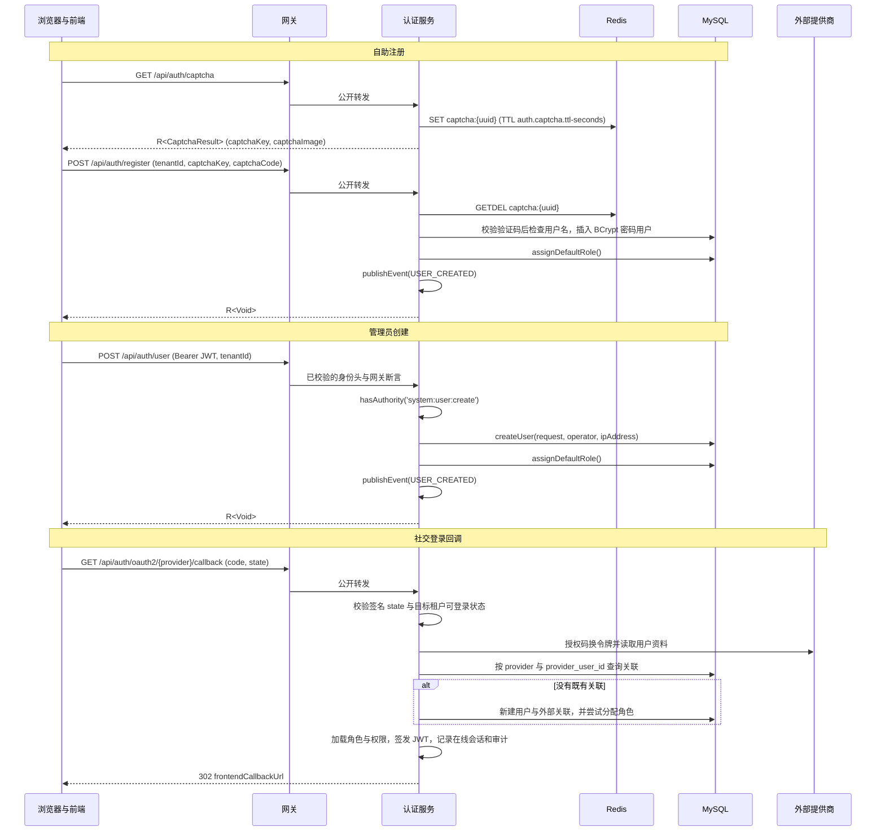

### 三种途径对比

| 维度 | 自助注册 | 管理员创建 | 社交登录自动创建 |
| --- | --- | --- | --- |
| 入口与权限 | `POST /api/auth/register`，公开端点 | `POST /api/auth/user`，`system:user:create` | `GET /api/auth/oauth2/{provider}/callback`，校验回调参数与 state |
| 租户来源 | 请求体 `tenantId`；注册页面提供租户选择 | 请求体 `tenantId`，由管理员指定 | 新建用户使用签名 state 中的租户；关联查询按提供商与外部用户 ID |
| 验证码 | `captchaKey` + `captchaCode`；原子 `GETDEL`，匹配失败也消耗 | 不要求 | 不要求本地验证码；需提供商授权码与用户资料 |
| 密码与用户名校验 | `RegisterRequest`：用户名 3–32、密码 6–64 字符 | `CreateUserRequest`：用户名非空，无 `@Size`；密码至少 6 字符 | 密码为 `null`；`gh_` / `go_` / `ge_` + 外部用户名 |
| 重名与失败 | 租户内预查询重名抛业务码 400 | 租户内预查询重名抛业务码 400 | 首次插入触发 `DuplicateKeyException` 后重试一次 `{prefix}{login}_{providerUserId}`；第二次失败继续抛出 |
| 默认角色实现 | 调用私有 `UserServiceImpl.assignDefaultRole()` | 同自助注册 | `createNewUser()` 内独立查询、插入；捕获角色分配异常并警告 |
| 角色写异常 | 角色缺失仅警告；查询或关联插入异常继续抛出 | 同自助注册，不能笼统称所有失败均不阻塞 | 角色分配代码块捕获异常；其他创建、回调异常仍按各自路径处理 |
| 成功后的行为 | 返回 `R<Void>`；页面保存所选租户并进入登录页 | 返回 `R<Void>`；页面关闭创建弹窗并刷新列表 | 返回前端配置的回调地址，fragment 含编码后的 `token` 与 `username` |

### 关键组件

| 源码入口 | 职责 |
| --- | --- |
| [AuthController.java](../omni-backend/omni-auth/src/main/java/com/omni/auth/controller/AuthController.java) / [CaptchaResult.java](../omni-backend/omni-auth/src/main/java/com/omni/auth/dto/CaptchaResult.java) / [RegisterRequest.java](../omni-backend/omni-auth/src/main/java/com/omni/auth/dto/RegisterRequest.java) / [CaptchaServiceImpl.java](../omni-backend/omni-auth/src/main/java/com/omni/auth/service/impl/CaptchaServiceImpl.java) | 公开注册与验证码 DTO |
| [UserController.java](../omni-backend/omni-auth/src/main/java/com/omni/auth/controller/UserController.java) / [CreateUserRequest.java](../omni-backend/omni-auth/src/main/java/com/omni/auth/dto/CreateUserRequest.java) / [UserServiceImpl.java](../omni-backend/omni-auth/src/main/java/com/omni/auth/service/impl/UserServiceImpl.java) | 管理员创建与私有默认角色方法 |
| [SocialLoginController.java](../omni-backend/omni-auth/src/main/java/com/omni/auth/controller/SocialLoginController.java) / [SocialLoginServiceImpl.java](../omni-backend/omni-auth/src/main/java/com/omni/auth/service/impl/SocialLoginServiceImpl.java) / [SysUserOauthProviderMapper.java](../omni-backend/omni-auth/src/main/java/com/omni/auth/mapper/SysUserOauthProviderMapper.java) | 社交回调、关联与独立角色分配 |
| [SysRoleMapper.java](../omni-backend/omni-auth/src/main/java/com/omni/auth/mapper/SysRoleMapper.java) / [auth.sql](../scripts/sql/seed/auth.sql) | 已启用角色查询与正式角色种子 |
| [index.vue](../omni-frontend/src/views/register/index.vue) / [auth.ts](../omni-frontend/src/api/auth.ts) | 注册表单与提交后的页面状态 |

### 当前状态

- 验证码返回字段为 `captchaKey` 与 `captchaImage`。TTL 由 `auth.captcha.ttl-seconds` 控制，默认 300 秒；校验不区分大小写，键不存在、过期或已消耗均拒绝。注册页面在提交结束后重新加载验证码。
- 三个创建入口都发布 `USER_CREATED` 审计事件。社交回调还检查用户启用状态、加载权限、签发 JWT，并尝试记录在线会话；已有外部关联走加载用户路径，关联查询本身不含租户条件。
- 这里记录源码行为及失败边界。真实注册、默认角色检查和社交授权操作见认证指南；源码路径和单元测试不能替代外部提供商的真实正向回调。

[认证指南](guides/authentication.md)

---

## Flow 8: XSS 防护 — 请求净化与配置管理

<a id="8a-xss-请求净化每次请求自动执行"></a>

### 8A. XSS 请求净化（按请求条件自动启用）

XSS 请求净化的自动装配限于 Servlet Web 环境，并要求存在 `XssConfigProvider`。过滤器注册到 `/*`，但只有 `X-Tenant-Id` 可解析、配置已启用且规则非空时才包装请求并设置线程规则。缺失或空租户头、无法解析的租户头、空设置、关闭状态或空规则都会继续原请求；身份与权限校验由各自安全链承担。

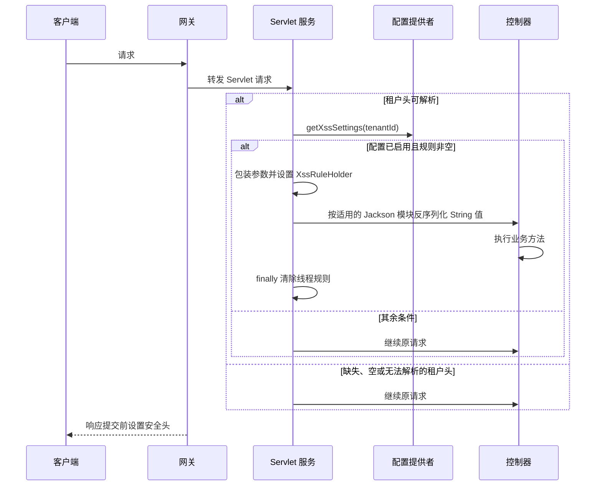

| ruleType | 当前处理方式 | 配置与示例 |
| --- | --- | --- |
| `HTML_TAG` | 按 `\|` 分隔的标签名做字面量匹配；删除匹配的成对标签及其内容，并删除匹配的单个开始或自闭合标签 | 配置 `script` 时，`<script>alert(1)</script>` → 空字符串 |
| `EVENT_HANDLER` | 以配置的正则匹配属性名，再匹配带引号或无引号的属性值并删除 | 配置 `on[a-zA-Z]+` 时删除 `onclick="..."` |
| `DANGEROUS_PROTOCOL` | 对 `\|` 分隔的配置值做不区分大小写的字面量替换 | 配置 `javascript:` 时删除该协议字符串 |
| `CUSTOM_PATTERN` | 按配置正则匹配并替换为空字符串 | 仅删除实际匹配部分 |

参数包装器只覆盖 `getParameter()` / `getParameterValues()`；JSON 路径依靠 Jackson 的 String 反序列化器，Jackson 2 与 Spring Boot 4 默认使用的 Jackson 3 分别注册模块。请求头、JSON 字段名、原始输入流及未覆盖的参数访问方法不由这两个入口统一处理。规则依次应用，未知类型原样返回，运行期正则语法错误记录警告后继续其他规则。Gateway 安全响应头属于响应侧措施，`Referrer-Policy` 的实际值为 `strict-origin-when-cross-origin`。

### 8B. XSS 配置管理（管理员操作）

| 方法（基础路径 `/api/auth/xss-config`） | 权限 | 行为 |
| --- | --- | --- |
| `GET /settings` | `system:xssconfig:list` | 管理端读取开关与全部规则；配置不存在时创建默认关闭记录 |
| `PUT /toggle?enabled=true` | `system:xssconfig:update` | 开关写入；`enabled` 是必填查询参数 |
| `GET /rules/list?page=1&size=10` | `system:xssconfig:list` | 分页读取当前租户规则 |
| `POST /rules` | `system:xssconfig:create` | 创建规则，初始化 `enabled=1` |
| `PUT /rules/{id}` | `system:xssconfig:update` | 只更新非 null 字段，先检查规则所属租户 |
| `DELETE /rules/{id}` | `system:xssconfig:delete` | 检查所属租户后删除 |
| `PUT /rules/{id}/toggle?enabled=false` | `system:xssconfig:update` | 检查所属租户后切换状态；`enabled` 为查询参数 |

Controller 将网关注入的 `X-Tenant-Id` 显式传给规则更新、删除和开关服务方法。服务先要求正租户 ID，再检查规则存在且 `rule.tenantId` 匹配；不匹配与不存在均抛业务码 404，由 `AuthExceptionHandler` 返回 HTTP 200 + `R.code=404`，发生数据库写入和缓存删除之前即停止。三处既有 `@PreAuthorize` 权限码保持生效。

创建 DTO 只要求 `ruleName`、`ruleType`、`pattern` 非空；服务对 pattern 执行 `Pattern.compile()`。更新只在提交 pattern 时重新校验。这里没有 ruleType 枚举校验，未知运行类型会被净化器跳过。运行时权威读取只返回 `enabled=1` 的规则，按 `sort_order` 升序。

Auth 的 provider 需要两个 Redis 值同时命中；规则 JSON 解析失败或任一键缺失时调用 `getAuthoritativeSettings()` 回源并缓存 30 分钟。权威读取在配置不存在或关闭时返回 `enabled=false`、空规则，不创建记录；它与管理端 `getSettings()` 的行为不同。

共享 Servlet Starter 的 provider 在缓存异常后尝试 Auth 权威接口；回源异常或无有效结果时返回本地安全基线：标签、事件属性与危险协议三类规则。权威返回的显式关闭状态仍被保留。Auth 自身 provider 的 Redis 读异常直接向上传播，不能把共享 Starter 的降级策略套用到所有实现。

每个写方法同步删除 `xss:enabled:{tenantId}` 与 `xss:rules:{tenantId}`；删除发生在写方法事务内，缓存失效与数据库提交分别执行。UI 操作与恢复见安全审计指南。

[安全审计指南](guides/system-security-audit.md)

### 关键组件

| 源码入口 | 职责 |
| --- | --- |
| [XssAutoConfiguration.java](../omni-backend/omni-common/src/main/java/com/omni/common/security/xss/XssAutoConfiguration.java) / [XssFilter.java](../omni-backend/omni-common/src/main/java/com/omni/common/security/xss/XssFilter.java) / [XssRuleHolder.java](../omni-backend/omni-common/src/main/java/com/omni/common/security/xss/XssRuleHolder.java) | Servlet 条件装配与请求规则生命周期 |
| [XssHttpServletRequestWrapper.java](../omni-backend/omni-common/src/main/java/com/omni/common/security/xss/XssHttpServletRequestWrapper.java) / [XssStringDeserializer.java](../omni-backend/omni-common/src/main/java/com/omni/common/security/xss/XssStringDeserializer.java) / [XssStringDeserializer3.java](../omni-backend/omni-common/src/main/java/com/omni/common/security/xss/XssStringDeserializer3.java) | 参数包装与 Jackson 2/3 String 净化 |
| [XssSanitizer.java](../omni-backend/omni-common/src/main/java/com/omni/common/security/xss/XssSanitizer.java) / [SecurityHeadersFilter.java](../omni-backend/omni-gateway/src/main/java/com/omni/gateway/config/SecurityHeadersFilter.java) | 规则应用与响应头，边界不同 |
| [XssConfigController.java](../omni-backend/omni-auth/src/main/java/com/omni/auth/controller/XssConfigController.java) / [XssConfigServiceImpl.java](../omni-backend/omni-auth/src/main/java/com/omni/auth/service/impl/XssConfigServiceImpl.java) / [XssConfigProviderImpl.java](../omni-backend/omni-auth/src/main/java/com/omni/auth/security/XssConfigProviderImpl.java) / [InternalXssController.java](../omni-backend/omni-auth/src/main/java/com/omni/auth/controller/internal/InternalXssController.java) | Auth 权威设置、管理写入与缓存 |
| [ServiceXssAutoConfiguration.java](../omni-backend/omni-common-service/src/main/java/com/omni/common/service/config/ServiceXssAutoConfiguration.java) / [CachedServiceXssConfigProvider.java](../omni-backend/omni-common-service/src/main/java/com/omni/common/service/xss/CachedServiceXssConfigProvider.java) / [DefaultXssSettingsFallback.java](../omni-backend/omni-common-service/src/main/java/com/omni/common/service/xss/DefaultXssSettingsFallback.java) / [AuthXssSettingsResolver.java](../omni-backend/omni-common-service/src/main/java/com/omni/common/service/client/AuthXssSettingsResolver.java) | 共享 Starter 缓存、回源与安全基线 |
| [XssRuleTenantBoundaryTest.java](../omni-backend/omni-auth/src/test/java/com/omni/auth/controller/XssRuleTenantBoundaryTest.java) / [XssJsonDeserializationTest.java](../omni-backend/omni-common/src/test/java/com/omni/common/security/xss/XssJsonDeserializationTest.java) / [XssHttpJsonIntegrationTest.java](../omni-backend/omni-common/src/test/java/com/omni/common/security/xss/XssHttpJsonIntegrationTest.java) | 三种规则写操作的跨租户、缺失与同租户回归入口 |

### 当前状态

- 源码覆盖 Servlet 参数、两套 JSON 反序列化模块、规则管理与安全响应头；实际净化取决于请求头、开关、有效规则及所使用的读取入口。
- 租户隔离由显式租户查询和规则归属校验落实，不能由 Auth 的通用 DataScope 拦截器替代；后者仅映射用户、组织和角色表。
- 测试入口区分 MockMvc/内存替身、JSON/HTTP 集成及真实部署验证；界面截图或一次构建通过不能证明所有输入与并发场景。

---

## Flow 9: 数据字典管理 — 类型+数据两级结构 CRUD

### 概述

Base 服务以 `sys_dict_type` 与 `sys_dict_data` 保存租户字典。类型编码在租户内唯一；数据通过 `typeCode` 关联类型。管理分页与已登录用户的轻量选项是两条读取路径：前者直接查库，后者缓存已启用的数据行。

### 时序图

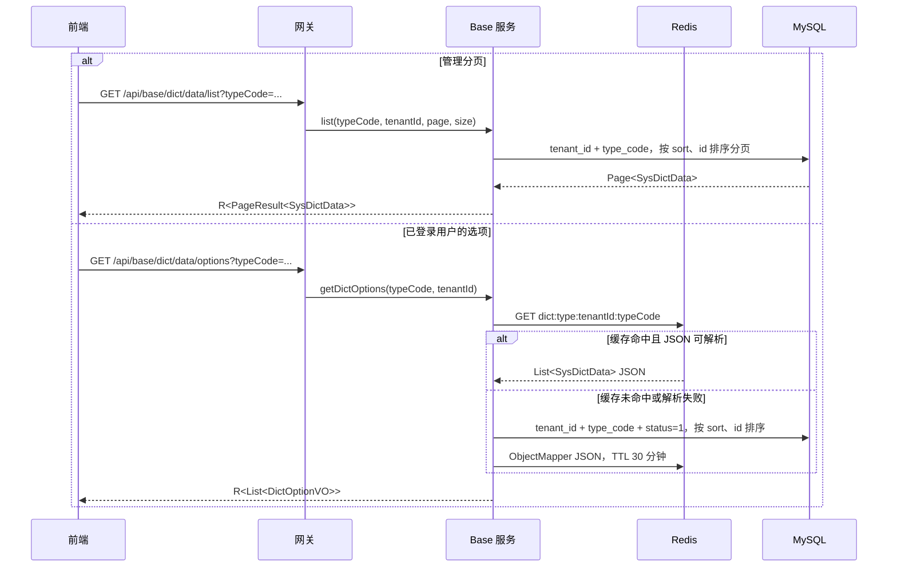

`GET /api/base/dict/data/list` 要求 `dict:data:list` 并返回 `R<PageResult<SysDictData>>`。`GET /api/base/dict/data/options` 由普通认证链保护，不要求单独的 `dict:data:*` 权限，返回仅含 `value`、`label` 的 `R<List<DictOptionVO>>`。

类型的按 ID 查询、更新、删除、状态切换，以及数据的更新、删除，都将网关注入的租户显式传到服务。服务先检查正租户 ID 与实体所属租户；资源不存在或属于其他租户均以业务码 404 拒绝，写入、级联删除及缓存失效均在此检查之后。

### 关键组件

| 源码 | 职责 |
| --- | --- |
| [DictTypeController.java](../omni-backend/omni-base/src/main/java/com/omni/base/controller/DictTypeController.java) / [DictTypeServiceImpl.java](../omni-backend/omni-base/src/main/java/com/omni/base/service/impl/DictTypeServiceImpl.java) / [CreateDictTypeRequest.java](../omni-backend/omni-base/src/main/java/com/omni/base/dto/CreateDictTypeRequest.java) / [UpdateDictTypeRequest.java](../omni-backend/omni-base/src/main/java/com/omni/base/dto/UpdateDictTypeRequest.java) | 类型查询、创建与 ID 资源归属校验 |
| [DictDataController.java](../omni-backend/omni-base/src/main/java/com/omni/base/controller/DictDataController.java) / [DictDataServiceImpl.java](../omni-backend/omni-base/src/main/java/com/omni/base/service/impl/DictDataServiceImpl.java) / [CreateDictDataRequest.java](../omni-backend/omni-base/src/main/java/com/omni/base/dto/CreateDictDataRequest.java) / [UpdateDictDataRequest.java](../omni-backend/omni-base/src/main/java/com/omni/base/dto/UpdateDictDataRequest.java) / [DictOptionVO.java](../omni-backend/omni-base/src/main/java/com/omni/base/dto/DictOptionVO.java) | 管理分页、选项缓存与数据归属校验 |
| [GatewayPreAuthFilter.java](../omni-backend/omni-base/src/main/java/com/omni/base/security/GatewayPreAuthFilter.java) / [SecurityConfig.java](../omni-backend/omni-base/src/main/java/com/omni/base/config/SecurityConfig.java) / [MybatisPlusAutoConfiguration.java](../omni-backend/omni-common-mybatis/src/main/java/com/omni/common/mybatis/config/MybatisPlusAutoConfiguration.java) | 网关身份断言、方法权限与 Base 的独立基础配置 |
| [dict.ts](../omni-frontend/src/api/dict.ts) / [useDictOptions.ts](../omni-frontend/src/composables/useDictOptions.ts) / [index.vue](../omni-frontend/src/views/base/dict/index.vue) / [index.vue](../omni-frontend/src/views/srm/supplier/index.vue) | 前端类型化 API、租户缓存和字典/供应商消费者 |
| [0001-base-schema.yaml](../database/changelog/base/0001-base-schema.yaml) / [base.sql](../scripts/sql/seed/base.sql) / [auth.sql](../scripts/sql/seed/auth.sql) | 当前结构、正式权限与基础种子 |
| [DictTenantBoundaryTest.java](../omni-backend/omni-base/src/test/java/com/omni/base/controller/DictTenantBoundaryTest.java) / [DictOperLogTenantBoundaryTest.java](../omni-backend/omni-base/src/test/java/com/omni/base/controller/DictOperLogTenantBoundaryTest.java) / [dict-options.test.ts](../omni-frontend/tests/base/dict-options.test.ts) | 字典 ID、日志快照及客户端上下文的隔离回归入口 |

### 缓存策略

| 项目 | 当前行为 |
| --- | --- |
| 键 | `dict:type:{tenantId}:{typeCode}` |
| 存储 | `StringRedisTemplate` 存取字符串；`ObjectMapper` 编解码 `List<SysDictData>` JSON |
| TTL | 成功回填后 30 分钟 |

选项缓存回源只筛选数据行 `status=1`，不会额外检查父类型的启用状态。缓存 JSON 解析异常回源查库；JSON 序列化异常只警告，Redis 读写运行期异常继续向上传播。

类型更新、删除和状态切换，以及数据创建、更新、删除会删除对应键。类型创建没有选项缓存失效调用。手动刷新按租户和类型先删除旧键，再查询启用数据并回填；刷新后前端模块缓存仍需按其自身生命周期处理。

`deleteType()` 在一个声明为 `@Transactional` 的服务方法中校验类型、删除当前租户同类型数据、删除类型并失效缓存。其他字典写方法没有该事务注解，不能笼统称全部 CRUD 原子提交。

### 权限树

正式权限种子定义 `base` 目录、`base:dict` 菜单及 9 个动作权限，并在租户 1 分配给 `SUPER_ADMIN`（role_id=1）。类型 6 个端点、数据 6 个端点合计 12 个；其中 `/options` 仅要求认证。逐端点权限映射以 API 契约第 12 节为准。

[API](api-contract.md)

### 当前状态

- 创建类型要求非空 `typeCode/typeName`，先按租户检查类型编码重名；更新 DTO 不提供类型编码变更。创建数据检查当前租户的父类型存在，数据更新不提供 `typeCode` 变更。
- 正式 `base.sql` 为租户 1 定义 3 个类型和 7 条数据；具体运行数据、其他租户及模块扩展以各自迁移和初始化结果为准。
- Base 自身 XSS provider 仍只读 Redis，键缺失或 JSON 解析失败时返回关闭设置；它与共享 Servlet Starter 的 Auth 回源/基线策略不同。前端缓存、身份切换和退出行为见前端规范第 14 节。

[useDictOptions](frontend-patterns.md)

---

## Flow 10: 操作日志 — AOP 采集 + RocketMQ 异步写入 + 热冷归档

### 概述

只有标注 `@OperLog` 且满足 Servlet/AspectJ 等装配条件的方法进入操作日志切面，范围包含查询与写操作。切面采集上下文、可选快照与差异，再调用生产者。生产者在当前线程调用 Outbox 写入或 `StreamBridge.send()`；中继投递和 Base 消费属于后续异步阶段。

<a id="10a-操作日志记录流程每次写操作触发"></a>

### 10A. 操作日志记录流程（标注方法触发）

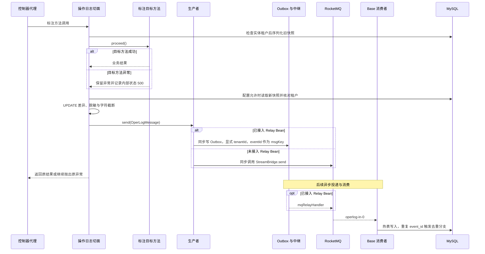

UPDATE/DELETE 的旧快照、UPDATE 的新快照和 CREATE 的返回实体快照都受 `recordSnapshot/entityClass/idExpr` 条件控制。具有 `tenantId` 属性的实体必须匹配请求租户才会被序列化；没有该属性的全局实体保留原快照行为。

参数、快照和异常信息在发送前经 `OperLogSanitizer` 清洗，`excludeFields` 可追加排除字段；长字符串按 4000 字符截断。UPDATE 在新旧 JSON 均存在时提取变更字段，无变化返回空差异。

目标异常原样抛出，日志内部 `response_status` 记为 500，不能当作后续 HTTP 或 `R.code`。后处理与生产者发送异常只记录警告；操作前 Mapper 快照读取位于业务调用之前，当前代码不能保证所有采集故障均不影响目标方法。

只有未提供 `ReliableMessageRelay` Bean 时才走直发分支；已接入 Outbox 后的发送异常不会再切换到直发。Controller 切面发送日志与业务服务事务的关系取决于实际调用边界，不能由“Outbox”名称推导两者始终同一事务。

<a id="10b-操作日志归档流程xxl-job-系统任务默认每日-0200"></a>

### 10B. 操作日志归档流程（任务元数据默认每日 02:00）

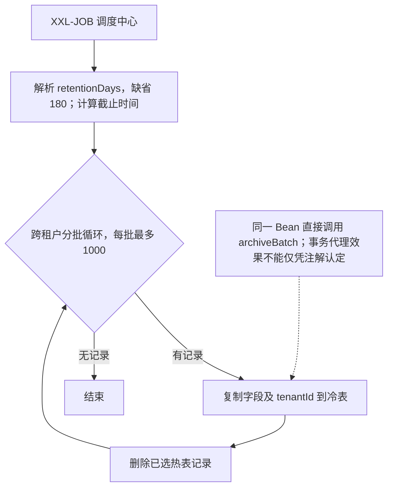

任务同时声明 `@XxlJob("operLogArchiveHandler")` 与 `@SystemJobMeta`，默认 cron 为 `0 0 2 * * ?`，批量大小 1000。实际执行依赖任务中心的注册、配置与启用状态。

保留天数读取 JSON 数值 `retentionDays`；未提供或解析失败用 180。元数据中的 min/max 不等于该解析方法会执行范围校验。查询不按租户筛选，复制时保留每条记录的 `tenantId`。

当前实现没有 `AtomicBoolean` 防重入；入口经同一 Bean 内部调用 `archiveBatch()`，虽有 `@Transactional` 注解，不能宣称此入口已证明原子复制与删除。批次异常记录错误后停止循环，入口仍可输出完成日志；该日志不证明全部归档成功。

### 关键组件

| 源码 | 职责 |
| --- | --- |
| [OperLog.java](../omni-backend/omni-common-core/src/main/java/com/omni/common/core/operlog/OperLog.java) / [OperType.java](../omni-backend/omni-common-core/src/main/java/com/omni/common/core/operlog/OperType.java) / [OperLogMessage.java](../omni-backend/omni-common-core/src/main/java/com/omni/common/core/operlog/OperLogMessage.java) | 注解选项、操作类型与消息结构 |
| [OperLogAutoConfiguration.java](../omni-backend/omni-common-operlog/src/main/java/com/omni/common/operlog/config/OperLogAutoConfiguration.java) / [OperLogAspect.java](../omni-backend/omni-common-operlog/src/main/java/com/omni/common/operlog/aspect/OperLogAspect.java) / [EntityDiffer.java](../omni-backend/omni-common-operlog/src/main/java/com/omni/common/operlog/diff/EntityDiffer.java) / [OperLogSanitizer.java](../omni-backend/omni-common-operlog/src/main/java/com/omni/common/operlog/sanitize/OperLogSanitizer.java) | 装配条件、快照租户检查、差异与脱敏 |
| [OperLogProducer.java](../omni-backend/omni-common-operlog/src/main/java/com/omni/common/operlog/producer/OperLogProducer.java) / [ReliableMessageRelay.java](../omni-backend/omni-common-core/src/main/java/com/omni/common/core/mq/ReliableMessageRelay.java) | 同步发送入口与显式租户 Outbox 契约 |
| [OperLogConsumer.java](../omni-backend/omni-base/src/main/java/com/omni/base/consumer/OperLogConsumer.java) / [OperLogServiceImpl.java](../omni-backend/omni-base/src/main/java/com/omni/base/service/impl/OperLogServiceImpl.java) / [OperLogController.java](../omni-backend/omni-base/src/main/java/com/omni/base/controller/OperLogController.java) | 热表消费、重复事件处理及租户查询 |
| [OperLogArchiver.java](../omni-backend/omni-base/src/main/java/com/omni/base/service/OperLogArchiver.java) / [0001-base-schema.yaml](../database/changelog/base/0001-base-schema.yaml) | 系统任务、热冷表结构与迁移边界 |
| [AuditEventListener.java](../omni-backend/omni-auth/src/main/java/com/omni/auth/event/AuditEventListener.java) / [AuditLogServiceImpl.java](../omni-backend/omni-auth/src/main/java/com/omni/auth/service/impl/AuditLogServiceImpl.java) / [pom.xml](../omni-backend/omni-auth/pom.xml) | Auth 的安全审计事件监听与独立写入路径 |

### 审计追踪维度

| 维度 | 字段 | 含义 |
| --- | --- | --- |
| 操作人 | `oper_username` | 当前认证名称 |
| 时间 | `oper_time` | 切面构建消息时的本地时间 |
| 动作 | `module/oper_type/request_url` | 注解类型及请求入口 |
| 变化 | `old_value/new_value` | 可选且脱敏后的快照或差异 |
| 来源 | `ip_address/user_agent` | 请求上下文 |
| 耗时 | `execution_time` | 从切面开始到进入 finally，包含前置采集，未包含后处理发送 |
| 结果 | `response_status/error_msg` | 目标方法内部成功/异常标记，独立于最终 HTTP 映射 |

### 与审计日志的互补关系

| 记录 | 存储 | 拥有者与采集路径 |
| --- | --- | --- |
| 操作日志 | `sys_oper_log/sys_oper_log_archive` | common-operlog 切面/生产者，Base 消费与归档 |
| 安全审计 | `sys_audit_log` | Auth：ApplicationEventPublisher → AuditEventListener → AuditLogService |
| 登录记录 | `sys_audit_log` 登录事件的只读投影 | Auth 的 LOGIN_SUCCESS / LOGIN_FAILED 查询 |

安全审计监听器通过 `@Async("auditExecutor")` 写库并捕获异常；它不是上述 RocketMQ 消费链。Auth 不引入 common-operlog，登录记录也没有独立 `sys_login_log` 表。

### 当前状态

- Base 的日志列表以显式 `tenant_id` 条件查询热表并要求 `base:operlog:list`；当前接口不把冷表合并到分页列表。
- 新消息由切面生成 `eventId`；旧消息没有该字段时服务生成稳定的 legacy 标识。热表与冷表各自有 `event_id` 唯一键；消费者捕获重复键异常，其他消费异常重新抛出交给中间件处理。
- 针对性回归分别覆盖实际字典 Controller/Service 与实际切面的租户泄露场景；源码和单元回归不能替代真实 MQ、数据库归档事务及调度并发验证。

[MQ](mq-reliability.md) / [XXL-JOB](scheduling.md) / [源码与约束](guides/system-security-audit.md)

---

## Flow 11: 用户任务创建 — 工作台自助创建到 XXL-JOB 直注册

### 概述

工作台通过 `/api/base/my-job` 管理当前用户的个人任务。创建读取全局启用类型，服务先插入本地任务，再向 XXL-JOB 注册共享 handler 并回填 ID；调度受理与真实执行是两个阶段。

### 时序图

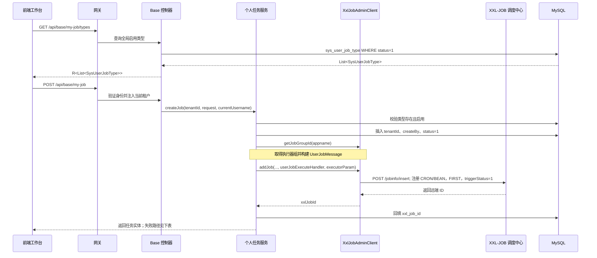

### 错误处理

| 触发条件 | 当前处理 |
| --- | --- |
| jobName/jobType/cronExpression 为空 | 创建 DTO 的 `@NotBlank` 校验；它不等于完整 Cron/参数 Schema 校验 |
| 类型不存在或已禁用 | 插入前抛业务码 400；目录启用不证明处理器已部署 |
| 获取执行器组失败 | 删除刚插入的本地行并抛业务码 500 |
| 注册或 ID 回填失败 | 按精确远端 ID 或执行器组+handler+executorParam 清理；确认无残留后才删除本地行，结果未知则保留恢复关联并报错 |
| 执行参数构建失败 | 当前调用位于插入之后、注册补偿 try 之外；该位置没有自动清理分支，不能概括为任意失败均已原子回滚 |

### 关键组件

| 源码 | 职责 |
| --- | --- |
| [MyJobController.java](../omni-backend/omni-base/src/main/java/com/omni/base/controller/MyJobController.java) / [CreateUserJobRequest.java](../omni-backend/omni-base/src/main/java/com/omni/base/dto/CreateUserJobRequest.java) / [UpdateUserJobRequest.java](../omni-backend/omni-base/src/main/java/com/omni/base/dto/UpdateUserJobRequest.java) / [UserJobServiceImpl.java](../omni-backend/omni-base/src/main/java/com/omni/base/service/impl/UserJobServiceImpl.java) / [UserJobTypeServiceImpl.java](../omni-backend/omni-base/src/main/java/com/omni/base/service/impl/UserJobTypeServiceImpl.java) | 已登录入口、DTO 校验、类型选择与逐行归属 |
| [index.vue](../omni-frontend/src/views/home/index.vue) / [myJob.ts](../omni-frontend/src/api/myJob.ts) | 工作台任务 API 与表单提交 |
| [CronGenerator.vue](../omni-frontend/src/components/CronGenerator.vue) / [DynamicFormRenderer.vue](../omni-frontend/src/components/DynamicFormRenderer.vue) / [schema.ts](../omni-frontend/src/types/schema.ts) | 7 种 Cron 频率及标准/兼容 Schema 的动态字段 |
| [XxlJobAdminClient.java](../omni-backend/omni-common-job/src/main/java/com/omni/common/job/XxlJobAdminClient.java) / [XxlJobProperties.java](../omni-backend/omni-common-job/src/main/java/com/omni/common/job/XxlJobProperties.java) / [XxlJobAutoConfiguration.java](../omni-backend/omni-common-job/src/main/java/com/omni/common/job/config/XxlJobAutoConfiguration.java) | 执行器配置、注册请求与远端查找/补偿 |
| [0001-base-schema.yaml](../database/changelog/base/0001-base-schema.yaml) / [base.sql](../scripts/sql/seed/base.sql) / [UserJobSeedSyncRunner.java](../omni-backend/omni-base/src/main/java/com/omni/base/job/UserJobSeedSyncRunner.java) | 正式任务结构、种子与启动同步入口 |

### 所有权模型

`MyJobController` 不使用 `@PreAuthorize` 代替逐行授权。列表和统计固定当前租户与 `createBy`；创建从可信请求头与认证上下文取得租户、创建人。

更新、删除、启停、手动触发和日志查询调用 `verifyOwnership(id, tenantId, username)`，要求实体 `tenantId` 与 `createBy` 同时匹配。任务不存在为业务码 404；外租户或其他创建人为业务码 403，同名用户名不能跨租户操作。

日志入口先验证父任务归属，再固定 `jobId` 查询。当前 `UserJobLogServiceImpl` 未把 `tenantId` 入参追加到 SQL；该入口的归属检查不能描述成该服务已有独立的 SQL 租户过滤。

### 当前状态

- 所有个人任务均注册为 `userJobExecuteHandler`，`jobType` 对应处理器 Bean 名。类型目录为全局 `sys_user_job_type`，不是按租户复制的字典。
- 已关联 XXL ID 时，Cron/参数更新、启停及删除先调用远端，再提交本地。只改名称不更新调度中心描述；受理响应丢失或清理未知时保留本地关联，先核对外部副作用。
- 启动同步扫描启用且没有 XXL ID 的本地行，不只区分正式种子。它不能代替未知注册结果对账，也不能作为盲目重启、再次创建的依据。

[XXL-JOB](scheduling.md) / [Wiki](guides/scheduling.md)

---

## Flow 12: 用户任务执行 — XXL-JOB 触发到前端通知

### 概述

XXL-JOB 向共享执行入口传递 `UserJobMessage` JSON，再按 `jobType` 路由到 `UserJobHandler`。处理器结果、日志落库、最后执行时间和前端通知分别有自己的失败边界；触发返回不证明这些步骤全部完成。

### 时序图

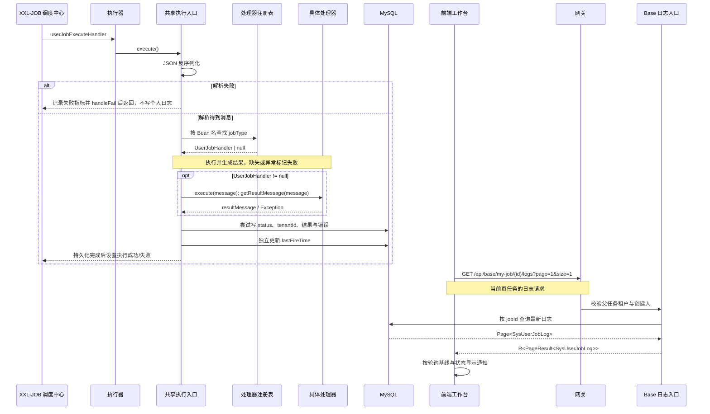

### 前端轮询机制

| 路径 | 周期/条件 | 范围 | 通知与退出 |
| --- | --- | --- | --- |
| 手动触发等待 | 每 2 秒，最多 15 次 | 被手动触发的任务 | 发现大于触发前基线的新日志后通知并停止；超时停止 |
| 页面进入检查 | 挂载后检查最近 2 分钟 | 当前列表页的各任务最新日志 | 要求 fireTime 与 resultMessage；没有持久化的已读记录 |
| 周期轮询 | 每 10 秒 | 当前筛选/分页 tableData 中 status=1 的任务 | 首次建立基线不通知；之后发现更大 ID 才通知并刷新列表/统计 |

请求经 Gateway/Base API，浏览器不直接访问 MySQL。全局轮询的“全局”只指该页面定时器，不代表扫描所有任务或分页外记录；未检测到可通知的新日志时不会每次刷新列表与统计。

三条通知路径没有统一的持久化去重状态，不能承诺所有通知只出现一次。页面卸载清除定时器与 ID 基线；重新进入可再次显示最近日志，关闭页面后也不会继续该轮询。

`ElNotification` 按成功/失败选择结果或错误文本，持续 3000 毫秒。下次执行时间由客户端 `cron-parser` 计算，仅供页面显示，不能证明调度中心实际下一次触发。

### 执行参数 JSON 格式

| 字段 | 用途 |
| --- | --- |
| `jobId` | 定位本地任务与日志归属 |
| `tenantId` | 显式传给处理器并写日志 |
| `jobType` | 匹配 UserJobHandler Bean 名 |
| `jobName` | 注册时的名称快照与通知标题 |
| `jobParams` | JSON 字符串，可为空；具体校验由处理器负责 |

通用入口没有统一校验合法 JSON 的全部字段，也没有在执行前重新读取任务并验证实时归属；它将消息上下文显式传入处理器，不建立 HTTP 租户 ThreadLocal。任务扩展必须验证参数和业务边界。

成功结果文本最多 500 字符，捕获的执行异常文本最多 2000 字符。`execute_time_ms` 在反序列化之后开始，包含处理器查找、执行与结果生成，不包含日志插入和最后时间更新。

内置 `DrinkWaterRemindHandler` 读取 `cupShape`，缺失或解析失败采用源码中的 `中杯`；提醒与兜底文本为中文，不随前端语言自动翻译。

### 错误处理

| 情况 | 当前结果 |
| --- | --- |
| JSON 反序列化失败 | 记录 failure 指标、调用 handleFail 并提前返回；没有该次个人日志或 lastFireTime 更新 |
| 处理器未找到 | status=0 并尝试保存错误日志；随后尝试更新时间和执行失败结果 |
| execute/getResultMessage 抛异常 | 捕获为 status=0；业务副作用不会因该 catch 自动回滚 |
| 日志插入或最后时间更新失败 | 位于处理器 catch 外且没有共同事务；异常可中断后续执行结果设置，不能保证两次写入原子完成 |
| 正常持久化完成 | status=1 时 handleSuccess；status=0 时 handleFail；前端仍需独立取得新日志 |

### 关键组件

| 源码 | 职责 |
| --- | --- |
| [UserJobExecuteHandler.java](../omni-backend/omni-base/src/main/java/com/omni/base/job/UserJobExecuteHandler.java) / [UserJobHandlerRegistry.java](../omni-backend/omni-base/src/main/java/com/omni/base/job/UserJobHandlerRegistry.java) | 共享执行入口、Bean 名路由与结果分支 |
| [UserJobMessage.java](../omni-backend/omni-common-core/src/main/java/com/omni/common/core/job/UserJobMessage.java) / [UserJobHandler.java](../omni-backend/omni-common-core/src/main/java/com/omni/common/core/job/UserJobHandler.java) | 五字段消息与处理器 SPI |
| [DrinkWaterRemindHandler.java](../omni-backend/omni-base/src/main/java/com/omni/base/job/handler/DrinkWaterRemindHandler.java) / [base.sql](../scripts/sql/seed/base.sql) | 内置提醒参数及实际文本 |
| [MyJobController.java](../omni-backend/omni-base/src/main/java/com/omni/base/controller/MyJobController.java) / [UserJobLogServiceImpl.java](../omni-backend/omni-base/src/main/java/com/omni/base/service/impl/UserJobLogServiceImpl.java) / [SysUserJobLogMapper.java](../omni-backend/omni-base/src/main/java/com/omni/base/mapper/SysUserJobLogMapper.java) | 父任务归属检查、日志查询与统计 SQL |
| [index.vue](../omni-frontend/src/views/home/index.vue) / [myJob.ts](../omni-frontend/src/api/myJob.ts) | 当前页轮询、手动等待与提示 |
| [JobMetrics.java](../omni-backend/omni-common-job/src/main/java/com/omni/common/job/JobMetrics.java) | 执行/解析指标入口 |

### 当前状态

- 处理器名称必须与全局类型编码完全一致；目录记录与部署的 Bean 是两个条件。共享用户 handler 不带系统任务元数据注解。
- 个人日志的 tenantId 来自执行参数；工作台读取先校验父任务。日志列表按 ID 倒序取最新记录，统计通过任务关联限定当前租户与创建人。
- 本节描述当前实现与边界；当前源码检查及既有单元验证不等于本轮已执行真实 Cron、浏览器通知或外部副作用闭环。

[XXL-JOB](scheduling.md) / [Wiki](guides/scheduling.md)

---

## Flow 13: CRM 线索幂等转换 — Customer + Contact + Opportunity + Outbox

### 概述

`POST /api/crm/lead/{id}/convert` 要求 `crm:lead:convert`，并按同一完整权限码解析当前用户的数据范围。服务先锁定当前租户可见且未删除的线索，再检查转换记录；首次转换要求 `QUALIFIED` 与请求版本一致，已有转换则返回原对象 ID 和 `idempotentReplay=true`，不重复写业务或 Outbox。

请求 DTO 要求非空 version、customerMode、contactMode；服务按 CREATE/LINK 分支校验模式及关联 ID，关联联系人必须属于所选客户。可选商机使用当前租户默认管道的 DISCOVERY 阶段与默认币种。

### 时序图

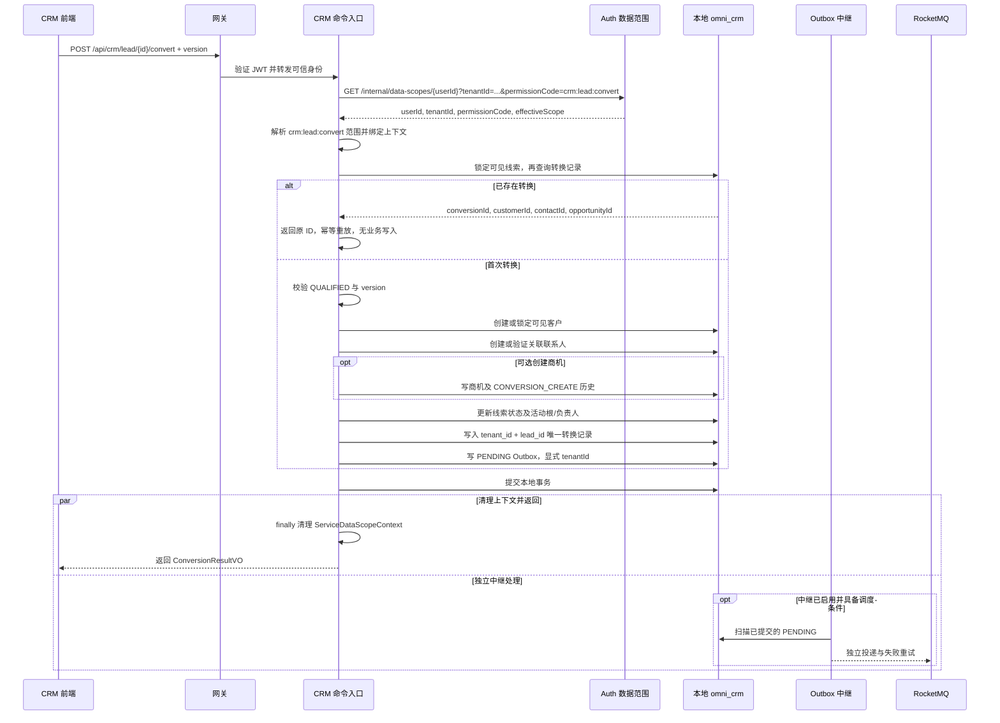

### 一致性边界

| 对象 | 负责人来源 |
| --- | --- |
| 新客户 | 当前线索的 owner 快照 |
| 新联系人 | 所选客户的 owner 快照，可能不同于线索 |
| 新商机 | 当前线索的 owner 快照 |
| 转移后的活动 | root 改为 CUSTOMER，并同步所选客户 owner；活动 version 增加 |

- `crm_lead_conversion(tenant_id,lead_id)` 唯一约束与可见线索行锁共同保护转换。重放仍须通过接口 DTO、功能权限和线索可见性检查；它在服务内部先于状态、版本检查返回已有结果。
- `convert()` 声明 `@Transactional`，默认四参数 `ReliableMessageTemplate.send()` 以 REQUIRED 加入当前事务，只写本地 PENDING 消息。中继与 MQ 投递独立于命令事务；关闭或未调度中继时不能把落库当作已投递。
- 关联已有客户或联系人不重新分配其 owner。转换不调用 `CrmOwnerResolver` 对继承的 owner 重新向 Auth 求证；不能把其他创建/分配命令的负责人校验描述为本转换新增的一步。
- 转换 payload 只有 leadId、customerId、contactId、opportunityId（可为 null）。eventId、tenantId、aggregateVersion、actorUserId 等属于事件信封；eventId 同时作为 msgKey 传入，msgKey 本身不提供业务幂等保证。载荷不包含联系方式或备注。
- 转换的 `@OperLog` 关闭实体快照，并显式排除 customerName、contactName、opportunityName 参数；清洗与异常边界见 Flow 10，不能据此宣称所有敏感文本都已被识别。
- 模式或关联关系错误为业务码 400，不可见资源为 404，首次转换的状态/版本冲突为 409。Auth 数据范围拒绝或返回不一致为 403，Feign 服务异常为 503；失败时不放宽数据范围。

源码与回归: [LeadController.java](../omni-backend/omni-crm/src/main/java/com/omni/crm/controller/LeadController.java) / [LeadServiceImpl.java](../omni-backend/omni-crm/src/main/java/com/omni/crm/service/impl/LeadServiceImpl.java) / [CrmRequests.java](../omni-backend/omni-crm/src/main/java/com/omni/crm/dto/CrmRequests.java) / [CrmTenantInitializerImpl.java](../omni-backend/omni-crm/src/main/java/com/omni/crm/service/impl/CrmTenantInitializerImpl.java) / [ReliableMessageTemplate.java](../omni-backend/omni-common-mqlog/src/main/java/com/omni/common/mqlog/template/ReliableMessageTemplate.java) / [LeadServiceImplTest.java](../omni-backend/omni-crm/src/test/java/com/omni/crm/service/impl/LeadServiceImplTest.java)

[可靠消息边界](mq-reliability.md)

---

## Flow 14: CRM 商机推进与权限隔离 — Stage History + Customer 激活

### 概述

商机阶段使用独立命令 `crm:opportunity:stage`，重开使用 `crm:opportunity:reopen`；普通 update DTO 不接受 stage/status。仓库配置启用租户与数据范围策略，服务通过可见行锁和版本条件更新约束命令，并追加阶段历史与本地 Outbox。

### 状态推进

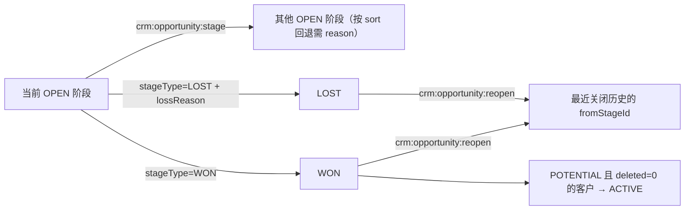

### 命令执行规则

1. Gateway 转发可信身份，CRM 的共享身份链与方法权限保护命令入口；`@ServiceDataScope` 使用该命令完整 permissionCode 向 Auth 解析范围，并校验 userId、tenantId、permissionCode、effectiveScope，finally 清理上下文。
2. 当前拦截器链为 TenantLine → DataPermission → OptimisticLocker → Pagination。TenantLine 仅处理 crm_*；DataPermission 为五类 owner 聚合追加范围。ALL/TENANT 只免除 owner 条件，仍保留当前租户边界。
3. changeStage 锁定可见商机，检查 version 与当前 OPEN 状态；原/目标阶段必须启用，目标属于同一 pipeline，相同阶段拒绝。按 sort 回退需 reason，目标 LOST 另需 lossReason；不是只能向下一个阶段推进。
4. 更新 stage/status/probability、关闭时间和输单原因，以 id/version/deleted=0 条件递增版本，更新行数非 1 抛 409；随后追加阶段历史并写 stage-changed/won/lost 事件。事件类型由目标 stageType 决定。
5. 赢单调用专用客户 SQL，仅忽略 DataPermission，保留 TenantLine，并要求 customerId、POTENTIAL、deleted=0。该调用未要求影响行数为 1；其他客户状态不会被强制改为 ACTIVE。
6. 重开从最近一次 toStatus=WON/LOST 的历史取 fromStageId，读取当前启用阶段，设置 OPEN、概率并清除关闭时间/输单原因，以版本条件更新；追加 REOPEN 历史并按所选阶段类型生成事件。
7. Customer、阶段历史和 Outbox 的写入属于该服务方法的本地事务。行锁与单元用例不能单独证明当前运行库的并发、回滚或外部 MQ 验收已完成。

### PII 返回规则

- Lead、Customer、Contact 的专用分页列表始终采用掩码装配；详情按 `crm:pii:view` 决定联系方式、地址等受保护字段是否返回完整值。
- Activity 专用列表/时间线将非空白 content 替换为 `[REDACTED]`；null 和空白原样保留，详情按 PII 权限决定。
- Customer 360 的联系人、商机、活动、线索块分别校验 list 权限并建立各自 dataScope；缺权限的块不查询。可见联系人与活动还按详情的 PII 标志装配，不能把它概括为所有集合都无条件掩码。
- 四个编辑页面先重新读取详情；无 PII 权限时禁用敏感输入，并从提交 payload 省略这些字段。转换页面也省略 contactMobile/contactEmail；后端命令权限与数据范围检查继续承担写授权。

源码与回归: [OpportunityController.java](../omni-backend/omni-crm/src/main/java/com/omni/crm/controller/OpportunityController.java) / [OpportunityServiceImpl.java](../omni-backend/omni-crm/src/main/java/com/omni/crm/service/impl/OpportunityServiceImpl.java) / [CrmCustomerMapper.java](../omni-backend/omni-crm/src/main/java/com/omni/crm/mapper/CrmCustomerMapper.java) / [CrmStateMachine.java](../omni-backend/omni-crm/src/main/java/com/omni/crm/domain/CrmStateMachine.java) / [ServicePersistenceAutoConfiguration.java](../omni-backend/omni-common-service/src/main/java/com/omni/common/service/config/ServicePersistenceAutoConfiguration.java) / [CrmViewAssembler.java](../omni-backend/omni-crm/src/main/java/com/omni/crm/dto/CrmViewAssembler.java) / [CrmPermissionScopeExecutor.java](../omni-backend/omni-crm/src/main/java/com/omni/crm/service/support/CrmPermissionScopeExecutor.java) / [OpportunityServiceImplTest.java](../omni-backend/omni-crm/src/test/java/com/omni/crm/service/impl/OpportunityServiceImplTest.java) / [PiiMaskerTest.java](../omni-backend/omni-crm/src/test/java/com/omni/crm/security/PiiMaskerTest.java)

[crm/lead/index.vue](../omni-frontend/src/views/crm/lead/index.vue) / [crm/customer/index.vue](../omni-frontend/src/views/crm/customer/index.vue) / [crm/contact/index.vue](../omni-frontend/src/views/crm/contact/index.vue) / [crm/activity/index.vue](../omni-frontend/src/views/crm/activity/index.vue)

本节依据当前源码与已绑定的单元结果；真实 MySQL 并发/回滚、浏览器及外部投递仍按相应验收范围核对。

---

部署步骤与排障移至 [认证教程](guides/authentication.md)、[Docker 部署](docker-deployment.md)及[运维指南](guides/operations-upgrade.md)。社交回调经过浏览器可达的 Gateway；Compose 内部通过服务名访问。Auth 的审计事件、JWT/JWK、功能权限与数据权限边界以本页各 Flow 为准。

## Flow 15：SRM 供应商准入审批

`POST /api/srm/supplier` 要求 `srm:supplier:create`，并使用同一权限码解析数据范围。管理端创建先写 PENDING_REVIEW 供应商、风险初始数据和注册 Outbox，再解析当前租户 `category=SRM_SUPPLIER_ONBOARDING` 的已发布模型。创建与被驳回后的 submit 均在本地 `@Transactional` 方法内同步调用 Workflow；当前调用点不是提交后执行。

Workflow 的实际启动接口为 `POST /api/internal/workflow/process-instance/start`，响应字段为 processInstanceId、requestId、businessType、businessKey、replayed。远端启动使用独立事务，本地回滚不能撤销已提交的远端流程。

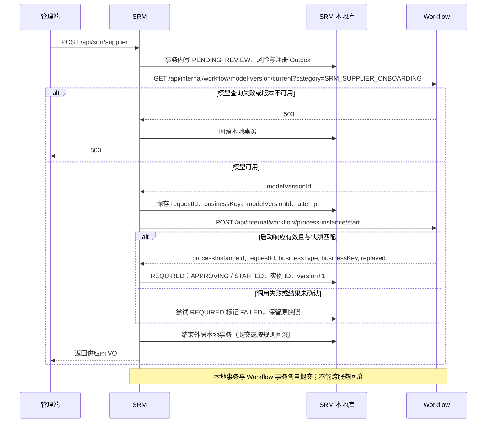

- 模型解析发生在启动异常捕获之前：缺少有效模型或查询失败会抛 503，不能承诺创建仍然落库。启动调用异常则尝试标记 FAILED，并由 prepareAndStart 捕获；外层事务提交时供应商保留 PENDING_REVIEW。FAILED 只表示本地未确认启动，不能证明远端没有流程。
- SRM 保存 requestId、businessKey=`{supplierId}:{attempt}`、modelVersionId、attempt 与启动状态；startUserId/startUserName 从当前身份放入启动命令，没有作为供应商启动人快照字段持久化。Workflow 以 tenant+requestId 及 tenant+businessType+businessKey 双唯一约束协调重放，并校验模型与发起人意图一致。
- 管理端 `/{id}/submit` 和 Portal `/profile/submit` 只接受 REJECTED，重新提交会生成新轮次。当前这两个入口没有为 PENDING_REVIEW/FAILED 暴露复用原快照的启动重试；Portal enrollment/retry 属于角色分配 Saga。不能将重新提交描述为失败启动的通用恢复入口。
- 完成事件经 Workflow 本地 Outbox 和独立中继送达。SRM 在同一事务登记/锁定 `(tenantId,eventId)` Inbox，核对 producer、businessType、businessKey、实例及载荷意图；匹配 APPROVING/STARTED 才推进 APPROVED/REJECTED 并写结果 Outbox。已处理或旧轮次/终态/实例不匹配不重复推进；有效事件早于本地启动确认时抛可重试异常，不能直接标记已处理。
- `RequiredWorkflowModelInitializer` 校验默认租户 1 的四个必需模型，并校正/发布查询到的对应启用模型；默认模型缺失或发布失败使 Workflow 启动失败。该行为不保证每个新租户都已具备全部模型。
- 创建响应由内存中的 supplier 实体装配；启动失败后数据库中的启动标记与递增版本未完整同步回该实体。需要重新读取详情核对状态和当前 version，不能把创建响应当作完整的持久化启动快照。

源码与回归: [SupplierController.java](../omni-backend/omni-srm/src/main/java/com/omni/srm/controller/SupplierController.java) / [SupplierServiceImpl.java](../omni-backend/omni-srm/src/main/java/com/omni/srm/service/impl/SupplierServiceImpl.java) / [SupplierWorkflowCoordinator.java](../omni-backend/omni-srm/src/main/java/com/omni/srm/workflow/SupplierWorkflowCoordinator.java) / [SupplierWorkflowStateServiceImpl.java](../omni-backend/omni-srm/src/main/java/com/omni/srm/workflow/SupplierWorkflowStateServiceImpl.java) / [SupplierWorkflowCompletionServiceImpl.java](../omni-backend/omni-srm/src/main/java/com/omni/srm/service/impl/SupplierWorkflowCompletionServiceImpl.java) / [WorkflowInternalClient.java](../omni-backend/omni-srm/src/main/java/com/omni/srm/client/WorkflowInternalClient.java) / [RequiredWorkflowModelInitializer.java](../omni-backend/omni-workflow/src/main/java/com/omni/workflow/config/RequiredWorkflowModelInitializer.java) / [InternalWorkflowServiceImpl.java](../omni-backend/omni-workflow/src/main/java/com/omni/workflow/service/impl/InternalWorkflowServiceImpl.java) / [WorkflowProcessStartRequestServiceImpl.java](../omni-backend/omni-workflow/src/main/java/com/omni/workflow/service/impl/WorkflowProcessStartRequestServiceImpl.java) / [SrmViewAssembler.java](../omni-backend/omni-srm/src/main/java/com/omni/srm/dto/SrmViewAssembler.java)

### Flow 15.1：请购审批规则配置与匹配试算

规则使用模型分类 `purchase`；运行实例业务类型为 `PROCUREMENT_REQUISITION`。界面选择流程名称与版本，协议仍传 modelVersionId。

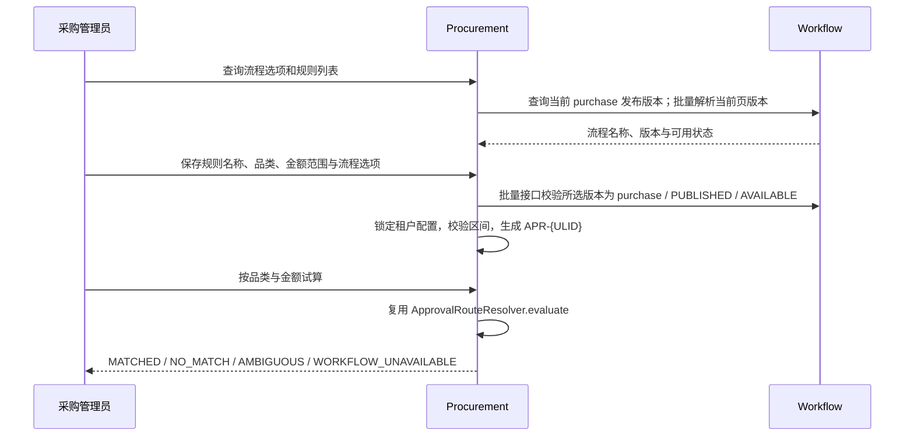

- 规则创建/更新校验当前 purchase 发布模型；列表按去重 modelVersionId 分批解析，每批最多 200，Workflow 不可用时保留本地规则并标记 UNAVAILABLE。试算只有模型和安全预览可用时返回审批图。
- 金额区间为半开区间：先匹配精确品类，未命中时才使用 `*`。同一层多命中返回 AMBIGUOUS，不因 priority 排序而选中一条。route_code 由服务端生成；priority 可由 API 显式给出，否则按该品类最大值加 10。
- 覆盖分析从 0 到无穷切分区间并纳入模型可用性；停用/删除影响试算只在内存排除目标规则。租户初始化仍可能准备默认配置，不能据“试算”二字推断整个请求绝无初始化写入。

源码与回归: [ApprovalRouteController.java](../omni-backend/omni-procurement/src/main/java/com/omni/procurement/controller/ApprovalRouteController.java) / [ApprovalRouteServiceImpl.java](../omni-backend/omni-procurement/src/main/java/com/omni/procurement/service/impl/ApprovalRouteServiceImpl.java) / [ApprovalRouteInsightServiceImpl.java](../omni-backend/omni-procurement/src/main/java/com/omni/procurement/service/impl/ApprovalRouteInsightServiceImpl.java) / [ApprovalRouteResolver.java](../omni-backend/omni-procurement/src/main/java/com/omni/procurement/domain/ApprovalRouteResolver.java) / [ApprovalRouteCoverageAnalyzer.java](../omni-backend/omni-procurement/src/main/java/com/omni/procurement/domain/ApprovalRouteCoverageAnalyzer.java) / [ApprovalRuleWizard.vue](../omni-frontend/src/views/procurement/approval-route/components/ApprovalRuleWizard.vue)

## Flow 16：Procurement 请购审批与异步回写

提交和 `/{id}/retry-start` 均要求 `procurement:requisition:submit` 与对应数据范围。submit 本身不持有事务；它先调用独立事务的 prepareSubmit，再以已提交快照调用 Workflow。

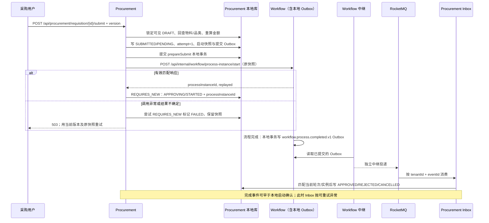

- prepareSubmit 只接受 DRAFT 和当前版本，回查活动物料/品类，要求单一品类、正数量与非负单价。每行金额按 HALF_UP 保留 4 位后汇总，并检查 DECIMAL(19,4) 范围；使用服务端路由，不接受客户端模型选择。
- 启动异常或响应不一致均尝试记录 SUBMITTED/FAILED，不能据此认定远端未启动。retry-start 只接受该状态与当前版本，复用 requestId/businessKey/modelVersionId/attempt、金额及申请人，不重新匹配路由或增加轮次。REJECTED 修改后回 DRAFT，再提交才开启新轮次。
- 完成消费在同一事务更新业务状态、结果 Outbox 和 Inbox；同 eventId 的不同载荷意图返回 409。早到事件抛可重试异常，旧轮次和终态事件幂等忽略。Outbox 落库与中继实际投递是不同阶段。
- 列表每 5 秒仅在页面可见且当前页存在 APPROVING 时静默刷新；60 秒后显示同步较慢并提供刷新，定时器仍继续。该提示不证明 Workflow 已完成，也不覆盖所有页面或 SUBMITTED 的启动恢复。

RFQ 邀请由 Procurement 权威管理，报价由 SRM 权威管理。SRM 同一事务保存报价、行、请求幂等账本和报价 Outbox；Procurement Inbox 按报价版本更新邀请并忽略旧版本。定点回查并校验当前报价 ID/版本、邀请和行快照，再在 Procurement 本地事务中创建带报价快照的订单、推进 RFQ 和写领域 Outbox。

源码与回归: [RequisitionController.java](../omni-backend/omni-procurement/src/main/java/com/omni/procurement/controller/RequisitionController.java) / [RequisitionServiceImpl.java](../omni-backend/omni-procurement/src/main/java/com/omni/procurement/service/impl/RequisitionServiceImpl.java) / [RequisitionWorkflowStateServiceImpl.java](../omni-backend/omni-procurement/src/main/java/com/omni/procurement/service/impl/RequisitionWorkflowStateServiceImpl.java) / [RequisitionWorkflowCoordinator.java](../omni-backend/omni-procurement/src/main/java/com/omni/procurement/workflow/RequisitionWorkflowCoordinator.java) / [WorkflowCompletionServiceImpl.java](../omni-backend/omni-procurement/src/main/java/com/omni/procurement/service/impl/WorkflowCompletionServiceImpl.java) / [index.vue](../omni-frontend/src/views/procurement/requisition/index.vue) / [QuotationServiceImpl.java](../omni-backend/omni-srm/src/main/java/com/omni/srm/service/impl/QuotationServiceImpl.java) / [QuotationSubmittedServiceImpl.java](../omni-backend/omni-procurement/src/main/java/com/omni/procurement/service/impl/QuotationSubmittedServiceImpl.java) / [RfqServiceImpl.java](../omni-backend/omni-procurement/src/main/java/com/omni/procurement/service/impl/RfqServiceImpl.java) / [PurchaseOrderServiceImpl.java](../omni-backend/omni-procurement/src/main/java/com/omni/procurement/service/impl/PurchaseOrderServiceImpl.java) / [RequisitionWorkflowCoordinatorTest.java](../omni-backend/omni-procurement/src/test/java/com/omni/procurement/workflow/RequisitionWorkflowCoordinatorTest.java) / [RequisitionWorkflowStateServiceImplTest.java](../omni-backend/omni-procurement/src/test/java/com/omni/procurement/service/impl/RequisitionWorkflowStateServiceImplTest.java) / [WorkflowCompletionServiceImplTest.java](../omni-backend/omni-procurement/src/test/java/com/omni/procurement/service/impl/WorkflowCompletionServiceImplTest.java)

以上为当前源码与绑定单元报告范围。真实 MySQL 并发/回滚、Workflow/MQ 投递、浏览器轮询和 SRM 真实验证码注册仍须各自验收。

---

## Flow 17：Procurement 收货到 Asset 建卡、调拨与处置

Procurement、Asset 与 Workflow 各自提交本地事务，通过 Outbox 与 Inbox 衔接。资产来源导入、审批确认和实物业务完成是独立步骤。

### 收货导入与历史补偿

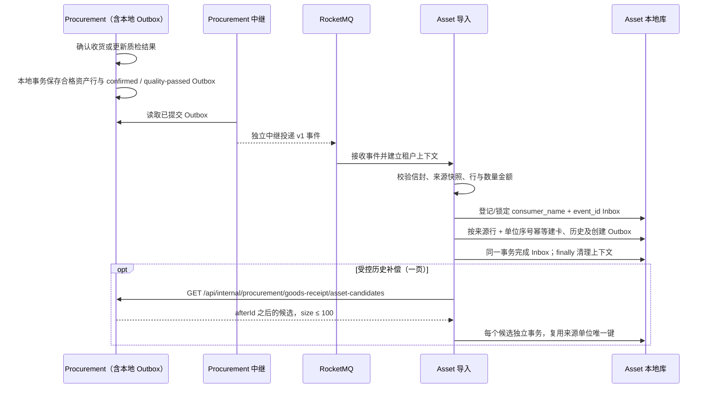

- Procurement 确认收货只将当时满足资产化条件的行放入事件；后续质检通过事件携带新通过的合格资产行。Asset 支持 `procurement.goods-receipt.confirmed.v1` 与 `procurement.goods-receipt.quality-passed.v1`。
- 导入先校验来源 ID、owner、币种、行快照和金额等式。合法但非 PASS 或非 assetManaged 的行跳过；缺字段、无效金额或重复来源行会拒绝整批。合格行的 receivedQuantity 必须为精确正整数、等于 assetQuantity 且不超过 Integer.MAX_VALUE；unitPrice、totalPrice 必须为正。
- Inbox 唯一键为 `(consumer_name,event_id)`，另校验 tenant 与 JSON 业务意图；跨租户碰撞或相同事件 ID 的不同意图拒绝。资产来源唯一键为 `(tenant_id,source_gr_line_id,source_unit_sequence)`，同时保护实时与回扫。幂等插入后回查已有单位，不能只凭 JDBC 影响行数判断是否新建。
- 新卡为 IN_STOCK，继承收货 owner；每张 purchaseAmount 取 unitPrice 按 HALF_UP 保留 2 位。只有新卡追加创建历史和 asset.created.v1 Outbox，实时导入的资产、历史、Inbox 和 Outbox 在同一本地事务中完成。
- 补偿入口是受内部令牌保护的 `POST /api/internal/asset/procurement/backfill`。头/查询 tenantId 必须一致，afterId 为排他收货行游标，size 为 1–100。一次只处理一页，返回 nextAfterId/hasMore；调用方保存游标并继续，没有自动启动全量回扫的实现。候选逐个提交，页中途失败时已完成副作用仍存在，重试通过来源键去重。

源码: [GoodsReceiptServiceImpl.java](../omni-backend/omni-procurement/src/main/java/com/omni/procurement/service/impl/GoodsReceiptServiceImpl.java) / [ProcurementGoodsReceiptConsumer.java](../omni-backend/omni-asset/src/main/java/com/omni/asset/consumer/ProcurementGoodsReceiptConsumer.java) / [ProcurementAssetImportServiceImpl.java](../omni-backend/omni-asset/src/main/java/com/omni/asset/service/impl/ProcurementAssetImportServiceImpl.java) / [AssetReceiptImportMapper.java](../omni-backend/omni-asset/src/main/java/com/omni/asset/mapper/AssetReceiptImportMapper.java) / [ProcurementAssetBackfillServiceImpl.java](../omni-backend/omni-asset/src/main/java/com/omni/asset/service/impl/ProcurementAssetBackfillServiceImpl.java) / [InternalProcurementBackfillController.java](../omni-backend/omni-asset/src/main/java/com/omni/asset/controller/InternalProcurementBackfillController.java) / [InternalAssetCandidateController.java](../omni-backend/omni-procurement/src/main/java/com/omni/procurement/controller/InternalAssetCandidateController.java) / [InternalAssetCandidateServiceImpl.java](../omni-backend/omni-procurement/src/main/java/com/omni/procurement/service/impl/InternalAssetCandidateServiceImpl.java) / [0001-asset-schema.yaml](../database/changelog/asset/0001-asset-schema.yaml)

### 调拨、处置审批与业务完成

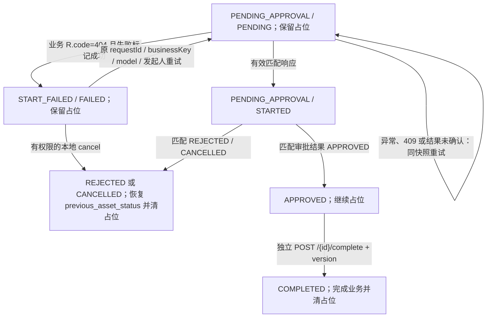

- 创建按 ASSET_TRANSFER/ASSET_DISPOSAL 自动解析当前租户已发布模型；模型版本不由用户选择。prepare 本地事务保存 requestId、以申请 ID 为 businessKey、模型与发起人，并以 tenant/id/version/status、两个 active_operation_* 均为空的条件占位；支持 IN_STOCK/ALLOCATED/IN_USE，冲突返回 409。提交后才调用 Workflow，确认写入使用 REQUIRES_NEW。
- 网络异常、业务 409、无效响应或本地确认失败保留 PENDING_APPROVAL/PENDING 与占位。仅业务响应 R.code=404 进入显式失败标记分支；成功保存 START_FAILED/FAILED 后才允许本地取消。HTTP 404 的 Feign 异常仍走结果未知分支。重试保留原 requestId、businessKey、模型及发起人。
- 审批 Inbox 核对租户、业务类型、业务键、实例与载荷意图；早于启动确认的有效事件抛可重试异常，已处理或当前状态/实例不匹配幂等忽略。APPROVED 保持占位，等待单独的 complete 权限和当前版本；调拨完成设置 current_user/unit 与 IN_USE，管理 owner 不随使用人改变；处置完成为 DISPOSED 或 SCRAPPED。拒绝/取消在同一事务恢复 previous_asset_status、写历史并清占位。
- 资产候选按对应 transfer:create/disposal:create 数据范围与可用状态筛选；用户候选按 Auth 租户与组织归属校验，供应商候选要求当前租户 APPROVED，不能统一概括为都套用资产 owner 条件。transfer:create 的 SELF 候选使用 current_user_id；命令还会重验目标部门可写及用户归属，可见候选不保证可写。
- purchaseAmount、residualValue 和来源事件金额使用 JSON 十进制字符串；残值请求使用专用字符串反序列化器。候选、重试、取消和完成均有各自权限，不能用流程审批权限代替资产命令权限。

源码: [AssetTransferController.java](../omni-backend/omni-asset/src/main/java/com/omni/asset/controller/AssetTransferController.java) / [AssetDisposalController.java](../omni-backend/omni-asset/src/main/java/com/omni/asset/controller/AssetDisposalController.java) / [AssetTransferServiceImpl.java](../omni-backend/omni-asset/src/main/java/com/omni/asset/service/impl/AssetTransferServiceImpl.java) / [AssetDisposalServiceImpl.java](../omni-backend/omni-asset/src/main/java/com/omni/asset/service/impl/AssetDisposalServiceImpl.java) / [AssetOperationWorkflowStateServiceImpl.java](../omni-backend/omni-asset/src/main/java/com/omni/asset/service/impl/AssetOperationWorkflowStateServiceImpl.java) / [WorkflowCompletionServiceImpl.java](../omni-backend/omni-asset/src/main/java/com/omni/asset/service/impl/WorkflowCompletionServiceImpl.java) / [AssetWorkflowCoordinator.java](../omni-backend/omni-asset/src/main/java/com/omni/asset/workflow/AssetWorkflowCoordinator.java) / [AssetWorkflowModelGuard.java](../omni-backend/omni-asset/src/main/java/com/omni/asset/workflow/AssetWorkflowModelGuard.java) / [AstAssetMapper.java](../omni-backend/omni-asset/src/main/java/com/omni/asset/mapper/AstAssetMapper.java) / [AssetOptionsController.java](../omni-backend/omni-asset/src/main/java/com/omni/asset/controller/AssetOptionsController.java) / [AssetOptionServiceImpl.java](../omni-backend/omni-asset/src/main/java/com/omni/asset/service/impl/AssetOptionServiceImpl.java) / [AssetDataPermissionHandler.java](../omni-backend/omni-asset/src/main/java/com/omni/asset/security/AssetDataPermissionHandler.java) / [AssetViews.java](../omni-backend/omni-asset/src/main/java/com/omni/asset/dto/AssetViews.java) / [AssetOperationRequests.java](../omni-backend/omni-asset/src/main/java/com/omni/asset/dto/AssetOperationRequests.java)

## Flow 18：SRM 门户邀请入驻与角色分配 Saga

账户自注册是 Auth 的独立流程，校验真实验证码与租户内用户名后再登录；默认 USER 分配的实现边界见 Flow 1。SRM 入驻使用已有认证身份、requestId 与 inviteToken，不负责创建 Auth 账号。

```mermaid
sequenceDiagram
    participant U as 门户用户
    participant G as Gateway
    participant A as Auth
    participant S as SRM
    participant SO as SRM Outbox/中继
    participant AO as Auth 回执与 Outbox/中继
    participant M as RocketMQ
    participant W as Workflow
    U->>A: POST /api/auth/register（tenant + captcha），随后登录
    A-->>U: 已登录身份
    U->>G: POST /api/srm/portal/enroll + requestId + inviteToken
    G->>S: 转发可信 tenant/user
    S->>S: 事务内消费邀请，创建 REGISTERING + PENDING_ROLE_ASSIGN
    S->>SO: 同事务写 srm.portal-role.assign-requested.v1
    SO-->>M: 独立中继投递
    M->>A: tenantId, requestId, supplierId, userId, SUPPLIER
    A->>A: 按 tenant/requestId 校验原身份并幂等授予 SUPPLIER
    A->>AO: 同事务保存回执和成功/失败结果 Outbox
    AO-->>M: 独立中继投递
    M->>S: auth.portal-role.assigned.v1 / auth.portal-role.assign-failed.v1
    alt SUCCESS
        S->>S: 同本地事务写 ACTIVE PortalUser、PENDING_REVIEW、COMPLETED
        S->>W: 同本地事务准备/启动供应商准入（见 Flow 15）
    else FAILED
        S->>S: REGISTERING_FAILED + ROLE_ASSIGN_FAILED + nextRetryTime
    end
    U->>S: GET /api/srm/portal/enrollment
    S-->>U: Saga 状态；COMPLETED 后提供重新登录
    Note over S,W: 模型查询失败可回滚 SRM 回写；Auth 已授予角色独立提交，消息需重投
```

- 同 tenant/requestId 重放校验申请人和规范化 creditCode；已有有效入驻也返回原申请，不重复消耗邀请。此处没有对整个请求体做幂等 hash 校验。新 Supplier 的内部 owner 为空，Portal userId 只写门户关联。
- 邀请原文仅在创建响应返回，持久化 SHA-256；enroll 的 OperLog 显式排除 inviteToken，角色消息不包含密码、验证码或邀请原文。消费 SQL 同时限制租户、版本、ACTIVE、有效期和余量；无效邀请 404，过期/用尽 410，并发冲突 409。
- Auth 以 `sys_portal_role_request(tenant_id,request_id)` 校验原 supplier/user/role 意图，只授予 SUPPLIER，并验证启用的租户用户与角色。角色写入、回执及结果 Outbox 同事务；已完成重放会补发结果 Outbox，结果 eventId 按 requestId 与事件类型确定性生成。
- SRM 核对结果信封/载荷的 requestId、tenantId 及 supplier/user/SUPPLIER。成功建立 ACTIVE PortalUser，写 PENDING_REVIEW/COMPLETED 后在同一本地事务调用准入 Workflow；有效启动进入 APPROVING。模型查询失败可回滚本地 Saga 完成，启动调用失败则可能提交 COMPLETED 与 PENDING_REVIEW/FAILED。Saga 完成不等于准入 APPROVED，恢复边界见 Flow 15。
- 失败记录 REGISTERING_FAILED/ROLE_ASSIGN_FAILED 与 nextRetryTime。`POST /api/srm/portal/enrollment/retry` 只在角色分配失败且退避到期后复用原 requestId 重发，不再消费邀请；过早返回 429。PENDING/COMPLETED 返回原状态；已完成后的迟到失败结果忽略。
- 在 SRM 门户权限范围内，预置 USER 用于 enroll；企业资料、评估须 SUPPLIER 角色、对应权限和当前租户/用户的 ACTIVE PortalUser 关联。SrmPortalScope 临时建立 TENANT 范围并恢复；SRM 结果消费者 finally 清理身份与范围，Auth 角色服务通过显式 tenant 条件处理。
- 门户按 tenant/username 保留 requestId，PENDING_ROLE_ASSIGN 时每 5 秒查询；COMPLETED 提供退出并重新登录以获取角色。数据库已授予角色不会自动改写当前 JWT。

源码: [AuthController.java](../omni-backend/omni-auth/src/main/java/com/omni/auth/controller/AuthController.java) / [UserServiceImpl.java](../omni-backend/omni-auth/src/main/java/com/omni/auth/service/impl/UserServiceImpl.java) / [PortalRoleAssignConsumer.java](../omni-backend/omni-auth/src/main/java/com/omni/auth/consumer/PortalRoleAssignConsumer.java) / [PortalRoleAssignmentServiceImpl.java](../omni-backend/omni-auth/src/main/java/com/omni/auth/service/impl/PortalRoleAssignmentServiceImpl.java) / [SysPortalRoleRequestMapper.java](../omni-backend/omni-auth/src/main/java/com/omni/auth/mapper/SysPortalRoleRequestMapper.java) / [PortalController.java](../omni-backend/omni-srm/src/main/java/com/omni/srm/controller/PortalController.java) / [PortalInviteServiceImpl.java](../omni-backend/omni-srm/src/main/java/com/omni/srm/service/impl/PortalInviteServiceImpl.java) / [SrmSupplierInviteMapper.java](../omni-backend/omni-srm/src/main/java/com/omni/srm/mapper/SrmSupplierInviteMapper.java) / [SupplierPortalServiceImpl.java](../omni-backend/omni-srm/src/main/java/com/omni/srm/service/impl/SupplierPortalServiceImpl.java) / [PortalRoleResultConsumer.java](../omni-backend/omni-srm/src/main/java/com/omni/srm/consumer/PortalRoleResultConsumer.java) / [PortalRoleResultServiceImpl.java](../omni-backend/omni-srm/src/main/java/com/omni/srm/service/impl/PortalRoleResultServiceImpl.java) / [SrmPortalScope.java](../omni-backend/omni-srm/src/main/java/com/omni/srm/security/SrmPortalScope.java) / [index.vue](../omni-frontend/src/views/supplier-portal/index.vue)

本节依据源码与既有单元报告描述合同；真实 MySQL 并发/事务、Broker 投递、原生界面以及真实验证码入驻需要对应验收。
