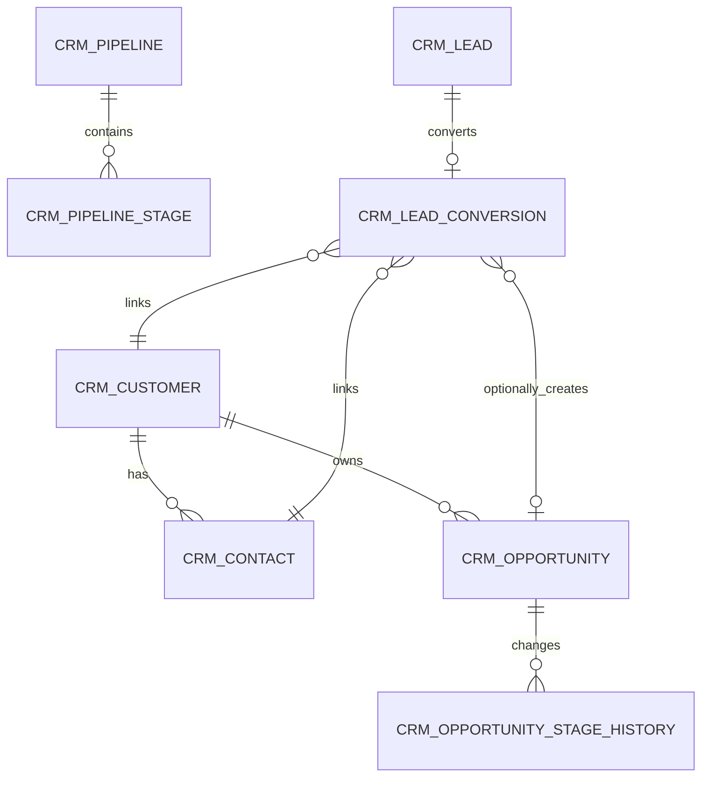

# CRM Sales Pipeline

> This document records current CRM boundaries, contracts and constraints; Chinese is the factual source. Read it before changing CRM code.
> Engineering references: [architecture](architecture.en.md), [API contract](api-contract.en.md), [backend patterns](backend-patterns.en.md), [frontend patterns](frontend-patterns.en.md). The [original design](design/crm-design.en.md) is historical; current source takes precedence when they differ.
> Operations and real screenshots: [CRM Wiki](guides/crm-flow.en.md). Extension and Docker testing: [development Wiki](guides/scaffold-development.en.md#8-crm-extension-and-container-tests).

CRM is a standalone microservice (`omni-crm`) covering the pre-sales closed loop: Lead → Follow-up → Customer/Contact → Opportunity → Won or Lost. Products, quotes, contracts, orders, invoicing, collections, marketing automation, and customer-service tickets are **out of scope** for CRM.

## 1. Service Boundaries

| Item | Value |
|---|---|
| Maven module | `omni-crm` |
| Service port | `8104` |
| Management port | `19904` |
| XXL-JOB executor | `omni-crm` / `9904` |
| Database | `omni_crm` |
| Gateway route | `/api/crm/**` → `lb://omni-crm` (no StripPrefix) |
| Redis | DB 0, shares Auth's common XSS cache keys |

**Depends on**: `omni-common-service`, `omni-common-core`, `omni-common`, `omni-common-mybatis`, `omni-common-redis`, `omni-common-operlog`, `omni-common-job`, `omni-common-mqlog`.

**Do NOT depend on** `omni-common-workflow` — that would pull the Flowable engine into CRM.

**Cross-service calls**: Calls Auth internal APIs via OpenFeign + `X-Internal-Token` generated by `InternalFeignHeadersFactory`. CRM only stores userId/unitId and never reads `omni_auth` across databases.

## 2. Domain Model

### 2.1 Aggregates & Tables

| Aggregate | Tables | Responsibility |
|---|---|---|
| Lead | `crm_lead`, `crm_lead_conversion` | Lead lifecycle, idempotent conversion |
| Customer | `crm_customer`, `crm_contact` | Customer profile, contacts, Customer 360 |
| Opportunity | `crm_opportunity`, `crm_opportunity_stage_history` | Stage, amount, probability, won/lost history |
| Activity | `crm_activity` | Plan, complete, cancel follow-ups |
| Pipeline | `crm_pipeline`, `crm_pipeline_stage` | Pipeline & stage definitions |
| Ownership Audit | `crm_owner_change_log` | Immutable history of owner changes |
| Tenant configuration | `crm_tenant_config` | defaultPipelineId / currencyCode / leadDuplicatePolicy |



`crm_activity` uses `root_type + root_id` for polymorphic association with Lead/Customer/Opportunity. The Service layer must verify that the target exists, belongs to the same tenant, and is accessible to the current user.

### 2.2 Common Field Rules

Every `crm_*` table must have `tenant_id`. Authorizable business tables additionally require:

- `tenant_id` — tenant isolation
- `owner_user_id` — SELF scope & business owner
- `owner_unit_id` — DEPT / DEPT_AND_BELOW / CUSTOM scope
- `version` — optimistic locking
- `deleted` — soft delete
- `id/create_time/update_time/create_by/update_by` — audit fields

**Key constraints**:

- User/org IDs are managed by Auth; no cross-database foreign keys; never trust frontend-submitted usernames or ownerUnitId
- Monetary amounts use `DECIMAL(18,2)` / `BigDecimal`; currency uses ISO 4217 three-letter codes; in MVP all opportunities must use the tenant's default currency
- Timestamps use `yyyy-MM-dd HH:mm:ss` uniformly
- `lead_no/customer_no/opportunity_no` are generated from the database ID and are unique per tenant
- Regular PUT requests must not directly modify owner, status, or stage
- External requests must not use bare `selectById/updateById/deleteById`

## 3. Security Architecture

### 3.1 Six-Layer Defense in Depth

```
Gateway JWT verification → CRM Tenant check → Spring Security @PreAuthorize
→ @ServiceDataScope aspect → MyBatis DataPermission interceptor → CrmRecordAccessGuard row-level write auth
```

1. Gateway verifies RS256 JWT and injects `X-User-*`, `X-Tenant-Id`, `X-Gateway-Forwarded`
2. `GatewayPreAuthenticationFilter` of `omni-common-service` builds `Authentication`, and `ServiceIdentityFilter` validates and binds userId/tenantId
3. Controller `@PreAuthorize` checks functional permissions
4. The `@ServiceDataScope(permissionCode)` common aspect calls the Auth internal API to resolve dataScope
5. MyBatis-Plus appends tenant + owner conditions
6. `CrmRecordAccessGuard` validates row-level authorization for write operations

**Fail-closed**: Missing tenant → 401, missing scope → `id=-1` (zero data visible), Auth unavailable → 503. Never degrade to unfiltered.

### 3.2 MyBatis Interceptor Order

CRM provides domain policies to `omni-common-service` via `CrmTenantTablePolicy` and `CrmDataPermissionHandler`; the common Starter assembles `mybatisPlusInterceptor` with a fixed, non-negotiable order:

```
TenantLineInnerInterceptor → DataPermissionInterceptor → OptimisticLockerInnerInterceptor → PaginationInnerInterceptor
```

- TenantLine only processes `crm_*` tables
- `sys_mq_message` is excluded from both permission interceptors (Relay scans all tenants by design)
- DataPermission must come before Pagination so that COUNT and records share the same scope
- Pipeline/Stage is only governed by tenant + functional permissions

### 3.3 DataScope Mapping

| dataScope | SQL Condition |
|---|---|
| SELF | `owner_user_id = currentUserId` |
| DEPT | `owner_unit_id = primaryUnitId` |
| DEPT_AND_BELOW / CUSTOM | `owner_unit_id IN accessibleUnitIds` |
| TENANT / ALL | No owner condition; TenantLine always retained |

### 3.4 Row-Level Write Authorization

DataPermission does not replace explicit row-level write authorization; dedicated SQL may bypass owner filtering. Every update/delete/convert/transfer/stage command must:

1. Query visible records with `tenant_id + id + data scope` (invisible → 404 to prevent ID enumeration)
2. Validate state machine and business invariants
3. Update with `tenant_id + id + version` conditions
4. Return a concurrency conflict if the affected row count is not exactly 1

### 3.5 Permission Codes

| Resource | Permission Code |
|---|---|
| Overview | `crm:overview:list` |
| Lead | `crm:lead:list/create/update/delete/assign/convert/disqualify` |
| Customer | `crm:customer:list/create/update/delete/transfer/status/blacklist` |
| Contact | `crm:contact:list/create/update/delete` |
| Opportunity | `crm:opportunity:list/create/update/delete/assign/stage/reopen` |
| Activity | `crm:activity:list/create/update/delete/complete/cancel` |
| Owner Candidates | `crm:owner:list` |
| PII View | `crm:pii:view` |

The `/` in the table is shorthand for multiple full permission codes under the same resource; each full code is stored individually. `@PreAuthorize` and `@ServiceDataScope` use the same full permission code.

### 3.6 PII Masking

- Dedicated lead, customer and contact lists always use masked VOs. Details use `crm:pii:view` to decide whether to return full contact information.
- Dedicated activity lists/timelines replace nonblank content with `[REDACTED]` in masked mode; `null` and blank content are preserved. Details follow the PII permission.
- Backend `CustomerServiceImpl.overview` uses the detail PII flag for contact and activity chunks; a blanket claim that every collection is always masked is incorrect. The UI `CustomerOverview.vue` currently calls customer details, contact lists, OPEN opportunity lists and the activity timeline separately, rather than consuming the overview bundle.
- Duplicate checks return only candidate IDs, numbers, names and masked contact summaries. Edit pages reload details and disable/omit sensitive inputs without PII permission; this is not a separate backend field-write permission mechanism.

### 3.7 XSS Protection

With `omni.service.xss.enabled=true`, CRM uses the shared Starter's `CachedServiceXssConfigProvider`, rather than a CRM-specific SPI implementation. It reads `xss:enabled:{tenantId}` and `xss:rules:{tenantId}` in Redis DB 0. Cache misses/errors resolve through Auth; resolution failure uses the shared security baseline. The authoritative enabled value is still respected. Notes are plain text; frontend `v-html` is forbidden.

### 3.8 Roles & dataScope

These are default-tenant examples in formal auth.sql seeds, not evidence that every new tenant already has these roles.

| Role | dataScope | Capabilities |
|---|---|---|
| `CRM_ADMIN` | TENANT | Full CRM features/data within the current tenant |
| `SALES_MANAGER` | DEPT_AND_BELOW | Department & subordinates, assign/transfer, statistics |
| `SALES_REP` | SELF | Own data and standard sales operations |
| `CRM_VIEWER` | TENANT | Tenant-level read-only, PII not granted by default |
| `SUPER_ADMIN` | ALL | All features, CRM data still scoped to current tenant |

The default USER role does not grant CRM permissions.

## 4. State Machines & Core Flows

### 4.1 Lead Lifecycle

```
[*] → NEW → FOLLOWING → QUALIFIED → CONVERTED → [*]
NEW/FOLLOWING/QUALIFIED → DISQUALIFIED
DISQUALIFIED → FOLLOWING (reactivate)
```

- First conversion requires `QUALIFIED`; `DISQUALIFIED` requires a reason; `CONVERTED` is a terminal state

### 4.2 Customer Status

```
POTENTIAL → ACTIVE → DORMANT / LOST / BLACKLISTED
DORMANT / LOST / BLACKLISTED → ACTIVE
```

Winning an opportunity can automatically transition a customer from POTENTIAL to ACTIVE. Customers with open opportunities cannot be deleted directly. BLACKLISTED uses a dedicated command and the `crm:customer:blacklist` permission.

### 4.3 Opportunity Stages

```
DISCOVERY → QUALIFICATION → PROPOSAL → NEGOTIATION → WON / LOST
```

- This is the default ordering, not a requirement to advance only to the adjacent stage. The command locks a visible record, checks current `OPEN` status and request version, requires enabled current/target stages in the same pipeline, and rejects the same stage.
- Moving to a lower sort requires reason; target `LOST` additionally requires lossReason. A versioned update, history and local Outbox write follow.
- `WON` attempts to activate the associated nondeleted `POTENTIAL` customer. Dedicated SQL ignores owner filtering but retains tenant filtering; the service does not require that SQL to affect one row, so activation is not guaranteed for every customer state.
- Ordinary editing of `WON/LOST` is rejected. The dedicated `crm:opportunity:reopen` command takes fromStageId from the latest closing history, requires that stage to remain enabled, restores `OPEN` and its probability, clears close time/loss reason, and appends `REOPEN` history and a stage event.

### 4.4 Activity Status

```
PLANNED → COMPLETED / CANCELLED
CANCELLED → PLANNED (reschedule)
```

### 4.5 Lead Conversion Flow

```
POST /api/crm/lead/{id}/convert
→ Validate DTO, functional permission and data scope
→ SELECT visible, nondeleted Lead FOR UPDATE
→ Existing Conversion: return original IDs, idempotentReplay=true
→ First conversion: require QUALIFIED and matching version
→ Create/link Customer + Contact; optionally create Opportunity
→ Lead → CONVERTED; move activities to CUSTOMER and its owner
→ INSERT Conversion → INSERT local Outbox (same transaction)
```

The unique constraint is `(tenant_id, lead_id)`. Replay precedes status/version checks, but still requires request validation, permissions and record visibility; it does not repeat business or Outbox writes.

A new customer inherits the lead owner; a new contact inherits the selected customer owner, and a linked contact must belong to that customer. An optional opportunity inherits the lead owner and uses default-pipeline `DISCOVERY`, tenant currency and the `CONVERSION_CREATE` history reason. This path does not resolve inherited owners through Auth again.

Conversion uses only the local CRM transaction and Outbox; it does not call Workflow or send directly to the Broker. This does not mean all CRM Feign calls run outside transactions: ordinary creation, transfer and response enrichment can call Auth inside transactional methods. See [Core Flows 13/14](core-flows.en.md).

## 5. API Endpoint Index

### 5.1 Common Contract

- All responses use `R<T>`; paginated responses use `R<PageResult<T>>`
- `page=1`, `size=10`, max `size=100`
- Entities are never used as Request/Response; state commands use dedicated DTOs
- Date parameters use `@DateTimeFormat(pattern = "yyyy-MM-dd HH:mm:ss")`
- State/transition/transfer requests carry `version`
- Write endpoints declare both `@PreAuthorize` and `@OperLog`

### 5.2 Endpoint Overview

Paths below are relative to `/api/crm` and are listed in full, without inheriting a preceding path. Controllers and `CrmRequests` define the DTOs.

| Domain | Endpoints |
|---|---|
| Overview | `GET /overview/summary` · `GET /overview/funnel` · `GET /overview/follow-ups` |
| Pipeline | `GET /pipeline/list` · `GET /pipeline/{id}/stages` |
| Lead | `GET /lead/list` · `GET /lead/{id}` · `POST /lead` · `PUT /lead/{id}` · `DELETE /lead/{id}` |
| Lead commands | `POST /lead/duplicate-check` · `POST /lead/{id}/assign` · `POST /lead/batch-assign` · `POST /lead/{id}/qualify` · `POST /lead/{id}/disqualify` · `POST /lead/{id}/reopen` · `POST /lead/{id}/convert` |
| Customer | `GET /customer/list` · `GET /customer/{id}` · `GET /customer/{id}/overview` · `POST /customer` · `PUT /customer/{id}` · `DELETE /customer/{id}` |
| Customer commands | `POST /customer/duplicate-check` · `POST /customer/{id}/status` · `POST /customer/{id}/transfer` · `POST /customer/{id}/blacklist` · `POST /customer/{id}/restore-from-blacklist` |
| Contact | `GET /contact/list` · `GET /customer/{customerId}/contact/list` · `GET /contact/{id}` · `POST /customer/{customerId}/contact` · `PUT /contact/{id}` · `DELETE /contact/{id}` · `POST /contact/{id}/primary` |
| Opportunity | `GET /opportunity/list` · `GET /opportunity/board` · `GET /opportunity/{id}` · `GET /opportunity/{id}/stage-history` · `POST /opportunity` · `PUT /opportunity/{id}` · `DELETE /opportunity/{id}` |
| Opportunity commands | `POST /opportunity/{id}/assign` · `POST /opportunity/{id}/stage` · `POST /opportunity/{id}/reopen` |
| Activity | `GET /activity/list` · `GET /activity/timeline` · `GET /activity/{id}` · `POST /activity` · `PUT /activity/{id}` · `DELETE /activity/{id}` |
| Activity commands | `POST /activity/{id}/complete` · `POST /activity/{id}/cancel` · `POST /activity/{id}/reschedule` |
| Owner candidates | `GET /options/owners` |

### 5.3 Customer 360 Chunked Permissions

`GET /api/crm/customer/{id}/overview` returns the customer, contacts, OPEN opportunities, at most 20 recent activities and converted lead IDs. Each chunk resolves scope using its own list permission; an ungranted chunk is not queried. `CrmPermissionScopeExecutor` restores the previous `ServiceDataScopeContext`; the outer aspect performs final cleanup. Customer visibility does not grant access to all related data. See 3.6 for PII behavior.

### 5.4 Overview Aggregate Queries

`summary()`, `funnel()`, and `followups()` use Mapper-level aggregate SQL (`GROUP BY` / `UNION ALL`) — never full loads with in-memory filtering. DataPermissionInterceptor automatically applies to aggregate queries.

## 6. Cross-Service Integration

### 6.1 Auth Feign

- On creation/assignment/transfer paths, `CrmOwnerResolver` checks that the owner exists, is enabled, belongs to the tenant, has a primary unit and is within the assignable scope. Selecting another owner also requires the corresponding assign/transfer permission. Conversion inheritance follows 4.5.
- `ownerUnitId` comes from Auth's primary unit. `CrmOwnerEnricher` deduplicates IDs, then performs separate user and organization batch calls rather than per-row calls. Performer names use a separate user batch.
- Auth permission denial during scope resolution returns 403; other dependency failures return 503. Display enrichment errors can leave IDs and empty names. Display fallback does not widen authorization or imply that every remote call is outside the database transaction.

### 6.2 Outbox Events

Business transactions call `ReliableMessageRelay.send("crm-domain-out-0", envelope, tenantId, eventId)`. The default implementation uses REQUIRED propagation to insert a local PENDING row. Relay later sends to the Broker; disabling Relay does not disable Outbox writes.

`DomainEventEnvelope` contains `eventId/eventType/occurredAt/tenantId/producer`, `aggregateType/aggregateId/aggregateVersion`, `actorUserId` and `payload`. eventId is a top-level envelope field passed as msgKey; Outbox msgId is generated separately. msgKey does not replace consumer business idempotency. Payloads contain no full PII.

| eventType | payload |
|---|---|
| `crm.lead.converted.v1` | leadId, customerId, contactId, nullable opportunityId |
| `crm.opportunity.stage-changed.v1` / `crm.opportunity.won.v1` / `crm.opportunity.lost.v1` | opportunityId, stageId, status |
| `crm.customer.owner-changed.v1` | customerId, oldOwnerUserId/newOwnerUserId, oldOwnerUnitId/newOwnerUnitId, cascadeOpenOpportunities |

### 6.3 Operation Logs

Generic `@OperLog` sanitization follows explicit field rules and does not guarantee recognition of arbitrary PII. Conversion disables entity snapshots and additionally excludes customerName/contactName/opportunityName. Owner Change and Stage History are synchronous facts in business transactions; asynchronous generic logs cannot replace them.

## 7. Hard Constraints

Rules that must be followed before modifying CRM code:

1. **Tenant Isolation**: All `crm_*` tables must have `tenant_id`; TenantLine is always appended; regular APIs never cross tenants
2. **Versioned commands**：External mutation commands on existing records use tenant + id + version and check affected rows; creation number completion and dedicated cascade SQL are not per-record client version commands
3. **Fail-Closed**: Missing tenant → 401, missing scope → `id=-1`, Auth unavailable → 503 — never degrade
4. **ThreadLocal Cleanup**: `ServiceIdentityContext` and `ServiceDataScopeContext` must be cleaned up in `finally` blocks to prevent memory leaks
5. **Dual Permission Declaration**: Write endpoints must declare both `@PreAuthorize` (functional permission) and `@ServiceDataScope` (data scope) with the same full permission code
6. **Backend PII Masking**: Without `crm:pii:view`, the backend VO returns masked values directly — no frontend reliance
7. **Explicit Outbox tenantId**: `ReliableMessageRelay.send()` must receive an explicit `Long tenantId`; ThreadLocal-based implicit passing is forbidden
8. **Interceptor Order**: TenantLine → DataPermission → OptimisticLocker → Pagination — non-negotiable
9. **Write Authorization**: Do not rely solely on DataPermission; AccessGuard row-level validation is required
10. **State Machine**: Regular PUT does not accept status/stage changes; dedicated command endpoints must be used
11. **MySQL DATETIME Range**: Do not use `LocalDateTime.MIN/MAX` as query parameters; use reasonable values like `LocalDateTime.of(2000,1,1,0,0)`
12. **Pipeline Read-Only**: In MVP, pipelines and stages are auto-created during tenant initialization; no admin UI is provided
13. **Activity Polymorphism**: `root_type + root_id` association; Service must verify target exists and is accessible
14. **`sys_mq_message` Excluded from Permission Interceptors**: Relay scans all tenants; user queries still require explicit tenant filtering

## 8. Frontend Structure

```
omni-frontend/src/
├── api/
│   ├── crm-overview.ts        # Overview aggregate APIs
│   ├── crm-lead.ts            # Lead CRUD + commands
│   ├── crm-customer.ts        # Customer CRUD + 360 + transfer
│   ├── crm-contact.ts         # Contact CRUD
│   ├── crm-opportunity.ts     # Opportunity CRUD + kanban + stage
│   └── crm-activity.ts        # Activity CRUD + timeline
├── views/crm/
│   ├── overview/index.vue     # Sales overview
│   ├── lead/index.vue         # Lead management
│   ├── customer/index.vue     # Customer management
│   ├── contact/index.vue      # Contact management
│   ├── opportunity/index.vue  # Opportunity management
│   └── activity/index.vue     # Follow-up activities
└── components/crm/
    ├── OwnerSelector.vue      # Owner selector
    ├── CustomerPicker.vue     # Customer picker
    ├── ActivityTimeline.vue   # Activity timeline
    ├── OpportunityStageBoard.vue  # Opportunity kanban board
    └── CustomerOverview.vue   # Customer 360 view
```

- `ApiResponse/PageResult` are imported exclusively from `src/types/api.ts`
- Buttons use the `v-permission` directive with the same permission codes, but the backend is the ultimate security boundary
- Customer 360 uses a Drawer component
- Opportunity page provides both Table and Kanban views

## 9. Extension and Testing Entry Points

Steps for aggregates, permissions, events and Docker tests are in the [CRM development Wiki](guides/scaffold-development.en.md#8-crm-extension-and-container-tests). Current pipeline/stage APIs are read-only. Management and migration of existing opportunities require separate design; future plans are not current capabilities.

## 10. Verification Boundaries

Unit tests cover state machines, conversion replay, cascades, PII, scope SQL and security failure branches. Mock/in-memory locking tests do not prove real MySQL concurrency or MQ delivery. `CrmMysqlInterceptorIntegrationTest` is enabled only with `CRM_TEST_MYSQL_URL` and requires database credentials. It creates and drops `crm_lead`, so it must target a dedicated disposable test database.

The latest reused Docker Reactor reports contain 16 CRM Surefire reports and 45 cases: 41 passed and 4 MySQL cases conditionally skipped. This is a report snapshot, not a fixed coverage promise. Historical `*IT` classes require `WP008_F_ENABLED` and protected independent fixtures; they are outside the default test conclusion and must not be enabled blindly. Independent real UI/API evidence boundaries are in the [CRM Wiki](guides/crm-flow.en.md).

## 11. Current Source Entry Points

[Schemas](../database/changelog/crm/0001-crm-schema.yaml) · [DTOs](../omni-backend/omni-crm/src/main/java/com/omni/crm/dto/CrmRequests.java) · [data permission](../omni-backend/omni-crm/src/main/java/com/omni/crm/security/CrmDataPermissionHandler.java) · [conversion](../omni-backend/omni-crm/src/main/java/com/omni/crm/service/impl/LeadServiceImpl.java) · [stages](../omni-backend/omni-crm/src/main/java/com/omni/crm/service/impl/OpportunityServiceImpl.java) · [Customer 360/transfer](../omni-backend/omni-crm/src/main/java/com/omni/crm/service/impl/CustomerServiceImpl.java) · [shared persistence](../omni-backend/omni-common-service/src/main/java/com/omni/common/service/config/ServicePersistenceAutoConfiguration.java) · [XSS provider](../omni-backend/omni-common-service/src/main/java/com/omni/common/service/xss/CachedServiceXssConfigProvider.java).
