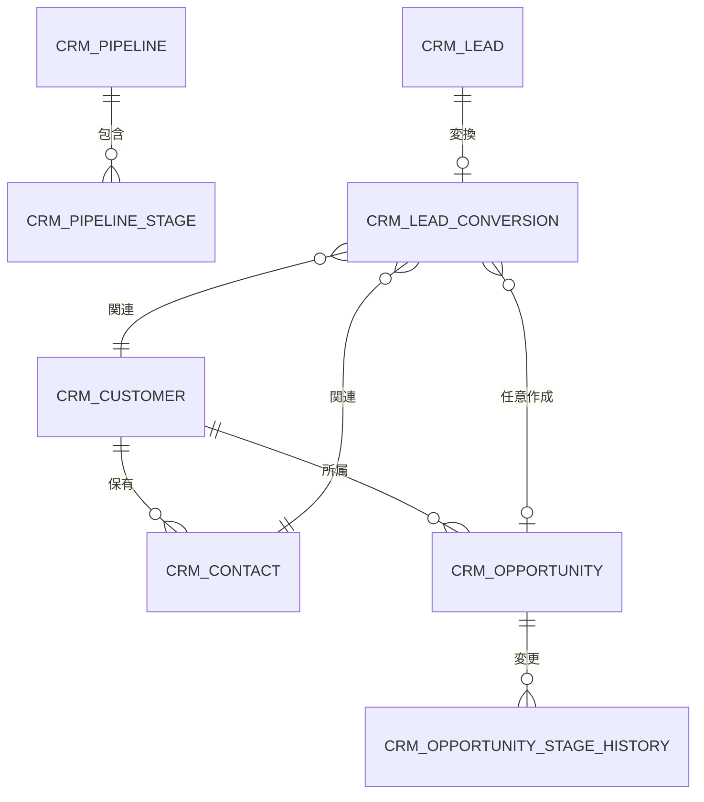

# CRM 販売パイプライン

[中文](crm.md) | [English](crm.en.md) | [한국어](crm.kr.md)

> 本文書は現在の CRM 実装の境界、契約、制約を記録します。中国語版を事実の原本とし、CRM コードの変更前に読んでください。
> 工程資料：[アーキテクチャ](architecture.jp.md)、[API 契約](api-contract.jp.md)、[バックエンド規約](backend-patterns.jp.md)、[フロントエンド規約](frontend-patterns.jp.md)。[原設計](design/crm-design.jp.md) は履歴資料であり、相違がある場合は現在のソースを優先します。
> 操作と実画面は [CRM Wiki](guides/crm-flow.jp.md)、拡張と Docker テストは [開発 Wiki](guides/scaffold-development.jp.md#8-crm-拡張とコンテナテスト) を参照してください。

CRM は独立したマイクロサービス `omni-crm` であり、プリセールスのクローズドループをカバーします：リード → フォロー → 顧客/連絡先 → 商談 → 受注または失注。製品、見積、契約、注文、請求、入金、マーケティング自動化、カスタマーサービスチケットは CRM の範囲外です。

## 1. サービス境界

| 項目 | 値 |
|---|---|
| Maven モジュール | `omni-crm` |
| サービスポート | `8104` |
| 管理ポート | `19904` |
| XXL-JOB エグゼキュータ | `omni-crm` / `9904` |
| データベース | `omni_crm` |
| Gateway ルーティング | `/api/crm/**` → `lb://omni-crm`（StripPrefix を使用しない） |
| Redis | DB 0、Auth の共通 XSS キャッシュキーを共有 |

**依存モジュール**：`omni-common-service`、`omni-common-core`、`omni-common`、`omni-common-mybatis`、`omni-common-redis`、`omni-common-operlog`、`omni-common-job`、`omni-common-mqlog`。

**`omni-common-workflow` に依存してはいけません**。依存すると Flowable エンジンが CRM に埋め込まれます。

**クロスサービス呼び出し**：OpenFeign + `InternalFeignHeadersFactory` が生成する `X-Internal-Token` を通じて Auth の内部 API を呼び出します。CRM は userId/unitId のみを保持し、`omni_auth` をクロスデータベースで参照しません。

## 2. ドメインモデル

### 2.1 集約とテーブル

| 集約 | テーブル | 責務 |
|---|---|---|
| Lead | `crm_lead`、`crm_lead_conversion` | リードのライフサイクル、変換の冪等性 |
| Customer | `crm_customer`、`crm_contact` | 顧客アーカイブ、連絡先、顧客 360 |
| Opportunity | `crm_opportunity`、`crm_opportunity_stage_history` | 段階、金額、確率、受注/失注履歴 |
| Activity | `crm_activity` | 計画、完了、キャンセルのフォロー |
| Pipeline | `crm_pipeline`、`crm_pipeline_stage` | パイプラインと段階の定義 |
| Ownership Audit | `crm_owner_change_log` | 担当者変更の不変履歴 |
| テナント設定 | `crm_tenant_config` | defaultPipelineId / currencyCode / leadDuplicatePolicy |



`crm_activity` は `root_type + root_id` により Lead/Customer/Opportunity への多態的関連を行います。Service は対象の存在、同一テナント、および現在のユーザーがアクセス可能であることを検証しなければなりません。

### 2.2 共通フィールドルール

すべての `crm_*` テーブルには `tenant_id` が必須です。認可対象の業務テーブルにはさらに以下が必要です：

- `tenant_id` — テナント分離
- `owner_user_id` — SELF スコープおよび業務担当者
- `owner_unit_id` — DEPT/DEPT_AND_BELOW/CUSTOM スコープ
- `version` — 楽観的ロック
- `deleted` — 論理削除
- `id/create_time/update_time/create_by/update_by` — 監査フィールド

**主要な制約**：

- ユーザー/組織 ID は Auth が管理し、クロスデータベースの外部キーは作成せず、フロントエンドから送信されたユーザー名や ownerUnitId を信頼しません
- 金額は `DECIMAL(18,2)` / `BigDecimal`、通貨は ISO 4217 の3桁コード、MVP ではすべての商談はテナントのデフォルト通貨に固定
- 日時は `yyyy-MM-dd HH:mm:ss` に統一
- `lead_no/customer_no/opportunity_no` はデータベース ID から生成され、テナント内で一意
- 通常の PUT では owner、status、stage の直接変更は許可しません
- 外部リクエストでは生の `selectById/updateById/deleteById` を使用してはいけません

## 3. セキュリティアーキテクチャ

### 3.1 6層の縦深防御

```
Gateway JWT 検証 → CRM Tenant 検証 → Spring Security @PreAuthorize
→ @ServiceDataScope アスペクト → MyBatis DataPermission インターセプタ → CrmRecordAccessGuard 行レベル書込み認可
```

1. Gateway は RS256 JWT を検証し、`X-User-*`、`X-Tenant-Id`、`X-Gateway-Forwarded` のヘッダー注入をカバー
2. `omni-common-service` の `GatewayPreAuthenticationFilter` が `Authentication` を構築し、`ServiceIdentityFilter` が userId/tenantId を検証してバインド
3. Controller の `@PreAuthorize` で機能権限を検証
4. `@ServiceDataScope(permissionCode)` 共通アスペクトが Auth の内部 API を呼び出して dataScope を解決
5. MyBatis-Plus が tenant + owner 条件を追加
6. `CrmRecordAccessGuard` が書込み操作の行レベル認可を検証

**フェイルクローズド**：tenant 欠落 → 401、scope 欠落 → `id=-1`（データ表示なし）、Auth 利用不可 → 503。決してフィルタリングなしにダウングレードしません。

### 3.2 MyBatis インターセプタの順序

CRM は `CrmTenantTablePolicy` と `CrmDataPermissionHandler` によって `omni-common-service` にドメインポリシーを提供し、共通 Starter が `mybatisPlusInterceptor` を組み立てます。順序は固定で変更不可です：

```
TenantLineInnerInterceptor → DataPermissionInterceptor → OptimisticLockerInnerInterceptor → PaginationInnerInterceptor
```

- TenantLine は `crm_*` テーブルのみを処理
- `sys_mq_message` は2つの権限インターセプタを除外（Relay は設計上すべてのテナントをスキャン）
- DataPermission は Pagination の前に配置し、COUNT とレコードが同じスコープになるように保証
- Pipeline/Stage は tenant + 機能権限のみで制御

### 3.3 DataScope マッピング

| dataScope | SQL 条件 |
|---|---|
| SELF | `owner_user_id = currentUserId` |
| DEPT | `owner_unit_id = primaryUnitId` |
| DEPT_AND_BELOW / CUSTOM | `owner_unit_id IN accessibleUnitIds` |
| TENANT / ALL | owner 条件なし、TenantLine は常に保持 |

### 3.4 書込み操作の行レベル認可

DataPermission は明示的な行レベル書込認可を代替しません。専用 SQL は owner 条件を除外する場合があります。各更新/削除/変換/移管/段階コマンドは以下を実行しなければなりません：

1. `tenant_id + id + data scope` で表示可能なレコードを問い合わせ（非表示 → 404、ID 列挙を防止）
2. ステートマシンと業務不変量を検証
3. `tenant_id + id + version` 条件で更新
4. 更新行数が1でない場合に同時更新の競合を返却

### 3.5 権限コード一覧

| リソース | 権限コード |
|---|---|
| Overview | `crm:overview:list` |
| Lead | `crm:lead:list/create/update/delete/assign/convert/disqualify` |
| Customer | `crm:customer:list/create/update/delete/transfer/status/blacklist` |
| Contact | `crm:contact:list/create/update/delete` |
| Opportunity | `crm:opportunity:list/create/update/delete/assign/stage/reopen` |
| Activity | `crm:activity:list/create/update/delete/complete/cancel` |
| Owner 候補 | `crm:owner:list` |
| PII 表示 | `crm:pii:view` |

表中の `/` は同一リソース内の複数の完全な権限コードの略記で、データベースには各コードを個別に保存します。`@PreAuthorize` と `@ServiceDataScope` は同じ完全な権限コードを使用します。

### 3.6 PII マスキング

- リード、顧客、連絡先の専用一覧は常にマスク済み VO を使います。詳細は `crm:pii:view` により連絡情報の全文返却を判断します。
- 活動の専用一覧/タイムラインは、マスクモードでは空白以外の内容を `[REDACTED]` にします。`null` と空白は保持し、詳細は PII 権限に従います。
- バックエンドの `CustomerServiceImpl.overview` は連絡先/活動ブロックに詳細と同じ PII 権限フラグを使うため、「全コレクションは必ずマスクされる」とは言えません。画面の `CustomerOverview.vue` は現在、顧客詳細、連絡先一覧、OPEN 商談一覧、活動タイムラインを個別に呼び、overview 一括応答を利用していません。
- 重複検出は候補 ID、番号、名称とマスク済み連絡要約のみ返します。編集画面は詳細を再読込し、PII 権限がなければ機微な入力を無効化/省略します。これは独立したバックエンドのフィールド書込権限ではありません。

### 3.7 XSS 防御

CRM は `omni.service.xss.enabled=true` により共通 Starter の `CachedServiceXssConfigProvider` を使い、CRM 独自の SPI 実装は持ちません。Redis DB 0 の `xss:enabled:{tenantId}` と `xss:rules:{tenantId}` を読み、キャッシュ欠落/異常時は Auth に照会します。照会失敗時は共通の安全な基準設定を使いますが、権威ある設定の enabled 値は尊重されます。備考はプレーンテキストとし、フロントエンドの `v-html` は禁止です。

### 3.8 ロールと dataScope

以下は正式 auth.sql の既定テナント用シード例で、全新規テナントがこれらのロールを既に持つ証拠ではありません。

| ロール | dataScope | 能力 |
|---|---|---|
| `CRM_ADMIN` | TENANT | 現在のテナントの全 CRM 機能/データ |
| `SALES_MANAGER` | DEPT_AND_BELOW | 部門および下位部門、割り当て/移管、統計 |
| `SALES_REP` | SELF | 自身が担当するデータと通常の販売操作 |
| `CRM_VIEWER` | TENANT | テナントレベルの読み取り専用、PII はデフォルトで付与されない |
| `SUPER_ADMIN` | ALL | 全機能、CRM データは現在のテナントに限定 |

デフォルトの USER ロールには CRM 権限は付与されません。

## 4. ステートマシンとコアフロー

### 4.1 Lead ライフサイクル

```
[*] → NEW → FOLLOWING → QUALIFIED → CONVERTED → [*]
NEW/FOLLOWING/QUALIFIED → DISQUALIFIED
DISQUALIFIED → FOLLOWING（再有効化）
```

- 初回変換は `QUALIFIED` が必要；`DISQUALIFIED` は理由が必須；`CONVERTED` は終端状態

### 4.2 Customer ステータス

```
POTENTIAL → ACTIVE → DORMANT / LOST / BLACKLISTED
DORMANT / LOST / BLACKLISTED → ACTIVE
```

商談の受注により POTENTIAL から ACTIVE へ自動遷移可能です。顧客にオープンな商談がある場合は直接削除できません。BLACKLISTED は独立したコマンドと `crm:customer:blacklist` 権限を使用します。

### 4.3 Opportunity 段階

```
DISCOVERY → QUALIFICATION → PROPOSAL → NEGOTIATION → WON / LOST
```

- これは既定の順序で、隣接段階だけに進める制限ではありません。コマンドは可視レコードをロックし、現在の `OPEN` と要求バージョンを確認します。現在/遷移先は同じパイプラインの有効な段階である必要があり、同一段階は拒否されます。
- sort の小さい段階への後退には reason が必須で、`LOST` にはさらに lossReason が必要です。バージョン条件付き更新、履歴、ローカル Outbox を書き込みます。
- `WON` は関連する未削除の `POTENTIAL` 顧客の `ACTIVE` 化を試みます。専用 SQL は owner 条件を除外し、テナント条件は保持します。サービスは更新一行を必須としていないため、どの顧客状態でも有効化されるとは保証しません。
- `WON/LOST` の通常編集は拒否されます。専用 `crm:opportunity:reopen` は直近の終了履歴から fromStageId を取り、その段階が現在も有効であることを確認します。`OPEN` と段階確率を復元し、終了時刻/失注理由を消去して `REOPEN` 履歴と段階イベントを追加します。

### 4.4 Activity ステータス

```
PLANNED → COMPLETED / CANCELLED
CANCELLED → PLANNED（再計画）
```

### 4.5 Lead 変換フロー

```
POST /api/crm/lead/{id}/convert
→ DTO、機能権限、データスコープを検証
→ 可視かつ未削除の Lead を SELECT FOR UPDATE
→ 既存 Conversion：元の IDs と idempotentReplay=true を返す
→ 初回変換：QUALIFIED と version 一致を確認
→ Customer + Contact を作成/関連付け、任意で Opportunity を作成
→ Lead を CONVERTED、活動を CUSTOMER と顧客 owner に移す
→ INSERT Conversion → INSERT ローカル Outbox（同一トランザクション）
```

一意制約は `(tenant_id, lead_id)` です。再実行は状態/バージョン確認より先に既存結果を返しますが、要求検証、権限、可視性は必要で、業務行/Outbox を重複作成しません。

新規顧客はリード owner、新規連絡先は選択した顧客 owner を継承します。既存連絡先はその顧客に属する必要があります。任意の新規商談はリード owner、既定パイプラインの `DISCOVERY`、テナント通貨、履歴理由 `CONVERSION_CREATE` を使います。この経路は継承 owner を Auth で再解決しません。

変換は CRM のローカルトランザクションと Outbox のみを使い、Workflow 呼出し/直接 Broker 送信は行いません。ただし CRM 全体の Feign がすべてトランザクション外という意味ではなく、通常作成、移管、表示補完ではトランザクション付きメソッド内から Auth を呼び得ます。[Core Flows 13/14](core-flows.jp.md) を参照してください。

## 5. API エントリ一覧

### 5.1 共通契約

- すべてのレスポンスは `R<T>`、ページネーションは `R<PageResult<T>>`
- `page=1`、`size=10`、最大 `size=100`
- Entity は Request/Response として使用しない、状態コマンドは独立した DTO を使用
- 日付パラメータは `@DateTimeFormat(pattern = "yyyy-MM-dd HH:mm:ss")`
- 状態/遷移/移管リクエストは `version` を保持
- 書込みインターフェースは `@PreAuthorize` と `@OperLog` の両方を宣言

### 5.2 エンドポイント一覧

以下は `/api/crm` からの相対パスを個別に完全記載しており、前項のパスを補いません。DTO は Controller と `CrmRequests` に従います。

| ドメイン | エンドポイント |
|---|---|
| 概要 | `GET /overview/summary` · `GET /overview/funnel` · `GET /overview/follow-ups` |
| パイプライン | `GET /pipeline/list` · `GET /pipeline/{id}/stages` |
| リード | `GET /lead/list` · `GET /lead/{id}` · `POST /lead` · `PUT /lead/{id}` · `DELETE /lead/{id}` |
| リードコマンド | `POST /lead/duplicate-check` · `POST /lead/{id}/assign` · `POST /lead/batch-assign` · `POST /lead/{id}/qualify` · `POST /lead/{id}/disqualify` · `POST /lead/{id}/reopen` · `POST /lead/{id}/convert` |
| 顧客 | `GET /customer/list` · `GET /customer/{id}` · `GET /customer/{id}/overview` · `POST /customer` · `PUT /customer/{id}` · `DELETE /customer/{id}` |
| 顧客コマンド | `POST /customer/duplicate-check` · `POST /customer/{id}/status` · `POST /customer/{id}/transfer` · `POST /customer/{id}/blacklist` · `POST /customer/{id}/restore-from-blacklist` |
| 連絡先 | `GET /contact/list` · `GET /customer/{customerId}/contact/list` · `GET /contact/{id}` · `POST /customer/{customerId}/contact` · `PUT /contact/{id}` · `DELETE /contact/{id}` · `POST /contact/{id}/primary` |
| 商談 | `GET /opportunity/list` · `GET /opportunity/board` · `GET /opportunity/{id}` · `GET /opportunity/{id}/stage-history` · `POST /opportunity` · `PUT /opportunity/{id}` · `DELETE /opportunity/{id}` |
| 商談コマンド | `POST /opportunity/{id}/assign` · `POST /opportunity/{id}/stage` · `POST /opportunity/{id}/reopen` |
| 活動 | `GET /activity/list` · `GET /activity/timeline` · `GET /activity/{id}` · `POST /activity` · `PUT /activity/{id}` · `DELETE /activity/{id}` |
| 活動コマンド | `POST /activity/{id}/complete` · `POST /activity/{id}/cancel` · `POST /activity/{id}/reschedule` |
| 担当候補 | `GET /options/owners` |

### 5.3 Customer 360 ブロック別権限

`GET /api/crm/customer/{id}/overview` は顧客、連絡先、OPEN 商談、直近最大 20 件の活動、変換元リード ID を返します。各ブロックは固有の list 権限でスコープを解決し、未許可なら問い合わせません。`CrmPermissionScopeExecutor` が元の `ServiceDataScopeContext` を復元し、外側アスペクトが最後に消去します。顧客の可視性だけでは全関連データへのアクセスは得られません。PII は 3.6 を参照してください。

### 5.4 Overview 集約クエリ

`summary()`、`funnel()`、`followups()` は Mapper レイヤーで集約 SQL（`GROUP BY` / `UNION ALL`）を使用し、全量ロードしてメモリでフィルタリングすることはありません。DataPermissionInterceptor は集約クエリにも自動的に適用されます。

## 6. クロスサービス連携

### 6.1 Auth Feign

- 作成/割当/移管経路の `CrmOwnerResolver` は担当者の存在、有効性、同一テナント、主組織、割当可能範囲を確認します。他の担当者を指定する場合は対応する assign/transfer 権限も必要です。変換の継承規則は 4.5 に従います。
- `ownerUnitId` は Auth の主組織に由来します。`CrmOwnerEnricher` は ID の重複を除き、ユーザーと組織を別々のバッチで照会します。行ごとの呼出しは行いません。実行者名は別のユーザーバッチで補完します。
- スコープ解決時の Auth 権限拒否は 403、他の依存障害は 503 です。表示補完の例外時は ID と空の名称を保持できます。表示の縮退は権限を拡大せず、全遠隔呼出しが DB トランザクション外であることも意味しません。

### 6.2 Outbox イベント

業務トランザクションは `ReliableMessageRelay.send("crm-domain-out-0", envelope, tenantId, eventId)` を呼びます。既定実装は REQUIRED 伝播でローカル PENDING 行を挿入し、Relay が後から Broker に送信します。Relay 停止でも Outbox 書込は停止しません。

`DomainEventEnvelope` は `eventId/eventType/occurredAt/tenantId/producer`、`aggregateType/aggregateId/aggregateVersion`、`actorUserId`、`payload` を持ちます。eventId は信封の最上位で msgKey に渡され、Outbox msgId は別途生成されます。msgKey はコンシューマの業務冪等性を代替しません。payload に完全な PII は含めません。

| eventType | payload |
|---|---|
| `crm.lead.converted.v1` | leadId、customerId、contactId、null 可の opportunityId |
| `crm.opportunity.stage-changed.v1` / `crm.opportunity.won.v1` / `crm.opportunity.lost.v1` | opportunityId、stageId、status |
| `crm.customer.owner-changed.v1` | customerId、oldOwnerUserId/newOwnerUserId、oldOwnerUnitId/newOwnerUnitId、cascadeOpenOpportunities |

### 6.3 操作ログ

共通 `@OperLog` は明示的なフィールド規則で秘匿化し、任意の PII を認識する保証はありません。変換はエンティティスナップショットを無効化し、customerName/contactName/opportunityName を追加除外します。Owner Change と Stage History は業務トランザクション内の同期的事実で、非同期汎用ログでは代替できません。

## 7. ハード制約

CRM コードを変更する前に遵守すべきルール：

1. **テナント分離**：すべての `crm_*` テーブルには `tenant_id` が必須、TenantLine は常に追加、通常 API はクロステナント不可
2. **バージョン付きコマンド**：既存レコードの外部変更コマンドは tenant + id + version と更新行数確認を使う。作成時の番号補完や専用連鎖 SQL は各行のクライアントバージョン指定コマンドとは異なる
3. **フェイルクローズド**：tenant 欠落 → 401、scope 欠落 → `id=-1`、Auth 利用不可 → 503、決してダウングレードしない
4. **ThreadLocal クリーンアップ**：`ServiceIdentityContext` と `ServiceDataScopeContext` は `finally` ブロックで必ずクリーンアップし、メモリリークを防止
5. **権限の二重宣言**：書込みインターフェースは `@PreAuthorize`（機能権限）と `@ServiceDataScope`（データスコープ）の両方を宣言し、同じ完全な権限コードを使用
6. **PII バックエンドマスキング**：`crm:pii:view` がない場合はバックエンド VO で直接マスキング値を返し、フロントエンドに依存しない
7. **Outbox tenantId 明示**：`ReliableMessageRelay.send()` は `Long tenantId` を明示的に渡す必要があり、ThreadLocal の暗黙的使用を禁止
8. **インターセプタ順序**：TenantLine → DataPermission → OptimisticLocker → Pagination、変更不可
9. **書込み認可**：DataPermission のみに依存せず、AccessGuard による行レベル検証が必須
10. **ステートマシン**：通常の PUT は status/stage の変更を受け付けない、専用のコマンドエンドポイントを経由
11. **MySQL DATETIME 範囲**：`LocalDateTime.MIN/MAX` をクエリパラメータとして使用不可、`LocalDateTime.of(2000,1,1,0,0)` などの適切な値を使用
12. **Pipeline 読み取り専用**：MVP のパイプラインと段階はテナント初期化時に自動作成され、管理 UI は提供しない
13. **Activity 多態**：`root_type + root_id` で関連付け、Service は対象の存在とアクセス可能性を検証
14. **`sys_mq_message` の権限インターセプタ除外**：Relay はすべてのテナントをスキャン、ユーザークエリには明示的な tenant フィルタリングが必要

## 8. フロントエンド構造

```
omni-frontend/src/
├── api/
│   ├── crm-overview.ts        # オーバービュー集約 API
│   ├── crm-lead.ts            # リード CRUD + コマンド
│   ├── crm-customer.ts        # 顧客 CRUD + 360 + 移管
│   ├── crm-contact.ts         # 連絡先 CRUD
│   ├── crm-opportunity.ts     # 商談 CRUD + カンバン + 段階
│   └── crm-activity.ts        # 活動 CRUD + タイムライン
├── views/crm/
│   ├── overview/index.vue     # 販売オーバービュー
│   ├── lead/index.vue         # リード管理
│   ├── customer/index.vue     # 顧客管理
│   ├── contact/index.vue      # 連絡先管理
│   ├── opportunity/index.vue  # 商談管理
│   └── activity/index.vue     # フォロー活動
└── components/crm/
    ├── OwnerSelector.vue      # 担当者セレクタ
    ├── CustomerPicker.vue     # 顧客ピッカー
    ├── ActivityTimeline.vue   # 活動タイムライン
    ├── OpportunityStageBoard.vue  # 商談カンバンボード
    └── CustomerOverview.vue   # 顧客 360 ビュー
```

- `ApiResponse/PageResult` は `src/types/api.ts` からのみインポート
- ボタンは `v-permission` ディレクティブで同じコードを使用しますが、バックエンドが最終的なセキュリティ境界です
- Customer 360 は Drawer コンポーネントを使用
- Opportunity ページはテーブル + カンバンのデュアルビューを提供

## 9. 拡張とテストの入口

集約、権限、イベント、Docker テストの手順は [開発 Wiki の CRM 拡張](guides/scaffold-development.jp.md#8-crm-拡張とコンテナテスト) に移動しました。現在のパイプライン/段階 API は読み取り専用です。管理機能や既存商談の移行は別途設計が必要で、将来計画を現行機能と見なしてはいけません。

## 10. 検証の境界

単体テストは状態機械、変換再実行、連鎖更新、PII、スコープ SQL、安全上の失敗分岐を含みます。Mock/メモリロックは実 MySQL の並行性や MQ 配送を証明しません。`CrmMysqlInterceptorIntegrationTest` は `CRM_TEST_MYSQL_URL` 設定時だけ有効で、テスト DB 資格情報も必要です。`crm_lead` を作成/削除するため、専用の破棄可能テスト DB だけを対象にします。

最新の再利用 Docker Reactor 報告では、CRM の Surefire 報告は 16、用例は 45 で、41 成功、MySQL 4 件は条件付きスキップでした。これは今回の報告値で固定カバレッジの約束ではありません。履歴 `*IT` は `WP008_F_ENABLED` と独立環境の保護が必要で、今回の通常テストの結論には含まれず、無条件に有効化できません。実 UI/API の独立した証拠範囲は [CRM Wiki](guides/crm-flow.jp.md) にあります。

## 11. 現在のソース入口

[スキーマ](../database/changelog/crm/0001-crm-schema.yaml) · [DTO](../omni-backend/omni-crm/src/main/java/com/omni/crm/dto/CrmRequests.java) · [データ権限](../omni-backend/omni-crm/src/main/java/com/omni/crm/security/CrmDataPermissionHandler.java) · [変換](../omni-backend/omni-crm/src/main/java/com/omni/crm/service/impl/LeadServiceImpl.java) · [段階](../omni-backend/omni-crm/src/main/java/com/omni/crm/service/impl/OpportunityServiceImpl.java) · [顧客 360/移管](../omni-backend/omni-crm/src/main/java/com/omni/crm/service/impl/CustomerServiceImpl.java) · [共通永続化](../omni-backend/omni-common-service/src/main/java/com/omni/common/service/config/ServicePersistenceAutoConfiguration.java) · [XSS 提供者](../omni-backend/omni-common-service/src/main/java/com/omni/common/service/xss/CachedServiceXssConfigProvider.java)。
