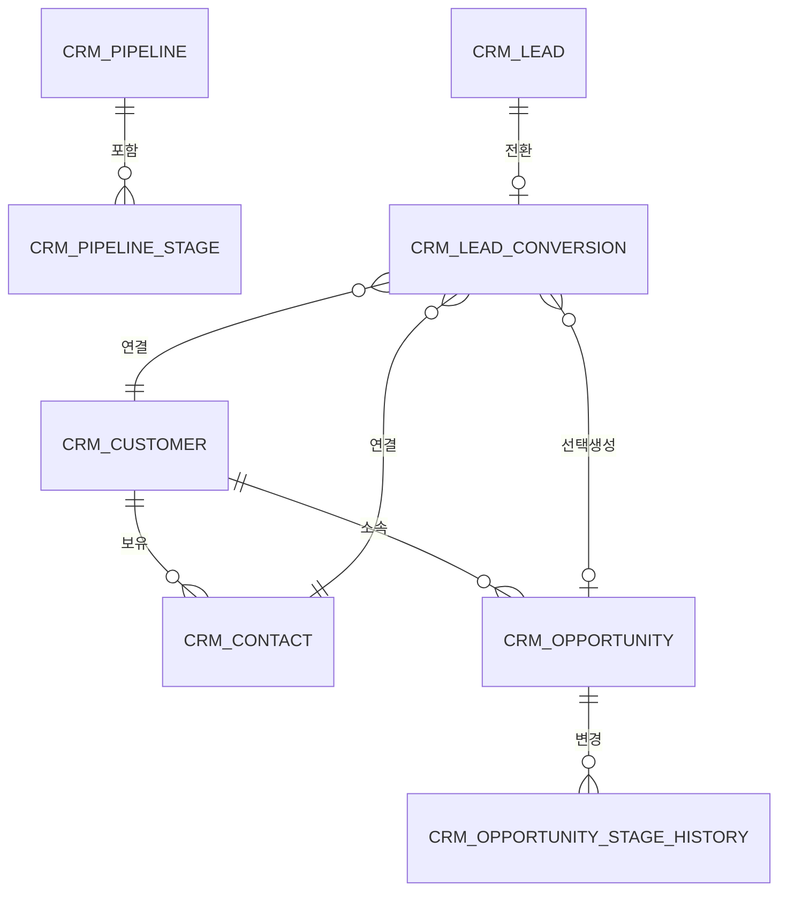

# CRM 세일즈 파이프라인

[中文](crm.md) | [English](crm.en.md) | [日本語](crm.jp.md)

> 이 문서는 현재 CRM 구현의 경계, 계약, 제약을 기록합니다. 중국어가 사실 원문이며 CRM 코드 변경 전에 읽어야 합니다.
> 개발 자료: [아키텍처](architecture.kr.md), [API 계약](api-contract.kr.md), [백엔드 규칙](backend-patterns.kr.md), [프론트엔드 규칙](frontend-patterns.kr.md). [초기 설계](design/crm-design.kr.md)는 이력 자료이며 차이가 있으면 현재 소스를 우선합니다.
> 사용 방법과 실제 화면은 [CRM Wiki](guides/crm-flow.kr.md), 확장과 Docker 테스트는 [개발 Wiki](guides/scaffold-development.kr.md#8-crm-확장-및-컨테이너-테스트)를 참고하세요.

CRM은 독립 마이크로서비스 `omni-crm`으로, 세일즈 전단 폐쇄 루프를 담당합니다: 리드 → 팔로우업 → 고객/연락처 → 기회 → 수주 또는 실주. 제품, 견적, 계약, 주문, 청구, 회수, 마케팅 자동화, CS 티켓은 CRM 범위에 포함되지 않습니다.

## 1. 서비스 경계

| 항목 | 값 |
|---|---|
| Maven 모듈 | `omni-crm` |
| 서비스 포트 | `8104` |
| 관리 포트 | `19904` |
| XXL-JOB 실행기 | `omni-crm` / `9904` |
| 데이터베이스 | `omni_crm` |
| Gateway 라우트 | `/api/crm/**` → `lb://omni-crm`(StripPrefix 사용하지 않음) |
| Redis | DB 0, Auth 공통 XSS 캐시 키 공유 |

**의존 모듈**: `omni-common-service`, `omni-common-core`, `omni-common`, `omni-common-mybatis`, `omni-common-redis`, `omni-common-operlog`, `omni-common-job`, `omni-common-mqlog`.

**의존 금지**: `omni-common-workflow`를 의존하면 Flowable 엔진이 CRM에 포함됩니다.

**크로스 서비스 호출**: OpenFeign + `InternalFeignHeadersFactory`가 생성한 `X-Internal-Token`을 통해 Auth 내부 API를 호출합니다. CRM은 userId/unitId만 저장하며, `omni_auth` 데이터베이스를 크로스 조회하지 않습니다.

## 2. 도메인 모델

### 2.1 애그리거트와 테이블

| 애그리거트 | 테이블 | 책임 |
|---|---|---|
| Lead | `crm_lead`, `crm_lead_conversion` | 리드 수명주기, 전환 멱등성 |
| Customer | `crm_customer`, `crm_contact` | 고객 아카이브, 연락처, 고객 360 |
| Opportunity | `crm_opportunity`, `crm_opportunity_stage_history` | 단계, 금액, 확률, 수주/실주 이력 |
| Activity | `crm_activity` | 계획, 완료, 취소 팔로우업 |
| Pipeline | `crm_pipeline`, `crm_pipeline_stage` | 파이프라인 및 단계 정의 |
| Ownership Audit | `crm_owner_change_log` | 담당자 변경의 불변 이력 |
| 테넌트 설정 | `crm_tenant_config` | defaultPipelineId / currencyCode / leadDuplicatePolicy |



`crm_activity`는 `root_type + root_id` 다형 연관으로 Lead/Customer/Opportunity에 연결됩니다. Service는 대상이 존재하고, 동일 테넌트이며, 현재 사용자가 접근할 수 있는지 반드시 검증해야 합니다.

### 2.2 공통 필드 규칙

모든 `crm_*` 테이블에는 `tenant_id`가 반드시 있어야 합니다. 권한 부여 가능한 비즈니스 테이블에는 다음 필드도 필수입니다:

- `tenant_id` — 테넌트 격리
- `owner_user_id` — SELF 범위 및 비즈니스 담당자
- `owner_unit_id` — DEPT/DEPT_AND_BELOW/CUSTOM 범위
- `version` — 낙관적 잠금
- `deleted` — 논리 삭제
- `id/create_time/update_time/create_by/update_by` — 감사 필드

**핵심 제약사항**:

- 사용자/조직 ID는 Auth에서 관리하므로, 크로스 DB 외부 키를 생성하지 않고, 프론트엔드에서 제출한 사용자명이나 ownerUnitId를 신뢰하지 않습니다
- 금액은 `DECIMAL(18,2)` / `BigDecimal`을 사용하고, 통화는 ISO 4217 세 자리 코드를 사용합니다. MVP에서는 모든 기회가 테넌트 기본 통화를 강제합니다
- 일시 형식은 `yyyy-MM-dd HH:mm:ss`로 통일합니다
- `lead_no/customer_no/opportunity_no`는 데이터베이스 ID에서 생성되며, 테넌트 내 고유합니다
- 일반 PUT은 owner, status, stage를 직접 수정할 수 없습니다
- 외부 요청은 순수 `selectById/updateById/deleteById`를 사용해서는 안 됩니다

## 3. 보안 아키텍처

### 3.1 6계층 종심방어

```
Gateway JWT 검증 → CRM Tenant 검증 → Spring Security @PreAuthorize
→ @ServiceDataScope AOP → MyBatis DataPermission 인터셉터 → CrmRecordAccessGuard 행 수준 쓰기 권한
```

1. Gateway가 RS256 JWT를 검증하고, `X-User-*`, `X-Tenant-Id`, `X-Gateway-Forwarded` 헤더 주입을 커버합니다
2. `omni-common-service`의 `GatewayPreAuthenticationFilter`가 `Authentication`을 구성하고, `ServiceIdentityFilter`가 userId/tenantId를 검증하여 바인딩합니다
3. Controller `@PreAuthorize`가 기능 권한을 검증합니다
4. `@ServiceDataScope(permissionCode)` 공통 AOP가 Auth 내부 API를 호출하여 dataScope를 해석합니다
5. MyBatis-Plus가 tenant + owner 조건을 추가합니다
6. `CrmRecordAccessGuard`가 쓰기 작업의 행 수준 권한을 검증합니다

**실패 시 차단(Fail-close)**: tenant 누락 → 401, scope 누락 → `id=-1`(데이터 조회 불가), Auth 사용 불가 → 503. 절대로 필터링 없음으로 격하하지 않습니다.

### 3.2 MyBatis 인터셉터 순서

CRM은 `CrmTenantTablePolicy`와 `CrmDataPermissionHandler`를 통해 `omni-common-service`에 도메인 정책을 제공하며, 공통 Starter가 `mybatisPlusInterceptor`를 조립합니다. 순서는 고정되어 변경할 수 없습니다:

```
TenantLineInnerInterceptor → DataPermissionInterceptor → OptimisticLockerInnerInterceptor → PaginationInnerInterceptor
```

- TenantLine은 `crm_*` 테이블만 처리합니다
- `sys_mq_message`는 두 권한 인터셉터에서 제외됩니다(Relay는 설계상 모든 테넌트를 스캔합니다)
- DataPermission은 반드시 Pagination 앞에 위치하여 COUNT와 records가 동일 범위를 보장해야 합니다
- Pipeline/Stage는 tenant + 기능 권한으로만 제어됩니다

### 3.3 DataScope 매핑

| dataScope | SQL 조건 |
|---|---|
| SELF | `owner_user_id = currentUserId` |
| DEPT | `owner_unit_id = primaryUnitId` |
| DEPT_AND_BELOW / CUSTOM | `owner_unit_id IN accessibleUnitIds` |
| TENANT / ALL | owner 조건 미추가, TenantLine은 항상 유지 |

### 3.4 쓰기 작업 행 수준 권한

DataPermission은 명시적 행 수준 쓰기 권한 검사를 대신하지 않습니다. 전용 SQL은 owner 필터를 제외할 수 있습니다. 모든 업데이트/삭제/전환/이관/단계 명령은 다음을 수행해야 합니다:

1. `tenant_id + id + data scope`로 조회 가능한 레코드를 조회합니다(조회 불가 → 404, ID 열거 방지)
2. 상태 머신 및 비즈니스 불변식을 검증합니다
3. `tenant_id + id + version` 조건으로 업데이트합니다
4. 업데이트된 행 수가 1이 아닐 경우 동시성 충돌을 반환합니다

### 3.5 권한 코드 목록

| 리소스 | 권한 코드 |
|---|---|
| Overview | `crm:overview:list` |
| Lead | `crm:lead:list/create/update/delete/assign/convert/disqualify` |
| Customer | `crm:customer:list/create/update/delete/transfer/status/blacklist` |
| Contact | `crm:contact:list/create/update/delete` |
| Opportunity | `crm:opportunity:list/create/update/delete/assign/stage/reopen` |
| Activity | `crm:activity:list/create/update/delete/complete/cancel` |
| Owner 후보 | `crm:owner:list` |
| PII 조회 | `crm:pii:view` |

표에서 `/`는 동일 리소스 내 여러 전체 권한 코드의 축약형이며, 데이터베이스에 저장할 때 각 코드를 개별적으로 저장합니다. `@PreAuthorize`와 `@ServiceDataScope`은 동일한 전체 권한 코드를 사용합니다.

### 3.6 PII 마스킹

- 리드, 고객, 연락처 전용 목록은 항상 마스킹 VO를 사용합니다. 상세 정보는 `crm:pii:view` 권한에 따라 전체 연락 정보를 반환합니다.
- 활동 전용 목록/타임라인은 마스킹 모드에서 공백이 아닌 내용을 `[REDACTED]`로 바꾸며 `null`과 공백은 유지합니다. 상세는 PII 권한을 따릅니다.
- 백엔드 `CustomerServiceImpl.overview`의 연락처/활동 블록은 상세 PII 권한 플래그를 사용하므로 모든 컬렉션이 항상 마스킹된다고 볼 수 없습니다. 화면 `CustomerOverview.vue`는 현재 고객 상세, 연락처 목록, OPEN 기회 목록, 활동 타임라인을 개별 호출하고 overview 묶음 응답을 재사용하지 않습니다.
- 중복 검사는 후보 ID, 번호, 이름, 마스킹 연락 요약만 반환합니다. 편집 화면은 상세를 다시 읽고 PII 권한이 없으면 민감 입력을 비활성화/생략합니다. 이는 별도의 백엔드 필드 쓰기 권한 장치가 아닙니다.

### 3.7 XSS 방어

CRM은 `omni.service.xss.enabled=true`를 통해 공통 Starter의 `CachedServiceXssConfigProvider`를 사용하며 CRM 전용 SPI 구현을 두지 않습니다. Redis DB 0의 `xss:enabled:{tenantId}`와 `xss:rules:{tenantId}`를 읽고 캐시 누락/오류 시 Auth에 조회합니다. 조회 실패 시 공통 보안 기본값을 사용하며, 권위 있는 설정의 enabled 값은 그대로 존중합니다. 비고는 일반 텍스트로 처리하고 프론트엔드 `v-html`을 금지합니다.

### 3.8 역할과 dataScope

다음은 정식 auth.sql의 기본 테넌트 시드 예시이며 모든 새 테넌트가 이미 이 역할을 갖는다는 증거가 아닙니다.

| 역할 | dataScope | 권한 |
|---|---|---|
| `CRM_ADMIN` | TENANT | 현재 테넌트의 전체 CRM 기능/데이터 |
| `SALES_MANAGER` | DEPT_AND_BELOW | 부서 및 하위 조직, 할당/이관, 통계 |
| `SALES_REP` | SELF | 본인 담당 데이터 및 일반 세일즈 작업 |
| `CRM_VIEWER` | TENANT | 테넌트 수준 읽기 전용, PII는 기본적으로 부여되지 않음 |
| `SUPER_ADMIN` | ALL | 모든 기능, CRM 데이터는 여전히 현재 테넌트로 제한 |

기본 USER 역할에는 CRM 권한이 부여되지 않습니다.

## 4. 상태 머신 및 핵심 흐름

### 4.1 Lead 수명주기

```
[*] → NEW → FOLLOWING → QUALIFIED → CONVERTED → [*]
NEW/FOLLOWING/QUALIFIED → DISQUALIFIED
DISQUALIFIED → FOLLOWING(재활성화)
```

- 첫 전환은 `QUALIFIED` 상태가 필요; `DISQUALIFIED`는 사유 필수; `CONVERTED`는 최종 상태

### 4.2 Customer 상태

```
POTENTIAL → ACTIVE → DORMANT / LOST / BLACKLISTED
DORMANT / LOST / BLACKLISTED → ACTIVE
```

기회 수주 시 POTENTIAL을 ACTIVE로 자동 전환할 수 있습니다. 고객에 열린 기회가 있으면 직접 삭제할 수 없습니다. BLACKLISTED는 독립 명령과 `crm:customer:blacklist` 권한을 사용합니다.

### 4.3 Opportunity 단계

```
DISCOVERY → QUALIFICATION → PROPOSAL → NEGOTIATION → WON / LOST
```

- 기본 순서이며 바로 다음 단계로만 이동해야 하는 제약은 아닙니다. 명령은 보이는 레코드를 잠그고 현재 `OPEN` 상태와 요청 버전을 검사합니다. 현재/대상 단계는 활성 상태이며 같은 파이프라인이어야 하고 동일 단계는 거부합니다.
- 더 작은 sort로 후퇴할 때 reason이 필요하며 `LOST`에는 lossReason도 필요합니다. 버전 조건 업데이트, 이력, 로컬 Outbox를 기록합니다.
- `WON`은 연관된 미삭제 `POTENTIAL` 고객을 `ACTIVE`로 바꾸려고 시도합니다. 전용 SQL은 owner 조건을 제외하지만 테넌트 조건은 유지합니다. 서비스가 반드시 한 행 업데이트를 요구하지 않아 모든 고객 상태의 활성화를 보장하지 않습니다.
- `WON/LOST` 일반 편집은 거부됩니다. 전용 `crm:opportunity:reopen` 명령은 최근 종료 이력의 fromStageId를 사용하고 해당 단계가 여전히 활성인지 확인합니다. `OPEN`과 확률을 복원하고 종료 시각/실주 사유를 지운 뒤 `REOPEN` 이력과 단계 이벤트를 추가합니다.

### 4.4 Activity 상태

```
PLANNED → COMPLETED / CANCELLED
CANCELLED → PLANNED(재계획)
```

### 4.5 Lead 전환 흐름

```
POST /api/crm/lead/{id}/convert
→ DTO, 기능 권한, 데이터 범위 검증
→ 보이는 미삭제 Lead를 SELECT FOR UPDATE
→ 기존 Conversion: 원래 IDs와 idempotentReplay=true 반환
→ 첫 전환: QUALIFIED와 version 일치 확인
→ Customer + Contact 생성/연결, 선택적으로 Opportunity 생성
→ Lead를 CONVERTED로, 활동을 CUSTOMER 및 고객 owner로 이동
→ INSERT Conversion → INSERT 로컬 Outbox(동일 트랜잭션)
```

고유 제약은 `(tenant_id, lead_id)`입니다. 재실행은 상태/버전 검사 전에 기존 결과를 반환하지만 요청 검증, 권한, 레코드 가시성은 필요하며 업무 행과 Outbox를 중복 기록하지 않습니다.

새 고객은 리드 owner를, 새 연락처는 선택된 고객 owner를 상속합니다. 기존 연락처는 그 고객 소속이어야 합니다. 선택적 새 기회는 리드 owner, 기본 파이프라인 `DISCOVERY`, 테넌트 통화, `CONVERSION_CREATE` 이력을 사용합니다. 이 경로는 상속 owner를 Auth에서 다시 해석하지 않습니다.

전환은 CRM 로컬 트랜잭션과 Outbox만 사용하고 Workflow나 Broker를 직접 호출하지 않습니다. 모든 CRM Feign이 트랜잭션 외부라는 뜻은 아닙니다. 일반 생성, 이관, 응답 이름 보완은 트랜잭션 메서드에서 Auth를 호출할 수 있습니다. [Core Flows 13/14](core-flows.kr.md)를 참고하세요.

## 5. API 엔트리 색인

### 5.1 공통 계약

- 모든 응답은 `R<T>`, 페이징은 `R<PageResult<T>>`
- `page=1`, `size=10`, 최대 `size=100`
- Entity는 Request/Response로 사용하지 않으며, 상태 명령은 독립 DTO를 사용합니다
- 날짜 파라미터는 `@DateTimeFormat(pattern = "yyyy-MM-dd HH:mm:ss")`
- 상태/전환/이관 요청은 `version`을 포함합니다
- 쓰기 인터페이스는 `@PreAuthorize`와 `@OperLog`를 동시에 선언합니다

### 5.2 엔드포인트 목록

아래 경로는 `/api/crm` 기준이며 앞 항목을 보충하지 않고 각 경로를 완전히 표시합니다. DTO는 Controller와 `CrmRequests`를 기준으로 합니다.

| 도메인 | 엔드포인트 |
|---|---|
| 개요 | `GET /overview/summary` · `GET /overview/funnel` · `GET /overview/follow-ups` |
| 파이프라인 | `GET /pipeline/list` · `GET /pipeline/{id}/stages` |
| 리드 | `GET /lead/list` · `GET /lead/{id}` · `POST /lead` · `PUT /lead/{id}` · `DELETE /lead/{id}` |
| 리드 명령 | `POST /lead/duplicate-check` · `POST /lead/{id}/assign` · `POST /lead/batch-assign` · `POST /lead/{id}/qualify` · `POST /lead/{id}/disqualify` · `POST /lead/{id}/reopen` · `POST /lead/{id}/convert` |
| 고객 | `GET /customer/list` · `GET /customer/{id}` · `GET /customer/{id}/overview` · `POST /customer` · `PUT /customer/{id}` · `DELETE /customer/{id}` |
| 고객 명령 | `POST /customer/duplicate-check` · `POST /customer/{id}/status` · `POST /customer/{id}/transfer` · `POST /customer/{id}/blacklist` · `POST /customer/{id}/restore-from-blacklist` |
| 연락처 | `GET /contact/list` · `GET /customer/{customerId}/contact/list` · `GET /contact/{id}` · `POST /customer/{customerId}/contact` · `PUT /contact/{id}` · `DELETE /contact/{id}` · `POST /contact/{id}/primary` |
| 기회 | `GET /opportunity/list` · `GET /opportunity/board` · `GET /opportunity/{id}` · `GET /opportunity/{id}/stage-history` · `POST /opportunity` · `PUT /opportunity/{id}` · `DELETE /opportunity/{id}` |
| 기회 명령 | `POST /opportunity/{id}/assign` · `POST /opportunity/{id}/stage` · `POST /opportunity/{id}/reopen` |
| 활동 | `GET /activity/list` · `GET /activity/timeline` · `GET /activity/{id}` · `POST /activity` · `PUT /activity/{id}` · `DELETE /activity/{id}` |
| 활동 명령 | `POST /activity/{id}/complete` · `POST /activity/{id}/cancel` · `POST /activity/{id}/reschedule` |
| 담당자 후보 | `GET /options/owners` |

### 5.3 Customer 360 블록별 권한

`GET /api/crm/customer/{id}/overview`는 고객, 연락처, OPEN 기회, 최근 최대 20개 활동과 전환 리드 ID를 반환합니다. 각 블록이 자기 list 권한으로 범위를 해석하며 권한이 없으면 조회하지 않습니다. `CrmPermissionScopeExecutor`는 이전 `ServiceDataScopeContext`를 복원하고 외부 AOP가 최종 정리합니다. 고객이 보인다고 모든 연관 데이터가 허용되는 것은 아닙니다. PII 경계는 3.6을 참고하세요.

### 5.4 Overview 집계 쿼리

`summary()`, `funnel()`, `followups()`는 Mapper 계층에서 집계 SQL(`GROUP BY` / `UNION ALL`)을 사용하며, 전체를 로드한 후 메모리에서 필터링하지 않습니다. DataPermissionInterceptor는 집계 쿼리에 자동으로 적용됩니다.

## 6. 크로스 서비스 통합

### 6.1 Auth Feign

- 생성/할당/이관 경로의 `CrmOwnerResolver`는 담당자가 존재하고 활성 상태이며 같은 테넌트이고 주 조직과 할당 가능한 범위를 갖는지 검사합니다. 다른 담당자 지정에는 대응 assign/transfer 권한도 필요합니다. 전환의 상속 규칙은 4.5를 따릅니다.
- `ownerUnitId`는 Auth 주 조직에서 가져옵니다. `CrmOwnerEnricher`는 중복 ID를 제거한 뒤 사용자와 조직을 각각 일괄 조회하며 행별 호출을 하지 않습니다. 수행자 이름은 별도 사용자 일괄 조회로 보완합니다.
- 범위 해석 중 Auth 권한 거부는 403, 다른 의존성 장애는 503입니다. 표시 보완 오류 시 ID와 빈 이름을 유지할 수 있습니다. 표시 대체는 권한을 확대하지 않으며 모든 원격 호출이 DB 트랜잭션 외부임을 의미하지 않습니다.

### 6.2 Outbox 이벤트

업무 트랜잭션은 `ReliableMessageRelay.send("crm-domain-out-0", envelope, tenantId, eventId)`를 호출합니다. 기본 구현은 REQUIRED 전파로 로컬 PENDING 행을 삽입하고 Relay가 나중에 Broker로 전송합니다. Relay 비활성화는 Outbox 기록 비활성화가 아닙니다.

`DomainEventEnvelope`는 `eventId/eventType/occurredAt/tenantId/producer`, `aggregateType/aggregateId/aggregateVersion`, `actorUserId`, `payload`를 담습니다. eventId는 봉투 최상위 필드로 msgKey에 전달되며 Outbox msgId는 별도 생성됩니다. msgKey가 소비자의 업무 멱등성을 대신하지 않습니다. payload에는 전체 PII를 담지 않습니다.

| eventType | payload |
|---|---|
| `crm.lead.converted.v1` | leadId, customerId, contactId, null 가능한 opportunityId |
| `crm.opportunity.stage-changed.v1` / `crm.opportunity.won.v1` / `crm.opportunity.lost.v1` | opportunityId, stageId, status |
| `crm.customer.owner-changed.v1` | customerId, oldOwnerUserId/newOwnerUserId, oldOwnerUnitId/newOwnerUnitId, cascadeOpenOpportunities |

### 6.3 작업 로그

공통 `@OperLog`는 명시적 필드 규칙으로 마스킹하며 임의의 모든 PII 인식을 보장하지 않습니다. 전환은 엔티티 스냅샷을 끄고 customerName/contactName/opportunityName을 추가 제외합니다. Owner Change와 Stage History는 업무 트랜잭션 안의 동기 사실이며 비동기 공통 로그가 대신할 수 없습니다.

## 7. 하드 제약

CRM 코드를 수정하기 전에 반드시 준수해야 하는 규칙:

1. **테넌트 격리**: 모든 `crm_*` 테이블에는 `tenant_id`가 필수이며, TenantLine은 항상 추가되고, 일반 API는 절대 크로스 테넌트를 허용하지 않습니다
2. **버전 명령**：기존 레코드의 외부 변경 명령은 tenant + id + version과 영향 행 수 검사를 사용합니다. 생성 번호 보완이나 전용 연쇄 SQL은 각 행의 클라이언트 버전 명령과 다릅니다
3. **실패 시 차단**: tenant 누락 → 401, scope 누락 → `id=-1`, Auth 사용 불가 → 503, 절대 격하하지 않습니다
4. **ThreadLocal 정리**: `ServiceIdentityContext`와 `ServiceDataScopeContext`는 반드시 `finally` 블록에서 정리하여 메모리 누수를 방지해야 합니다
5. **권한 이중 선언**: 쓰기 인터페이스는 `@PreAuthorize`(기능 권한)와 `@ServiceDataScope`(데이터 범위)을 동시에 선언해야 하며, 동일한 전체 권한 코드를 사용합니다
6. **PII 백엔드 마스킹**: `crm:pii:view` 권한이 없으면 백엔드 VO에서 직접 마스킹된 값을 반환하며, 프론트엔드에 의존하지 않습니다
7. **Outbox tenantId 명시**: `ReliableMessageRelay.send()`는 `Long tenantId`를 반드시 명시적으로 전달해야 하며, ThreadLocal 암시적 사용을 금지합니다
8. **인터셉터 순서**: TenantLine → DataPermission → OptimisticLocker → Pagination, 변경 불가
9. **쓰기 권한**: DataPermission에만 의존하지 않고 AccessGuard 행 수준 검증을 해야 합니다
10. **상태 머신**: 일반 PUT은 status/stage 변경을 허용하지 않으며, 전용 명령 엔드포인트를 사용해야 합니다
11. **MySQL DATETIME 범위**: `LocalDateTime.MIN/MAX`를 쿼리 파라미터로 사용하지 않으며, `LocalDateTime.of(2000,1,1,0,0)` 등 적절한 값을 사용합니다
12. **Pipeline 읽기 전용**: MVP 파이프라인과 단계는 테넌트 초기화 시 자동 생성되며, 관리 UI를 제공하지 않습니다
13. **Activity 다형성**: `root_type + root_id` 연관, Service는 대상이 존재하고 접근 가능한지 반드시 검증해야 합니다
14. **`sys_mq_message` 권한 인터셉터 제외**: Relay는 모든 테넌트를 스캔하므로, 사용자 쿼리는 여전히 명시적 tenant 필터링이 필요합니다

## 8. 프론트엔드 구조

```
omni-frontend/src/
├── api/
│   ├── crm-overview.ts        # 개요 집계 API
│   ├── crm-lead.ts            # 리드 CRUD + 명령
│   ├── crm-customer.ts        # 고객 CRUD + 360 + 이관
│   ├── crm-contact.ts         # 연락처 CRUD
│   ├── crm-opportunity.ts     # 기회 CRUD + 칸반 + 단계
│   └── crm-activity.ts        # 활동 CRUD + 타임라인
├── views/crm/
│   ├── overview/index.vue     # 세일즈 개요
│   ├── lead/index.vue         # 리드 관리
│   ├── customer/index.vue     # 고객 관리
│   ├── contact/index.vue      # 연락처 관리
│   ├── opportunity/index.vue  # 기회 관리
│   └── activity/index.vue     # 후속 활동
└── components/crm/
    ├── OwnerSelector.vue      # 담당자 선택기
    ├── CustomerPicker.vue     # 고객 선택기
    ├── ActivityTimeline.vue   # 활동 타임라인
    ├── OpportunityStageBoard.vue  # 기회 칸반
    └── CustomerOverview.vue   # 고객 360 보기
```

- `ApiResponse/PageResult`는 `src/types/api.ts`에서만 가져옵니다
- 버튼은 `v-permission` 동일 코드 디렉티브를 사용하지만, 백엔드가 최종 보안 경계입니다
- Customer 360은 Drawer 컴포넌트를 사용합니다
- Opportunity 페이지는 테이블 + 칸반 이중 뷰를 제공합니다

## 9. 확장 및 테스트 안내

애그리거트, 권한, 이벤트와 Docker 테스트 절차는 [개발 Wiki의 CRM 확장](guides/scaffold-development.kr.md#8-crm-확장-및-컨테이너-테스트)으로 옮겼습니다. 현재 파이프라인/단계 API는 읽기 전용입니다. 관리와 기존 기회 마이그레이션은 별도 설계가 필요하며 향후 계획을 현재 기능으로 볼 수 없습니다.

## 10. 검증 경계

단위 테스트는 상태 머신, 전환 재실행, 연쇄 업데이트, PII, 범위 SQL, 보안 실패 분기를 포함합니다. Mock/메모리 잠금은 실제 MySQL 동시성이나 MQ 전달을 증명하지 않습니다. `CrmMysqlInterceptorIntegrationTest`는 `CRM_TEST_MYSQL_URL` 설정 시에만 활성화되고 DB 자격 증명도 필요합니다. `crm_lead`를 생성/삭제하므로 전용 폐기 가능한 테스트 DB만 사용합니다.

최근 재사용 Docker Reactor 보고에는 CRM Surefire 보고 16개, 사례 45개가 있으며 41개 통과, MySQL 4개는 조건부 건너뜀입니다. 이번 보고의 수치이며 고정 커버리지 약속이 아닙니다. 과거 `*IT`는 `WP008_F_ENABLED` 및 독립 환경 보호가 필요하고 이번 기본 테스트 결론에 포함되지 않으므로 무조건 켜면 안 됩니다. 실제 UI/API의 별도 증거 경계는 [CRM Wiki](guides/crm-flow.kr.md)를 참고하세요.

## 11. 현재 소스 진입점

[스키마](../database/changelog/crm/0001-crm-schema.yaml) · [DTO](../omni-backend/omni-crm/src/main/java/com/omni/crm/dto/CrmRequests.java) · [데이터 권한](../omni-backend/omni-crm/src/main/java/com/omni/crm/security/CrmDataPermissionHandler.java) · [전환](../omni-backend/omni-crm/src/main/java/com/omni/crm/service/impl/LeadServiceImpl.java) · [단계](../omni-backend/omni-crm/src/main/java/com/omni/crm/service/impl/OpportunityServiceImpl.java) · [고객 360/이관](../omni-backend/omni-crm/src/main/java/com/omni/crm/service/impl/CustomerServiceImpl.java) · [공통 영속성](../omni-backend/omni-common-service/src/main/java/com/omni/common/service/config/ServicePersistenceAutoConfiguration.java) · [XSS 제공자](../omni-backend/omni-common-service/src/main/java/com/omni/common/service/xss/CachedServiceXssConfigProvider.java).
