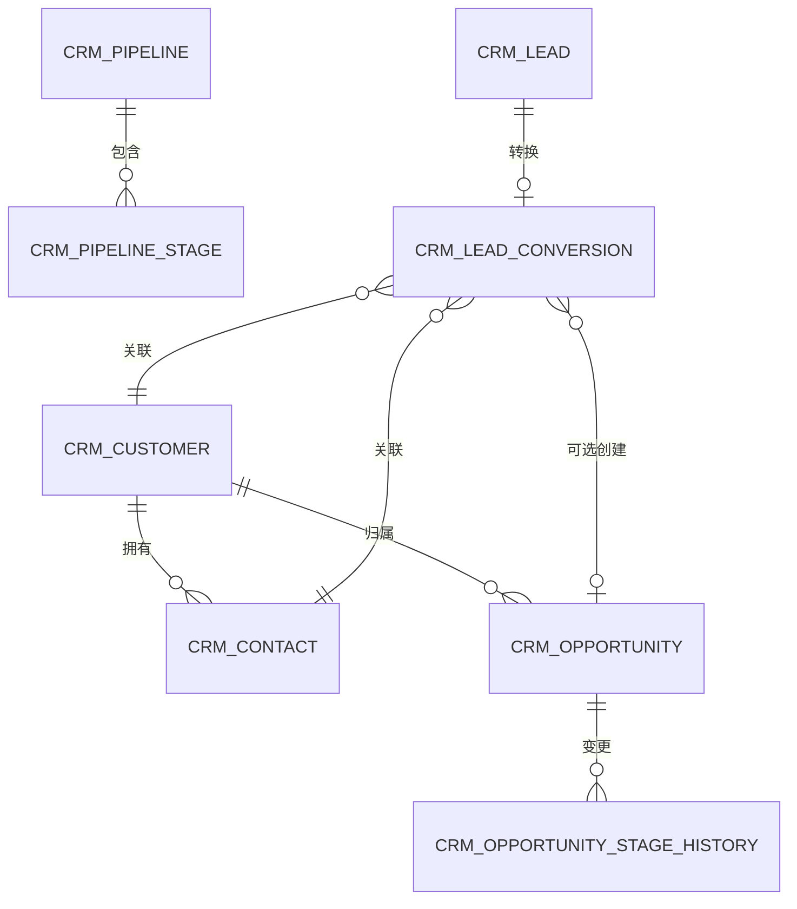

# CRM 销售管道

> 本文记录当前 CRM 实现的边界、契约和约束；中文为事实源。修改 CRM 代码前先读本文。
> 工程入口：[架构](architecture.md)、[API 契约](api-contract.md)、[后端规范](backend-patterns.md)、[前端规范](frontend-patterns.md)。[原始设计](design/crm-design.md) 是历史基线，发生差异时以当前源码为准。
> 操作教程与真实截图见 [CRM Wiki](guides/crm-flow.md)；扩展和 Docker 测试步骤见 [开发 Wiki](guides/scaffold-development.md#8-crm-扩展与容器测试)。

CRM 是独立微服务 `omni-crm`，覆盖售前闭环：线索 → 跟进 → 客户/联系人 → 商机 → 赢单或输单。产品、报价、合同、订单、开票、回款、营销自动化和客服工单不在 CRM 范围内。

## 1. 服务边界

| 项目 | 值 |
|---|---|
| Maven 模块 | `omni-crm` |
| 服务端口 | `8104` |
| 管理端口 | `19904` |
| XXL-JOB 执行器 | `omni-crm` / `9904` |
| 数据库 | `omni_crm` |
| Gateway 路由 | `/api/crm/**` → `lb://omni-crm`（不使用 StripPrefix） |
| Redis | DB 0，共享 Auth 的 XSS 公共缓存键 |

**依赖模块**：`omni-common-service`、`omni-common-core`、`omni-common`、`omni-common-mybatis`、`omni-common-redis`、`omni-common-operlog`、`omni-common-job`、`omni-common-mqlog`。

**不要依赖** `omni-common-workflow`，否则会把 Flowable 引擎嵌入 CRM。

**跨服务调用**：通过 OpenFeign + `InternalFeignHeadersFactory` 生成的 `X-Internal-Token` 调用 Auth 内部 API，CRM 只存 userId/unitId，不跨库读取 `omni_auth`。

## 2. 领域模型

### 2.1 聚合与表

| 聚合 | 表 | 职责 |
|---|---|---|
| Lead | `crm_lead`、`crm_lead_conversion` | 线索生命周期、转换幂等 |
| Customer | `crm_customer`、`crm_contact` | 客户档案、联系人、客户 360 |
| Opportunity | `crm_opportunity`、`crm_opportunity_stage_history` | 阶段、金额、概率、赢/输单历史 |
| Activity | `crm_activity` | 计划、完成、取消跟进 |
| Pipeline | `crm_pipeline`、`crm_pipeline_stage` | 管道与阶段定义 |
| Ownership Audit | `crm_owner_change_log` | 负责人变更的不可变历史 |
| 租户配置 | `crm_tenant_config` | defaultPipelineId / currencyCode / leadDuplicatePolicy |



`crm_activity` 用 `root_type + root_id` 多态关联 Lead/Customer/Opportunity。Service 必须验证目标存在、同租户且当前用户可访问。

### 2.2 通用字段规则

每张 `crm_*` 表都必须有 `tenant_id`。可授权业务表还必须有：

- `tenant_id` — 租户隔离
- `owner_user_id` — SELF 范围和业务负责人
- `owner_unit_id` — DEPT/DEPT_AND_BELOW/CUSTOM 范围
- `version` — 乐观锁
- `deleted` — 逻辑删除
- `id/create_time/update_time/create_by/update_by` — 审计字段

**关键约束**：

- 用户/组织 ID 由 Auth 管理，不建跨库外键，不信任前端提交的用户名或 ownerUnitId
- 金额用 `DECIMAL(18,2)` / `BigDecimal`，币种用 ISO 4217 三位码，MVP 所有商机强制租户默认币种
- 时间统一 `yyyy-MM-dd HH:mm:ss`
- `lead_no/customer_no/opportunity_no` 由数据库 ID 生成，tenant 内唯一
- 普通 PUT 不允许直接修改 owner、status 或 stage
- 外部请求不得使用裸 `selectById/updateById/deleteById`

## 3. 安全架构

### 3.1 六层纵深

```
Gateway JWT 验证 → CRM Tenant 校验 → Spring Security @PreAuthorize
→ @ServiceDataScope 切面 → MyBatis DataPermission 拦截器 → CrmRecordAccessGuard 行级写授权
```

1. Gateway 验证 RS256 JWT，覆盖注入 `X-User-*`、`X-Tenant-Id`、`X-Gateway-Forwarded`
2. `omni-common-service` 的 `GatewayPreAuthenticationFilter` 构建 `Authentication`，`ServiceIdentityFilter` 校验并绑定 userId/tenantId
3. Controller `@PreAuthorize` 验证功能权限
4. `@ServiceDataScope(permissionCode)` 公共切面调 Auth 内部 API 解析 dataScope
5. MyBatis-Plus 追加 tenant + owner 条件
6. `CrmRecordAccessGuard` 校验写操作行级授权

**失败关闭**：缺 tenant → 401，缺 scope → `id=-1`（零数据可见），Auth 不可用 → 503。绝不降级为无过滤。

### 3.2 MyBatis 拦截器顺序

CRM 通过 `CrmTenantTablePolicy` 和 `CrmDataPermissionHandler` 向 `omni-common-service` 提供领域策略，公共 Starter 装配 `mybatisPlusInterceptor`，顺序固定不可调换：

```
TenantLineInnerInterceptor → DataPermissionInterceptor → OptimisticLockerInnerInterceptor → PaginationInnerInterceptor
```

- TenantLine 只处理 `crm_*` 表
- `sys_mq_message` 排除两个权限拦截器（Relay 按设计扫描所有租户）
- DataPermission 必须在 Pagination 前，保证 COUNT 和 records 同范围
- Pipeline/Stage 只受 tenant + 功能权限控制

### 3.3 DataScope 映射

| dataScope | SQL 条件 |
|---|---|
| SELF | `owner_user_id = currentUserId` |
| DEPT | `owner_unit_id = primaryUnitId` |
| DEPT_AND_BELOW / CUSTOM | `owner_unit_id IN accessibleUnitIds` |
| TENANT / ALL | 不加 owner 条件，TenantLine 始终保留 |

### 3.4 写操作行级授权

DataPermission 不能替代显式的行级写授权；专用 SQL 可能忽略 owner 过滤。每个更新/删除/转换/转移/阶段命令必须：

1. 以 `tenant_id + id + data scope` 查询可见记录（不可见 → 404，防 ID 枚举）
2. 校验状态机和业务不变量
3. 以 `tenant_id + id + version` 条件更新
4. 更新行数非 1 时返回并发冲突

### 3.5 权限码清单

| 资源 | 权限码 |
|---|---|
| Overview | `crm:overview:list` |
| Lead | `crm:lead:list/create/update/delete/assign/convert/disqualify` |
| Customer | `crm:customer:list/create/update/delete/transfer/status/blacklist` |
| Contact | `crm:contact:list/create/update/delete` |
| Opportunity | `crm:opportunity:list/create/update/delete/assign/stage/reopen` |
| Activity | `crm:activity:list/create/update/delete/complete/cancel` |
| Owner 候选 | `crm:owner:list` |
| PII 查看 | `crm:pii:view` |

表中 `/` 是同一资源下多个完整权限码的简写，落库时逐条保存完整 code。`@PreAuthorize` 与 `@ServiceDataScope` 使用同一个完整权限码。

### 3.6 PII 掩码

- 线索、客户、联系人专用列表始终使用脱敏 VO；详情根据 `crm:pii:view` 决定是否返回完整联系信息。
- 活动专用列表/时间线在无明文模式下将非空白内容变为 `[REDACTED]`；`null` 和空白内容保持原值，详情按 PII 权限处理。
- 后端 `CustomerServiceImpl.overview` 的联系人与活动块使用详情的 PII 权限标志，不能把“所有集合始终脱敏”作为契约。界面 `CustomerOverview.vue` 当前分别调用客户详情、联系人列表、开放商机列表和活动时间线，未复用 overview 的整包响应。
- 重复检测只返回候选 ID、编号、名称与脱敏联系摘要。编辑界面先重读详情，无 PII 权限时禁用并省略敏感输入；这不是独立的后端字段写权限机制。

### 3.7 XSS 防护

CRM 通过 `omni.service.xss.enabled=true` 使用公共 Starter 的 `CachedServiceXssConfigProvider`，不是在 CRM 中另写 SPI 实现。读取 Redis DB 0 的 `xss:enabled:{tenantId}` 与 `xss:rules:{tenantId}`；缓存缺失或异常时回源 Auth，回源失败使用公共安全基线。权威配置中的 enabled 值仍被尊重。备注按纯文本处理，前端禁止 `v-html`。

### 3.8 角色与 dataScope

以下是正式 auth.sql 的默认租户种子示例；不作为每个新租户已拥有这些角色的证据。

| 角色 | dataScope | 能力 |
|---|---|---|
| `CRM_ADMIN` | TENANT | 当前租户全部 CRM 功能/数据 |
| `SALES_MANAGER` | DEPT_AND_BELOW | 部门及下级、分配/转移、统计 |
| `SALES_REP` | SELF | 自己负责的数据及常规销售操作 |
| `CRM_VIEWER` | TENANT | 租户级只读，不默认授予 PII |
| `SUPER_ADMIN` | ALL | 所有功能，CRM 数据仍限当前租户 |

默认 USER 角色不授予 CRM 权限。

## 4. 状态机与核心流程

### 4.1 Lead 生命周期

```
[*] → NEW → FOLLOWING → QUALIFIED → CONVERTED → [*]
NEW/FOLLOWING/QUALIFIED → DISQUALIFIED
DISQUALIFIED → FOLLOWING（重新激活）
```

- 首次转换要求 `QUALIFIED`；`DISQUALIFIED` 必填原因；`CONVERTED` 为终态

### 4.2 Customer 状态

```
POTENTIAL → ACTIVE → DORMANT / LOST / BLACKLISTED
DORMANT / LOST / BLACKLISTED → ACTIVE
```

Opportunity 赢单可将 POTENTIAL 自动转为 ACTIVE。客户有开放商机时不能直接删除。BLACKLISTED 使用独立命令和 `crm:customer:blacklist` 权限。

### 4.3 Opportunity 阶段

```
DISCOVERY → QUALIFICATION → PROPOSAL → NEGOTIATION → WON / LOST
```

- 这是默认阶段顺序，不限制命令只能前进到相邻阶段。阶段命令锁定可见记录、检查当前 `OPEN` 与请求版本，要求当前/目标阶段启用且同属一个管道，拒绝相同阶段。
- 向较小 sort 回退必须有 reason；目标 `LOST` 还必须有 lossReason。迁移执行版本条件更新，写历史和本地 Outbox。
- `WON` 尝试将关联的未删除 `POTENTIAL` 客户改为 `ACTIVE`，专用 SQL 忽略 owner 条件但保留租户条件；服务没有强制要求该 SQL 影响一行，不能承诺每种客户状态都被激活。
- `WON/LOST` 的普通编辑被拒绝。专用 `crm:opportunity:reopen` 命令从最近一次关闭历史取 fromStageId，要求该阶段仍启用，恢复 `OPEN` 与阶段概率并清空关闭时间/输单原因，追加 `REOPEN` 历史和阶段事件。

### 4.4 Activity 状态

```
PLANNED → COMPLETED / CANCELLED
CANCELLED → PLANNED（重新计划）
```

### 4.5 Lead 转换流程

```
POST /api/crm/lead/{id}/convert
→ 校验 DTO、功能权限和数据范围
→ SELECT 可见且未删除的 Lead FOR UPDATE
→ 已有 Conversion：返回原 IDs、idempotentReplay=true
→ 首次转换：检查 QUALIFIED 与 version
→ 创建或关联 Customer + Contact；可选创建 Opportunity
→ Lead → CONVERTED，活动迁移到 CUSTOMER 并同步客户 owner
→ INSERT Conversion → INSERT 本地 Outbox（同一事务）
```

唯一约束是 `(tenant_id, lead_id)`。重放发生在状态/版本检查之前，但仍需通过请求校验、权限和记录可见性，且不重复写业务行或 Outbox。

新客户继承线索 owner；新联系人继承选定客户 owner，关联联系人必须属于该客户；可选新商机继承线索 owner，使用默认管道 `DISCOVERY`、租户币种与 `CONVERSION_CREATE` 历史原因。转换路径没有重新调用 Auth 解析这些继承的 owner。

转换仅写 CRM 本地事务及 Outbox，不调用 Workflow 或直接发送 Broker 消息。这不能概括为所有 CRM Feign 都在事务外：普通创建、转移及响应展示增强可能在带事务的方法中调用 Auth。详见 [Core Flows 13/14](core-flows.md)。

## 5. API 入口索引

### 5.1 通用契约

- 所有响应 `R<T>`，分页 `R<PageResult<T>>`
- `page=1`、`size=10`，最大 `size=100`
- Entity 不作为 Request/Response，状态命令使用独立 DTO
- 日期参数 `@DateTimeFormat(pattern = "yyyy-MM-dd HH:mm:ss")`
- 状态/转换/转移请求携带 `version`
- 写接口同时声明 `@PreAuthorize` 和 `@OperLog`

### 5.2 端点总览

以下路径均相对 `/api/crm`；每条路径完整列出，不从前一项补全。具体 DTO 以 Controller 与 `CrmRequests` 为准。

| 领域 | 端点 |
|---|---|
| 概览 | `GET /overview/summary` · `GET /overview/funnel` · `GET /overview/follow-ups` |
| 管道 | `GET /pipeline/list` · `GET /pipeline/{id}/stages` |
| 线索 | `GET /lead/list` · `GET /lead/{id}` · `POST /lead` · `PUT /lead/{id}` · `DELETE /lead/{id}` |
| 线索命令 | `POST /lead/duplicate-check` · `POST /lead/{id}/assign` · `POST /lead/batch-assign` · `POST /lead/{id}/qualify` · `POST /lead/{id}/disqualify` · `POST /lead/{id}/reopen` · `POST /lead/{id}/convert` |
| 客户 | `GET /customer/list` · `GET /customer/{id}` · `GET /customer/{id}/overview` · `POST /customer` · `PUT /customer/{id}` · `DELETE /customer/{id}` |
| 客户命令 | `POST /customer/duplicate-check` · `POST /customer/{id}/status` · `POST /customer/{id}/transfer` · `POST /customer/{id}/blacklist` · `POST /customer/{id}/restore-from-blacklist` |
| 联系人 | `GET /contact/list` · `GET /customer/{customerId}/contact/list` · `GET /contact/{id}` · `POST /customer/{customerId}/contact` · `PUT /contact/{id}` · `DELETE /contact/{id}` · `POST /contact/{id}/primary` |
| 商机 | `GET /opportunity/list` · `GET /opportunity/board` · `GET /opportunity/{id}` · `GET /opportunity/{id}/stage-history` · `POST /opportunity` · `PUT /opportunity/{id}` · `DELETE /opportunity/{id}` |
| 商机命令 | `POST /opportunity/{id}/assign` · `POST /opportunity/{id}/stage` · `POST /opportunity/{id}/reopen` |
| 活动 | `GET /activity/list` · `GET /activity/timeline` · `GET /activity/{id}` · `POST /activity` · `PUT /activity/{id}` · `DELETE /activity/{id}` |
| 活动命令 | `POST /activity/{id}/complete` · `POST /activity/{id}/cancel` · `POST /activity/{id}/reschedule` |
| 负责人候选 | `GET /options/owners` |

### 5.3 Customer 360 分块权限

`GET /api/crm/customer/{id}/overview` 返回客户、联系人、开放商机、最近最多 20 条活动及转换线索 ID。每块用各自 list 权限独立解析范围；缺权限的块不查询。`CrmPermissionScopeExecutor` 恢复原先的 `ServiceDataScopeContext`，外层切面负责最终清理。客户可见不代表全部子数据可见；PII 边界见 3.6。

### 5.4 Overview 聚合查询

`summary()`、`funnel()`、`followups()` 使用 Mapper 层聚合 SQL（`GROUP BY` / `UNION ALL`），不全量加载再内存过滤。DataPermissionInterceptor 自动作用于聚合查询。

## 6. 跨服务集成

### 6.1 Auth Feign

- 创建/分配/转移路径的 `CrmOwnerResolver` 验证负责人存在、启用、同租户、有主组织及目标可分配范围；指定其他负责人还需对应 assign/transfer 权限。转换的继承 owner 规则见 4.5。
- `ownerUnitId` 来自 Auth 主组织。`CrmOwnerEnricher` 先去重收集 ID，再分别批量查询用户和组织，禁止逐行业务循环调用；执行人名称有独立用户批量查询。
- 数据范围解析遇到 Auth 权限拒绝返回 403，其他依赖失败返回 503；展示增强异常可保留 ID 与空名称。显示降级不扩大授权范围，也不保证远程调用都在数据库事务外。

### 6.2 Outbox 事件

业务事务调用 `ReliableMessageRelay.send("crm-domain-out-0", envelope, tenantId, eventId)`。默认实现以 REQUIRED 传播写本地 PENDING 行；Relay 后续发送 Broker，关闭 Relay 不等于关闭 Outbox 写入。

`DomainEventEnvelope` 包含 `eventId/eventType/occurredAt/tenantId/producer`、`aggregateType/aggregateId/aggregateVersion`、`actorUserId` 和 `payload`。eventId 位于信封顶层，作为 msgKey 传递；Outbox msgId 另行生成，msgKey 不替代消费者业务幂等。payload 不传完整 PII。

| eventType | payload |
|---|---|
| `crm.lead.converted.v1` | leadId、customerId、contactId、可空 opportunityId |
| `crm.opportunity.stage-changed.v1` / `crm.opportunity.won.v1` / `crm.opportunity.lost.v1` | opportunityId、stageId、status |
| `crm.customer.owner-changed.v1` | customerId、oldOwnerUserId/newOwnerUserId、oldOwnerUnitId/newOwnerUnitId、cascadeOpenOpportunities |

### 6.3 操作日志

通用 `@OperLog` 按显式字段规则脱敏，不保证识别任意 PII。转换接口关闭实体快照并额外排除 customerName/contactName/opportunityName。Owner Change 和 Stage History 是业务事务中的同步事实，异步通用日志不能替代它们。

## 7. 硬约束

修改 CRM 代码前必须遵守的规则：

1. **租户隔离**：所有 `crm_*` 表必须有 `tenant_id`，TenantLine 始终追加，普通 API 永不跨租户
2. **版本命令**：既有记录的外部变更命令使用 tenant + id + version 并检查影响行数；创建编号补全和专用级联 SQL 不等同于逐条客户端版本命令
3. **失败关闭**：缺 tenant → 401，缺 scope → `id=-1`，Auth 不可用 → 503，绝不降级
4. **ThreadLocal 清理**：`ServiceIdentityContext` 和 `ServiceDataScopeContext` 必须在 `finally` 块清理，防内存泄漏
5. **权限双声明**：写接口必须同时声明 `@PreAuthorize`（功能权限）和 `@ServiceDataScope`（数据范围），使用同一个完整权限码
6. **PII 后端掩码**：无 `crm:pii:view` 时后端 VO 直接返回掩码，不依赖前端
7. **Outbox tenantId 显式**：`ReliableMessageRelay.send()` 必须显式传 `Long tenantId`，禁止 ThreadLocal 隐式
8. **拦截器顺序**：TenantLine → DataPermission → OptimisticLocker → Pagination，不可调换
9. **写授权**：不能只依赖 DataPermission，必须 AccessGuard 行级校验
10. **状态机**：普通 PUT 不接受 status/stage 变更，必须走专用命令端点
11. **MySQL DATETIME 范围**：不可用 `LocalDateTime.MIN/MAX` 作为查询参数，用 `LocalDateTime.of(2000,1,1,0,0)` 等合理值
12. **Pipeline 只读**：MVP 管道和阶段由租户初始化自动创建，不提供管理 UI
13. **Activity 多态**：`root_type + root_id` 关联，Service 必须验证目标存在且可访问
14. **`sys_mq_message` 排除权限拦截器**：Relay 扫描所有租户，用户查询仍需显式 tenant 过滤

## 8. 前端结构

```
omni-frontend/src/
├── api/
│   ├── crm-overview.ts        # 概览聚合 API
│   ├── crm-lead.ts            # 线索 CRUD + 命令
│   ├── crm-customer.ts        # 客户 CRUD + 360 + 转移
│   ├── crm-contact.ts         # 联系人 CRUD
│   ├── crm-opportunity.ts     # 商机 CRUD + 看板 + 阶段
│   └── crm-activity.ts        # 活动 CRUD + 时间线
├── views/crm/
│   ├── overview/index.vue     # 销售概览
│   ├── lead/index.vue         # 线索管理
│   ├── customer/index.vue     # 客户管理
│   ├── contact/index.vue      # 联系人管理
│   ├── opportunity/index.vue  # 商机管理
│   └── activity/index.vue     # 跟进活动
└── components/crm/
    ├── OwnerSelector.vue      # 负责人选择器
    ├── CustomerPicker.vue     # 客户选择器
    ├── ActivityTimeline.vue   # 活动时间线
    ├── OpportunityStageBoard.vue  # 商机看板
    └── CustomerOverview.vue   # 客户 360 视图
```

- `ApiResponse/PageResult` 只从 `src/types/api.ts` 导入
- 按钮使用 `v-permission` 同码指令，但后端是最终安全边界
- Customer 360 使用 Drawer 组件
- Opportunity 页面提供表格 + Kanban 双视图

## 9. 扩展与测试入口

新增聚合、权限、事件及 Docker 测试步骤已归入 [开发 Wiki 的 CRM 扩展](guides/scaffold-development.md#8-crm-扩展与容器测试)。当前管道/阶段只有读取 API；开放管理、迁移既有商机等需要另行设计，不能把未来规划当作现有能力。

## 10. 验证边界

单元测试包含状态机、转换重放、级联、PII、范围 SQL 与安全失败分支；Mock/内存锁测试不证明真实 MySQL 并发或 MQ 投递。`CrmMysqlInterceptorIntegrationTest` 只有设置 `CRM_TEST_MYSQL_URL` 才启用，且还需要测试库凭据；它会创建和删除 `crm_lead`，只能指向专用可销毁测试库。

最新复用的 Docker Reactor 报告中，CRM 有 16 个 Surefire 报告、45 个用例：41 通过、4 个 MySQL 用例按条件跳过。该数是本次报告快照，不是固定测试覆盖承诺。历史 `*IT` 受 `WP008_F_ENABLED` 和独立环境保护，不包含在本次默认测试结论中；不可盲目启用。真实界面与 API 演练的独立证据边界见 [CRM Wiki](guides/crm-flow.md)。

## 11. 当前源码入口

[Schemas](../database/changelog/crm/0001-crm-schema.yaml) · [DTO](../omni-backend/omni-crm/src/main/java/com/omni/crm/dto/CrmRequests.java) · [数据权限](../omni-backend/omni-crm/src/main/java/com/omni/crm/security/CrmDataPermissionHandler.java) · [转换](../omni-backend/omni-crm/src/main/java/com/omni/crm/service/impl/LeadServiceImpl.java) · [阶段](../omni-backend/omni-crm/src/main/java/com/omni/crm/service/impl/OpportunityServiceImpl.java) · [客户 360/转移](../omni-backend/omni-crm/src/main/java/com/omni/crm/service/impl/CustomerServiceImpl.java) · [共享持久化](../omni-backend/omni-common-service/src/main/java/com/omni/common/service/config/ServicePersistenceAutoConfiguration.java) · [XSS 提供者](../omni-backend/omni-common-service/src/main/java/com/omni/common/service/xss/CachedServiceXssConfigProvider.java)。
