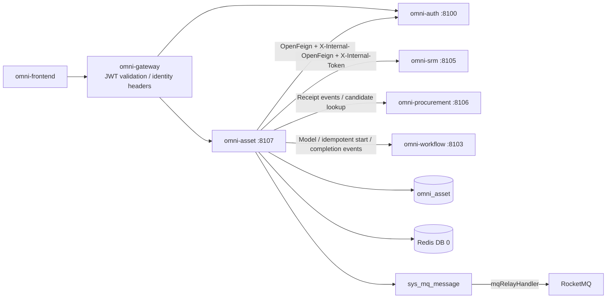
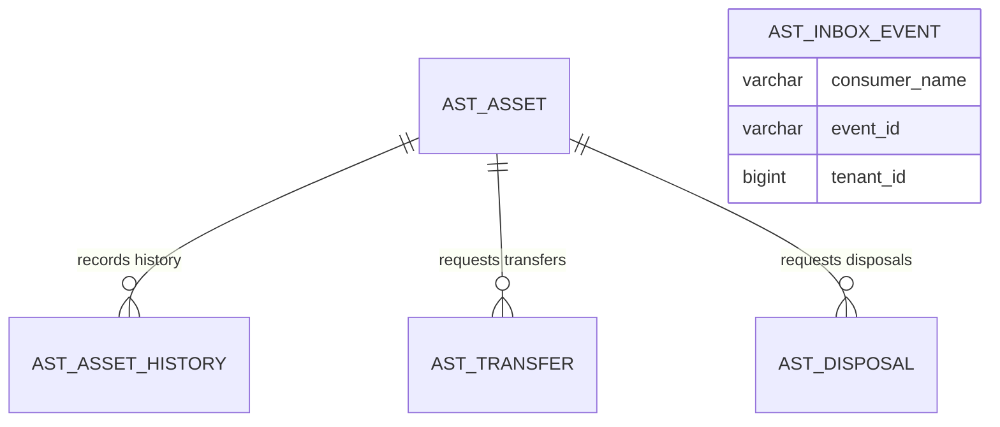
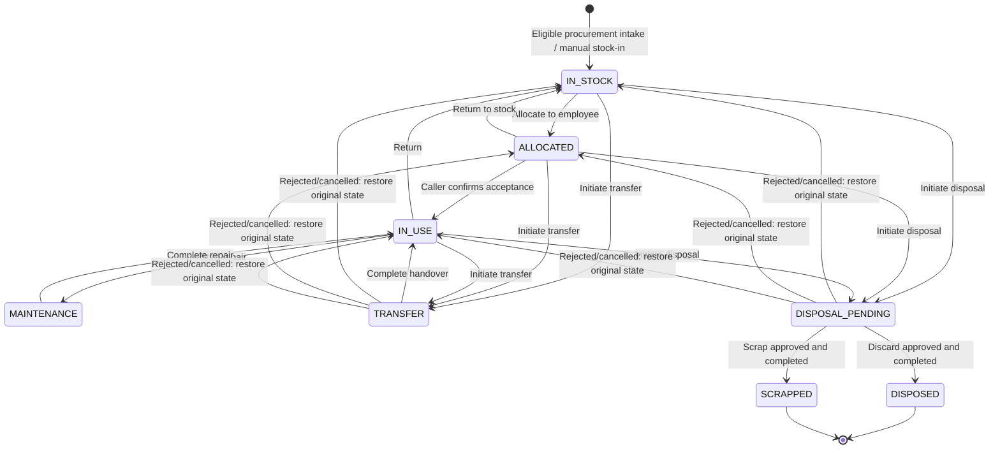
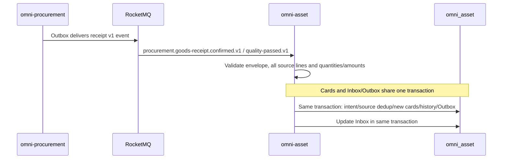
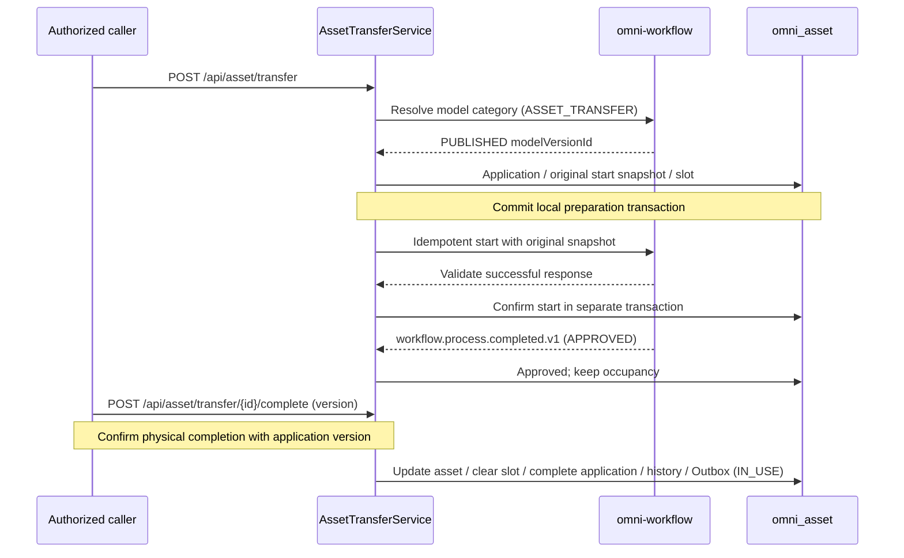
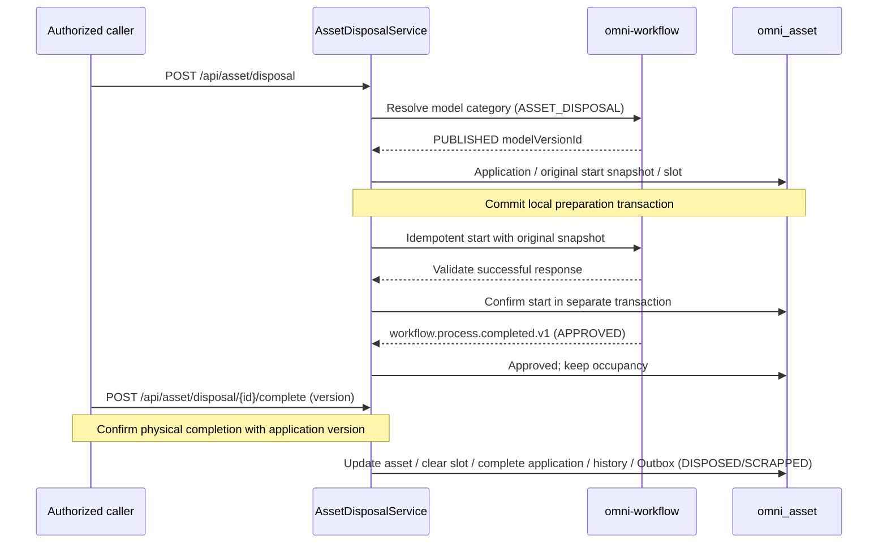

# Asset Management Module Architecture and Implementation Baseline

> Applicability: The original design date, 2026-07-27, and important history in sections 14–16 are retained. Current facts are checked against `omni-asset` source, Liquibase, frontend and configuration; historical “verified” status does not establish complete acceptance in this run. Translation review follows [ADR-0003](../adr/0003-authorized-ai-translation-review.md) and records actual `AI_REVIEW`, never human review.
>
> Project: Omni-Stack
> Original design date: 2026-07-27
> Current purpose: Explain asset service boundaries, data, commands, approval and procurement intake contracts.

For operation entry points see the [feature tour](../wiki/feature-tour.en.md), and for development see the [source index](../reference/source-map.en.md). Prerequisites, identity, steps, screenshots and recovery belong in the Wiki. Requirements, historical plans and unit tests do not substitute for new end-to-end evidence. Related facts: [architecture](../architecture.en.md), [API contract](../api-contract.en.md), [core flows](../core-flows.en.md), [Workflow](../workflow.en.md), [Procurement design](procurement-design.en.md) and [SRM design](srm-design.en.md).

## 1. Design Conclusion

Asset management should be built as an independent Servlet microservice that manages the complete lifecycle of assets from procurement goods-receipt to final disposal. SRM provides supplier information, Procurement provides the procurement source, and Workflow provides approval capability.

| Item | Decision |
|---|---|
| Maven module / service name | `omni-asset` |
| Local port / management port | `8107` / `19907` |
| XXL-JOB executor | `omni-asset` / `9907`, controlled by `XXL_JOB_ENABLED` and related settings; this does not establish depreciation or maintenance jobs |
| Database | `omni_asset` |
| Gateway | `/api/asset/**` → `lb://omni-asset`, without `StripPrefix` |
| Redis | DB 0; shared `xss:enabled:{tenantId}` / `xss:rules:{tenantId}`; no general `asset:` business cache prefix is declared |
| Frontend | `omni-frontend/src/views/asset/**` |

The Asset MVP covers the closed loop of full asset lifecycle management:

> Procurement goods-receipt → asset acceptance and stock-in → allocation/assignment → in use → transfer → discard disposal / scrap disposal.

Depreciation calculation, asset stocktaking, and maintenance/repair work orders are not included in the MVP.

## 2. Product Scope

This section retains product goals and phases. Actual role capabilities depend on current permissions and data scope; Phase 2/3 are not delivered features. Asset values are aggregated separately by currency, without exchange conversion.

### 2.1 Users and Goals

| User | Core need |
|---|---|
| Administration/IT administrator | Manage all company assets, assign them to employees, handle disposal requests |
| Asset user | View assets under their own name, confirm acceptance or initiate a return |
| Department manager | View department assets, approve transfers and disposals |
| Finance staff | View the asset original value and current status, confirm scrapping |
| Asset administrator | Full-tenant asset management, configuration, and statistics |

The MVP should be able to answer: how many assets the company has and where they are distributed; who is currently using a given asset and in what status; which assets are idle and awaiting allocation; the total asset value of a given department; which assets are going through the disposal/scrap flow.

### 2.2 Phasing

| Phase | Capability |
|---|---|
| MVP | Asset ledger, asset acceptance (procurement linkage), asset allocation/return, asset transfer, discard disposal, scrap disposal, asset overview |
| Phase 2 | Asset stocktaking, depreciation calculation, maintenance/repair work orders, asset tags/barcodes, asset import/export |
| Phase 3 | Asset budget control, asset disposal auction, asset lifecycle cost analysis |

## 3. System Boundaries

| Component | Authority | Current Asset use |
|---|---|---|
| `omni-auth` | Identity, organizations, permissions, data scope, XSS | Internal user options, user/organization reference checks and shared security; IDs and the original Workflow starter username snapshot are stored |
| `omni-srm` | Suppliers | Current client searches this tenant's `APPROVED` supplier options; the ledger displays a local name snapshot |
| `omni-procurement` | POs, receipts, asset candidates | Consume receipt events; internal candidate API supports controlled backfill, not current realtime source-detail lookup |
| `omni-base` | Dictionaries, operation logs | Dictionary authority and log aggregation; Asset's own provisioner has no default tenant business data |
| `omni-workflow` | BPMN, instances, tasks, Flowable | Resolve published versions by business category, start idempotently, validate assignments and receive completion events |
| `omni-asset` | Assets, history, transfers, disposals, consumer Inbox | Sole writer of this service's asset business data |
| RocketMQ | Event transport | Consumers tolerate duplicates; deployed configuration determines retry/dead-letter behavior |

The current POM explicitly depends on `omni-common-core`, `omni-common`, `omni-common-mybatis`, `omni-common-redis`, `omni-common-operlog`, `omni-common-job`, `omni-common-mqlog`, `omni-common-service`, alongside Web, Security, Validation, OpenFeign, LoadBalancer, Nacos, RocketMQ and Actuator. `omni-common-service` assembles identity, tenancy, DataScope, persistence and XSS. A dependency does not establish that every background job is enabled.

**Asset does not depend on `omni-common-workflow` or embed Flowable.** The engine and database belong to the independent `omni-workflow` service.

## 4. Domain and Data Design

### 4.1 Aggregates

| Aggregate | Tables | Responsibility |
|---|---|---|
| Asset | `ast_asset`, `ast_asset_history` | Asset master data, immutable status-change history |
| Transfer | `ast_transfer` | Asset transfer records |
| Disposal | `ast_disposal` | Asset disposal records (discard/scrap shared) |
| Consumer Inbox | `ast_inbox_event` | Registration, intent validation and processing state for separate Procurement and Workflow-completion consumers |

### 4.2 Common Fields and Rules

- All five `ast_*` tables include `tenant_id`. `ast_asset` separates management ownership (`owner_user_id/owner_unit_id`) from usage (`current_user_id/current_unit_id`); these cannot be merged for write authorization.
- Assets and both applications have their own `version`, `deleted` and audit fields; history and Inbox have no logical deletion. `AST-<id>` is unique within a tenant. Manual assets receive a database-generated ID first; procurement intake uses a server-generated ID.
- Auth owns users/organizations, SRM suppliers and Procurement sources. Store IDs and necessary snapshots locally, without cross-database foreign keys. The diagram shows domain references, not every physical DDL constraint.
- Source `source_po_id/source_gr_id/source_gr_line_id/source_unit_sequence` and PO/GR numbers provide traceability. The `tenant_id + source_gr_line_id + source_unit_sequence` unique key protects each physical unit.
- Money uses `DECIMAL(18,2)` / `BigDecimal`. Request and response `purchaseAmount` and `residualValue` are JSON decimal strings, never JSON numbers; procurement source prices also use strings. Date-times use `yyyy-MM-dd HH:mm:ss`; purchase date is a date field.
- Manual creation checks writable management ownership and asks Auth to validate active users/organizations and matching primary organization. Updates require `version`; generic PUT cannot change status, current user or location.
- Deletion is limited to manual in-stock assets with no current user, active operation or subsequent business history. Procurement-imported assets cannot be deleted. Disposal terminal states cannot be restored.
- At most one transfer/disposal occupies an asset. Creation atomically checks tenant, ID, version, original status, `deleted=0` and both `active_operation_* IS NULL` fields. Exactly one affected row is required; otherwise 409.

### 4.3 Main Tables

`ast_asset`

- `asset_no/name/category_code`: asset number, name, category (dictionary code).
- `specification/brand/model`: specification, brand, model.
- `supplier_id/supplier_name_snapshot`: Supplier ID and local name snapshot. The current ledger does not batch-enrich live names from SRM; a snapshot does not establish current supplier eligibility.
- `source_po_id/source_gr_id/source_gr_line_id/source_unit_sequence/source_po_no/source_gr_no`: procurement source and unit-level idempotency identifiers.
- `purchase_date/purchase_amount/currency_code`: purchase date, original value, currency.
- `location_code`: asset location (dictionary code, e.g., floor + room number).
- `status`: lifecycle status (IN_STOCK/ALLOCATED/IN_USE/MAINTENANCE/TRANSFER/DISPOSAL_PENDING/DISPOSED/SCRAPPED).
- `current_user_id`: Current user ID; the ledger VO returns the ID without Auth name enrichment.
- `current_unit_id`: Current usage department ID; the ledger VO returns the ID without Auth organization-name enrichment.
- `allocated_time`: allocation time.
- `active_operation_type/active_operation_id`: current active operation (TRANSFER/DISPOSAL) and request ID; NULL when there is no active operation.
- `warranty_expiry_date`: warranty expiry date.
- `expected_life_years`: expected service life (used as a scrapping reference).
- `remark`.
- `owner_user_id/owner_unit_id/version/deleted` and audit fields.
- Core indexes: tenant + owner/status, tenant + current_user_id, tenant + current_unit_id, tenant + category_code/status, tenant + asset_no (unique), tenant + source_gr_line_id + source_unit_sequence (procurement source unique; manual stock-in allows the source fields to be NULL).

`ast_asset_history`

- `asset_id/from_status/to_status/changed_by_user_id/changed_time/remark`.
- Append-only, never updated, never deleted. Records every asset status change and key operation (allocation, return, transfer, disposal).

`ast_transfer`

- `transfer_no/asset_id/from_user_id/from_unit_id/to_user_id/to_unit_id/from_location/to_location`.
- `reason/status/process_instance_id/previous_asset_status/active_flag`.
- `workflow_request_id/workflow_business_key/model_version_id/workflow_start_status/workflow_start_user_id/workflow_start_user_name`: Workflow idempotency snapshot and original initiator identity; `businessType=ASSET_TRANSFER` is fixedly derived from the transfer aggregate type.
- `status`: PENDING_APPROVAL/START_FAILED/APPROVED/REJECTED/COMPLETED/CANCELLED.
- `approved_time/completed_time`.
- `version/deleted` and audit fields.

`ast_disposal`

- `disposal_no/asset_id/disposal_type (DISCARD/SCRAP)/reason/previous_asset_status/active_flag`.
- `residual_value (residual value)/disposal_method (disposal method description)`.
- `status`: PENDING_APPROVAL/START_FAILED/APPROVED/REJECTED/COMPLETED/CANCELLED.
- `process_instance_id`: links to the omni-workflow approval process instance.
- `workflow_request_id/workflow_business_key/model_version_id/workflow_start_status/workflow_start_user_id/workflow_start_user_name`: Workflow idempotency snapshot and original initiator identity; `businessType=ASSET_DISPOSAL` is fixedly derived from the disposal aggregate type.
- `approved_time/completed_time`.
- `version/deleted` and audit fields.

`ast_inbox_event`

- Unique `consumer_name/event_id`; stores tenant, event type, source, aggregate identity, payload, processing state and timestamps.
- A different tenant or JSON-semantic intent under the same event ID conflicts. Intent must be checked before skipping an already-processed event.
- Realtime Procurement intake and Workflow completion use separate consumer identities. Backfill candidates use source-unit idempotency without registering realtime Inbox events.

## 5. State Machine and Core Flows

### 5.1 Asset Lifecycle

- `IN_STOCK`: the asset is in stock, unallocated.
- `ALLOCATED`: allocated to an employee, awaiting acceptance confirmation.
- `IN_USE`: the employee is using it.
- `MAINTENANCE`: sent for repair (the MVP only marks the status, no repair work order).
- `TRANSFER`: transfer in progress (awaiting approval and handover).
- `DISPOSAL_PENDING`: going through disposal approval; allocation, return, transfer, or duplicate disposal is forbidden.
- `DISPOSED`: discard disposal completed (terminal state).
- `SCRAPPED`: scrap disposal completed (terminal state).

Only `IN_STOCK/ALLOCATED/IN_USE` can initiate transfer or disposal. Repair provides only `IN_USE → MAINTENANCE → IN_USE` commands. An active transfer/disposal blocks allocation, return, repair and duplicate occupancy. A state-machine transition also requires endpoint permission, row scope, version and activity-slot conditions.

### 5.2 Asset Acceptance (Procurement Linkage)

Realtime intake consumes `procurement.goods-receipt.confirmed.v1` and `procurement.goods-receipt.quality-passed.v1`. It validates the envelope, tenant, source root, metadata of every line and unique source-line IDs before writes. Quantity, unit price and line amount must be positive, with `unitPrice × receivedQuantity = totalPrice`. Missing fields, invalid enums or unsupported versions reject the whole event; defaults are not guessed.

Only valid `qualityStatus=PASS && assetManaged=true` lines produce cards. `receivedQuantity` must be an exact positive integer equal to `assetQuantity` and no greater than `Integer.MAX_VALUE`. Valid non-asset or PENDING/FAIL lines are skipped; malformed lines are still rejected. Five eligible units produce five cards with `source_unit_sequence=1..5`, initial `IN_STOCK` status and source management ownership. Each card's `purchaseAmount` is `unitPrice` rounded HALF_UP to two decimals, not the whole line amount copied to every card.

Dual idempotency: realtime Inbox `consumer_name + event_id` validates tenant and JSON-semantic intent before replay handling. Source-unit uniqueness protects realtime delivery, replay and backfill together. The persisted source record is locked and read back to validate intent; JDBC affected-row counts alone do not determine creation. One realtime transaction contains new cards, history, Inbox state and `asset.created.v1` Outbox only for new cards. Persisting Outbox does not prove Broker delivery or downstream consumption.

Historical backfill processes one controlled page per call; cursor and partial-commit boundaries are in 8.3. There is no guarantee of an automatic exhaustive startup scan.

### 5.3 Asset Allocation and Return

| Command (prefix `/api/asset/asset`) | Request and state conditions | Transactional effect |
|---|---|---|
| `POST /{id}/allocate` | `version,targetUserId,targetUnitId,remark?`; in stock, empty activity slot; writable target department, Auth-validated active same-tenant user/organization and primary organization | `ALLOCATED`; current user/unit, allocation time, history and `asset.allocated.v1` Outbox |
| `POST /{id}/accept` | `version,remark?`; `ALLOCATED` and current user equals caller | `IN_USE` and history |
| `POST /{id}/return` | `version,remark?`; `ALLOCATED/IN_USE` and current user equals caller | `IN_STOCK`; clear user/unit/allocation time, history and `asset.returned.v1` Outbox |
| `POST /{id}/maintenance/start` | `version,remark?`; `IN_USE`, empty activity slot | `MAINTENANCE` and history |
| `POST /{id}/maintenance/complete` | `version,remark?`; `MAINTENANCE`, empty activity slot | `IN_USE` and history |

Lock the asset by tenant and data scope, then update conditionally by version and original state. Conflicts return 409. Management roles do not widen the caller-only accept/return boundary. These commands do not implement repair work orders, automatic depreciation or maintenance scheduling.

### 5.4 Asset Transfer

Creation accepts `assetId,toUserId,toUnitId,toLocation?,reason`; the server resolves `modelVersionId` rather than accepting the caller's choice. Validate the target department and Auth references, then resolve the current published `ASSET_TRANSFER` model. The local preparation transaction persists the application, `previous_asset_status`, original start snapshot and activity slot. Call remote Workflow only after that transaction commits; persist start confirmation separately.

`APPROVED` retains `active_flag=1` and the asset's `TRANSFER` occupancy. An authorized caller supplies the application `version` to business `/complete` for handover. That transaction changes current user/unit and optional location, sets `IN_USE`, clears the slot, appends history and completion Outbox. Management `owner_user_id/owner_unit_id` remain unchanged.

The current category-matching published BPMN determines approval levels; section 15's single-level approval is the original design choice. Rejection/process cancellation terminates the application and restores original asset status/clears the slot transactionally. See 8.4 for unknown-start versus explicit-failure recovery.

### 5.5 Asset Disposal (Discard/Scrap)

Creation uses `assetId,disposalType,reason,residualValue?,disposalMethod?`. `disposalType` is `DISCARD/SCRAP` and residual value is a JSON decimal string. The server resolves an `ASSET_DISPOSAL` model; both types share the application table and approval integration. BPMN determines actual approvers and levels; finance confirmation cannot be assumed to have occurred.

After `APPROVED`, `DISPOSAL_PENDING` occupancy remains. Only a permission- and application-version-checked business `/complete` confirms physical disposal, enters `DISPOSED/SCRAPPED`, clears the slot and writes history plus the corresponding Outbox. Rejection/process cancellation, or local cancellation after persisted explicit start failure, must restore `previous_asset_status` and clear both activity markers in one transaction. Unknown start results cannot be locally cancelled.

## 6. Tenant, RBAC, and Data Permissions

### 6.1 Trust Chain

Consistent with other Servlet business services: Gateway JWT → `GatewayPreAuthenticationFilter` pre-authentication → `ServiceIdentityFilter` tenant/identity validation → `@PreAuthorize` → `@ServiceDataScope` → MyBatis DataPermission → `AssetRecordAccessGuard`.

### 6.2 Permission Tree and Roles

Menus: `asset` (DIRECTORY) and `asset:overview`, `asset:asset`, `asset:transfer`, `asset:disposal` (MENU).

API permissions:

- `asset:overview:list`
- `asset:asset:list`, `asset:asset:self`, `asset:asset:create`, `asset:asset:update`, `asset:asset:delete`, `asset:asset:allocate`, `asset:asset:accept`, `asset:asset:return`, `asset:asset:maintenance`
- `asset:transfer:list`, `asset:transfer:create`, `asset:transfer:approve`, `asset:transfer:complete`, `asset:transfer:cancel`, `asset:transfer:retry`
- `asset:disposal:list`, `asset:disposal:create`, `asset:disposal:approve`, `asset:disposal:complete`, `asset:disposal:cancel`, `asset:disposal:retry`

| Role | dataScope | Capability |
|---|---|---|
| `ASSET_ADMIN` | TENANT | All asset functions/data of the current tenant |
| `ASSET_MANAGER` | DEPT_AND_BELOW | Department and below, transfer/disposal approval |
| `ASSET_USER` | SELF | View assets under their own name, confirm acceptance, and initiate returns through the "my assets" endpoint |
| `SUPER_ADMIN` | ALL | All functions; asset data is still limited to the current tenant |

The default USER is not granted asset permissions.

### 6.3 Asset Context and SQL Interception

The cross-module context and persistence-layer assembly are provided by `omni-common-service`: request identity uses `ServiceIdentityContext` / `ServiceRequestIdentity`, data scope uses `@ServiceDataScope` / `ServiceDataScopeContext`, and `ServicePersistenceAutoConfiguration` assembles the interceptors. Asset only keeps the domain policies `AssetTenantTablePolicy`, `AssetDataPermissionHandler`, and the write-operation guard `AssetRecordAccessGuard`.

The interceptor order is fixed: `TenantLineInnerInterceptor → DataPermissionInterceptor → OptimisticLockerInnerInterceptor → PaginationInnerInterceptor`. `AssetTenantTablePolicy` takes effect only on `ast_*` tables; `sys_mq_message` must remain outside tenant interception to allow the background Relay to scan across tenants.

| dataScope | Condition |
|---|---|
| SELF | The owner or current_user column mapped by the current permission equals currentUserId |
| DEPT | owner_unit_id equals primaryUnitId |
| DEPT_AND_BELOW / CUSTOM | owner_unit_id IN accessibleUnitIds |
| TENANT / ALL | No owner condition is added; TenantLine is always retained |

The asset dataScope has a management dimension and a usage dimension; a broad OR must not be used in generic SQL, and it must be explicitly mapped by permissionCode/endpoint:

| Endpoint/permission | Scope column | Rule |
|---|---|---|
| `/api/asset/asset/list`, detail, management history; `asset:asset:list` | `owner_user_id/owner_unit_id` | For asset management staff, filtered by management ownership |
| `/api/asset/asset/my`; `asset:asset:self` | `current_user_id` | Fixed to equal the current user, not widened by a broader dataScope of another role |
| accept/return; corresponding command permission | `current_user_id` | RecordAccessGuard enforces that the target asset is currently allocated to currentUserId |
| Transfer/Disposal list/detail | The management dimension of the associated Asset | Child tables inherit through the asset_id of the same tenant, without directly concatenating non-existent owner columns |
| Transfer/Disposal approval-view | Workflow taskId assignment relationship | First verify the current user is the task approver of that tenant/business document, then read the read-only VO by tenant + id |
| Overview | Asset management dimension | The aggregate SQL uses the same scope as `/api/asset/asset/list` |

If a user holds both ASSET_USER and a management role, the frontend still calls "my assets" and the management list separately; the backend must not OR-merge the two dimensions for write authorization.

Interpret exceptions by full permission code: `asset:asset:self`, `asset:asset:accept`, `asset:asset:return` always fixes `current_user_id`. `asset:transfer:create` also maps to `current_user_id` under `SELF`; other management operations retain owner columns. Candidate queries use the corresponding create permission's scope and filter both empty activity fields plus eligible states.

Approval-view requires local `PENDING_APPROVAL + STARTED` with a complete business key/instance, then validates caller, tenant, business type/key, Workflow task assignment and matching instance. Only then is a temporary `TENANT` scope used to read that application's VO; `finally` restores the prior context. It is not an unconditional bypass for ordinary details.

## 7. API Design

### 7.1 Common Contract

Follow the [API contract](../api-contract.en.md): `R<T>` and `R<PageResult<T>>` for pages. Page numbering starts/defaults at 1; size defaults to 10 and accepts 1..100. Invisible/missing data generally yields business 404, insufficient permission 403, version/state/occupancy conflicts 409, and dependency unavailability or uncertain Workflow results 503. HTTP status and `R.code` are different layers.

Source DTOs and VOs define fields. Asset updates/lifecycle commands require `version`; transfer/disposal retry/cancel/complete use the application version. `purchaseAmount/residualValue` are decimal strings; time formats follow 4.2.

### 7.2 Endpoints

The following 32 external method paths and one internal method path are complete service paths. Gateway does not strip `/api/asset`. Internal backfill requires a valid internal token and equal positive `X-Tenant-Id` and query `tenantId`.

| Area | Method and full path |
|---|---|
| Asset ledger / caller commands | `GET /api/asset/asset/list` |
| Asset ledger / caller commands | `GET /api/asset/asset/my` |
| Asset ledger / caller commands | `GET /api/asset/asset/{id}` |
| Asset ledger / caller commands | `GET /api/asset/asset/{id}/history` |
| Asset ledger / caller commands | `POST /api/asset/asset` |
| Asset ledger / caller commands | `PUT /api/asset/asset/{id}` |
| Asset ledger / caller commands | `DELETE /api/asset/asset/{id}` |
| Asset ledger / caller commands | `POST /api/asset/asset/{id}/allocate` |
| Asset ledger / caller commands | `POST /api/asset/asset/{id}/accept` |
| Asset ledger / caller commands | `POST /api/asset/asset/{id}/return` |
| Asset ledger / caller commands | `POST /api/asset/asset/{id}/maintenance/start` |
| Asset ledger / caller commands | `POST /api/asset/asset/{id}/maintenance/complete` |
| Disposal | `GET /api/asset/disposal/list` |
| Disposal | `GET /api/asset/disposal/{id}` |
| Disposal | `GET /api/asset/disposal/{id}/approval-view` |
| Disposal | `POST /api/asset/disposal` |
| Disposal | `POST /api/asset/disposal/{id}/retry-start` |
| Disposal | `POST /api/asset/disposal/{id}/cancel` |
| Disposal | `POST /api/asset/disposal/{id}/complete` |
| Options | `GET /api/asset/options/users` |
| Options | `GET /api/asset/options/transfer-assets` |
| Options | `GET /api/asset/options/disposal-assets` |
| Options | `GET /api/asset/options/suppliers` |
| Overview | `GET /api/asset/overview/summary` |
| Overview | `GET /api/asset/overview/distribution` |
| Transfer | `GET /api/asset/transfer/list` |
| Transfer | `GET /api/asset/transfer/{id}` |
| Transfer | `GET /api/asset/transfer/{id}/approval-view` |
| Transfer | `POST /api/asset/transfer` |
| Transfer | `POST /api/asset/transfer/{id}/retry-start` |
| Transfer | `POST /api/asset/transfer/{id}/cancel` |
| Transfer | `POST /api/asset/transfer/{id}/complete` |
| Internal backfill | `POST /api/internal/asset/procurement/backfill` |

### 7.3 Endpoint to DataScope Permission Mapping

| Operation | permissionCode |
|---|---|
| Overview | `asset:overview:list` |
| Asset list/detail/history | `asset:asset:list` |
| My Asset | `asset:asset:self` |
| Asset create/update/delete | `asset:asset:create`, `asset:asset:update`, `asset:asset:delete` |
| Asset allocate | `asset:asset:allocate` |
| Asset accept (employee self-use) | `asset:asset:accept` |
| Asset return | `asset:asset:return` |
| Asset maintenance start/complete | `asset:asset:maintenance` |
| Transfer list/detail | `asset:transfer:list` |
| Transfer create | `asset:transfer:create` |
| Transfer approval-view | `asset:transfer:approve` |
| Transfer complete | `asset:transfer:complete` |
| Transfer cancel/retry-start | `asset:transfer:cancel`, `asset:transfer:retry` |
| Disposal list/detail | `asset:disposal:list` |
| Disposal create | `asset:disposal:create` |
| Disposal approval-view | `asset:disposal:approve` |
| Disposal complete | `asset:disposal:complete` |
| Disposal cancel/retry-start | `asset:disposal:cancel`, `asset:disposal:retry` |

`options/users` accepts any complete `asset:asset:list`, `asset:asset:create`, `asset:asset:update`, `asset:asset:allocate`, `asset:transfer:create` or `asset:disposal:create` permission. `options/suppliers` requires `asset:asset:create` or `asset:asset:update`. `options/transfer-assets` and `options/disposal-assets` require the corresponding create permission and DataScope. An option is not final write authorization; writes revalidate state, references and scope.

## 8. Cross-Service Consistency

### 8.1 Auth Feign

Auth owns identity, permissions, organizations, data scope and XSS. `AssetIdentityGuard` checks `/internal/users/{id}` and `/internal/orgs/{id}` for the same tenant, active status and matching primary organization. Exceptions/invalid responses fail closed. `options/users` calls `/internal/users/options`, filters missing primary organizations and validates tenant. These APIs do not automatically enrich ledger names.

Internal Feign uses `InternalFeignHeadersFactory` for authentication headers; shared service components manage identity/DataScope lifecycles. Caller-entered numeric IDs are not validated references by themselves.

### 8.2 SRM Feign

The current `SrmInternalClient` exposes only `GET /api/internal/supplier/search` with matching tenant header/parameter and fixed `status=APPROVED`. Registration UI calls `GET /api/asset/options/suppliers`. Failure or an invalid response yields 503.

Ledger/details display `supplierNameSnapshot`, falling back to supplier ID. Current paths provide no live supplier detail, warranty-contact lookup or batch name enrichment. A stored snapshot does not grant current supplier eligibility.

### 8.3 Procurement Linkage

Realtime v1 payload follows the [Procurement design](procurement-design.en.md), including source, currency, management ownership and line quantity/amounts. Consumers establish current-tenant identity and `TENANT` DataScope and clear them in `finally`; see 5.2 for validation and atomic intake. Consumer exceptions mean this attempt failed. Retry timing and dead-letter behavior require actual Broker/binder configuration and evidence; an exception alone does not establish dead-letter delivery.

Controlled backfill calls `POST /api/internal/asset/procurement/backfill` with `tenantId>0,afterId>=0,size=1..100`, default afterId 0 and size 100. It calls `GET /api/internal/procurement/goods-receipt/asset-candidates` with matching tenant header/parameter. Source-line IDs must strictly increase beyond afterId; the entire page's cursor order is checked before importing. Each candidate imports in its own transaction using source-unit uniqueness, without realtime Inbox. Only new cards receive history and created Outbox.

One call returns `fetchedCount/createdCount/duplicateCount/nextAfterId/hasMore`. `hasMore` is inferred when page count equals size. The caller persists cursors and schedules subsequent pages; this is not an automatic scanner. If a later candidate fails, earlier candidates may already be committed. Reconcile source units and retry the original page; a failed response does not mean whole-page rollback. Backfill cleans identity and DataScope on exit.

### 8.4 Workflow Integration

A current published model must belong to the tenant, be `PUBLISHED`, have a process definition and match category `ASSET_TRANSFER/ASSET_DISPOSAL`. Resolve before local creation. After preparation commits, start with the original `requestId/tenantId/modelVersionId/businessType/businessKey/startUser` snapshot. Business key is the application ID. Workflow idempotency is `tenantId + businessType + businessKey`; retries do not invent a new intent.

- Successful responses must match request ID, business type/key and instance ID. Local `markStarted` confirms in a separate transaction.
- Feign/HTTP errors, stream loss, other non-success business codes, inconsistent responses or failed local confirmation retain `PENDING_APPROVAL + PENDING` and occupancy for same-key retries.
- Only business `R.code=404` enters the explicit-failure branch and attempts `markFailed`. Local persistence can still fail and leave PENDING. HTTP 404 thrown by Feign is unknown. Only persisted local `START_FAILED + FAILED` permits versioned local cancellation; retry keeps the original snapshot.
- Approval uses `/api/workflow/approval/{taskId}/complete`. Asset approval-view also needs its asset approve permission; completing the assigned task needs `workflow:approval:complete` and assignment validation, as in 6.3.

`workflow.process.completed.v1` validates producer, tenant, type, business key, instance and current state. After Inbox registration, same-event JSON-semantic intent is checked first; conflicts return 409. Already-processed events, stale states and foreign instances are ignored. **A valid completion arriving before local start confirmation raises a retryable exception instead of being permanently swallowed.** APPROVED keeps occupancy until business completion; REJECTED/CANCELLED restore state and clear the slot transactionally. Workflow remains authoritative for full tasks, actors and comments; Asset does not copy approval-comment history.

### 8.5 Outbox Events

Local Outbox sends these domain events through `asset-domain-out-0` to `asset-domain-event`:

- `asset.created.v1`: actually new cards from realtime/backfill procurement intake; manual creation has no such publication call.
- `asset.allocated.v1`, `asset.returned.v1`.
- `asset.transfer.completed.v1`.
- `asset.disposed.v1`, `asset.scrapped.v1`.

The envelope contains `eventId/eventType/occurredAt/tenantId/producer/payload`. Follow actual call sites; do not infer an event for every state change. Relay/Broker delivery requires separate observation.

## 9. Privacy, Operation Logs, and XSS

### 9.1 OperLog

Write commands use `@OperLog`. Shared `OperLogSanitizer` sanitizes parameters, snapshots and exceptions before MQ: field rules replace reason/remark and credential fields, mask phone/email and handle credential fragments in text. Coverage has explicit boundaries; it does not guarantee anonymization of arbitrary names, address variants or all application logs.

### 9.2 PII

Asset stores current-user/manager IDs, supplier/source snapshots, free text and the original starter username `workflow_start_user_name`. User options also return username/nickname. It is therefore inaccurate to claim “no PII” or “only userId is stored.” Production screenshots, exports, logs and review evidence require field-appropriate authorization and handling to avoid exposing credentials or personal information.

### 9.3 XSS

`CachedServiceXssConfigProvider` first reads Redis DB0 `xss:enabled:{tenantId}` / `xss:rules:{tenantId}`. Missing cache, read failure or parse failure triggers Auth fallback. A valid Auth result is still used; a Redis outage alone does not necessarily select the local baseline. Only an absent/failed authoritative result uses `XssSettingsFallback`; the default enables HTML_TAG, EVENT_HANDLER and DANGEROUS_PROTOCOL protection. Failed cache writes do not discard obtained authoritative settings. Remarks are intended as plain text; dependency failures cannot bypass filtering.

## 10. Frontend Design

Current pages are `omni-frontend/src/views/asset/{overview,asset,transfer,disposal}/index.vue` with APIs `src/api/asset-{overview,asset,transfer,disposal}.ts`. The old proposed separate `components/asset/AssetCard.vue` and related components do not exist.

- The ledger page shows ledger/my tabs by permission, calling management and fixed-caller lists separately. Management filters include status, category, management department and location. Its detail drawer shows base fields, user/unit IDs, source snapshots and change history; transfer/disposal records use their own pages.
- Supplier/user options drive selection, with management/usage department populated from the selected user's primary organization. The backend revalidates. Buttons use corresponding `v-permission`.
- Overview returns status counts and `amountsByCurrency`. Distribution supports `STATUS/CATEGORY/DEPARTMENT/LOCATION` with currency-separated amounts; different currencies are not added together.
- Import shared `ApiResponse/PageResult` only from `src/types/api.ts`. Current router/layout handles menus, icons and caller-only entry. Actual tutorial steps/screenshots belong in Wiki; this structural description does not establish this run's browser acceptance.

## 11. Engineering Landing Points

### 11.1 Current Module Entries

Current Java entry is `omni-backend/omni-asset/src/main/java/com/omni/asset`: `AssetApplication.java`, client, config, controller, dto, entity, mapper, security, service, consumer, workflow and domain. SQL lives in Java Mapper annotations and Liquibase. Resources are `application.yml` and `application-lite.yml`, not a separate application-dev.yml or XML mapper directory. Use the [source index](../reference/source-map.en.md) for navigation.

### 11.2 Current Related Files

These are current fact entry points, to update when the corresponding contract changes; they are not files still awaiting creation.

| Area | Current files/directories |
|---|---|
| Module | `omni-backend/omni-asset/pom.xml` `omni-backend/pom.xml` |
| Runtime configuration | `omni-backend/omni-asset/src/main/resources/application.yml` `omni-backend/omni-asset/src/main/resources/application-lite.yml` |
| Schema | `database/changelog/asset/0001-asset-schema.yaml` |
| Permissions and seed digests | `scripts/sql/seed/auth.sql` `database/seed/manifest.yaml` |
| Tenant provisioning | `omni-backend/omni-asset/src/main/java/com/omni/asset/service/impl/AssetTenantModuleProvisioner.java` |
| Gateway / Compose | `omni-backend/omni-gateway/src/main/resources/application.yml` `compose.yaml` |
| Frontend | `omni-frontend/src/views/asset` `omni-frontend/src/api/asset-asset.ts` `omni-frontend/src/router/index.ts` |
| Cross-service contracts | `omni-backend/omni-asset/src/main/java/com/omni/asset/client` `omni-backend/omni-asset/src/main/java/com/omni/asset/dto/ProcurementAssetContracts.java` `omni-backend/omni-asset/src/main/java/com/omni/asset/dto/WorkflowContracts.java` |

Defaults: host entry `8107`, management `19907`, Redis DB 0, XXL appname `omni-asset` / `9907`. Compose maps container ports according to its configuration. `application-lite.yml` disables Nacos and uses static discovery. All running, builds and tests use local Docker. Auth provisions permissions; Base owns dictionary initialization.

## 12. Non-Functional Design

- Lists accept at most 100 rows; option/distribution limits also validate 1..100. Overview Mapper aggregates directly on the asset root, inheriting tenancy and management scope, with currency-separated amounts. No live ledger-name enrichment or measured performance is claimed.
- Allocation/return lock assets and update by version. Transfer/disposal creation shares one activity slot; completion/cancellation checks application and asset versions, states and occupancy identity. Actual database concurrency acceptance requires separate proof.
- Auth outages fail closed for operations depending on its reference/options/scope checks, rather than necessarily failing every local snapshot read. SRM option failures yield 503; existing ledgers display local supplier snapshots. Procurement candidate failures fail that backfill attempt; historical PO/GR numbers remain local fields.
- Unknown Workflow results retain occupancy and retry the same key. Persisting a business404 failure marker can itself fail. Do not bypass approval or cancel blindly. Local Outbox success does not establish MQ availability.

## 13. Testing and Acceptance

Current tests are under `omni-backend/omni-asset/src/test/java`. Unit assertions, build results and real database/cross-service/browser evidence are recorded separately. Acceptance requirements include:

- Legal/illegal transitions across eight asset states, version conflicts, manual-deletion limits and caller-only list/accept/return despite management roles.
- Complete source validation, quantity/amount equality, valid ineligible-line skipping and whole-event rejection of malformed lines; event replay, conflicting intent and source-unit deduplication.
- Realtime atomic transactions versus candidate transactions, reconciliation/retry after partial pages, and no new-card events for duplicate sources.
- Transfer/disposal competition for the slot; APPROVED awaits physical completion, terminal states remain irreversible, rejection/cancellation restores previousStatus.
- Model category/task qualification, unknown start, failed local confirmation, unpersisted explicit-failure markers, retryable early completion and foreign-instance isolation.
- Management owner scope, SELF transfer's current-user exception, cross-tenant isolation and fail-closed missing context.
- JSON decimal strings, currency-separated aggregation, logging/XSS boundaries and permission display in four languages.
- Real end-to-end: procurement receipt → MQ → IN_STOCK → ALLOCATED → IN_USE → transfer approval/handover → disposal approval/physical completion → SCRAPPED. Actual execution receipts are required; neither passing units nor this document proves that chain.

## 14. Implementation Order

Retained 2026-07-27 implementation breakdown: historical planning, not work to repeat in this run or the current acceptance checklist. Current entries/contracts are in sections 3–13.

### Milestone 0: Prerequisite Confirmation

- Confirm SRM and Procurement are built.
- Confirm the Workflow service is available.
- Confirm the Workflow internal start API, approval-result events, and the Procurement goods-receipt event/historical compensation API contracts.

### Milestone 1: Service Setup + Security Foundation

- Create the module, configuration, Gateway, Docker, DB.
- TenantLine + DataPermission + Pagination.
- Permission tree, Asset roles, existing-tenant migration.
- Frontend root menu.

### Milestone 2: Asset Ledger

- Asset CRUD (including manual stock-in).
- Asset allocation/acceptance confirmation/return.
- Asset change history.
- Asset detail page.

### Milestone 3: Procurement Linkage + Acceptance

- MQ consumer (goods-receipt event → create asset).
- `ast_inbox_event` idempotent consumption.
- Source-unit unique key, batch asset creation (assetQuantity > 1), and historical compensation rescan.

### Milestone 4: Transfer + Disposal

- Transfer request + independent Workflow service approval.
- Discard/scrap disposal + independent Workflow service approval.
- Approval-result event → request status update, rejection restore, business complete.

### Milestone 5: Overview + Production Hardening

- Overview statistics (summary + distribution).
- Testing, indexes, security acceptance.
- Update docs/, AGENTS.md.

## 15. ADR Summary

Original design choices are retained. Single-level approval was the original simplification; current category-matching published BPMN determines behavior. Deferred items describe the original MVP boundary.

| Decision | Choice | Reason |
|---|---|---|
| Service | Independent `omni-asset` | Separated from SRM/Procurement, clear responsibilities |
| Workflow integration | Independent `omni-workflow` internal API + approval-result events | Keeps Flowable as the sole runtime and preserves database boundaries |
| Procurement linkage | Outbox event consumption | Decouples Procurement and Asset |
| Batch goods-receipt | One asset card per unit | Facilitates independent tracking of each asset |
| Idempotent consumption | Inbox eventId + source line/unitSequence unique key | Covers real-time events, replay, and historical rescan simultaneously |
| Transfer approval | Simple single-level approval | The MVP does not do multi-level approval |
| Disposal types | DISCARD + SCRAP share a table | Consistent flow; the difference is in approvers and terminal state |
| Depreciation calculation | Not done | The MVP does not handle financial depreciation |

## 16. Main Risks

Original risk register and then-proposed mitigations are retained. Current transaction, backfill, failure and initialization boundaries are above: whole backfill pages do not roll back atomically; Base owns dictionaries; source-unit uniqueness supplements Inbox.

| Priority | Risk | Handling |
|---|---|---|
| P0 | Duplicate consumption of goods-receipt events causes duplicate asset creation | `ast_inbox_event` unique-key idempotency |
| P0 | Workflow unavailability or lost response causes half-started/duplicate flows | Keep PENDING and retry with the same key on uncertain results; enter START_FAILED only when the remote explicitly did not create an instance |
| P0 | Write operations bypass query data permissions | AccessGuard + conditional update |
| P1 | Concurrent allocation of the same asset | Row lock + version optimistic lock |
| P1 | Incomplete asset creation when goods-receipt quantity > 1 | Create line by line within a transaction; all succeed or all roll back |
| P0 | Consumables/failed quality checks/continuous-measure materials are wrongly assetized | Procurement assetManaged + quality/integer validation, Asset fail-closed |
| P1 | Asset stuck after concurrent transfer and disposal or after rejection | active_operation atomic occupancy + previousStatus restore |
| P1 | Wrongful recovery after asset disposal | Terminal state is irreversible; no recovery interface is provided |
| P1 | MQ message backlog or late Asset go-live causes delayed/missed asset creation | Outbox real-time delivery + Procurement historical-candidate compensation rescan |
| P2 | Incomplete category/location dictionary data | Preload common values at tenant initialization |
