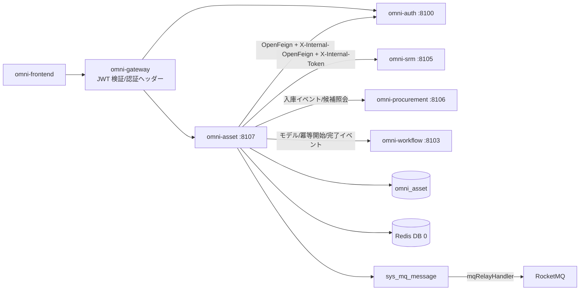
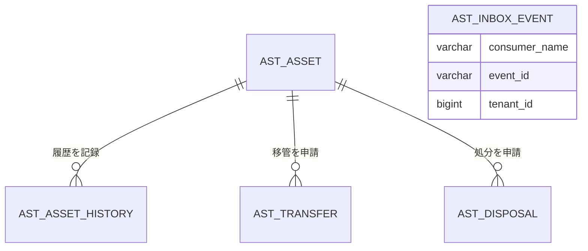
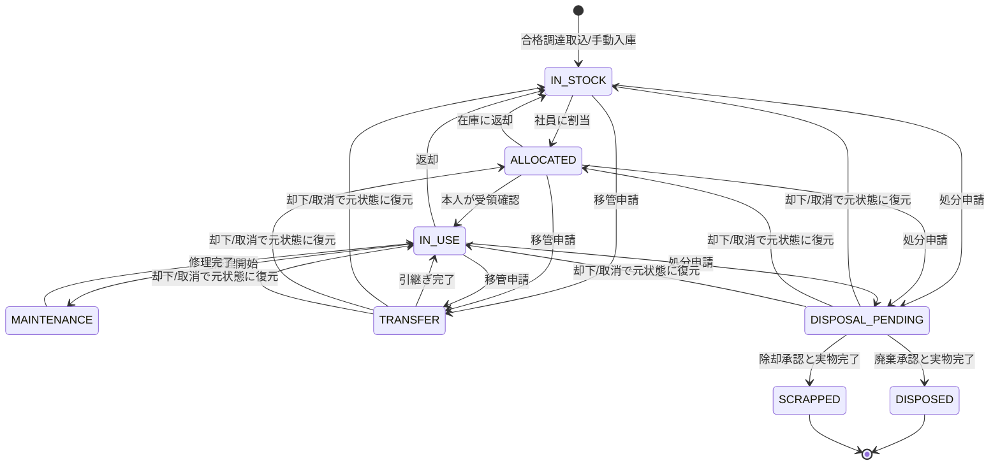
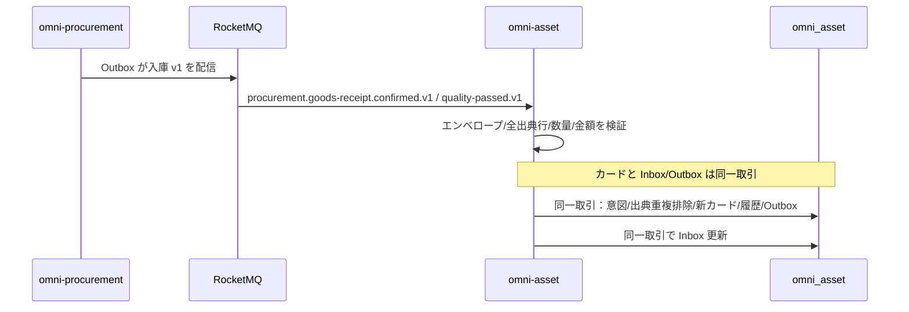
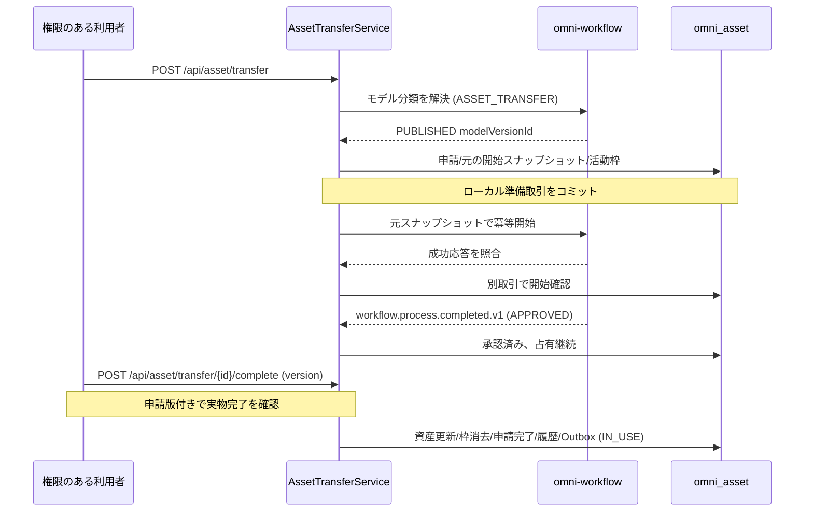
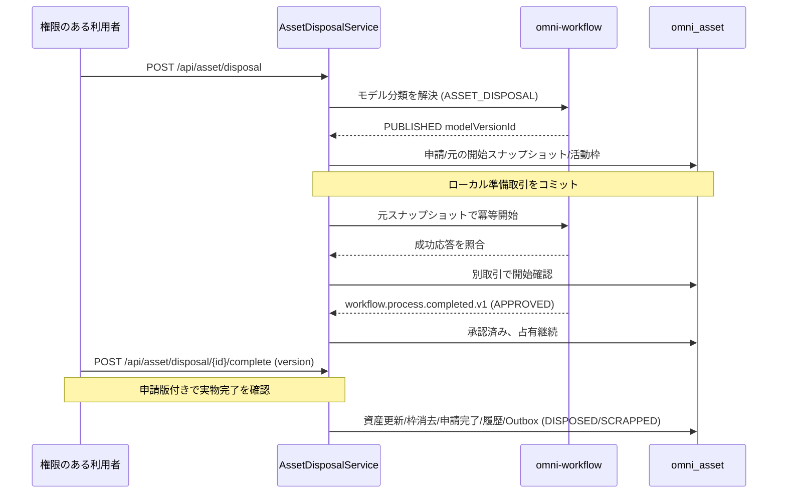

# 資産管理モジュール アーキテクチャと実装ベースライン

> 適用範囲：2026-07-27 の原設計日と第 14–16 節の重要な履歴を保持します。現在の事実は `omni-asset` のソース、Liquibase、フロントエンド、設定と照合しています。過去の「検証済み」は今回の完全な実行検収を意味しません。翻訳確認は [ADR-0003](../adr/0003-authorized-ai-translation-review.md) に従い、実際の `AI_REVIEW` として記録し、人によるレビューと偽りません。
>
> プロジェクト：Omni-Stack
> 原設計日：2026-07-27
> 現在の役割：資産サービスの境界、データ、コマンド、承認、調達取込契約を説明します。

操作入口は [機能ガイド](../wiki/feature-tour.jp.md)、開発入口は [ソース索引](../reference/source-map.jp.md) を参照してください。前提条件、利用者の資格、手順、画面、復旧は Wiki の役割です。要件、過去の計画、単体テストを新たな結合検証の証拠とは扱いません。関連資料は [構成](../architecture.jp.md)、[API 契約](../api-contract.jp.md)、[主要フロー](../core-flows.jp.md)、[Workflow](../workflow.jp.md)、[調達設計](procurement-design.jp.md)、[SRM 設計](srm-design.jp.md) です。

## 1. 設計結論

資産管理は独立した Servlet マイクロサービスとして構築し、調達入庫から最終処分までの資産の完全なライフサイクルを管理すべきである。SRM はサプライヤー情報を、Procurement は調達ソースを、Workflow は承認能力を提供する。

| 項目 | 決定 |
|---|---|
| Maven モジュール / サービス名 | `omni-asset` |
| ローカルポート / 管理ポート | `8107` / `19907` |
| XXL-JOB 実行体 | `omni-asset` / `9907`。`XXL_JOB_ENABLED` 等の設定で制御し、減価償却や保守ジョブの存在を意味しません |
| データベース | `omni_asset` |
| Gateway | `/api/asset/**` → `lb://omni-asset`、`StripPrefix` は使用しない |
| Redis | DB 0。`xss:enabled:{tenantId}` / `xss:rules:{tenantId}` を共有し、汎用の `asset:` 業務キャッシュ接頭辞は定義しません |
| フロントエンド | `omni-frontend/src/views/asset/**` |

Asset MVP は資産の全ライフサイクル管理の閉ループをカバーする：

> 調達入庫 → 資産検収・入庫 → 払出/割当 → 使用中 → 移管 → 廃棄処分 / スクラップ処分。

減価償却計算、資産棚卸、保守修理工単は MVP に含めない。

## 2. 製品範囲

本節は製品目標と段階を保持します。実際のロール能力は現在の権限とデータ範囲によります。Phase 2/3 は提供済み機能ではありません。資産原価は通貨ごとに集計し、為替換算しません。

### 2.1 ユーザーと目標

| ユーザー | コアニーズ |
|---|---|
| 総務/IT 管理者 | 会社の全資産を管理し、従業員に割当て、処分申請を処理する |
| 資産使用者 | 自分名義の資産を確認し、受入を確認または返却を発起する |
| 部門マネージャー | 自部門の資産を確認し、移管と処分を承認する |
| 財務担当者 | 資産の取得原価・現在状態を確認し、スクラップを確認する |
| 資産管理者 | 全テナントの資産管理、設定、統計 |

MVP は次に答えられるべきである：会社に資産がどれだけありどこに分布するか；ある資産を現在誰が使用中でどの状態か；どの資産が遊休で割当待ちか；ある部門の資産総額；どの資産が処分/スクラップフローを進行中か。

### 2.2 フェーズ分け

| フェーズ | 能力 |
|---|---|
| MVP | 資産台帳、資産検収（調達連動）、資産割当/返却、資産移管、廃棄処分、スクラップ処分、資産オーバービュー |
| Phase 2 | 資産棚卸、減価償却計算、保守修理工単、資産タグ/バーコード、資産インポート・エクスポート |
| Phase 3 | 資産予算管理、資産処分オークション、資産ライフサイクルコスト分析 |

## 3. システム境界

| 構成要素 | 正式な責務 | 現在の Asset の利用 |
|---|---|---|
| `omni-auth` | ID、組織、権限、データ範囲、XSS | 内部ユーザー候補、ユーザー/組織参照の検証、共通セキュリティ。ID と元の Workflow 起案者名を保存 |
| `omni-srm` | 仕入先 | 現在のクライアントは同一テナントの `APPROVED` 候補を検索。台帳はローカル名称スナップショットを表示 |
| `omni-procurement` | PO、入庫、資産候補 | 入庫イベントを購読。内部候補 API は制御された補完用で、現在のリアルタイム出典詳細照会ではない |
| `omni-base` | 辞書、操作ログ | 辞書の正式な管理元とログ集約。Asset 独自初期化器にテナント既定業務データはない |
| `omni-workflow` | BPMN、インスタンス、タスク、Flowable | 業務分類で公開版を解決し、冪等に開始、担当資格を検証、完了イベントを受信 |
| `omni-asset` | 資産、履歴、移管、処分、消費 Inbox | 本サービスの資産業務データの唯一の書込元 |
| RocketMQ | イベント転送 | 消費側は重複を許容。再試行/デッドレターの実動作は配置設定による |

現在の POM は `omni-common-core`, `omni-common`, `omni-common-mybatis`, `omni-common-redis`, `omni-common-operlog`, `omni-common-job`, `omni-common-mqlog`, `omni-common-service` に加え、Web、Security、Validation、OpenFeign、LoadBalancer、Nacos、RocketMQ、Actuator 等を明示的に使用します。`omni-common-service` が ID、テナント、DataScope、永続化、XSS を組み立てます。依存の存在は全バックグラウンドジョブの有効化を意味しません。

**Asset は `omni-common-workflow` に依存せず、Flowable を内蔵しません。** エンジンと DB は独立 `omni-workflow` の責務です。

## 4. ドメインとデータ設計

### 4.1 集約

| 集約 | テーブル | 責務 |
|---|---|---|
| Asset | `ast_asset`、`ast_asset_history` | 資産マスタデータ、状態変更の不変履歴 |
| Transfer | `ast_transfer` | 資産移管記録 |
| Disposal | `ast_disposal` | 資産処分記録（廃棄/スクラップ共用） |
| 消費 Inbox | `ast_inbox_event` | Procurement と Workflow 完了の各消費者の登録、意図照合、処理状態 |

### 4.2 共通フィールドとルール

- 5 つの `ast_*` テーブルすべてに `tenant_id` があります。`ast_asset` の管理帰属 `owner_user_id/owner_unit_id` と使用帰属 `current_user_id/current_unit_id` を書込認可で混同しません。
- 資産と両申請はそれぞれ `version`、`deleted`、監査項目を持ち、履歴と Inbox に論理削除はありません。`AST-<id>` はテナント内で一意です。手動資産は先に DB が ID を採番し、調達取込はサーバー生成 ID を使用します。
- ユーザー/組織は Auth、仕入先は SRM、出典は Procurement が管理します。ID と必要なスナップショットを保存し、DB 間外部キーを作りません。図はドメイン関連で、実際の全 DDL 制約ではありません。
- `source_po_id/source_gr_id/source_gr_line_id/source_unit_sequence` と PO/GR 番号が追跡元です。`tenant_id + source_gr_line_id + source_unit_sequence` の一意キーで各実物単位を保護します。
- 金額は `DECIMAL(18,2)` / `BigDecimal`。要求/応答の `purchaseAmount`、`residualValue` は JSON 十進文字列で、JSON number は不可です。調達元価格も文字列契約です。日時は `yyyy-MM-dd HH:mm:ss`、購入日は日付項目です。
- 手動登録は管理帰属の書込範囲と Auth の有効ユーザー/組織、主組織一致を検証します。更新には `version` が必要です。通常 PUT で状態、使用者、場所を変更しません。
- 削除は使用者、活動操作、後続業務履歴のない手動在庫資産に限定します。調達取込資産は削除不可、処分終状態は復元不可です。
- 同じ資産を占有できる活動移管/処分は一つです。作成時はテナント、ID、版、元状態、`deleted=0` と両 `active_operation_* IS NULL` を条件に原子的に占有し、更新 1 行以外は 409 です。

### 4.3 主要テーブル

`ast_asset`

- `asset_no/name/category_code`：資産番号、名称、品目（辞書 code）。
- `specification/brand/model`：仕様、ブランド、型番。
- `supplier_id/supplier_name_snapshot`：仕入先 ID とローカル名称スナップショット。現在の台帳は SRM から最新名を一括補完せず、スナップショットは現在の仕入先資格を証明しません。
- `source_po_id/source_gr_id/source_gr_line_id/source_unit_sequence/source_po_no/source_gr_no`：調達ソースと単位レベルの冪等識別子。
- `purchase_date/purchase_amount/currency_code`：購買日、取得原価、通貨。
- `location_code`：資産の場所（辞書 code、例：フロア+部屋番号）。
- `status`：ライフサイクル状態（IN_STOCK/ALLOCATED/IN_USE/MAINTENANCE/TRANSFER/DISPOSAL_PENDING/DISPOSED/SCRAPPED）。
- `current_user_id`：現在の使用者 ID。台帳 VO は ID を返し、Auth の氏名を一括補完しません。
- `current_unit_id`：現在の使用部門 ID。台帳 VO は ID を返し、Auth の組織名を一括補完しません。
- `allocated_time`：割当時刻。
- `active_operation_type/active_operation_id`：現在のアクティブ操作（TRANSFER/DISPOSAL）と申請 ID；アクティブ操作がない場合は NULL。
- `warranty_expiry_date`：保証期限日。
- `expected_life_years`：想定使用年数（スクラップの参考用）。
- `remark`。
- `owner_user_id/owner_unit_id/version/deleted` と監査フィールド。
- コアインデックス：tenant + owner/status、tenant + current_user_id、tenant + current_unit_id、tenant + category_code/status、tenant + asset_no（ユニーク）、tenant + source_gr_line_id + source_unit_sequence（調達ソースユニーク、手動入庫は source フィールドの NULL を許可）。

`ast_asset_history`

- `asset_id/from_status/to_status/changed_by_user_id/changed_time/remark`。
- 追記のみで、更新・削除しない。資産の毎回の状態変更と主要操作（割当、返却、移管、処分）を記録する。

`ast_transfer`

- `transfer_no/asset_id/from_user_id/from_unit_id/to_user_id/to_unit_id/from_location/to_location`。
- `reason/status/process_instance_id/previous_asset_status/active_flag`。
- `workflow_request_id/workflow_business_key/model_version_id/workflow_start_status/workflow_start_user_id/workflow_start_user_name`：Workflow 冪等スナップショットおよび元の起票者身分；`businessType=ASSET_TRANSFER` は移管集約タイプから固定的に導出される。
- `status`：PENDING_APPROVAL/START_FAILED/APPROVED/REJECTED/COMPLETED/CANCELLED。
- `approved_time/completed_time`。
- `version/deleted` と監査フィールド。

`ast_disposal`

- `disposal_no/asset_id/disposal_type（DISCARD/SCRAP）/reason/previous_asset_status/active_flag`。
- `residual_value（残存価値）/disposal_method（処分方式の記述）`。
- `status`：PENDING_APPROVAL/START_FAILED/APPROVED/REJECTED/COMPLETED/CANCELLED。
- `process_instance_id`：omni-workflow の承認プロセスインスタンスに関連付け。
- `workflow_request_id/workflow_business_key/model_version_id/workflow_start_status/workflow_start_user_id/workflow_start_user_name`：Workflow 冪等スナップショットおよび元の起票者身分；`businessType=ASSET_DISPOSAL` は処分集約タイプから固定的に導出される。
- `approved_time/completed_time`。
- `version/deleted` と監査フィールド。

`ast_inbox_event`

- `consumer_name/event_id` が一意。テナント、イベント型、出典、集約識別、payload、処理状態、時刻を保持します。
- 同じイベント ID に異なるテナントや JSON 意味上の意図が結びつくと競合です。処理済みを理由に意図照合を先に省略しません。
- Procurement のリアルタイム消費と Workflow 完了は別消費者です。補完候補は出典単位の冪等性を使い、リアルタイム Inbox に登録しません。

## 5. 状態マシンとコアフロー

### 5.1 Asset ライフサイクル

- `IN_STOCK`：資産は在庫中で未割当。
- `ALLOCATED`：従業員に割当済み、受入確認待ち。
- `IN_USE`：従業員が使用中。
- `MAINTENANCE`：修理送付中（MVP は状態をマークするのみ、修理工単は行わない）。
- `TRANSFER`：移管中（承認と引継ぎを待機）。
- `DISPOSAL_PENDING`：処分承認を進行中、割当・返却・移管・重複処分を禁止。
- `DISPOSED`：廃棄処分完了（終端状態）。
- `SCRAPPED`：スクラップ処分完了（終端状態）。

移管/処分を作成できるのは `IN_STOCK/ALLOCATED/IN_USE` だけです。修理は `IN_USE → MAINTENANCE → IN_USE` のコマンドのみです。活動移管/処分中は割当、返却、修理、重複占有を禁止します。状態遷移には端点権限、行範囲、版、活動枠の条件も必要です。

### 5.2 資産検収（調達連動）

リアルタイム入口は `procurement.goods-receipt.confirmed.v1` と `procurement.goods-receipt.quality-passed.v1` を購読します。書込前にエンベロープ、テナント、出典ルート、全明細のメタデータ、出典行 ID の一意性を検証します。数量、単価、行金額は正数で、`unitPrice × receivedQuantity = totalPrice` が必要です。必須項目欠落、不正列挙値、非対応版はイベント全体を拒否し、既定値を推測しません。

有効な `qualityStatus=PASS && assetManaged=true` 行だけをカード化します。`receivedQuantity` は厳密な正整数で `assetQuantity` と等しく、`Integer.MAX_VALUE` 以下です。有効な非資産行や PENDING/FAIL 行はスキップしますが、不正形式行は検証対象です。合格 5 単位なら `source_unit_sequence=1..5` の 5 枚を `IN_STOCK`、出典の管理帰属で作成します。各カードの `purchaseAmount` は `unitPrice` を HALF_UP で小数 2 桁に丸め、行全体額を各カードに複製しません。

二重冪等性：リアルタイム Inbox の `consumer_name + event_id` は再送判定より先にテナントと JSON 意味上の意図を照合します。出典単位の一意キーはリアルタイム、再送、補完を共通保護します。書込後に出典行をロックして読み直し意図を検証し、JDBC 更新行数だけで新規作成を判定しません。同じリアルタイム取引に新カード、履歴、Inbox 状態、新カード分だけの `asset.created.v1` Outbox を含めます。Outbox 保存だけでは Broker 配信や下流消費の成功を証明しません。

過去補完は制御された 1 ページ単位です。カーソルと部分コミットは 8.3 を参照。起動後に自動で全件走査する保証はありません。

### 5.3 資産割当と返却

| コマンド（接頭辞 `/api/asset/asset`） | 要求と状態条件 | 同一取引の効果 |
|---|---|---|
| `POST /{id}/allocate` | `version,targetUserId,targetUnitId,remark?`、在庫・空活動枠。対象部門が書込可能、Auth で同一テナントの有効ユーザー/組織と主組織を検証 | `ALLOCATED`、使用者/部門、割当時刻、履歴、`asset.allocated.v1` Outbox |
| `POST /{id}/accept` | `version,remark?`、`ALLOCATED` かつ使用者本人 | `IN_USE` と履歴 |
| `POST /{id}/return` | `version,remark?`、`ALLOCATED/IN_USE` かつ使用者本人 | `IN_STOCK`、使用者/部門/時刻を消去、履歴、`asset.returned.v1` Outbox |
| `POST /{id}/maintenance/start` | `version,remark?`、`IN_USE`、空活動枠 | `MAINTENANCE` と履歴 |
| `POST /{id}/maintenance/complete` | `version,remark?`、`MAINTENANCE`、空活動枠 | `IN_USE` と履歴 |

テナントとデータ範囲で資産をロックし、版と元状態等で条件更新します。競合は 409。管理ロールも accept/return の本人限定を拡大しません。修理指示票、自動減価償却、自動保守スケジュールは実装しません。

### 5.4 資産移管

作成項目は `assetId,toUserId,toUnitId,toLocation?,reason`。`modelVersionId` はサーバーが解決し、利用者指定を受け付けません。対象部門と Auth 参照を検証後、現在の公開 `ASSET_TRANSFER` モデルを解決します。準備取引で申請、`previous_asset_status`、元の開始スナップショット、活動枠を保存します。そのコミット後に遠隔 Workflow を呼び、開始確認を別途永続化します。

`APPROVED` でも申請 `active_flag=1` と資産 `TRANSFER` 占有を維持します。権限のある利用者が申請 `version` 付き業務 `/complete` で引継ぎを完了します。同取引で現在の使用者/使用部門と任意の場所を変更し、`IN_USE`、枠消去、履歴、完了 Outbox を記録します。管理帰属 `owner_user_id/owner_unit_id` は変更しません。

承認段階は現在の分類一致公開 BPMN によります。第 15 節の単段階承認は原設計です。却下/プロセス取消は同取引で申請を終了し資産の元状態を復元、枠を消去します。開始不明と明示失敗の復旧境界は 8.4 を参照。

### 5.5 資産処分（廃棄/スクラップ）

作成は `assetId,disposalType,reason,residualValue?,disposalMethod?`。`disposalType` は `DISCARD/SCRAP`、残存価額は JSON 十進文字列です。サーバーは `ASSET_DISPOSAL` モデルを解決します。両処分は同じ申請表と承認統合を使いますが、実際の承認者と段階は BPMN に従い、財務確認済みと仮定しません。

`APPROVED` 後も `DISPOSAL_PENDING` の占有を維持します。権限と申請版を検証した業務 `/complete` で初めて実物処分を確定し、`DISPOSED/SCRAPPED`、枠消去、履歴、対応 Outbox を記録します。却下/プロセス取消、または明示開始失敗が永続化された後のローカル取消は、同取引で `previous_asset_status` と両活動印を復旧/消去します。開始結果不明時のローカル取消は禁止です。

## 6. テナント、RBAC とデータ権限

### 6.1 信頼チェーン

他の Servlet ビジネスサービスと一致：Gateway JWT → `GatewayPreAuthenticationFilter` 事前認証 → `ServiceIdentityFilter` テナント/身分検証 → `@PreAuthorize` → `@ServiceDataScope` → MyBatis DataPermission → `AssetRecordAccessGuard`。

### 6.2 権限ツリーとロール

メニュー：`asset`（DIRECTORY）および `asset:overview`、`asset:asset`、`asset:transfer`、`asset:disposal`（MENU）。

API 権限：

- `asset:overview:list`
- `asset:asset:list`, `asset:asset:self`, `asset:asset:create`, `asset:asset:update`, `asset:asset:delete`, `asset:asset:allocate`, `asset:asset:accept`, `asset:asset:return`, `asset:asset:maintenance`
- `asset:transfer:list`, `asset:transfer:create`, `asset:transfer:approve`, `asset:transfer:complete`, `asset:transfer:cancel`, `asset:transfer:retry`
- `asset:disposal:list`, `asset:disposal:create`, `asset:disposal:approve`, `asset:disposal:complete`, `asset:disposal:cancel`, `asset:disposal:retry`

| ロール | dataScope | 能力 |
|---|---|---|
| `ASSET_ADMIN` | TENANT | 現在のテナントの全資産機能/データ |
| `ASSET_MANAGER` | DEPT_AND_BELOW | 部門および下位、移管/処分承認 |
| `ASSET_USER` | SELF | 「マイ資産」エンドポイントで自分名義の資産を確認し、受入確認と返却発起を行う |
| `SUPER_ADMIN` | ALL | 全機能、資産データは引き続き現テナントに限定 |

デフォルトの USER には資産権限を付与しない。

### 6.3 Asset コンテキストと SQL インターセプト

モジュール横断コンテキストと永続層の組み立ては `omni-common-service` が提供する：リクエスト身分は `ServiceIdentityContext` / `ServiceRequestIdentity`、データ範囲は `@ServiceDataScope` / `ServiceDataScopeContext` を使用し、`ServicePersistenceAutoConfiguration` がインターセプターの組み立てを担当する。Asset はドメインポリシー `AssetTenantTablePolicy`、`AssetDataPermissionHandler` と書き込み操作ガード `AssetRecordAccessGuard` のみを保持する。

インターセプター順序は固定：`TenantLineInnerInterceptor → DataPermissionInterceptor → OptimisticLockerInnerInterceptor → PaginationInnerInterceptor`。`AssetTenantTablePolicy` は `ast_*` テーブルにのみ有効で、`sys_mq_message` はテナントインターセプトの外に保たなければならず、バックグラウンド Relay のテナント横断スキャンを許可する。

| dataScope | 条件 |
|---|---|
| SELF | 現在の permission がマップする owner または current_user 列が currentUserId に等しい |
| DEPT | owner_unit_id が primaryUnitId と一致 |
| DEPT_AND_BELOW / CUSTOM | owner_unit_id が accessibleUnitIds に含まれる |
| TENANT / ALL | owner 条件を追加しない、TenantLine は常に保持 |

資産の dataScope には管理次元と使用次元があり、汎用 SQL で広い OR を使用できず、permissionCode/エンドポイントごとに明示的にマップしなければならない：

| エンドポイント/権限 | 範囲列 | ルール |
|---|---|---|
| `/api/asset/asset/list`、詳細、管理履歴；`asset:asset:list` | `owner_user_id/owner_unit_id` | 資産管理担当向け、管理帰属でフィルタ |
| `/api/asset/asset/my`；`asset:asset:self` | `current_user_id` | 固定して現在ユーザーに等しく、他ロールのより広い dataScope によって拡大しない |
| accept/return；対応するコマンド権限 | `current_user_id` | RecordAccessGuard が対象資産の現在割当先が currentUserId であることを強制 |
| Transfer/Disposal list/detail | 関連 Asset の管理次元 | 子テーブルは同一テナントの asset_id で継承し、存在しない owner 列を直接連結しない |
| Transfer/Disposal approval-view | Workflow taskId の割当関係 | まず現在ユーザーがその tenant/ビジネス伝票のタスク承認者であることを検証し、その後 tenant + id で読み取り専用 VO を読む |
| Overview | Asset 管理次元 | 集約 SQL は `/api/asset/asset/list` と同一範囲を使用 |

ユーザーが ASSET_USER と管理ロールを同時に持つ場合でも、フロントエンドは「マイ資産」と管理リストをそれぞれ呼び出す。バックエンドは 2 つの次元を OR 結合して書き込み認可に使用してはならない。

例外は完全な権限コードで判断します。`asset:asset:self`, `asset:asset:accept`, `asset:asset:return` は常に `current_user_id` 固定です。`asset:transfer:create` の `SELF` も `current_user_id`、その他の管理操作は owner 列です。候補照会も対応 create 権限の範囲を使い、両活動列の NULL と操作可能状態を条件とします。

approval-view はローカル `PENDING_APPROVAL + STARTED` と完全な業務キー/インスタンスが前提です。利用者、テナント、業務型/キー、Workflow タスク割当と同一インスタンスを検証後だけ一時 `TENANT` 範囲で該当 VO を読み、`finally` で元コンテキストを復元します。通常詳細の無条件な権限回避口ではありません。

## 7. API 設計

### 7.1 共通契約

[API 契約](../api-contract.jp.md) に従い、`R<T>`、ページは `R<PageResult<T>>`。ページは 1 起点/既定 1、件数は既定 10、1..100。非表示/不存在は通常業務 404、権限不足 403、版/状態/占有競合 409、依存先停止または Workflow 結果未確定は 503 です。HTTP 状態と `R.code` を混同しません。

項目は現在の DTO/VO が基準です。資産更新/ライフサイクル操作に `version`、移管/処分 retry/cancel/complete に申請版が必要です。`purchaseAmount/residualValue` は十進文字列、時刻は 4.2 に従います。

### 7.2 エンドポイント

以下は外部 32、内部 1 の完全なメソッド/サービスパスです。Gateway は `/api/asset` を除去しません。内部補完には有効な内部トークンと、同じ正数の `X-Tenant-Id` / クエリ `tenantId` が必要です。

| 領域 | メソッドと完全パス |
|---|---|
| 資産台帳/本人操作 | `GET /api/asset/asset/list` |
| 資産台帳/本人操作 | `GET /api/asset/asset/my` |
| 資産台帳/本人操作 | `GET /api/asset/asset/{id}` |
| 資産台帳/本人操作 | `GET /api/asset/asset/{id}/history` |
| 資産台帳/本人操作 | `POST /api/asset/asset` |
| 資産台帳/本人操作 | `PUT /api/asset/asset/{id}` |
| 資産台帳/本人操作 | `DELETE /api/asset/asset/{id}` |
| 資産台帳/本人操作 | `POST /api/asset/asset/{id}/allocate` |
| 資産台帳/本人操作 | `POST /api/asset/asset/{id}/accept` |
| 資産台帳/本人操作 | `POST /api/asset/asset/{id}/return` |
| 資産台帳/本人操作 | `POST /api/asset/asset/{id}/maintenance/start` |
| 資産台帳/本人操作 | `POST /api/asset/asset/{id}/maintenance/complete` |
| 処分 | `GET /api/asset/disposal/list` |
| 処分 | `GET /api/asset/disposal/{id}` |
| 処分 | `GET /api/asset/disposal/{id}/approval-view` |
| 処分 | `POST /api/asset/disposal` |
| 処分 | `POST /api/asset/disposal/{id}/retry-start` |
| 処分 | `POST /api/asset/disposal/{id}/cancel` |
| 処分 | `POST /api/asset/disposal/{id}/complete` |
| 候補 | `GET /api/asset/options/users` |
| 候補 | `GET /api/asset/options/transfer-assets` |
| 候補 | `GET /api/asset/options/disposal-assets` |
| 候補 | `GET /api/asset/options/suppliers` |
| 概要 | `GET /api/asset/overview/summary` |
| 概要 | `GET /api/asset/overview/distribution` |
| 移管 | `GET /api/asset/transfer/list` |
| 移管 | `GET /api/asset/transfer/{id}` |
| 移管 | `GET /api/asset/transfer/{id}/approval-view` |
| 移管 | `POST /api/asset/transfer` |
| 移管 | `POST /api/asset/transfer/{id}/retry-start` |
| 移管 | `POST /api/asset/transfer/{id}/cancel` |
| 移管 | `POST /api/asset/transfer/{id}/complete` |
| 内部補完 | `POST /api/internal/asset/procurement/backfill` |

### 7.3 エンドポイントと DataScope permission のマッピング

| 操作 | permissionCode |
|---|---|
| Overview | `asset:overview:list` |
| Asset list/detail/history | `asset:asset:list` |
| My Asset | `asset:asset:self` |
| Asset create/update/delete | `asset:asset:create`, `asset:asset:update`, `asset:asset:delete` |
| Asset allocate | `asset:asset:allocate` |
| Asset accept（従業員自用） | `asset:asset:accept` |
| Asset return | `asset:asset:return` |
| Asset maintenance start/complete | `asset:asset:maintenance` |
| Transfer list/detail | `asset:transfer:list` |
| Transfer create | `asset:transfer:create` |
| Transfer approval-view | `asset:transfer:approve` |
| Transfer complete | `asset:transfer:complete` |
| Transfer cancel/retry-start | `asset:transfer:cancel`, `asset:transfer:retry` |
| Disposal list/detail | `asset:disposal:list` |
| Disposal create | `asset:disposal:create` |
| Disposal approval-view | `asset:disposal:approve` |
| Disposal complete | `asset:disposal:complete` |
| Disposal cancel/retry-start | `asset:disposal:cancel`, `asset:disposal:retry` |

`options/users` は完全な `asset:asset:list`, `asset:asset:create`, `asset:asset:update`, `asset:asset:allocate`、`asset:transfer:create`、`asset:disposal:create` のいずれかを要求します。`options/suppliers` は `asset:asset:create` または `asset:asset:update`。`options/transfer-assets` と `options/disposal-assets` は各 create 権限と DataScope を要求します。候補表示は最終書込認可ではなく、書込時に状態、参照、範囲を再検証します。

## 8. サービス横断の一貫性

### 8.1 Auth Feign

Auth が ID、権限、組織、データ範囲、XSS を管理します。`AssetIdentityGuard` は `/internal/users/{id}` と `/internal/orgs/{id}` で同一テナント、有効状態、主組織一致を検証し、例外や不正応答は閉鎖します。`options/users` は `/internal/users/options` から主組織のない候補を除外しテナントを照合します。台帳氏名の自動補完を意味しません。

内部 Feign の認証頭は `InternalFeignHeadersFactory` が生成し、ID/DataScope の寿命は共通サービスに従います。利用者入力の数値 ID を検証済み参照と扱いません。

### 8.2 SRM Feign

現在の `SrmInternalClient` は `GET /api/internal/supplier/search` のみです。テナント頭/引数を一致させ、`status=APPROVED` に固定します。登録画面は `GET /api/asset/options/suppliers` を使い、失敗/不正応答は 503 です。

台帳/詳細は `supplierNameSnapshot`、なければ仕入先 ID を表示します。現在の経路に最新仕入先詳細、保証連絡先、名称一括補完はありません。保存スナップショットは現在の仕入先資格を付与しません。

### 8.3 Procurement 連動

リアルタイム payload は [調達設計](procurement-design.jp.md) の v1 契約で、出典、通貨、管理帰属、行数量/金額を含みます。入口で現在テナントの ID と `TENANT` DataScope を設定し `finally` で消去します。検証と原子的取込は 5.2 を参照。消費例外はその処理試行の失敗を表すだけです。再試行時刻やデッドレター移送は Broker/binder の実設定と証拠が必要で、例外だけから断定しません。

補完は `POST /api/internal/asset/procurement/backfill`、`tenantId>0,afterId>=0,size=1..100`、既定 afterId 0/size 100 です。`GET /api/internal/procurement/goods-receipt/asset-candidates` を一致テナント頭/引数で呼びます。出典行 ID は afterId より大きく厳密昇順で、取込前に全ページの順序を検証します。各候補は独立取引で出典単位一意キーを使用し、リアルタイム Inbox を登録しません。新カードだけ履歴と created Outbox を記録します。

1 回の結果は `fetchedCount/createdCount/duplicateCount/nextAfterId/hasMore`。`hasMore` は件数が size と等しい場合の推定です。呼出元がカーソル保存と次ページの実行を管理するので、自動走査器ではありません。後の候補が失敗しても前の候補はコミット済みの場合があります。出典単位を照合して元ページを再試行し、失敗応答を全ページのロールバックと解釈しません。終了時は ID/DataScope を消去します。

### 8.4 Workflow 統合

公開モデルは同一テナント、`PUBLISHED`、定義あり、category が `ASSET_TRANSFER/ASSET_DISPOSAL` に一致する必要があります。ローカル作成前に解決し、準備コミット後は元の `requestId/tenantId/modelVersionId/businessType/businessKey/startUser` スナップショットで開始します。業務キーは申請 ID。Workflow は `tenantId + businessType + businessKey` で冪等なので、新しい意図を作り直しません。

- 成功応答も要求 ID、業務型/キー、インスタンス ID を照合し、`markStarted` の別取引で確認します。
- Feign/HTTP エラー、通信断、他の非成功業務コード、不一致応答、ローカル確認失敗は `PENDING_APPROVAL + PENDING` と占有を保ち、同じキーで再試行します。
- 業務 `R.code=404` だけが明示失敗分岐で `markFailed` を試みます。その保存も失敗して PENDING が残り得ます。Feign の HTTP404 例外は不明分岐です。ローカル `START_FAILED + FAILED` が永続化された場合だけ版付きローカル取消が可能で、retry は元スナップショットを使います。
- 承認は `/api/workflow/approval/{taskId}/complete` で実行します。資産承認ビューには対応 asset approve 権限、担当タスク完了には `workflow:approval:complete` と割当照合が必要です。6.3 を参照。

`workflow.process.completed.v1` は送信元、テナント、型、業務キー、インスタンス、現状態を検証します。Inbox 登録後、同イベントの JSON 意味上の意図を先に照合し、競合は 409。処理済み、古い状態、別インスタンスは無視します。**正当な完了がローカル開始確認より先に届いた場合は再試行可能例外とし、永久に捨てません。** APPROVED は業務完了まで占有、REJECTED/CANCELLED は同取引で復元/枠消去します。完全なタスク、担当者、意見の正式な情報源は Workflow で、Asset は承認意見履歴を複製しません。

### 8.5 Outbox イベント

`asset-domain-out-0` から `asset-domain-event` へ以下のローカル Outbox を書きます。

- `asset.created.v1`：調達のリアルタイム/補完で実際に作成した新カード。手動作成にこの発行呼出しはありません。
- `asset.allocated.v1`、`asset.returned.v1`。
- `asset.transfer.completed.v1`。
- `asset.disposed.v1`、`asset.scrapped.v1`。

エンベロープは `eventId/eventType/occurredAt/tenantId/producer/payload`。実呼出しを基準とし、全状態遷移イベントがあるとは推定しません。Relay/Broker 配信は別に観測します。

## 9. プライバシー、操作ログと XSS

### 9.1 OperLog

書込操作に `@OperLog` を使用します。共通 `OperLogSanitizer` は MQ 前に引数、スナップショット、例外を処理し、reason/remark 等の自由文や認証情報項目を規則で置換、電話/メールをマスクし、文字列の認証情報断片を処理します。任意の氏名、住所表記や全アプリログの匿名化を保証するものではありません。

### 9.2 PII

Asset は使用者/管理者 ID、仕入先/出典スナップショット、自由文、元起案者名 `workflow_start_user_name` を保存し、ユーザー候補も username/nickname を返します。「PII なし」「userId のみ保存」は不正確です。本番画面、出力、ログ、レビュー証拠は項目と認可に応じて管理し、認証情報や個人情報を漏らしません。

### 9.3 XSS

`CachedServiceXssConfigProvider` はまず Redis DB0 の `xss:enabled:{tenantId}` / `xss:rules:{tenantId}` を読みます。欠落、読取/解析失敗時は Auth に照会し、有効な応答は使用します。Redis 単独障害で必ずローカル基準になるわけではありません。正式設定が得られない場合だけ `XssSettingsFallback` を使い、既定は HTML_TAG、EVENT_HANDLER、DANGEROUS_PROTOCOL の防御を有効にします。キャッシュ書戻し失敗でも取得した正式設定は維持します。備考は平文用途で、依存障害を理由にフィルターを回避しません。

## 10. フロントエンド設計

現ページは `omni-frontend/src/views/asset/{overview,asset,transfer,disposal}/index.vue`、API は `src/api/asset-{overview,asset,transfer,disposal}.ts`。旧案の独立 `components/asset/AssetCard.vue` 等はありません。

- 台帳の ledger/my タブを権限で表示し、管理一覧と固定本人一覧を別呼出しします。管理側は状態、品類、管理部門、場所で絞ります。詳細ドロワーは基本項目、使用者/部門 ID、出典スナップショット、変更履歴を表示し、移管/処分記録は専用ページで照会します。
- 仕入先/ユーザー候補を選び、主組織から管理/使用部門を設定します。バックエンドで再照合し、ボタンは対応 `v-permission` を使います。
- 概要は状態件数と `amountsByCurrency`。分布は `STATUS/CATEGORY/DEPARTMENT/LOCATION`、金額は通貨別で異通貨を合算しません。
- 共通 `ApiResponse/PageResult` は `src/types/api.ts` だけから導入します。メニュー、アイコン、本人入口は現 router/layout を参照。実手順/画面は Wiki の役割で、この構成説明だけでは今回のブラウザー検収を証明しません。

## 11. エンジニアリング着地点

### 11.1 現在のモジュール入口

Java 入口は `omni-backend/omni-asset/src/main/java/com/omni/asset` 配下の `AssetApplication.java`、client、config、controller、dto、entity、mapper、security、service、consumer、workflow、domain です。SQL は Java Mapper 注釈と Liquibase にあります。リソースは `application.yml` / `application-lite.yml` で、独立 application-dev.yml や XML mapper ディレクトリではありません。[ソース索引](../reference/source-map.jp.md) から移動してください。

### 11.2 現在の関連ファイル

以下は現在の事実の入口です。対応契約を変更したときに同期し、未作成予定ファイルとは扱いません。

| 範囲 | 現在のファイル/ディレクトリ |
|---|---|
| モジュール | `omni-backend/omni-asset/pom.xml` `omni-backend/pom.xml` |
| 実行設定 | `omni-backend/omni-asset/src/main/resources/application.yml` `omni-backend/omni-asset/src/main/resources/application-lite.yml` |
| Schema | `database/changelog/asset/0001-asset-schema.yaml` |
| 権限と seed 摘要 | `scripts/sql/seed/auth.sql` `database/seed/manifest.yaml` |
| テナント初期化 | `omni-backend/omni-asset/src/main/java/com/omni/asset/service/impl/AssetTenantModuleProvisioner.java` |
| Gateway / Compose | `omni-backend/omni-gateway/src/main/resources/application.yml` `compose.yaml` |
| 画面 | `omni-frontend/src/views/asset` `omni-frontend/src/api/asset-asset.ts` `omni-frontend/src/router/index.ts` |
| サービス間契約 | `omni-backend/omni-asset/src/main/java/com/omni/asset/client` `omni-backend/omni-asset/src/main/java/com/omni/asset/dto/ProcurementAssetContracts.java` `omni-backend/omni-asset/src/main/java/com/omni/asset/dto/WorkflowContracts.java` |

既定のホスト入口 `8107`、管理 `19907`、Redis DB 0、XXL appname `omni-asset` / `9907`。Compose の設定に従ってコンテナポートを割り当てます。`application-lite.yml` は Nacos を無効にして静的発見を使います。実行、構築、テストはすべてローカル Docker。権限初期化は Auth、辞書は Base が担当します。

## 12. 非機能設計

- 一覧は最大 100。候補/分布 limit も 1..100 を検証します。Overview Mapper は資産ルートを直接集計し、テナント/管理範囲を継承、金額は通貨別です。台帳名称の遠隔一括補完や実測性能は主張しません。
- 割当/返却は資産ロックと版条件更新。移管/処分は活動枠を共用し、完了/取消で申請と資産の版、状態、占有識別を検証します。実 DB 並行検収は別証拠が必要です。
- Auth 停止は参照/候補/範囲検証に依存する操作を失敗閉鎖しますが、すべてのローカル読取が失敗するとは限りません。SRM 候補失敗は 503、既存台帳はローカル名称を表示。Procurement 候補停止は当該補完の失敗で、過去 PO/GR 号はローカル項目です。
- Workflow 結果不明時は枠を保ち同キー再試行。業務404の失敗印保存も失敗し得るため、承認迂回や盲目的取消は禁止。ローカル Outbox 成功から MQ 可用性を推定しません。

## 13. テストと検収

現在のテスト入口は `omni-backend/omni-asset/src/test/java`。単体断言、構築結果、実 DB/サービス間/ブラウザー証拠を区別します。検収要件：

- 資産 8 状態の合法/不正遷移、版競合、手動削除境界、管理ロールでも本人一覧/accept/return を拡大しないこと。
- 完全な出典検証、数量/金額等式、有効な非対象行のスキップ、不正行の全イベント拒否、再送、同 ID 異意図競合、出典単位重複排除。
- リアルタイム原子取引と候補取引、部分ページ成功後の照合/再試行、重複出典から新カードイベントを再発行しないこと。
- 移管/処分の枠競争、APPROVED 後の実物完了待ち、終状態不可逆、却下/取消の previousStatus 復元。
- モデル分類/担当資格、開始結果不明、ローカル確認失敗、明示失敗印の保存失敗、早到完了の再試行、別インスタンス分離。
- owner 管理範囲、SELF 移管の current-user 例外、テナント分離、コンテキスト欠落時の失敗閉鎖。
- JSON 金額文字列、通貨別集計、ログ/XSS 境界、4 言語の権限表示。
- 実結合：調達入庫 → MQ → IN_STOCK → ALLOCATED → IN_USE → 移管承認/引継ぎ → 処分承認/実物完了 → SCRAPPED。実行記録が必要で、単体成功や本文の存在だけでは成功扱いしません。

## 14. 実装順序

2026-07-27 の原実施分解を履歴として保持します。今回の再実行指示や現検収一覧ではありません。現在の入口/契約は第 3–13 節です。

### Milestone 0：前提確認

- SRM と Procurement が構築済みであることを確認。
- Workflow サービスが利用可能であることを確認。
- Workflow 内部起動 API、承認結果イベント、および Procurement 入庫イベント/履歴補償 API の契約を確認。

### Milestone 1：サービス構築 + セキュリティ基盤

- モジュール、設定、Gateway、Docker、DB を作成。
- TenantLine + DataPermission + Pagination。
- 権限ツリー、Asset ロール、既存テナント移行。
- フロントエンド root メニュー。

### Milestone 2：資産台帳

- 資産 CRUD（手動入庫を含む）。
- 資産割当/受入確認/返却。
- 資産変更履歴。
- 資産詳細ページ。

### Milestone 3：調達連動 + 検収

- MQ 消費者（入庫イベント → 資産作成）。
- `ast_inbox_event` 冪等消費。
- ソース単位ユニークキー、一括資産作成（assetQuantity > 1）と履歴補償再スキャン。

### Milestone 4：移管 + 処分

- 移管申請 + 独立 Workflow サービス承認。
- 廃棄/スクラップ処分 + 独立 Workflow サービス承認。
- 承認結果イベント → 申請状態更新、拒否回復、ビジネス complete。

### Milestone 5：オーバービュー + 本番強化

- オーバービュー統計（summary + distribution）。
- テスト、インデックス、セキュリティ検収。
- docs/、AGENTS.md を更新。

## 15. ADR 要約

原設計判断を保持します。単段階承認は当時の簡略化で、現在は分類一致の公開 BPMN が決定します。見送り項目は原 MVP の境界です。

| 決定 | 選択 | 理由 |
|---|---|---|
| サービス | 独立 `omni-asset` | SRM/Procurement から分離、責務が明確 |
| Workflow 統合 | 独立 `omni-workflow` 内部 API + 承認結果イベント | Flowable の唯一実行時とデータベース境界を保持 |
| 調達連動 | Outbox イベント消費 | Procurement と Asset を疎結合 |
| 一括入庫 | 単位ごとに 1 つの資産カード | 各資産の独立追跡を容易にする |
| 冪等消費 | Inbox eventId + ソース行/unitSequence ユニークキー | リアルタイムイベント、リプレイ、履歴再スキャンを同時にカバー |
| 移管承認 | 単純単段承認 | MVP は多段承認を行わない |
| 処分タイプ | DISCARD + SCRAP がテーブル共用 | フローは一致、違いは承認者と終端状態 |
| 減価償却計算 | 行わない | MVP は財務減価償却を処理しない |

## 16. 主要リスク

原リスク登録と当時の対策を保持します。現取引、補完、失敗、初期化境界は前述のとおりです。補完全ページは原子的にロールバックせず、辞書は Base の責務、Inbox に出典単位一意キーを併用します。

| 優先度 | リスク | 対処 |
|---|---|---|
| P0 | 入庫イベントの重複消費による資産の重複作成 | `ast_inbox_event` ユニークキー冪等 |
| P0 | Workflow 利用不可または応答喪失による半起動/重複フロー | 結果不確実は PENDING を保持し同一キーでリトライ；リモートがインスタンス未作成を明示した時のみ START_FAILED に入る |
| P0 | 書き込み操作がクエリデータ権限をバイパス | AccessGuard + 条件付き更新 |
| P1 | 同一資産の並行割当 | 行ロック + version 楽観ロック |
| P1 | 入庫数量 > 1 のとき資産作成が不完全 | トランザクション内で行ごとに作成、全部成功または全部ロールバック |
| P0 | 消耗品/品質検査失敗/連続計量資材が誤って資産化 | Procurement assetManaged + 品質/整数検証、Asset はフェイルクローズド |
| P1 | 移管と処分の並行または拒否後に資産がスタック | active_operation 原子占有 + previousStatus 回復 |
| P1 | 資産処分後の誤操作回復 | 終端状態は不可逆、回復インターフェースを提供しない |
| P1 | MQ メッセージ滞留や Asset の遅い稼働で資産作成が遅延/漏れ | Outbox リアルタイム配信 + Procurement 履歴候補補償再スキャン |
| P2 | 品目/場所辞書データが不完全 | テナント初期化時に常用値をプリセット |
