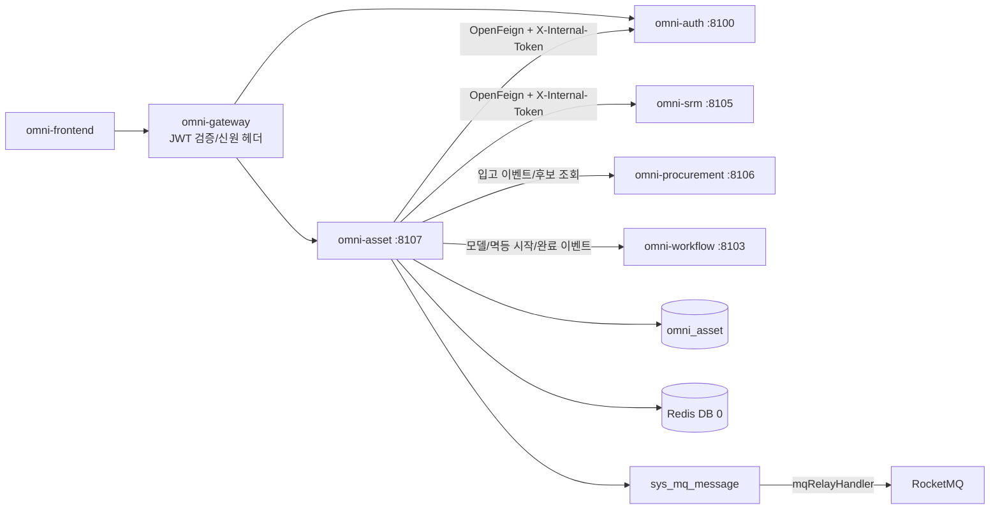
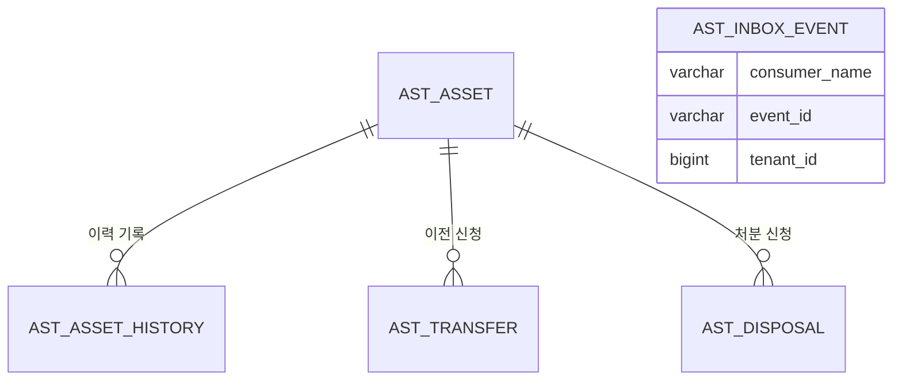
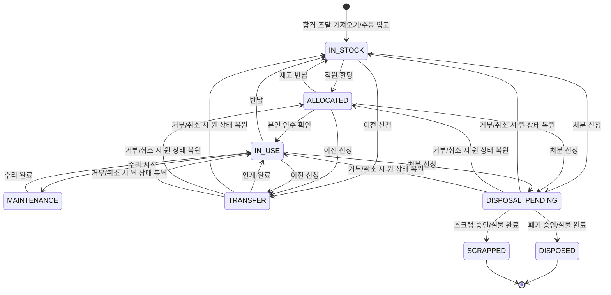
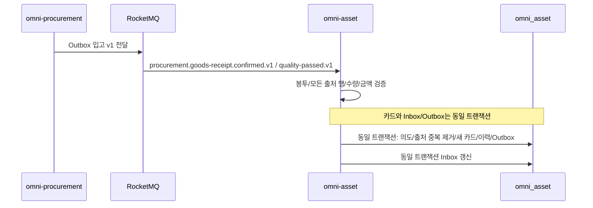
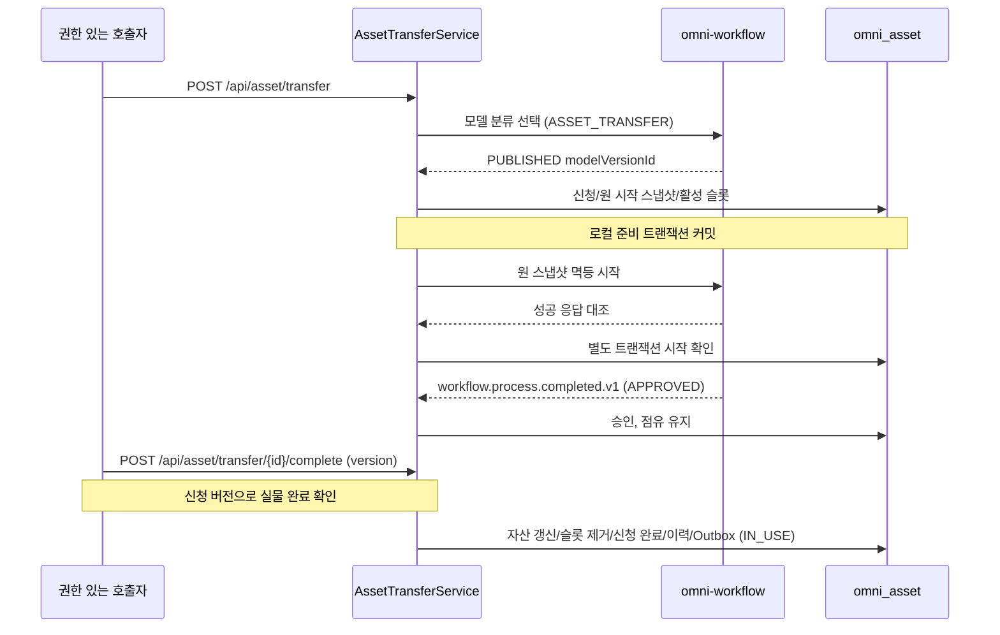
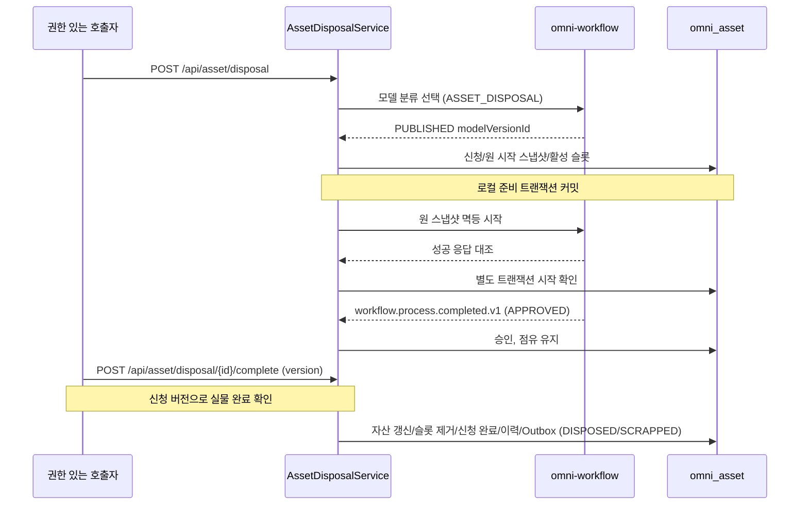

# 자산 관리 모듈 아키텍처와 구현 기준선

> 적용 범위: 원 설계 날짜 2026-07-27과 14–16절의 중요한 이력을 유지합니다. 현재 사실은 `omni-asset` 소스, Liquibase, 프런트엔드와 설정을 대조한 것입니다. 과거의 “검증 완료”는 이번 실행의 전체 인수를 뜻하지 않습니다. 번역 검토는 [ADR-0003](../adr/0003-authorized-ai-translation-review.md)에 따라 실제 `AI_REVIEW`로 기록하며 사람 검토로 표시하지 않습니다.
>
> 프로젝트: Omni-Stack
> 원 설계 날짜: 2026-07-27
> 현재 역할: 자산 서비스 경계, 데이터, 명령, 승인 및 조달 가져오기 계약을 설명합니다.

사용 입구는 [기능 안내](../wiki/feature-tour.kr.md), 개발 입구는 [소스 색인](../reference/source-map.kr.md)을 참조하세요. 사전 조건, 사용자 자격, 절차, 화면과 복구는 Wiki의 역할입니다. 요구 사항, 과거 계획, 단위 테스트를 새로운 종단간 증거로 대신하지 않습니다. 관련 사실은 [아키텍처](../architecture.kr.md), [API 계약](../api-contract.kr.md), [핵심 흐름](../core-flows.kr.md), [Workflow](../workflow.kr.md), [조달 설계](procurement-design.kr.md), [SRM 설계](srm-design.kr.md)에 있습니다.

## 1. 설계 결론

자산 관리는 독립 Servlet 마이크로서비스로 구축하여, 조달 입고부터 최종 처분까지 자산의 전체 라이프사이클을 관리해야 한다. SRM은 공급업체 정보를, Procurement은 조달 출처를, Workflow는 승인 역량을 제공한다.

| 항목 | 결정 |
|---|---|
| Maven 모듈 / 서비스명 | `omni-asset` |
| 로컬 포트 / 관리 포트 | `8107` / `19907` |
| XXL-JOB 실행자 | `omni-asset` / `9907`, `XXL_JOB_ENABLED` 등 설정으로 제어하며 감가상각/보수 작업의 존재를 뜻하지 않음 |
| 데이터베이스 | `omni_asset` |
| Gateway | `/api/asset/**` → `lb://omni-asset`, `StripPrefix`를 사용하지 않음 |
| Redis | DB 0; `xss:enabled:{tenantId}` / `xss:rules:{tenantId}` 공유. 일반 `asset:` 업무 캐시 접두사는 선언하지 않음 |
| 프런트엔드 | `omni-frontend/src/views/asset/**` |

Asset MVP는 자산 전체 라이프사이클 관리의 폐루프를 다룬다:

> 조달 입고 → 자산 검수 입고 → 지급/할당 → 사용 중 → 이전 → 폐기 처분 / 스크랩 처분.

감가상각 계산, 자산 재고실사, 보수 정비 작업지시는 MVP에 포함하지 않는다.

## 2. 제품 범위

이 절은 제품 목표와 단계를 유지합니다. 실제 역할 권한은 현재 권한과 데이터 범위에 따르며 Phase 2/3은 제공 완료 기능이 아닙니다. 자산 원가는 통화별로 집계하며 환율 변환하지 않습니다.

### 2.1 사용자와 목표

| 사용자 | 핵심 요구 |
|---|---|
| 총무/IT 관리자 | 회사 전체 자산을 관리하고, 직원에 할당하며, 처분 신청을 처리 |
| 자산 사용자 | 본인 명의 자산을 보고, 인수 확인 또는 반납 시작 |
| 부서 매니저 | 본 부서 자산을 보고, 이전과 처분을 승인 |
| 재무 담당 | 자산 취득원가와 현재 상태를 보고, 스크랩을 확인 |
| 자산 관리자 | 전체 테넌트 자산 관리, 설정, 통계 |

MVP는 다음에 답할 수 있어야 한다: 회사에 자산이 얼마나 있고 어디에 분포하는지; 어떤 자산을 현재 누가 사용 중이고 어떤 상태인지; 어떤 자산이 유휴 상태로 할당 대기인지; 어떤 부서의 자산 총액; 어떤 자산이 처분/스크랩 플로우를 진행 중인지.

### 2.2 단계 구분

| 단계 | 역량 |
|---|---|
| MVP | 자산 대장, 자산 검수(조달 연동), 자산 할당/반납, 자산 이전, 폐기 처분, 스크랩 처분, 자산 개요 |
| Phase 2 | 자산 재고실사, 감가상각 계산, 보수 정비 작업지시, 자산 태그/바코드, 자산 가져오기/내보내기 |
| Phase 3 | 자산 예산 통제, 자산 처분 경매, 자산 라이프사이클 비용 분석 |

## 3. 시스템 경계

| 구성 요소 | 공식 책임 | 현재 Asset 사용 |
|---|---|---|
| `omni-auth` | 신원, 조직, 권한, 데이터 범위, XSS | 내부 사용자 후보, 사용자/조직 참조 검증 및 공유 보안. ID와 원래 Workflow 기안자 이름 스냅샷 저장 |
| `omni-srm` | 공급업체 | 현재 클라이언트는 같은 테넌트의 `APPROVED` 후보 검색; 장부는 로컬 이름 스냅샷 표시 |
| `omni-procurement` | PO, 입고, 자산 후보 | 입고 이벤트 소비. 내부 후보 API는 제어된 보상용이며 현재 실시간 출처 상세 조회가 아님 |
| `omni-base` | 사전, 작업 로그 | 사전의 공식 관리와 로그 집계. Asset 자체 초기화기에는 테넌트 기본 업무 데이터가 없음 |
| `omni-workflow` | BPMN, 인스턴스, 작업, Flowable | 업무 분류로 게시 버전 선택, 멱등 시작, 작업 할당 검증, 완료 이벤트 수신 |
| `omni-asset` | 자산, 이력, 이전, 처분, 소비 Inbox | 이 서비스의 자산 업무 데이터 유일 쓰기 주체 |
| RocketMQ | 이벤트 전송 | 소비자는 중복을 허용; 실제 재시도/데드 레터 동작은 배포 설정에 따름 |

현재 POM은 `omni-common-core`, `omni-common`, `omni-common-mybatis`, `omni-common-redis`, `omni-common-operlog`, `omni-common-job`, `omni-common-mqlog`, `omni-common-service` 및 Web, Security, Validation, OpenFeign, LoadBalancer, Nacos, RocketMQ, Actuator 등을 명시적으로 사용합니다. `omni-common-service`가 신원, 테넌트, DataScope, 영속성과 XSS를 조립합니다. 의존성 존재가 모든 백그라운드 작업의 활성화를 뜻하지 않습니다.

**Asset은 `omni-common-workflow`에 의존하거나 Flowable을 내장하지 않습니다.** 엔진과 DB는 독립 `omni-workflow`의 책임입니다.

## 4. 도메인과 데이터 설계

### 4.1 집계

| 집계 | 테이블 | 책임 |
|---|---|---|
| Asset | `ast_asset`, `ast_asset_history` | 자산 마스터 데이터, 상태 변경 불변 이력 |
| Transfer | `ast_transfer` | 자산 이전 기록 |
| Disposal | `ast_disposal` | 자산 처분 기록(폐기/스크랩 공용) |
| 소비 Inbox | `ast_inbox_event` | Procurement/Workflow 완료의 각 소비자 등록, 의도 대조, 처리 상태 |

### 4.2 공통 필드와 규칙

- 다섯 `ast_*` 테이블 모두 `tenant_id`를 포함합니다. `ast_asset`의 관리 귀속 `owner_user_id/owner_unit_id`와 사용 귀속 `current_user_id/current_unit_id`를 쓰기 권한에서 혼합하지 않습니다.
- 자산과 두 신청에는 각각 `version`, `deleted`와 감사 필드가 있으며 이력/Inbox는 논리 삭제하지 않습니다. `AST-<id>`는 테넌트 내 고유합니다. 수동 자산은 DB가 먼저 ID를 생성하고 조달 가져오기는 서버 생성 ID를 사용합니다.
- 사용자/조직은 Auth, 공급업체는 SRM, 출처는 Procurement가 관리합니다. 로컬에는 ID와 필요한 스냅샷을 저장하며 DB 간 외래 키를 만들지 않습니다. 도식은 도메인 관계이며 실제 모든 DDL 제약을 대신하지 않습니다.
- `source_po_id/source_gr_id/source_gr_line_id/source_unit_sequence`와 PO/GR 번호로 추적합니다. `tenant_id + source_gr_line_id + source_unit_sequence` 고유 키가 실물 단위를 보호합니다.
- 금액은 `DECIMAL(18,2)` / `BigDecimal`입니다. 요청/응답 `purchaseAmount`와 `residualValue`는 JSON 십진 문자열이며 JSON number를 허용하지 않습니다. 조달 출처 가격도 문자열 계약입니다. 날짜/시간은 `yyyy-MM-dd HH:mm:ss`, 구매일은 날짜 필드입니다.
- 수동 생성은 관리 귀속 쓰기 범위와 Auth의 활성 사용자/조직 및 주 조직 일치를 검증합니다. 갱신은 `version`이 필요하며 일반 PUT으로 상태, 사용인, 위치를 변경하지 않습니다.
- 삭제는 사용인, 활성 작업, 후속 업무 이력이 없는 수동 재고 자산만 가능합니다. 조달 가져오기 자산은 삭제할 수 없고 처분 종료 상태는 복원할 수 없습니다.
- 동일 자산은 하나의 활성 이전/처분만 점유합니다. 생성은 테넌트, ID, 버전, 원 상태, `deleted=0`와 두 `active_operation_* IS NULL` 조건으로 원자 점유하며 정확히 한 행이 아니면 409입니다.

### 4.3 주요 테이블

`ast_asset`

- `asset_no/name/category_code`: 자산 번호, 명칭, 품목(사전 code).
- `specification/brand/model`: 규격, 브랜드, 모델.
- `supplier_id/supplier_name_snapshot`: 공급업체 ID와 로컬 이름 스냅샷. 현재 장부는 SRM 최신 이름을 일괄 보강하지 않으며 스냅샷은 현재 공급업체 자격을 입증하지 않습니다.
- `source_po_id/source_gr_id/source_gr_line_id/source_unit_sequence/source_po_no/source_gr_no`: 조달 출처와 단위 수준 멱등 식별자.
- `purchase_date/purchase_amount/currency_code`: 구매일, 취득원가, 통화.
- `location_code`: 자산 위치(사전 code, 예: 층+방 번호).
- `status`: 라이프사이클 상태(IN_STOCK/ALLOCATED/IN_USE/MAINTENANCE/TRANSFER/DISPOSAL_PENDING/DISPOSED/SCRAPPED).
- `current_user_id`: 현재 사용인 ID. 장부 VO는 ID만 반환하고 Auth 이름을 일괄 보강하지 않습니다.
- `current_unit_id`: 현재 사용 부서 ID. 장부 VO는 ID만 반환하고 Auth 조직명을 일괄 보강하지 않습니다.
- `allocated_time`: 할당 시각.
- `active_operation_type/active_operation_id`: 현재 활성 조작(TRANSFER/DISPOSAL)과 신청 ID; 활성 조작이 없으면 NULL.
- `warranty_expiry_date`: 보증 만료일.
- `expected_life_years`: 예상 사용 연한(스크랩 참고용).
- `remark`.
- `owner_user_id/owner_unit_id/version/deleted`와 감사 필드.
- 핵심 인덱스: tenant + owner/status, tenant + current_user_id, tenant + current_unit_id, tenant + category_code/status, tenant + asset_no(고유), tenant + source_gr_line_id + source_unit_sequence(조달 출처 고유, 수동 입고는 source 필드 NULL 허용).

`ast_asset_history`

- `asset_id/from_status/to_status/changed_by_user_id/changed_time/remark`.
- 추가 전용으로, 업데이트하지도 삭제하지도 않는다. 자산의 매 상태 변경과 주요 조작(할당, 반납, 이전, 처분)을 기록한다.

`ast_transfer`

- `transfer_no/asset_id/from_user_id/from_unit_id/to_user_id/to_unit_id/from_location/to_location`.
- `reason/status/process_instance_id/previous_asset_status/active_flag`.
- `workflow_request_id/workflow_business_key/model_version_id/workflow_start_status/workflow_start_user_id/workflow_start_user_name`: Workflow 멱등 스냅샷 및 원래 기안자 신분; `businessType=ASSET_TRANSFER`는 이전 집계 유형으로부터 고정 도출된다.
- `status`: PENDING_APPROVAL/START_FAILED/APPROVED/REJECTED/COMPLETED/CANCELLED.
- `approved_time/completed_time`.
- `version/deleted`와 감사 필드.

`ast_disposal`

- `disposal_no/asset_id/disposal_type(DISCARD/SCRAP)/reason/previous_asset_status/active_flag`.
- `residual_value(잔존가치)/disposal_method(처분 방식 기술)`.
- `status`: PENDING_APPROVAL/START_FAILED/APPROVED/REJECTED/COMPLETED/CANCELLED.
- `process_instance_id`: omni-workflow 승인 프로세스 인스턴스에 연결.
- `workflow_request_id/workflow_business_key/model_version_id/workflow_start_status/workflow_start_user_id/workflow_start_user_name`: Workflow 멱등 스냅샷 및 원래 기안자 신분; `businessType=ASSET_DISPOSAL`는 처분 집계 유형으로부터 고정 도출된다.
- `approved_time/completed_time`.
- `version/deleted`와 감사 필드.

`ast_inbox_event`

- `consumer_name/event_id` 고유 키와 테넌트, 이벤트 유형, 출처, 애그리거트 식별, payload, 상태와 시간을 저장합니다.
- 같은 이벤트 ID에 다른 테넌트 또는 JSON 의미상 의도가 있으면 충돌합니다. “이미 처리됨”으로 의도 검증을 먼저 생략하지 않습니다.
- Procurement 실시간 소비와 Workflow 완료는 별도 소비자입니다. 보상 후보는 출처 단위 멱등성을 쓰며 실시간 Inbox를 등록하지 않습니다.

## 5. 상태 머신과 핵심 플로우

### 5.1 Asset 라이프사이클

- `IN_STOCK`: 자산이 재고 중이며 미할당.
- `ALLOCATED`: 직원에 할당됨, 인수 확인 대기.
- `IN_USE`: 직원이 사용 중.
- `MAINTENANCE`: 수리 의뢰 중(MVP는 상태 표시만 하고 수리 작업지는 하지 않음).
- `TRANSFER`: 이전 진행 중(승인과 인수인계 대기).
- `DISPOSAL_PENDING`: 처분 승인 진행 중, 할당·반납·이전·중복 처분 금지.
- `DISPOSED`: 폐기 처분 완료(종료 상태).
- `SCRAPPED`: 스크랩 처분 완료(종료 상태).

`IN_STOCK/ALLOCATED/IN_USE`만 이전/처분을 만들 수 있습니다. 수리는 `IN_USE → MAINTENANCE → IN_USE` 명령만 제공합니다. 활성 이전/처분은 할당, 반납, 수리, 중복 점유를 막습니다. 상태 전이에는 엔드포인트 권한, 행 범위, 버전과 활성 슬롯 조건도 필요합니다.

### 5.2 자산 검수(조달 연동)

실시간 입구는 `procurement.goods-receipt.confirmed.v1`와 `procurement.goods-receipt.quality-passed.v1`를 소비합니다. 쓰기 전에 봉투, 테넌트, 출처 루트, 모든 행 메타데이터와 고유 출처 행 ID를 검증합니다. 수량, 단가, 행 금액은 양수이고 `unitPrice × receivedQuantity = totalPrice`여야 합니다. 필드 누락, 잘못된 열거값, 미지원 버전은 전체 이벤트를 거부하며 기본값을 추측하지 않습니다.

유효한 `qualityStatus=PASS && assetManaged=true` 행만 카드화합니다. `receivedQuantity`는 정확한 양의 정수로 `assetQuantity`와 같고 `Integer.MAX_VALUE` 이하여야 합니다. 유효한 비자산 또는 PENDING/FAIL 행은 건너뛰지만 형식 오류 행은 거부합니다. 합격한 5단위는 `source_unit_sequence=1..5` 카드 5개를 `IN_STOCK` 및 출처 관리 귀속으로 생성합니다. 카드별 `purchaseAmount`는 `unitPrice`를 HALF_UP 소수 두 자리로 반올림하며 행 전체 금액을 카드마다 복사하지 않습니다.

이중 멱등성: 실시간 Inbox `consumer_name + event_id`는 재전송 처리 전에 테넌트와 JSON 의미상 의도를 검증합니다. 출처 단위 고유 키는 실시간, 재생, 보상을 함께 보호합니다. 쓰기 후 출처 행을 잠금 조회하여 의도를 대조하며 JDBC 영향 행 수만으로 신생 여부를 판단하지 않습니다. 한 실시간 트랜잭션에 새 카드, 이력, Inbox 상태, 새 카드에만 `asset.created.v1` Outbox를 포함합니다. Outbox 저장은 Broker 전달이나 후속 소비 성공을 입증하지 않습니다.

이력 보상은 호출당 제어된 한 페이지입니다. 커서/부분 커밋 경계는 8.3을 참조하세요. 시작 후 자동으로 끝까지 스캔한다는 보장은 없습니다.

### 5.3 자산 할당과 반납

| 명령(접두사 `/api/asset/asset`) | 요청과 상태 조건 | 동일 트랜잭션 효과 |
|---|---|---|
| `POST /{id}/allocate` | `version,targetUserId,targetUnitId,remark?`, 재고/빈 슬롯, 대상 부서 쓰기 허용, Auth의 같은 테넌트 활성 사용자/조직 및 주 조직 검증 | `ALLOCATED`, 사용인/부서/할당 시각, 이력과 `asset.allocated.v1` Outbox |
| `POST /{id}/accept` | `version,remark?`, `ALLOCATED`이며 현재 사용인 본인 | `IN_USE`와 이력 |
| `POST /{id}/return` | `version,remark?`, `ALLOCATED/IN_USE`이며 현재 사용인 본인 | `IN_STOCK`, 사용인/부서/시각 제거, 이력과 `asset.returned.v1` Outbox |
| `POST /{id}/maintenance/start` | `version,remark?`, `IN_USE`, 빈 슬롯 | `MAINTENANCE`와 이력 |
| `POST /{id}/maintenance/complete` | `version,remark?`, `MAINTENANCE`, 빈 슬롯 | `IN_USE`와 이력 |

테넌트/데이터 범위로 자산을 잠근 뒤 버전과 원 상태 등으로 조건 갱신하며 충돌은 409입니다. 관리 역할도 accept/return의 본인 경계를 넓히지 않습니다. 수리 작업지, 자동 감가상각, 자동 보수 스케줄은 제공하지 않습니다.

### 5.4 자산 이전

생성 필드는 `assetId,toUserId,toUnitId,toLocation?,reason`입니다. `modelVersionId`는 서버가 선택하고 호출자 지정은 받지 않습니다. 대상 부서와 Auth 참조 검증 후 현재 게시된 `ASSET_TRANSFER` 모델을 선택합니다. 로컬 준비 트랜잭션이 신청, `previous_asset_status`, 원 시작 스냅샷과 활성 점유를 저장합니다. 커밋 후에만 원격 Workflow를 호출하고 시작 확인은 별도로 저장합니다.

`APPROVED`여도 신청 `active_flag=1`과 자산 `TRANSFER` 점유를 유지합니다. 권한 있는 호출자가 신청 `version`을 넣어 업무 `/complete`로 인계를 완료합니다. 이 트랜잭션이 현재 사용인/사용 부서와 선택 위치를 변경하고 `IN_USE`로 전이, 슬롯 제거, 이력 및 완료 Outbox를 기록합니다. `owner_user_id/owner_unit_id` 관리 귀속은 바꾸지 않습니다.

승인 단계는 현재 분류 일치 게시 BPMN이 결정합니다. 15절의 단일 단계 승인은 원 설계 선택입니다. 거부/프로세스 취소는 동일 트랜잭션에서 신청 종료와 자산 원 상태 복원/슬롯 제거를 수행합니다. 시작 불명/명시 실패의 복구 차이는 8.4를 참조하세요.

### 5.5 자산 처분(폐기/스크랩)

생성은 `assetId,disposalType,reason,residualValue?,disposalMethod?`를 사용합니다. `disposalType`은 `DISCARD/SCRAP`, 잔존가치는 JSON 십진 문자열입니다. 서버는 `ASSET_DISPOSAL` 모델을 선택합니다. 두 유형은 신청 테이블과 승인 통합을 공유하며 실제 승인자/단계는 BPMN이 결정하므로 재무 확인이 이미 이뤄졌다고 가정하지 않습니다.

`APPROVED` 후에도 `DISPOSAL_PENDING` 점유를 유지합니다. 권한/신청 버전을 검증한 업무 `/complete`만 실물 처분을 확정하고 `DISPOSED/SCRAPPED`로 전이, 슬롯 제거, 이력/대응 Outbox를 기록합니다. 거부/프로세스 취소 또는 명시적 시작 실패가 저장된 후의 로컬 취소는 한 트랜잭션에서 `previous_asset_status`를 복원하고 두 활성 표시를 제거해야 합니다. 시작 결과 불명일 때 로컬 취소는 허용하지 않습니다.

## 6. 테넌트, RBAC과 데이터 권한

### 6.1 신뢰 체인

다른 Servlet 비즈니스 서비스와 일치: Gateway JWT → `GatewayPreAuthenticationFilter` 사전 인증 → `ServiceIdentityFilter` 테넌트/신분 검증 → `@PreAuthorize` → `@ServiceDataScope` → MyBatis DataPermission → `AssetRecordAccessGuard`.

### 6.2 권한 트리와 역할

메뉴: `asset`(DIRECTORY) 그리고 `asset:overview`, `asset:asset`, `asset:transfer`, `asset:disposal`(MENU).

API 권한:

- `asset:overview:list`
- `asset:asset:list`, `asset:asset:self`, `asset:asset:create`, `asset:asset:update`, `asset:asset:delete`, `asset:asset:allocate`, `asset:asset:accept`, `asset:asset:return`, `asset:asset:maintenance`
- `asset:transfer:list`, `asset:transfer:create`, `asset:transfer:approve`, `asset:transfer:complete`, `asset:transfer:cancel`, `asset:transfer:retry`
- `asset:disposal:list`, `asset:disposal:create`, `asset:disposal:approve`, `asset:disposal:complete`, `asset:disposal:cancel`, `asset:disposal:retry`

| 역할 | dataScope | 역량 |
|---|---|---|
| `ASSET_ADMIN` | TENANT | 현재 테넌트의 전체 자산 기능/데이터 |
| `ASSET_MANAGER` | DEPT_AND_BELOW | 부서 및 하위, 이전/처분 승인 |
| `ASSET_USER` | SELF | "내 자산" 엔드포인트로 본인 명의 자산을 보고, 인수 확인과 반납 시작 |
| `SUPER_ADMIN` | ALL | 모든 기능, 자산 데이터는 계속 현재 테넌트로 제한 |

기본 USER에는 자산 권한을 부여하지 않는다.

### 6.3 Asset 컨텍스트와 SQL 인터셉트

모듈 간 컨텍스트와 영속 계층 조립은 `omni-common-service`가 제공한다: 요청 신분은 `ServiceIdentityContext` / `ServiceRequestIdentity`, 데이터 범위는 `@ServiceDataScope` / `ServiceDataScopeContext`를 사용하고, `ServicePersistenceAutoConfiguration`이 인터셉터 조립을 담당한다. Asset은 도메인 정책 `AssetTenantTablePolicy`, `AssetDataPermissionHandler`와 쓰기 조작 가드 `AssetRecordAccessGuard`만 유지한다.

인터셉터 순서는 고정: `TenantLineInnerInterceptor → DataPermissionInterceptor → OptimisticLockerInnerInterceptor → PaginationInnerInterceptor`. `AssetTenantTablePolicy`는 `ast_*` 테이블에만 적용되고, `sys_mq_message`는 백그라운드 Relay의 테넌트 간 스캔을 허용하도록 테넌트 인터셉트 밖에 유지해야 한다.

| dataScope | 조건 |
|---|---|
| SELF | 현재 permission이 매핑하는 owner 또는 current_user 열이 currentUserId와 같음 |
| DEPT | owner_unit_id가 primaryUnitId와 같음 |
| DEPT_AND_BELOW / CUSTOM | owner_unit_id가 accessibleUnitIds에 포함 |
| TENANT / ALL | owner 조건을 추가하지 않음, TenantLine은 항상 유지 |

자산의 dataScope에는 관리 차원과 사용 차원이 있어, 일반 SQL에서 넓은 OR를 사용할 수 없으며 permissionCode/엔드포인트별로 명시적으로 매핑해야 한다:

| 엔드포인트/권한 | 범위 열 | 규칙 |
|---|---|---|
| `/api/asset/asset/list`, 상세, 관리 이력; `asset:asset:list` | `owner_user_id/owner_unit_id` | 자산 관리 담당 대상, 관리 귀속으로 필터 |
| `/api/asset/asset/my`; `asset:asset:self` | `current_user_id` | 고정하여 현재 사용자와 같으며, 다른 역할의 더 넓은 dataScope로 확장하지 않음 |
| accept/return; 해당 명령 권한 | `current_user_id` | RecordAccessGuard가 대상 자산의 현재 할당 대상이 currentUserId임을 강제 |
| Transfer/Disposal list/detail | 연관 Asset의 관리 차원 | 자식 테이블은 동일 테넌트의 asset_id로 상속하며, 존재하지 않는 owner 열을 직접 연결하지 않음 |
| Transfer/Disposal approval-view | Workflow taskId 할당 관계 | 먼저 현재 사용자가 해당 tenant/비즈니스 전표의 작업 승인자임을 검증한 뒤, tenant + id로 읽기 전용 VO를 읽음 |
| Overview | Asset 관리 차원 | 집계 SQL은 `/api/asset/asset/list`와 동일한 범위를 사용 |

사용자가 ASSET_USER와 관리 역할을 동시에 가져도, 프런트엔드는 여전히 "내 자산"과 관리 목록을 각각 호출한다. 백엔드는 두 차원을 OR 병합하여 쓰기 권한 부여에 사용해서는 안 된다.

예외는 완전한 권한 코드로 판단합니다. `asset:asset:self`, `asset:asset:accept`, `asset:asset:return`은 항상 `current_user_id` 고정입니다. `asset:transfer:create`도 `SELF`에서는 `current_user_id`이며 다른 관리 작업은 owner 열을 유지합니다. 후보 조회도 해당 create 권한 범위를 쓰고 두 빈 활성 필드와 가능한 상태를 필터링합니다.

approval-view는 로컬 `PENDING_APPROVAL + STARTED`와 완전한 업무 키/인스턴스가 필요합니다. 호출자, 테넌트, 업무 유형/키, Workflow 작업 할당과 인스턴스 일치를 검증한 후에만 임시 `TENANT` 범위로 해당 VO를 읽고 `finally`에서 원 컨텍스트를 복원합니다. 일반 상세의 무조건적인 권한 우회 입구가 아닙니다.

## 7. API 설계

### 7.1 공통 계약

[API 계약](../api-contract.kr.md)에 따라 `R<T>`, 페이지는 `R<PageResult<T>>`입니다. 페이지는 1부터/기본 1, 크기는 기본 10과 1..100 범위입니다. 비가시/없음은 보통 업무404, 권한 부족403, 버전/상태/점유 충돌409, 의존성 불가 또는 Workflow 결과 미확인503입니다. HTTP 상태와 `R.code`를 혼동하지 않습니다.

현재 DTO/VO가 필드 기준입니다. 자산 갱신/생명주기 명령은 `version`, 이전/처분 retry/cancel/complete는 신청 버전이 필요합니다. `purchaseAmount/residualValue`는 십진 문자열이며 시간은 4.2를 따릅니다.

### 7.2 엔드포인트

외부 32개 및 내부 1개의 완전한 메서드/서비스 경로입니다. Gateway는 `/api/asset`을 제거하지 않습니다. 내부 보상은 유효한 내부 토큰과 동일한 양수 `X-Tenant-Id` / 쿼리 `tenantId`가 필요합니다.

| 영역 | 메서드와 전체 경로 |
|---|---|
| 자산 장부/본인 명령 | `GET /api/asset/asset/list` |
| 자산 장부/본인 명령 | `GET /api/asset/asset/my` |
| 자산 장부/본인 명령 | `GET /api/asset/asset/{id}` |
| 자산 장부/본인 명령 | `GET /api/asset/asset/{id}/history` |
| 자산 장부/본인 명령 | `POST /api/asset/asset` |
| 자산 장부/본인 명령 | `PUT /api/asset/asset/{id}` |
| 자산 장부/본인 명령 | `DELETE /api/asset/asset/{id}` |
| 자산 장부/본인 명령 | `POST /api/asset/asset/{id}/allocate` |
| 자산 장부/본인 명령 | `POST /api/asset/asset/{id}/accept` |
| 자산 장부/본인 명령 | `POST /api/asset/asset/{id}/return` |
| 자산 장부/본인 명령 | `POST /api/asset/asset/{id}/maintenance/start` |
| 자산 장부/본인 명령 | `POST /api/asset/asset/{id}/maintenance/complete` |
| 처분 | `GET /api/asset/disposal/list` |
| 처분 | `GET /api/asset/disposal/{id}` |
| 처분 | `GET /api/asset/disposal/{id}/approval-view` |
| 처분 | `POST /api/asset/disposal` |
| 처분 | `POST /api/asset/disposal/{id}/retry-start` |
| 처분 | `POST /api/asset/disposal/{id}/cancel` |
| 처분 | `POST /api/asset/disposal/{id}/complete` |
| 후보 | `GET /api/asset/options/users` |
| 후보 | `GET /api/asset/options/transfer-assets` |
| 후보 | `GET /api/asset/options/disposal-assets` |
| 후보 | `GET /api/asset/options/suppliers` |
| 개요 | `GET /api/asset/overview/summary` |
| 개요 | `GET /api/asset/overview/distribution` |
| 이전 | `GET /api/asset/transfer/list` |
| 이전 | `GET /api/asset/transfer/{id}` |
| 이전 | `GET /api/asset/transfer/{id}/approval-view` |
| 이전 | `POST /api/asset/transfer` |
| 이전 | `POST /api/asset/transfer/{id}/retry-start` |
| 이전 | `POST /api/asset/transfer/{id}/cancel` |
| 이전 | `POST /api/asset/transfer/{id}/complete` |
| 내부 보상 | `POST /api/internal/asset/procurement/backfill` |

### 7.3 엔드포인트와 DataScope permission 매핑

| 조작 | permissionCode |
|---|---|
| Overview | `asset:overview:list` |
| Asset list/detail/history | `asset:asset:list` |
| My Asset | `asset:asset:self` |
| Asset create/update/delete | `asset:asset:create`, `asset:asset:update`, `asset:asset:delete` |
| Asset allocate | `asset:asset:allocate` |
| Asset accept(직원 자체 사용) | `asset:asset:accept` |
| Asset return | `asset:asset:return` |
| Asset maintenance start/complete | `asset:asset:maintenance` |
| Transfer list/detail | `asset:transfer:list` |
| Transfer create | `asset:transfer:create` |
| Transfer approval-view | `asset:transfer:approve` |
| Transfer complete | `asset:transfer:complete` |
| Transfer cancel/retry-start | `asset:transfer:cancel`, `asset:transfer:retry` |
| Disposal list/detail | `asset:disposal:list` |
| Disposal create | `asset:disposal:create` |
| Disposal approval-view | `asset:disposal:approve` |
| Disposal complete | `asset:disposal:complete` |
| Disposal cancel/retry-start | `asset:disposal:cancel`, `asset:disposal:retry` |

`options/users`는 완전한 `asset:asset:list`, `asset:asset:create`, `asset:asset:update`, `asset:asset:allocate`, `asset:transfer:create`, `asset:disposal:create` 중 하나를 요구합니다. `options/suppliers`는 `asset:asset:create` 또는 `asset:asset:update`, `options/transfer-assets`와 `options/disposal-assets`는 해당 create 권한과 DataScope가 필요합니다. 후보는 최종 쓰기 권한이 아니며 쓰기 시 상태, 참조, 범위를 재검증합니다.

## 8. 서비스 간 일관성

### 8.1 Auth Feign

Auth가 신원, 권한, 조직, 데이터 범위, XSS를 관리합니다. `AssetIdentityGuard`는 `/internal/users/{id}`와 `/internal/orgs/{id}`로 같은 테넌트, 활성 상태, 주 조직 일치를 검증하며 예외/잘못된 응답은 차단합니다. `options/users`는 `/internal/users/options`를 호출하고 주 조직이 없는 후보를 제외하며 테넌트를 대조합니다. 장부 이름 자동 보강을 뜻하지 않습니다.

내부 Feign은 `InternalFeignHeadersFactory`로 인증 헤더를 만들며 신원/DataScope 수명은 공통 서비스 컴포넌트를 따릅니다. 호출자가 입력한 숫자 ID만으로 검증된 참조로 취급하지 않습니다.

### 8.2 SRM Feign

현재 `SrmInternalClient`는 `GET /api/internal/supplier/search`만 제공하며 일치하는 테넌트 헤더/인자와 고정 `status=APPROVED`를 사용합니다. 등록 화면은 `GET /api/asset/options/suppliers`를 호출하고 실패/잘못된 응답은 503입니다.

장부/상세는 `supplierNameSnapshot`, 없으면 공급업체 ID를 표시합니다. 현재 경로에는 실시간 공급업체 상세, 보증 연락처 또는 이름 일괄 보강이 없습니다. 저장 스냅샷은 현재 공급업체 자격을 부여하지 않습니다.

### 8.3 Procurement 연동

실시간 v1 payload는 [조달 설계](procurement-design.kr.md)를 따르며 출처, 통화, 관리 귀속과 행별 수량/금액을 포함합니다. 소비 입구는 현재 테넌트 신원과 `TENANT` DataScope를 설정하고 `finally`에서 제거합니다. 검증/원자 가져오기는 5.2를 참조하세요. 소비 예외는 해당 시도 실패를 뜻할 뿐입니다. 재시도 시각과 데드 레터 전달은 실제 Broker/binder 설정과 증거로 확인하며 예외만으로 전달을 단정하지 않습니다.

제어 보상은 `POST /api/internal/asset/procurement/backfill`, `tenantId>0,afterId>=0,size=1..100`, 기본 afterId 0/size 100입니다. 일치하는 테넌트 헤더/인자로 `GET /api/internal/procurement/goods-receipt/asset-candidates`를 호출합니다. 출처 행 ID는 afterId보다 크고 엄격 오름차순이어야 하며 가져오기 전에 전체 페이지 순서를 검증합니다. 후보마다 독립 트랜잭션/출처 단위 고유 키를 쓰며 실시간 Inbox는 등록하지 않습니다. 새 카드만 이력과 created Outbox를 기록합니다.

한 호출 결과는 `fetchedCount/createdCount/duplicateCount/nextAfterId/hasMore`입니다. `hasMore`는 페이지 건수가 size와 같은지로 추정합니다. 호출자가 커서를 저장하고 다음 페이지를 실행하므로 자동 스캐너가 아닙니다. 뒤 후보가 실패하면 앞 후보는 이미 커밋되었을 수 있습니다. 출처 단위를 대조하고 원 페이지를 재시도하며 실패 응답을 전체 페이지 롤백으로 보지 않습니다. 종료 시 신원/DataScope를 제거합니다.

### 8.4 Workflow 통합

현재 게시 모델은 같은 테넌트, `PUBLISHED`, 프로세스 정의 존재, category `ASSET_TRANSFER/ASSET_DISPOSAL` 일치가 필요합니다. 로컬 생성 전에 선택하고 준비 커밋 후 원래 `requestId/tenantId/modelVersionId/businessType/businessKey/startUser` 스냅샷으로 시작합니다. 업무 키는 신청 ID입니다. Workflow는 `tenantId + businessType + businessKey`로 멱등이며 재시도에 새 의도를 만들지 않습니다.

- 성공 응답도 요청 ID, 업무 유형/키, 인스턴스 ID를 대조하고 로컬 `markStarted`가 별도 트랜잭션에서 확인합니다.
- Feign/HTTP 오류, 연결 단절, 다른 비성공 업무 코드, 응답 불일치, 로컬 확인 실패는 `PENDING_APPROVAL + PENDING`과 점유를 유지하여 같은 키로 재시도합니다.
- 업무 `R.code=404`만 명시 실패 분기에서 `markFailed`를 시도합니다. 저장도 실패하여 PENDING이 남을 수 있습니다. Feign HTTP404 예외는 불명 분기입니다. 로컬 `START_FAILED + FAILED`가 저장된 경우에만 버전 기반 로컬 취소가 가능하며 retry는 원 스냅샷을 사용합니다.
- 승인은 `/api/workflow/approval/{taskId}/complete`로 실행합니다. 자산 승인 뷰는 해당 asset approve 권한, 할당 작업 완료는 `workflow:approval:complete`와 작업 할당 검증도 필요합니다. 6.3을 참조하세요.

`workflow.process.completed.v1`는 생산자, 테넌트, 유형, 업무 키, 인스턴스, 현 상태를 검증합니다. Inbox 등록 후 같은 이벤트의 JSON 의미상 의도를 먼저 검증하고 충돌은 409입니다. 이미 처리/오래된 상태/다른 인스턴스는 무시합니다. **정상 완료 이벤트가 로컬 시작 확인보다 일찍 도착하면 재시도 가능 예외를 던지며 영구적으로 버리지 않습니다.** APPROVED는 업무 완료까지 점유, REJECTED/CANCELLED는 동일 트랜잭션 복원/슬롯 제거입니다. 전체 작업, 처리자, 의견의 공식 정보는 Workflow이며 Asset은 승인 의견 이력을 복사하지 않습니다.

### 8.5 Outbox 이벤트

`asset-domain-out-0`에서 `asset-domain-event`로 다음 로컬 Outbox를 기록합니다.

- `asset.created.v1`: 조달 실시간/보상에서 실제 새로 만든 카드. 수동 생성에는 이 발행 호출이 없습니다.
- `asset.allocated.v1`, `asset.returned.v1`.
- `asset.transfer.completed.v1`.
- `asset.disposed.v1`, `asset.scrapped.v1`.

봉투는 `eventId/eventType/occurredAt/tenantId/producer/payload`입니다. 실제 호출 기준이며 모든 상태 변화 이벤트가 있다고 추정하지 않습니다. Relay/Broker 전달은 별도 관찰합니다.

## 9. 프라이버시, 조작 로그와 XSS

### 9.1 OperLog

쓰기 명령은 `@OperLog`를 사용합니다. 공통 `OperLogSanitizer`가 MQ 전에 인자, 스냅샷, 예외를 처리하여 reason/remark 등 자유문과 인증 필드를 규칙으로 치환하고 전화/이메일 및 텍스트 인증 조각을 가립니다. 임의 이름, 주소 변형 또는 모든 애플리케이션 로그가 익명화된다는 보장은 아닙니다.

### 9.2 PII

Asset은 사용인/관리자 ID, 공급업체/출처 스냅샷, 자유문과 원 기안자 이름 `workflow_start_user_name`을 저장하며 사용자 후보도 username/nickname을 반환합니다. “PII 없음” 또는 “userId만 저장”은 부정확합니다. 운영 화면, 내보내기, 로그, 검토 증거는 필드/권한에 맞춰 관리하여 인증 정보와 개인정보 유출을 막아야 합니다.

### 9.3 XSS

`CachedServiceXssConfigProvider`는 Redis DB0의 `xss:enabled:{tenantId}` / `xss:rules:{tenantId}`를 먼저 읽습니다. 누락, 읽기/해석 실패 시 Auth에서 조회하며 유효한 결과는 계속 사용합니다. Redis 단독 장애가 반드시 로컬 기준선 선택을 뜻하지 않습니다. 공식 설정이 없거나 조회 실패일 때만 `XssSettingsFallback`을 사용하며 기본값은 HTML_TAG, EVENT_HANDLER, DANGEROUS_PROTOCOL 방어를 켭니다. 캐시 저장 실패도 이미 받은 공식 설정을 버리지 않습니다. 비고는 평문 용도이며 의존성 장애로 필터를 우회하지 않습니다.

## 10. 프런트엔드 설계

현재 페이지는 `omni-frontend/src/views/asset/{overview,asset,transfer,disposal}/index.vue`, API는 `src/api/asset-{overview,asset,transfer,disposal}.ts`입니다. 예전 계획의 독립 `components/asset/AssetCard.vue` 등은 없습니다.

- 장부는 권한에 따라 ledger/my 탭으로 관리/고정 본인 목록을 따로 호출합니다. 관리 필터는 상태, 품목, 관리 부서, 위치입니다. 상세 드로어는 기본 필드, 사용인/부서 ID, 출처 스냅샷, 변경 이력을 표시하며 이전/처분 기록은 각 페이지에서 조회합니다.
- 공급업체/사용자 후보를 선택하고 선택 사용자의 주 조직에서 관리/사용 부서를 채웁니다. 백엔드가 재검증하고 버튼은 해당 `v-permission`을 사용합니다.
- 개요는 상태 건수와 `amountsByCurrency`, 분포는 `STATUS/CATEGORY/DEPARTMENT/LOCATION`를 제공하며 통화별 금액을 합산하고 서로 다른 통화는 더하지 않습니다.
- 공통 `ApiResponse/PageResult`는 `src/types/api.ts`에서만 가져옵니다. 메뉴/아이콘/본인 입구는 현 router/layout을 참조하세요. 실제 절차/화면은 Wiki에 있으며 구조 설명만으로 이번 브라우저 인수를 입증하지 않습니다.

## 11. 엔지니어링 착지점

### 11.1 현재 모듈 진입점

현재 Java 입구는 `omni-backend/omni-asset/src/main/java/com/omni/asset`의 `AssetApplication.java`, client, config, controller, dto, entity, mapper, security, service, consumer, workflow, domain입니다. SQL은 Java Mapper 주석과 Liquibase에 있습니다. 리소스는 `application.yml` / `application-lite.yml`이며 별도 application-dev.yml이나 XML mapper 디렉터리가 아닙니다. [소스 색인](../reference/source-map.kr.md)으로 이동하세요.

### 11.2 현재 관련 파일

현재 사실 입구이며 해당 계약 변경 시 동기화합니다. 아직 생성해야 할 파일 목록이 아닙니다.

| 범위 | 현재 파일/디렉터리 |
|---|---|
| 모듈 | `omni-backend/omni-asset/pom.xml` `omni-backend/pom.xml` |
| 실행 설정 | `omni-backend/omni-asset/src/main/resources/application.yml` `omni-backend/omni-asset/src/main/resources/application-lite.yml` |
| Schema | `database/changelog/asset/0001-asset-schema.yaml` |
| 권한/시드 요약 | `scripts/sql/seed/auth.sql` `database/seed/manifest.yaml` |
| 테넌트 초기화 | `omni-backend/omni-asset/src/main/java/com/omni/asset/service/impl/AssetTenantModuleProvisioner.java` |
| Gateway / Compose | `omni-backend/omni-gateway/src/main/resources/application.yml` `compose.yaml` |
| 프런트엔드 | `omni-frontend/src/views/asset` `omni-frontend/src/api/asset-asset.ts` `omni-frontend/src/router/index.ts` |
| 서비스 간 계약 | `omni-backend/omni-asset/src/main/java/com/omni/asset/client` `omni-backend/omni-asset/src/main/java/com/omni/asset/dto/ProcurementAssetContracts.java` `omni-backend/omni-asset/src/main/java/com/omni/asset/dto/WorkflowContracts.java` |

기본 호스트 입구 `8107`, 관리 `19907`, Redis DB 0, XXL appname `omni-asset` / `9907`입니다. Compose 설정에 따라 컨테이너 포트를 매핑합니다. `application-lite.yml`는 Nacos를 끄고 정적 탐색을 사용합니다. 모든 실행/빌드/테스트는 로컬 Docker이며 권한 초기화는 Auth, 사전은 Base 책임입니다.

## 12. 비기능 설계

- 목록 최대 100, 후보/분포 limit도 1..100 검증입니다. Overview Mapper는 자산 루트를 직접 집계하여 테넌트/관리 범위를 상속하고 통화별 금액을 구분합니다. 장부 이름 원격 일괄 보강이나 성능 실측을 주장하지 않습니다.
- 할당/반납은 자산 잠금과 버전 조건 갱신입니다. 이전/처분은 하나의 활성 슬롯을 공유하고 완료/취소에 신청/자산 버전, 상태와 점유 신원을 검증합니다. 실제 DB 동시성 인수는 별도 증거가 필요합니다.
- Auth 장애는 참조/후보/범위 검증에 의존하는 작업을 차단하지만 모든 로컬 스냅샷 읽기 실패를 뜻하지 않습니다. SRM 후보 실패는 503, 기존 장부는 로컬 이름을 표시합니다. Procurement 후보 실패는 해당 보상 시도 실패이며 과거 PO/GR 번호는 로컬 필드입니다.
- Workflow 결과 불명은 점유를 유지하여 같은 키로 재시도합니다. 업무404 실패 표시 저장도 실패할 수 있어 승인 우회나 무조건 취소하면 안 됩니다. 로컬 Outbox 성공으로 MQ 가용성을 추정하지 않습니다.

## 13. 테스트와 검수

현재 테스트는 `omni-backend/omni-asset/src/test/java`에 있습니다. 단위 단언, 빌드 결과, 실제 DB/서비스 간/브라우저 증거는 별도로 기록합니다. 인수 요구 사항:

- 자산 8상태의 정상/불법 전이, 버전 충돌, 수동 삭제 경계, 관리 역할이 있어도 본인 목록/accept/return 고정.
- 완전한 출처 검증, 수량/금액 등식, 유효 비대상 행 건너뛰기, 오류 행의 전체 이벤트 거부, 재생/동일 ID 다른 의도 충돌/출처 단위 중복 제거.
- 실시간 원자 트랜잭션과 후보 트랜잭션, 부분 페이지 성공 후 대조/재시도, 중복 출처의 새 카드 이벤트 미발행.
- 이전/처분 슬롯 경쟁, APPROVED 후 실물 완료 대기, 종료 상태 비가역, 거부/취소의 previousStatus 복원.
- 모델 분류/작업 자격, 시작 불명, 로컬 확인 실패, 명시 실패 표시 저장 실패, 조기 완료 재시도, 타 인스턴스 격리.
- owner 관리 범위, SELF 이전의 current-user 예외, 교차 테넌트와 컨텍스트 누락 차단.
- JSON 금액 문자열, 통화별 집계, 로그/XSS 경계, 네 언어 권한 표시.
- 실제 종단간: 조달 입고 → MQ → IN_STOCK → ALLOCATED → IN_USE → 이전 승인/인계 → 처분 승인/실물 완료 → SCRAPPED. 실제 실행 기록이 필요하며 단위 통과나 문서 존재만으로 성공을 추정하지 않습니다.

## 14. 구현 순서

2026-07-27 원 구현 분해를 이력으로 유지합니다. 이번 재실행 지시나 현 인수 목록이 아니며 현재 입구/계약은 3–13절입니다.

### Milestone 0: 선행 확인

- SRM과 Procurement이 구축 완료되었음을 확인.
- Workflow 서비스가 사용 가능함을 확인.
- Workflow 내부 시작 API, 승인 결과 이벤트, 그리고 Procurement 입고 이벤트/이력 보상 API 계약을 확인.

### Milestone 1: 서비스 구축 + 보안 기반

- 모듈, 설정, Gateway, Docker, DB 생성.
- TenantLine + DataPermission + Pagination.
- 권한 트리, Asset 역할, 기존 테넌트 마이그레이션.
- 프런트엔드 root 메뉴.

### Milestone 2: 자산 대장

- 자산 CRUD(수동 입고 포함).
- 자산 할당/인수 확인/반납.
- 자산 변경 이력.
- 자산 상세 페이지.

### Milestone 3: 조달 연동 + 검수

- MQ 소비자(입고 이벤트 → 자산 생성).
- `ast_inbox_event` 멱등 소비.
- 출처 단위 고유 키, 일괄 자산 생성(assetQuantity > 1)과 이력 보상 재스캔.

### Milestone 4: 이전 + 처분

- 이전 신청 + 독립 Workflow 서비스 승인.
- 폐기/스크랩 처분 + 독립 Workflow 서비스 승인.
- 승인 결과 이벤트 → 신청 상태 업데이트, 거부 복구, 비즈니스 complete.

### Milestone 5: 개요 + 운영 강화

- 개요 통계(summary + distribution).
- 테스트, 인덱스, 보안 검수.
- docs/, AGENTS.md 업데이트.

## 15. ADR 요약

원 설계 결정을 유지합니다. 단일 단계 승인은 당시 단순화이며 현재는 분류가 일치하는 게시 BPMN이 결정합니다. 보류 항목은 원 MVP 경계입니다.

| 결정 | 선택 | 이유 |
|---|---|---|
| 서비스 | 독립 `omni-asset` | SRM/Procurement에서 분리, 책임이 명확 |
| Workflow 통합 | 독립 `omni-workflow` 내부 API + 승인 결과 이벤트 | Flowable의 유일 런타임과 데이터베이스 경계를 유지 |
| 조달 연동 | Outbox 이벤트 소비 | Procurement과 Asset을 느슨하게 결합 |
| 일괄 입고 | 단위마다 하나의 자산 카드 | 각 자산의 독립 추적을 용이하게 함 |
| 멱등 소비 | Inbox eventId + 출처 행/unitSequence 고유 키 | 실시간 이벤트, 재생, 이력 재스캔을 동시에 다룸 |
| 이전 승인 | 간단한 단일 단계 승인 | MVP는 다단계 승인을 하지 않음 |
| 처분 유형 | DISCARD + SCRAP 테이블 공용 | 플로우는 일치, 차이는 승인자와 종료 상태 |
| 감가상각 계산 | 하지 않음 | MVP는 재무 감가상각을 처리하지 않음 |

## 16. 주요 리스크

원 위험 등록과 당시 대책을 유지합니다. 현재 트랜잭션, 보상, 실패, 초기화 경계는 위에 있습니다. 전체 보상 페이지가 원자 롤백되지 않으며 사전은 Base 책임, Inbox와 출처 단위 고유 키를 함께 사용합니다.

| 우선순위 | 리스크 | 대응 |
|---|---|---|
| P0 | 입고 이벤트 중복 소비로 자산 중복 생성 | `ast_inbox_event` 고유 키 멱등 |
| P0 | Workflow 사용 불가 또는 응답 손실로 반쪽 시작/중복 플로우 | 결과 불확실 시 PENDING을 유지하고 동일 키로 재시도; 원격이 인스턴스를 만들지 않았다고 명시한 경우에만 START_FAILED로 진입 |
| P0 | 쓰기 조작이 쿼리 데이터 권한을 우회 | AccessGuard + 조건부 업데이트 |
| P1 | 동일 자산의 동시 할당 | 행 락 + version 낙관적 락 |
| P1 | 입고 수량 > 1일 때 자산 생성 불완전 | 트랜잭션 내 행별 생성, 전부 성공 또는 전부 롤백 |
| P0 | 소모품/품질검사 실패/연속 계량 자재가 잘못 자산화 | Procurement assetManaged + 품질/정수 검증, Asset은 실패 차단 |
| P1 | 이전과 처분 동시 또는 거부 후 자산이 멈춤 | active_operation 원자 점유 + previousStatus 복구 |
| P1 | 자산 처분 후 오조작 복구 | 종료 상태는 비가역, 복구 인터페이스를 제공하지 않음 |
| P1 | MQ 메시지 적체나 Asset의 늦은 가동으로 자산 생성 지연/누락 | Outbox 실시간 전달 + Procurement 이력 후보 보상 재스캔 |
| P2 | 품목/위치 사전 데이터 불완전 | 테넌트 초기화 시 자주 쓰는 값을 미리 설정 |
