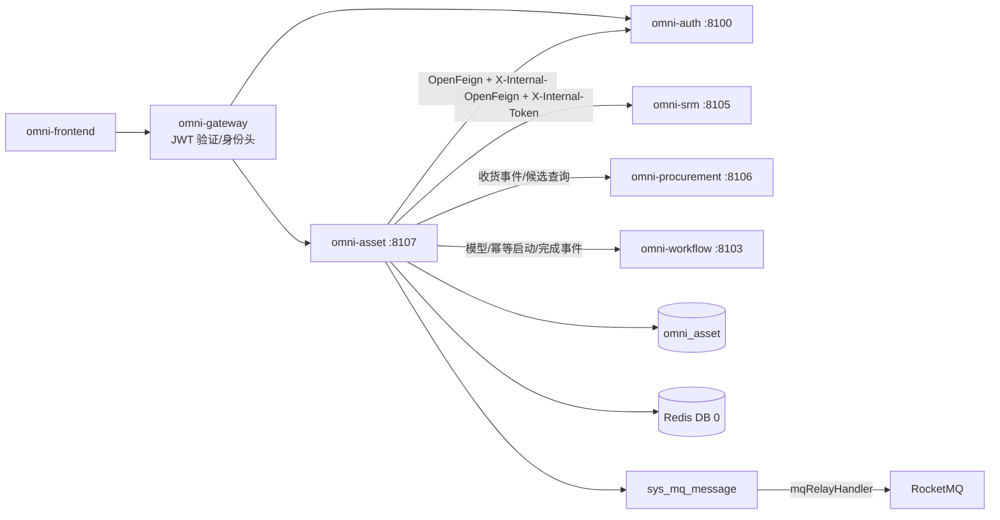
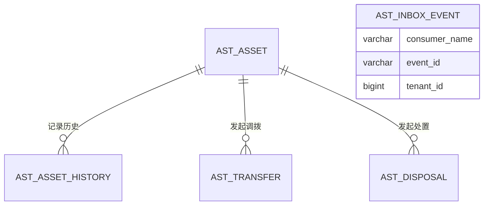
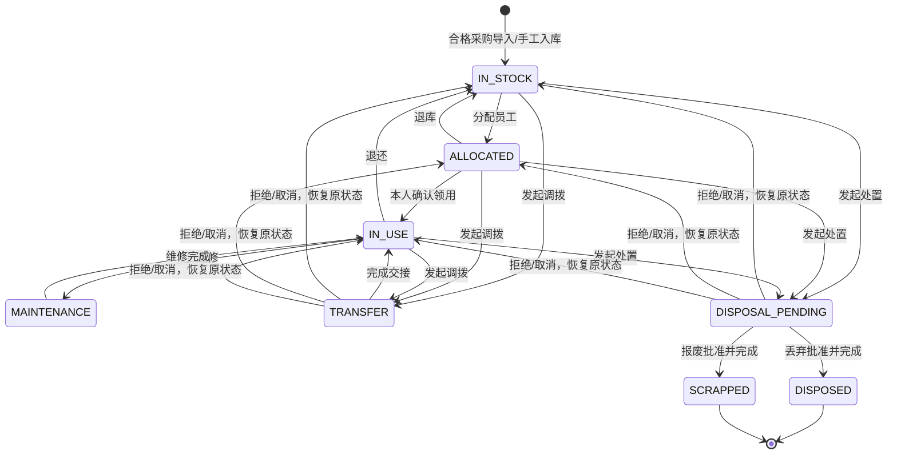
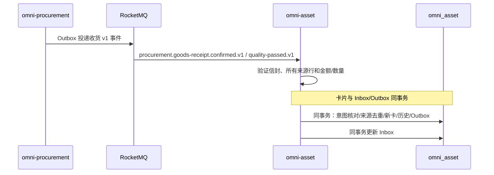
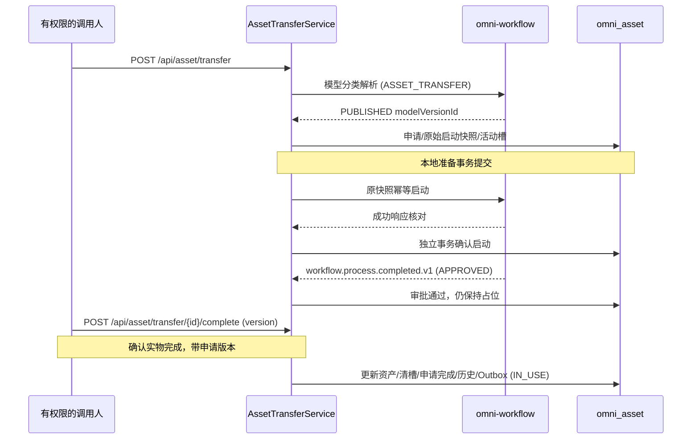
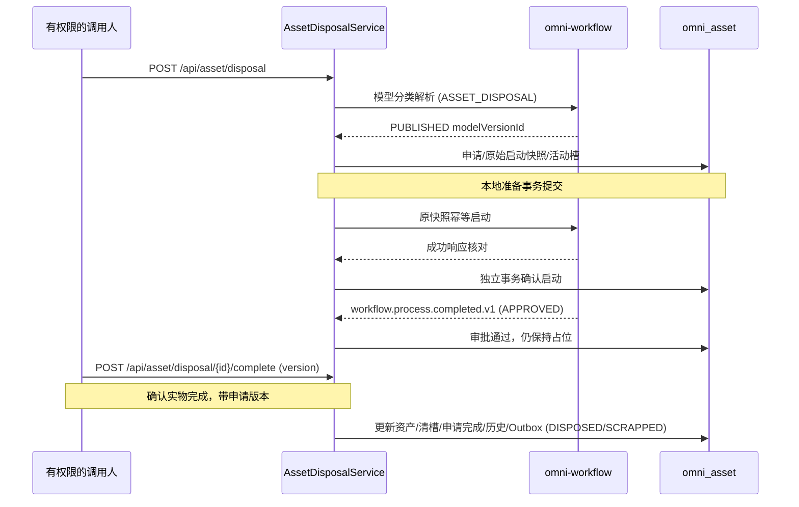

# 资产管理模块架构与实现基线

> 适用性：保留 2026-07-27 的原设计日期与第 14–16 节的重要历史。本页当前事实依据 `omni-asset` 源码、Liquibase、前端和配置核对；历史“已验证”不代表本轮完整运行验收。翻译复核按 [ADR-0003](../adr/0003-authorized-ai-translation-review.md) 记录真实 `AI_REVIEW`，不冒称人工复核。
>
> 项目：Omni-Stack
> 原设计日期：2026-07-27
> 当前职责：说明资产服务边界、数据模型、命令、审批和采购导入契约。

操作入口见 [功能导览](../wiki/feature-tour.md)，开发导航见 [源码入口](../reference/source-map.md)；运行前提、身份、步骤、截图与故障恢复属于 Wiki。本页不把测试要求、历史方案或单元测试替代成新的端到端证据。相关事实见 [架构](../architecture.md)、[API 契约](../api-contract.md)、[核心流程](../core-flows.md)、[Workflow](../workflow.md)、[采购设计](procurement-design.md) 和 [SRM 设计](srm-design.md)。

## 1. 设计结论

资产管理应建设为独立 Servlet 微服务，管理资产从采购入库到最终处置的完整生命周期。SRM 提供供应商信息，Procurement 提供采购来源，Workflow 提供审批能力。

| 项目 | 决策 |
|---|---|
| Maven 模块 / 服务名 | `omni-asset` |
| 本地端口 / 管理端口 | `8107` / `19907` |
| XXL-JOB 执行器 | `omni-asset` / `9907`，由 `XXL_JOB_ENABLED` 等配置控制；不表示已有折旧或保养任务 |
| 数据库 | `omni_asset` |
| Gateway | `/api/asset/**` → `lb://omni-asset`，不使用 `StripPrefix` |
| Redis | DB 0；共享 `xss:enabled:{tenantId}` / `xss:rules:{tenantId}`，不声明通用 `asset:` 业务缓存前缀 |
| 前端 | `omni-frontend/src/views/asset/**` |

Asset MVP 覆盖资产全生命周期管理闭环：

> 采购收货 → 资产验收入库 → 领用/分配 → 使用中 → 调拨 → 丢弃处置 / 报废处置。

折旧计算、资产盘点、维修保养工单不进入 MVP。

## 2. 产品范围

本节保留产品目标与分期；角色实际能力以当前权限和数据范围为准，Phase 2/3 不是已交付功能。资产原值按币种分别汇总，不执行汇率换算。

### 2.1 用户与目标

| 用户 | 核心诉求 |
|---|---|
| 行政/IT 管理员 | 管理公司全部资产，分配给员工，处理处置申请 |
| 资产使用人 | 查看自己名下的资产，确认领用或发起退还 |
| 部门经理 | 查看本部门资产，审批调拨和处置 |
| 财务人员 | 查看资产原值、当前状态，确认报废 |
| 资产管理员 | 全租户资产管理、配置、统计 |

MVP 应能回答：公司有多少资产、分布在哪里；某个资产当前谁在使用、什么状态；哪些资产闲置待分配；某个部门的资产总值；哪些资产正在走处置/报废流程。

### 2.2 分期

| 阶段 | 能力 |
|---|---|
| MVP | 资产台账、资产验收（采购联动）、资产分配/退还、资产调拨、丢弃处置、报废处置、资产概览 |
| Phase 2 | 资产盘点、折旧计算、维修保养工单、资产标签/条码、资产导入导出 |
| Phase 3 | 资产预算管控、资产处置拍卖、资产生命周期成本分析 |

## 3. 系统边界

| 组件 | 权威职责 | 当前 Asset 调用边界 |
|---|---|---|
| `omni-auth` | 身份、组织、权限、数据范围、XSS | 内部用户候选、用户/组织引用校验及共享安全能力；保存 ID 和原始 Workflow 发起人用户名快照 |
| `omni-srm` | 供应商 | 当前客户端搜索本租户 `APPROVED` 供应商候选；台账显示本地名称快照 |
| `omni-procurement` | PO、收货、资产候选 | 消费收货事件；内部候选接口用于受控补偿，不是当前实时来源详情查询 |
| `omni-base` | 字典、操作日志 | 字典权威与日志汇聚；Asset 自身初始化器没有租户默认业务数据 |
| `omni-workflow` | BPMN、实例、任务、Flowable | 按业务分类解析已发布版本、幂等启动、校验任务资格，接收完成事件 |
| `omni-asset` | 资产、历史、调拨、处置、消费 Inbox | 本服务资产业务数据唯一写入方 |
| RocketMQ | 事件运输 | 消费端必须容忍重复；实际重试/死信行为由部署配置决定 |

当前 POM 显式依赖 `omni-common-core`, `omni-common`, `omni-common-mybatis`, `omni-common-redis`, `omni-common-operlog`, `omni-common-job`, `omni-common-mqlog`, `omni-common-service`，并包含 Web、Security、Validation、OpenFeign、LoadBalancer、Nacos、RocketMQ、Actuator 等。`omni-common-service` 组合身份、租户、DataScope、持久化和 XSS；依赖存在不表示每项后台任务均已启用。

**Asset 不依赖 `omni-common-workflow`，不嵌入 Flowable。** 流程引擎和数据库属于独立 `omni-workflow`。

## 4. 领域与数据设计

### 4.1 聚合

| 聚合 | 表 | 职责 |
|---|---|---|
| Asset | `ast_asset`、`ast_asset_history` | 资产主数据、状态变更不可变历史 |
| Transfer | `ast_transfer` | 资产调拨记录 |
| Disposal | `ast_disposal` | 资产处置记录（丢弃/报废共用） |
| 消费 Inbox | `ast_inbox_event` | Procurement 与 Workflow 完成事件各自消费者的登记、意图核对与处理状态 |

### 4.2 通用字段与规则

- 五张 `ast_*` 表均包含 `tenant_id`。`ast_asset` 使用 `owner_user_id/owner_unit_id` 管理归属、`current_user_id/current_unit_id` 使用归属；两者不能混为写授权。
- 资产和两类申请有各自 `version`、`deleted` 与审计字段；历史与 Inbox 不使用逻辑删除。`AST-<id>` 编号在租户内唯一；手工资产先由数据库生成 ID，采购导入使用服务端生成的 ID。
- Auth 管理用户/组织，SRM 管理供应商，Procurement 管理来源；本地保存 ID 和必要快照，不创建跨库外键。图示是领域关联，不代替实际 DDL。
- 来源 `source_po_id/source_gr_id/source_gr_line_id/source_unit_sequence` 及 PO/GR 号用于溯源；`tenant_id + source_gr_line_id + source_unit_sequence` 唯一键保护每个实物单位。
- 金额存储为 `DECIMAL(18,2)` / `BigDecimal`。请求与响应的 `purchaseAmount`、`residualValue` 使用 JSON 十进制字符串，不能传 JSON number；采购来源价格也使用字符串契约。日期时间为 `yyyy-MM-dd HH:mm:ss`，采购日期为日期字段。
- 手工创建校验管理归属在写入范围内，并向 Auth 验证启用用户、组织及主组织一致；更新必须带 `version`。普通 PUT 不改变状态、使用人或位置。
- 删除仅允许无使用人、无活动操作且未发生后续业务历史的手工在库资产；采购导入资产不能删除。处置终态不可恢复。
- 同一资产最多一个活动调拨/处置。创建通过租户、ID、版本、原状态、`deleted=0` 和两个 `active_operation_* IS NULL` 条件原子占位；必须命中一行，否则 409。

### 4.3 主要表

`ast_asset`

- `asset_no/name/category_code`：资产编号、名称、品类（字典 code）。
- `specification/brand/model`：规格、品牌、型号。
- `supplier_id/supplier_name_snapshot`：供应商 ID 与本地名称快照。当前台账不向 SRM 批量补全实时名称；快照不证明当前供应商资格。
- `source_po_id/source_gr_id/source_gr_line_id/source_unit_sequence/source_po_no/source_gr_no`：采购来源与单位级幂等标识。
- `purchase_date/purchase_amount/currency_code`：采购日期、原值、币种。
- `location_code`：资产位置（字典 code，如楼层+房间号）。
- `status`：生命周期状态（IN_STOCK/ALLOCATED/IN_USE/MAINTENANCE/TRANSFER/DISPOSAL_PENDING/DISPOSED/SCRAPPED）。
- `current_user_id`：当前使用人 ID；当前台账 VO 返回 ID，不批量补全 Auth 姓名。
- `current_unit_id`：当前使用部门 ID；当前台账 VO 返回 ID，不批量补全 Auth 部门名称。
- `allocated_time`：分配时间。
- `active_operation_type/active_operation_id`：当前活动操作（TRANSFER/DISPOSAL）及申请 ID；无活动操作时为 NULL。
- `warranty_expiry_date`：保修到期日。
- `expected_life_years`：预期使用年限（用于报废参考）。
- `remark`。
- `owner_user_id/owner_unit_id/version/deleted` 和审计字段。
- 核心索引：tenant + owner/status、tenant + current_user_id、tenant + current_unit_id、tenant + category_code/status、tenant + asset_no（唯一）、tenant + source_gr_line_id + source_unit_sequence（采购来源唯一，手工入库允许 source 字段为 NULL）。

`ast_asset_history`

- `asset_id/from_status/to_status/changed_by_user_id/changed_time/remark`。
- 只追加，不更新、不删除。记录资产每次状态变更和关键操作（分配、退还、调拨、处置）。

`ast_transfer`

- `transfer_no/asset_id/from_user_id/from_unit_id/to_user_id/to_unit_id/from_location/to_location`。
- `reason/status/process_instance_id/previous_asset_status/active_flag`。
- `workflow_request_id/workflow_business_key/model_version_id/workflow_start_status/workflow_start_user_id/workflow_start_user_name`：Workflow 幂等快照及原始发起人身份；`businessType=ASSET_TRANSFER` 由调拨聚合类型固定推导。
- `status`：PENDING_APPROVAL/START_FAILED/APPROVED/REJECTED/COMPLETED/CANCELLED。
- `approved_time/completed_time`。
- `version/deleted` 和审计字段。

`ast_disposal`

- `disposal_no/asset_id/disposal_type（DISCARD/SCRAP）/reason/previous_asset_status/active_flag`。
- `residual_value（残值）/disposal_method（处置方式描述）`。
- `status`：PENDING_APPROVAL/START_FAILED/APPROVED/REJECTED/COMPLETED/CANCELLED。
- `process_instance_id`：关联 omni-workflow 审批流程实例。
- `workflow_request_id/workflow_business_key/model_version_id/workflow_start_status/workflow_start_user_id/workflow_start_user_name`：Workflow 幂等快照及原始发起人身份；`businessType=ASSET_DISPOSAL` 由处置聚合类型固定推导。
- `approved_time/completed_time`。
- `version/deleted` 和审计字段。

`ast_inbox_event`

- `consumer_name/event_id` 唯一；包含租户、事件类型、来源、聚合标识、payload、处理状态和时间。
- 相同事件 ID 的租户或 JSON 语义意图不同返回冲突，不能先按“已处理”跳过意图核对。
- Procurement 实时消费与 Workflow 完成消费使用各自消费者身份；补偿候选按来源单位幂等，不登记实时事件 Inbox。

## 5. 状态机与核心流程

### 5.1 Asset 生命周期

- `IN_STOCK`：资产在库，未分配。
- `ALLOCATED`：已分配给员工，等待领用确认。
- `IN_USE`：员工正在使用。
- `MAINTENANCE`：送修中（MVP 仅标记状态，不做维修工单）。
- `TRANSFER`：正在调拨中（等待审批和交接）。
- `DISPOSAL_PENDING`：正在走处置审批，禁止分配、退还、调拨或重复处置。
- `DISPOSED`：丢弃处置完成（终态）。
- `SCRAPPED`：报废处置完成（终态）。

只有 `IN_STOCK/ALLOCATED/IN_USE` 可创建调拨或处置。维修仅提供 `IN_USE → MAINTENANCE → IN_USE` 两条命令；活动调拨/处置期间不能分配、退还、送修或重复占位。状态机允许迁移还必须同时满足端点权限、行级范围、版本和活动槽条件。

### 5.2 资产验收（采购联动）

实时入口消费 `procurement.goods-receipt.confirmed.v1` 和 `procurement.goods-receipt.quality-passed.v1`。先验证信封、租户、来源根、所有行元数据和唯一来源行；数量、单价、行金额必须为正且 `unitPrice × receivedQuantity = totalPrice`。缺字段、无效枚举或不支持版本拒绝整个事件，不猜测默认值。

有效行仅在 `qualityStatus=PASS && assetManaged=true` 时建卡；`receivedQuantity` 必须是精确正整数、等于 `assetQuantity` 且不超过 `Integer.MAX_VALUE`。合法的非资产化或 PENDING/FAIL 行跳过；格式错误行不会因“不建卡”而免校验。5 个合格单位生成 `source_unit_sequence=1..5` 的 5 张卡片，初态 `IN_STOCK`，管理归属取来源。每张卡的 `purchaseAmount` 取 `unitPrice` 四舍五入到两位，不能把整行金额复制到每张卡。

双重幂等：实时 Inbox 的 `consumer_name + event_id` 先核对租户及 JSON 语义意图，再处理重放；来源单位唯一键同时保护实时、重放与补偿。写后锁定读取来源记录核对意图，不只依赖 JDBC 影响行数。同一实时事务包含新卡、历史、Inbox 状态和仅针对新卡的 `asset.created.v1` Outbox；持久化 Outbox 不代表 Broker 或下游已经成功消费。

历史补偿为受控的一页调用，具体游标与部分提交边界见 8.3；没有自动启动后扫描到底的保证。

### 5.3 资产分配与退还

| 命令（前缀 `/api/asset/asset`） | 请求与状态条件 | 同事务效果 |
|---|---|---|
| `POST /{id}/allocate` | `version,targetUserId,targetUnitId,remark?`；在库、无活动槽；目标部门可写，Auth 验证同租户启用用户/组织及主组织一致 | `ALLOCATED`，写当前使用人/部门、分配时间、历史和 `asset.allocated.v1` Outbox |
| `POST /{id}/accept` | `version,remark?`；`ALLOCATED` 且当前使用人就是调用人 | `IN_USE` 与历史 |
| `POST /{id}/return` | `version,remark?`；`ALLOCATED/IN_USE` 且当前使用人就是调用人 | `IN_STOCK`，清使用人/部门/分配时间，写历史与 `asset.returned.v1` Outbox |
| `POST /{id}/maintenance/start` | `version,remark?`；`IN_USE`，无活动槽 | `MAINTENANCE` 与历史 |
| `POST /{id}/maintenance/complete` | `version,remark?`；`MAINTENANCE`，无活动槽 | `IN_USE` 与历史 |

先按租户和数据范围锁定资产，再以版本、原状态等条件更新；冲突返回 409。管理角色不扩大 accept/return 的本人边界。这里没有维修工单、自动折旧或自动保养调度。

### 5.4 资产调拨

创建字段为 `assetId,toUserId,toUnitId,toLocation?,reason`；`modelVersionId` 由服务端解析，不接受调用方指定。先验证目标部门和 Auth 引用，再按 `ASSET_TRANSFER` 解析当前已发布模型；本地准备事务保存申请、`previous_asset_status`、原始启动快照和活动占位。该事务提交后才调用远端 Workflow，启动确认另行持久化。

`APPROVED` 仍保持申请 `active_flag=1` 和资产 `TRANSFER` 占位；有权限的调用方带申请 `version` 调用业务 `/complete` 完成交接。此事务更新当前使用人、使用部门和可选位置为新目标，资产变为 `IN_USE`，清槽，写历史及完成 Outbox；不改变 `owner_user_id/owner_unit_id` 管理归属。

审批层级由当前已发布的分类匹配 BPMN 决定；第 15 节的单级审批是原设计取舍。拒绝/流程取消在同事务终结申请并恢复原资产状态、清槽。启动不确定和明确失败的不同恢复边界见 8.4。

### 5.5 资产处置（丢弃/报废）

创建使用 `assetId,disposalType,reason,residualValue?,disposalMethod?`，`disposalType` 为 `DISCARD/SCRAP`，残值为 JSON 十进制字符串。服务端按 `ASSET_DISPOSAL` 解析模型；两种处置共用申请表和审批集成，实际审批人与层级由 BPMN 决定，不能假定财务确认已经发生。

`APPROVED` 后仍保留 `DISPOSAL_PENDING` 占位；权限和申请版本校验通过后，业务 `/complete` 才确认实物处置，进入 `DISPOSED/SCRAPPED`，清槽并写历史与对应 Outbox。拒绝/流程取消或已持久化启动失败后的本地取消，必须在同事务恢复 `previous_asset_status` 并清理两处活动标记。启动结果未知时不允许本地取消。

## 6. 租户、RBAC 与数据权限

### 6.1 信任链

与其他 Servlet 业务服务一致：Gateway JWT → `GatewayPreAuthenticationFilter` 预认证 → `ServiceIdentityFilter` 租户/身份校验 → `@PreAuthorize` → `@ServiceDataScope` → MyBatis DataPermission → `AssetRecordAccessGuard`。

### 6.2 权限树与角色

菜单：`asset`（DIRECTORY）以及 `asset:overview`、`asset:asset`、`asset:transfer`、`asset:disposal`（MENU）。

API 权限：

- `asset:overview:list`
- `asset:asset:list`, `asset:asset:self`, `asset:asset:create`, `asset:asset:update`, `asset:asset:delete`, `asset:asset:allocate`, `asset:asset:accept`, `asset:asset:return`, `asset:asset:maintenance`
- `asset:transfer:list`, `asset:transfer:create`, `asset:transfer:approve`, `asset:transfer:complete`, `asset:transfer:cancel`, `asset:transfer:retry`
- `asset:disposal:list`, `asset:disposal:create`, `asset:disposal:approve`, `asset:disposal:complete`, `asset:disposal:cancel`, `asset:disposal:retry`

| 角色 | dataScope | 能力 |
|---|---|---|
| `ASSET_ADMIN` | TENANT | 当前租户全部资产功能/数据 |
| `ASSET_MANAGER` | DEPT_AND_BELOW | 部门及下级、调拨/处置审批 |
| `ASSET_USER` | SELF | 通过“我的资产”端点查看本人名下资产、确认领用和发起退还 |
| `SUPER_ADMIN` | ALL | 所有功能，资产数据仍限当前租户 |

默认 USER 不授予资产权限。

### 6.3 Asset 上下文与 SQL 拦截

跨模块上下文与持久层组装由 `omni-common-service` 提供：请求身份使用 `ServiceIdentityContext` / `ServiceRequestIdentity`，数据范围使用 `@ServiceDataScope` / `ServiceDataScopeContext`，`ServicePersistenceAutoConfiguration` 负责组装拦截器。Asset 仅保留领域策略 `AssetTenantTablePolicy`、`AssetDataPermissionHandler` 和写操作守卫 `AssetRecordAccessGuard`。

拦截器顺序固定：`TenantLineInnerInterceptor → DataPermissionInterceptor → OptimisticLockerInnerInterceptor → PaginationInnerInterceptor`。`AssetTenantTablePolicy` 只对 `ast_*` 表生效，`sys_mq_message` 必须保持在租户拦截之外，以允许后台 Relay 跨租户扫描。

| dataScope | 条件 |
|---|---|
| SELF | 当前 permission 映射的 owner 或 current_user 列等于 currentUserId |
| DEPT | owner_unit_id 等于 primaryUnitId |
| DEPT_AND_BELOW / CUSTOM | owner_unit_id 属于 accessibleUnitIds |
| TENANT / ALL | 不加 owner 条件，TenantLine 始终保留 |

资产的 dataScope 有管理维度和使用维度，不能在通用 SQL 中使用宽泛 OR，必须按 permissionCode/端点显式映射：

| 端点/权限 | 范围列 | 规则 |
|---|---|---|
| `/api/asset/asset/list`、详情、管理历史；`asset:asset:list` | `owner_user_id/owner_unit_id` | 面向资产管理人员，按管理归属过滤 |
| `/api/asset/asset/my`；`asset:asset:self` | `current_user_id` | 固定等于当前用户，不因其他角色的更宽 dataScope 扩大 |
| accept/return；对应命令权限 | `current_user_id` | RecordAccessGuard 强制目标资产当前分配给 currentUserId |
| Transfer/Disposal list/detail | 关联 Asset 的管理维度 | 子表通过同 tenant 的 asset_id 继承，不直接拼接不存在的 owner 列 |
| Transfer/Disposal approval-view | Workflow taskId 分配关系 | 先验证当前用户是该 tenant/业务单据的任务审批人，再按 tenant + id 读取只读 VO |
| Overview | Asset 管理维度 | 聚合 SQL 使用与 `/api/asset/asset/list` 相同范围 |

如果用户同时拥有 ASSET_USER 和管理角色，前端仍分别调用“我的资产”和管理列表；后端不得把两种维度 OR 合并后用于写授权。

例外必须按完整权限码理解：`asset:asset:self`, `asset:asset:accept`, `asset:asset:return` 总是固定 `current_user_id`；`asset:transfer:create` 在 `SELF` 时也映射 `current_user_id`，其他管理操作继续使用 owner 维度。候选查询同样使用对应 create 权限范围，并过滤两个空活动字段与可操作状态。

approval-view 仅在本地 `PENDING_APPROVAL + STARTED` 且业务键、实例齐全时校验当前用户、租户、业务类型/键和 Workflow 任务分配及实例一致；通过后临时使用 `TENANT` 读取该申请 VO，并在 `finally` 恢复原上下文。它不是普通详情的无条件越权入口。

## 7. API 设计

### 7.1 通用契约

遵循 [API 契约](../api-contract.md)：`R<T>`，分页为 `R<PageResult<T>>`；页码从 1 开始、默认 1，每页默认 10、范围 1..100。数据不可见/不存在通常为业务 404，权限不足 403，版本/状态/占位冲突 409，外部依赖不可用或 Workflow 结果待确认 503；不能把 HTTP 状态与 `R.code` 混用。

创建 DTO、命令 DTO 和 VO 以源码为准；资产更新及生命周期命令需 `version`，调拨/处置 retry/cancel/complete 带申请版本。`purchaseAmount/residualValue` 为十进制字符串，时间格式与 4.2 一致。

### 7.2 端点

以下 32 个外部方法路径和 1 个内部方法路径使用完整服务路径；Gateway 不剥离 `/api/asset`。内部补偿要求有效内部令牌，且 `X-Tenant-Id` 与查询 `tenantId` 为同一正数。

| 领域 | 方法与完整路径 |
|---|---|
| 资产台账/本人命令 | `GET /api/asset/asset/list` |
| 资产台账/本人命令 | `GET /api/asset/asset/my` |
| 资产台账/本人命令 | `GET /api/asset/asset/{id}` |
| 资产台账/本人命令 | `GET /api/asset/asset/{id}/history` |
| 资产台账/本人命令 | `POST /api/asset/asset` |
| 资产台账/本人命令 | `PUT /api/asset/asset/{id}` |
| 资产台账/本人命令 | `DELETE /api/asset/asset/{id}` |
| 资产台账/本人命令 | `POST /api/asset/asset/{id}/allocate` |
| 资产台账/本人命令 | `POST /api/asset/asset/{id}/accept` |
| 资产台账/本人命令 | `POST /api/asset/asset/{id}/return` |
| 资产台账/本人命令 | `POST /api/asset/asset/{id}/maintenance/start` |
| 资产台账/本人命令 | `POST /api/asset/asset/{id}/maintenance/complete` |
| 处置 | `GET /api/asset/disposal/list` |
| 处置 | `GET /api/asset/disposal/{id}` |
| 处置 | `GET /api/asset/disposal/{id}/approval-view` |
| 处置 | `POST /api/asset/disposal` |
| 处置 | `POST /api/asset/disposal/{id}/retry-start` |
| 处置 | `POST /api/asset/disposal/{id}/cancel` |
| 处置 | `POST /api/asset/disposal/{id}/complete` |
| 候选 | `GET /api/asset/options/users` |
| 候选 | `GET /api/asset/options/transfer-assets` |
| 候选 | `GET /api/asset/options/disposal-assets` |
| 候选 | `GET /api/asset/options/suppliers` |
| 概览 | `GET /api/asset/overview/summary` |
| 概览 | `GET /api/asset/overview/distribution` |
| 调拨 | `GET /api/asset/transfer/list` |
| 调拨 | `GET /api/asset/transfer/{id}` |
| 调拨 | `GET /api/asset/transfer/{id}/approval-view` |
| 调拨 | `POST /api/asset/transfer` |
| 调拨 | `POST /api/asset/transfer/{id}/retry-start` |
| 调拨 | `POST /api/asset/transfer/{id}/cancel` |
| 调拨 | `POST /api/asset/transfer/{id}/complete` |
| 内部补偿 | `POST /api/internal/asset/procurement/backfill` |

### 7.3 端点与 DataScope permission 映射

| 操作 | permissionCode |
|---|---|
| Overview | `asset:overview:list` |
| Asset list/detail/history | `asset:asset:list` |
| My Asset | `asset:asset:self` |
| Asset create/update/delete | `asset:asset:create`, `asset:asset:update`, `asset:asset:delete` |
| Asset allocate | `asset:asset:allocate` |
| Asset accept（员工自用） | `asset:asset:accept` |
| Asset return | `asset:asset:return` |
| Asset maintenance start/complete | `asset:asset:maintenance` |
| Transfer list/detail | `asset:transfer:list` |
| Transfer create | `asset:transfer:create` |
| Transfer approval-view | `asset:transfer:approve` |
| Transfer complete | `asset:transfer:complete` |
| Transfer cancel/retry-start | `asset:transfer:cancel`, `asset:transfer:retry` |
| Disposal list/detail | `asset:disposal:list` |
| Disposal create | `asset:disposal:create` |
| Disposal approval-view | `asset:disposal:approve` |
| Disposal complete | `asset:disposal:complete` |
| Disposal cancel/retry-start | `asset:disposal:cancel`, `asset:disposal:retry` |

`options/users` 接受 `asset:asset:list`, `asset:asset:create`, `asset:asset:update`, `asset:asset:allocate` 或 `asset:transfer:create`、`asset:disposal:create` 中任一完整权限；`options/suppliers` 要求 `asset:asset:create` 或 `asset:asset:update`。`options/transfer-assets` 与 `options/disposal-assets` 分别要求对应 create 权限及 DataScope。候选不是最终写授权，写入时仍重新校验状态、引用和范围。

## 8. 跨服务一致性

### 8.1 Auth Feign

Auth 权威处理身份、权限、组织、数据范围和 XSS。`AssetIdentityGuard` 通过 `/internal/users/{id}` 与 `/internal/orgs/{id}` 核对同租户、启用状态、用户主组织；异常或无效响应失败关闭。`options/users` 调用 `/internal/users/options`，排除无主组织候选并校验租户；接口存在不表示台账自动补全姓名。

内部 Feign 使用 `InternalFeignHeadersFactory` 生成内部认证头，身份/DataScope 生命周期遵循共享服务组件。不得把客户端自填的数字 ID 当作已验证引用。

### 8.2 SRM Feign

当前 `SrmInternalClient` 只有 `GET /api/internal/supplier/search`，同时携带租户头和参数，并固定 `status=APPROVED`。外部登记页面调用 `GET /api/asset/options/suppliers`；失败或无效响应返回 503。

台账和详情直接显示 `supplierNameSnapshot`，缺少时展示供应商 ID。当前路径没有实时供应商详情、保修联系人或批量名称补全；保存快照不能授予供应商当前资格。

### 8.3 Procurement 联动

实时事件 payload 沿用 [采购设计](procurement-design.md) 的 v1 契约，包括来源、币种、管理归属和行级数量/金额。消费入口设当前租户身份与 `TENANT` DataScope，`finally` 清理；校验和原子导入见 5.2。消费异常表示该次处理未成功；是否重试、多久重试、是否进入死信需要实际 Broker/binder 配置与证据，不能仅凭抛异常宣称已进入死信。

受控补偿调用 `POST /api/internal/asset/procurement/backfill`；参数 `tenantId>0,afterId>=0,size=1..100`，默认游标 0、页大小 100。服务调用 `GET /api/internal/procurement/goods-receipt/asset-candidates`，租户头/参数一致，取得严格递增且大于 afterId 的来源行页；在导入前先验证整页游标顺序。每个候选通过独立事务导入，使用来源单位唯一键，不登记实时 Inbox；仅新卡写历史及 created Outbox。

一次请求返回 `fetchedCount/createdCount/duplicateCount/nextAfterId/hasMore`；`hasMore` 按本页数量等于 size 推断，调用方负责保存游标和后续调度，不是自动扫描器。后面的候选失败时，前面候选可能已提交；应核对来源单位再重试原页，不能把失败响应等同整页回滚。补偿结束清理身份和 DataScope。

### 8.4 Workflow 集成

当前已发布模型必须属于本租户、`PUBLISHED`、有流程定义且 category 匹配 `ASSET_TRANSFER/ASSET_DISPOSAL`。模型解析发生在本地创建前；准备事务提交后使用原始 `requestId/tenantId/modelVersionId/businessType/businessKey/startUser` 快照启动。业务键为申请 ID；Workflow 按 `tenantId + businessType + businessKey` 幂等，重试不新造业务意图。

- 远端成功响应还需匹配请求 ID、业务类型/键与实例 ID，本地 `markStarted` 使用独立事务确认。
- Feign/HTTP 错误、断流、其他非成功业务码、响应不一致或本地确认失败：维持可同键重试的 `PENDING_APPROVAL + PENDING` 与占位。
- 只有业务 `R.code=404` 进入明确失败分支并尝试 `markFailed`；若本地写失败仍可能 PENDING。HTTP 404 抛 Feign 异常属于未知分支。只有本地已持久化 `START_FAILED + FAILED` 才允许版本化本地取消；retry 继续复用原快照。
- 审批通过 `/api/workflow/approval/{taskId}/complete` 完成；读取资产审批视图还需对应 asset approve 权限，完成任务需 `workflow:approval:complete`，并核对任务归属，见 6.3。

完成事件 `workflow.process.completed.v1` 校验生产者、租户、类型、业务键、实例及当前状态。Inbox 登记后先检查同事件 JSON 语义意图，冲突 409；已处理、旧状态、非当前实例等忽略。**合法完成事件早于本地启动确认时抛可重试异常，不永久吞掉。** APPROVED 保留活动占位等待业务完成；REJECTED/CANCELLED 同事务恢复资产状态并清槽。完整任务、处理人和意见由 Workflow 权威查询；Asset 不复制审批意见历史。

### 8.5 Outbox 事件

通过 `asset-domain-out-0` 向 `asset-domain-event` 写以下领域事件的本地 Outbox：

- `asset.created.v1`：采购实时/补偿导入实际新卡；手工创建没有此发布调用。
- `asset.allocated.v1`、`asset.returned.v1`。
- `asset.transfer.completed.v1`。
- `asset.disposed.v1`、`asset.scrapped.v1`。

统一信封包含 `eventId/eventType/occurredAt/tenantId/producer/payload`；以对应调用点为准，不推断存在每个状态变化事件。Relay 与 Broker 的实际投递另行观察。

## 9. 隐私、操作日志与 XSS

### 9.1 OperLog

写命令用 `@OperLog`，共享 `OperLogSanitizer` 在 MQ 前处理参数、快照和异常：按字段规则替换 reason/remark 等自由文本及凭证字段，遮盖电话/邮箱并处理文本凭证片段。规则覆盖有明确边界，不能承诺任意姓名、地址变体或所有应用日志均已匿名化。

### 9.2 PII

Asset 保存使用人/管理员 ID、供应商与来源快照、自由文本以及 `workflow_start_user_name` 原始发起人用户名快照；用户候选还返回用户名/昵称等。因此不能称“无 PII”或“仅存 userId”。生产截图、导出、日志与审查证据须按字段和授权控制，避免外泄凭证及个人资料。

### 9.3 XSS

`CachedServiceXssConfigProvider` 先读取 Redis DB 0 的 `xss:enabled:{tenantId}` / `xss:rules:{tenantId}`。缓存缺失、读取或解析失败时向 Auth 回源；Auth 返回有效设置则继续使用，不能把 Redis 单独故障等同于必然启用本地基线。回源无有效结果或异常时才使用 `XssSettingsFallback`；默认基线启用 HTML_TAG、EVENT_HANDLER、DANGEROUS_PROTOCOL 三类防护。回写缓存失败不丢弃已取到的权威设置。备注按纯文本用途设计，不能以依赖故障为由绕过过滤。

## 10. 前端设计

当前页面位于 `omni-frontend/src/views/asset/{overview,asset,transfer,disposal}/index.vue`，对应 API 为 `src/api/asset-{overview,asset,transfer,disposal}.ts`；没有本页旧方案中的独立 `components/asset/AssetCard.vue` 等组件。

- 台账页按权限显示 ledger/my 页签，分别调用管理列表和固定本人列表；管理筛选包括状态、品类、管理部门、位置。当前详情抽屉显示基础字段、用户/部门 ID、来源快照与变更历史；调拨/处置记录由各自页面查询。
- 供应商与用户通过候选接口选择，管理/使用部门由所选用户主组织带出；后端重新核验。按钮使用对应 `v-permission`。
- 概览返回状态计数、`amountsByCurrency`，分布支持 `STATUS/CATEGORY/DEPARTMENT/LOCATION`，金额按币种分组，不把不同币种相加。
- 共享 `ApiResponse/PageResult` 只从 `src/types/api.ts` 导入；菜单、图标和本人入口适配见当前 router/layout。真实教程步骤和页面截图见 Wiki，不能由此结构说明推定已完成本轮浏览器验收。

## 11. 工程落点

### 11.1 当前模块入口

当前源码入口是 `omni-backend/omni-asset/src/main/java/com/omni/asset` 下的 `AssetApplication.java`、client、config、controller、dto、entity、mapper、security、service、consumer、workflow 与 domain。SQL 位于 Java Mapper 注解和 Liquibase；资源是 `application.yml` 与 `application-lite.yml`，不是独立 application-dev.yml 或 XML mapper 目录。完整入口可从 [源码索引](../reference/source-map.md) 定位。

### 11.2 当前关联文件

以下为当前事实入口，修改相应契约时才同步更新；不再列作待新建文件。

| 范围 | 当前文件/目录 |
|---|---|
| 模块 | `omni-backend/omni-asset/pom.xml` `omni-backend/pom.xml` |
| 运行配置 | `omni-backend/omni-asset/src/main/resources/application.yml` `omni-backend/omni-asset/src/main/resources/application-lite.yml` |
| Schema | `database/changelog/asset/0001-asset-schema.yaml` |
| 权限与种子摘要 | `scripts/sql/seed/auth.sql` `database/seed/manifest.yaml` |
| 租户初始化 | `omni-backend/omni-asset/src/main/java/com/omni/asset/service/impl/AssetTenantModuleProvisioner.java` |
| Gateway / Compose | `omni-backend/omni-gateway/src/main/resources/application.yml` `compose.yaml` |
| 前端 | `omni-frontend/src/views/asset` `omni-frontend/src/api/asset-asset.ts` `omni-frontend/src/router/index.ts` |
| 跨服务契约 | `omni-backend/omni-asset/src/main/java/com/omni/asset/client` `omni-backend/omni-asset/src/main/java/com/omni/asset/dto/ProcurementAssetContracts.java` `omni-backend/omni-asset/src/main/java/com/omni/asset/dto/WorkflowContracts.java` |

默认宿主入口 `8107`、管理端口 `19907`、Redis DB 0、XXL appname `omni-asset` / `9907`；Compose 按其配置映射容器端口。`application-lite.yml` 关闭 Nacos 并使用静态服务发现。所有运行、构建与测试在本机 Docker；初始化权限由 Auth、字典由 Base 负责。

## 12. 非功能设计

- 列表分页最大 100；候选和分布 limit 也校验 1..100。Overview 的 Mapper 直接按资产根聚合，继承租户与管理范围；金额按币种分组。当前没有声称台账远程名称批量补全或性能实测。
- 分配/退还等命令先锁资产并做版本条件更新；创建调拨/处置统一占活动槽，申请完成/取消同时检查申请和资产版本、状态、占位身份。并发约束的真实数据库验收需单独证明。
- Auth 不可用影响依赖其引用/候选/数据范围的操作并失败关闭，不等于所有本地快照读取都会失败。SRM 候选失败 503，已有台账显示本地供应商快照；Procurement 候选失败导致该次补偿失败，历史 PO/GR 号仍是本地字段。
- Workflow 结果未知保留占位并同键重试；业务 404 的失败落库也可能失败，不能绕过审批或盲目本地取消。MQ 可用性不由本地 Outbox 成功推定。

## 13. 测试与验收

当前测试入口为 `omni-backend/omni-asset/src/test/java`；单元断言、构建结果与真实数据库/跨服务/浏览器证据分别记录，以下是验收要求：

- 资产 8 状态的合法/非法迁移、版本冲突，手工删除边界；本人列表/accept/return 不被管理角色扩大。
- 完整来源校验、数量/金额等式、有效非资产行跳过、异常行全事件拒绝；同事件重放、同 ID 异意图冲突、来源单位去重。
- 实时原子事务与补偿候选事务，部分页成功后的来源核对及重试，重复来源不再发新卡事件。
- 调拨/处置竞争活动槽；APPROVED 后等待实物完成，终态不可恢复；拒绝/取消恢复 previousStatus。
- 模型分类与任务资格校验、启动结果未知、本地确认失败、明确失败标记未落库、早到完成事件可重试及无效实例隔离。
- 管理 owner 范围、SELF 调拨 current-user 例外、跨租户和上下文缺失失败关闭。
- JSON 金额字符串、按币种聚合、日志/XSS 规则边界与四语页面权限显示。
- 真实端到端：采购收货 → MQ → IN_STOCK → ALLOCATED → IN_USE → 调拨审批/交接 → 处置审批/实物完成 → SCRAPPED。此链需实际运行回执，不能仅由单元通过或本文存在推定成功。

## 14. 实施顺序

本节保留 2026-07-27 原实施分解作为历史，不表示本轮待重复执行，也不是当前验收清单；当前入口与契约见 3–13 节。

### Milestone 0：前置确认

- 确认 SRM 和 Procurement 已建设完成。
- 确认 Workflow 服务可用。
- 确认 Workflow 内部启动 API、审批结果事件以及 Procurement 收货事件/历史补偿 API 契约。

### Milestone 1：服务搭建 + 安全底座

- 创建模块、配置、Gateway、Docker、DB。
- TenantLine + DataPermission + Pagination。
- 权限树、Asset 角色、已有租户迁移。
- 前端 root 菜单。

### Milestone 2：资产台账

- 资产 CRUD（含手动入库）。
- 资产分配/领用确认/退还。
- 资产变更历史。
- 资产详情页。

### Milestone 3：采购联动 + 验收

- MQ 消费者（收货事件 → 创建资产）。
- `ast_inbox_event` 幂等消费。
- 来源单位唯一键、批量创建资产（assetQuantity > 1）和历史补偿回扫。

### Milestone 4：调拨 + 处置

- 调拨申请 + 独立 Workflow 服务审批。
- 丢弃/报废处置 + 独立 Workflow 服务审批。
- 审批结果事件 → 申请状态更新、拒绝恢复、业务 complete。

### Milestone 5：概览 + 生产加固

- 概览统计（summary + distribution）。
- 测试、索引、安全验收。
- 更新 docs/、AGENTS.md。

## 15. ADR 摘要

本节保留原设计取舍。原“单级审批”是当时简化方案，当前由分类匹配的已发布 BPMN 决定；“不做”项表示原 MVP 边界。

| 决策 | 选择 | 原因 |
|---|---|---|
| 服务 | 独立 `omni-asset` | 与 SRM/Procurement 分离，职责清晰 |
| Workflow 集成 | 独立 `omni-workflow` 内部 API + 审批结果事件 | 保持 Flowable 唯一运行时和数据库边界 |
| 采购联动 | Outbox 事件消费 | 解耦 Procurement 和 Asset |
| 批量收货 | 每单位一个资产卡片 | 便于独立追踪每个资产 |
| 幂等消费 | Inbox eventId + 来源行/unitSequence 唯一键 | 同时覆盖实时事件、重放和历史回扫 |
| 调拨审批 | 简单单级审批 | MVP 不做多级审批 |
| 处置类型 | DISCARD + SCRAP 共用表 | 流程一致，区别在审批人和终态 |
| 折旧计算 | 不做 | MVP 不处理财务折旧 |

## 16. 主要风险

本节保留原风险登记与当时对策；现行事务、补偿、失败与初始化边界见前文。例如整页补偿并不原子回滚，字典权威属于 Base，Inbox 之外还需要来源单位唯一键。

| 优先级 | 风险 | 处理 |
|---|---|---|
| P0 | 收货事件重复消费导致资产重复创建 | `ast_inbox_event` 唯一键幂等 |
| P0 | Workflow 不可用或响应丢失导致半启动/重复流程 | 结果不确定保持 PENDING 同键重试；仅远端明确未创建实例时进入 START_FAILED |
| P0 | 写操作绕过查询数据权限 | AccessGuard + 条件更新 |
| P1 | 并发分配同一资产 | 行锁 + version 乐观锁 |
| P1 | 收货数量 > 1 时资产创建不完整 | 事务内逐行创建，全部成功或全部回滚 |
| P0 | 耗材/质检失败/连续计量物料被错误资产化 | Procurement assetManaged + 质量/整数校验，Asset 失败关闭 |
| P1 | 调拨与处置并发或拒绝后资产卡死 | active_operation 原子占位 + previousStatus 恢复 |
| P1 | 资产处置后误操作恢复 | 终态不可逆，不提供恢复接口 |
| P1 | MQ 消息积压或 Asset 晚上线导致资产创建延迟/漏建 | Outbox 实时投递 + Procurement 历史候选补偿回扫 |
| P2 | 品类/位置字典数据不完整 | 租户初始化时预置常用值 |
