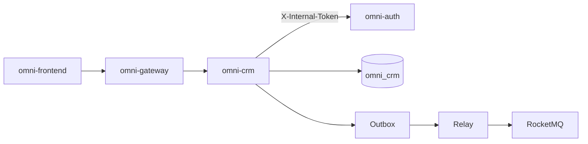
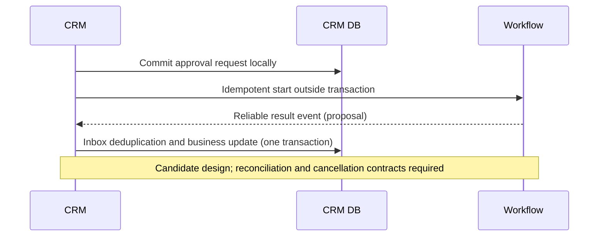

# CRM Design Decisions and Evolution Boundaries

> This page owns CRM tradeoffs, implementation scope and prerequisites for evolution. [CRM Facts](../crm.en.md), [API Contract](../api-contract.en.md) and source own current states, fields, endpoints and failure behavior. [CRM Wiki](../guides/crm-flow.en.md) owns procedures and screenshots.
> The original date field is 2026-07-12; it does not establish implementation or acceptance on that date. The previous complete text remains in Git at `3ef2fbc:docs/design/crm-design.en.md`. Historical milestones cannot replace current evidence. Four-language acceptance follows [authorized AI_REVIEW](../adr/0003-authorized-ai-translation-review.md), without requiring human translation review.

## 1. Design Conclusion

Choose the independent Servlet service `omni-crm` so pre-sales data, business commands and deployment have a clear owner. Auth owns identity/authorization, Base supplies shared capabilities and Workflow owns the engine. CRM does not query Auth across databases or embed Flowable.

| Decision area | Existing structure and current reference | Evolution boundary |
|---|---|---|
| Service and storage | Independent CRM module/database, Gateway route and frontend pages; see [CRM](../crm.en.md) | Module presence is not complete business acceptance |
| Identity and scope | common-service pre-authentication, permission-aware scope and domain table policies | Retain trusted-network assumptions and actual signature coverage limits |
| Privacy and events | Backend PII views, operation-log configuration and domain Outbox | Verify masking, auditing and delivery separately |
| Approvals and reminders | Phase 2/3 candidates below | Not currently deployed features by this declaration |

Tenant isolation, explicit authorization, rejection with missing context and synchronous domain invariants are prerequisites. The old requests to first add Auth/masking/migration/tests now have corresponding implementations; neither complete platform absence nor universal security acceptance follows.

## 2. Product Scope

### 2.1 Users and Goals

Organize leads, customers, contacts, opportunities, activities and dashboards for sales representatives, managers, tenant CRM administrators and read-only observers. Role names are authorization examples; tenant permissions, data scope and PII authority determine actual access.

The pre-sales loop covers lead progress, due follow-ups, customer relationships, stages/funnel and important command history. Shared UI does not implicitly add products, quotes, contracts, orders, invoicing, collections, marketing automation or support tickets to the CRM MVP.

### 2.2 Phasing

| Layer | Design scope |
|---|---|
| Current MVP | Leads/customers/contacts/opportunities/activities, assignment/transfer, conversion, stages, basic dashboards and duplicate candidates; exact entries are in facts |
| Phase 2 candidates | Public pool, tags, import/export, merging, reminders, sharing, stage administration, custom fields and field encryption |
| Phase 3 candidates | Products/price lists, quotes, contracts, discount approval, collection plans and sales forecasting; first evaluate an independent sales domain |
| Separate domains | Marketing nurturing, support SLA and financial reconciliation through explicit contracts |

Phasing records dependencies and boundaries, not completed delivery. Current pipeline/stage APIs are read-only; administration needs a migration strategy for existing opportunities.

## 3. System Boundaries



The diagram shows responsibilities, not startup order, container ports or every call. [Deployment](../docker-deployment.en.md) owns ports, profiles, Nacos, Redis and executor configuration.

CRM is the business writer. Auth provides users, organizations and permission scope; Base aggregates common logs; RocketMQ transports events; XXL-JOB triggers background work; Redis caches settings such as XSS. Cache/scheduler records do not replace business truth in the database. The MVP does not require Workflow at startup.

Dependencies include common-service and selected OperLog/Job/MQ capabilities. [Architecture](../architecture.en.md) owns the complete dependency map rather than a second POM inventory here.

## 4. Domain and Data Design

### 4.1 Aggregates

Separate Lead, Customer/Contact, Opportunity, Activity and Pipeline responsibilities. Conversion, stage and owner changes have records for command history and relationships, not generic resources that bypass root authorization.

Activity `root_type + root_id` is polymorphic. Ordinary foreign keys cannot express all business visibility, so Services check existence, tenant and access. Contact/activity owner snapshots reduce query-time cross-aggregate dependencies but require synchronized maintenance during transfer/conversion.

### 4.2 Common Fields and Rules

Tenant fields and business owners are separate. `create_by` records a username for auditing, not SELF ownership. New fields must distinguish current owner, historical performer and auditor; a BaseEntity does not prove automatic filling of everything.

[Current CRM rules](../crm.en.md) and [API Contract](../api-contract.en.md) own money, currency and dates. The MVP single-currency constraint avoids summing without an exchange-rate source. Database/service boundaries own identifiers and uniqueness; phone/email provide duplicate candidates.

Separate ordinary editing from status/owner/stage commands to make version checks, history and related updates explicit. Conversion uniqueness is `(tenant_id, lead_id)`, not globally unique leadId across tenants. Decide lifecycle, deletion and inherited authorization before adding relationships.

### 4.3 Main Tables

`database/changelog/crm/` solely owns current `crm_*` DDL. This page retains design grouping rather than duplicating full columns/indexes.

| Design responsibility | Current tables |
|---|---|
| Leads and conversion | `crm_lead`, `crm_lead_conversion` |
| Customers and contacts | `crm_customer`, `crm_contact` |
| Opportunities and stage history | `crm_opportunity`, `crm_opportunity_stage_history` |
| Activities and ownership history | `crm_activity`, `crm_owner_change_log` |
| Pipelines, stages and tenant settings | `crm_pipeline`, `crm_pipeline_stage`, `crm_tenant_config` |

All eleven declare tenant_id; they do not share an identical owner/version/deleted combination, nor does DDL metadata prove an installed database. `crm_approval_request` and `crm_inbox_event` are candidates, absent from this scoped CRM main/schema/seed inspection rather than current installed tables.

## 5. State Machine and Core Flows

### 5.1 Lead

Lifecycle and ownership/public-pool membership are separate dimensions. Qualification, disqualification, reopening and conversion use explicit commands so editing cannot bypass transition checks. [CRM state machines](../crm.en.md) own complete current edges/exceptions. A public pool additionally needs claim, return and contention policies.

### 5.2 Customer

Customer activity status, blacklisting and ownership transfer affect different invariants. Blacklist/restore use dedicated permissions and commands rather than ordinary update/status. Contact/activity ownership and optional open-opportunity cascades must be explicit, not implicit UI choices.

### 5.3 Opportunity

Stages carry pipeline semantics, not just status strings. Advance, rollback, won/lost and reopen commands consider versions, reasons, history and customer effects. Facts own exact transitions. Future configurable stages also require migration of existing probabilities, terminal states and statistics.

### 5.4 Activity

Planning, completion, cancellation, rescheduling and historical entry distinguish the performer from access ownership. Plain text reduces rich-text trust exposure. Reminder scheduling is a future capability; nextFollowup alone does not prove a reminder was sent.

### 5.5 Lead Conversion

Use a CRM-local transaction for creation/association, conversion records, source status and local events to avoid partial core objects. Replay still needs request validation, authority and visibility. [CRM conversion](../crm.en.md) owns exact replay/version/ownership ordering.

Conversion calls neither Workflow nor the Broker directly; that does not put every CRM Auth Feign call outside transactions. Other creation, transfer and enrichment paths have their own boundaries; see [Core Flows](../core-flows.en.md).

## 6. Tenant, RBAC, and Data Permissions

### 6.1 Trust Chain

Gateway validates JWT; services verify signed identity assertions before constructing Authentication. `X-Gateway-Forwarded:true` alone is not proof. Current signatures cover identity/time, not all roles, scope or request content. [Architecture](../architecture.en.md) separates signature and network trust boundaries.

### 6.2 Permission Tree and Roles

Check functional permissions, data scope and PII display authority separately. CRM ALL remains tenant-scoped. Menus/buttons present access but cannot replace server authorization. Facts and formal Auth seeds own actual roles and complete permission codes.

Public pools and cross-tenant administration need separate design. `platform:crm:cross-tenant` is a candidate permission name from the original proposal, not a delivered platform endpoint asserted here. Successful login does not establish default USER CRM access.

### 6.3 Auth Internal Data-Scope Contract

Current Auth clients explicitly send tenantId and complete permissionCode. Resolution merges roles granting that target permission. `InternalDataScopeDTO` contains a securityVersion fingerprint; its presence does not prove complete caching, invalidation propagation or request binding.

Display names may degrade while authorization scope must not widen. [CRM integration](../crm.en.md) owns actual 403/503 behavior and organization batching. CRM neither copies Auth Mappers nor queries their business tables across databases.

### 6.4 CRM Context and SQL Interception

Reuse common-service pre-authentication, identity Filters, method DataScope and persistence composition. CRM supplies SecurityConfig, CrmTenantTablePolicy and CrmDataPermissionHandler implementing DataScopeTablePolicy. These are existing capabilities rather than a still-unimplemented standalone configuration template.

Current order is `TenantLine → DataPermission → OptimisticLock → Pagination`. Scope resolves by endpoint permission and is restored/cleared in finally. Domain table policies and root checks remain necessary. Advisor/Filter diagrams do not replace actual proxy, async and integration verification.

### 6.5 Row-Level Authorization for Write Operations

SELECT filtering cannot authorize writes by itself. Commands check visible roots, state/relationships, applicable tenant/id/version updates and history, handling affected-row conflicts according to contract. Creation, cascades and external commands on existing records do not mechanically share identical version requirements.

Child reads need root relationships and their own permission scope. Customer visibility does not widen every 360 block, and owner candidates must stay within the command's allowed scope.

## 7. API Design

### 7.1 Common Contract

Ordinary business APIs use R/PageResult and intent-specific DTOs, with [API Contract](../api-contract.en.md) dates and money. PII duplicate checks use controlled bodies and minimal candidates. Endpoint naming does not prove logs or traffic captures contain no PII.

### 7.2 Endpoints

[CRM API entries](../crm.en.md) own complete current overview, pipeline, lead, customer, contact, opportunity, activity and owner-options methods/paths. Design new commands around idempotency, versions, ownership, errors and cascades rather than copying abbreviated paths as a second API truth.

### 7.3 Endpoint to DataScope Permission Mapping

Use a complete business permission for method checks and corresponding DataScope; follow module contracts for internal/background entries without user scope. Creation for another owner also needs applicable assign/transfer authority and target validation. Detail, statistics, duplicate candidates and 360 blocks must not borrow broader coarse resource permissions.

## 8. Cross-Service Consistency

### 8.1 Users and Organizations

CRM stores user/unit IDs; Auth owns current identity/primary organization. Assignment checks tenant and enabled state. Enrich users and organizations through their separate batches, avoiding per-row calls. Organization changes should not silently rewrite assigned business ownership; auditable transfer decides it.

Internal Tokens come from private settings. Separate ordinary identity, internal protocols and display degradation; a Compose validation gate does not establish identical HTTP failures on all paths.

### 8.2 Dictionary

Presentation dictionaries do not change lifecycle, stageType or permission semantics. Stable codes/built-in options reduce new-tenant dependence on an online Base. Moving options into shared dictionaries needs initialization, legacy codes, caches and fallback.

### 8.3 Workflow

Approvals, contracts and customer merging are candidates. This inspection found no CRM approval/inbox implementation. Integration needs tenant-safe idempotent start, reliable result events, APPROVED/REJECTED/CANCELLED mapping, timeout reconciliation and cancel/retry semantics. Existing partial Workflow events do not prove reliable publication of every engine ending.

The following is a future collaboration proposal, not a runtime receipt:



Candidate approvalRequest states remain `PENDING_START/RUNNING/APPROVED/REJECTED/CANCELLED/START_FAILED`. A businessKey can use `crm:{aggregateType}:{tenantId}:{aggregateId}:{approvalRequestId}`. CRM remains the business writer; Workflow does not modify CRM's database directly.

### 8.4 XXL-JOB

These remain candidate system tasks; the scoped CRM main/schema/seed scan found none of these four handlers:

| Candidate Handler | Candidate frequency | Design responsibility |
|---|---|---|
| `crmFollowupReminderHandler` | Every minute | Due-follow-up reminder events |
| `crmLeadSlaHandler` | Every 5 minutes | Leads not contacted in time |
| `crmOpportunityStaleHandler` | Hourly or daily | Opportunities with prolonged inactivity |
| `crmApprovalReconcileHandler` | Every 10 minutes | Future approval projection reconciliation |

Scan by record category instead of creating a scheduler job per follow-up. Implementation must define tenant enumeration, finally cleanup of system context, atomic claiming, re-entry and deduplication. [Scheduling](../scheduling.en.md) owns dual annotations and execution prerequisites.

### 8.5 Outbox and Events

Current envelopes have top-level eventId passed as msgKey, while Outbox generates its own msgId. Transport record IDs do not replace consumer business identity. This DTO-field illustration is not a sent event:

```json
{
  "eventId": "example-event-id",
  "eventType": "crm.lead.converted.v1",
  "occurredAt": "2026-07-12 10:30:00",
  "tenantId": 1,
  "producer": "omni-crm",
  "aggregateType": "LEAD",
  "aggregateId": 1001,
  "aggregateVersion": 4,
  "actorUserId": 12,
  "correlationId": null,
  "causationId": null,
  "payload": {}
}
```

Production code and [CRM event facts](../crm.en.md) define actual event types, minimal payload and optional correlation/causation population. Candidate created/assigned/converted, owner-changed, stage/won/lost and activity-completed events are not automatically all produced.

Shared Relay already uses PROCESSING claims and a 120-second lease stored in next_retry_time; the old no-claim/lease statement is obsolete. Terminal CAS checks status, not owner/generation. Long sends, lease reclamation and uncertain outcomes still need at-least-once delivery and consumer idempotency, not exactly-once promises. A future Inbox needs tenant, consumer/eventId deduplication, out-of-order versions and business commit boundaries.

## 9. Privacy, Operation Logs, and XSS

### 9.1 OperLog Prerequisite Refactoring

Masking, parameter/snapshot switches, excluded fields, event deduplication and consumer error propagation exist. Several CRM entries disable snapshots and exclude names. Review data minimization per endpoint; generic logs cannot replace synchronous owner/stage history.

[Backend Patterns](../backend-patterns.en.md) owns current pre-target collection, responseStatus, truncated JSON and archive self-invocation transaction limits. This page no longer promises universal error isolation or reliable retention of every log.

### 9.2 PII

Backend views choose masking by actual endpoint and permission. Dedicated lists and Customer 360 have different policies, documented by [CRM PII](../crm.en.md). UI hiding is not access control.

Limit fields/access for duplicate candidates, events, logs, exports, backups, dead letters and operations. Encryption, searchable HMAC and rich text need separate key/migration/search designs. Existing masking tools do not establish compliance certification or unidentifiability of every person.

### 9.3 XSS

common-service currently supplies caches, Auth fallback and an enabled baseline, retaining Provider/Servlet/Jackson conditions and authoritative disabled settings. Do not require duplication of a CRM XssConfigProviderImpl already supplied by composition.

Plain text and output encoding remain design principles. Rule filtering, response headers and rich-text allowlists are different layers. Cache misses neither imply disabling nor prove safety for every input access, async path and output.

## 10. Frontend Design

Reuse unified API types, request identity/tenant handling, page state and controlled commands. Customer 360 displays permission blocks; stage boards initiate commands while the backend owns authorization and state decisions.

[CRM frontend facts](../crm.en.md) and [Frontend Patterns](../frontend-patterns.en.md) own current paths/components/routes. Router holds CRM icon mappings and layout uses resolved icons; a second iconMap is not required. New text is synchronized in four languages. Ordinary CRUD does not require global Pinia solely for sharing.

## 11. Engineering Landing Points

### 11.1 New Module

CRM modules, application entry, Feign/Mapper scanning and shared Starter integration exist. New aggregates first define boundaries and authorization inheritance, then use [Development Wiki](../guides/scaffold-development.en.md). Old module-creation steps are not an unimplemented checklist.

### 11.2 Files That Must Change

Use forward-only Liquibase changes and synchronize formal seeds/manifests. Permission changes involve Auth seeds, frontend matching codes and new-tenant initialization. CrmTenantModuleProvisioner already establishes the event tenant as system identity, invokes initialization and clears it in finally.

Formal startup uses compose.yaml/compose.apps.yaml/compose.infra.yaml and omni-db-migrator. Old docker-compose.yml/start scripts and fixed 12/13-service counts are not current entry points. [Deployment](../docker-deployment.en.md), [Development Guide](../guides/scaffold-development.en.md) and catalog own configuration/image/preset coordination.

## 12. Non-Functional Design

### Performance

Evaluate page limits, composite indexes, user/organization batching and 360 block limits at actual data scale. Funnel summary tables are a threshold-driven choice, not proof that performance targets have been achieved.

### Concurrency and Idempotency

Conversion uniqueness, row locks, conditional versions and synchronous history protect distinct invariants. Define batch limits and all-or-per-item semantics. Outbox, task claiming and consumer idempotency provide different guarantees.

### Degradation

Authorization dependency failures remain closed; display enrichment may preserve IDs. Local commits during Broker outages require an actual business/Outbox transaction and do not guarantee later delivery. Future approvals need pending/failed/reconciliation states. Preserve actual XSS fallback/baseline and authoritative switches.

### Observability

Correlate scope resolution, rejection/conflicts, conversions, stages, Outbox age and task backlog by tenant/aggregate/event/trace without full PII. [Observability](../observability.en.md) and actual source determine whether dashboards/aggregation exist and currently contain data.

## 13. Testing and Acceptance

Business/common tests now exist; no-test-foundation is not current fact. Retain ongoing coverage topics: legal/illegal transitions, conversion replay/concurrency, ownership cascades, PII/logging, six-scope list/detail/COUNT/aggregation, cross-tenant command rejection, missing context, version conflicts, business/Outbox transactions, future Inbox deduplication and XSS.

Separate builds, isolated unit/MVC tests, real MySQL/MQ, browser flows and negative permissions. Mocks/in-memory locks do not prove real concurrency. CRM_TEST_MYSQL_URL tests create/delete crm_lead and require a dedicated disposable database; historical WP008 IT also has its own switch/environment. Skips are not passes.

Follow [AGENTS.md](../../AGENTS.md) for JDK 25/Maven Wrapper and frontend build/lint in local Docker; Development Wiki owns procedures. This documentation change reuses reports after exact source-tree checks instead of rerunning unchanged expensive validation. Authorized AI_REVIEW still requires current digest/link/content gates.

## 14. Implementation Order

These retain implementation dependencies, not receipts that every business scenario passed this run.

### Milestone 0: Platform Hardening

Identity, permission-aware scope, tenants, log minimization, XSS and test baselines precede business integration. Verify existing mechanisms and remaining limits separately; a milestone name is not completion.

### Milestone 1: Service and Security Foundation

Establish modules/routes/migrations/defaults/role policies and verify boundaries in current shared Starter order. Tenant initialization/access need corresponding evidence.

### Milestone 2: Lead + Activity

Verify a real entry/assignment/follow-up/qualification/activity-history path, including duplicate candidates, rejections and retries.

### Milestone 3: Customer + Contact + Conversion

Check creation/association, primary contacts, conversion replay and customer-transfer invariants, separating unit evidence from real database concurrency.

### Milestone 4: Opportunity + Pipeline

Close the command loop across stages, reasons, terminal/reopen behavior, history and customer effects. Read-only stage configuration does not deliver administration.

### Milestone 5: Overview + Production Hardening

Finish dashboards, privacy, auditing, indexes and actual business validation. Implement Phase 2/3 independently once their contracts/dependencies exist; future candidates are not current completed features here.

## 15. ADR Summary

| Tradeoff | Reason and cost |
|---|---|
| Independent service, tenant-scoped ordinary APIs, explicit permissions | Clear ownership; maintain identity and cross-service failure boundaries |
| Owner snapshots and controlled commands | Direct scope queries; synchronize transfer/conversion effects and history |
| Local conversion transaction plus Outbox | Core local consistency; delivery/consumer idempotency remain separate |
| Backend PII, plain text, minimal events | Reduce exposure; rules do not replace all output/log verification |
| Approval/reminder/sales-domain phasing | Establish contracts first; candidates are not available capabilities |
| Facts/design/Wiki responsibilities | Maintain current rules once; design explains choices and tutorials reproduce them |

## 16. Main Risks

| Risk | Design response and evidence boundary |
|---|---|
| Identity or scope widening | Verify trusted identity, tenant and permission; retain signature limits |
| Writes/children bypassing root visibility | AccessGuard, applicable conditional updates and block permissions, not SELECT filtering alone |
| PII through logs/events/exports | Minimize per entry and inspect output; generic rules are not complete guarantees |
| Expired leases or uncertain results causing duplicates | Recognize status-CAS limits; consumer idempotency and inspect effects before recovery |
| Future approvals/reminders mistaken for implementation | Explicit candidates, contracts, states and deployment evidence |
| Old diagrams/commands/milestones treated as current | Current source and named evidence take precedence; Git preserves historical text |

Semantic review of this design does not certify real CRM end-to-end flows, every tenant or every external dependency. Implementation and business acceptance require version-bound evidence for the relevant scenarios.
