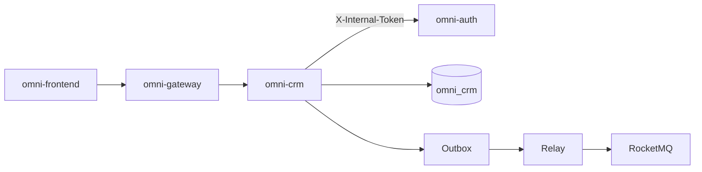
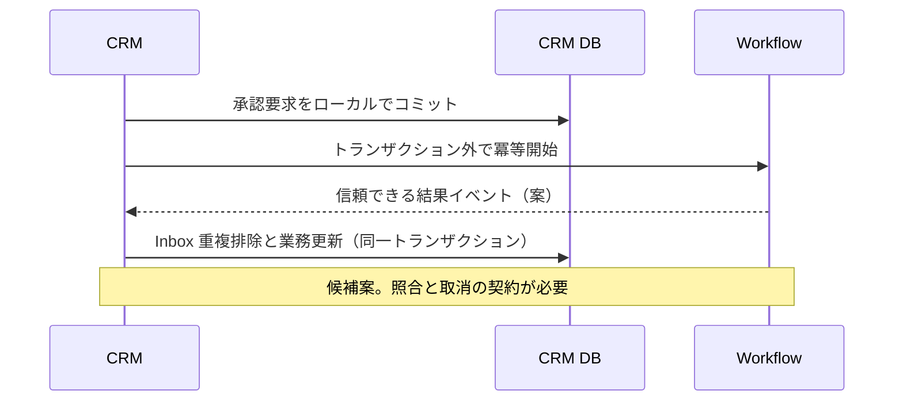

# CRM の設計判断と拡張境界

> 本書は CRM の設計上の取捨選択、実装範囲と拡張の前提を管理します。現在の状態遷移、フィールド、API、失敗動作は [CRM の事実](../crm.jp.md)、[API 契約](../api-contract.jp.md)とソースが管理し、操作・画像は [CRM Wiki](../guides/crm-flow.jp.md)が管理します。
> 元の日付フィールドは 2026-07-12 ですが、その日の実装・受入状態は推定しません。以前の全文は Git の `3ef2fbc:docs/design/crm-design.jp.md` に残ります。旧マイルストーンは現在の証拠を代替しません。四言語の受入は[承認済み AI_REVIEW](../adr/0003-authorized-ai-translation-review.md)に従い、人手の翻訳レビューを必須としません。

## 1. 設計結論

独立した Servlet サービス `omni-crm` を選び、販売前のデータ、業務コマンド、デプロイに明確な所有者を置きます。Auth は識別・認可、Base は共通機能、Workflow はエンジンを所有します。CRM は Auth をデータベース横断で照会せず、Flowable を内蔵しません。

| 判断領域 | 既存構造と現在の参照先 | 拡張境界 |
|---|---|---|
| サービスと保存 | 独立 CRM モジュール・DB、Gateway ルート、画面。[CRM](../crm.jp.md)参照 | モジュールの存在だけで全業務の受入完了にはならない |
| 識別と範囲 | common-service 事前認証、permission-aware 範囲、ドメイン表方針 | ネットワーク信頼と実署名対象の限界を維持 |
| プライバシーとイベント | バックエンド PII ビュー、操作ログ設定、ドメイン Outbox | マスク、監査、配信は別々に検証 |
| 承認と通知 | 以下の Phase 2/3 候補 | 現在デプロイ済み機能とは扱わない |

テナント分離、明示認可、コンテキスト欠落時の拒否、同期的なドメイン不変条件が前提です。旧文書の Auth・秘匿・移行・テストの事前整備には対応実装があります。全面的な欠落とも全安全場面の検証完了とも記述しません。

## 2. 製品範囲

### 2.1 ユーザーと目標

営業担当、マネージャー、テナント CRM 管理者、読み取り専用利用者向けに、リード・顧客・連絡先・商談・活動・ダッシュボードを整理します。ロール名は設定例であり、実際の利用範囲はテナント権限、データ範囲と PII 権限が決めます。

販売前の一連の業務で進捗、期限到達のフォロー、顧客関係、ステージ/ファネル、重要コマンドの履歴を扱います。共通 UI を理由に製品、見積、契約、注文、請求、入金、マーケティング自動化、サポートを MVP の暗黙の責務に加えません。

### 2.2 フェーズ分け

| 段階 | 設計範囲 |
|---|---|
| 現 MVP | リード/顧客/連絡先/商談/活動、割当/移管、転換、ステージ、基本ダッシュボード、重複候補。正確な入口は事実文書を参照 |
| Phase 2 候補 | 共有プール、タグ、インポート/エクスポート、統合、通知、共有、ステージ管理、独自フィールド、フィールド暗号化 |
| Phase 3 候補 | 製品/価格表、見積、契約、割引承認、入金計画、販売予測。先に独立 sales ドメインを検討 |
| 独立ドメイン | マーケティング育成、サポート SLA、財務消込を明示契約で連携 |

段階分けは依存と境界の記録で、納品完了記録ではありません。現在の pipeline/stage API は読み取り専用で、管理機能には既存商談の移行方針が必要です。

## 3. システム境界



図は責務関係を示し、起動順、コンテナポート、全呼出を示しません。ポート、profiles、Nacos、Redis、実行器設定は[デプロイ](../docker-deployment.jp.md)が管理します。

CRM が業務を書き、Auth がユーザー・組織・権限範囲を提供し、Base が共通ログを集約します。RocketMQ はイベントを運び、XXL-JOB はバックグラウンド処理を起動し、Redis は XSS などの設定をキャッシュします。キャッシュやスケジューラの記録を DB の業務事実の代替にしません。MVP の起動は Workflow に依存しません。

common-service と必要な OperLog/Job/MQ を組み合わせます。完全な依存表は[アーキテクチャ](../architecture.jp.md)が管理し、ここに別の POM 一覧を作りません。

## 4. ドメインとデータ設計

### 4.1 アグリゲート

Lead、Customer/Contact、Opportunity、Activity、Pipeline ごとに責務を分けます。転換、ステージ、owner 変更は履歴・関連を記録し、ルート認可を迂回する独立汎用リソースにはしません。

Activity の `root_type + root_id` は多態的な関連です。通常の外部キーだけで業務可視性を表現できず、Service が存在・同一テナント・アクセスを確認します。連絡先/活動の owner スナップショットは照会時の集約間依存を減らす一方、移管・転換時の同期保守が必要です。

### 4.2 共通フィールドとルール

テナントと業務 owner を分け、`create_by` はユーザー名の監査に使い SELF の帰属にはしません。新フィールドが現在の owner、過去の実行者、監査人のどれを表すか明示します。BaseEntity だけで全項目の自動設定を推定しません。

金額、通貨、日時は[現在の CRM 規則](../crm.jp.md)と[API 契約](../api-contract.jp.md)に従います。MVP の単一通貨は根拠となる為替レートなしの合計を防ぎます。番号と一意性は DB/Service の境界で扱い、電話・メールは重複候補に用います。

通常編集を status/owner/stage コマンドと分け、version、履歴、関連更新の入口を明確にします。転換の一意キーは `(tenant_id, lead_id)` で、全テナントを通じた leadId 一意ではありません。関連追加前にライフサイクル、削除、認可継承を決めます。

### 4.3 主要テーブル

現在の `crm_*` DDL は `database/changelog/crm/` が一元管理します。本書には設計分類を残し、全列・索引一覧を複製しません。

| 設計責務 | 現在のテーブル |
|---|---|
| リードと転換 | `crm_lead`、`crm_lead_conversion` |
| 顧客と連絡先 | `crm_customer`、`crm_contact` |
| 商談とステージ履歴 | `crm_opportunity`、`crm_opportunity_stage_history` |
| 活動と帰属履歴 | `crm_activity`、`crm_owner_change_log` |
| パイプライン、ステージ、テナント設定 | `crm_pipeline`、`crm_pipeline_stage`、`crm_tenant_config` |

11 表はいずれも tenant_id を宣言しますが、owner/version/deleted の組合せが全表同一ではなく、DDL メタデータは実 DB の移行証明でもありません。`crm_approval_request` と `crm_inbox_event` は候補で、今回の CRM main/schema/seed 範囲には実装が見つかっておらず、現行の導入済み表には数えません。

## 5. 状態マシンとコアフロー

### 5.1 Lead

ライフサイクルと owner/共有プールは別軸です。合格、無効化、再開、転換は明示コマンドを使い、通常編集から状態検証を迂回させません。全遷移・現例外は[CRM 状態機械](../crm.jp.md)が管理します。共有プールには別途取得・返却・競合方針が必要です。

### 5.2 Customer

顧客の稼働状態、ブラックリスト、owner 移管は異なる不変条件に関わります。ブラックリスト/解除は専用権限とコマンドを使います。連絡先/活動の帰属と未完商談を連動させるかを明示し、UI で暗黙に決めません。

### 5.3 Opportunity

ステージは pipeline の業務意味を持ち、状態文字列だけではありません。前進、後退、受注/失注、再開は version、理由、履歴、顧客への効果を扱います。現在の遷移は事実文書を参照し、将来のステージ管理には既存確度・終端状態・統計の移行も定義します。

### 5.4 Activity

計画、完了、取消、再計画、履歴入力では実行者とアクセス帰属を区別します。プレーンテキストはリッチテキストの信頼面を狭めます。通知スケジュールは後続機能で、nextFollowup の存在は通知配信の証明ではありません。

### 5.5 Lead 転換

生成/関連付け、転換記録、元状態、ローカルイベントを CRM 単一 DB トランザクションで扱い、主要オブジェクトの部分成功を避けます。再送も要求検証・権限・可視性が必要です。正確な再送/version/帰属順序は[CRM 転換](../crm.jp.md)が管理します。

転換は Workflow や Broker を直接呼びませんが、すべての CRM Auth Feign が DB トランザクション外とは限りません。作成、移管、表示情報の補完の各境界は[コアフロー](../core-flows.jp.md)を参照します。

## 6. テナント、RBAC とデータ権限

### 6.1 信頼チェーン

Gateway が JWT を検証し、サービスが署名済み識別アサーションを検証して Authentication を構築します。`X-Gateway-Forwarded:true` 自体は証明ではありません。現署名は識別/時刻を対象とし、全ロール、範囲、要求内容を含みません。署名とネットワークの境界は[アーキテクチャ](../architecture.jp.md)を参照します。

### 6.2 権限ツリーとロール

機能権限、データ範囲、PII 表示権を分けます。CRM の ALL も現在 tenant に制限されます。メニュー/ボタンは表示制御で、サーバー認可を代替しません。実ロールと完全な code は事実文書・正式 Auth seed が管理します。

共有プールとテナント横断管理は別設計です。`platform:crm:cross-tenant` は原案の候補名で、ここで納品済み API を宣言するものではありません。ログイン成功から default USER の CRM 権限は推定しません。

### 6.3 Auth 内部データ範囲契約

現 Auth クライアントは tenantId と完全な permissionCode を明示し、対象権限を付与するロールを統合します。`InternalDataScopeDTO` は securityVersion 指紋を持ちますが、その存在はキャッシュ・失効伝播・要求結合の全面実装を証明しません。

表示名は縮退できても認可範囲は拡大できません。403/503 と組織 batch の実動作は [CRM 連携](../crm.jp.md)が管理します。CRM は Auth Mapper をコピーせず、業務表を DB 横断で読みません。

### 6.4 CRM コンテキストと SQL インターセプト

common-service の事前認証、識別 Filter、メソッド DataScope、永続化構成を再利用します。CRM は SecurityConfig、CrmTenantTablePolicy、DataScopeTablePolicy を実装する CrmDataPermissionHandler を提供します。旧独立構成テンプレートの未実装扱いにはしません。

現在は `TenantLine → DataPermission → OptimisticLock → Pagination` の順です。scope はエンドポイント権限で解決し finally で復元/クリアします。表方針とルート確認にはドメインの関与が必要です。Advisor/Filter 図だけで実 proxy、非同期、統合検証を代替しません。

### 6.5 書き込み操作の行レベル認可

SELECT フィルタだけでは書込認可になりません。コマンドは可視ルート、状態/関連、適用される tenant/id/version 条件更新、履歴を確認し、行数競合を契約に従って扱います。生成、連動更新、既存レコードへの外部コマンドの version 要件を一律にしません。

子リソースはルート関係と固有権限範囲を必要とします。顧客の可視性で全 360 ブロックを広げず、owner 候補もコマンドの範囲内に制限します。

## 7. API 設計

### 7.1 共通契約

通常 API は R/PageResult と意図別 DTO を使い、日時・金額は [API 契約](../api-contract.jp.md)に従います。PII 重複確認は管理された body と最小候補を使います。名前だけでログや通信記録の PII 不在は証明しません。

### 7.2 エンドポイント

overview、pipeline、lead、customer、contact、opportunity、activity、owner options の現メソッド・パス全体は [CRM API 入口](../crm.jp.md)が管理します。新コマンドは冪等性、version、帰属、エラー、連動を設計し、旧省略パスを第二の API 事実として複製しません。

### 7.3 エンドポイントと DataScope permission のマッピング

メソッド権限と対応 DataScope に同じ完全な業務権限を使い、ユーザー scope を使わない内部/バックグラウンド入口はモジュール契約に従います。他者を owner にする生成は assign/transfer 権限と対象確認も必要です。詳細、統計、重複候補、360 ブロックで広い粗粒度権限を借用しません。

## 8. サービス横断の一貫性

### 8.1 ユーザーと組織

CRM は user/unit ID を保持し、Auth が現識別・主組織を所有します。割当時に同テナント・有効性を確認し、ユーザー/組織をそれぞれ batch 取得して行別呼出を避けます。組織異動で既存帰属を黙って書き換えず、追跡可能な移管で決定します。

内部 Token は非公開設定から取得します。通常識別、内部プロトコル、表示縮退を分け、Compose の一つの検証条件から全パスの HTTP エラーが同じとは推定しません。

### 8.2 辞書

表示辞書はライフサイクル、stageType、権限意味を変更しません。安定 code と組込み選択肢で新テナントの Base オンライン依存を減らします。共有辞書へ移す前に初期化、旧 code、キャッシュ、縮退を設計します。

### 8.3 Workflow

承認、契約、顧客統合は候補です。今回の範囲では CRM approval/inbox の実装はありません。導入前にテナント安全な冪等開始、信頼できる結果イベント、APPROVED/REJECTED/CANCELLED 対応、タイムアウト照合、取消/再試行を定義します。既存の一部イベントから全エンジン終了の信頼性配信を推定しません。

以下は将来の協調案で、現在の実行受領証ではありません。



候補状態は `PENDING_START/RUNNING/APPROVED/REJECTED/CANCELLED/START_FAILED`、businessKey 案は `crm:{aggregateType}:{tenantId}:{aggregateId}:{approvalRequestId}` です。CRM が業務を書き、Workflow は CRM DB を直接変更しません。

### 8.4 XXL-JOB

次は候補システムジョブで、今回の CRM main/schema/seed 範囲に四つの handler は見つかっていません。

| 候補 Handler | 候補頻度 | 設計責務 |
|---|---|---|
| `crmFollowupReminderHandler` | 毎分 | 期限到達のフォロー通知イベント |
| `crmLeadSlaHandler` | 5 分ごと | 時間内に連絡されないリードの処理 |
| `crmOpportunityStaleHandler` | 毎時または毎日 | 長期未活動商談の識別 |
| `crmApprovalReconcileHandler` | 10 分ごと | 将来の承認投影照合 |

記録種類で走査し、各フォローにスケジューラのジョブを作りません。実装時に tenant 列挙、system context の finally クリア、原子的な取得、再入、重複排除を定義します。二つの注釈と実行前提は[スケジューリング](../scheduling.jp.md)が管理します。

### 8.5 Outbox とイベント

現在のイベントエンベロープはトップレベル eventId を msgKey として渡し、Outbox は独自 msgId を生成します。転送記録 ID は消費側の業務識別を代替しません。以下は DTO 項目の例で、送信済みイベントではありません。

```json
{
  "eventId": "example-event-id",
  "eventType": "crm.lead.converted.v1",
  "occurredAt": "2026-07-12 10:30:00",
  "tenantId": 1,
  "producer": "omni-crm",
  "aggregateType": "LEAD",
  "aggregateId": 1001,
  "aggregateVersion": 4,
  "actorUserId": 12,
  "correlationId": null,
  "causationId": null,
  "payload": {}
}
```

実イベント、最小 payload、任意 correlation/causation の設定は production と [CRM イベント事実](../crm.jp.md)が定義します。created/assigned/converted、owner-changed、stage/won/lost、activity completed の候補すべてが発生済みとはしません。

共有 Relay には PROCESSING 取得と 120 秒 lease があり、next_retry_time が期限を保持します。旧「claim/lease なし」は失効しています。終端 CAS は状態だけを見て owner/generation を照合しません。長い送信、lease 回収、不確定結果には少なくとも一度の配信とコンシューマーの冪等性が必要で、exactly-once を保証しません。将来の Inbox は tenant、consumer/eventId 重複排除、version 順序逆転、業務 commit 境界も必要です。

## 9. プライバシー、操作ログと XSS

### 9.1 OperLog の前提改修

秘匿器、引数/スナップショットスイッチ、除外項目、イベント重複排除、コンシューマーの例外伝播は実装済みです。複数の CRM 入口はスナップショットを無効にし氏名などを除外します。入口別の最小化は継続確認し、汎用ログで同期 owner/stage 履歴を代替しません。

前置収集エラー、responseStatus、JSON 切詰め、同 Bean の archive トランザクション制約は[バックエンド規約](../backend-patterns.jp.md)を参照します。全エラーの業務隔離や全ログの確実な保持を保証しません。

### 9.2 PII

実入口・権限に応じバックエンドがマスクを選び、専用一覧と Customer 360 は異なる方針を持ちます。[CRM PII](../crm.jp.md)が全動作を管理し、UI 遮蔽をアクセス制御としません。

重複候補、イベント、ログ、export、backup、デッドレター、運用入口で項目/アクセスを制限します。暗号化、検索用 HMAC、リッチテキストは鍵・移行・検索の別設計が必要です。既存マスクで準拠認証や全個人の識別不能を断言しません。

### 9.3 XSS

現在 common-service が cache、Auth への設定照会、有効な基準規則を提供し、Provider/Servlet/Jackson 条件と正式な無効設定を保ちます。組合せ機能が既に提供する CRM XssConfigProviderImpl の複製を要求しません。

プレーンテキストと出力 encoding は設計原則です。規則フィルタ、応答 Header、リッチテキスト allowlist は別層です。cache miss は無効化を意味せず、全入力取得・非同期・出力の安全性も証明しません。

## 10. フロントエンド設計

共通 API 型、要求識別/tenant 処理、画面状態、制御されたコマンドを使います。Customer 360 は権限ブロック単位で表示し、ステージ board はコマンド入口として、認可と状態判断をバックエンドに残します。

現ディレクトリ、部品、動的ルートは [CRM フロントエンド事実](../crm.jp.md)と[フロントエンド規約](../frontend-patterns.jp.md)が管理します。router が CRM icon 対応を持ち、layout は解決済み icon を使うため第二の iconMap は不要です。新文言は四言語を同期し、共有目的だけで通常 CRUD にグローバル Pinia を強制しません。

## 11. エンジニアリング着地点

### 11.1 新モジュール

CRM モジュール、application 入口、Feign/Mapper scan、shared Starter は既存です。新集約は先に境界と認可継承を決め、[開発 Wiki](../guides/scaffold-development.jp.md)を使います。旧モジュール生成手順を未実施一覧にしません。

### 11.2 必ず変更するファイル

forward-only Liquibase 変更と正式 seed/manifest を同期します。権限変更は Auth seed、frontend 同 code、新テナント初期化に関わります。CrmTenantModuleProvisioner は event tenant を system identity とし、初期化を呼んで finally でクリアします。

正式起動は compose.yaml / compose.apps.yaml / compose.infra.yaml と omni-db-migrator です。旧 docker-compose.yml/start scripts、固定 12/13 サービス数を現入口にしません。設定・image・preset 連携は[デプロイ](../docker-deployment.jp.md)、[開発ガイド](../guides/scaffold-development.jp.md)、現 catalog に従います。

## 12. 非機能設計

### 性能

ページ上限、複合索引、ユーザー/組織 batch、360 ブロック制限は実データ規模で評価します。ファネル集計表は閾値後の選択で、設計目標から性能達成を推定しません。

### 並行と冪等

転換一意性、行ロック、version 条件、同期履歴は別々の不変条件を守ります。batch 上限と全体/逐件の意味を定めます。Outbox、ジョブ取得、コンシューマーの冪等性は同じ保証ではありません。

### 縮退

認可依存失敗は閉じ、表示情報の補完は ID を残せます。MQ 障害時のローカル commit は実業務/Outbox トランザクションを前提とし、後続配信を保証しません。将来の承認は待機/失敗/照合状態を明示し、XSS は現在の設定取得/基準と正式スイッチを保ちます。

### 可観測性

tenant/aggregate/event/trace で scope 解決、拒否/競合、転換、ステージ、Outbox age、ジョブ滞留を関連付け、完全 PII を記録しません。画面・運用集約の存在と現在のデータは[可観測性](../observability.jp.md)と実ソースで確認します。

## 13. テストと検収

業務・common テストは既にあり、旧「テスト基盤なし」を現状にはしません。継続テーマは有効/無効な遷移、転換再送/並行、帰属連動、PII/ログ、六範囲の一覧/詳細/COUNT/集計、越境コマンド拒否、コンテキスト欠落、version 競合、業務/Outbox トランザクション、将来 Inbox 重複排除、XSS です。

build、隔離 unit/MVC、実 MySQL/MQ、browser、権限拒否を分けます。Mock/メモリロックは実並行性を証明しません。CRM_TEST_MYSQL_URL テストは crm_lead を生成/削除するため専用破棄可能 DB を使い、旧 WP008 IT にも専用スイッチ/環境があります。skip を pass にしません。

[AGENTS.md](../../AGENTS.md) に従いローカル Docker で JDK 25/Maven Wrapper と frontend build/lint を使い、操作手順は開発 Wiki に置きます。文書のみの本変更はソースツリーの完全一致後に既存報告を再利用し、不変の高価な検証を再実行しません。承認済み AI_REVIEW でも現在の hash/link/content gate が必要です。

## 14. 実装順序

以下は実装依存の設計意義で、今回全業務が通過したマイルストーン受領証ではありません。

### Milestone 0：プラットフォーム強化

識別、permission-aware 範囲、tenant、ログ最小化、XSS、テスト基準が業務接続に先行します。既存機構と残る限界を分けて確認し、段階名を完了証明にしません。

### Milestone 1：サービスとセキュリティ基盤

module/route/migration/default/role 方針を確立し、現 shared Starter 順で境界を検証します。テナント別初期化・アクセスには対応証拠が必要です。

### Milestone 2：Lead + Activity

入力、割当、フォロー、判定、活動履歴の実経路を検証し、重複候補、拒否、再試行も含めます。

### Milestone 3：Customer + Contact + Conversion

新規/関連、主要連絡先、転換再送、顧客移管の不変条件を確認し、unit 証拠と実 DB 並行を分けます。

### Milestone 4：Opportunity + Pipeline

ステージ、理由、終端/再開、履歴、顧客効果でコマンド経路を閉じます。読み取り専用設定は管理機能の納品ではありません。

### Milestone 5：Overview + 本番強化

ダッシュボード、プライバシー、監査、索引、実業務検証を仕上げます。Phase 2/3 は各契約・依存の充足後に別途実装し、候補を現在の完了機能に加えません。

## 15. ADR 要約

| 取捨選択 | 理由と代価 |
|---|---|
| 独立 service、通常 API は tenant 内、明示権限 | 所有を明確にし、識別とサービス間失敗境界を維持 |
| owner snapshot と明示コマンド | 範囲照会を直接化。移管/転換の連動と履歴を同期 |
| ローカル転換トランザクション + Outbox | 中核のローカル整合性。配信/コンシューマーの冪等性は別途必要 |
| backend PII、plain text、最小 event | 露出を減らすが、全出力/ログ検証を規則で代替しない |
| 承認/通知/sales 段階分け | 契約を先に定義。候補は利用可能能力ではない |
| 事実/設計/Wiki の分担 | 現規則を一元管理。設計が理由、教材が再現を説明 |

## 16. 主要リスク

| リスク | 設計対応と証拠範囲 |
|---|---|
| 識別・範囲の拡大 | 実信頼経路、tenant、permission を検証し署名限界を保持 |
| 書込/子資源が root 可視性を迂回 | AccessGuard、適用条件更新、block 権限。SELECT だけに頼らない |
| ログ/event/export の PII | 入口ごとに最小化し出力確認。汎用規則を全面保証にしない |
| lease 期限・不確定結果の重複 | 状態 CAS の限界を認識し、コンシューマーの冪等性と回復前の副作用確認 |
| 将来の承認/通知を実装済みと誤認 | 候補、契約、状態、実デプロイ証拠を明示 |
| 旧図/コマンド/段階を現状扱い | 現ソースと対象を明記した証拠を優先。旧全文は Git に保存 |

設計の意味レビューは実 CRM end-to-end、全 tenant、全外部依存の受入を意味しません。設計案の実装・業務受入には対象バージョンと実シナリオに対応する証拠が必要です。
