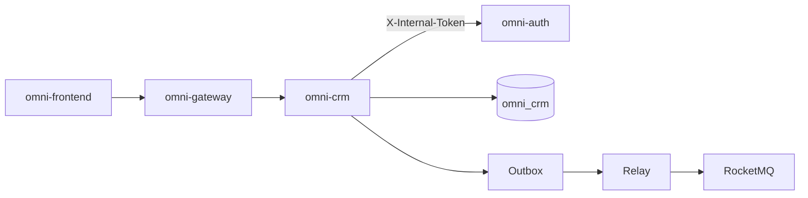
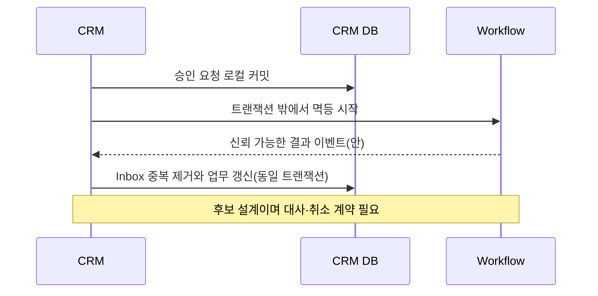

# CRM 설계 결정과 확장 경계

> 이 문서는 CRM의 설계 선택, 구현 범위와 확장 전제를 관리합니다. 현재 상태 전이·필드·API·실패 동작은 [CRM 사실](../crm.kr.md), [API 계약](../api-contract.kr.md)과 소스가 관리하며 실행 절차·이미지는 [CRM Wiki](../guides/crm-flow.kr.md)에서 관리합니다.
> 원래 날짜 필드는 2026-07-12이며 그날의 구현·검증 상태를 추정하지 않습니다. 이전 전문은 Git의 `3ef2fbc:docs/design/crm-design.kr.md`에 남습니다. 과거 마일스톤은 현재 증거를 대신하지 않습니다. 네 언어 검증은 [승인된 AI_REVIEW](../adr/0003-authorized-ai-translation-review.md)를 따르며 사람의 번역 검토를 필수로 요구하지 않습니다.

## 1. 설계 결론

독립 Servlet 서비스 `omni-crm`을 선택하여 영업 전 단계의 데이터, 업무 명령과 배포에 명확한 소유자를 둡니다. Auth는 신원·권한, Base는 공통 기능, Workflow는 엔진을 소유합니다. CRM은 Auth를 DB 간 조회하거나 Flowable을 내장하지 않습니다.

| 결정 영역 | 기존 구조와 현재 참조 | 확장 경계 |
|---|---|---|
| 서비스와 저장 | 독립 CRM 모듈·DB, Gateway 경로와 화면, [CRM](../crm.kr.md) 참조 | 모듈 존재가 전체 업무 검증 완료를 뜻하지 않음 |
| 신원과 범위 | common-service 사전 인증, permission-aware 범위와 도메인 테이블 정책 | 신뢰 네트워크 전제와 실제 서명 범위의 한계 유지 |
| 개인정보와 이벤트 | 백엔드 PII 뷰, 운영 로그 설정과 도메인 Outbox | 마스킹·감사·전달을 따로 검증 |
| 승인과 알림 | 아래 Phase 2/3 후보 | 현재 배포 기능으로 선언하지 않음 |

테넌트 격리, 명시 권한, 컨텍스트 부재 시 거부와 동기 도메인 불변 조건이 전제입니다. 과거 Auth·마스킹·마이그레이션·테스트 선행 항목에는 대응 구현이 있습니다. 플랫폼 전체 부재나 모든 보안 시나리오 검증 완료로 표현하지 않습니다.

## 2. 제품 범위

### 2.1 사용자와 목표

영업 담당자·관리자, 테넌트 CRM 관리자와 읽기 전용 사용자를 위해 리드·고객·연락처·영업 기회·활동·대시보드를 구성합니다. 역할 이름은 권한 설정 예시이며 실제 접근은 테넌트 권한, 데이터 범위와 PII 권한이 결정합니다.

영업 전 단계는 리드 진척, 기한 도달 후속 조치, 고객 관계, 단계·퍼널과 주요 명령 이력을 다룹니다. 같은 UI를 쓴다는 이유로 제품·견적·계약·주문·청구·수금·마케팅 자동화·고객 지원을 MVP의 암묵적 책임으로 추가하지 않습니다.

### 2.2 단계 구분

| 단계 | 설계 범위 |
|---|---|
| 현재 MVP | 리드/고객/연락처/영업 기회/활동, 할당·이전, 전환, 단계, 기본 대시보드와 중복 후보, 정확한 진입점은 사실 문서 참조 |
| Phase 2 후보 | 공용 풀, 태그, 가져오기/내보내기, 병합, 알림, 공유, 단계 관리, 사용자 정의 필드와 필드 암호화 |
| Phase 3 후보 | 제품·가격표, 견적, 계약, 할인 승인, 수금 계획과 판매 예측, 독립 sales 도메인을 먼저 검토 |
| 별도 도메인 | 마케팅 육성, 지원 SLA와 재무 정산을 명시적 계약으로 연결 |

단계 구분은 의존성과 경계이며 납품 완료 기록이 아닙니다. 현재 pipeline/stage API는 읽기 전용으로 관리 기능에는 기존 영업 기회 마이그레이션 정책이 필요합니다.

## 3. 시스템 경계



그림은 책임 관계이며 시작 순서·컨테이너 포트·전체 호출이 아닙니다. 포트, profiles, Nacos, Redis와 실행기 설정은 [배포](../docker-deployment.kr.md)에서 관리합니다.

CRM은 업무 쓰기, Auth는 사용자·조직·권한 범위, Base는 공통 로그 집계를 담당합니다. RocketMQ는 이벤트를 전달하고 XXL-JOB은 백그라운드 작업을 시작하며 Redis는 XSS 등의 설정을 캐시합니다. 캐시·스케줄러 기록이 DB 업무 사실을 대체하지 않습니다. MVP 시작은 Workflow에 의존하지 않습니다.

common-service와 필요한 OperLog/Job/MQ 기능을 조합합니다. 전체 의존성은 [아키텍처](../architecture.kr.md)가 관리하며 이 페이지에 별도 POM 목록을 두지 않습니다.

## 4. 도메인과 데이터 설계

### 4.1 집계

Lead, Customer/Contact, Opportunity, Activity, Pipeline으로 업무 책임을 나눕니다. 전환·단계·owner 변경은 명령 이력과 관계를 남기며 루트 권한을 우회하는 독립 범용 리소스로 만들지 않습니다.

Activity의 `root_type + root_id`는 다형 관계입니다. 일반 외래키가 전체 업무 가시성을 표현하지 못하므로 Service에서 존재·동일 테넌트·접근을 확인합니다. 연락처·활동 owner 스냅샷은 조회 시 집계 간 의존성을 줄이지만 이전·전환 때 동기 유지가 필요합니다.

### 4.2 공통 필드와 규칙

테넌트와 업무 owner를 분리합니다. `create_by`는 사용자명 감사이며 SELF 소유가 아닙니다. 새 필드는 현재 소유자·과거 실행자·감사 주체 중 무엇인지 명시하며 BaseEntity만으로 전체 자동 채우기를 추정하지 않습니다.

금액·통화·날짜는 [현재 CRM 규칙](../crm.kr.md)과 [API 계약](../api-contract.kr.md)이 기준입니다. MVP 단일 통화는 환율 근거 없는 합산을 피합니다. 번호와 유일성은 DB·Service 경계에서 다루고 전화·이메일은 중복 후보에 사용합니다.

일반 편집과 status/owner/stage 명령을 분리하여 version·이력·연동 진입점을 드러냅니다. 전환 유일키는 `(tenant_id, lead_id)`이며 테넌트 전체에서 leadId가 전역 유일하다는 뜻이 아닙니다. 관계 추가 전에 생명주기·삭제·권한 상속을 정합니다.

### 4.3 주요 테이블

현재 `crm_*` DDL의 유일한 소유자는 `database/changelog/crm/`입니다. 이 문서는 설계 분류를 유지하며 전체 열·인덱스를 복제하지 않습니다.

| 설계 책임 | 현재 테이블 |
|---|---|
| 리드와 전환 | `crm_lead`, `crm_lead_conversion` |
| 고객과 연락처 | `crm_customer`, `crm_contact` |
| 영업 기회와 단계 이력 | `crm_opportunity`, `crm_opportunity_stage_history` |
| 활동과 소유 이력 | `crm_activity`, `crm_owner_change_log` |
| 파이프라인·단계·테넌트 설정 | `crm_pipeline`, `crm_pipeline_stage`, `crm_tenant_config` |

11개 테이블은 tenant_id를 선언하지만 owner/version/deleted 조합이 모두 같지는 않으며 DDL 메타데이터가 실제 DB 설치를 증명하지 않습니다. `crm_approval_request`와 `crm_inbox_event`는 후보로 이번 CRM main/schema/seed 범위에서 구현을 찾지 못했으므로 현재 설치 테이블로 세지 않습니다.

## 5. 상태 머신과 핵심 플로우

### 5.1 Lead

생명주기와 owner·공용 풀 소속은 별도 차원입니다. 적격·무효화·재개·전환은 명시 명령을 통해 일반 편집의 상태 검증 우회를 막습니다. 전체 전이·현재 예외는 [CRM 상태 머신](../crm.kr.md)이 관리합니다. 공용 풀에는 별도 인수·반환·경쟁 정책이 필요합니다.

### 5.2 Customer

고객 활동 상태·블랙리스트·owner 이전은 서로 다른 불변 조건입니다. 블랙리스트·복원은 일반 update/status 대신 전용 권한·명령을 사용합니다. 연락처·활동 소유와 진행 중 영업 기회 연동 여부는 명시하며 UI의 암묵적 선택에 맡기지 않습니다.

### 5.3 Opportunity

단계는 pipeline 업무 의미를 가지며 상태 문자열만 바꾸는 일이 아닙니다. 전진·후퇴·수주/실패·재개에 version·사유·이력·고객 영향을 고려합니다. 정확한 전이는 사실 문서가 관리하며 향후 단계 관리에는 기존 확률·종료 상태·통계 마이그레이션도 필요합니다.

### 5.4 Activity

계획·완료·취소·재계획·이력 입력은 실행자와 접근 소유를 구분합니다. 평문은 리치 텍스트 신뢰 영역을 줄입니다. 알림 스케줄은 후속 기능으로 nextFollowup 필드만으로 알림 발송이 증명되지는 않습니다.

### 5.5 Lead 전환

생성·연결, 전환 기록, 원본 상태와 로컬 이벤트를 CRM 단일 DB 트랜잭션으로 처리하여 핵심 객체의 부분 성공을 피합니다. 재요청도 요청 검증·권한·가시성이 필요합니다. 정확한 재요청/version/owner 순서는 [CRM 전환](../crm.kr.md)이 관리합니다.

전환은 Workflow나 Broker를 직접 호출하지 않지만 모든 CRM Auth Feign이 DB 트랜잭션 밖이라는 뜻은 아닙니다. 다른 생성·이전·표시 보강 경계는 [핵심 흐름](../core-flows.kr.md)을 참조하세요.

## 6. 테넌트, RBAC과 데이터 권한

### 6.1 신뢰 체인

Gateway가 JWT를 검증하고 서비스는 서명된 신원 assertion을 확인하여 Authentication을 구성합니다. `X-Gateway-Forwarded:true` 자체는 증거가 아닙니다. 현재 서명은 신원·시간을 대상으로 모든 역할·범위·요청 내용을 포함하지 않습니다. 서명과 네트워크 경계는 [아키텍처](../architecture.kr.md)를 참조하세요.

### 6.2 권한 트리와 역할

기능 권한·데이터 범위·PII 표시 권한을 따로 판단합니다. CRM ALL도 현재 tenant에 제한됩니다. 메뉴·버튼은 표현이며 서버 권한을 대신하지 않습니다. 실제 역할과 전체 권한 코드는 사실 문서와 정식 Auth 시드가 관리합니다.

공용 풀과 테넌트 간 관리는 별도 설계입니다. `platform:crm:cross-tenant`는 원안의 후보 이름이며 이 페이지에서 납품된 플랫폼 API로 선언하지 않습니다. 로그인 성공으로 기본 USER의 CRM 접근을 추정하지 않습니다.

### 6.3 Auth 내부 데이터 범위 계약

현재 Auth 클라이언트는 tenantId와 전체 permissionCode를 명시하고 대상 권한을 부여하는 역할을 병합합니다. `InternalDataScopeDTO`에 securityVersion 지문이 있으나 필드 존재가 전체 캐시·무효화 전파·요청 바인딩 구현을 증명하지 않습니다.

표시 이름은 폴백할 수 있으나 권한 범위는 넓히지 않습니다. 실제 403/503과 조직 배치는 [CRM 연동](../crm.kr.md)이 관리합니다. CRM은 Auth Mapper를 복제하거나 DB 간 업무 테이블을 읽지 않습니다.

### 6.4 CRM 컨텍스트와 SQL 인터셉트

common-service 사전 인증·신원 Filter·메서드 DataScope·영속화 조합을 재사용합니다. CRM은 SecurityConfig, CrmTenantTablePolicy와 DataScopeTablePolicy를 구현한 CrmDataPermissionHandler를 제공합니다. 이미 있는 기능을 과거 독립 구성 템플릿의 미구현 항목으로 보지 않습니다.

현재 순서는 `TenantLine → DataPermission → OptimisticLock → Pagination`입니다. scope는 진입점 권한으로 해석하고 finally에서 복구·정리합니다. 테이블 정책과 루트 검사는 도메인 참여가 필요합니다. Advisor/Filter 그림은 실제 proxy·비동기·통합 검증을 대체하지 않습니다.

### 6.5 쓰기 조작의 행 수준 인가

SELECT 필터만으로 쓰기를 승인할 수 없습니다. 명령은 보이는 루트, 상태·관계, 해당 tenant/id/version 조건 갱신과 이력을 확인하고 영향 행 충돌을 계약대로 처리합니다. 생성·연동 갱신·기존 기록 외부 명령의 version 요구를 기계적으로 같게 만들지 않습니다.

하위 조회에는 루트 관계와 자체 권한 범위가 필요합니다. 고객 가시성이 360 전체 블록 범위를 넓히지 않으며 owner 후보도 명령의 허용 범위 안에 둡니다.

## 7. API 설계

### 7.1 공통 계약

일반 API는 R/PageResult와 의도별 DTO를 쓰고 날짜·금액은 [API 계약](../api-contract.kr.md)을 따릅니다. PII 중복 검사는 통제된 body·최소 후보를 사용합니다. 이름만으로 로그·패킷 기록의 PII 부재가 증명되지는 않습니다.

### 7.2 엔드포인트

overview, pipeline, lead, customer, contact, opportunity, activity와 owner options의 현재 전체 메서드·경로는 [CRM API 진입점](../crm.kr.md)이 관리합니다. 새 명령은 멱등성·version·소유·오류·연동을 정하며 과거 축약 경로를 두 번째 API 사실로 복제하지 않습니다.

### 7.3 엔드포인트와 DataScope permission 매핑

메서드 검사와 대응 DataScope에는 동일한 전체 업무 권한을 사용하고 사용자 scope가 없는 내부·백그라운드 진입점은 모듈 계약을 따릅니다. 다른 owner로 생성하려면 해당 assign/transfer 권한과 대상 검증도 필요합니다. 상세·통계·중복 후보·360 블록은 더 넓은 리소스 권한을 빌리지 않습니다.

## 8. 서비스 간 일관성

### 8.1 사용자와 조직

CRM은 user/unit ID를 저장하고 Auth가 현재 신원·주 조직을 소유합니다. 할당 시 동일 테넌트·활성 상태를 확인합니다. 사용자와 조직 각각의 배치 조회로 행별 호출을 피합니다. 조직 이동으로 기존 소유를 조용히 바꾸지 않고 추적 가능한 이전으로 결정합니다.

내부 Token은 비공개 설정에서 가져옵니다. 일반 신원·내부 프로토콜·표시 폴백을 분리하며 하나의 Compose 검사로 모든 경로의 HTTP 오류가 같다고 추정하지 않습니다.

### 8.2 사전

표시 사전이 생명주기·stageType·권한 의미를 바꾸지 않습니다. 안정된 code와 내장 옵션으로 새 테넌트의 온라인 Base 의존을 줄입니다. 공유 사전으로 옮기기 전에 초기화·기존 code·캐시·폴백을 정합니다.

### 8.3 Workflow

승인·계약·고객 병합은 후보이며 이번 범위에서 CRM approval/inbox 구현은 발견되지 않았습니다. 연동 전에 테넌트 안전한 멱등 시작, 신뢰 가능한 결과 이벤트, APPROVED/REJECTED/CANCELLED 매핑, 시간 초과 대사와 취소·재시도를 정의합니다. 기존 일부 이벤트로 모든 엔진 종료의 신뢰성 발행을 추정하지 않습니다.

다음은 향후 협업안이며 현재 실행 영수증이 아닙니다.



후보 상태는 `PENDING_START/RUNNING/APPROVED/REJECTED/CANCELLED/START_FAILED`, businessKey는 `crm:{aggregateType}:{tenantId}:{aggregateId}:{approvalRequestId}`로 설계할 수 있습니다. CRM이 업무 쓰기를 소유하고 Workflow가 CRM DB를 직접 바꾸지 않습니다.

### 8.4 XXL-JOB

다음은 후보 시스템 작업이며 이번 CRM main/schema/seed 범위에서 네 handler를 찾지 못했습니다.

| 후보 Handler | 후보 주기 | 설계 책임 |
|---|---|---|
| `crmFollowupReminderHandler` | 매분 | 기한 도달 후속 조치 알림 이벤트 |
| `crmLeadSlaHandler` | 5분마다 | 시간 내 미연락 리드 처리 |
| `crmOpportunityStaleHandler` | 매시간 또는 매일 | 장기 미활동 영업 기회 식별 |
| `crmApprovalReconcileHandler` | 10분마다 | 향후 승인 투영 대사 |

기록 종류별로 스캔하며 후속 조치마다 스케줄러 작업을 만들지 않습니다. 구현 시 tenant 열거, system context finally 정리, 원자 인수·재진입·중복 제거를 정의합니다. 이중 어노테이션·실행 전제는 [스케줄링](../scheduling.kr.md)에서 관리합니다.

### 8.5 Outbox와 이벤트

현재 이벤트 봉투의 최상위 eventId를 msgKey로 전달하고 Outbox가 별도 msgId를 생성합니다. 전송 기록 ID는 소비자 업무 식별을 대신하지 않습니다. 다음은 DTO 필드 예시이며 발송된 이벤트가 아닙니다.

```json
{
  "eventId": "example-event-id",
  "eventType": "crm.lead.converted.v1",
  "occurredAt": "2026-07-12 10:30:00",
  "tenantId": 1,
  "producer": "omni-crm",
  "aggregateType": "LEAD",
  "aggregateId": 1001,
  "aggregateVersion": 4,
  "actorUserId": 12,
  "correlationId": null,
  "causationId": null,
  "payload": {}
}
```

실제 이벤트 종류·최소 payload·선택 correlation/causation 값 설정은 운영 코드와 [CRM 이벤트 사실](../crm.kr.md)이 기준입니다. created/assigned/converted, owner-changed, stage/won/lost와 activity completed 후보가 모두 이미 발생했다고 보지 않습니다.

공유 Relay에는 PROCESSING 인수와 120초 lease가 있으며 next_retry_time이 만료를 저장합니다. 과거 claim/lease 부재 설명은 유효하지 않습니다. 최종 CAS는 상태만 검사하며 owner/generation을 확인하지 않습니다. 긴 전송·lease 회수·불확정 결과는 최소 1회 전달과 소비 멱등성이 필요하며 exactly-once를 보장하지 않습니다. 향후 Inbox에는 tenant, consumer/eventId 중복 제거, version 역전과 업무 commit 경계도 필요합니다.

## 9. 프라이버시, 조작 로그와 XSS

### 9.1 OperLog 선행 개조

마스커·인자/스냅샷 스위치·제외 필드·이벤트 중복 제거·소비 오류 전파가 구현되어 있습니다. 여러 CRM 진입점은 스냅샷을 끄고 이름 등을 제외합니다. 진입점별 데이터 최소화를 계속 검토하며 범용 로그로 동기 owner/stage 이력을 대신하지 않습니다.

사전 수집 오류, responseStatus, JSON 잘림과 같은 Bean archive 트랜잭션 경계는 [백엔드 규칙](../backend-patterns.kr.md)을 참조하세요. 모든 오류의 업무 격리나 전체 로그 보존을 보장하지 않습니다.

### 9.2 PII

실제 API·권한에 따라 백엔드 뷰가 마스킹을 선택하며 전용 목록과 Customer 360 정책은 다릅니다. 전체 동작은 [CRM PII](../crm.kr.md)가 관리합니다. UI 가림은 접근 통제가 아닙니다.

중복 후보·이벤트·로그·내보내기·백업·데드레터·운영 진입점의 필드와 접근을 제한합니다. 암호화·검색용 HMAC·리치 텍스트는 키·마이그레이션·검색 설계가 별도로 필요합니다. 기존 마스킹 도구로 규정 준수 인증이나 모든 개인정보의 식별 불가를 주장하지 않습니다.

### 9.3 XSS

현재 common-service가 캐시·Auth 원본 조회·활성 기준 규칙을 제공하고 Provider/Servlet/Jackson 조건과 공식 비활성 설정을 보존합니다. 조합 기능이 이미 제공하는 CRM XssConfigProviderImpl을 복제하도록 요구하지 않습니다.

평문·출력 인코딩은 설계 원칙입니다. 규칙 필터, 응답 Header와 리치 텍스트 allowlist는 별도 계층입니다. cache miss는 비활성화를 뜻하지 않고 모든 입력 접근·비동기·출력 안전성을 증명하지도 않습니다.

## 10. 프런트엔드 설계

공유 API 타입, 요청 신원·tenant 처리, 페이지 상태와 통제된 명령을 재사용합니다. Customer 360은 권한 블록별로 표시하고 단계 board는 명령 진입점이며 최종 권한·상태 판단은 백엔드에 둡니다.

현재 디렉터리·컴포넌트·동적 경로는 [CRM 프런트엔드 사실](../crm.kr.md)과 [프런트엔드 규칙](../frontend-patterns.kr.md)이 관리합니다. router가 CRM icon 매핑을 보유하고 layout은 해석된 icon을 쓰므로 두 번째 iconMap을 요구하지 않습니다. 새 문구는 네 언어를 동기화하며 일반 CRUD를 공유 목적만으로 전역 Pinia에 넣지 않습니다.

## 11. 엔지니어링 착지점

### 11.1 새 모듈

CRM 모듈·application 진입점·Feign/Mapper scan·shared Starter는 이미 있습니다. 새 집계는 경계·권한 상속을 먼저 정하고 [개발 Wiki](../guides/scaffold-development.kr.md)를 사용합니다. 과거 모듈 생성 단계를 미구현 체크리스트로 보지 않습니다.

### 11.2 반드시 변경할 파일

forward-only Liquibase 변경과 정식 시드·manifest를 동기화합니다. 권한 변경에는 Auth 시드, 프런트엔드 동일 code와 새 테넌트 초기화가 필요합니다. CrmTenantModuleProvisioner가 이벤트 tenant를 system identity에 설정하고 초기화를 호출한 뒤 finally에서 정리합니다.

정식 시작은 compose.yaml / compose.apps.yaml / compose.infra.yaml과 omni-db-migrator입니다. 과거 docker-compose.yml/start scripts와 고정 12/13 서비스 수는 현재 진입점이 아닙니다. 설정·image·preset 연동은 [배포](../docker-deployment.kr.md), [개발 가이드](../guides/scaffold-development.kr.md)와 현재 catalog를 따릅니다.

## 12. 비기능 설계

### 성능

페이지 상한·복합 인덱스·사용자/조직 배치·360 블록 제한은 실제 데이터 규모로 평가합니다. 퍼널 요약 테이블은 수요 임계값 이후 선택이며 설계 목표가 성능 달성 증거는 아닙니다.

### 동시성과 멱등

전환 유일성·행 잠금·version 조건·동기 이력은 각각 불변 조건을 보호합니다. 배치 상한과 전체·건별 의미를 정의합니다. Outbox·작업 인수·소비 멱등은 같은 보장이 아닙니다.

### 저하

권한 의존 실패는 차단하고 표시 보강은 ID를 남길 수 있습니다. MQ 장애 중 로컬 commit은 실제 업무·Outbox 트랜잭션이 필요하며 후속 전달을 보장하지 않습니다. 향후 승인은 대기·실패·대사 상태를 명시하고 XSS는 현재 원본 조회·기준 규칙과 공식 스위치를 유지합니다.

### 관측 가능성

tenant/aggregate/event/trace로 scope 해석, 거부·충돌, 전환, 단계, Outbox age와 작업 적체를 연결하며 전체 PII를 남기지 않습니다. 대시보드·운영 집계의 존재와 현재 데이터는 [관측성](../observability.kr.md)과 실제 소스로 확인합니다.

## 13. 테스트와 검수

업무·공통 테스트는 이미 있으며 과거 테스트 기반 부재를 현황으로 삼지 않습니다. 지속 주제는 정상·비정상 전이, 전환 재요청·동시성, 소유 연동, PII·로그, 여섯 범위 목록·상세·COUNT·집계, 테넌트 간 명령 거부, 컨텍스트 부재, version 충돌, 업무·Outbox 트랜잭션, 향후 Inbox 중복 제거와 XSS입니다.

build·격리 unit/MVC·실제 MySQL/MQ·브라우저·권한 거부를 구분합니다. Mock·메모리 잠금은 실제 동시성을 증명하지 않습니다. CRM_TEST_MYSQL_URL 테스트는 crm_lead를 생성·삭제하므로 전용 폐기 가능 DB를 쓰며 과거 WP008 IT도 별도 스위치·환경이 있습니다. skip은 pass가 아닙니다.

[AGENTS.md](../../AGENTS.md)에 따라 로컬 Docker에서 JDK 25·Maven Wrapper와 frontend build/lint를 사용하며 실행 절차는 개발 Wiki에 둡니다. 문서만 바뀐 이번 변경은 소스 tree 일치 후 기존 보고서를 재사용하고 미변경 고비용 검증을 반복하지 않습니다. 승인된 AI_REVIEW에도 현재 hash/link/content gate가 필요합니다.

## 14. 구현 순서

아래는 구현 의존의 설계 의미이며 이번에 모든 업무가 통과했다는 마일스톤 영수증이 아닙니다.

### Milestone 0: 플랫폼 보강

신원·permission-aware 범위·tenant·로그 최소화·XSS·테스트 기준이 업무 도입에 선행합니다. 기존 기능·남은 한계를 따로 확인하며 단계 이름만으로 완료를 선언하지 않습니다.

### Milestone 1: 서비스와 보안 기반

module/route/migration/default/role 정책을 확립하고 현재 shared Starter 순서로 경계를 검증합니다. 테넌트별 초기화·접근에는 대응 증거가 필요합니다.

### Milestone 2: Lead + Activity

입력·할당·후속 조치·판정·활동 이력의 실제 경로와 중복 후보·거부·재시도를 검증합니다.

### Milestone 3: Customer + Contact + Conversion

신규·연결, 주요 연락처, 전환 재요청과 고객 이전의 불변 조건을 확인하고 unit 증거와 실제 DB 동시성을 구분합니다.

### Milestone 4: Opportunity + Pipeline

단계·사유·종료/재개·이력·고객 영향을 명령 경로로 검증합니다. 읽기 전용 단계 설정은 관리 기능 납품이 아닙니다.

### Milestone 5: Overview + 운영 강화

대시보드·개인정보·감사·인덱스와 실제 업무 검증을 마무리합니다. Phase 2/3은 각 계약·의존성을 갖춘 뒤 별도로 구현하고 후보를 현재 완료 기능으로 추가하지 않습니다.

## 15. ADR 요약

| 선택 | 이유와 비용 |
|---|---|
| 독립 service, 일반 API tenant 내부, 명시 권한 | 명확한 소유와 신원·서비스 간 실패 경계 유지 |
| owner snapshot·통제된 명령 | 직접 범위 조회, 이전·전환 연동·이력의 동기 유지 필요 |
| 로컬 전환 트랜잭션·Outbox | 핵심 로컬 일관성, 전달·소비 멱등은 별도 처리 |
| backend PII·plain text·최소 event | 노출 축소, 규칙으로 전체 출력·로그 검증을 대체하지 않음 |
| 승인·알림·sales 단계 구분 | 계약 선행, 후보는 사용 가능한 기능이 아님 |
| 사실·설계·Wiki 분담 | 현재 규칙은 한 곳에서 유지, 설계는 이유·튜토리얼은 재현 제공 |

## 16. 주요 리스크

| 위험 | 설계 대응과 증거 범위 |
|---|---|
| 신원·범위 확대 | 실제 신뢰 체인·tenant·permission 검증, 서명 한계 유지 |
| 쓰기·하위 리소스의 루트 가시성 우회 | AccessGuard·해당 조건 갱신·블록 권한, SELECT만 의존하지 않음 |
| 로그·event·export PII | 진입점별 최소화와 출력 검사, 범용 규칙은 전체 보장이 아님 |
| lease 만료·불확정 결과의 중복 | 상태 CAS 한계 인식, 소비 멱등과 복구 전 부작용 확인 |
| 후속 승인·알림을 구현으로 오해 | 후보·계약·상태·실제 배포 증거 명시 |
| 과거 그림·명령·단계가 현황으로 간주됨 | 현재 소스·명명된 증거 우선, 이전 전문은 Git 보존 |

설계 의미 검토는 실제 CRM end-to-end·모든 tenant·전체 외부 의존 검증이 아닙니다. 설계 구현과 업무 검증에는 해당 버전·실제 시나리오에 맞는 증거가 필요합니다.
