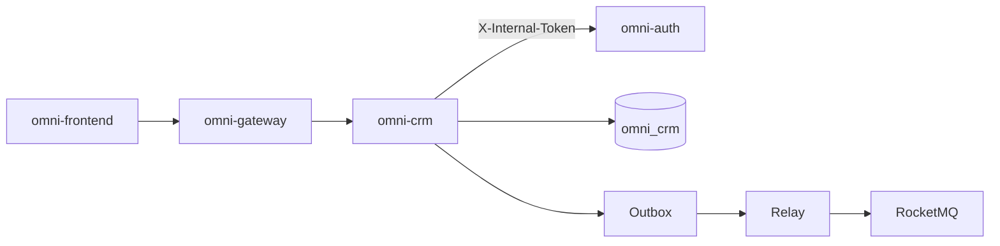
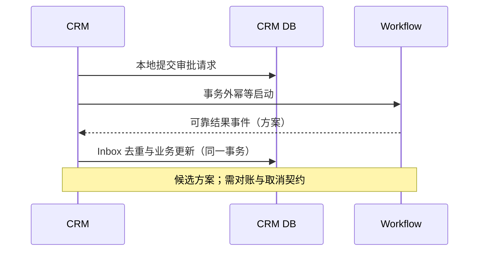

# CRM 设计决策与演进边界

> 本页维护 CRM 的设计取舍、实现范围与演进前提。当前状态机、字段、接口和失败行为由 [CRM 事实](../crm.md)、[API 契约](../api-contract.md)与源码维护；操作与截图由 [CRM Wiki](../guides/crm-flow.md)维护。
> 原设计日期字段为 2026-07-12，不据此推定当日实现或验收状态。此前完整设计文本保留在 Git 的 `3ef2fbc:docs/design/crm-design.md`；旧阶段结论不能替代当前证据。四语验收遵循[授权 AI_REVIEW](../adr/0003-authorized-ai-translation-review.md)，无需人工翻译复核。

## 1. 设计结论

选择独立 Servlet 服务 `omni-crm`，使售前数据、业务命令和部署边界有明确所有者。Auth 管理身份与授权，Base 提供公共能力，Workflow 拥有流程引擎；CRM 不跨库读 Auth，也不把 Flowable 嵌入自身。

| 决策领域 | 已有结构与当前入口 | 后续边界 |
|---|---|---|
| 服务与存储 | CRM 独立模块、业务库、Gateway 路由与前端页面，详见 [CRM](../crm.md) | 模块存在不等于真实业务验收全部通过 |
| 身份与范围 | common-service 预认证、permission-aware 范围和领域表策略 | 保留可信网络假设和实际签名覆盖限制 |
| 隐私与事件 | 后端 PII 视图、操作日志配置、领域 Outbox | 掩码、审计与送达分别验证 |
| 审批与提醒 | 下面的 Phase 2/3 候选方案 | 不作为当前已部署功能 |

设计前提是租户隔离、显式授权、缺上下文时拒绝访问，以及同步领域不变量。旧文档中“先补 Auth/脱敏/迁移/测试”的前置项已有对应实现，不能继续写成平台完全缺失，也不能据此宣称所有安全场景已验收。

## 2. 产品范围

### 2.1 用户与目标

面向销售人员、销售经理、租户 CRM 管理员与只读观察者，围绕线索、客户、联系人、商机、活动和看板组织工作。角色名称是授权配置示例，实际能力由租户内权限、数据范围和 PII 权限决定。

售前闭环回答线索进展、到期跟进、客户关联、阶段与漏斗，以及关键命令的历史。产品、报价、合同、订单、发票、回款、营销自动化和客服工单不应因共享 UI 而变成 CRM MVP 的隐含职责。

### 2.2 分期

| 层次 | 设计范围 |
|---|---|
| 当前 MVP | 线索/客户/联系人/商机/活动、分配与转移、转换、阶段、基础看板、重复候选；准确入口以事实文档为准 |
| Phase 2 候选 | 公海池、标签、导入导出、合并、提醒、共享、阶段管理、自定义字段、字段加密 |
| Phase 3 候选 | 产品/价目表、报价、合同、折扣审批、回款计划、销售预测；先评估独立 sales 领域 |
| 独立领域 | 营销培育、客服 SLA、财务核销，与 CRM 通过明确契约协作 |

分期表达依赖和边界，不是实施完成记录。当前管道/阶段只有读取 API；开放管理需另定既有商机迁移策略。

## 3. 系统边界



图是职责关系，不表示启动顺序、容器端口或完整调用链。部署端口、profiles、Nacos、Redis 和执行器设置由[部署说明](../docker-deployment.md)管理。

CRM 是业务写入方；Auth 提供用户/组织/权限范围，Base 汇聚通用日志，RocketMQ 运输事件，XXL-JOB 触发后台任务，Redis 缓存 XSS 等设置。DB 中的业务事实不以缓存或调度中心记录替代。MVP 不以 Workflow 为启动依赖。

依赖组合包含 common-service 与按需的 OperLog/Job/MQ 能力；完整模块依赖见[架构](../architecture.md)，不另维护一份漂移的 POM 清单。

## 4. 领域与数据设计

### 4.1 聚合

以 Lead、Customer/Contact、Opportunity、Activity、Pipeline 划分业务责任。转换、阶段变化和 owner 变化保留独立记录，用于命令追溯与关联，而不是独立绕开根对象授权的通用资源。

Activity 的 `root_type + root_id` 是多态关联，普通外键不能表达全部业务可见性，Service 需确认目标存在、同租户且可访问。联系人、活动的 owner 快照减少查询时的跨聚合依赖，代价是转移/转换时必须同步维护。

### 4.2 通用字段与规则

租户字段与业务 owner 分开；`create_by` 是用户名审计，不作为 SELF 归属。新增字段需说明它属于当前 owner、历史执行人还是审计人，不因通用 BaseEntity 就假定全部字段自动填充。

金额、币种和日期采用[当前 CRM 规则](../crm.md)与[API 契约](../api-contract.md)。MVP 的单币种约束避免无汇率来源的跨币种求和；号码生成与唯一约束由数据库/服务边界承担，手机号和邮箱只提供重复候选。

普通编辑与状态、owner、stage 命令分离，使版本检查、历史和联动有明确入口。转换唯一键为 `(tenant_id, lead_id)`；不能写成 leadId 跨租户全局唯一。新增关联先决定生命周期、删除和授权继承，再修改表结构。

### 4.3 主要表

当前 `crm_*` 结构在 `database/changelog/crm/` 中拥有唯一 DDL；本页保留设计分类，不重复完整列与索引清单。

| 设计职责 | 当前表 |
|---|---|
| 线索与转换 | `crm_lead`、`crm_lead_conversion` |
| 客户与联系人 | `crm_customer`、`crm_contact` |
| 商机与阶段历史 | `crm_opportunity`、`crm_opportunity_stage_history` |
| 活动与归属历史 | `crm_activity`、`crm_owner_change_log` |
| 管道、阶段、租户设置 | `crm_pipeline`、`crm_pipeline_stage`、`crm_tenant_config` |

这 11 张表均声明 tenant_id；不代表每表都有 owner/version/deleted 的相同组合，也不证明数据库已实际迁移。`crm_approval_request` 与 `crm_inbox_event` 是后续候选，在本次 CRM main/schema/seed 范围中未找到其实现，不能列入当前已落库清单。

## 5. 状态机与核心流程

### 5.1 Lead

生命周期与 owner/公海归属是两个维度。合格、无效、重开与转换走明确命令，避免普通编辑绕过状态校验。完整状态边和当前例外由[CRM 状态机](../crm.md)维护；公海池另需认领/回收及竞争策略。

### 5.2 Customer

客户活跃状态、黑名单与所有者转移影响不同不变量。黑名单进入/恢复使用专门权限与命令，不能以普通 update/status 替代。联系人与活动的归属联动、开放商机是否级联必须明示，不能由 UI 隐式决定。

### 5.3 Opportunity

阶段是管道业务语义，不能仅修改状态字符串。前进、回退、赢单、输单、重开应同时考虑版本、原因、历史与关联客户行为。当前具体迁移见事实文档；未来开放阶段配置还需定义旧记录概率、终态和统计的迁移。

### 5.4 Activity

计划、完成、取消、重新计划与历史录入应保留实际执行人与访问归属的区别。纯文本内容减少富文本信任面；提醒调度是后续能力，不能从 nextFollowup 字段的存在推定提醒已发送。

### 5.5 Lead 转换

选择 CRM 单库事务处理创建/关联、转换记录、源状态与本地事件，以避免核心对象部分成功。重放仍需请求校验、权限和可见性；当前重放/版本/owner 继承的精确顺序由[CRM 转换流程](../crm.md)维护。

转换路径不调用 Workflow 或直接发送 Broker；这不等于所有 CRM Auth Feign 都在数据库事务外。其他创建、转移与展示增强路径存在各自事务边界，见[核心流程](../core-flows.md)。

## 6. 租户、RBAC 与数据权限

### 6.1 信任链

Gateway 校验 JWT，服务验证已签名的身份断言后建立 Authentication。`X-Gateway-Forwarded:true` 本身不是证明；当前签名覆盖身份/时间，不覆盖全部角色、范围或请求内容。网络隔离与签名分别承担边界，详见[架构](../architecture.md)。

### 6.2 权限树与角色

功能权限、数据范围、PII 展示权分别判断。CRM 的 ALL 仍受当前 tenant 限制；前端菜单和按钮只作呈现，不能替代后端授权。现有角色/完整权限码由事实文档及正式 Auth seed 管理，不在设计页重复另一份清单。

公海池和跨租户管理需要独立设计。`platform:crm:cross-tenant` 是原方案中的候选权限名，不是本页声明已交付的平台接口。默认 USER 的 CRM 访问不得由“登录成功”推导。

### 6.3 Auth 内部数据范围契约

当前 Auth 内部客户端已显式传 tenantId 和完整 permissionCode；角色只按授予目标权限的集合解析。`InternalDataScopeDTO` 包含 securityVersion 指纹，但字段存在不证明缓存、失效传播或请求绑定已全面实现。

显示名称可降级，授权范围不可扩大；当前 403/503 与组织批量增强行为由 [CRM 集成](../crm.md)维护。CRM 不复制 Auth Mapper，也不跨库查询其业务表。

### 6.4 CRM 上下文与 SQL 拦截

复用 common-service 的预认证、身份 Filter、方法 DataScope 与持久化组合；CRM 提供 SecurityConfig、CrmTenantTablePolicy 和实现 DataScopeTablePolicy 的 CrmDataPermissionHandler。其能力不是仍待创建的旧独立配置模板。

现有组合顺序是 `TenantLine → DataPermission → OptimisticLock → Pagination`。范围按端点权限解析并在 finally 恢复/清理，SQL 表策略与根对象检查仍需领域参与。Advisor/Filter 图只说明设计关系，不替代实际代理、异步和集成验证。

### 6.5 写操作行级授权

SELECT 过滤不能独自授权写入。命令先确认可见根记录，再校验状态/关联，执行 tenant/id/version 等适用条件更新并记录关键历史；更新数不匹配按并发契约处理。创建、联动更新与已有记录外部命令的版本要求不能机械等同。

子资源查询需要根关联与自己的权限范围。Customer 360 各块不因客户可见而自动扩大权限；owner 候选也只能缩小在命令允许的范围内。

## 7. API 设计

### 7.1 通用契约

普通业务响应使用 R / PageResult，命令 DTO 表达意图，日期与金额沿用[API 契约](../api-contract.md)。PII 重复检测使用受控请求体与最小候选输出；不能以接口命名证明日志或抓包均无 PII。

### 7.2 端点

当前 overview、pipeline、lead、customer、contact、opportunity、activity 与 owner options 的完整路径和方法由[CRM API 入口](../crm.md)维护。设计新增命令时需决定幂等键、版本、归属、错误和联动，避免复制旧缩写路径作为第二份 API 真相。

### 7.3 端点与 DataScope permission 映射

新增端点把完整业务权限同时用于方法权限与相应 DataScope，按模块契约处理无需用户 scope 的内部/后台入口。写入别人名下还需相应 assign/transfer 权限和目标归属验证；详情、统计、去重候选与 360 分块不能借用更宽的粗粒度资源权限。

## 8. 跨服务一致性

### 8.1 用户与组织

CRM 保留 user/unit ID，Auth 拥有当前身份和主组织。分配时核对同租户与启用状态，展示采用用户/组织各自批量查询，避免逐行远程调用。组织调动不应静默改变已分配业务归属，应由可追溯转移决定。

内部 Token 从私有配置取得，普通身份、内部协议与展示降级边界分开；不能把某个 Compose 前置校验泛化为所有路径相同的 HTTP 错误。

### 8.2 字典

状态机、stageType 和权限语义不由展示字典改变。稳定 code 与内置展示选项降低新租户对 Base 在线的硬依赖；迁入共享字典前需处理租户初始化、旧 code、缓存与降级。

### 8.3 Workflow

审批、合同和客户合并属于后续候选。CRM 本次范围未发现 approval/inbox 实现。对接前需明确租户安全的幂等启动、可靠结果事件、APPROVED/REJECTED/CANCELLED 映射、超时对账和取消/重试语义；不能从现有局部 Workflow 事件推断全部引擎终结均已可靠发布。

以下是未来审批协作方案，不是当前运行回执：



候选 approvalRequest 状态保留 `PENDING_START/RUNNING/APPROVED/REJECTED/CANCELLED/START_FAILED`，businessKey 可按 `crm:{aggregateType}:{tenantId}:{aggregateId}:{approvalRequestId}` 设计。CRM 保持唯一业务写入方；Workflow 不直接改 CRM 数据库。

### 8.4 XXL-JOB

以下仍为候选系统任务，当前 CRM main/schema/seed 扫描未发现这四个 handler：

| 候选 Handler | 候选频率 | 设计职责 |
|---|---|---|
| `crmFollowupReminderHandler` | 每分钟 | 到期跟进提醒事件 |
| `crmLeadSlaHandler` | 每 5 分钟 | 超时未联系线索处理 |
| `crmOpportunityStaleHandler` | 每小时或每天 | 长期无跟进商机识别 |
| `crmApprovalReconcileHandler` | 每 10 分钟 | 未来审批投影对账 |

按记录类别扫描而非每条跟进创建调度任务；实现时定义 tenant 枚举、系统上下文 finally 清理、原子领取、重入和去重。系统任务双注解与运行前提由[调度文档](../scheduling.md)维护。

### 8.5 Outbox 与事件

当前事件信封有顶层 eventId，作为 msgKey 传递，Outbox msgId 另行生成；业务消费者的事件身份不能由运输记录 ID 替代。下面仅是 DTO 字段示例，非已发送事件：

```json
{
  "eventId": "example-event-id",
  "eventType": "crm.lead.converted.v1",
  "occurredAt": "2026-07-12 10:30:00",
  "tenantId": 1,
  "producer": "omni-crm",
  "aggregateType": "LEAD",
  "aggregateId": 1001,
  "aggregateVersion": 4,
  "actorUserId": 12,
  "correlationId": null,
  "causationId": null,
  "payload": {}
}
```

实际事件种类、最小 payload 与可选 correlation/causation 字段是否赋值以生产代码和[CRM 事件事实](../crm.md)为准；created/assigned/converted、owner-changed、stage/won/lost、activity completed 等候选不能自动视为全部已产生。

共享 Relay 已有 PROCESSING 抢占与 120 秒租约，next_retry_time 保存期限；旧“没有 claim/lease”结论失效。终态 CAS 只检查状态，未核对 owner/generation；长发送、租约回收和结果不确定仍需至少一次及消费幂等设计，不能承诺 exactly-once。未来 Inbox 还需 tenant、consumer/eventId 去重、版本乱序和业务提交边界。

## 9. 隐私、操作日志与 XSS

### 9.1 OperLog 前置改造

脱敏器、参数/快照开关、排除字段、事件去重和消费者错误传播已有实现；CRM 若干入口关闭快照并排除姓名等字段。仍需按实际入口审查数据最小化，通用日志不能替代 owner/stage 同步历史。

采集前置错误、responseStatus、截断 JSON 与归档自调用事务等当前限制见[后端规范](../backend-patterns.md)。设计页不再承诺“全部错误不影响业务”或“所有日志可靠保留”。

### 9.2 PII

后端视图按实际接口和权限选择掩码；专用列表与 Customer 360 的策略有区别，完整行为由[CRM PII](../crm.md)维护。UI 遮挡不是访问控制。

重复候选、事件、日志、导出、备份、死信与运维入口都需限定字段和访问。字段加密、可检索 HMAC 与富文本属于需另定密钥/迁移/检索方案的演进选择，不能据现有掩码工具宣称合规认证或所有个人信息不可识别。

### 9.3 XSS

当前由 common-service 提供缓存、Auth 回源和启用基线，Provider/Servlet/Jackson 条件与权威关闭设置均需保留。不能继续要求复制一个已由组合能力提供的 CRM XssConfigProviderImpl。

纯文本与输出编码的设计仍适用；规则过滤、响应安全头与富文本允许列表是不同层次。缓存 miss 不等于关闭，也不证明所有输入取得方式、异步路径和输出都已安全。

## 10. 前端设计

复用统一 API 类型、请求身份/tenant 处理、页面状态与受控命令。Customer 360 分块展示，阶段板只是命令入口，最终授权和状态判断留在后端。

当前目录、组件与动态路由见[CRM 前端事实](../crm.md)及[前端规范](../frontend-patterns.md)。router 保有 CRM 图标映射，layout 使用已解析图标，不再要求复制第二个 iconMap。新文案同步四语言；普通 CRUD 不为共享而强行加入全局 Pinia。

## 11. 工程落点

### 11.1 新模块

CRM 模块、应用入口、Feign/Mapper 扫描和 shared Starter 接入已经存在。新增聚合先明确边界与授权继承，再参照[开发 Wiki](../guides/scaffold-development.md)，不把原“创建模块”步骤当作尚未实施的必做清单。

### 11.2 必改文件

结构由 forward-only Liquibase 变更维护，正式种子与 manifest 同步；权限涉及 Auth seed、前端同码控制及新租户初始化。CrmTenantModuleProvisioner 已把事件租户放入系统身份，调用初始化并 finally 清理。

正式启动使用 compose.yaml / compose.apps.yaml / compose.infra.yaml 与 omni-db-migrator；旧 docker-compose.yml、start 脚本和“12/13 个服务”口径不作为当前入口。配置、镜像与 preset 的联动以[部署](../docker-deployment.md)、[开发指南](../guides/scaffold-development.md)和当前 catalog 为准。

## 12. 非功能设计

### 性能

分页上限、组合索引、用户/组织批量增强和 360 分块限制应在真实数据规模下评估。漏斗汇总表是达到需求阈值后的选择，不由设计目标推定已达成性能指标。

### 并发与幂等

转换唯一约束、行锁、版本条件更新与同步历史分别保护对应不变量。批量命令需明确上限及整体/逐条语义；Outbox、调度领取和消费幂等不是同一个保证。

### 降级

授权依赖失败保持关闭，显示增强可保留 ID；MQ 不可用时的本地提交取决于 Outbox 与业务事务成立，不能据此保证后来一定送达。未来审批需显式待启动/失败/对账状态，XSS 保持当前回源/基线和权威开关语义。

### 可观测性

需要按 tenant、aggregate、event 与 trace 关联范围解析、拒绝/冲突、转换、阶段、Outbox 年龄和任务积压，避免记录完整 PII。仪表盘或运维聚合是否存在、是否当前有数据，要按[可观测性](../observability.md)与实际源验证。

## 13. 测试与验收

当前已有业务与公共测试，旧“没有测试基础”不能作为现状。最低持续验证主题保留：合法/非法状态迁移、转换重放与并发、归属级联、PII/日志、六范围的列表/详情/COUNT/聚合、跨租户命令拒绝、缺上下文、版本竞争、业务/Outbox 事务、未来 Inbox 去重及 XSS。

验收区分构建、隔离单元/MVC、真实 MySQL/MQ、浏览器与负面权限场景。Mock/内存锁不证明实际并发；CRM_TEST_MYSQL_URL 条件测试会创建/删除 crm_lead，只能指向专用可销毁测试库，历史 WP008 IT 也有独立开关与环境。不能把 skip 算作通过。

实现变更按 [AGENTS.md](../../AGENTS.md) 在本机 Docker 使用 JDK 25 与 Maven Wrapper，并验证前端 build/lint；实操步骤归开发 Wiki。本文的文档改动在精确源树核对后复用既有报告，不重跑未变的昂贵验证。翻译通过授权 AI_REVIEW 后还需当前摘要/链接/内容等门禁。

## 14. 实施顺序

以下保留实施依赖的设计意义，不是本次全部业务场景已验收的里程碑回执。

### Milestone 0：平台补强

身份、permission-aware 范围、租户、日志最小化、XSS 与测试基线是业务接入前提；已有机制与剩余限制须分别核验，不能以阶段名表示全部完成。

### Milestone 1：服务与安全底座

模块/路由/迁移/默认配置与角色策略先建立，按当前 shared Starter 顺序验证安全边界；不同租户初始化和访问需要对应证据。

### Milestone 2：Lead + Activity

围绕录入、分配、跟进、判定与活动历史验证一条真实路径；重复候选、拒绝场景与重试同样属于验收。

### Milestone 3：Customer + Contact + Conversion

验证新建/关联、主要联系人、转换重放和客户转移的业务不变量，分清单元证据与真实数据库并发。

### Milestone 4：Opportunity + Pipeline

阶段、原因、终态/重开、历史和关联客户形成命令闭环；当前只读阶段配置不等于阶段管理已交付。

### Milestone 5：Overview + 生产加固

看板、隐私、审计、索引和真实业务验证收尾。Phase 2/3 需在各自契约与依赖具备后独立实施；本页不把未来候选加入当前已完成功能。

## 15. ADR 摘要

| 取舍 | 理由与代价 |
|---|---|
| 独立服务、普通 API 租户内、显式权限 | 清晰所有权；需要维护跨服务身份和失败边界 |
| owner 快照与受控命令 | 查询范围直接；转移/转换需同步联动与历史 |
| 单库转换加 Outbox | 本地核心一致性；送达与消费幂等仍需独立处理 |
| 后端 PII、纯文本、最小事件 | 减少暴露；规则不能替代所有输出/日志验证 |
| 审批/提醒/销售域分期 | 先形成明确契约；候选不算当前可用能力 |
| 事实/设计/Wiki 分工 | 当前规则只维护一处；设计解释取舍，教程提供复现 |

## 16. 主要风险

| 风险 | 设计应对与证据边界 |
|---|---|
| 身份或范围被扩大 | 验证真实可信链、租户与 permission；保留签名覆盖限制 |
| 写入或子资源绕过根可见性 | AccessGuard、适用条件更新与分块权限，不能只看 SELECT 拦截 |
| PII 经日志、事件、导出流出 | 按入口最小化并检查实际输出；通用规则不作全面保证 |
| 租约过期或结果不确定引发重复 | 识别当前状态 CAS 的边界，消费幂等与恢复先核对副作用 |
| 后续审批/提醒被误认已实现 | 明示候选、契约、状态与实际部署证据 |
| 旧图、命令、阶段记录冒充现状 | 当前源与具名证据优先，历史文本由 Git 保存 |

设计页通过语义复核不代表真实 CRM 端到端、所有租户或全部外部依赖已验收；方案实现与业务验收仍需对应版本、实际场景和验证证据。
