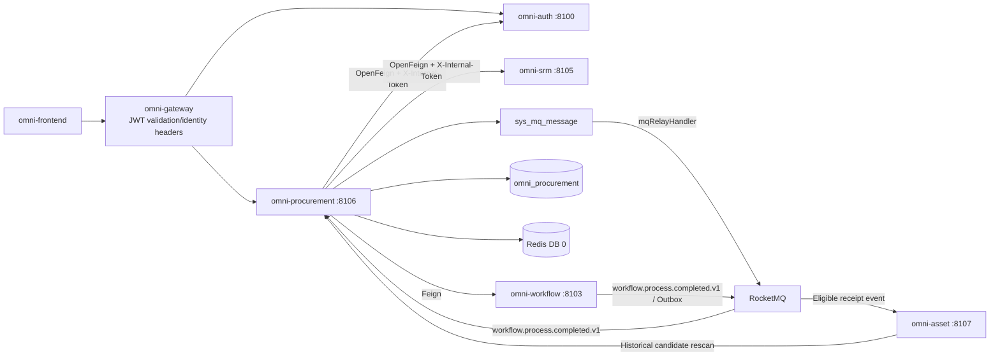
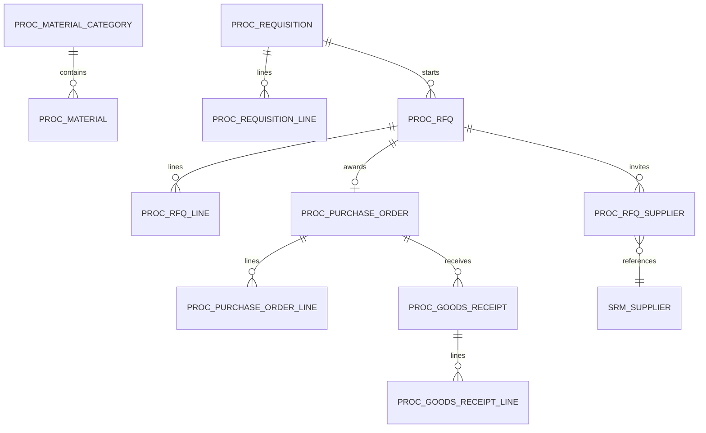
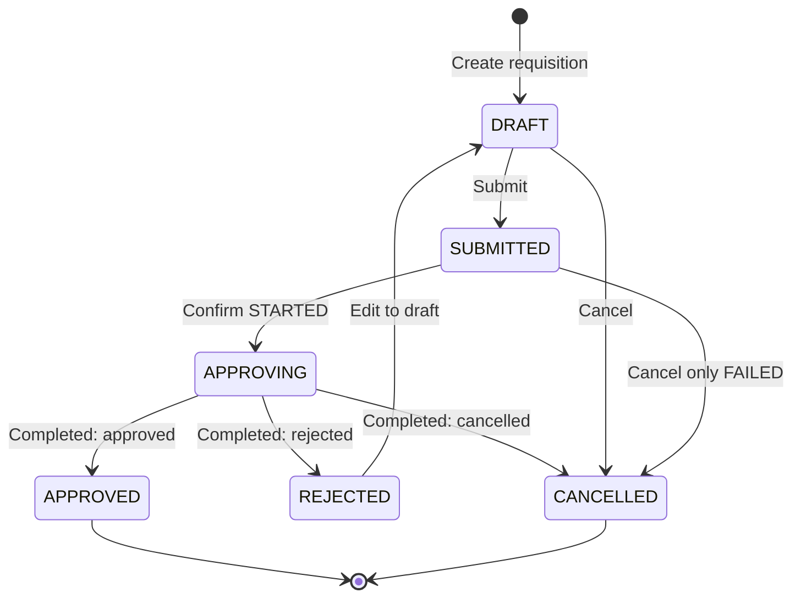
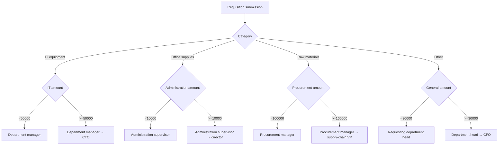
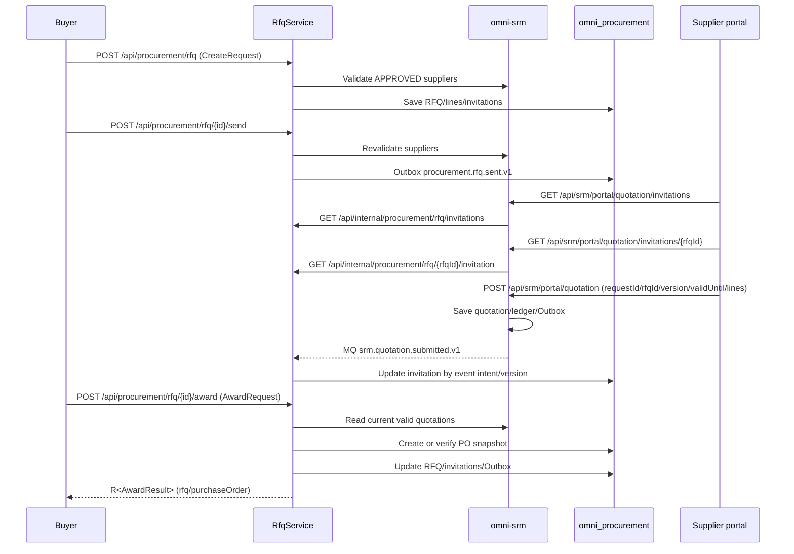
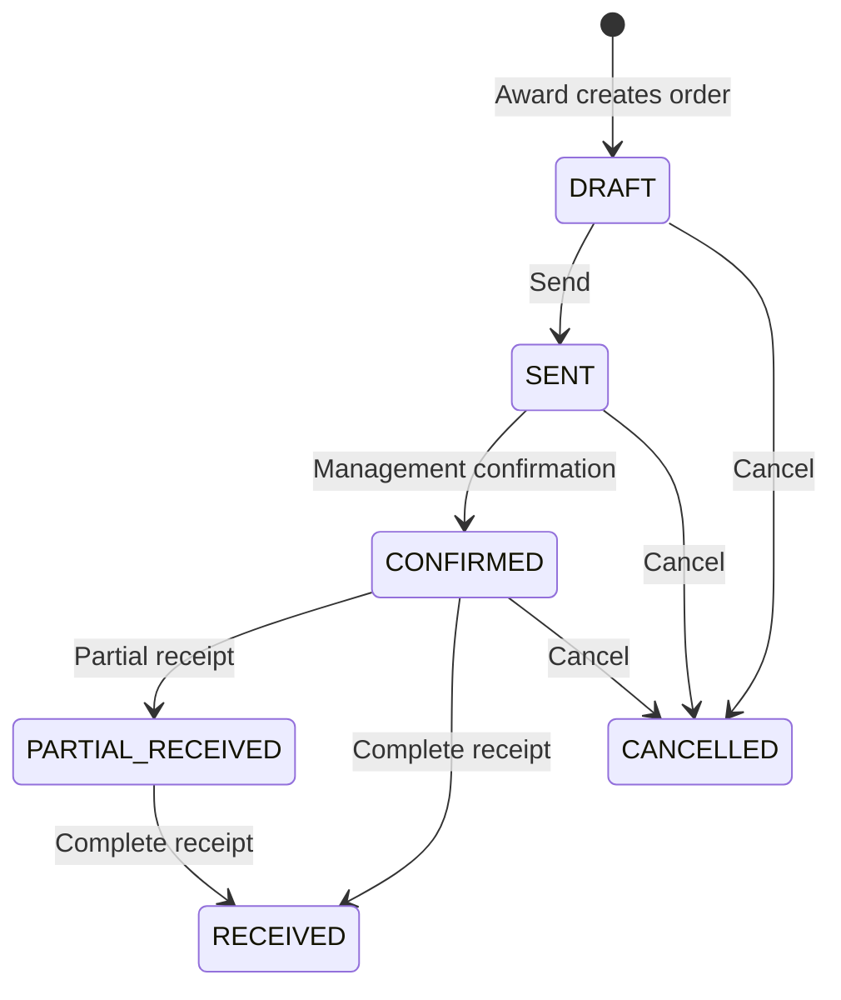
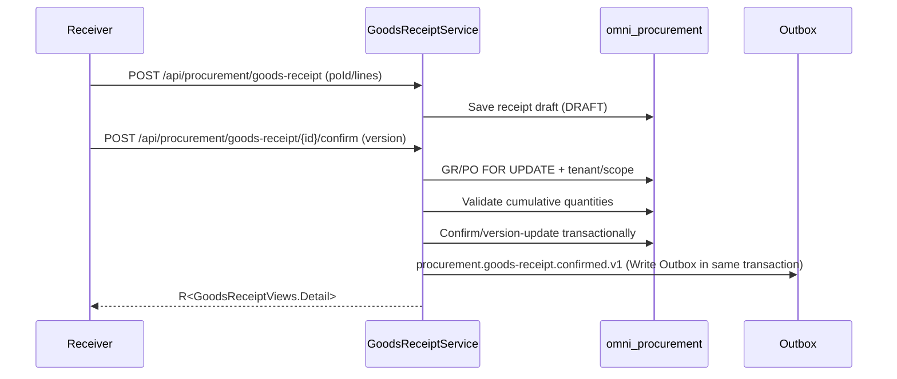

# Procurement Execution Module Architecture and Implementation Baseline

> The original design date, phases and important decisions of 2026-07-27 are retained alongside current source constraints; Chinese is the factual source. Historical acceptance does not establish current runtime behavior or release eligibility. Authorized AI_REVIEW and HUMAN_REVIEW are recorded separately; see [ADR 0003](../adr/0003-authorized-ai-translation-review.md).

> Original recorded status (2026-07-27): MVP implemented and verified
> Project: Omni-Stack
> Date: 2026-07-27
> Goal: Describe the architecture, cross-service contracts, and implementation boundaries of the omni-procurement MVP; the implementation entry points are `omni-backend/omni-procurement` and `omni-frontend/src/views/procurement`.

Design basis: `README.md`, and all topic documents in `docs/` — architecture, api-contract, backend-patterns, frontend-patterns, core-flows, scheduling, workflow, mq-reliability, docker-deployment; also references the SRM supplier model in `docs/design/srm-design.md`.

Accounts, operations and screenshots are in the [Procurement Wiki](../guides/procurement-flow.en.md); extension and Docker-tool entry points are in the [development Wiki](../guides/scaffold-development.en.md). Use the [source index](../reference/source-map.en.md) for current files.

[中文](procurement-design.md) · [English](procurement-design.en.md) · [日本語](procurement-design.jp.md) · [한국어](procurement-design.kr.md)

## 1. Design Conclusion

Procurement execution should be built as an independent Servlet microservice, separated from supplier management (`omni-srm`) and asset management (`omni-asset`). SRM is the foundation; Procurement depends on SRM's supplier data, and Asset depends on Procurement's procurement-source data.

| Item | Decision |
|---|---|
| Maven module / service name | `omni-procurement` |
| Local port / management port | `8106` / `19906` |
| XXL-JOB executor | `omni-procurement` / `9906` (when scheduled reminders are enabled) |
| Database | `omni_procurement` |
| Gateway | `/api/procurement/**` → `lb://omni-procurement`, without `StripPrefix` |
| Redis | DB 0, shared Auth XSS cache keys; no established proc: business-cache prefix |
| Frontend | Continue to use `omni-frontend`, add `views/procurement/**` |

The Procurement MVP covers the procurement-execution closed loop:

> Material catalog → requisition → approval → RFQ/price comparison → award → purchase order → goods-receipt confirmation.

Three-way matching (PO + goods receipt + invoice) and payment are not included in the MVP; they are left to the ERP or finance system. Contract management is introduced in Phase 2.

## 2. Product Scope

### 2.1 Users and Goals

| User | Core need |
|---|---|
| Requesting-department employee | Submit purchase requests, track requisition progress |
| Procurement staff | Manage RFQs, price comparison, ordering, and track order progress |
| Procurement manager | Approve requisitions, manage the procurement process, view procurement statistics |
| Department manager/executive | Approve requisitions (by amount threshold), view procurement spend |
| Supplier | View RFQs and submit quotations through the portal (reusing the SRM portal) |

The MVP should be able to answer: how many requisitions await approval; what step a given requisition's approval has reached; which RFQs are waiting for supplier quotations; the goods-receipt status of a given purchase order; procurement-spend statistics by category/supplier/department.

### 2.2 Phasing

| Phase | Capability |
|---|---|
| MVP | Material catalog, requisition, approval flow (category + amount multi-dimensional branching), RFQ/price comparison, purchase order, goods-receipt confirmation, procurement overview |
| Phase 2 | Contract management, reverse auction, procurement templates, framework agreements, three-way matching, supplier-performance linkage |
| Phase 3 | Procurement analytics (price trends, supplier concentration), budget control, automatic replenishment suggestions |

## 3. System Boundaries

| Component | Authoritative responsibility | How Procurement uses it |
|---|---|---|
| `omni-auth` | Tenant, user, organization, role, permission, data scope, XSS configuration | Internal OpenFeign; stores only user/organization IDs |
| `omni-srm` | Supplier data (admission, grading, risk) | Internal OpenFeign to query suppliers; supplier portal quotations go through the SRM service |
| `omni-base` | Dictionary, operation logs | Operation log aggregation |
| `omni-workflow` | BPMN, instances, approvals and the sole Flowable runtime | Model queries/previews, idempotent start, task-assignment validation and completion events; no Procurement-driven termination capability |
| `omni-procurement` | Material, requisition, RFQ, purchase order, goods receipt | The sole business writer |
| `omni-asset` | Asset management | After goods-receipt acceptance passes, creates asset cards through Outbox events and controlled historical compensation |
| XXL-JOB | Triggers batch scans | Order-overdue reminders (Phase 2) |
| RocketMQ | Asynchronous transport | At-least-once; consumers must be idempotent |



Current base dependencies: `omni-common-core`, `omni-common`, `omni-common-mybatis`, `omni-common-redis`, `omni-common-operlog`, `omni-common-job`, `omni-common-mqlog`, `omni-common-service`; also Web, Validation, Security, AspectJ, OpenFeign, LoadBalancer, Nacos, RocketMQ Stream, Actuator and Lombok.

**Procurement does not depend on `omni-common-workflow` and does not embed Flowable in this service.** `omni-workflow` is an independent microservice and the sole Flowable runtime; Procurement initiates flows through an internal Feign contract and receives approval results through reliable domain events. Cross-service DTOs should live in a pure contract module or be defined locally by the Feign client, and must not introduce the Flowable Starter because of this.

## 4. Domain and Data Design

### 4.1 Aggregates

| Aggregate | Tables | Responsibility |
|---|---|---|
| ProcurementConfig | `proc_tenant_config`, `proc_approval_route` | Tenant currency and category/amount approval-model routing |
| Material | `proc_material_category`, `proc_material` | Material category tree, material catalog |
| Requisition | `proc_requisition`, `proc_requisition_line` | Requisition, detail lines; approval tasks and records are authoritatively managed by omni-workflow |
| RFQ | `proc_rfq`, `proc_rfq_line`, `proc_rfq_supplier` | RFQ, detail lines, invited suppliers |
| PurchaseOrder | `proc_purchase_order`, `proc_purchase_order_line` | Purchase order, detail lines |
| GoodsReceipt | `proc_goods_receipt`, `proc_goods_receipt_line` | Goods receipt, detail lines |
| Inbox | `proc_event_inbox` | Tenant-local Workflow/quotation event idempotency and original intent |



### 4.2 Common Fields and Rules

Every `proc_*` table retains tenant_id. Business roots use version/deleted and audit fields. Scope columns depend on the aggregate: Requisition uses requester_user_id/requester_unit_id; RFQ, PurchaseOrder and GoodsReceipt use owner_user_id/owner_unit_id. Children inherit through parents; Material/Category, approval routes and tenant configuration are tenant-shared, so owner predicates cannot be appended to every table.

- Requisition creation takes requester/primary unit from the effective scope and stores the same initial owner; authorization still uses requester columns.
- RFQ takes the current scope owner, PO inherits RFQ ownership, and GR belongs to the current receiver/primary unit. Never infer ownership from a supplier portal account or consumer thread.
- Numbers come from database IDs; material codes and business numbers are tenant-unique. supplier_id is a logical SRM reference without cross-database foreign keys.
- Quantities/prices use DECIMAL(19,6), line/total amounts DECIMAL(19,4), and HTTP JSON decimal strings, never JavaScript number money arithmetic. Requisition estimated price may be zero; quotation/order prices are positive.
- Date-times use yyyy-MM-dd HH:mm:ss; expected/actual delivery dates are LocalDate fields and follow their DTO contract.
- Ordinary PUT does not change lifecycle, approval state or owner. Existing business changes require authorization, state/version and affected-row checks; tenant-shared configuration, number completion and ledgers are not one uniform command.

### 4.3 Main Tables

`proc_tenant_config`

- `tenant_id/currency_code/initialized_time/version` and audit fields, unique within the tenant.

`proc_approval_route`

- `route_code/category_code/min_amount/max_amount/model_version_id/priority/status/version/deleted` and audit fields.
- An exact category takes precedence over the `category_code='*'` default route; the interval semantics are `min_amount <= total_amount < max_amount`, with an empty max meaning no upper limit.
- Active amount intervals of the same category must not overlap; when a requisition submission matches zero or multiple routes, return 409, and the client must not pass modelVersionId.

`proc_material_category`

- `tenant_id/parent_id/category_code/category_name/sort/status/version/deleted` and audit fields.
- Supports an arbitrary-level category tree (parent_id of 0 means a top-level category); a material can only be associated with a leaf category.
- The MVP provides category-tree management on the material-catalog page; `category_code` cannot be modified after creation, and updates and deletes must carry `version` and perform a conditional update.

`proc_material`

- `tenant_id/category_id/material_code/material_name/specification/unit/asset_managed/status/version/deleted`.
- `specification` is a text description (the MVP does not do structured specification parameters).
- `unit` is a normalized uppercase unit of measure (e.g., EA, PCS, UNIT, SET, KG).
- `asset_managed` indicates whether, after qualified goods receipt, it enters Asset as "one asset card per unit"; only `EA/PCS/UNIT/SET` can be enabled, and consumables, services, and continuous-measure materials such as KG must be false.
- Indexes: tenant + category_id/status, tenant + material_code (unique).

`proc_requisition`

- `requisition_no/title/requester_user_id/requester_unit_id/reason/primary_category_code/total_amount/currency_code`.
- `status`: DRAFT/SUBMITTED/APPROVING/APPROVED/REJECTED/CANCELLED.
- `approval_attempt/workflow_request_id/workflow_business_key/workflow_model_version_id/process_instance_id`: the current approval round and the Workflow idempotency snapshot; businessKey is fixed to `{requisitionId}:{approvalAttempt}`.
- `workflow_start_status`: NOT_STARTED/PENDING/FAILED/STARTED; separated from the business status; on failure, the business status is still SUBMITTED.
- `approved_time/workflow_completed_time`: the approval-completion time snapshot; approval comments still take Workflow as authoritative, and Procurement does not copy or forge the final comment.
- `owner_user_id/owner_unit_id/version/deleted` and audit fields.

`proc_requisition_line`

- `line_no/requisition_id/material_id/material_code/material_name/category_code/unit/quantity/estimated_unit_price/estimated_total_price/remark`; the material code, name, category, and unit are all snapshots at submission time.
- The requisition total amount = SUM(line.estimated_total_price).
- The MVP enforces that all lines of one requisition belong to the same category; cross-category needs are split into multiple requisitions, avoiding uncertain single-value approval-routing semantics.

`proc_rfq`

- `rfq_no/requisition_id/title/quotation_deadline/currency_code/status/sent_time/owner_user_id/owner_unit_id/version/deleted`.
- `status`: DRAFT/SENT/CLOSED/AWARDED/CANCELLED.
- `awarded_supplier_id/awarded_quotation_id/awarded_quotation_version/awarded_time`: the award and quotation-version snapshot.
- References a visible APPROVED requisition and copies all its lines. Multiple RFQs may reference one requisition; current creation does not split selected lines or categories.

`proc_rfq_line`

- `rfq_id/line_no/material_id/material_code/material_name/category_code/unit/quantity/remark/version/deleted`, all snapshots of the requisition lines.

`proc_rfq_supplier`

- `rfq_id/supplier_id/supplier_name_snapshot/invited_time/quotation_id/quotation_version/quotation_request_id/quotation_time/status/version/deleted`.
- `status`: INVITED/QUOTED/EXPIRED/AWARDED/REJECTED. `AWARDED/REJECTED` are read-only historical terminal states after the award and cannot continue quoting.
- New quotation writes require RFQ status=SENT, invitation status IN (INVITED, QUOTED) and a deadline strictly after now. Successful historical replay has the separately documented SRM validation order.
- `quotation_id` logically associates SRM's `srm_quotation` (no cross-database foreign key); `supplier_name_snapshot` is only for historical display and is not a basis for the current supplier status or permission.

`proc_purchase_order`

- `po_no/rfq_id/supplier_id/quotation_id/quotation_version/title/total_amount/currency_code`.
- The winning quotation's supplier name, per-line unit prices, delivery dates, etc. are copied directly to the PO/PO Line to form an immutable business snapshot; quotation_id/version are only for traceability.
- `status`: DRAFT/SENT/CONFIRMED/PARTIAL_RECEIVED/RECEIVED/CLOSED/CANCELLED.
- `order_time/expected_delivery_date/actual_delivery_date`.
- `delivery_address/contact_name/contact_phone`.
- `owner_user_id/owner_unit_id/version/deleted` and audit fields.

`proc_purchase_order_line`

- `po_id/material_id/material_name/unit/quantity/unit_price/total_price/remark`.

`proc_goods_receipt`

- `gr_no/po_id/receiver_user_id/receive_time/remark/status/owner_user_id/owner_unit_id/version/deleted`.
- `status`: DRAFT/CONFIRMED.
- After confirmation, an Outbox event is triggered to notify Asset to create asset cards.

`proc_goods_receipt_line`

- `goods_receipt_id/po_line_id/material_id/material_name/unit/ordered_quantity/received_quantity/quality_status/remark`.
- `quality_status`: PASS/FAIL/PENDING.
- The received quantity may be less than or equal to the ordered quantity (partial goods receipt).

## 5. State Machine and Core Flows

### 5.1 Requisition



Submission first recomputes material/category/amount facts and resolves the approval route in a separate local transaction, commits SUBMITTED/PENDING and Outbox, then calls Workflow. Only a confirmed start advances APPROVING. Procurement cancel accepts SUBMITTED only with workflow_start_status=FAILED; APPROVING→CANCELLED comes from a matching Workflow completion and is not a Procurement termination command.

### 5.2 Approval Flow Design (integrated with omni-workflow)

The following category/amount branches preserve the original design example. They do not prove these BPMNs, roles or thresholds are deployed for every current tenant. Current submission selects a published model through server-side rules, then runs that model.



Implementation:
- In `omni-workflow`, create one BPMN process model per category (e.g., `procurement_approval_it`, `procurement_approval_office`, etc.).
- Or use one generic BPMN, routing through two-level nesting of Exclusive Gateways (category → amount).
- When the requisition is submitted, the Procurement service selects a published modelVersionId from `proc_approval_route` based on the requisition's unique category and the server-recomputed total amount, and starts the flow through the Workflow internal API; the client cannot specify the model version.
- Approvers are dynamically resolved by Flowable's `ScopedRoleAssignmentListener` (using the existing organization structure + role system).

Cross-service startup must be retryable: each time it is submitted from DRAFT, first increment `approvalAttempt + 1`, generate and persist the requestId and `businessKey={requisitionId}:{approvalAttempt}`; Procurement uses `tenantId + businessType(PROCUREMENT_REQUISITION) + businessKey` as the idempotency key for the current round. First update to `status=SUBMITTED, workflow_start_status=PENDING` in a local transaction, then call Workflow after the transaction commits; on success, write the processInstanceId, set workflow_start_status=STARTED, and advance to APPROVING. A lost response or failed call attempts FAILED marking; reload actual state before retry; a retry must reuse the saved requestId/businessKey/modelVersionId and must not increment the attempt. After a REJECTED modification succeeds, it returns to DRAFT, and only resubmission opens a new attempt, avoiding the Workflow permanent-business-key unique constraint replaying an old flow.

**MVP constraint**: a single requisition allows only one category; approval routing supports an exact category and a `*` default route, and the BPMN can branch by amount. When cross-category requisitions are needed later, define an explicit primary-category or multi-flow strategy; the current version is forbidden from implicitly taking the first line.

Material/model/route failure before prepareSubmit commits rolls back and does not imply SUBMITTED/FAILED. After that commit, uncertain start calls/responses attempt REQUIRES_NEW FAILED marking, which can itself fail or match no row; reload real state/version. FAILED does not prove no remote process exists. retry-start reuses the persisted request/model/amount/requester/attempt only for SUBMITTED/FAILED, without reevaluating routing.

### 5.2.1 Requisition Approval Rule Management

The management UI centers on the business name, applicable category, amount range, and flow name, and does not require business staff to enter technical codes, model version IDs,
or priority. `route_code` is generated by the server as `APR-{ULID}` and shown read-only only under advanced information; `route_name` is a required business name.
The bindable flow is fixed to the currently published version of Workflow `category=purchase`, while running instances continue to use
`businessType=PROCUREMENT_REQUISITION`; the two identifiers must not be mixed.

The list deduplicates `modelVersionId` for the current page, then uses a batch internal interface of no more than 200 items to supplement flow metadata; per-row calls are forbidden.
When Workflow is unavailable, the read-only list keeps the local rules and marks `UNAVAILABLE`; create, update, and requisition submission still fail closed.
The match test calls the same `ApprovalRouteResolver.evaluate` as requisition submission, explicitly returning a unique hit, no match, and multiple matches from historical dirty data.
Coverage analysis splits each valid category into half-open intervals from 0 to infinity, applying exact rules first, then filling gaps with the default rule;
before disabling and deleting, it excludes the target rule in memory and reuses the same algorithm to generate an impact hint.

### 5.3 RFQ/Price Comparison



Price-comparison method: the MVP provides a simple comparison view — listing the valid quotations (unit price, total price, delivery days) of invited suppliers through `GET /api/internal/quotation/batch`, and the procurement staff manually selects the awarded supplier. No automatic bid-evaluation algorithm is done. The award transaction must save the quotationId, quotation version, and an immutable amount/delivery snapshot; subsequent SRM quotation changes must not alter the existing award and purchase order.

Award uses RfqRequests.AwardRequest: rfqVersion, quotationId, quotationVersion, title, optional expectedDeliveryDate, and deliveryAddress/contactName/contactPhone. supplierId comes from the selected valid quotation; a supplier ID alone cannot award. `R<AwardResult>` contains rfq and purchaseOrder.

### 5.4 Purchase Order



Orders are created only by RFQ award. Confirmation is a management-permission and row-scope-protected command, not a separate supplier-portal API. DRAFT/SENT/CONFIRMED cancellation checks cancel permission, state and version without additional Workflow approval. CLOSED exists as a value, but the current Controller has no close command. A first complete receipt may go directly from CONFIRMED to RECEIVED.

### 5.5 Goods Receipt



Creating a DRAFT does not occupy the order's received quantity and does not send an event. On confirmation, the PO must be locked and re-validated cumulatively based on all CONFIRMED goods-receipt lines, preventing over-receipt caused by concurrent confirmation of multiple drafts. After a successful confirmation, the Outbox event `procurement.goods-receipt.confirmed.v1` is written; when Asset is not yet built, Procurement is not blocked, but it must not be assumed that historical events stay in the Outbox/Broker indefinitely — when Asset goes live, it must perform the historical-compensation rescan defined below.

Only goods-receipt lines with `quality_status=PASS`, `asset_managed=true`, and a positive-integer receivedQuantity can be assetized. PENDING/FAIL lines, consumables, services, and continuous-measure materials do not create assets. When a PENDING line later becomes PASS through `POST /goods-receipt/{id}/quality-result`, Procurement publishes `procurement.goods-receipt.quality-passed.v1`, carrying only the lines newly passed this time; modifying or reusing an already-sent confirmed event is forbidden.

Quality entry accepts only PENDING lines on CONFIRMED receipts becoming PASS/FAIL. quality-passed carries only newly passing asset-eligible lines. Repeating a terminal result conflicts rather than succeeding as replay. confirmed contains only its asset candidates and may have no lines. Cumulative totals include all tenant-local confirmed receipts; the dedicated query ignores receiver-owner scope to avoid omissions. Receipt/PO use actual FOR UPDATE and version updates; the line query itself has no FOR UPDATE.

## 6. Tenant, RBAC, and Data Permissions

### 6.1 Trust Chain

Consistent with SRM: Gateway JWT → `GatewayPreAuthenticationFilter` → `ServiceIdentityFilter` (Tenant/user identity validation) → `@PreAuthorize` → `@ServiceDataScope` → MyBatis DataPermission → `ProcRecordAccessGuard`.

### 6.2 Permission Tree and Roles

Menus: `procurement` (DIRECTORY) and `procurement:overview`, `procurement:material`, `procurement:approval-route`, `procurement:requisition`, `procurement:rfq`, `procurement:purchase-order`, `procurement:goods-receipt` (MENU). Only seed MENU for pages already delivered, to avoid dead links in the dynamic sidebar.

API permissions:

- `procurement:overview:list`
- `procurement:material:list/create/update/delete`
- `procurement:approval-route:list/create/update/delete`
- `procurement:requisition:list/create/update/delete/submit/approve/cancel`
- `procurement:rfq:list/create/update/delete/send/award/cancel`
- `procurement:purchase-order:list/update/delete/send/confirm/cancel` (a purchase order is generated only by an RFQ award)
- `procurement:goods-receipt:list/create/confirm`

| Role | dataScope | Capability |
|---|---|---|
| `PROCUREMENT_MANAGER` | DEPT_AND_BELOW | Department and below, approval, statistics |
| `PROCUREMENT_STAFF` | SELF | Requisitions, RFQs, and orders they own, and the SELF-scope overview |
| `EMPLOYEE` | SELF | Submit and view their own requisitions |
| `TEAM_LEADER` | DEPT | Approvals assigned to them by Workflow and the department approval business view |
| `DEPT_LEADER` | DEPT_AND_BELOW | Approvals assigned to them by Workflow and the department-tree approval business view |
| `SUPER_ADMIN` | ALL | All functions; procurement data is still limited to the current tenant |

The default USER is not granted procurement permissions.

### 6.3 Procurement Context and SQL Interception

The common request identity, DataScope context, and aspect are provided by `omni-common-service`: `ServiceIdentityContext`, `ServiceDataScopeContext`, `@ServiceDataScope`, and `ServicePersistenceAutoConfiguration`. The procurement module keeps only the domain differences: `ProcTenantTablePolicy`, `ProcDataPermissionHandler`, and `ProcRecordAccessGuard`.

The interceptor order is fixed: `TenantLineInnerInterceptor → DataPermissionInterceptor → OptimisticLockerInnerInterceptor → PaginationInnerInterceptor`. `ProcTenantTablePolicy` enables TenantLine only on `proc_*` tables; `sys_mq_message` must be excluded to ensure the cross-tenant Outbox Relay can scan pending messages. The data-permission mapping of domain tables is still defined by `ProcDataPermissionHandler` per the table below.

| dataScope | Condition |
|---|---|
| SELF | `requester_user_id = currentUserId` or `owner_user_id = currentUserId` |
| DEPT | `requester_unit_id = primaryUnitId` |
| DEPT_AND_BELOW / CUSTOM | `requester_unit_id IN accessibleUnitIds` |
| TENANT / ALL | No owner condition added; TenantLine is always retained |

The table above only describes scope semantics; the actual SQL must be mapped per table, and mechanically appending `requester_user_id OR owner_user_id` to all `proc_*` tables is forbidden:

| Resource/table | SELF column | DEPT/CUSTOM column | Sub-resource constraint |
|---|---|---|---|
| Requisition | `requester_user_id` | `requester_unit_id` | Line inherits through the requisition_id of the same tenant |
| RFQ | `owner_user_id` | `owner_unit_id` | Line/Supplier inherit through the rfq_id of the same tenant |
| PurchaseOrder | `owner_user_id` | `owner_unit_id` | Line inherits through the po_id of the same tenant |
| GoodsReceipt | `owner_user_id` (goods-receipt owner) | `owner_unit_id` | Line inherits through the goods_receipt_id of the same tenant |
| Material/Category | No SELF private semantics | Controlled by functional permission, shared within the tenant | TenantLine is always retained |
| Overview | Mapped by the current permissionCode to the corresponding business table's owner/requester column | Same as left | Aggregate SQL must apply the same scope as the list |

### 6.4 Approval Flow Permissions

Workflow owns task completion. Dedicated approval-view requires procurement:requisition:approve, tenant-local APPROVING/STARTED identity, a complete saved businessKey (requisitionId:attempt) and processInstanceId. Workflow validates current user, taskId, businessType and full key, and the returned instance must match. The service temporarily reads the readonly VO with TENANT scope, restoring the previous scope in finally. Ordinary details retain requester scope; this exception cannot be reused. Completing a task also requires workflow:approval:complete and actual task eligibility.

## 7. API Design

### 7.1 Common Contract

Consistent with SRM: `R<T>`, `R<PageResult<T>>`, `page=1`, `size=10`, `size <= 100`.

### 7.2 Endpoints

The real Controllers define 50 external method/path combinations, relative to /api/procurement with complete paths, plus three internal readonly paths. approval-view requires taskId query input; version/delete parameters follow their DTO/query contracts.

| Controller | Methods and paths |
|---|---|
| Approval rules (ApprovalRouteController) | `GET /approval-route/list` · `GET /approval-route/workflow-options` · `POST /approval-route/match-preview` · `GET /approval-route/coverage` · `GET /approval-route/impact` · `POST /approval-route` · `PUT /approval-route/{id}` · `DELETE /approval-route/{id}` |
| Goods receipt (GoodsReceiptController) | `GET /goods-receipt/list` · `GET /goods-receipt/{id}` · `POST /goods-receipt` · `POST /goods-receipt/{id}/confirm` · `POST /goods-receipt/{id}/quality-result` |
| Materials/categories (MaterialController) | `GET /material/category/list` · `POST /material/category` · `PUT /material/category/{id}` · `DELETE /material/category/{id}` · `GET /material/list` · `GET /material/{id}` · `POST /material` · `PUT /material/{id}` · `DELETE /material/{id}` |
| Overview (OverviewController) | `GET /overview/summary` · `GET /overview/spend-analysis` |
| Purchase orders (PurchaseOrderController) | `GET /purchase-order/list` · `GET /purchase-order/{id}` · `PUT /purchase-order/{id}` · `DELETE /purchase-order/{id}` · `POST /purchase-order/{id}/send` · `POST /purchase-order/{id}/confirm` · `POST /purchase-order/{id}/cancel` |
| Requisitions (RequisitionController) | `GET /requisition/list` · `GET /requisition/{id}` · `GET /requisition/{id}/approval-view` · `POST /requisition` · `PUT /requisition/{id}` · `DELETE /requisition/{id}` · `POST /requisition/{id}/submit` · `POST /requisition/{id}/retry-start` · `POST /requisition/{id}/cancel` |
| RFQs (RfqController) | `GET /rfq/supplier-options` · `GET /rfq/list` · `GET /rfq/{id}` · `GET /rfq/{id}/comparison` · `POST /rfq` · `PUT /rfq/{id}` · `DELETE /rfq/{id}` · `POST /rfq/{id}/send` · `POST /rfq/{id}/award` · `POST /rfq/{id}/cancel` |

The Overview summary fixedly returns the number of requisitions under approval, the number of `SENT` RFQs that still have `INVITED` suppliers within the deadline,
the counts of each purchase-order status, the number of goods-receipt drafts, and the confirmed procurement commitment amount grouped by `currencyCode`.
Procurement commitment and spend count only `CONFIRMED/PARTIAL_RECEIVED/RECEIVED/CLOSED` orders, excluding
`DRAFT/SENT/CANCELLED`. The `dimension` of `spend-analysis` supports
`CATEGORY/SUPPLIER/DEPARTMENT`, where DEPARTMENT means the purchase order's `owner_unit_id`;
results are sorted first by currency, then by amount descending, and `limit` ranges from 1–100. No interface may sum directly across currencies.

| Controller | Methods and paths |
|---|---|
| Internal asset candidates (InternalAssetCandidateController) | `GET /api/internal/procurement/goods-receipt/asset-candidates` |
| Internal invitations (InternalRfqInvitationController) | `GET /api/internal/procurement/rfq/invitations` · `GET /api/internal/procurement/rfq/{rfqId}/invitation` |

### 7.3 Endpoint to DataScope Permission Mapping

| Operation | permissionCode |
|---|---|
| Overview | `procurement:overview:list` |
| Material list/detail | `procurement:material:list` |
| Material create/update/delete | `procurement:material:create/update/delete` |
| Approval route list/create/update/delete | `procurement:approval-route:list/create/update/delete` |
| Requisition list/detail | `procurement:requisition:list` |
| Requisition create/update/delete | `procurement:requisition:create/update/delete` |
| Requisition submit | `procurement:requisition:submit` |
| Requisition retry-start | `procurement:requisition:submit` |
| Requisition approve | `procurement:requisition:approve` |
| Requisition cancel | `procurement:requisition:cancel` |
| RFQ list/detail | `procurement:rfq:list` |
| RFQ create/update/delete/send/award/cancel | `procurement:rfq:create/update/delete/send/award/cancel` |
| PO list/detail | `procurement:purchase-order:list` |
| PO update/delete/send/confirm/cancel | `procurement:purchase-order:update/delete/send/confirm/cancel` (no external create; an order is generated only by an RFQ award) |
| GR list/detail | `procurement:goods-receipt:list` |
| GR create/confirm/quality-result | `procurement:goods-receipt:create/confirm` (quality-result reuses the confirm permission) |

## 8. Cross-Service Consistency

### 8.1 Auth Feign

Auth owns users, organizations, permissions and scope. Current creation uses effective ServiceDataScopeContext identity/primary unit; PO inherits RFQ ownership. SRM owner-transfer/candidate capabilities are not automatically Procurement features. AuthInternalClient remains declared, but a contract declaration does not prove each creation/list path calls it. Shared identity/scope failures close access; XSS fallback has separate baseline semantics.

### 8.2 SRM Feign

Current SrmInternalClient uses `GET /api/internal/supplier/search`, `POST /api/internal/supplier/batch` and `GET /api/internal/quotation/batch`. RFQ creation/send validate tenant-local APPROVED suppliers. Comparison/award reread valid quotations and verify version, invitation and complete line snapshots; historical names never authorize access.

Procurement exposes `GET /api/internal/procurement/rfq/invitations` and `GET /api/internal/procurement/rfq/{rfqId}/invitation` to SRM. supplierId comes from the current ACTIVE PortalUser. Internal calls use X-Internal-Token/X-Tenant-Id and matching duplicate tenant parameters; Gateway does not expose the prefix.

New quotation writes check SENT, INVITED/QUOTED, future deadline, validUntil and all lines. Successful historical replay precedes new state/RFQ checks but still needs portal association, DTO and matching intent; it returns the current quotation without republishing. SRM never writes RFQ across databases. Procurement consumes quotation events with Inbox, and an old quotation version cannot overwrite a newer one.

SRM outages fail actions requiring current suppliers/quotations. Later local commands on an existing PO use its saved snapshot and do not all become unavailable. Invitations/orders display stored supplier-name snapshots; not every list performs current supplier batch enrichment.

### 8.3 Workflow Integration

Procurement does not embed Flowable and integrates through the Workflow internal API protected by `X-Internal-Token`. The requisition approval flow:

1. Procurement conditionally updates the requisition to SUBMITTED, then calls Workflow `POST /api/internal/workflow/process-instance/start` after the transaction commits.
2. The request contains the persisted `requestId`, `tenantId`, `modelVersionId`, `businessType=PROCUREMENT_REQUISITION`, `businessKey={requisitionId}:{approvalAttempt}`, `startUserId`, and variables.
3. `variables` contains `requisitionId`, `approvalAttempt`, `materialCategory` (the unique category code), `totalAmount` (the total amount as a decimal string), and `requesterUnitId` (the requesting department); Workflow starts the instance by the published BPMN corresponding to modelVersionId.
4. Workflow builds a unique idempotency constraint on `tenantId + businessType + businessKey`; a duplicate request returns the existing processInstanceId.
5. Procurement saves the processInstanceId and advances the status to APPROVING. On timeout or a lost response, it retries with the same requestId/businessKey.
6. After approval ends, Workflow publishes `workflow.process.completed.v1` in a local transaction, carrying eventId, tenantId, businessType, businessKey, processInstanceId, result, and completedTime.
7. Procurement consumes idempotently by the Inbox unique key, updating to APPROVED, REJECTED, or CANCELLED only when tenant/businessKey (including the current attempt)/processInstanceId all match and the current status is APPROVING, and sends a procurement domain event. If the completion event arrives before the local `markStarted`, it must throw a retryable exception and must not mark the Inbox as processed; an old-attempt event is only idempotently ignored.

The workflow integration follows the specification in `docs/workflow.md`:
- `model_key` is unique within the tenant.
- Start the flow through `processDefinitionId`, not `processKey`.
- Process-instance traceability fields are recorded in `wf_process_instance_ext`.
- Flowable tables and runtime exist only in the `omni-workflow` database; Procurement does not depend on `omni-common-workflow`.
- Do not use the undefined and unreliable synchronous `WorkflowCallbackService`; approval results are delivered through Workflow Outbox events.

### 8.4 Asset Linkage

After goods-receipt confirmation, the Outbox event `procurement.goods-receipt.confirmed.v1` is written. The event payload contains:

```json
{
  "eventId": "018f...uuid",
  "eventType": "procurement.goods-receipt.confirmed.v1",
  "occurredAt": "2026-07-13 10:30:00",
  "tenantId": 1,
  "payload": {
    "goodsReceiptId": 301,
    "grNo": "GR202607130001",
    "purchaseOrderId": 201,
    "poNo": "PO202607100001",
    "supplierId": 101,
    "supplierNameSnapshot": "Acme Technology",
    "purchaseDate": "2026-07-13 10:30:00",
    "currencyCode": "CNY",
    "ownerUserId": 1001,
    "ownerUnitId": 2001,
    "lines": [
      {
        "goodsReceiptLineId": 401,
        "purchaseOrderLineId": 501,
        "materialId": 601,
        "materialCode": "IT-NB-001",
        "materialNameSnapshot": "ThinkPad X1 Carbon",
        "categoryCode": "LAPTOP",
        "unit": "PCS",
        "receivedQuantity": "5.000000",
        "qualityStatus": "PASS",
        "assetManaged": true,
        "assetQuantity": 5,
        "unitPrice": "12000.000000",
        "totalPrice": "60000.0000"
      }
    ]
  }
}
```

`ownerUserId/ownerUnitId` are the indispensable snapshot of the goods-receipt management ownership; Asset inherits them directly as the manager and management department of the new asset. They must not be guessed from the supplier portal user or the message-consumption thread identity. Quantity, unit price, and amount follow the Procurement decimal-string contract; only the integer count `assetQuantity` uses a JSON number.

`omni-asset` creates asset cards by `assetQuantity` only for lines that meet the assetization conditions. Real-time events use the
`consumerName + eventId` Inbox unique key for idempotency; real-time consumption and historical rescan jointly use the
`tenantId + goodsReceiptLineId + unitSequence` asset-source unique key as a fallback; when the same idempotency key binds a different complete business intent, return a conflict and do not silently overwrite.

Local Outbox and Relay provide retryable sending, not proof of Broker/consumer success or permanent retention for future consumers. Historical candidates use an ascending receipt-line cursor, afterId>=0 and size1–100, selecting CONFIRMED/PASS/assetManaged/positive integers with a source-event latch. The service validates exactly one source event, ownership and associations. Realtime/backfill need both consumerName+eventId Inbox and tenant/receipt-line/unit-sequence source uniqueness; Inbox alone does not explain deduplication. Conflicting intent must not overwrite.

### 8.5 Outbox Events

- `procurement.requisition.submitted.v1`
- `procurement.requisition.approved.v1`
- `procurement.requisition.rejected.v1`
- `procurement.requisition.cancelled.v1`
- `procurement.rfq.sent.v1`
- `procurement.rfq.awarded.v1`
- `procurement.purchase-order.created.v1`
- `procurement.purchase-order.confirmed.v1`
- `procurement.goods-receipt.confirmed.v1`
- `procurement.goods-receipt.quality-passed.v1`

## 9. Privacy, Operation Logs, and XSS

### 9.1 OperLog Masking

OperLogSanitizer normalizes names and uses contains rules for address/contactname/phone, which cover current address/name/phone fields. Non-JSON fallback patterns handle some phones, emails and credentials. These rules do not recognize arbitrary PII or replace business authorization.

### 9.2 PII

PO Summary returns masked address/name/phone fields. Detail returns full values after procurement:purchase-order:list and row visibility checks; this path has no additional independent PII grant. Phase 2 print/export permissions remain planned.

### 9.3 XSS

Shared CachedServiceXssConfigProvider reads Redis DB 0 xss:enabled:{tenantId}/xss:rules:{tenantId}; cache miss/error resolves through Auth, with a security baseline on resolution failure while respecting authoritative enabled values. These are not proc: business-cache keys. Remarks remain plain text.

## 10. Frontend Design

```text
omni-frontend/src/
├── api/
│   ├── procurement-overview.ts
│   ├── procurement-material.ts
│   ├── procurement-requisition.ts
│   ├── procurement-rfq.ts
│   ├── procurement-purchase-order.ts
│   └── procurement-goods-receipt.ts
├── views/procurement/
│   ├── overview/index.vue           # Overview/spend
│   ├── material/index.vue           # Material catalog
│   ├── requisition/index.vue        # Requisitions
│   ├── rfq/index.vue                # RFQs
│   ├── purchase-order/index.vue     # Purchase orders
│   └── goods-receipt/index.vue      # Goods receipt
└── components/procurement/
    ├── RequisitionForm.vue          # Requisition form
    ├── RfqCompareView.vue           # Comparison
    ├── PurchaseOrderTracker.vue     # Order progress
    └── GoodsReceiptForm.vue         # Receipt form
```

- `ApiResponse/PageResult` are imported only from `src/types/api.ts`.
- The requisition form supports dynamic add/remove of detail lines (add/remove material lines).
- The price-comparison view uses an Element Plus table to compare each supplier's quotation side by side.
- The Workflow to-do list itself does not carry the Procurement businessKey; when opening a task, first call `/api/workflow/task/{taskId}/form`, read `businessType/requisitionId` from variables, then load the Procurement `approval-view`. When the business form fails to load or the task-assignment validation fails, submitting the approval must be forbidden.
- `router/index.ts` and the `layout/index.vue` iconMap add Procurement.

Also present: procurement-approval-route.ts and views/procurement/approval-route with wizard, coverage, match test and flow preview. Maintain menus, permission buttons and all zh-CN/en-US/ja-JP/ko-KR locales together.

## 11. Engineering Landing Points

These are existing implementation entry points, not instructions to recreate the module. See the development Wiki for service-extension teaching.

| Area | Current files |
|---|---|
| Application/scanning | [omni-backend/omni-procurement/src/main/java/com/omni/procurement/ProcurementApplication.java](../../omni-backend/omni-procurement/src/main/java/com/omni/procurement/ProcurementApplication.java) |
| Configuration | [omni-backend/omni-procurement/src/main/resources/application.yml](../../omni-backend/omni-procurement/src/main/resources/application.yml) · [omni-backend/omni-procurement/src/main/resources/application-lite.yml](../../omni-backend/omni-procurement/src/main/resources/application-lite.yml) |
| Services/APIs | [omni-backend/omni-procurement/src/main/java/com/omni/procurement/service/impl/](../../omni-backend/omni-procurement/src/main/java/com/omni/procurement/service/impl/) · [omni-backend/omni-procurement/src/main/java/com/omni/procurement/controller/](../../omni-backend/omni-procurement/src/main/java/com/omni/procurement/controller/) |
| Scope/authorization | [omni-backend/omni-procurement/src/main/java/com/omni/procurement/security/ProcDataPermissionHandler.java](../../omni-backend/omni-procurement/src/main/java/com/omni/procurement/security/ProcDataPermissionHandler.java) |
| Migrations/seeds | [database/changelog/procurement/](../../database/changelog/procurement/) · [scripts/sql/seed/procurement.sql](../../scripts/sql/seed/procurement.sql) · [scripts/sql/seed/auth.sql](../../scripts/sql/seed/auth.sql) · [database/seed/manifest.yaml](../../database/seed/manifest.yaml) |
| Containers | [compose.yaml](../../compose.yaml) · [compose.tools.yaml](../../compose.tools.yaml) · [docker/backend/Dockerfile](../../docker/backend/Dockerfile) · [start.bat](../../start.bat) · [start.sh](../../start.sh) |
| Frontend | [omni-frontend/src/views/procurement/](../../omni-frontend/src/views/procurement/) · [omni-frontend/src/api/procurement-approval-route.ts](../../omni-frontend/src/api/procurement-approval-route.ts) |
| Tenant initialization | [omni-backend/omni-procurement/src/main/java/com/omni/procurement/service/impl/ProcTenantInitializerImpl.java](../../omni-backend/omni-procurement/src/main/java/com/omni/procurement/service/impl/ProcTenantInitializerImpl.java) · [omni-backend/omni-procurement/src/main/java/com/omni/procurement/service/impl/ProcTenantModuleProvisioner.java](../../omni-backend/omni-procurement/src/main/java/com/omni/procurement/service/impl/ProcTenantModuleProvisioner.java) |

ProcTenantInitializerImpl writes CNY and thirteen default categories on first configuration creation, then returns early for an existing configuration. It does not perpetually repair all removed categories. ProcTenantModuleProvisioner binds tenant identity and clears it in finally.

## 12. Non-Functional Design

### Performance

Paginated endpoints enforce maximum100; category trees, options and internal cursors follow their own contracts. Batch supplier validation differs from historical name display; not every list performs live enrichment.

- Overview statistics use Mapper-layer aggregate SQL (procurement spend `GROUP BY` category/supplier/owning department and currency);
  each aggregate root continues to apply the same requester/owner DataScope as its list, and cross-currency summing and per-record queries are forbidden.

### Concurrency and Idempotency

Receipt confirmation combines actual receipt/PO FOR UPDATE, all tenant-local confirmed quantities and version/affected-row checks; a method name does not prove line locking. Award locks RFQ/invitations, checks current quotation version, creates/verifies the PO snapshot, then updates RFQ and Outbox in the same local transaction.

- Requisition submission → approval-flow start: local-status conditional update + Workflow's `tenantId + businessType + businessKey` unique idempotency; retry with the same requestId on timeout.
- Portal quotation submission: SRM uses a permanent request-history table for idempotency by `(tenantId, requestId)`, requestHash to prevent the same key with a different intent, and constrains a unique valid quotation by `(tenantId, rfqId, supplierId)`; a replay of the same intent returns the current snapshot without re-publishing the event.
- Quotation events and approval-result events: each consumes idempotently by the Inbox eventId unique key; an old quotationVersion of the same quotationId must not overwrite a newer version.

proc_event_inbox stores full event JSON under unique (tenant_id,event_id). Quotation/approval consumers validate type, producer, aggregate and semantic JSON intent before replay; conflicting intent returns409, while key ordering/whitespace is not a conflict. Business results and Inbox status change in one local transaction.

### Degradation

Dependency failures depend on stage: pre-submit model/route failures roll back; uncertain post-commit startup attempts FAILED marking and requires reloading, never assuming no remote start. RFQ supplier/quotation actions need SRM; existing PO commands use snapshots. Auth scope failures cannot widen access; XSS resolution has a separate baseline. Broker outages can leave local Outbox pending; eventual delivery still needs evidence.

## 13. Testing and Acceptance

This section lists design requirements and acceptance scenarios, not a record that all were executed. Current individually digest-matched Docker Reactor artifacts contain 49 Procurement reports and 213 passes, zero failures/errors/skips. They prove only their assertions, not real Workflow/MQ, MySQL concurrency or new tutorial execution. Operations/screenshots retain the Procurement Wiki's separate evidence scope.

Minimum test set:

- Requisition state-machine legal/illegal transitions.
- Requisition approval-flow start and result consumption (mock the Workflow Feign/MQ; do not start Flowable in the Procurement tests).
- When approval-result events are duplicate, out-of-order, or have mismatched tenant/businessKey/processInstanceId, the requisition is not wrongly updated.
- An approver can read the approval-view only through a taskId assigned to themselves, and cannot use this interface to read an arbitrary requisition.
- Correctness of the approval flow routing by amount branch.
- RFQ award generates a purchase order.
- Idempotent consumption of the SRM quotation event; SRM cannot directly update Procurement tables.
- Modifying the SRM quotation after the award does not affect the saved winning snapshot and purchase order.
- The goods-receipt quantity does not exceed the order quantity.
- Partial goods-receipt accumulation is correct.
- Creating a DRAFT does not update the PO's received quantity and sends no event; only on confirmation does it lock the PO, validate cumulatively, and deliver.
- When two drafts, each individually valid but together over-receiving, are confirmed concurrently, only one succeeds.
- A PENDING quality check turning to PASS publishes a quality-passed event only for the newly passed lines; a duplicate submission does not assetize duplicately.
- Non-asset materials, failed/pending quality checks, and non-integer continuous-measure receipts do not generate asset candidates.
- Asset real-time consumption and historical-compensation rescan running in parallel do not create duplicate assets.
- Cross-tenant isolation.
- Fail-closed when tenant/scope is missing.
- Outbox event write integrity.

End-to-end acceptance: create material → submit requisition → approval passed → create RFQ → invite suppliers → supplier quotation → price comparison and award → generate purchase order → goods-receipt confirmation → Outbox event sent.

## 14. Implementation Order

The following original implementation plan dates from 2026-07-27 and is kept for traceability. Milestones do not require recreating existing modules or prove current completion. Current facts follow source contracts and actual evidence.

### Milestone 0: Prerequisite Confirmation

- Confirm SRM is built and the supplier internal API is available.
- Confirm the Workflow service is available and the Flowable engine is normal.
- Confirm the Workflow internal start/task-validation API and the `workflow.process.completed.v1` event contract are ready; Procurement does not introduce `omni-common-workflow`.

### Milestone 1: Service Setup + Security Foundation

- Create the module, configuration, Gateway, Docker, DB.
- TenantLine + DataPermission + Pagination.
- Permission tree, Procurement roles, existing-tenant migration.
- Frontend root menu.

### Milestone 2: Material Catalog

- Category tree (arbitrary levels) and material CRUD.
- Material code unique within the tenant.

### Milestone 3: Requisition + Approval Flow

- Requisition CRUD (including dynamic add/remove of detail lines).
- Requisition submission → Flowable approval-flow start.
- Idempotent consumption of approval-result events → requisition status update.
- BPMN process-model creation (routed by category + amount).

### Milestone 4: RFQ/Price Comparison + Purchase Order

- RFQ CRUD + invite suppliers.
- Price-comparison view (manual award).
- Purchase-order generation + status tracking.

### Milestone 5: Goods Receipt + Production Hardening

- Goods-receipt confirmation (including quality status).
- Partial goods receipt.
- Outbox events (goods-receipt confirmation → Asset linkage).
- Asset historical-compensation rescan internal API.
- Overview statistics.
- Testing, indexes, security acceptance.
- Update docs/, AGENTS.md.

## 15. ADR Summary

| Decision | Choice | Reason |
|---|---|---|
| Service | Independent `omni-procurement` | Separated from SRM/Asset, clear responsibilities |
| Workflow integration | Independent `omni-workflow` internal API + approval-result events | Keeps Flowable as the sole runtime and preserves database boundaries |
| Approval routing | Exclusive Gateway by category + amount | Multi-dimensional approval decisions, extensible |
| Price-comparison method | Manual award | The MVP does not do automatic bid evaluation |
| Goods receipt → Asset | Outbox real-time event + historical-compensation rescan | Decoupled and does not rely on the Broker retaining messages permanently for future consumers |
| Supplier data | Feign call to SRM | Does not read SRM data across databases |
| Three-way matching | Not done | Left to the ERP/finance system |
| MVP category management | Frontend management UI already opened | Supports self-maintenance of an arbitrary-level category tree |

## 16. Main Risks

The following preserves original risks/proposed mitigations. Amount-first/category-later wording belongs to that plan; current server-side category/amount rules already exist and must retain their current approval and acceptance requirements.

| Priority | Risk | Handling |
|---|---|---|
| P0 | Workflow unavailability or a lost response causes a half-started/duplicate approval start | 503 + SUBMITTED/FAILED retryable start status + cross-service business-key idempotency |
| P0 | SRM unavailability prevents RFQ/ordering | 503 rejects the operation, does not bypass supplier validation |
| P0 | Write operations bypass query data permissions | AccessGuard + conditional update |
| P1 | The approval-flow BPMN is too complex | The MVP first uses a single amount dimension, then adds category later |
| P1 | Over-receipt of goods-receipt quantity | Optimistic lock + quantity validation |
| P0 | The SRM portal writes RFQ status across databases | SRM quotation event + Procurement Inbox consumption; cross-database writes are forbidden |
| P1 | Asset not ready causes historical goods receipts to be missed for consumption | Real-time Outbox + paginated compensation rescan after Asset goes live |
| P2 | The number of category approval branches expands | Reserve a generic approval template + make it configurable |
