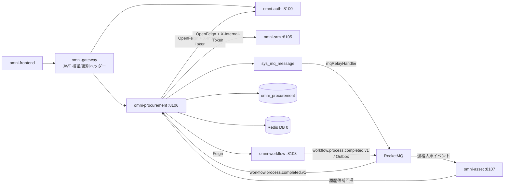
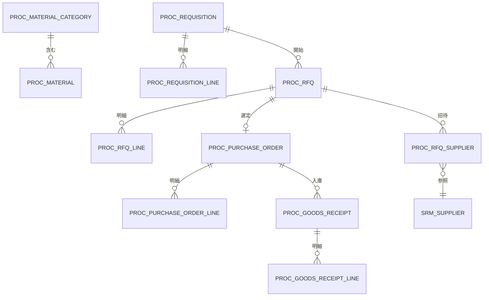
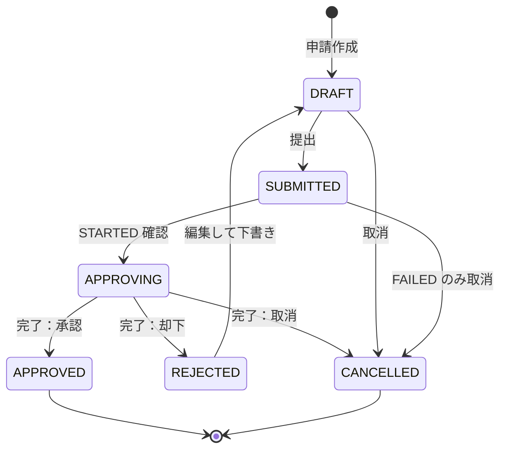
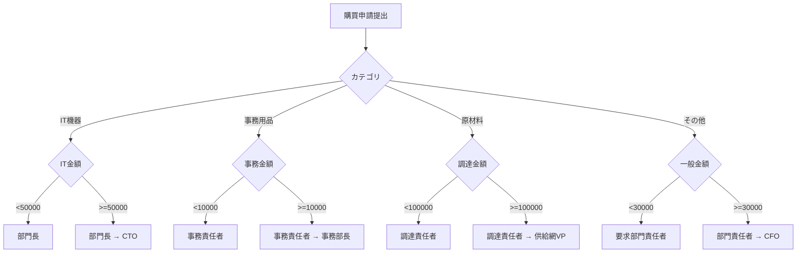
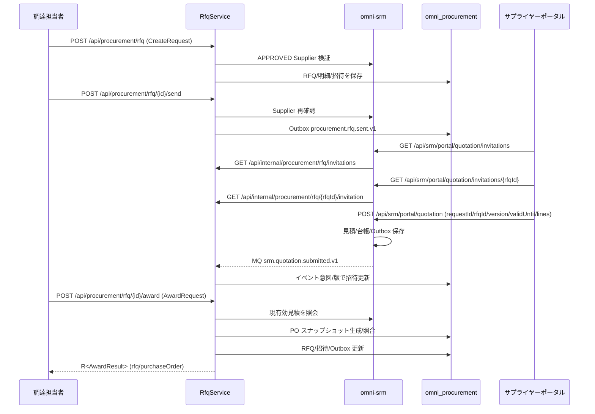
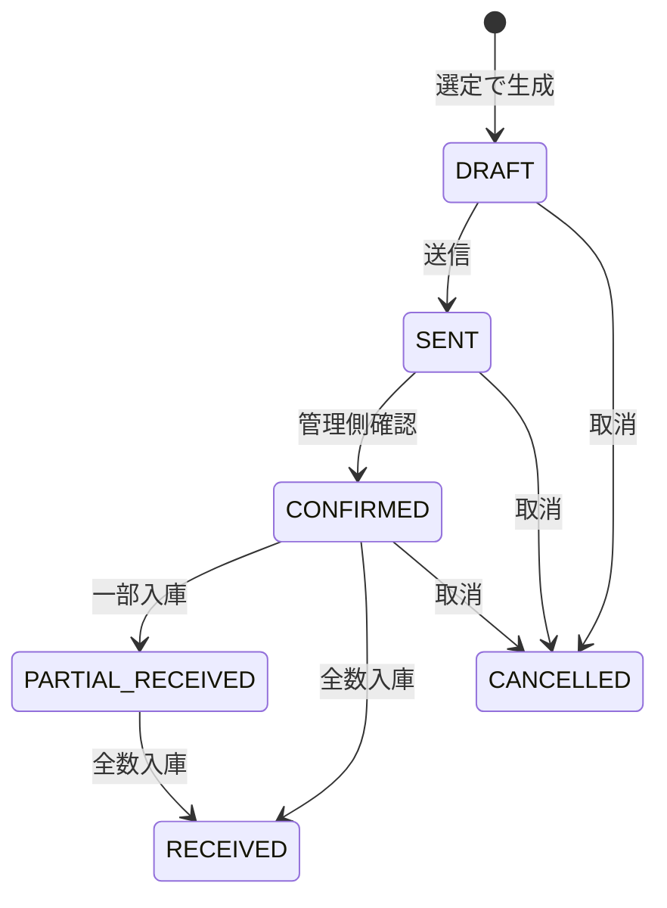
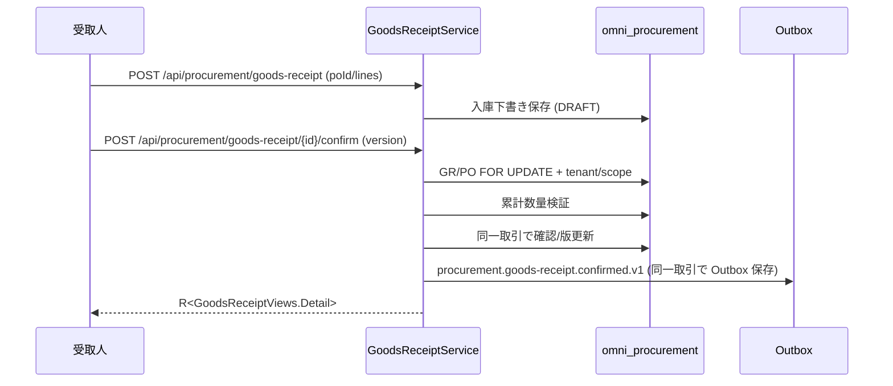

# 調達実行モジュール アーキテクチャと実装ベースライン

> 2026-07-27 の原設計日、段階計画、重要な決定を保持し、現行ソースの制約も記録します。中国語版が事実の原本です。過去の検収は現在の実行や公開条件を証明しません。承認済み AI_REVIEW と HUMAN_REVIEW は区別し、[ADR 0003](../adr/0003-authorized-ai-translation-review.md) に従います。

> 原記録の状態（2026-07-27）：MVP 実装済み・検証完了
> プロジェクト：Omni-Stack
> 日付：2026-07-27
> 目標：omni-procurement MVP のアーキテクチャ、サービス横断契約、実装境界を説明する。実装入口は `omni-backend/omni-procurement` と `omni-frontend/src/views/procurement`。

設計根拠：`README.md`、および `docs/` 内の architecture、api-contract、backend-patterns、frontend-patterns、core-flows、scheduling、workflow、mq-reliability、docker-deployment の全トピックドキュメント。同時に `docs/design/srm-design.md` の SRM サプライヤーモデルを参照。

操作、アカウント、画面は[調達 Wiki](../guides/procurement-flow.jp.md)、拡張と Docker ツールは[開発 Wiki](../guides/scaffold-development.jp.md)、現行ファイルは[ソース索引](../reference/source-map.jp.md)を参照してください。

[中文](procurement-design.md) · [English](procurement-design.en.md) · [日本語](procurement-design.jp.md) · [한국어](procurement-design.kr.md)

## 1. 設計結論

調達実行は独立した Servlet マイクロサービスとして構築し、サプライヤー管理（`omni-srm`）と資産管理（`omni-asset`）から分離すべきである。SRM は土台で、Procurement は SRM のサプライヤーデータに依存し、Asset は Procurement の調達ソースデータに依存する。

| 項目 | 決定 |
|---|---|
| Maven モジュール / サービス名 | `omni-procurement` |
| ローカルポート / 管理ポート | `8106` / `19906` |
| XXL-JOB 実行体 | `omni-procurement` / `9906`（定期リマインド有効時） |
| データベース | `omni_procurement` |
| Gateway | `/api/procurement/**` → `lb://omni-procurement`、`StripPrefix` は使用しない |
| Redis | DB 0、Auth 共通 XSS キャッシュキー。独立 proc: 業務キャッシュ接頭辞は未確認 |
| フロントエンド | 引き続き `omni-frontend` を使用し、`views/procurement/**` を新設 |

Procurement MVP は調達実行の閉ループをカバーする：

> 資材カタログ → 購買申請 → 承認 → RFQ/価格比較 → 選定 → 購買注文 → 入庫確認。

三点照合 マッチング（PO + 入庫伝票 + 請求書）と支払は MVP に含めず、ERP または財務システムに残す。契約管理は Phase 2 で導入する。

## 2. 製品範囲

### 2.1 ユーザーと目標

| ユーザー | コアニーズ |
|---|---|
| 要求部門の従業員 | 購買申請を提出し、購買申請の進捗を追跡 |
| 調達担当 | RFQ、価格比較、発注を管理し、注文進捗を追跡 |
| 調達マネージャー | 購買申請を承認し、調達プロセスを管理し、調達統計を閲覧 |
| 部門マネージャー/役員 | 購買申請を承認（金額閾値別）し、調達支出を閲覧 |
| サプライヤー | ポータルで RFQ を閲覧し見積を提出（SRM ポータルを再利用） |

MVP は次に答えられるべきである：承認待ちの購買申請がどれだけあるか；ある購買申請の承認がどの段階まで進んだか；どの RFQ がサプライヤーの見積を待っているか；ある購買注文の入庫状態；品目/サプライヤー/部門別の調達支出統計。

### 2.2 フェーズ分け

| フェーズ | 能力 |
|---|---|
| MVP | 資材カタログ、購買申請、承認フロー（品目+金額の多次元分岐）、RFQ/価格比較、購買注文、入庫確認、調達オーバービュー |
| Phase 2 | 契約管理、リバースオークション、調達テンプレート、フレームワーク契約、三点照合 マッチング、サプライヤー業績連動 |
| Phase 3 | 調達分析（価格トレンド、サプライヤー集中度）、予算統制、自動補充提案 |

## 3. システム境界

| コンポーネント | 権威的責務 | Procurement の利用方式 |
|---|---|---|
| `omni-auth` | テナント、ユーザー、組織、ロール、権限、データ範囲、XSS 設定 | 内部 OpenFeign；ユーザー/組織 ID のみ保存 |
| `omni-srm` | サプライヤーデータ（参入、グレーディング、リスク） | 内部 OpenFeign でサプライヤーを照会；サプライヤーポータル見積は SRM サービス経由 |
| `omni-base` | 辞書、操作ログ | 操作ログ集約 |
| `omni-workflow` | BPMN、インスタンス、承認、唯一の Flowable ランタイム | モデル照会/プレビュー、冪等開始、タスク資格検証、完了イベント。Procurement からの直接終了機能はない |
| `omni-procurement` | 資材、購買申請、RFQ、購買注文、入庫 | 唯一のビジネス書き込み側 |
| `omni-asset` | 資産管理 | 入庫検収通過後、Outbox イベントと制御された履歴補償で資産カードを作成 |
| XXL-JOB | バッチスキャンのトリガー | 注文期限超過リマインド（Phase 2） |
| RocketMQ | 非同期輸送 | 少なくとも一度；コンシューマーは冪等でなければならない |



現行の基礎依存：`omni-common-core`、`omni-common`、`omni-common-mybatis`、`omni-common-redis`、`omni-common-operlog`、`omni-common-job`、`omni-common-mqlog`、`omni-common-service`。ほかに Web、Validation、Security、AspectJ、OpenFeign、LoadBalancer、Nacos、RocketMQ Stream、Actuator、Lombok など。

**Procurement は `omni-common-workflow` に依存せず、本サービスに Flowable を埋め込まない。** `omni-workflow` は独立マイクロサービスであり Flowable の唯一の実行時である；Procurement は内部 Feign 契約でフローを開始し、信頼できるドメインイベントで承認結果を受信する。サービス横断 DTO は純粋な契約モジュールに置くか Feign クライアントでローカルに定義し、これによって Flowable Starter を導入してはならない。

## 4. ドメインとデータ設計

### 4.1 アグリゲート

| アグリゲート | テーブル | 責務 |
|---|---|---|
| ProcurementConfig | `proc_tenant_config`、`proc_approval_route` | テナント通貨と品目/金額承認モデルのルーティング |
| Material | `proc_material_category`、`proc_material` | 資材品目ツリー、資材カタログ |
| Requisition | `proc_requisition`、`proc_requisition_line` | 購買申請、明細行；承認タスクと記録は omni-workflow が権威的に管理 |
| RFQ | `proc_rfq`、`proc_rfq_line`、`proc_rfq_supplier` | RFQ、明細行、招待サプライヤー |
| PurchaseOrder | `proc_purchase_order`、`proc_purchase_order_line` | 購買注文、明細行 |
| GoodsReceipt | `proc_goods_receipt`、`proc_goods_receipt_line` | 入庫伝票、明細行 |
| Inbox | `proc_event_inbox` | 同テナントの Workflow/見積イベントの冪等性と元の意図 |



### 4.2 共通フィールドとルール

全 `proc_*` 表に tenant_id を保持します。業務ルートは version/deleted と監査列を持ちますが、範囲列は集約別です。Requisition は requester_user_id/requester_unit_id、RFQ・PurchaseOrder・GoodsReceipt は owner_user_id/owner_unit_id を使います。子は親経由、Material/Category・承認ルート・テナント設定は共有です。全表に owner 条件を追加しません。

- 購買申請は有効 scope のユーザー/主組織を申請者と初期 owner に保存し、認可には requester 列を使います。
- RFQ は現在 scope の owner、PO は RFQ の帰属、GR は現在の受取人/主組織を使います。ポータルアカウントや消費スレッドから推測しません。
- 番号は DB ID 由来、資材コードと業務番号はテナント内一意です。supplier_id は SRM の論理参照で、クロス DB 外部キーはありません。
- 数量/単価は DECIMAL(19,6)、行/総額は DECIMAL(19,4)、HTTP JSON は十進文字列です。JavaScript number で金額計算しません。購買申請の見積単価は 0 可、見積/注文単価は正です。
- 日時は yyyy-MM-dd HH:mm:ss。予定/実納入日は LocalDate の日付フィールドとして DTO に従います。
- 通常 PUT はライフサイクル/承認状態/owner を変えません。既存業務変更は認可後、状態・version・更新行数を確認します。共有設定、番号補完、台帳を同一コマンドとみなしません。

### 4.3 主要テーブル

`proc_tenant_config`

- `tenant_id/currency_code/initialized_time/version` と監査フィールド、テナント内でユニーク。

`proc_approval_route`

- `route_code/category_code/min_amount/max_amount/model_version_id/priority/status/version/deleted` と監査フィールド。
- 正確な品目が `category_code='*'` デフォルトルートより優先；区間セマンティクスは `min_amount <= total_amount < max_amount`、max が空は上限なしを表す。
- 同一品目のアクティブな金額区間は重複してはならない；購買申請提出時にゼロ件または複数件マッチした場合はいずれも 409 を返し、クライアントは modelVersionId を渡してはならない。

`proc_material_category`

- `tenant_id/parent_id/category_code/category_name/sort/status/version/deleted` と監査フィールド。
- 任意階層の品目ツリーをサポート（parent_id が 0 は最上位品目）、資材はリーフ品目にのみ関連付けできる。
- MVP は資材カタログページで品目ツリー管理を提供；`category_code` は作成後変更不可、更新と削除は必ず `version` を携行し条件付き更新を実行。

`proc_material`

- `tenant_id/category_id/material_code/material_name/specification/unit/asset_managed/status/version/deleted`。
- `specification` はテキスト記述（MVP は構造化された規格パラメータを作らない）。
- `unit` は正規化された大文字の計量単位（例 EA、PCS、UNIT、SET、KG）。
- `asset_managed` は合格入庫後に「単位ごとに 1 枚の資産カード」として Asset に入るかを示す；`EA/PCS/UNIT/SET` のみ有効化でき、消耗品、サービス、KG などの連続計量資材は必ず false。
- インデックス：tenant + category_id/status、tenant + material_code（ユニーク）。

`proc_requisition`

- `requisition_no/title/requester_user_id/requester_unit_id/reason/primary_category_code/total_amount/currency_code`。
- `status`：DRAFT/SUBMITTED/APPROVING/APPROVED/REJECTED/CANCELLED。
- `approval_attempt/workflow_request_id/workflow_business_key/workflow_model_version_id/process_instance_id`：現在の承認ラウンドと Workflow 冪等スナップショット；businessKey は `{requisitionId}:{approvalAttempt}` に固定。
- `workflow_start_status`：NOT_STARTED/PENDING/FAILED/STARTED；ビジネス status と分離、失敗時もビジネス状態は SUBMITTED のまま。
- `approved_time/workflow_completed_time`：承認完了時刻のスナップショット；承認意見は引き続き Workflow を権威とし、Procurement は最終意見を複製も捏造もしない。
- `owner_user_id/owner_unit_id/version/deleted` と監査フィールド。

`proc_requisition_line`

- `line_no/requisition_id/material_id/material_code/material_name/category_code/unit/quantity/estimated_unit_price/estimated_total_price/remark`；資材コード、名称、品目、単位はいずれも提出時のスナップショット。
- 購買申請の総金額 = SUM(line.estimated_total_price)。
- MVP は 1 件の購買申請の全行が同一品目に属することを強制；品目横断の要求は複数の購買申請に分割し、単一値の承認ルートセマンティクスの不確実性を避ける。

`proc_rfq`

- `rfq_no/requisition_id/title/quotation_deadline/currency_code/status/sent_time/owner_user_id/owner_unit_id/version/deleted`。
- `status`：DRAFT/SENT/CLOSED/AWARDED/CANCELLED。
- `awarded_supplier_id/awarded_quotation_id/awarded_quotation_version/awarded_time`：選定と見積バージョンのスナップショット。
- 可視な APPROVED 購買申請の全明細をコピーします。同一申請を複数 RFQ が参照できますが、現行作成には明細選択やカテゴリ分割機能はありません。

`proc_rfq_line`

- `rfq_id/line_no/material_id/material_code/material_name/category_code/unit/quantity/remark/version/deleted`、すべて購買申請行のスナップショット。

`proc_rfq_supplier`

- `rfq_id/supplier_id/supplier_name_snapshot/invited_time/quotation_id/quotation_version/quotation_request_id/quotation_time/status/version/deleted`。
- `status`：INVITED/QUOTED/EXPIRED/AWARDED/REJECTED。`AWARDED/REJECTED` は選定後の読み取り専用履歴終端状態で、見積を継続できない。
- 新しい見積書込は RFQ status=SENT、招待 status IN (INVITED, QUOTED)、現在より後の deadline を要求します。成功済み履歴の再実行は SRM 契約の別の検証順序に従います。
- `quotation_id` は SRM の `srm_quotation` に論理的に関連付け（クロス DB 外部キーを作らない）；`supplier_name_snapshot` は履歴表示専用で、現在のサプライヤー状態や権限の根拠にしない。

`proc_purchase_order`

- `po_no/rfq_id/supplier_id/quotation_id/quotation_version/title/total_amount/currency_code`。
- 落札見積のサプライヤー名称、行ごとの単価、納期などを直接 PO/PO Line にコピーして不変ビジネススナップショットを形成；quotation_id/version はトレーサビリティ専用。
- `status`：DRAFT/SENT/CONFIRMED/PARTIAL_RECEIVED/RECEIVED/CLOSED/CANCELLED。
- `order_time/expected_delivery_date/actual_delivery_date`。
- `delivery_address/contact_name/contact_phone`。
- `owner_user_id/owner_unit_id/version/deleted` と監査フィールド。

`proc_purchase_order_line`

- `po_id/material_id/material_name/unit/quantity/unit_price/total_price/remark`。

`proc_goods_receipt`

- `gr_no/po_id/receiver_user_id/receive_time/remark/status/owner_user_id/owner_unit_id/version/deleted`。
- `status`：DRAFT/CONFIRMED。
- 確認後に Outbox イベントをトリガーして Asset に資産カード作成を通知。

`proc_goods_receipt_line`

- `goods_receipt_id/po_line_id/material_id/material_name/unit/ordered_quantity/received_quantity/quality_status/remark`。
- `quality_status`：PASS/FAIL/PENDING。
- 入庫数量は注文数量以下でよい（分割入庫）。

## 5. 状態マシンとコアフロー

### 5.1 購買申請（Requisition）



提出は別ローカルトランザクションで資材/カテゴリ/金額を再計算し、ルートを解決して SUBMITTED/PENDING と Outbox をコミット後、Workflow を呼びます。開始確認後のみ APPROVING に進みます。SUBMITTED の cancel は workflow_start_status=FAILED のみです。APPROVING→CANCELLED は照合済み Workflow 完了結果で、調達 cancel による遠隔終了ではありません。

### 5.2 承認フロー設計（omni-workflow との統合）

下図は原設計のカテゴリ/金額分岐例です。全テナントに同じ BPMN、役職、閾値が配置済みとの証明ではありません。現行提出はサーバー規則で公開モデルを選び、そのモデルを実行します。



実装方式：
- `omni-workflow` で品目ごとに 1 つの BPMN プロセスモデルを作成（例 `procurement_approval_it`、`procurement_approval_office` など）。
- または 1 つの汎用 BPMN を使い、Exclusive Gateway の二段ネスト（品目 → 金額）でルーティングを実現。
- Procurement サービスは購買申請提出時に、購買申請の一意の品目とサーバー側再計算の総金額に基づき、`proc_approval_route` から公開済み modelVersionId を選択し、Workflow 内部 API でフローを起動；クライアントはモデルバージョンを指定できない。
- 承認者は Flowable の `ScopedRoleAssignmentListener` で動的に解決（既存の組織構造+ロール体系を利用）。

サービス横断の起動はリトライ可能でなければならない：DRAFT から提出するたびにまず `approvalAttempt + 1` し、requestId と `businessKey={requisitionId}:{approvalAttempt}` を生成・永続化；Procurement は `tenantId + businessType(PROCUREMENT_REQUISITION) + businessKey` を現在のラウンドの冪等キーとする。まずローカルトランザクションで `status=SUBMITTED, workflow_start_status=PENDING` に更新し、トランザクションコミット後に Workflow を呼ぶ；成功後に processInstanceId を書き込み、workflow_start_status=STARTED に設定し APPROVING へ進める。応答喪失や呼出し失敗時は FAILED 記録を試み、実状態を再読込します。retry は必ず保存済みの requestId/businessKey/modelVersionId を再利用し attempt を増やしてはならない。REJECTED の修正成功後は DRAFT に戻り、再提出して初めて新しい attempt を開く。Workflow の永久ビジネスキーユニーク制約が古いフローをリプレイするのを避ける。

**MVP 制約**：1 件の購買申請は 1 品目のみ許可；承認ルートは正確な品目と `*` デフォルトルートをサポートし、BPMN は金額で分岐できる。後で品目横断の購買申請が必要になったら、明示的な主品目または複数フロー戦略を定義する。現行バージョンが暗黙に先頭行を取ることを禁止する。

prepareSubmit のコミット前の資材/モデル/ルート失敗はロールバックし、SUBMITTED/FAILED を意味しません。コミット後の開始不確定時は REQUIRES_NEW で FAILED 記録を試みますが、失敗や零行更新もあり、実状態/version を再読込します。FAILED は遠隔未開始の証明ではありません。retry-start は SUBMITTED/FAILED で保存済み要求/モデル/金額/申請者/試行を再利用し、ルートを再選択しません。

### 5.2.1 購買申請承認ルールの管理

管理画面はビジネス名、適用品目、金額範囲、フロー名を中心とし、ビジネス担当者に技術コード、モデルバージョン ID、
priority の入力を要求しない。`route_code` はサーバー側が `APR-{ULID}` を生成し、詳細情報内でのみ読み取り専用で表示；`route_name` はビジネス必須名。
バインド可能なフローは Workflow `category=purchase` の現在の公開済みバージョンに固定され、実行インスタンスは引き続き
`businessType=PROCUREMENT_REQUISITION` を使う。2 種類の識別子は混用できない。

リストは現在のページの `modelVersionId` を重複排除した後、200 件を超えないバッチ内部インターフェースでフローメタデータを補完し、行ごとの呼び出しを禁止する。
Workflow が利用不可のとき、読み取り専用リストはローカルルールを保持し `UNAVAILABLE` とマーク；作成、更新、購買申請提出は引き続きフェイルクローズドする。
マッチテストは購買申請提出と同一の `ApprovalRouteResolver.evaluate` を呼び、一意ヒット、マッチなし、履歴ダーティデータの
複数マッチを明示的に返す。カバレッジ分析は各有効品目を 0 から無限まで半開区間に分割し、まず正確なルールを適用し、次にデフォルトルールで欠落を補う；
停用と削除の前にメモリ内で対象ルールを除外し、同一アルゴリズムを再利用して影響ヒントを生成する。

### 5.3 RFQ/価格比較



価格比較方式：MVP は簡単な比較ビューを提供する——`GET /api/internal/quotation/batch` で招待サプライヤーの有効な見積（単価、総価、納期）を列挙し、調達担当が手動で選定サプライヤーを選ぶ。自動入札評価アルゴリズムは行わない。選定トランザクションは必ず quotationId、見積バージョン、および金額/納期の不変スナップショットを保存し、後続の SRM 見積変更は既存の選定と購買注文を変えてはならない。

選定は RfqRequests.AwardRequest の rfqVersion、quotationId、quotationVersion、title、任意 expectedDeliveryDate、deliveryAddress/contactName/contactPhone を使います。supplierId は有効見積から取り、Supplier ID だけでは選定できません。`R<AwardResult>` は rfq と purchaseOrder を返します。

### 5.4 購買注文（Purchase Order）



PO は RFQ 選定でのみ生成します。確認は管理権限/行範囲を検証する命令で、独立 Supplier ポータル API ではありません。DRAFT/SENT/CONFIRMED の取消は cancel 権限・状態・version を使い、追加 Workflow 承認はありません。CLOSED 値は存在しますが現 Controller に close はありません。初回全数入庫は CONFIRMED→RECEIVED に直接進めます。

### 5.5 入庫確認（Goods Receipt）



DRAFT の作成は注文の入庫済み数量を占有せず、イベントも送信しない。確認時は必ず PO をロックし、すべての CONFIRMED 入庫行に基づいて累計で再検証し、複数の下書きの並行確認による超過入庫を防ぐ。確認成功後に Outbox イベント `procurement.goods-receipt.confirmed.v1` を書く；Asset が未構築のとき Procurement をブロックしないが、履歴イベントが Outbox/Broker に無期限に滞留すると仮定してはならない——Asset の稼働開始時は必ず以下で定義する履歴補償再スキャンを実行する。

`quality_status=PASS`、`asset_managed=true`、かつ receivedQuantity が正の整数の入庫行のみ資産化できる。PENDING/FAIL 行、消耗品、サービス、連続計量資材は資産を作成しない。PENDING が後で `POST /goods-receipt/{id}/quality-result` により PASS になったとき、Procurement は `procurement.goods-receipt.quality-passed.v1` を発行し、今回新たに通過した行のみを携行；送信済みの confirmed イベントの変更や再利用を禁止する。

品質追記は CONFIRMED の PENDING 行を PASS/FAIL にする場合のみです。quality-passed は今回合格した資産適格行のみを送り、終端行の再変更は競合で成功再実行ではありません。confirmed の候補行は空の場合もあります。累計は全同テナントの確定入庫を含み、専用集計は受取 owner 範囲を除外して漏計を防ぎます。伝票/PO は実 FOR UPDATE と版更新を使い、明細照会自体には FOR UPDATE がありません。

## 6. テナント、RBAC とデータ権限

### 6.1 信頼チェーン

SRM と一致：Gateway JWT → `GatewayPreAuthenticationFilter` → `ServiceIdentityFilter`（Tenant/ユーザー身分検証）→ `@PreAuthorize` → `@ServiceDataScope` → MyBatis DataPermission → `ProcRecordAccessGuard`。

### 6.2 権限ツリーとロール

メニュー：`procurement`（DIRECTORY）および `procurement:overview`、`procurement:material`、`procurement:approval-route`、`procurement:requisition`、`procurement:rfq`、`procurement:purchase-order`、`procurement:goods-receipt`（MENU）。既に提供済みのページにのみ MENU をシードし、動的サイドバーにデッドリンクが出ることを避ける。

API 権限：

- `procurement:overview:list`
- `procurement:material:list/create/update/delete`
- `procurement:approval-route:list/create/update/delete`
- `procurement:requisition:list/create/update/delete/submit/approve/cancel`
- `procurement:rfq:list/create/update/delete/send/award/cancel`
- `procurement:purchase-order:list/update/delete/send/confirm/cancel`（購買注文は RFQ 選定でのみ生成）
- `procurement:goods-receipt:list/create/confirm`

| ロール | dataScope | 能力 |
|---|---|---|
| `PROCUREMENT_MANAGER` | DEPT_AND_BELOW | 部門および下位、承認、統計 |
| `PROCUREMENT_STAFF` | SELF | 自分が担当する購買申請、RFQ、注文および SELF 範囲のオーバービュー |
| `EMPLOYEE` | SELF | 自分の購買申請を提出し閲覧 |
| `TEAM_LEADER` | DEPT | Workflow が本人に割り当てた承認および部門承認ビジネスビュー |
| `DEPT_LEADER` | DEPT_AND_BELOW | Workflow が本人に割り当てた承認および部門ツリー承認ビジネスビュー |
| `SUPER_ADMIN` | ALL | 全機能、調達データは引き続き現テナントに限定 |

デフォルトの USER には調達権限を付与しない。

### 6.3 Procurement コンテキストと SQL インターセプト

汎用のリクエスト身分、DataScope コンテキストとアスペクトは `omni-common-service` が提供する：`ServiceIdentityContext`、`ServiceDataScopeContext`、`@ServiceDataScope`、`ServicePersistenceAutoConfiguration`。調達モジュールはドメインの差異のみを保持する：`ProcTenantTablePolicy`、`ProcDataPermissionHandler`、`ProcRecordAccessGuard`。

インターセプター順序は固定：`TenantLineInnerInterceptor → DataPermissionInterceptor → OptimisticLockerInnerInterceptor → PaginationInnerInterceptor`。`ProcTenantTablePolicy` は `proc_*` テーブルにのみ TenantLine を有効化；`sys_mq_message` は必ず除外し、テナント横断の Outbox Relay が送信待ちメッセージをスキャンできるようにする。ドメインテーブルのデータ権限マッピングは引き続き `ProcDataPermissionHandler` が下表のとおり定義する。

| dataScope | 条件 |
|---|---|
| SELF | `requester_user_id = currentUserId` または `owner_user_id = currentUserId` |
| DEPT | `requester_unit_id = primaryUnitId` |
| DEPT_AND_BELOW / CUSTOM | `requester_unit_id IN accessibleUnitIds` |
| TENANT / ALL | owner 条件を追加しない、TenantLine は常に保持 |

上表はスコープのセマンティクスのみを記述し、実際の SQL は必ずテーブルごとにマップする。`requester_user_id OR owner_user_id` をすべての `proc_*` テーブルに機械的に追加することを禁止する：

| リソース/テーブル | SELF 列 | DEPT/CUSTOM 列 | サブリソース制約 |
|---|---|---|---|
| Requisition | `requester_user_id` | `requester_unit_id` | Line は同一 tenant の requisition_id で継承 |
| RFQ | `owner_user_id` | `owner_unit_id` | Line/Supplier は同一 tenant の rfq_id で継承 |
| PurchaseOrder | `owner_user_id` | `owner_unit_id` | Line は同一 tenant の po_id で継承 |
| GoodsReceipt | `owner_user_id`（入庫担当者） | `owner_unit_id` | Line は同一 tenant の goods_receipt_id で継承 |
| Material/Category | SELF 私有セマンティクスなし | 機能権限で制御、テナント内で共有 | 常に TenantLine を保持 |
| Overview | 現在の permissionCode で対応するビジネステーブルの owner/requester 列にマップ | 左に同じ | 集約 SQL は必ずリストと同一範囲を適用 |

### 6.4 承認フロー権限

タスク完了は Workflow が所有します。専用 approval-view は procurement:requisition:approve と、同テナントの APPROVING/STARTED、保存済み完全 businessKey（requisitionId:attempt）、processInstanceId を要求します。Workflow が現ユーザー、taskId、businessType、完全キーを検証し、返されたインスタンスも一致する必要があります。成功後に一時 TENANT 範囲で読取専用 VO を取得し、finally で元 scope に戻します。通常詳細は requester 範囲を維持し、例外を流用しません。完了には workflow:approval:complete と実タスク資格も必要です。

## 7. API 設計

### 7.1 共通契約

SRM と一致：`R<T>`、`R<PageResult<T>>`、`page=1`、`size=10`、`size <= 100`。

### 7.2 エンドポイント

実 Controller の外部 50 メソッド/パスを /api/procurement 相対で完全記載し、内部読取専用 3 パスも示します。approval-view は taskId query、version/削除引数は実 DTO/query に従います。

| Controller | メソッドとパス |
|---|---|
| 承認規則 (ApprovalRouteController) | `GET /approval-route/list` · `GET /approval-route/workflow-options` · `POST /approval-route/match-preview` · `GET /approval-route/coverage` · `GET /approval-route/impact` · `POST /approval-route` · `PUT /approval-route/{id}` · `DELETE /approval-route/{id}` |
| 入庫 (GoodsReceiptController) | `GET /goods-receipt/list` · `GET /goods-receipt/{id}` · `POST /goods-receipt` · `POST /goods-receipt/{id}/confirm` · `POST /goods-receipt/{id}/quality-result` |
| 資材/カテゴリ (MaterialController) | `GET /material/category/list` · `POST /material/category` · `PUT /material/category/{id}` · `DELETE /material/category/{id}` · `GET /material/list` · `GET /material/{id}` · `POST /material` · `PUT /material/{id}` · `DELETE /material/{id}` |
| 概要 (OverviewController) | `GET /overview/summary` · `GET /overview/spend-analysis` |
| 購買注文 (PurchaseOrderController) | `GET /purchase-order/list` · `GET /purchase-order/{id}` · `PUT /purchase-order/{id}` · `DELETE /purchase-order/{id}` · `POST /purchase-order/{id}/send` · `POST /purchase-order/{id}/confirm` · `POST /purchase-order/{id}/cancel` |
| 購買申請 (RequisitionController) | `GET /requisition/list` · `GET /requisition/{id}` · `GET /requisition/{id}/approval-view` · `POST /requisition` · `PUT /requisition/{id}` · `DELETE /requisition/{id}` · `POST /requisition/{id}/submit` · `POST /requisition/{id}/retry-start` · `POST /requisition/{id}/cancel` |
| RFQ (RfqController) | `GET /rfq/supplier-options` · `GET /rfq/list` · `GET /rfq/{id}` · `GET /rfq/{id}/comparison` · `POST /rfq` · `PUT /rfq/{id}` · `DELETE /rfq/{id}` · `POST /rfq/{id}/send` · `POST /rfq/{id}/award` · `POST /rfq/{id}/cancel` |

Overview のサマリは固定で次を返す：承認中の購買申請数、締切内にまだ `INVITED` サプライヤーがいる `SENT` RFQ 数、
購買注文の各状態の数、入庫下書き数、および `currencyCode` でグループ化した確認済み調達コミット金額。
調達コミットと支出は `CONFIRMED/PARTIAL_RECEIVED/RECEIVED/CLOSED` 注文のみを集計し、
`DRAFT/SENT/CANCELLED` を含まない。`spend-analysis` の `dimension` は
`CATEGORY/SUPPLIER/DEPARTMENT` をサポートし、DEPARTMENT は購買注文の `owner_unit_id` を表す；
結果はまず通貨別、次に金額降順に並べ、`limit` の範囲は 1–100。どのインターフェースも通貨横断で直接合計してはならない。

| Controller | メソッドとパス |
|---|---|
| 内部資産候補 (InternalAssetCandidateController) | `GET /api/internal/procurement/goods-receipt/asset-candidates` |
| 内部招待 (InternalRfqInvitationController) | `GET /api/internal/procurement/rfq/invitations` · `GET /api/internal/procurement/rfq/{rfqId}/invitation` |

### 7.3 エンドポイントと DataScope permission のマッピング

| 操作 | permissionCode |
|---|---|
| Overview | `procurement:overview:list` |
| Material list/detail | `procurement:material:list` |
| Material create/update/delete | `procurement:material:create/update/delete` |
| Approval route list/create/update/delete | `procurement:approval-route:list/create/update/delete` |
| Requisition list/detail | `procurement:requisition:list` |
| Requisition create/update/delete | `procurement:requisition:create/update/delete` |
| Requisition submit | `procurement:requisition:submit` |
| Requisition retry-start | `procurement:requisition:submit` |
| Requisition approve | `procurement:requisition:approve` |
| Requisition cancel | `procurement:requisition:cancel` |
| RFQ list/detail | `procurement:rfq:list` |
| RFQ create/update/delete/send/award/cancel | `procurement:rfq:create/update/delete/send/award/cancel` |
| PO list/detail | `procurement:purchase-order:list` |
| PO update/delete/send/confirm/cancel | `procurement:purchase-order:update/delete/send/confirm/cancel`（外部 create なし、注文は RFQ 選定でのみ生成） |
| GR list/detail | `procurement:goods-receipt:list` |
| GR create/confirm/quality-result | `procurement:goods-receipt:create/confirm`（quality-result は confirm 権限を再利用） |

## 8. サービス横断の一貫性

### 8.1 Auth Feign

Auth はユーザー/組織/権限/範囲の権威です。現行作成は有効な ServiceDataScopeContext の識別/主組織を使い、PO は RFQ の帰属を継承します。SRM の担当移管/候補解決が調達にもあるとはみなしません。AuthInternalClient の宣言だけでは全作成/一覧が呼ぶ証拠になりません。共通識別/範囲障害は拒否し、XSS 回源の安全基準は別です。

### 8.2 SRM Feign

現行 SrmInternalClient は `GET /api/internal/supplier/search`、`POST /api/internal/supplier/batch`、`GET /api/internal/quotation/batch` を使います。RFQ 作成/送信は同テナントの APPROVED サプライヤーを確認し、比較/選定は有効見積、version、招待、全明細を再確認します。過去の名称は認可根拠にしません。

Procurement は `GET /api/internal/procurement/rfq/invitations` と `GET /api/internal/procurement/rfq/{rfqId}/invitation` を SRM に公開します。supplierId は現在の ACTIVE PortalUser 由来です。X-Internal-Token/X-Tenant-Id と重複 tenant 引数の一致を要求し、Gateway はこの接頭辞を公開しません。

新見積は SENT、INVITED/QUOTED、将来 deadline、validUntil、全行を検証します。成功履歴再実行は新状態/RFQ 検査より先ですが、ポータル関連/DTO/意図一致は必要で、現在見積を返して再発行しません。SRM は RFQ をクロス DB 更新せず、Procurement が Inbox 消費し、古い見積版で新しい版を上書きしません。

SRM 障害は現行 Supplier/見積を必要とする操作を拒否します。生成済み PO の後続ローカル命令は保存済みスナップショットを使い、一律利用不可にはなりません。招待/注文は保存済み名称を表示し、全一覧が現行 Supplier を batch 補完するとは保証しません。

### 8.3 Workflow 統合

Procurement は Flowable を埋め込まず、`X-Internal-Token` で保護された Workflow 内部 API で統合する。購買申請承認フロー：

1. Procurement は購買申請を SUBMITTED に条件更新し、トランザクションコミット後に Workflow `POST /api/internal/workflow/process-instance/start` を呼ぶ。
2. リクエストは永続化済みの `requestId`、`tenantId`、`modelVersionId`、`businessType=PROCUREMENT_REQUISITION`、`businessKey={requisitionId}:{approvalAttempt}`、`startUserId` と variables を含む。
3. `variables` は `requisitionId`、`approvalAttempt`、`materialCategory`（一意の品目 code）、`totalAmount`（総金額の十進文字列）、`requesterUnitId`（申請部門）を含む；Workflow は modelVersionId に対応する公開済み BPMN でインスタンスを起動する。
4. Workflow は `tenantId + businessType + businessKey` にユニーク冪等制約を作る；重複リクエストは既存の processInstanceId を返す。
5. Procurement は processInstanceId を保存し、状態を APPROVING へ進める。タイムアウトや応答喪失時は同一の requestId/businessKey でリトライする。
6. 承認終了後、Workflow はローカルトランザクションで `workflow.process.completed.v1` を発行し、eventId、tenantId、businessType、businessKey、processInstanceId、result、completedTime を携行する。
7. Procurement は Inbox ユニークキーで冪等に消費し、tenant/businessKey（現在の attempt を含む）/processInstanceId がすべて一致し現在の状態が APPROVING のときのみ APPROVED、REJECTED、CANCELLED に更新し、調達ドメインイベントを送信する。完了イベントがローカルの `markStarted` より先に到着した場合、リトライ可能な例外をスローしなければならず、Inbox を処理済みにしてはならない；古い attempt のイベントは冪等に無視するのみ。

ワークフロー統合は `docs/workflow.md` の仕様に従う：
- `model_key` はテナント内でユニーク。
- `processDefinitionId` でフローを起動し、`processKey` は使わない。
- プロセスインスタンスのトレーサビリティフィールドは `wf_process_instance_ext` に記録。
- Flowable のテーブルと実行時は `omni-workflow` データベースにのみ存在し、Procurement は `omni-common-workflow` に依存しない。
- 未定義で信頼できない同期的な `WorkflowCallbackService` は使わない；承認結果は Workflow Outbox イベントで配送する。

### 8.4 Asset 連動

入庫確認後に Outbox イベント `procurement.goods-receipt.confirmed.v1` を書く。イベント payload は次を含む：

```json
{
  "eventId": "018f...uuid",
  "eventType": "procurement.goods-receipt.confirmed.v1",
  "occurredAt": "2026-07-13 10:30:00",
  "tenantId": 1,
  "payload": {
    "goodsReceiptId": 301,
    "grNo": "GR202607130001",
    "purchaseOrderId": 201,
    "poNo": "PO202607100001",
    "supplierId": 101,
    "supplierNameSnapshot": "Acme Technology",
    "purchaseDate": "2026-07-13 10:30:00",
    "currencyCode": "CNY",
    "ownerUserId": 1001,
    "ownerUnitId": 2001,
    "lines": [
      {
        "goodsReceiptLineId": 401,
        "purchaseOrderLineId": 501,
        "materialId": 601,
        "materialCode": "IT-NB-001",
        "materialNameSnapshot": "ThinkPad X1 Carbon",
        "categoryCode": "LAPTOP",
        "unit": "PCS",
        "receivedQuantity": "5.000000",
        "qualityStatus": "PASS",
        "assetManaged": true,
        "assetQuantity": 5,
        "unitPrice": "12000.000000",
        "totalPrice": "60000.0000"
      }
    ]
  }
}
```

`ownerUserId/ownerUnitId` は入庫伝票の管理帰属の欠くことのできないスナップショットで、Asset はこれを新資産の管理人と管理部門として直接継承する；サプライヤーポータルユーザーやメッセージ消費スレッドの身分で推測してはならない。数量、単価、金額は Procurement の十進文字列契約に従い、整数カウントの `assetQuantity` のみ JSON number を使う。

`omni-asset` は資産化条件を満たす行にのみ `assetQuantity` に従って資産カードを作成する。リアルタイムイベントは
`consumerName + eventId` の Inbox ユニークキーで冪等を行い、リアルタイム消費と履歴再スキャンは共同で
`tenantId + goodsReceiptLineId + unitSequence` の資産ソースユニークキーをフォールバックに使う；同一冪等キーが異なる完全なビジネス意図にバインドされた場合は競合を返し、サイレントに上書きしてはならない。

ローカル Outbox/Relay は再試行可能な送信経路で、Broker/消費成功や将来消費者向け永久保持の証明ではありません。履歴候補は入庫行 ID 昇順、afterId>=0、size1–100 で、CONFIRMED/PASS/assetManaged/正整数/元イベント門閂を要求します。サービスは一意な元イベント、owner、関連を再検証します。実時間/回掃は consumerName+eventId Inbox とテナント/入庫行/単位序号の元データ一意制約の両方を使い、Inbox だけで重複防止を説明しません。異意図を上書きしません。

### 8.5 Outbox イベント

- `procurement.requisition.submitted.v1`
- `procurement.requisition.approved.v1`
- `procurement.requisition.rejected.v1`
- `procurement.requisition.cancelled.v1`
- `procurement.rfq.sent.v1`
- `procurement.rfq.awarded.v1`
- `procurement.purchase-order.created.v1`
- `procurement.purchase-order.confirmed.v1`
- `procurement.goods-receipt.confirmed.v1`
- `procurement.goods-receipt.quality-passed.v1`

## 9. プライバシー、操作ログと XSS

### 9.1 OperLog マスキング

OperLogSanitizer は名前を正規化して address/contactname/phone の包含規則を適用し、現行住所/名前/電話を処理します。非 JSON では一部の電話・メール・資格情報をテキスト規則で処理します。任意 PII 認識や業務認可の代替ではありません。

### 9.2 PII

PO Summary は住所/名前/電話のマスク値を返します。Detail は procurement:purchase-order:list と行可視性確認後に完全値を返し、追加の独立 PII 権限検査はありません。Phase 2 の印刷/出力権限は計画です。

### 9.3 XSS

共通 CachedServiceXssConfigProvider は Redis DB 0 の xss:enabled:{tenantId}/xss:rules:{tenantId} を読み、未ヒット/障害は Auth に回源、失敗時は安全基準を使いつつ権威 enabled を尊重します。proc: 業務キャッシュではなく、備考はプレーンテキストです。

## 10. フロントエンド設計

```text
omni-frontend/src/
├── api/
│   ├── procurement-overview.ts
│   ├── procurement-material.ts
│   ├── procurement-requisition.ts
│   ├── procurement-rfq.ts
│   ├── procurement-purchase-order.ts
│   └── procurement-goods-receipt.ts
├── views/procurement/
│   ├── overview/index.vue           # 概要/支出
│   ├── material/index.vue           # 資材目録
│   ├── requisition/index.vue        # 購買申請
│   ├── rfq/index.vue                # RFQ
│   ├── purchase-order/index.vue     # 購買注文
│   └── goods-receipt/index.vue      # 入庫
└── components/procurement/
    ├── RequisitionForm.vue          # 申請フォーム
    ├── RfqCompareView.vue           # 比較
    ├── PurchaseOrderTracker.vue     # 注文進捗
    └── GoodsReceiptForm.vue         # 入庫フォーム
```

- `ApiResponse/PageResult` は `src/types/api.ts` からのみインポート。
- 購買申請フォームは明細行の動的追加/削除（資材行の追加/除去）をサポート。
- 価格比較ビューは Element Plus テーブルで各サプライヤーの見積を横に比較。
- Workflow の未処理リスト自体は Procurement の businessKey を携行しない；タスクを開くときまず `/api/workflow/task/{taskId}/form` を呼び、variables から `businessType/requisitionId` を読み、次に Procurement の `approval-view` をロードする。ビジネスフォームのロードやタスク割当検証が失敗したときは必ず承認提出を禁止する。
- `router/index.ts` と `layout/index.vue` の iconMap に Procurement を補う。

procurement-approval-route.ts と views/procurement/approval-route（規則ウィザード、網羅性、試算、図プレビュー）もあります。メニュー/権限ボタンと zh-CN/en-US/ja-JP/ko-KR を同期します。

## 11. エンジニアリング着地点

以下は既存実装の入口で、モジュールを再作成する手順ではありません。サービス拡張の教材は開発 Wiki を参照します。

| 領域 | 現行ファイル |
|---|---|
| アプリ/走査 | [omni-backend/omni-procurement/src/main/java/com/omni/procurement/ProcurementApplication.java](../../omni-backend/omni-procurement/src/main/java/com/omni/procurement/ProcurementApplication.java) |
| 設定 | [omni-backend/omni-procurement/src/main/resources/application.yml](../../omni-backend/omni-procurement/src/main/resources/application.yml) · [omni-backend/omni-procurement/src/main/resources/application-lite.yml](../../omni-backend/omni-procurement/src/main/resources/application-lite.yml) |
| サービス/API | [omni-backend/omni-procurement/src/main/java/com/omni/procurement/service/impl/](../../omni-backend/omni-procurement/src/main/java/com/omni/procurement/service/impl/) · [omni-backend/omni-procurement/src/main/java/com/omni/procurement/controller/](../../omni-backend/omni-procurement/src/main/java/com/omni/procurement/controller/) |
| 範囲/認可 | [omni-backend/omni-procurement/src/main/java/com/omni/procurement/security/ProcDataPermissionHandler.java](../../omni-backend/omni-procurement/src/main/java/com/omni/procurement/security/ProcDataPermissionHandler.java) |
| 移行/シード | [database/changelog/procurement/](../../database/changelog/procurement/) · [scripts/sql/seed/procurement.sql](../../scripts/sql/seed/procurement.sql) · [scripts/sql/seed/auth.sql](../../scripts/sql/seed/auth.sql) · [database/seed/manifest.yaml](../../database/seed/manifest.yaml) |
| コンテナ | [compose.yaml](../../compose.yaml) · [compose.tools.yaml](../../compose.tools.yaml) · [docker/backend/Dockerfile](../../docker/backend/Dockerfile) · [start.bat](../../start.bat) · [start.sh](../../start.sh) |
| 画面 | [omni-frontend/src/views/procurement/](../../omni-frontend/src/views/procurement/) · [omni-frontend/src/api/procurement-approval-route.ts](../../omni-frontend/src/api/procurement-approval-route.ts) |
| テナント初期化 | [omni-backend/omni-procurement/src/main/java/com/omni/procurement/service/impl/ProcTenantInitializerImpl.java](../../omni-backend/omni-procurement/src/main/java/com/omni/procurement/service/impl/ProcTenantInitializerImpl.java) · [omni-backend/omni-procurement/src/main/java/com/omni/procurement/service/impl/ProcTenantModuleProvisioner.java](../../omni-backend/omni-procurement/src/main/java/com/omni/procurement/service/impl/ProcTenantModuleProvisioner.java) |

ProcTenantInitializerImpl は初回設定作成時に CNY と 13 既定カテゴリを書き、設定があれば早期 return します。削除された全カテゴリの恒久修復を保証しません。ProcTenantModuleProvisioner はテナント識別を設定し finally で消去します。

## 12. 非機能設計

### 性能

ページ応答は最大100、カテゴリツリー/選択肢/内部カーソルは個別契約です。一括 Supplier 検証と過去名称表示は別で、全一覧の実時間補完は保証しません。

- オーバービュー統計は Mapper 層の集約 SQL を使用（品目/サプライヤー/担当部門および通貨別の調達支出 `GROUP BY`）、
  各アグリゲートルートは引き続きそのリストと同一の requester/owner DataScope を適用し、通貨横断の合計とレコードごとのクエリを禁止する。

### 並行と冪等

入庫確認は伝票/PO の実 FOR UPDATE、全同テナント確定数量、version/更新行数を組み合わせます。メソッド名だけで明細ロックとみなしません。選定は RFQ/招待をロックして現見積版を確認し、PO スナップショットを生成/照合後、同ローカルトランザクションで RFQ/Outbox を更新します。

- 購買申請提出 → 承認フロー起動：ローカル状態の条件更新 + Workflow の `tenantId + businessType + businessKey` ユニーク冪等；タイムアウト時は同一 requestId でリトライ。
- ポータル見積提出：SRM は永久リクエスト履歴テーブルで `(tenantId, requestId)` により冪等を行い、requestHash で同一キー異意図を防ぎ、`(tenantId, rfqId, supplierId)` でユニークな有効見積を制約；同一意図のリプレイは現在のスナップショットを返し、イベントを重複発行しない。
- 見積イベントと承認結果イベント：各自 Inbox eventId ユニークキーで冪等消費；同一 quotationId の古い quotationVersion は新しいバージョンを上書きしてはならない。

proc_event_inbox は (tenant_id,event_id) 一意キーで完全イベント JSON を保存します。見積/承認消費は種類・送信元・集約・JSON 意味上の意図を先に照合し、異意図は409、キー順序/空白差は競合としません。業務結果と Inbox 状態は同ローカルトランザクションで更新します。

### 縮退

障害は段階別です。提出前モデル/ルート失敗はロールバック、コミット後不確定開始は FAILED 記録を試み再読込し、遠隔未開始を仮定しません。RFQ の Supplier/見積は SRM 依存、既存 PO 命令はスナップショットを使います。Auth 範囲障害でアクセスを広げず、XSS は別の安全基準を持ちます。Broker 障害では Outbox を保留でき、最終配送には証拠が必要です。

## 13. テストと検収

本節は設計要件/検収シナリオで、全実行済み記録ではありません。現行の個別摘要一致 Docker Reactor 産物は調達 49 報告、213 成功、失敗/エラー/スキップ 0 です。各アサーションのみを証明し、実 Workflow/MQ、MySQL 並行性、新教材実行を証明しません。画面/操作は調達 Wiki 固有の証拠範囲に従います。

最小テストセット：

- 購買申請状態マシンの合法/不正遷移。
- 購買申請承認フローの起動と結果消費（Workflow Feign/MQ を Mock し、Procurement テストで Flowable を起動しない）。
- 承認結果イベントが重複、順序不同、tenant/businessKey/processInstanceId 不一致のとき購買申請を誤って更新しない。
- 承認者は自分に割り当てられた taskId でのみ approval-view を読め、このインターフェースで任意の購買申請を読めない。
- 承認フローの金額分岐ルーティングの正確性。
- RFQ 選定が購買注文を生成。
- SRM 見積イベントの冪等消費；SRM は Procurement テーブルを直接更新できない。
- 選定後に SRM 見積を変更しても保存済みの落札スナップショットと購買注文に影響しない。
- 入庫数量が注文数量を超えない。
- 分割入庫の累計が正しい。
- DRAFT の作成は PO の入庫済み数量を更新せずイベントも送らない；確認時にのみ PO をロックし累計検証し配送する。
- 個別には成立するが合計で超過入庫となる 2 つの下書きを並行確認すると 1 つのみ成功。
- PENDING 品質検査が PASS に転じたとき新たに通過した行の quality-passed イベントのみ発行し、重複提出で重複資産化しない。
- 非資産資材、品質検査失敗/保留、非整数の連続計量入庫は資産候補を生成しない。
- Asset のリアルタイム消費と履歴補償再スキャンが並行しても資産を重複作成しない。
- テナント横断分離。
- tenant/scope 欠落時にフェイルクローズド。
- Outbox イベント書き込みの完全性。

エンドツーエンド検収：資材作成 → 購買申請提出 → 承認通過 → RFQ 作成 → サプライヤー招待 → サプライヤー見積 → 価格比較選定 → 購買注文生成 → 入庫確認 → Outbox イベント発行。

## 14. 実装順序

以下は 2026-07-27 の原実装計画を追跡用に保持します。段階は既存モジュールの再作成要求でも現完了証拠でもありません。現事実はソース契約と実証拠に従います。

### Milestone 0：前提確認

- SRM が構築済みでサプライヤー内部 API が利用可能であることを確認。
- Workflow サービスが利用可能で Flowable エンジンが正常であることを確認。
- Workflow 内部起動/タスク検証 API と `workflow.process.completed.v1` イベント契約が準備済みであることを確認；Procurement は `omni-common-workflow` を導入しない。

### Milestone 1：サービス構築 + セキュリティ基盤

- モジュール、設定、Gateway、Docker、DB を作成。
- TenantLine + DataPermission + Pagination。
- 権限ツリー、Procurement ロール、既存テナント移行。
- フロントエンド root メニュー。

### Milestone 2：資材カタログ

- 品目ツリー（任意階層）と資材 CRUD。
- 資材番号はテナント内でユニーク。

### Milestone 3：購買申請 + 承認フロー

- 購買申請 CRUD（明細行の動的追加/削除を含む）。
- 購買申請提出 → Flowable 承認フロー起動。
- 承認結果イベントの冪等消費 → 購買申請状態更新。
- BPMN プロセスモデル作成（品目+金額でルーティング）。

### Milestone 4：RFQ/価格比較 + 購買注文

- RFQ CRUD + サプライヤー招待。
- 価格比較ビュー（手動選定）。
- 購買注文生成 + 状態追跡。

### Milestone 5：入庫 + 本番強化

- 入庫確認（品質検査状態を含む）。
- 分割入庫。
- Outbox イベント（入庫確認 → Asset 連動）。
- Asset 履歴補償再スキャン内部 API。
- オーバービュー統計。
- テスト、インデックス、セキュリティ検収。
- docs/、AGENTS.md を更新。

## 15. ADR 要約

| 決定 | 選択 | 理由 |
|---|---|---|
| サービス | 独立 `omni-procurement` | SRM/Asset から分離、責務が明確 |
| Workflow 統合 | 独立 `omni-workflow` 内部 API + 承認結果イベント | Flowable の唯一実行時とデータベース境界を保持 |
| 承認ルーティング | Exclusive Gateway で品目+金額別 | 多次元の承認決定、拡張可能 |
| 価格比較方式 | 手動選定 | MVP は自動入札評価をしない |
| 入庫 → Asset | Outbox リアルタイムイベント + 履歴補償再スキャン | 疎結合かつ Broker が将来のコンシューマーのためにメッセージを永久保存することに依存しない |
| サプライヤーデータ | SRM への Feign 呼び出し | SRM データをクロス DB で読まない |
| 三点照合 マッチング | 行わない | ERP/財務システムに残す |
| MVP 品目管理 | フロントエンド管理 UI を開放済み | 任意階層の品目ツリーの自主保守をサポート |

## 16. 主要リスク

以下は原設計リスクと当時の対処案です。金額を先行しカテゴリを後で追加する記述は当時の計画で、現サーバーのカテゴリ/金額ルールと承認/検収要件を下げません。

| 優先度 | リスク | 対処 |
|---|---|---|
| P0 | Workflow 利用不可または応答喪失による承認の半起動/重複起動 | 503 + SUBMITTED/FAILED のリトライ可能な起動状態 + サービス横断ビジネスキー冪等 |
| P0 | SRM 利用不可で RFQ/発注ができない | 503 で操作を拒否、サプライヤー検証をバイパスしない |
| P0 | 書き込み操作がクエリデータ権限をバイパス | AccessGuard + 条件付き更新 |
| P1 | 承認フロー BPMN が複雑すぎる | MVP はまず金額単一次元、後で品目を追加 |
| P1 | 入庫数量の超過 | 楽観ロック + 数量検証 |
| P0 | SRM ポータルが RFQ 状態をクロス DB で書く | SRM 見積イベント + Procurement Inbox 消費、クロス DB 書き込みを禁止 |
| P1 | Asset 未準備で履歴入庫の消費を逃す | リアルタイム Outbox + Asset 稼働後のページング補償再スキャン |
| P2 | 品目承認分岐数の膨張 | 汎用承認テンプレートを予備 + 設定化 |
