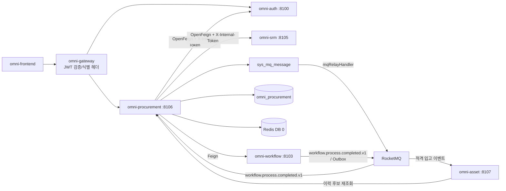
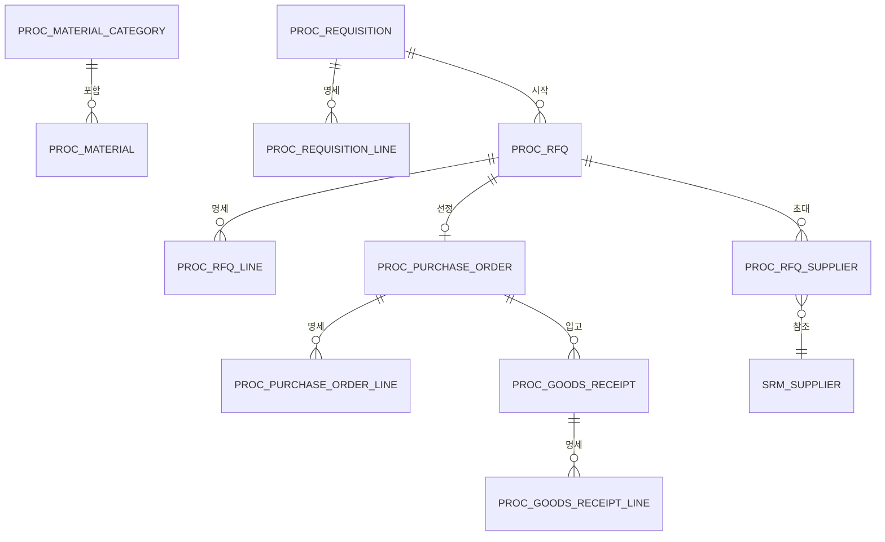
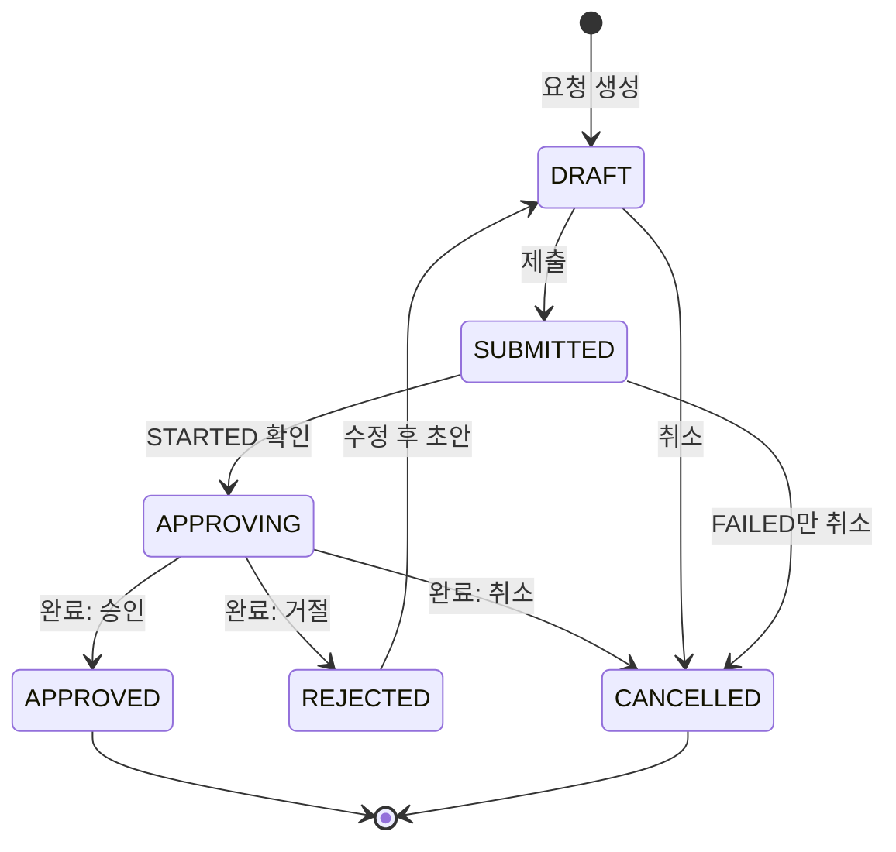
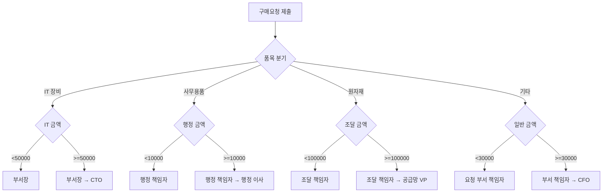
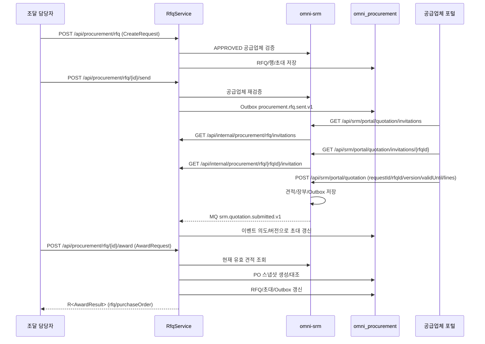
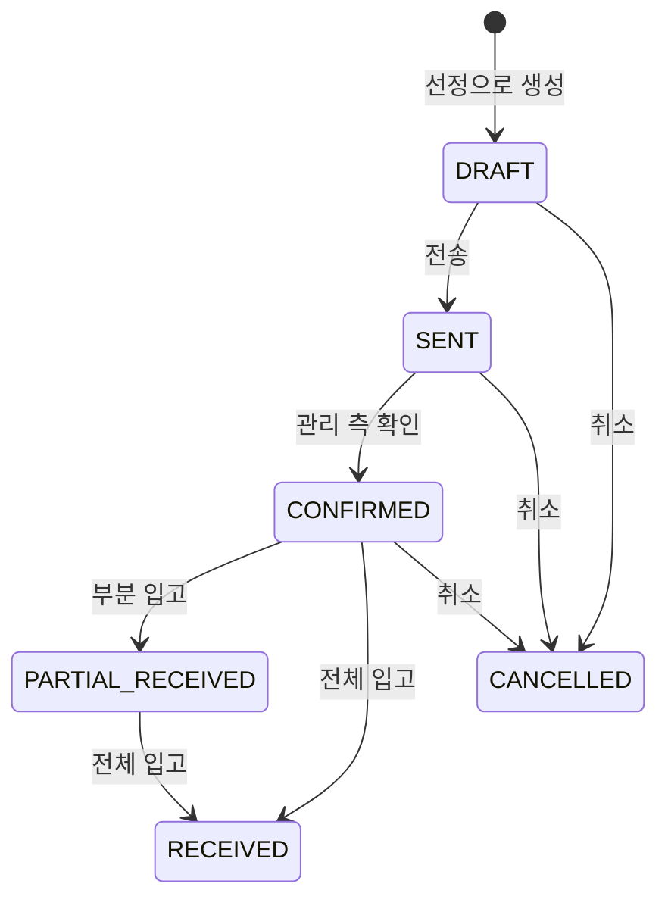
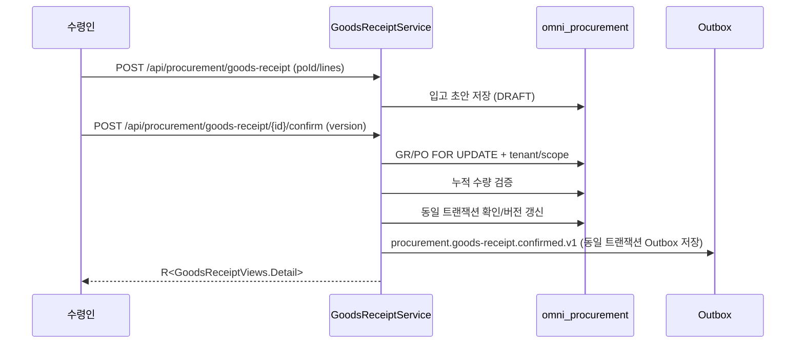

# 조달 실행 모듈 아키텍처와 구현 기준선

> 2026-07-27의 원 설계 날짜, 단계와 주요 결정을 보존하면서 현재 소스 제약을 기록합니다. 중국어가 사실 원문입니다. 과거 검수는 현재 실행이나 공개 조건을 증명하지 않습니다. 승인된 AI_REVIEW와 HUMAN_REVIEW는 구분하며 [ADR 0003](../adr/0003-authorized-ai-translation-review.md)을 따릅니다.

> 원 기록 상태(2026-07-27): MVP 구현 및 검증 완료
> 프로젝트: Omni-Stack
> 날짜: 2026-07-27
> 목표: omni-procurement MVP의 아키텍처, 서비스 간 계약, 구현 경계를 설명한다. 구현 입구는 `omni-backend/omni-procurement`과 `omni-frontend/src/views/procurement`이다.

설계 근거: `README.md`, 그리고 `docs/`의 architecture, api-contract, backend-patterns, frontend-patterns, core-flows, scheduling, workflow, mq-reliability, docker-deployment 전체 주제 문서. 동시에 `docs/design/srm-design.md`의 SRM 공급업체 모델을 참조한다.

계정, 작업과 화면은 [조달 Wiki](../guides/procurement-flow.kr.md), 확장/Docker 도구는 [개발 Wiki](../guides/scaffold-development.kr.md), 현재 파일은 [소스 색인](../reference/source-map.kr.md)을 참고하세요.

[中文](procurement-design.md) · [English](procurement-design.en.md) · [日本語](procurement-design.jp.md) · [한국어](procurement-design.kr.md)

## 1. 설계 결론

조달 실행은 독립 Servlet 마이크로서비스로 구축하여, 공급업체 관리(`omni-srm`)와 자산 관리(`omni-asset`)에서 분리해야 한다. SRM은 기반이며, Procurement은 SRM의 공급업체 데이터에 의존하고, Asset은 Procurement의 조달 출처 데이터에 의존한다.

| 항목 | 결정 |
|---|---|
| Maven 모듈 / 서비스명 | `omni-procurement` |
| 로컬 포트 / 관리 포트 | `8106` / `19906` |
| XXL-JOB 실행자 | `omni-procurement` / `9906` (정기 알림 활성화 시) |
| 데이터베이스 | `omni_procurement` |
| Gateway | `/api/procurement/**` → `lb://omni-procurement`, `StripPrefix`를 사용하지 않음 |
| Redis | DB 0, Auth 공통 XSS 캐시 키. 별도 proc: 업무 캐시 접두사는 확인되지 않음 |
| 프런트엔드 | 계속 `omni-frontend`를 사용하고 `views/procurement/**`를 신설 |

Procurement MVP는 조달 실행 폐루프를 다룬다:

> 자재 카탈로그 → 구매요청 → 승인 → RFQ/가격 비교 → 선정 → 구매 주문 → 입고 확인.

3-way 매칭(PO + 입고 전표 + 청구서)과 지불은 MVP에 포함하지 않고, ERP 또는 재무 시스템에 남긴다. 계약 관리는 Phase 2에서 도입한다.

## 2. 제품 범위

### 2.1 사용자와 목표

| 사용자 | 핵심 요구 |
|---|---|
| 요구 부서 직원 | 구매 신청을 제출하고 구매요청 진행을 추적 |
| 조달 담당 | RFQ, 가격 비교, 발주를 관리하고 주문 진행을 추적 |
| 조달 매니저 | 구매요청을 승인하고 조달 프로세스를 관리하며 조달 통계를 열람 |
| 부서 매니저/임원 | 구매요청을 승인(금액 임계값별)하고 조달 지출을 열람 |
| 공급업체 | 포털로 RFQ를 열람하고 견적을 제출(SRM 포털 재사용) |

MVP는 다음에 답할 수 있어야 한다: 승인 대기 구매요청이 얼마나 있는지; 어떤 구매요청의 승인이 어느 단계까지 갔는지; 어떤 RFQ가 공급업체 견적을 기다리는지; 어떤 구매 주문의 입고 상태; 품목/공급업체/부서별 조달 지출 통계.

### 2.2 단계 구분

| 단계 | 역량 |
|---|---|
| MVP | 자재 카탈로그, 구매요청, 승인 플로우(품목+금액 다차원 분기), RFQ/가격 비교, 구매 주문, 입고 확인, 조달 개요 |
| Phase 2 | 계약 관리, 역경매, 조달 템플릿, 프레임워크 계약, 3-way 매칭, 공급업체 성과 연동 |
| Phase 3 | 조달 분석(가격 추세, 공급업체 집중도), 예산 통제, 자동 보충 제안 |

## 3. 시스템 경계

| 컴포넌트 | 권위 책임 | Procurement의 사용 방식 |
|---|---|---|
| `omni-auth` | 테넌트, 사용자, 조직, 역할, 권한, 데이터 범위, XSS 설정 | 내부 OpenFeign; 사용자/조직 ID만 저장 |
| `omni-srm` | 공급업체 데이터(진입, 등급, 리스크) | 내부 OpenFeign으로 공급업체 조회; 공급업체 포털 견적은 SRM 서비스 경유 |
| `omni-base` | 사전, 조작 로그 | 조작 로그 집약 |
| `omni-workflow` | BPMN, 인스턴스, 승인, 유일한 Flowable 런타임 | 모델 조회/미리보기, 멱등 시작, 태스크 자격 검증, 완료 이벤트. Procurement의 직접 종료 기능은 없음 |
| `omni-procurement` | 자재, 구매요청, RFQ, 구매 주문, 입고 | 유일한 비즈니스 쓰기 주체 |
| `omni-asset` | 자산 관리 | 입고 검수 통과 후, Outbox 이벤트와 통제된 이력 보상으로 자산 카드 생성 |
| XXL-JOB | 일괄 스캔 트리거 | 주문 기한 초과 알림(Phase 2) |
| RocketMQ | 비동기 전송 | 최소 1회; 컨슈머는 멱등이어야 함 |



현재 기본 의존성: `omni-common-core`, `omni-common`, `omni-common-mybatis`, `omni-common-redis`, `omni-common-operlog`, `omni-common-job`, `omni-common-mqlog`, `omni-common-service`. 추가로 Web, Validation, Security, AspectJ, OpenFeign, LoadBalancer, Nacos, RocketMQ Stream, Actuator, Lombok 등이 있습니다.

**Procurement은 `omni-common-workflow`에 의존하지 않으며 본 서비스에 Flowable을 내장하지 않는다.** `omni-workflow`는 독립 마이크로서비스이자 Flowable의 유일한 런타임이다; Procurement은 내부 Feign 계약으로 플로우를 시작하고, 신뢰 가능한 도메인 이벤트로 승인 결과를 수신한다. 서비스 간 DTO는 순수 계약 모듈에 두거나 Feign 클라이언트가 로컬로 정의해야 하며, 이로 인해 Flowable Starter를 도입해서는 안 된다.

## 4. 도메인과 데이터 설계

### 4.1 애그리거트

| 애그리거트 | 테이블 | 책임 |
|---|---|---|
| ProcurementConfig | `proc_tenant_config`, `proc_approval_route` | 테넌트 통화와 품목/금액 승인 모델 라우팅 |
| Material | `proc_material_category`, `proc_material` | 자재 품목 트리, 자재 카탈로그 |
| Requisition | `proc_requisition`, `proc_requisition_line` | 구매요청, 명세 행; 승인 태스크와 기록은 omni-workflow가 권위적으로 관리 |
| RFQ | `proc_rfq`, `proc_rfq_line`, `proc_rfq_supplier` | RFQ, 명세 행, 초대된 공급업체 |
| PurchaseOrder | `proc_purchase_order`, `proc_purchase_order_line` | 구매 주문, 명세 행 |
| GoodsReceipt | `proc_goods_receipt`, `proc_goods_receipt_line` | 입고 전표, 명세 행 |
| Inbox | `proc_event_inbox` | 테넌트 내 Workflow/견적 이벤트 멱등성과 원 의도 |



### 4.2 공통 필드와 규칙

모든 `proc_*` 테이블은 tenant_id를 유지합니다. 업무 루트는 version/deleted와 감사 필드를 쓰지만 범위 열은 애그리거트별입니다. Requisition은 requester_user_id/requester_unit_id, RFQ/PurchaseOrder/GoodsReceipt는 owner_user_id/owner_unit_id를 씁니다. 자식은 부모를 통해 상속하고 Material/Category, 승인 경로, 테넌트 설정은 공유합니다. 모든 테이블에 owner 조건을 붙이지 않습니다.

- 구매요청은 유효 scope의 사용자/주 조직을 신청자와 초기 owner로 저장하며 권한에는 requester 열을 씁니다.
- RFQ는 현재 scope owner, PO는 RFQ 귀속, GR은 현재 수령인/주 조직을 씁니다. 포털 계정이나 소비 스레드로 추측하지 않습니다.
- 번호는 DB ID에서 만들고 자재 코드/업무 번호는 테넌트 내 고유합니다. supplier_id는 SRM 논리 참조이며 교차 DB 외래 키는 없습니다.
- 수량/단가는 DECIMAL(19,6), 행/총액은 DECIMAL(19,4), HTTP JSON은 십진 문자열입니다. JavaScript number로 금액을 계산하지 않습니다. 요청 예상 단가는 0 가능, 견적/주문 단가는 양수입니다.
- 일시는 yyyy-MM-dd HH:mm:ss, 예상/실제 납품일은 LocalDate 날짜 필드이므로 DTO 계약을 따릅니다.
- 일반 PUT은 수명주기/승인 상태/owner를 바꾸지 않습니다. 기존 업무 변경은 권한 후 상태/version/영향 행을 검사합니다. 공유 설정, 번호 보완, 장부는 동일 명령으로 일반화하지 않습니다.

### 4.3 주요 테이블

`proc_tenant_config`

- `tenant_id/currency_code/initialized_time/version`과 감사 필드, 테넌트 내 고유.

`proc_approval_route`

- `route_code/category_code/min_amount/max_amount/model_version_id/priority/status/version/deleted`와 감사 필드.
- 정확한 품목이 `category_code='*'` 기본 라우트보다 우선; 구간 의미는 `min_amount <= total_amount < max_amount`, max가 비면 상한 없음.
- 동일 품목의 활성 금액 구간은 겹치면 안 됨; 구매요청 제출 시 0건 또는 여러 건 매칭되면 모두 409를 반환하고, 클라이언트는 modelVersionId를 넘겨선 안 됨.

`proc_material_category`

- `tenant_id/parent_id/category_code/category_name/sort/status/version/deleted`와 감사 필드.
- 임의 계층 품목 트리를 지원(parent_id가 0이면 최상위 품목), 자재는 리프 품목에만 연결 가능.
- MVP는 자재 카탈로그 페이지에서 품목 트리 관리를 제공; `category_code`는 생성 후 수정 불가, 업데이트와 삭제는 반드시 `version`을 지니고 조건부 업데이트를 실행.

`proc_material`

- `tenant_id/category_id/material_code/material_name/specification/unit/asset_managed/status/version/deleted`.
- `specification`은 텍스트 기술(MVP는 구조화된 규격 파라미터를 하지 않음).
- `unit`은 정규화된 대문자 계량 단위(예 EA, PCS, UNIT, SET, KG).
- `asset_managed`는 적격 입고 후 "단위마다 자산 카드 한 장"으로 Asset에 들어가는지 나타냄; `EA/PCS/UNIT/SET`만 활성화할 수 있고, 소모품, 서비스, KG 등 연속 계량 자재는 반드시 false.
- 인덱스: tenant + category_id/status, tenant + material_code(고유).

`proc_requisition`

- `requisition_no/title/requester_user_id/requester_unit_id/reason/primary_category_code/total_amount/currency_code`.
- `status`: DRAFT/SUBMITTED/APPROVING/APPROVED/REJECTED/CANCELLED.
- `approval_attempt/workflow_request_id/workflow_business_key/workflow_model_version_id/process_instance_id`: 현재 승인 라운드와 Workflow 멱등 스냅샷; businessKey는 `{requisitionId}:{approvalAttempt}`로 고정.
- `workflow_start_status`: NOT_STARTED/PENDING/FAILED/STARTED; 비즈니스 status와 분리, 실패 시에도 비즈니스 상태는 SUBMITTED 유지.
- `approved_time/workflow_completed_time`: 승인 완료 시각 스냅샷; 승인 의견은 계속 Workflow를 권위로 하고, Procurement은 최종 의견을 복제하거나 날조하지 않음.
- `owner_user_id/owner_unit_id/version/deleted`와 감사 필드.

`proc_requisition_line`

- `line_no/requisition_id/material_id/material_code/material_name/category_code/unit/quantity/estimated_unit_price/estimated_total_price/remark`; 자재 코드, 명칭, 품목, 단위는 모두 제출 시 스냅샷.
- 구매요청 총 금액 = SUM(line.estimated_total_price).
- MVP는 한 구매요청의 모든 행이 동일 품목에 속함을 강제; 품목 교차 요구는 여러 구매요청으로 나누어, 단일 값 승인 라우트 의미의 불확실성을 피함.

`proc_rfq`

- `rfq_no/requisition_id/title/quotation_deadline/currency_code/status/sent_time/owner_user_id/owner_unit_id/version/deleted`.
- `status`: DRAFT/SENT/CLOSED/AWARDED/CANCELLED.
- `awarded_supplier_id/awarded_quotation_id/awarded_quotation_version/awarded_time`: 선정과 견적 버전 스냅샷.
- 보이는 APPROVED 구매요청의 모든 행을 복사합니다. 한 요청을 여러 RFQ가 참조할 수 있지만 현재 생성은 일부 행 선택이나 품목 분할을 구현하지 않습니다.

`proc_rfq_line`

- `rfq_id/line_no/material_id/material_code/material_name/category_code/unit/quantity/remark/version/deleted`, 모두 구매요청 행 스냅샷.

`proc_rfq_supplier`

- `rfq_id/supplier_id/supplier_name_snapshot/invited_time/quotation_id/quotation_version/quotation_request_id/quotation_time/status/version/deleted`.
- `status`: INVITED/QUOTED/EXPIRED/AWARDED/REJECTED. `AWARDED/REJECTED`는 선정 후 읽기 전용 이력 종료 상태로, 견적을 계속할 수 없음.
- 새 견적 쓰기는 RFQ status=SENT, 초대 status IN (INVITED, QUOTED), 현재보다 뒤인 deadline을 요구합니다. 성공 이력 재실행은 SRM 계약의 별도 검증 순서를 따릅니다.
- `quotation_id`는 SRM의 `srm_quotation`에 논리적으로 연결(크로스 DB 외래 키를 만들지 않음); `supplier_name_snapshot`은 이력 표시 전용으로, 현재 공급업체 상태나 권한의 근거로 삼지 않음.

`proc_purchase_order`

- `po_no/rfq_id/supplier_id/quotation_id/quotation_version/title/total_amount/currency_code`.
- 낙찰 견적의 공급업체 명칭, 행별 단가, 납기 등을 직접 PO/PO Line에 복사하여 불변 비즈니스 스냅샷을 형성; quotation_id/version은 추적 전용.
- `status`: DRAFT/SENT/CONFIRMED/PARTIAL_RECEIVED/RECEIVED/CLOSED/CANCELLED.
- `order_time/expected_delivery_date/actual_delivery_date`.
- `delivery_address/contact_name/contact_phone`.
- `owner_user_id/owner_unit_id/version/deleted`와 감사 필드.

`proc_purchase_order_line`

- `po_id/material_id/material_name/unit/quantity/unit_price/total_price/remark`.

`proc_goods_receipt`

- `gr_no/po_id/receiver_user_id/receive_time/remark/status/owner_user_id/owner_unit_id/version/deleted`.
- `status`: DRAFT/CONFIRMED.
- 확인 후 Outbox 이벤트를 트리거하여 Asset에 자산 카드 생성을 통지.

`proc_goods_receipt_line`

- `goods_receipt_id/po_line_id/material_id/material_name/unit/ordered_quantity/received_quantity/quality_status/remark`.
- `quality_status`: PASS/FAIL/PENDING.
- 입고 수량은 주문 수량 이하일 수 있음(분할 입고).

## 5. 상태 머신과 핵심 플로우

### 5.1 구매요청(Requisition)



제출은 별도 로컬 트랜잭션에서 자재/품목/금액을 재계산하고 경로를 해석해 SUBMITTED/PENDING과 Outbox를 커밋한 뒤 Workflow를 호출합니다. 시작 확인 후만 APPROVING으로 갑니다. SUBMITTED 취소는 workflow_start_status=FAILED만 가능하며 APPROVING→CANCELLED는 일치하는 Workflow 완료 결과입니다. 조달 cancel은 원격 종료 명령이 아닙니다.

### 5.2 승인 플로우 설계(omni-workflow와 통합)

아래는 원 설계의 품목/금액 분기 예시이며 모든 현재 테넌트에 동일 BPMN/직책/임계값이 배포됐다는 증거가 아닙니다. 현재 제출은 서버 규칙으로 게시 모델을 선택한 후 그 모델을 실행합니다.



구현 방식:
- `omni-workflow`에서 품목마다 하나의 BPMN 프로세스 모델을 생성(예 `procurement_approval_it`, `procurement_approval_office` 등).
- 또는 하나의 범용 BPMN을 사용하여, Exclusive Gateway의 2중 네스트(품목 → 금액)로 라우팅을 구현.
- Procurement 서비스는 구매요청 제출 시, 구매요청의 고유 품목과 서버 측 재계산 총 금액에 따라 `proc_approval_route`에서 게시된 modelVersionId를 선택하고, Workflow 내부 API로 플로우를 시작; 클라이언트는 모델 버전을 지정할 수 없음.
- 승인자는 Flowable의 `ScopedRoleAssignmentListener`로 동적 해석(기존 조직 구조+역할 체계를 활용).

서비스 간 시작은 재시도 가능해야 한다: DRAFT에서 제출할 때마다 먼저 `approvalAttempt + 1`을 하고, requestId와 `businessKey={requisitionId}:{approvalAttempt}`를 생성·영속화; Procurement은 `tenantId + businessType(PROCUREMENT_REQUISITION) + businessKey`를 현재 라운드의 멱등 키로 사용. 먼저 로컬 트랜잭션으로 `status=SUBMITTED, workflow_start_status=PENDING`으로 업데이트하고, 트랜잭션 커밋 후 Workflow를 호출; 성공 후 processInstanceId를 쓰고, workflow_start_status=STARTED로 설정하고 APPROVING으로 진행. 응답 손실/호출 실패는 FAILED 기록을 시도하므로 실제 상태를 다시 읽어야 합니다. retry는 반드시 저장된 requestId/businessKey/modelVersionId를 재사용하며 attempt를 늘리면 안 됨. REJECTED 수정 성공 후 DRAFT로 돌아가고, 재제출해야 새 attempt가 열리며, Workflow 영구 비즈니스 키 고유 제약이 오래된 플로우를 재생하는 것을 피함.

**MVP 제약**: 하나의 구매요청은 하나의 품목만 허용; 승인 라우트는 정확 품목과 `*` 기본 라우트를 지원하고, BPMN은 금액으로 분기할 수 있음. 이후 품목 교차 구매요청이 필요하면 명시적 주 품목 또는 다중 플로우 전략을 정의하며, 현재 버전이 암묵적으로 첫 행을 취하는 것을 금지.

prepareSubmit 커밋 전 자재/모델/경로 실패는 롤백하므로 SUBMITTED/FAILED를 뜻하지 않습니다. 커밋 후 시작 결과가 불확실하면 REQUIRES_NEW로 FAILED 기록을 시도하지만 실패하거나 0행일 수 있어 실제 상태/version을 다시 읽어야 합니다. FAILED가 원격 프로세스 부재를 증명하지 않습니다. retry-start는 SUBMITTED/FAILED에서 저장 요청/모델/금액/신청자/시도를 재사용하고 경로를 다시 고르지 않습니다.

### 5.2.1 구매요청 승인 규칙 관리

관리 화면은 비즈니스 명칭, 적용 품목, 금액 범위, 플로우 명칭을 중심으로 하고, 비즈니스 담당자에게 기술 코드, 모델 버전 ID,
priority 입력을 요구하지 않는다. `route_code`는 서버 측이 `APR-{ULID}`를 생성하고 고급 정보에서만 읽기 전용으로 표시; `route_name`은 비즈니스 필수 명칭.
바인딩 가능한 플로우는 Workflow `category=purchase`의 현재 게시 버전으로 고정되고, 실행 인스턴스는 계속
`businessType=PROCUREMENT_REQUISITION`을 사용; 두 종류의 식별자는 혼용할 수 없음.

목록은 현재 페이지의 `modelVersionId`를 중복 제거한 뒤, 200건을 넘지 않는 일괄 내부 인터페이스로 플로우 메타데이터를 보완하고, 행별 호출을 금지.
Workflow 사용 불가 시 읽기 전용 목록은 로컬 규칙을 보존하고 `UNAVAILABLE`로 표시; 생성, 업데이트, 구매요청 제출은 계속 실패 차단.
매칭 테스트는 구매요청 제출과 동일한 `ApprovalRouteResolver.evaluate`를 호출하여, 고유 히트, 매칭 없음, 이력 더티 데이터의
다중 매칭을 명시적으로 반환. 커버리지 분석은 각 유효 품목을 0부터 무한까지 반개 구간으로 나누고, 먼저 정확 규칙을 적용한 뒤 기본 규칙으로 결손을 보충;
사용 중지와 삭제 전에 메모리에서 대상 규칙을 제외하고 동일 알고리즘을 재사용하여 영향 힌트를 생성.

### 5.3 RFQ/가격 비교



가격 비교 방식: MVP는 간단한 비교 뷰를 제공한다——`GET /api/internal/quotation/batch`로 초대된 공급업체의 유효 견적(단가, 총가, 납기)을 나열하고, 조달 담당이 수동으로 선정 공급업체를 고른다. 자동 입찰 평가 알고리즘은 하지 않는다. 선정 트랜잭션은 반드시 quotationId, 견적 버전, 그리고 금액/납기의 불변 스냅샷을 보존해야 하며, 후속 SRM 견적 변경은 기존 선정과 구매 주문을 바꾸면 안 된다.

선정은 RfqRequests.AwardRequest의 rfqVersion, quotationId, quotationVersion, title, 선택 expectedDeliveryDate, deliveryAddress/contactName/contactPhone을 씁니다. supplierId는 선택한 유효 견적에서 가져오며 공급업체 ID만으로 선정할 수 없습니다. `R<AwardResult>`는 rfq와 purchaseOrder를 반환합니다.

### 5.4 구매 주문(Purchase Order)



PO는 RFQ 선정으로만 생성합니다. 확인은 관리 권한/행 범위 보호 명령이며 별도 공급업체 포털 API가 아닙니다. DRAFT/SENT/CONFIRMED 취소는 cancel 권한/상태/version을 검사하고 추가 Workflow 승인은 없습니다. CLOSED 값은 있지만 현재 Controller에 close는 없습니다. 첫 전체 입고는 CONFIRMED→RECEIVED로 바로 진행할 수 있습니다.

### 5.5 입고 확인(Goods Receipt)



DRAFT 생성은 주문의 입고 완료 수량을 점유하지 않고, 이벤트도 보내지 않는다. 확인 시 반드시 PO를 잠그고, 모든 CONFIRMED 입고 행을 기반으로 누적 재검증하여, 여러 초안의 동시 확인으로 인한 초과 입고를 방지한다. 확인 성공 후 Outbox 이벤트 `procurement.goods-receipt.confirmed.v1`을 쓴다; Asset이 아직 구축되지 않았을 때 Procurement을 막지 않지만, 이력 이벤트가 Outbox/Broker에 무기한 머물 것이라고 가정해선 안 된다——Asset 가동 시 반드시 아래에서 정의하는 이력 보상 재스캔을 실행해야 한다.

`quality_status=PASS`, `asset_managed=true`, 그리고 receivedQuantity가 양의 정수인 입고 행만 자산화할 수 있다. PENDING/FAIL 행, 소모품, 서비스, 연속 계량 자재는 자산을 생성하지 않는다. PENDING이 이후 `POST /goods-receipt/{id}/quality-result`로 PASS가 되면, Procurement은 `procurement.goods-receipt.quality-passed.v1`을 발행하고 이번에 새로 통과한 행만 싣는다; 이미 전송된 confirmed 이벤트를 수정하거나 재사용하는 것을 금지한다.

품질 추가 입력은 CONFIRMED의 PENDING 행을 PASS/FAIL로 바꿀 때만 허용합니다. quality-passed는 이번에 새로 통과한 자산 적격 행만 보내고 종료 행 재변경은 충돌이지 성공 재실행이 아닙니다. confirmed의 후보 행은 비어 있을 수도 있습니다. 누적 수량은 모든 동일 테넌트 확정 입고를 포함하며 전용 집계는 수령인 owner 범위를 제외해 누락을 막습니다. 전표/PO는 실제 FOR UPDATE와 버전 갱신을 쓰고 행 조회 자체에는 FOR UPDATE가 없습니다.

## 6. 테넌트, RBAC과 데이터 권한

### 6.1 신뢰 체인

SRM과 일치: Gateway JWT → `GatewayPreAuthenticationFilter` → `ServiceIdentityFilter`(Tenant/사용자 신분 검증) → `@PreAuthorize` → `@ServiceDataScope` → MyBatis DataPermission → `ProcRecordAccessGuard`.

### 6.2 권한 트리와 역할

메뉴: `procurement`(DIRECTORY) 그리고 `procurement:overview`, `procurement:material`, `procurement:approval-route`, `procurement:requisition`, `procurement:rfq`, `procurement:purchase-order`, `procurement:goods-receipt`(MENU). 이미 제공된 페이지만 MENU로 시드하여, 동적 사이드바에 죽은 링크가 나타나지 않게 한다.

API 권한:

- `procurement:overview:list`
- `procurement:material:list/create/update/delete`
- `procurement:approval-route:list/create/update/delete`
- `procurement:requisition:list/create/update/delete/submit/approve/cancel`
- `procurement:rfq:list/create/update/delete/send/award/cancel`
- `procurement:purchase-order:list/update/delete/send/confirm/cancel`(구매 주문은 RFQ 선정으로만 생성)
- `procurement:goods-receipt:list/create/confirm`

| 역할 | dataScope | 역량 |
|---|---|---|
| `PROCUREMENT_MANAGER` | DEPT_AND_BELOW | 부서 및 하위, 승인, 통계 |
| `PROCUREMENT_STAFF` | SELF | 본인이 담당하는 구매요청, RFQ, 주문 및 SELF 범위 개요 |
| `EMPLOYEE` | SELF | 본인 구매요청을 제출하고 열람 |
| `TEAM_LEADER` | DEPT | Workflow가 본인에 할당한 승인 및 부서 승인 비즈니스 뷰 |
| `DEPT_LEADER` | DEPT_AND_BELOW | Workflow가 본인에 할당한 승인 및 부서 트리 승인 비즈니스 뷰 |
| `SUPER_ADMIN` | ALL | 모든 기능, 조달 데이터는 계속 현재 테넌트로 제한 |

기본 USER에는 조달 권한을 부여하지 않는다.

### 6.3 Procurement 컨텍스트와 SQL 인터셉트

범용 요청 신분, DataScope 컨텍스트와 애스펙트는 `omni-common-service`가 제공한다: `ServiceIdentityContext`, `ServiceDataScopeContext`, `@ServiceDataScope`, `ServicePersistenceAutoConfiguration`. 조달 모듈은 도메인 차이만 보존한다: `ProcTenantTablePolicy`, `ProcDataPermissionHandler`, `ProcRecordAccessGuard`.

인터셉터 순서는 고정: `TenantLineInnerInterceptor → DataPermissionInterceptor → OptimisticLockerInnerInterceptor → PaginationInnerInterceptor`. `ProcTenantTablePolicy`는 `proc_*` 테이블에만 TenantLine을 활성화; `sys_mq_message`는 반드시 제외하여, 테넌트 간 Outbox Relay가 전송 대기 메시지를 스캔할 수 있게 한다. 도메인 테이블의 데이터 권한 매핑은 계속 `ProcDataPermissionHandler`가 아래 표대로 정의한다.

| dataScope | 조건 |
|---|---|
| SELF | `requester_user_id = currentUserId` 또는 `owner_user_id = currentUserId` |
| DEPT | `requester_unit_id = primaryUnitId` |
| DEPT_AND_BELOW / CUSTOM | `requester_unit_id IN accessibleUnitIds` |
| TENANT / ALL | owner 조건을 추가하지 않음, TenantLine은 항상 유지 |

위 표는 범위 의미만 기술하며, 실제 SQL은 반드시 테이블별로 매핑한다. `requester_user_id OR owner_user_id`를 모든 `proc_*` 테이블에 기계적으로 추가하는 것을 금지한다:

| 리소스/테이블 | SELF 열 | DEPT/CUSTOM 열 | 하위 리소스 제약 |
|---|---|---|---|
| Requisition | `requester_user_id` | `requester_unit_id` | Line은 동일 tenant의 requisition_id로 상속 |
| RFQ | `owner_user_id` | `owner_unit_id` | Line/Supplier는 동일 tenant의 rfq_id로 상속 |
| PurchaseOrder | `owner_user_id` | `owner_unit_id` | Line은 동일 tenant의 po_id로 상속 |
| GoodsReceipt | `owner_user_id`(입고 담당자) | `owner_unit_id` | Line은 동일 tenant의 goods_receipt_id로 상속 |
| Material/Category | SELF 사유 의미 없음 | 기능 권한으로 통제, 테넌트 내 공유 | 항상 TenantLine을 유지 |
| Overview | 현재 permissionCode로 대응 비즈니스 테이블의 owner/requester 열에 매핑 | 좌측과 동일 | 집계 SQL은 반드시 목록과 동일 범위를 적용 |

### 6.4 승인 플로우 권한

태스크 완료는 Workflow 소유입니다. 전용 approval-view는 procurement:requisition:approve와 동일 테넌트 APPROVING/STARTED, 저장된 전체 businessKey(requisitionId:attempt), processInstanceId를 요구합니다. Workflow가 현재 사용자/taskId/businessType/전체 키를 확인하고 반환 인스턴스도 일치해야 합니다. 성공하면 임시 TENANT 범위로 읽기 전용 VO를 얻고 finally에서 이전 scope로 복원합니다. 일반 상세의 requester 범위에 이 예외를 재사용하면 안 됩니다. 완료에는 workflow:approval:complete와 실제 태스크 자격도 필요합니다.

## 7. API 설계

### 7.1 공통 계약

SRM과 일치: `R<T>`, `R<PageResult<T>>`, `page=1`, `size=10`, `size <= 100`.

### 7.2 엔드포인트

실제 Controller의 외부 50개 메서드/경로를 /api/procurement 기준으로 완전히 표시하고 내부 읽기 전용 3개도 제공합니다. approval-view는 taskId query가 필요하며 version/삭제 인자는 실제 DTO/query 계약을 따릅니다.

| Controller | 메서드와 경로 |
|---|---|
| 승인 규칙 (ApprovalRouteController) | `GET /approval-route/list` · `GET /approval-route/workflow-options` · `POST /approval-route/match-preview` · `GET /approval-route/coverage` · `GET /approval-route/impact` · `POST /approval-route` · `PUT /approval-route/{id}` · `DELETE /approval-route/{id}` |
| 입고 (GoodsReceiptController) | `GET /goods-receipt/list` · `GET /goods-receipt/{id}` · `POST /goods-receipt` · `POST /goods-receipt/{id}/confirm` · `POST /goods-receipt/{id}/quality-result` |
| 자재/품목 (MaterialController) | `GET /material/category/list` · `POST /material/category` · `PUT /material/category/{id}` · `DELETE /material/category/{id}` · `GET /material/list` · `GET /material/{id}` · `POST /material` · `PUT /material/{id}` · `DELETE /material/{id}` |
| 개요 (OverviewController) | `GET /overview/summary` · `GET /overview/spend-analysis` |
| 구매 주문 (PurchaseOrderController) | `GET /purchase-order/list` · `GET /purchase-order/{id}` · `PUT /purchase-order/{id}` · `DELETE /purchase-order/{id}` · `POST /purchase-order/{id}/send` · `POST /purchase-order/{id}/confirm` · `POST /purchase-order/{id}/cancel` |
| 구매요청 (RequisitionController) | `GET /requisition/list` · `GET /requisition/{id}` · `GET /requisition/{id}/approval-view` · `POST /requisition` · `PUT /requisition/{id}` · `DELETE /requisition/{id}` · `POST /requisition/{id}/submit` · `POST /requisition/{id}/retry-start` · `POST /requisition/{id}/cancel` |
| RFQ (RfqController) | `GET /rfq/supplier-options` · `GET /rfq/list` · `GET /rfq/{id}` · `GET /rfq/{id}/comparison` · `POST /rfq` · `PUT /rfq/{id}` · `DELETE /rfq/{id}` · `POST /rfq/{id}/send` · `POST /rfq/{id}/award` · `POST /rfq/{id}/cancel` |

Overview 요약은 다음을 고정 반환한다: 승인 중 구매요청 수, 마감 내에 아직 `INVITED` 공급업체가 있는 `SENT` RFQ 수,
구매 주문 각 상태 수, 입고 초안 수, 그리고 `currencyCode`로 그룹한 확정 조달 커밋 금액.
조달 커밋과 지출은 `CONFIRMED/PARTIAL_RECEIVED/RECEIVED/CLOSED` 주문만 집계하고,
`DRAFT/SENT/CANCELLED`를 포함하지 않는다. `spend-analysis`의 `dimension`은
`CATEGORY/SUPPLIER/DEPARTMENT`를 지원하며, DEPARTMENT는 구매 주문의 `owner_unit_id`를 의미;
결과는 먼저 통화별, 이어서 금액 내림차순으로 정렬하고, `limit` 범위는 1–100. 어떤 인터페이스도 통화 간 직접 합산하면 안 된다.

| Controller | 메서드와 경로 |
|---|---|
| 내부 자산 후보 (InternalAssetCandidateController) | `GET /api/internal/procurement/goods-receipt/asset-candidates` |
| 내부 초대 (InternalRfqInvitationController) | `GET /api/internal/procurement/rfq/invitations` · `GET /api/internal/procurement/rfq/{rfqId}/invitation` |

### 7.3 엔드포인트와 DataScope permission 매핑

| 조작 | permissionCode |
|---|---|
| Overview | `procurement:overview:list` |
| Material list/detail | `procurement:material:list` |
| Material create/update/delete | `procurement:material:create/update/delete` |
| Approval route list/create/update/delete | `procurement:approval-route:list/create/update/delete` |
| Requisition list/detail | `procurement:requisition:list` |
| Requisition create/update/delete | `procurement:requisition:create/update/delete` |
| Requisition submit | `procurement:requisition:submit` |
| Requisition retry-start | `procurement:requisition:submit` |
| Requisition approve | `procurement:requisition:approve` |
| Requisition cancel | `procurement:requisition:cancel` |
| RFQ list/detail | `procurement:rfq:list` |
| RFQ create/update/delete/send/award/cancel | `procurement:rfq:create/update/delete/send/award/cancel` |
| PO list/detail | `procurement:purchase-order:list` |
| PO update/delete/send/confirm/cancel | `procurement:purchase-order:update/delete/send/confirm/cancel`(외부 create 없음, 주문은 RFQ 선정으로만 생성) |
| GR list/detail | `procurement:goods-receipt:list` |
| GR create/confirm/quality-result | `procurement:goods-receipt:create/confirm`(quality-result는 confirm 권한 재사용) |

## 8. 서비스 간 일관성

### 8.1 Auth Feign

Auth가 사용자/조직/권한/범위의 권위입니다. 현재 생성은 유효 ServiceDataScopeContext의 식별/주 조직을 쓰고 PO는 RFQ 귀속을 상속합니다. SRM 담당 이관/후보 해석 기능이 조달에도 있다고 간주하지 않습니다. AuthInternalClient 선언만으로 모든 생성/목록이 호출한다고 증명할 수 없습니다. 공통 식별/범위 실패는 차단하고 XSS 원본 조회의 보안 기본값은 별개입니다.

### 8.2 SRM Feign

현재 SrmInternalClient는 `GET /api/internal/supplier/search`, `POST /api/internal/supplier/batch`, `GET /api/internal/quotation/batch`를 사용합니다. RFQ 생성/전송은 동일 테넌트 APPROVED 공급업체를 확인하며 비교/선정은 유효 견적, version, 초대와 전체 행을 다시 확인합니다. 과거 이름은 권한 근거가 아닙니다.

Procurement은 `GET /api/internal/procurement/rfq/invitations` 및 `GET /api/internal/procurement/rfq/{rfqId}/invitation`을 SRM에 제공합니다. supplierId는 현재 ACTIVE PortalUser에서 얻습니다. X-Internal-Token/X-Tenant-Id와 중복 tenant 인자 일치를 요구하고 Gateway는 해당 접두사를 공개하지 않습니다.

새 견적은 SENT, INVITED/QUOTED, 미래 deadline, validUntil, 전체 행을 검증합니다. 성공 이력 재실행은 새 상태/RFQ 검사보다 앞서지만 포털 연결/DTO/의도 일치는 필요하고 현재 견적을 반환하며 재발행하지 않습니다. SRM은 교차 DB로 RFQ를 쓰지 않고 Procurement이 Inbox로 소비하며 구버전 견적이 신버전을 덮어쓰지 않습니다.

SRM 장애는 현재 공급업체/견적을 요구하는 작업을 차단합니다. 생성된 PO의 후속 로컬 명령은 저장 스냅샷을 사용하므로 모두 불가능해지지는 않습니다. 초대/주문은 저장 이름을 표시하며 모든 목록의 실시간 공급업체 일괄 보완을 보장하지 않습니다.

### 8.3 Workflow 통합

Procurement은 Flowable을 내장하지 않고, `X-Internal-Token`으로 보호되는 Workflow 내부 API로 통합한다. 구매요청 승인 플로우:

1. Procurement은 구매요청을 SUBMITTED로 조건부 업데이트하고, 트랜잭션 커밋 후 Workflow `POST /api/internal/workflow/process-instance/start`를 호출.
2. 요청은 영속화된 `requestId`, `tenantId`, `modelVersionId`, `businessType=PROCUREMENT_REQUISITION`, `businessKey={requisitionId}:{approvalAttempt}`, `startUserId`, variables를 포함.
3. `variables`는 `requisitionId`, `approvalAttempt`, `materialCategory`(고유 품목 code), `totalAmount`(총 금액 십진 문자열), `requesterUnitId`(신청 부서)를 포함; Workflow는 modelVersionId에 대응하는 게시된 BPMN으로 인스턴스를 시작.
4. Workflow는 `tenantId + businessType + businessKey`에 고유 멱등 제약을 만듦; 중복 요청은 기존 processInstanceId를 반환.
5. Procurement은 processInstanceId를 보존하고 상태를 APPROVING으로 진행. 시간 초과나 응답 손실 시 동일 requestId/businessKey로 재시도.
6. 승인 종료 후, Workflow는 로컬 트랜잭션에서 `workflow.process.completed.v1`을 발행하고, eventId, tenantId, businessType, businessKey, processInstanceId, result, completedTime을 싣는다.
7. Procurement은 Inbox 고유 키로 멱등 소비하여, tenant/businessKey(현재 attempt 포함)/processInstanceId가 모두 일치하고 현재 상태가 APPROVING일 때만 APPROVED, REJECTED, CANCELLED로 업데이트하고, 조달 도메인 이벤트를 전송. 완료 이벤트가 로컬 `markStarted`보다 먼저 도착하면, 재시도 가능 예외를 던져야 하고 Inbox를 처리됨으로 표시하면 안 됨; 오래된 attempt 이벤트는 멱등 무시만 함.

워크플로우 통합은 `docs/workflow.md`의 규격을 따른다:
- `model_key`는 테넌트 내 고유.
- `processDefinitionId`로 플로우를 시작하고, `processKey`는 쓰지 않음.
- 프로세스 인스턴스 추적 필드는 `wf_process_instance_ext`에 기록.
- Flowable 테이블과 런타임은 `omni-workflow` 데이터베이스에만 존재하고, Procurement은 `omni-common-workflow`에 의존하지 않음.
- 미정의되고 신뢰할 수 없는 동기 `WorkflowCallbackService`를 쓰지 않음; 승인 결과는 Workflow Outbox 이벤트로 전달.

### 8.4 Asset 연동

입고 확인 후 Outbox 이벤트 `procurement.goods-receipt.confirmed.v1`을 쓴다. 이벤트 payload는 다음을 포함:

```json
{
  "eventId": "018f...uuid",
  "eventType": "procurement.goods-receipt.confirmed.v1",
  "occurredAt": "2026-07-13 10:30:00",
  "tenantId": 1,
  "payload": {
    "goodsReceiptId": 301,
    "grNo": "GR202607130001",
    "purchaseOrderId": 201,
    "poNo": "PO202607100001",
    "supplierId": 101,
    "supplierNameSnapshot": "Acme Technology",
    "purchaseDate": "2026-07-13 10:30:00",
    "currencyCode": "CNY",
    "ownerUserId": 1001,
    "ownerUnitId": 2001,
    "lines": [
      {
        "goodsReceiptLineId": 401,
        "purchaseOrderLineId": 501,
        "materialId": 601,
        "materialCode": "IT-NB-001",
        "materialNameSnapshot": "ThinkPad X1 Carbon",
        "categoryCode": "LAPTOP",
        "unit": "PCS",
        "receivedQuantity": "5.000000",
        "qualityStatus": "PASS",
        "assetManaged": true,
        "assetQuantity": 5,
        "unitPrice": "12000.000000",
        "totalPrice": "60000.0000"
      }
    ]
  }
}
```

`ownerUserId/ownerUnitId`는 입고 전표 관리 귀속의 누락될 수 없는 스냅샷으로, Asset은 이를 새 자산의 관리자와 관리 부서로 직접 상속한다; 공급업체 포털 사용자나 메시지 소비 스레드 신분으로 추측하면 안 된다. 수량, 단가, 금액은 Procurement 십진 문자열 계약을 따르고, 정수 카운트인 `assetQuantity`만 JSON number를 쓴다.

`omni-asset`는 자산화 조건을 충족하는 행에만 `assetQuantity`에 따라 자산 카드를 생성한다. 실시간 이벤트는
`consumerName + eventId`의 Inbox 고유 키로 멱등을 수행하고, 실시간 소비와 이력 재스캔은 공동으로
`tenantId + goodsReceiptLineId + unitSequence` 자산 출처 고유 키를 폴백으로 쓴다; 동일 멱등 키가 다른 완전한 비즈니스 의도에 바인딩되면 충돌을 반환하고, 조용히 덮어쓰면 안 된다.

로컬 Outbox/Relay는 재시도 전송 경로이며 Broker/소비 성공이나 미래 소비자용 영구 보존의 증거가 아닙니다. 이력 후보는 입고 행 ID 오름차순, afterId>=0, size1–100이며 CONFIRMED/PASS/assetManaged/양의 정수/출처 이벤트 래치를 요구합니다. 서비스는 단일 출처 이벤트, owner와 연결을 검증합니다. 실시간/재조회는 consumerName+eventId Inbox와 테넌트/입고 행/단위 순번 출처 고유 제약을 함께 쓰며 Inbox만으로 중복 방지를 설명하지 않습니다. 다른 의도는 덮어쓰지 않습니다.

### 8.5 Outbox 이벤트

- `procurement.requisition.submitted.v1`
- `procurement.requisition.approved.v1`
- `procurement.requisition.rejected.v1`
- `procurement.requisition.cancelled.v1`
- `procurement.rfq.sent.v1`
- `procurement.rfq.awarded.v1`
- `procurement.purchase-order.created.v1`
- `procurement.purchase-order.confirmed.v1`
- `procurement.goods-receipt.confirmed.v1`
- `procurement.goods-receipt.quality-passed.v1`

## 9. 프라이버시, 조작 로그와 XSS

### 9.1 OperLog 마스킹

OperLogSanitizer는 이름을 정규화하고 address/contactname/phone 포함 규칙을 적용하므로 현재 주소/이름/전화에 해당 규칙이 있습니다. 비 JSON은 일부 전화/이메일/자격값을 텍스트 규칙으로 처리합니다. 임의의 모든 PII 인식이나 업무 권한의 대체가 아닙니다.

### 9.2 PII

PO Summary는 주소/이름/전화 마스크 필드를 반환합니다. Detail은 procurement:purchase-order:list와 행 가시성 검증 후 전체 값을 반환하고 별도 독립 PII 권한 검사는 없습니다. Phase 2 인쇄/내보내기 권한은 계획입니다.

### 9.3 XSS

공통 CachedServiceXssConfigProvider는 Redis DB 0 xss:enabled:{tenantId}/xss:rules:{tenantId}를 읽고 캐시 누락/오류 시 Auth로 조회합니다. 원본 조회 실패는 보안 기본값을 쓰되 권위 enabled를 존중합니다. proc: 업무 캐시가 아니며 비고는 일반 텍스트입니다.

## 10. 프런트엔드 설계

```text
omni-frontend/src/
├── api/
│   ├── procurement-overview.ts
│   ├── procurement-material.ts
│   ├── procurement-requisition.ts
│   ├── procurement-rfq.ts
│   ├── procurement-purchase-order.ts
│   └── procurement-goods-receipt.ts
├── views/procurement/
│   ├── overview/index.vue           # 개요/지출
│   ├── material/index.vue           # 자재 목록
│   ├── requisition/index.vue        # 구매요청
│   ├── rfq/index.vue                # RFQ
│   ├── purchase-order/index.vue     # 구매 주문
│   └── goods-receipt/index.vue      # 입고
└── components/procurement/
    ├── RequisitionForm.vue          # 요청 양식
    ├── RfqCompareView.vue           # 비교
    ├── PurchaseOrderTracker.vue     # 주문 진행
    └── GoodsReceiptForm.vue         # 입고 양식
```

- `ApiResponse/PageResult`는 `src/types/api.ts`에서만 가져온다.
- 구매요청 양식은 명세 행의 동적 추가/삭제(자재 행 추가/제거)를 지원.
- 가격 비교 뷰는 Element Plus 테이블로 각 공급업체 견적을 가로로 비교.
- Workflow 대기 목록 자체는 Procurement businessKey를 싣지 않는다; 태스크를 열 때 먼저 `/api/workflow/task/{taskId}/form`을 호출하고, variables에서 `businessType/requisitionId`를 읽은 뒤, Procurement `approval-view`를 로드. 비즈니스 양식 로드나 태스크 할당 검증이 실패하면 반드시 승인 제출을 금지.
- `router/index.ts`와 `layout/index.vue` iconMap에 Procurement을 보탠다.

procurement-approval-route.ts와 views/procurement/approval-route(규칙 마법사/범위 분석/매칭 시험/흐름 미리보기)도 있습니다. 메뉴/권한 버튼과 zh-CN/en-US/ja-JP/ko-KR을 함께 유지합니다.

## 11. 엔지니어링 착지점

아래는 기존 구현 진입점이며 모듈을 다시 만들라는 절차가 아닙니다. 서비스 확장 학습은 개발 Wiki를 참고합니다.

| 영역 | 현재 파일 |
|---|---|
| 앱/스캔 | [omni-backend/omni-procurement/src/main/java/com/omni/procurement/ProcurementApplication.java](../../omni-backend/omni-procurement/src/main/java/com/omni/procurement/ProcurementApplication.java) |
| 설정 | [omni-backend/omni-procurement/src/main/resources/application.yml](../../omni-backend/omni-procurement/src/main/resources/application.yml) · [omni-backend/omni-procurement/src/main/resources/application-lite.yml](../../omni-backend/omni-procurement/src/main/resources/application-lite.yml) |
| 서비스/API | [omni-backend/omni-procurement/src/main/java/com/omni/procurement/service/impl/](../../omni-backend/omni-procurement/src/main/java/com/omni/procurement/service/impl/) · [omni-backend/omni-procurement/src/main/java/com/omni/procurement/controller/](../../omni-backend/omni-procurement/src/main/java/com/omni/procurement/controller/) |
| 범위/권한 | [omni-backend/omni-procurement/src/main/java/com/omni/procurement/security/ProcDataPermissionHandler.java](../../omni-backend/omni-procurement/src/main/java/com/omni/procurement/security/ProcDataPermissionHandler.java) |
| 이관/시드 | [database/changelog/procurement/](../../database/changelog/procurement/) · [scripts/sql/seed/procurement.sql](../../scripts/sql/seed/procurement.sql) · [scripts/sql/seed/auth.sql](../../scripts/sql/seed/auth.sql) · [database/seed/manifest.yaml](../../database/seed/manifest.yaml) |
| 컨테이너 | [compose.yaml](../../compose.yaml) · [compose.tools.yaml](../../compose.tools.yaml) · [docker/backend/Dockerfile](../../docker/backend/Dockerfile) · [start.bat](../../start.bat) · [start.sh](../../start.sh) |
| 화면 | [omni-frontend/src/views/procurement/](../../omni-frontend/src/views/procurement/) · [omni-frontend/src/api/procurement-approval-route.ts](../../omni-frontend/src/api/procurement-approval-route.ts) |
| 테넌트 초기화 | [omni-backend/omni-procurement/src/main/java/com/omni/procurement/service/impl/ProcTenantInitializerImpl.java](../../omni-backend/omni-procurement/src/main/java/com/omni/procurement/service/impl/ProcTenantInitializerImpl.java) · [omni-backend/omni-procurement/src/main/java/com/omni/procurement/service/impl/ProcTenantModuleProvisioner.java](../../omni-backend/omni-procurement/src/main/java/com/omni/procurement/service/impl/ProcTenantModuleProvisioner.java) |

ProcTenantInitializerImpl은 첫 설정 생성 때 CNY와 13개 기본 품목을 쓰고 설정이 있으면 즉시 반환합니다. 이후 삭제된 모든 품목의 지속 복구를 보장하지 않습니다. ProcTenantModuleProvisioner는 테넌트 식별을 설정하고 finally에서 정리합니다.

## 12. 비기능 설계

### 성능

페이지 응답은 최대100이며 품목 트리/옵션/내부 커서는 개별 계약입니다. 공급업체 일괄 검증과 과거 이름 표시는 다르며 모든 목록의 실시간 보완을 보장하지 않습니다.

- 개요 통계는 Mapper 계층 집계 SQL을 사용(품목/공급업체/담당 부서 및 통화별 조달 지출 `GROUP BY`),
  각 집계 루트는 계속 그 목록과 동일한 requester/owner DataScope를 적용하고, 통화 간 합산과 레코드별 조회를 금지.

### 동시성과 멱등

입고 확인은 전표/PO 실제 FOR UPDATE, 모든 동일 테넌트 확정 수량과 version/영향 행 검사를 함께 씁니다. 메서드 이름만으로 행 잠금을 추정하면 안 됩니다. 선정은 RFQ/초대를 잠그고 현재 견적 버전을 검사해 PO 스냅샷을 생성/대조한 후 같은 로컬 트랜잭션에서 RFQ/Outbox를 갱신합니다.

- 구매요청 제출 → 승인 플로우 시작: 로컬 상태 조건부 업데이트 + Workflow의 `tenantId + businessType + businessKey` 고유 멱등; 시간 초과 시 동일 requestId로 재시도.
- 포털 견적 제출: SRM은 영구 요청 이력 테이블로 `(tenantId, requestId)` 멱등, requestHash로 동일 키 다른 의도 방지, `(tenantId, rfqId, supplierId)`로 고유 유효 견적 제약; 동일 의도 재생은 현재 스냅샷을 반환하고 이벤트를 중복 발행하지 않음.
- 견적 이벤트와 승인 결과 이벤트: 각자 Inbox eventId 고유 키로 멱등 소비; 동일 quotationId의 오래된 quotationVersion은 새 버전을 덮어쓰면 안 됨.

proc_event_inbox는 (tenant_id,event_id) 고유 키로 전체 이벤트 JSON을 저장합니다. 견적/승인 소비는 유형/생산자/애그리거트/JSON 의미상 의도를 먼저 검증합니다. 다른 의도는409이며 키 순서/공백은 충돌이 아닙니다. 업무 결과와 Inbox 상태는 한 로컬 트랜잭션에서 갱신합니다.

### 저하

장애는 단계별입니다. 제출 전 모델/경로 실패는 롤백하고 커밋 후 불확실한 시작은 FAILED 기록을 시도한 뒤 다시 읽으며 원격 미시작을 가정하지 않습니다. RFQ 공급업체/견적은 SRM이 필요하고 기존 PO 명령은 스냅샷을 씁니다. Auth 범위 장애로 접근을 넓히지 않고 XSS는 별도 기본값을 씁니다. Broker 장애는 로컬 Outbox에 대기시킬 수 있으나 최종 전달은 증거가 필요합니다.

## 13. 테스트와 검수

이 절은 설계 요구/검수 시나리오 목록이며 전체 실행 기록이 아닙니다. 현재 개별 해시 일치 Docker Reactor 산출물은 조달 49개 보고, 213개 통과, 실패/오류/건너뜀 0입니다. 각 단언만 증명하며 실제 Workflow/MQ, MySQL 동시성이나 새 학습 절차 실행을 증명하지 않습니다. 작업/화면은 조달 Wiki의 개별 증거 범위를 따릅니다.

최소 테스트 세트:

- 구매요청 상태 머신 합법/불법 전이.
- 구매요청 승인 플로우 시작과 결과 소비(Workflow Feign/MQ를 Mock, Procurement 테스트에서 Flowable을 시작하지 않음).
- 승인 결과 이벤트가 중복, 순서 뒤섞임, tenant/businessKey/processInstanceId 불일치 시 구매요청을 잘못 업데이트하지 않음.
- 승인자는 본인에 할당된 taskId로만 approval-view를 읽을 수 있고, 이 인터페이스로 임의 구매요청을 읽을 수 없음.
- 승인 플로우의 금액 분기 라우팅 정확성.
- RFQ 선정이 구매 주문을 생성.
- SRM 견적 이벤트 멱등 소비; SRM은 Procurement 테이블을 직접 업데이트할 수 없음.
- 선정 후 SRM 견적을 수정해도 보존된 낙찰 스냅샷과 구매 주문에 영향 없음.
- 입고 수량이 주문 수량을 넘지 않음.
- 분할 입고 누적이 정확.
- DRAFT 생성은 PO의 입고 완료 수량을 업데이트하지 않고 이벤트도 보내지 않음; 확인 시에만 PO를 잠그고 누적 검증하고 전달.
- 각각은 성립하지만 합계로 초과 입고가 되는 두 초안을 동시 확인하면 하나만 성공.
- PENDING 품질검사가 PASS로 바뀌면 새로 통과한 행의 quality-passed 이벤트만 발행, 중복 제출로 중복 자산화하지 않음.
- 비자산 자재, 품질검사 실패/보류, 비정수 연속 계량 입고는 자산 후보를 생성하지 않음.
- Asset 실시간 소비와 이력 보상 재스캔이 병행해도 자산을 중복 생성하지 않음.
- 테넌트 간 격리.
- tenant/scope 누락 시 실패 차단.
- Outbox 이벤트 쓰기 완전성.

엔드투엔드 검수: 자재 생성 → 구매요청 제출 → 승인 통과 → RFQ 생성 → 공급업체 초대 → 공급업체 견적 → 가격 비교 선정 → 구매 주문 생성 → 입고 확인 → Outbox 이벤트 발행.

## 14. 구현 순서

아래는 추적을 위해 보존한 2026-07-27 원 구현 계획입니다. 단계는 기존 모듈 재생성 요구나 현재 완료 증거가 아닙니다. 현재 사실은 소스 계약과 실제 증거를 따릅니다.

### Milestone 0: 선행 확인

- SRM이 구축 완료되고 공급업체 내부 API가 사용 가능함을 확인.
- Workflow 서비스가 사용 가능하고 Flowable 엔진이 정상임을 확인.
- Workflow 내부 시작/태스크 검증 API와 `workflow.process.completed.v1` 이벤트 계약이 준비되었음을 확인; Procurement은 `omni-common-workflow`를 도입하지 않음.

### Milestone 1: 서비스 구축 + 보안 기반

- 모듈, 설정, Gateway, Docker, DB 생성.
- TenantLine + DataPermission + Pagination.
- 권한 트리, Procurement 역할, 기존 테넌트 마이그레이션.
- 프런트엔드 root 메뉴.

### Milestone 2: 자재 카탈로그

- 품목 트리(임의 계층)와 자재 CRUD.
- 자재 번호 테넌트 내 고유.

### Milestone 3: 구매요청 + 승인 플로우

- 구매요청 CRUD(명세 행 동적 추가/삭제 포함).
- 구매요청 제출 → Flowable 승인 플로우 시작.
- 승인 결과 이벤트 멱등 소비 → 구매요청 상태 업데이트.
- BPMN 프로세스 모델 생성(품목+금액으로 라우팅).

### Milestone 4: RFQ/가격 비교 + 구매 주문

- RFQ CRUD + 공급업체 초대.
- 가격 비교 뷰(수동 선정).
- 구매 주문 생성 + 상태 추적.

### Milestone 5: 입고 + 운영 강화

- 입고 확인(품질검사 상태 포함).
- 분할 입고.
- Outbox 이벤트(입고 확인 → Asset 연동).
- Asset 이력 보상 재스캔 내부 API.
- 개요 통계.
- 테스트, 인덱스, 보안 검수.
- docs/, AGENTS.md 업데이트.

## 15. ADR 요약

| 결정 | 선택 | 이유 |
|---|---|---|
| 서비스 | 독립 `omni-procurement` | SRM/Asset에서 분리, 책임이 명확 |
| Workflow 통합 | 독립 `omni-workflow` 내부 API + 승인 결과 이벤트 | Flowable의 유일 런타임과 데이터베이스 경계를 유지 |
| 승인 라우팅 | Exclusive Gateway로 품목+금액별 | 다차원 승인 결정, 확장 가능 |
| 가격 비교 방식 | 수동 선정 | MVP는 자동 입찰 평가를 하지 않음 |
| 입고 → Asset | Outbox 실시간 이벤트 + 이력 보상 재스캔 | 느슨하게 결합되고 Broker가 미래 컨슈머를 위해 메시지를 영구 보존하는 것에 의존하지 않음 |
| 공급업체 데이터 | SRM으로 Feign 호출 | SRM 데이터를 크로스 DB로 읽지 않음 |
| 3-way 매칭 | 하지 않음 | ERP/재무 시스템에 남김 |
| MVP 품목 관리 | 프런트엔드 관리 UI 이미 개방 | 임의 계층 품목 트리의 자주 유지보수를 지원 |

## 16. 주요 리스크

아래는 원 설계 리스크/대응 계획입니다. 금액 우선/품목 추후 문구는 당시 계획이며 현재 서버 품목/금액 규칙과 승인/검수 요구를 낮추지 않습니다.

| 우선순위 | 리스크 | 대응 |
|---|---|---|
| P0 | Workflow 사용 불가 또는 응답 손실로 승인 반쪽 시작/중복 시작 | 503 + SUBMITTED/FAILED 재시도 가능 시작 상태 + 서비스 간 비즈니스 키 멱등 |
| P0 | SRM 사용 불가로 RFQ/발주 불가 | 503으로 조작 거부, 공급업체 검증을 우회하지 않음 |
| P0 | 쓰기 조작이 조회 데이터 권한을 우회 | AccessGuard + 조건부 업데이트 |
| P1 | 승인 플로우 BPMN이 너무 복잡 | MVP는 먼저 금액 단일 차원, 이후 품목 추가 |
| P1 | 입고 수량 초과 | 낙관적 락 + 수량 검증 |
| P0 | SRM 포털이 RFQ 상태를 크로스 DB로 씀 | SRM 견적 이벤트 + Procurement Inbox 소비, 크로스 DB 쓰기 금지 |
| P1 | Asset 미준비로 이력 입고 소비를 놓침 | 실시간 Outbox + Asset 가동 후 페이지네이션 보상 재스캔 |
| P2 | 품목 승인 분기 수 팽창 | 범용 승인 템플릿 예비 + 설정화 |
