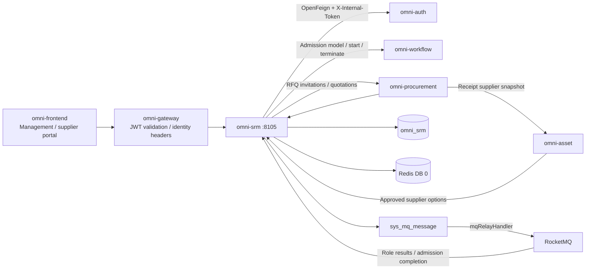
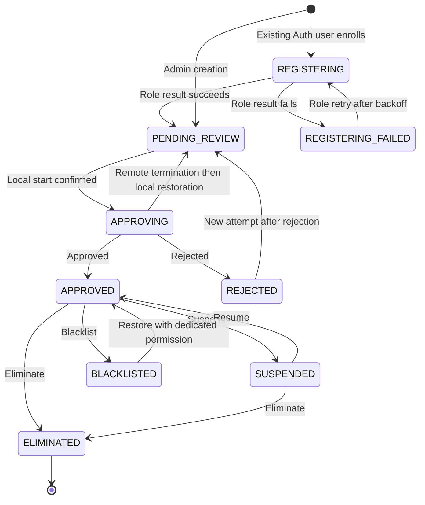
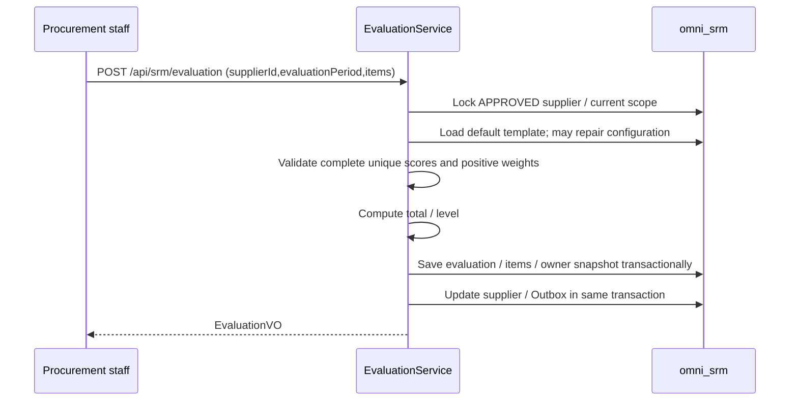
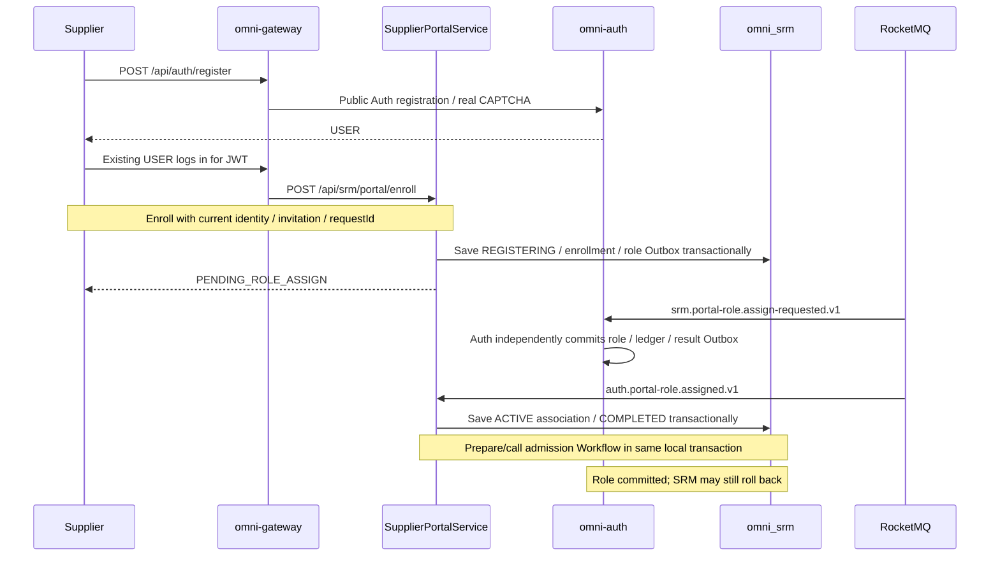

# SRM Supplier Management Module Architecture and Implementation Baseline

> Applicability: Retain the original date, 2026-07-27, and important history in sections 14–16. Current facts follow SRM source, Liquibase, frontend and configuration. Historical “end-to-end hardened” status does not establish this run's actual acceptance. Translation review records actual `AI_REVIEW` under [ADR-0003](../adr/0003-authorized-ai-translation-review.md), never human review.
>
> Project: Omni-Stack
> Original design date: 2026-07-27
> Current purpose: Preserve design decisions, the implemented baseline snapshot and important history; maintain current rules in the SRM fact document.

See current [SRM facts](../srm.en.md), the [feature tour](../wiki/feature-tour.en.md), [source index](../reference/source-map.en.md) and [development guide](../guides/scaffold-development.en.md). Prerequisites, identity, steps, screenshots and recovery belong in Wiki. Preserve design decisions without treating requirements or historical plans as new acceptance evidence. Related facts: [core flows](../core-flows.en.md), [Workflow](../workflow.en.md), [Procurement](procurement-design.en.md) and [Asset](asset-design.en.md).

Ownership: The implementation tables, state machines, permissions and API descriptions on this page are retained as the reviewed design baseline snapshot in commit `9b23ab972f1dcac4116ae95fb5cd56442e2961e4`; this does not backdate implementation results to the original design date. Maintain subsequent current contracts only in [SRM facts](../srm.en.md), rather than treating this page as a separately editable fact source. Update this page when long-term design decisions change and state their relationship to current facts and ADRs. Procedures and runtime evidence remain in Wiki.

## 1. Design Conclusion

SRM is an independent Servlet microservice with domain boundaries separate from procurement execution (`omni-procurement`) and asset management (`omni-asset`). Sections 3 and 8 describe current dependencies and integration.

| Item | Decision |
|---|---|
| Maven module / service name | `omni-srm` |
| Local port / management port | `8105` / `19905` |
| XXL-JOB executor | `omni-srm` / `9905`, controlled by `XXL_JOB_ENABLED` and related configuration; this does not establish scheduled evaluation or qualification scans |
| Database | `omni_srm` |
| Gateway | `/api/srm/**` → `lb://omni-srm`, without `StripPrefix` |
| Redis | DB 0, shared `xss:enabled:{tenantId}` / `xss:rules:{tenantId}`; no general `srm:` business cache prefix is declared |
| Frontend | `views/srm/**` (management) and `views/supplier-portal/index.vue` (portal) |

The SRM MVP covers the closed loop of full supplier lifecycle management:

> Supplier registration/admission → review → grading and classification → performance evaluation → risk control → elimination/exit.

Procurement execution (requisition, RFQ, order, goods receipt) and asset disposal (acceptance, transfer, scrap) are not included in the SRM MVP; they are implemented in `omni-procurement` and `omni-asset` respectively.

SRM master data depends on Auth identity/shared security. Admission calls independent Workflow; portal quotations call Procurement invitations. Procurement queries SRM suppliers/quotations. Asset uses both receipt supplier snapshots and direct SRM APPROVED supplier-option search, rather than inheriting supplier data only indirectly.

## 2. Product Scope

This section retains product goals and phases. Current features, entry points and limitations are below. Phase 2/3 are not delivered features and do not establish identical seeds or workflow models for every tenant.

### 2.1 Users and Goals

| User | Core need |
|---|---|
| Procurement manager | Manage the supplier library, evaluate supplier performance, control supply risk |
| Procurement staff | Daily supplier queries, initiate evaluations, view risk information |
| SRM administrator | Manage all supplier data and configuration within the tenant |
| Supplier | Self-register through the portal, maintain company information, view their own performance; submit quotations within the Procurement invitation scope |
| Read-only observer | View supplier statistics and records within the authorized scope |

The MVP should be able to answer: how many qualified/frozen/eliminated suppliers there are; when a given supplier's qualification expires; the score of the last performance evaluation; which suppliers have a red risk level; who modified key supplier information.

### 2.2 Phasing

| Phase | Capability |
|---|---|
| MVP | Supplier information library, admission review, grading and classification, supplier portal, performance evaluation, risk dashboard, supplier 360 |
| MVP increment (implemented) | Procurement/RFQ integration and supplier self-service quotation |
| Phase 2 | Dynamic evaluation-template configuration UI, third-party credit-reporting integration, risk-event workflow, certificate attachment management |
| Phase 3 | Supplier collaboration platform (order confirmation, shipment notification, reconciliation), intelligent alerts (public-opinion monitoring) |

## 3. System Boundaries

| Component | Authority | Current SRM use |
|---|---|---|
| `omni-auth` | Users, organizations, roles, permissions, data scope, XSS | Internal reference/scope/batch-display queries; portal-role requests for existing users |
| `omni-srm` | Suppliers, evaluations, risk, PortalUser, quotations | Sole business writer of this service; does not process registration passwords |
| `omni-base` | Dictionaries, operation logs, task/MQ operations | Dictionary authority/log aggregation; SRM stores codes and its own business data |
| `omni-workflow` | BPMN, instances, tasks, Flowable | Resolve published admission models, start/terminate and consume completion events; SRM embeds no engine |
| `omni-procurement` | RFQ, invitations, award, PO, receipt | Internal supplier/quotation queries; SRM validates invitations and complete line snapshots before quoting |
| `omni-asset` | Assets | Consume procurement supplier snapshots and directly search approved suppliers in SRM |
| RocketMQ | Event transport | Consumers must be idempotent; local Outbox does not prove delivery |
| Redis / XXL-JOB | Shared cache / execution foundation | XSS settings and configurable executor; external task deployment needs separate evidence |

The POM explicitly depends on `omni-common-core`, `omni-common`, `omni-common-mybatis`, `omni-common-redis`, `omni-common-operlog`, `omni-common-job`, `omni-common-mqlog`, `omni-common-service`, plus Web, Security, Validation, AspectJ, OpenFeign, LoadBalancer, Nacos, RocketMQ, Actuator and Lombok. `omni-common-service` assembles identity, tenancy, DataScope, persistence and XSS; dependencies do not establish that all jobs are enabled. SRM does not depend on `omni-common-workflow`. Flowable runtime/tables belong exclusively to independent Workflow.

## 4. Domain and Data Design

### 4.1 Aggregates

| Aggregate | Tables | Responsibility |
|---|---|---|
| Supplier | `srm_supplier`, `srm_supplier_contact`, `srm_supplier_qualification`, `srm_supplier_bank_account` | Supplier master data, contacts, qualifications, bank accounts |
| Evaluation | `srm_evaluation_template`, `srm_evaluation_dimension`, `srm_evaluation`, `srm_evaluation_item` | Evaluation template, evaluation records, scoring details |
| Risk | `srm_risk_indicator`, `srm_risk_assessment`, `srm_risk_indicator_type`, `srm_risk_criterion`, `srm_risk_score_threshold` | Indicators, assessment history and tenant-shared types/criteria/total-score thresholds |
| Portal | `srm_supplier_invite`, `srm_supplier_enrollment`, `srm_supplier_portal_user` | Enrollment invitation/Saga, portal account association |
| Quotation | `srm_quotation`, `srm_quotation_line`, `srm_quotation_request` | RFQ quotation snapshot, quotation lines, request idempotency history |
| Consumer Inbox | `srm_event_inbox` | Workflow completion registration, intent validation and processing state |

```mermaid
erDiagram
    SRM_SUPPLIER ||--o{ SRM_SUPPLIER_CONTACT : "contacts"
    SRM_SUPPLIER ||--o{ SRM_SUPPLIER_QUALIFICATION : "qualifications"
    SRM_SUPPLIER ||--o{ SRM_SUPPLIER_BANK_ACCOUNT : "bank accounts"
    SRM_SUPPLIER ||--o{ SRM_EVALUATION : "evaluations"
    SRM_SUPPLIER ||--o{ SRM_RISK_ASSESSMENT : "risk history"
    SRM_SUPPLIER ||--o{ SRM_SUPPLIER_ENROLLMENT : "enrollment"
    SRM_SUPPLIER ||--o{ SRM_QUOTATION : "quotations"
    SRM_SUPPLIER ||--o{ SRM_SUPPLIER_PORTAL_USER : "portal users"
    SRM_SUPPLIER ||--o{ SRM_RISK_INDICATOR : "risk indicators"
    SRM_QUOTATION ||--|{ SRM_QUOTATION_LINE : "lines"
    SRM_QUOTATION ||--o{ SRM_QUOTATION_REQUEST : "permanent request ledger"
    SRM_EVALUATION_TEMPLATE ||--o{ SRM_EVALUATION_DIMENSION : "dimensions"
    SRM_EVALUATION_TEMPLATE ||--o{ SRM_EVALUATION : "template"
    SRM_EVALUATION ||--o{ SRM_EVALUATION_ITEM : "score items"
    SRM_RISK_INDICATOR_TYPE ||--o{ SRM_RISK_CRITERION : "criteria"
    SRM_EVENT_INBOX {
        bigint tenant_id
        varchar event_id
    }
    SRM_RISK_SCORE_THRESHOLD {
        int min_score
        int max_score
    }
```

### 4.2 Common Fields and Rules

- All 20 `srm_*` tables contain `tenant_id`. Supplier and Evaluation are direct owner-authorized roots. Other business children inherit through explicit parent chains; not every authorized table has owner columns. Templates, dimensions and risk configuration are tenant-shared.
- Entities use actual DDL versions, deletion and audit fields. `srm_quotation_request` is a permanent ledger without `deleted/version`; Inbox has its own processing state. `create_by/update_by` are audit usernames, not SELF user IDs.
- Auth owns users/organizations and the server resolves the owner's primary unit. Portal accounts use `srm_supplier_portal_user`, never internal owner columns. No cross-database foreign keys are created; diagrams do not replace DDL.
- `supplier_no` is tenant-unique and derived from an existing ID, never `MAX+1`. Generic PUT changes neither lifecycle nor owner. Transfer, state commands and deletion have separate validation; DataPermission is not write authorization.
- Date-times use `yyyy-MM-dd HH:mm:ss`. Quotation unit price/quantity use `DECIMAL(19,6)` and amounts `DECIMAL(19,4)`; prices and returned amounts use JSON decimal strings. Scores/weights follow their own DTO precision.
- Permanent `tenant_id + request_id` uniqueness and `tenant_id + quotation_id + target_version` bind quotation requests to result versions. Active unique constraints prevent parallel non-deleted supplier/RFQ quotations or duplicate quotation lines.
- PII depends on the endpoint/assembler: supplier-specific lists are always masked; internal details and contact/bank lists honor `srm:pii:view`; portal self-profile has separate authorization, as in section 9.

### 4.3 Main Tables

`srm_supplier`

- `supplier_no/name/normalized_name/supplier_type/industry_code`.
- `credit_code (Unified Social Credit Code)/website/phone/email/region/address`.
- `category_code`: the supplier's category (IT, raw materials, administration, services, etc.), using a dictionary code.
- `level_code`: supplier level (STRATEGIC/PREFERRED/QUALIFIED/ELIMINATED), automatically adjusted by evaluation or set manually.
- `status`: lifecycle status (REGISTERING/REGISTERING_FAILED/PENDING_REVIEW/APPROVING/REJECTED/APPROVED/SUSPENDED/BLACKLISTED/ELIMINATED). `REGISTERING*` is used only for portal cross-service registration; admin creation enters PENDING_REVIEW and automatically prepares the admission Workflow.
- `owner_user_id/owner_unit_id/assigned_time/last_evaluation_time`.
- `version/deleted` and audit fields.
- Core indexes: tenant + owner/status, tenant + unit/status, tenant + category/status, tenant + name/credit_code.
- `workflow_request_id/workflow_business_key/workflow_model_version_id/approval_attempt/process_instance_id/workflow_start_status/workflow_completed_time/approved_time` store admission attempt/idempotency state; business key is `supplierId:attempt`. Start status is `NOT_STARTED/PENDING/FAILED/STARTED`. Starter identity comes from the current request, not persisted starter columns on Supplier.

`srm_supplier_contact`

- `supplier_id/name/department/job_title/mobile/phone/email/decision_role/primary_flag/status`.
- The current table has no internal owner columns. Scope inherits through the same-tenant Supplier; there is no owner-permission snapshot synchronized on transfer.
- Primary-contact/version/deletion rules follow dedicated services and DDL. Full contact details require the applicable PII permission.

`srm_supplier_qualification`

- `supplier_id/qualification_name/certificate_no/issuing_authority/issue_date/expiry_date/status`.
- `expiry_date` is used for qualification-expiry alerts (marked yellow when expiring within 30 days, red when already expired).
- The MVP does not store attachments, only text information.

`srm_supplier_bank_account`

- `supplier_id/account_name/account_no/bank_name/bank_branch/bank_code/status`.
- `account_no` is a PII field; the full value is returned only to `srm:pii:view`.
- Each supplier may maintain multiple bank accounts, marking one as default.

`srm_supplier_portal_user`

- `supplier_id/user_id/status/last_login_time/version/deleted`.
- `tenant_id + user_id` is unique, ensuring one Auth user is associated with only one supplier entity within the same tenant.
- `tenant_id + supplier_id + user_id` is used for portal row-level authorization; a portal user cannot switch companies by modifying the supplierId in the request.
- `owner_user_id` and the portal `user_id` are strictly separated in semantics: the former is the internal procurement owner, the latter is the supplier login account.

`srm_supplier_enrollment`

- `request_id/supplier_id/user_id/invite_id/status/retry_count/last_error_code/next_retry_time/version/deleted`.
- States are `PENDING_ROLE_ASSIGN/ROLE_ASSIGN_FAILED/COMPLETED/CANCELLED`; `tenant_id + request_id` is unique. Replay checks the applicant and normalized credit_code, not a SHA hash of the whole enrollment request.
- Store inviteId, never raw tokens, passwords or captchas. `next_retry_time` is a backoff recommendation, not proof of automatic scheduling. Role-failure retry differs from admission-start retry.

`srm_supplier_invite`

- `invite_code_hash/status/expires_time/max_uses/used_count/version/deleted`. The current implementation has no expected credit_code, email digest or purpose fields.
- Creation generates a UUID token returned once in the creation response. The database stores SHA-256, not HMAC. Consumption checks tenant, ACTIVE, expiry, remaining uses and version; the conditional use-count update belongs to enrollment's transaction.
- List display can show expired/exhausted entries as EXPIRED/USED. Display status does not establish a persisted scanning job. Revoked invitations cannot be consumed.

`srm_evaluation_template`

- `tenant_id/name/status/default_flag/version/deleted`.
- In the MVP, each tenant has one default template set, with no dynamic configuration UI.
- At tenant initialization, `SrmTenantInitializer` idempotently creates the default template.

`srm_evaluation_dimension`

- `tenant_id/template_id/indicator_name/weight/sort/status/deleted`.
- The MVP presets four dimensions: Quality (30%), Delivery (30%), Price (20%), Service (20%).
- `weight` is `DECIMAL(5,2)`; the sum of all dimension weights under the same template must equal 100.

`srm_evaluation`

- `supplier_id/template_id/evaluation_period/total_score/evaluator_user_id/evaluation_time/status/owner_user_id/owner_unit_id/version/deleted`. Creation produces `COMPLETED` and snapshots internal ownership.
- Request fields are `supplierId/evaluationPeriod/items`, without client supplier version or total score. Only visible APPROVED suppliers with complete ownership are eligible; after locking, use the database version.
- `SUM(score / 5 × weight)` rounds HALF_UP to two decimals, range 20–100. ≥90 STRATEGIC, ≥75 PREFERRED, ≥60 QUALIFIED, otherwise ELIMINATED. This is `level_code` and does not move the supplier lifecycle directly into its eliminated terminal state.

`srm_evaluation_item`

- `evaluation_id/dimension_id/indicator_name/score/weight/remark`.
- `score` is 1-5, `DECIMAL(3,1)`.
- Append-only, written once when the evaluation is submitted, with no subsequent modification interface (to correct, create a new evaluation record).

`srm_risk_indicator`

- `supplier_id/indicator_type/indicator_value/criterion_id/score/risk_level/assessment_time/remark` plus actual version/deletion/audit fields.
- Types come from enabled configuration rather than a fixed Java enum. Six formal seed types are default-tenant examples.
- Manual edits are rejected for `autoCalc=1` only when an enabled type is found; absent/disabled types skip that check. criterionId copies the current tenant's criterion score/level/label; current code does not enforce criterion/type consistency.

`srm_risk_assessment`

- `supplier_id/overall_level/assessment_time/assessor_user_id/remark/version/deleted`.
- Current overall level sums non-null `indicator.score` values and matches score thresholds, not the highest indicator color. Recalculation appends assessment history; see 5.3.

`srm_quotation`

- `supplier_id/rfq_id/rfq_no/supplier_name_snapshot/request_id/quotation_time/valid_until/total_amount/currency_code/status/version/deleted`.
- `request_id` records the client request ID of the last successful change to this quotation, used for current-snapshot audit; the complete request idempotency history is stored by `srm_quotation_request`.
- A `(tenant_id, rfq_id, active_supplier_guard)` unique constraint ensures at most one non-deleted quotation per RFQ per supplier; a duplicate submission updates the original quotation and increments `version`, without creating a parallel valid quotation.
- `total_amount DECIMAL(19,4)`, `currency_code CHAR(3)`, and the RFQ/supplier snapshots are all computed by the server from the Procurement invitation details and quotation lines; the portal must not specify them directly.

`srm_quotation_line`

- `quotation_id/rfq_line_id/material_code/material_name/unit/unit_price/quantity/line_amount/delivery_days/remark/version/deleted`.
- `rfq_line_id` is required, and the submitted line set must exactly match the RFQ line snapshot returned by Procurement; material, unit, and quantity are copied by the server, and the portal submits only unit price, delivery days, and remark.
- `unit_price/quantity` use `DECIMAL(19,6)` and must be greater than 0; `line_amount` uses `DECIMAL(19,4)` and must be greater than 0; `delivery_days` is 0–3650. The server computes and summarizes line by line; trusting client amounts is forbidden.
- `(tenant_id, quotation_id, active_rfq_line_guard)` is unique; duplicate RFQ lines within the same quotation are forbidden.

`srm_quotation_request`

- `request_id/quotation_id/rfq_id/supplier_id/request_hash/target_version/status`, with status only `RESERVED/COMPLETED`, no logical deletion.
- `(tenant_id, request_id)` is permanently unique; `request_hash` is the SHA-256 of the normalized request body, used to reject different intents under the same requestId.
- `(tenant_id, quotation_id, target_version)` is unique, storing the quotation version corresponding to each successful update; therefore an old requestId replayed after the quotation continues to be updated can still be recognized and will not duplicately write the quotation, details, or Outbox.

`srm_risk_indicator_type` / `srm_risk_criterion` / `srm_risk_score_threshold`

- Store types (including enabled/autoCalc), scoring criteria and total-score intervals. Tenant identity and configuration permission apply; internal owner filtering does not.
- Query order and inclusive interval endpoints determine matching. Complete coverage/non-overlap validation is not guaranteed.

`srm_event_inbox`

- Tenant/eventId protects Workflow completion consumption, with source, type, aggregate key, payload and processing state.
- Validate same-ID JSON-semantic intent before replay handling. Inbox and supplier changes share a transaction; valid early completion requires retry instead of permanent suppression.

## 5. State Machine and Core Flows

### 5.1 Supplier Lifecycle

`REGISTERING/REGISTERING_FAILED` belong only to portal-role Saga for existing Auth users; Auth registration happens first. Admin creation sets PENDING_REVIEW and prepares/calls Workflow synchronously within the same local transaction. Confirmed start yields APPROVING. New procurement business requires APPROVED; ELIMINATED is an irreversible lifecycle terminal state. Blacklist restoration has dedicated permission.

Management `submit` and portal `profile/submit` allow only REJECTED and open a new attempt. There is no generic same-snapshot start-retry API for PENDING_REVIEW/FAILED. Withdrawal/cancellation first terminates the matching remote instance, then version-updates local PENDING_REVIEW/NOT_STARTED. Remote success and local changes are not a distributed atomic rollback.

### 5.2 Performance Evaluation Flow

Request fields are `supplierId/evaluationPeriod/items[{dimensionId,score,remark}]`. The default template keeps Quality/Delivery/Price/Service at 30/30/20/20. Template reads can repair local configuration and are not necessarily side-effect-free queries. Every enabled dimension must appear exactly once; scores are 1–5, stored as `DECIMAL(3,1)`, with positive weights totaling 100.

One transaction saves Evaluation/Items, supplier level/latest-evaluation time and `srm.evaluation.completed.v1` Outbox. See 4.3 for grading; Evaluation preserves owner snapshots. Standalone history returns at most 100 records; 360 selects the latest five. Quarterly frequency is an original business suggestion, not evidence of enforced scheduled execution.

### 5.3 Risk Assessment Flow

Current flow: validate visible supplier/command scope → update indicators using actual criteria → recalculate CERTIFICATE → sum non-null scores → match total-score thresholds → append RiskAssessment → write risk Outbox only on first/non-red-to-RED transition.

Endpoints are inclusive, using the first match in query order. No thresholds yields GREEN. An unmatched total above every maximum takes the greatest-upper-bound threshold's level; other gaps yield GREEN. Compatibility method `highest` is not the current overall-assessment path.

Missing certificate expiry is GREEN; 0–30 days from today is YELLOW, overdue RED, with scores 1/2/3. Multiple qualifications choose the worst level, then earlier expiry on ties. Manual assessment, indicator updates and qualification changes for APPROVED/SUSPENDED/BLACKLISTED suppliers trigger recalculation. Current SRM main Java has no dedicated `@XxlJob/@Scheduled` qualification-risk scan; external job configuration needs separate proof. An event does not prove external notification delivery.

### 5.4 Supplier Portal Account Opening and Enrollment

- Public Auth `POST /api/auth/register` validates tenant, real captcha, username uniqueness and password handling. Default USER assignment failure boundaries are in Core Flow 1. SRM receives neither passwords nor captchas.
- Authenticated `portal/enroll` requires enrollment permission, original requestId and valid tenant invitation. Tenant/user come from trusted identity. New enrollment writes REGISTERING, base risk data, PENDING_ROLE_ASSIGN and a role-request Outbox.
- Replay checks applicant and normalized credit_code; existing applications may return without another invitation use. Auth atomically adds the role, ledger and result Outbox. Completed replay may publish a deterministic result eventId again.
- SRM success creates/activates ACTIVE PortalUser and COMPLETED/PENDING_REVIEW, then attempts admission in that same local transaction. Auth's role can already be committed while SRM model-resolution failure rolls back local changes. Reconcile both sides/messages; cross-service “no half-success” is not guaranteed.
- Role failure means Enrollment ROLE_ASSIGN_FAILED and Supplier REGISTERING_FAILED. `enrollment/retry` requires failure/backoff expiry and republishes the original requestId role intent, without consuming the invitation again. It is not approval-start retry.
- Saga COMPLETED does not imply admission APPROVED. Role changes do not update existing JWTs; the client prompts re-login. Real captcha registration and cross-service end-to-end execution still need independent evidence.

## 6. Tenant, RBAC, and Data Permissions

### 6.1 Trust Chain

Gateway validates JWT/blacklist and overrides identity headers → `GatewayPreAuthenticationFilter` builds authentication → `ServiceIdentityFilter` establishes tenant/user → Controller method permission → corresponding DataScope aspect → MyBatis policies/write guards. Missing authentication/identity is rejected at the applicable boundary. Shared internal-token filtering separately fails closed for internal APIs.

`X-Gateway-Forwarded:true` is not cryptographic proof; production business ports need network boundaries. Outer finally clears shared contexts, nested scopes restore previous context. ThreadLocal still exists.

### 6.2 Permission Tree and Roles

Current menus/permissions/default-tenant role seeds follow `scripts/sql/seed/auth.sql`; they do not prove identical roles in every new tenant. Common permission mapping is in 7.3.

| Role | Seed scope | Current boundary |
|---|---|---|
| `SRM_ADMIN` | TENANT | Tenant management, never proxy supplier quotations |
| `PROCUREMENT_MANAGER` | DEPT_AND_BELOW | Department/subdepartments, evaluation and risk |
| `PROCUREMENT_STAFF` | SELF | Own business; configuration is tenant-shared by function permission |
| `SUPPLIER` | SELF | Still needs portal permission and ACTIVE PortalUser for current tenant/user |
| `SUPER_ADMIN` | ALL | Full function tree, current-tenant data only; alone cannot impersonate portal identity |

USER gets SRM enroll only. Profile/evaluation/quotation also require SUPPLIER, function permission and ACTIVE association. Keep internal and portal identities distinct. Frontend retains multi-role management entry according to actual permissions; backend revalidates.

### 6.3 Auth Internal Data-Scope Contract

The actual internal path is `GET /internal/data-scopes/{userId}?tenantId={tenantId}&permissionCode=srm:supplier:list`, without `/api`.

Auth validates enabled user/tenant and merges only roles granting that full permission. Shared components distinguish denial, inconsistent responses and failures with applicable 403/503 branches. Missing identity/scope must not widen queries.

### 6.4 Common Context and SRM SQL Policy

`omni-common-service` assembles identity, internal authentication, XSS and persistence. Order: `TenantLineInnerInterceptor → DataPermissionInterceptor → OptimisticLockerInnerInterceptor → PaginationInnerInterceptor`. TenantLine handles only `srm_*`; `sys_mq_message` remains outside both permission interceptors.

| Resource | Authorization |
|---|---|
| Supplier / Evaluation | Direct owner roots; Evaluation snapshots creation-time ownership |
| Contact / Qualification / BankAccount / RiskIndicator / RiskAssessment / Quotation | Same-tenant Supplier parent inheritance |
| EvaluationItem | Inherits Evaluation |
| QuotationLine | Quotation then Supplier, two-level inheritance |
| Template / Dimension / risk configuration | Tenant-shared and function permission |
| Portal | Role/function/ACTIVE PortalUser fixes supplierId; not internal owner scope |
| Supplier 360 blocks | Contacts, qualifications, banks, evaluations and risk each resolve permission/scope; ungranted blocks are not queried |

Owner-root SELF is `owner_user_id=currentUserId`, DEPT `owner_unit_id=primaryUnitId`, DEPT_AND_BELOW/CUSTOM a unit set, TENANT/ALL omit owner while retaining tenant. SrmPermissionScopeExecutor/SrmPortalScope restore previous scope; a broad owner OR cannot replace parent chains.

### 6.5 Row-Level Authorization for Write Operations

Changes to existing records first load a current-tenant visible row, validate state/relationships, then apply each command's version/deletion/state conditions and affected-row checks. Number assignment, cascades, permanent ledger, invitation revocation and tenant configuration have separate paths; not all writes carry client version. DataPermission does not replace `SrmRecordAccessGuard`.

Owner creation/transfer asks Auth for an enabled same-tenant user and authoritative primary organization. Selecting another owner also needs the relevant transfer permission/assignable scope. Generic PUT rejects owner changes. Deletion is limited by lifecycle, portal/evaluation/risk history and other constraints.

## 7. API Design

### 7.1 Common Contract

Responses are `R<T>`, pages `R<PageResult<T>>`, page starts/defaults at 1, size defaults to 10 and is at most 100. DTOs declaring version require it. Evaluation creation has no client supplier version; invitation revocation cannot be generalized to one version-command request.

Date-times use `yyyy-MM-dd HH:mm:ss`; quotation precision and JSON strings are in 8.4. Controllers/DTOs define fields. Logging, internal authentication, portal identity and owner aspects apply per entry, not as one annotation promise for every method.

### 7.2 Endpoints

These 77 external and four internal method paths include current aliases and show full service paths. Gateway does not strip `/api/srm`. Auth registration is an external dependency API, excluded from the SRM-controller inventory.

| Area | Method and full path |
|---|---|
| Bank accounts | `GET /api/srm/supplier/{supplierId}/bank-account` `GET /api/srm/supplier/{supplierId}/bank-account/list` `GET /api/srm/supplier/{supplierId}/bank-account/{id}` `POST /api/srm/supplier/{supplierId}/bank-account` `PUT /api/srm/supplier/{supplierId}/bank-account/{id}` `DELETE /api/srm/supplier/{supplierId}/bank-account/{id}` |
| Contacts | `GET /api/srm/supplier/{supplierId}/contact` `GET /api/srm/supplier/{supplierId}/contact/list` `GET /api/srm/supplier/{supplierId}/contact/{id}` `POST /api/srm/supplier/{supplierId}/contact` `PUT /api/srm/supplier/{supplierId}/contact/{id}` `DELETE /api/srm/supplier/{supplierId}/contact/{id}` |
| Performance evaluation | `GET /api/srm/evaluation/list` `GET /api/srm/evaluation/{id}` `GET /api/srm/evaluation/supplier/{supplierId}` `GET /api/srm/evaluation/template/default/dimensions` `POST /api/srm/evaluation` |
| Internal quotations | `GET /api/internal/quotation/batch` |
| Internal suppliers | `GET /api/internal/supplier/{supplierId}` `GET /api/internal/supplier/search` `POST /api/internal/supplier/batch` |
| Owner options | `GET /api/srm/options/owners` |
| Overview | `GET /api/srm/overview/summary` `GET /api/srm/overview/risk-dashboard` |
| Portal enrollment/profile | `POST /api/srm/portal/enroll` `GET /api/srm/portal/enrollment` `POST /api/srm/portal/enrollment/retry` `GET /api/srm/portal/profile` `PUT /api/srm/portal/profile` `POST /api/srm/portal/profile/submit` |
| Portal evaluation | `GET /api/srm/portal/evaluations` `GET /api/srm/portal/evaluations/history` |
| Invitations including aliases | `GET /api/srm/portal/invite` `GET /api/srm/portal/invite/list` `GET /api/srm/invite` `GET /api/srm/invite/list` `POST /api/srm/portal/invite` `POST /api/srm/invite` `POST /api/srm/portal/invite/{inviteId}/revoke` `POST /api/srm/invite/{inviteId}/revoke` |
| Portal quotations | `GET /api/srm/portal/quotation/invitations` `GET /api/srm/portal/quotation/invitations/{rfqId}` `POST /api/srm/portal/quotation` |
| Qualifications | `GET /api/srm/supplier/{supplierId}/qualification` `GET /api/srm/supplier/{supplierId}/qualification/list` `GET /api/srm/supplier/{supplierId}/qualification/{id}` `POST /api/srm/supplier/{supplierId}/qualification` `PUT /api/srm/supplier/{supplierId}/qualification/{id}` `DELETE /api/srm/supplier/{supplierId}/qualification/{id}` |
| Risk | `GET /api/srm/risk/list` `GET /api/srm/risk/indicators/{supplierId}` `PUT /api/srm/risk/indicator/{id}` `POST /api/srm/risk/assessment/{supplierId}` `GET /api/srm/risk/assessment/history/{supplierId}` |
| Risk configuration | `GET /api/srm/risk/config/types` `POST /api/srm/risk/config/types` `PUT /api/srm/risk/config/types/{id}` `DELETE /api/srm/risk/config/types/{id}` `POST /api/srm/risk/config/criteria` `PUT /api/srm/risk/config/criteria/{id}` `DELETE /api/srm/risk/config/criteria/{id}` `GET /api/srm/risk/config/thresholds` `PUT /api/srm/risk/config/thresholds` |
| Supplier | `GET /api/srm/supplier/list` `GET /api/srm/supplier/{id}` `GET /api/srm/supplier/{id}/overview` `POST /api/srm/supplier` `PUT /api/srm/supplier/{id}` `POST /api/srm/supplier/{id}/transfer` `DELETE /api/srm/supplier/{id}` `POST /api/srm/supplier/{id}/submit` `POST /api/srm/supplier/{id}/withdraw` `POST /api/srm/supplier/{id}/cancel` `POST /api/srm/supplier/{id}/suspend` `POST /api/srm/supplier/{id}/resume` `POST /api/srm/supplier/{id}/restore-from-blacklist` `POST /api/srm/supplier/{id}/restore` `POST /api/srm/supplier/{id}/blacklist` `POST /api/srm/supplier/{id}/eliminate` |
| Supplier insights | `GET /api/srm/supplier/{supplierId}/evaluation/history` `GET /api/srm/supplier/{supplierId}/risk` |

### 7.3 Endpoint to DataScope Permission Mapping

| Operation | Permission / additional conditions |
|---|---|
| Overview | `srm:overview:list` |
| Supplier list/detail/360 | `srm:supplier:list`; independently authorize 360 child blocks |
| Create / rejected submit | `srm:supplier:create` |
| Update / delete / transfer | `srm:supplier:update`, `srm:supplier:delete`, `srm:supplier:transfer` |
| withdraw / cancel | `srm:supplier:withdraw`, `srm:supplier:cancel`; match remote instance first |
| suspend / resume / blacklist / restore / eliminate | `srm:supplier:suspend`, `srm:supplier:resume`, `srm:supplier:blacklist`, `srm:supplier:restore`, `srm:supplier:eliminate` |
| Contacts / qualifications / banks | `srm:contact:list`, `srm:contact:create`, `srm:contact:update`, `srm:contact:delete`, `srm:qualification:list`, `srm:qualification:create`, `srm:qualification:update`, `srm:qualification:delete`, `srm:bank-account:list`, `srm:bank-account:create`, `srm:bank-account:update`, `srm:bank-account:delete` |
| Evaluation | `srm:evaluation:list`, `srm:evaluation:create`, `srm:evaluation:view` |
| Risk / configuration | `srm:risk:list`, `srm:risk:update`, `srm:risk:assess`, `srm:risk:config:list`, `srm:risk:config:update` |
| Owner / PII | `srm:owner:list`, `srm:pii:view` |
| Invitations | Corresponding `srm:invite:list`, `srm:invite:create`, `srm:invite:revoke` or `srm:portal:invite` |
| enroll / enrollment state or retry | `srm:portal:enroll`; state/retry accept `srm:portal:enroll` or `srm:portal:profile` |
| Portal profile / evaluation / quotation | `srm:portal:profile`, `srm:portal:evaluation`, `srm:portal:quotation` plus SUPPLIER and ACTIVE association |

Authorization uses each complete permission code together with the applicable row-level checks. Current SRM has no local approve/reject/approval-view method; Workflow completes approval tasks.

## 8. Cross-Service Consistency

### 8.1 Users and Organizations

OwnerResolver validates Auth user, primary unit and assignable scope during creation/transfer. ownerUnitId is authoritative. OwnerEnricher deduplicates and batch-queries users/organizations; failures may leave IDs/empty names. Display fallback does not widen authorization or prove all Feign calls occur outside transactions.

Store user/unit IDs and necessary audit usernames locally, never passwords. Auth's ledger/result Outbox manages portal roles; SRM stores PortalUser associations.

### 8.2 Dictionary

Base owns `srm_supplier_category`. Formal default-tenant seeds include ELECTRONICS, IT, RAW_MATERIAL, ADMIN and SERVICE. SRM stores category_code and initializes its own evaluation templates/base risk data. These examples do not establish identical catalogs for every tenant or require every local read to query Base online.

### 8.3 Workflow

Admin create, REJECTED submit and portal-role success synchronously call SupplierWorkflowCoordinator within local transactions. Resolving a current-tenant published `SRM_SUPPLIER_ONBOARDING` model happens before the start-exception catch. Missing/unpublished models or lookup failure can roll back creation/Saga results.

Persist `requestId/businessKey=supplierId:attempt/modelVersionId/attempt/startStatus/instance`. Starter identity comes from current context. Success must match request/business key/type/instance; the response field is `replayed`. markStarted/markFailed use REQUIRED, not independent post-commit confirmation. Failed start/confirmation attempts a FAILED marker that can fail or match no row. FAILED does not prove the remote instance was absent. There is no generic PENDING_REVIEW/FAILED start-retry API; role-Saga retry is not a substitute.

Completion uses `tenantId + eventId` Inbox: validate JSON-semantic intent before matching attempt, business key, instance and state. Valid early completion requires message retry; stale attempts/duplicates/foreign instances are isolated. Completion advances APPROVED/REJECTED. Withdrawal/cancellation terminates remotely before local version update, as in 5.1.

`RequiredWorkflowModelInitializer` belongs to Workflow. It checks four required models for default tenant 1 and corrects/publishes found enabled matching models. It does not create models for every tenant or guarantee SRM startup readiness for every tenant.

### 8.4 Procurement and Asset Integration

Four internal paths are in 7.2. They use `X-Internal-Token` and `X-Tenant-Id` with matching query/body tenant. Supplier get/batch return current non-deleted summaries, without automatically requiring APPROVED; callers validate eligibility. Search accepts status/category/keyword and limit 1..100. Batch accepts at most 100 unique positive IDs, preserves first-appearance order and omits missing IDs, without contact/bank PII. Asset currently uses approved supplier search; receipts retain Procurement snapshots.

Portal RFQs call Procurement `/api/internal/procurement/rfq/invitations` and `/api/internal/procurement/rfq/{rfqId}/invitation`. SupplierId comes from ACTIVE PortalUser, not the client. Quotation binds only `requestId/rfqId/version/validUntil/lines[{rfqLineId,unitPrice,deliveryDays,remark}]`.

After identity/DTO validation, check the permanent ledger first. A same-intent historical requestId returns the current quotation without writes/events or repeating new-request APPROVED/RFQ-open checks. Different intent yields 409. New requests then lock an APPROVED supplier and require RFQ SENT, invitation INVITED/QUOTED, a future deadline and validUntil later than now and no earlier than the deadline.

Require 1–200 unique lines fully covering the RFQ snapshot. Material/unit/quantity/currency come from the server-side invitation. Positive unitPrice is a JSON decimal string fitting DECIMAL(19,6); delivery 0–3650 days, remark ≤500 characters. Line amount rounds HALF_UP to four decimals; totals sum lines, all positive DECIMAL(19,4). Returned/event amounts use strings.

The tenant/requestId ledger stores SHA-256 normalized intent and quotationId/targetVersion. Intent includes rfqId,version,validUntil and line-ID-sorted price/delivery/remarks. First creation uses version 0 and stores version 1; updates require current version. Quotation, lines, COMPLETED ledger and srm.quotation.submitted.v1 Outbox commit together. Procurement updates invitations by event/intent/version and persists immutable award/PO snapshots; later quotations do not rewrite existing POs. Internal quotation batch returns only SUBMITTED, unexpired quotations from APPROVED suppliers.

### 8.5 Outbox and Events

`DomainEventEnvelope` includes `eventId/eventType/occurredAt/tenantId/producer`, `aggregateType/aggregateId/aggregateVersion`, `actorUserId/correlationId/causationId/payload` as defined per event. Transactions explicitly call `ReliableMessageRelay.send("srm-domain-out-0", envelope, tenantId, eventId)`. Top-level eventId is msgKey; Outbox msgId is independently generated.

SRM outputs six supplier registered/approved/rejected/suspended/blacklisted/eliminated events plus `srm.portal-role.assign-requested.v1`, `srm.quotation.submitted.v1`, `srm.evaluation.completed.v1` and `srm.risk.level-changed.v1`. Auth inputs are `auth.portal-role.assigned.v1` / `auth.portal-role.assign-failed.v1`: 12 types total, not 12 SRM outputs.

Payloads may include explicit IDs, versions, states, scores/amounts and necessary snapshots, never passwords/captchas/inviteToken/full bank accounts/contact details. Role requests/results follow their own DTOs; every envelope does not contain both request and result fields. Outbox commit proves neither Broker delivery, consumption nor external notifications.

| Direction | Event type |
|---|---|
| SRM output | `srm.supplier.registered.v1` |
| SRM output | `srm.supplier.approved.v1` |
| SRM output | `srm.supplier.rejected.v1` |
| SRM output | `srm.supplier.suspended.v1` |
| SRM output | `srm.supplier.blacklisted.v1` |
| SRM output | `srm.supplier.eliminated.v1` |
| SRM output | `srm.portal-role.assign-requested.v1` |
| SRM output | `srm.quotation.submitted.v1` |
| SRM output | `srm.evaluation.completed.v1` |
| SRM output | `srm.risk.level-changed.v1` |
| Auth input | `auth.portal-role.assigned.v1` |
| Auth input | `auth.portal-role.assign-failed.v1` |

## 9. Privacy, Operation Logs, and XSS

### 9.1 OperLog Masking

Operation logs sanitize explicit fields/text rules, not arbitrary PII. Account numbers, contact details, credentials and free text follow actual annotations/shared sanitizer. enroll disables snapshots and excludes inviteToken/creditCode/phone/email; raw invitation tokens are not logged. Generic asynchronous logs do not replace business state, Inbox or approval facts.

### 9.2 PII

Supplier-specific lists always use masked VOs. Details/360 and contact/bank lists/details use srm:pii:view for phone/email/account values. Addresses receive no general masking guarantee from that rule. Portal profile returns own phone/email after SUPPLIER/function/ACTIVE checks; SUPPLIER has no implied global pii:view. Current portal has no contacts/qualifications/bank-accounts APIs.

SRM stores company/contact/bank/free-text data and BaseEntity audit usernames, not only userId/unitId. Supplier has no persisted Workflow-starter columns; start requests pass current identity to Workflow. Evidence, screenshots, logs and exports still require field-appropriate authorization.

### 9.3 XSS

SRM reuses common-service `CachedServiceXssConfigProvider` rather than a second independent SPI. It reads two Redis DB 0 XSS keys. Missing/failed cache triggers Auth; valid authoritative settings, including enabled, remain in use even if cache writes fail. Only absent/failed authoritative results select the default HTML_TAG/EVENT_HANDLER/DANGEROUS_PROTOCOL baseline. Dependency failures cannot bypass filters; remarks are plain-text usage without v-html.

## 10. Frontend Design

Current management pages are `views/srm/{overview,supplier,evaluation,risk,invite}/index.vue` and `views/srm/risk/config/index.vue`. Portal is `views/supplier-portal/index.vue`, not the old enrollment/profile/evaluation directory split. APIs include srm-overview/supplier/evaluation/risk/risk-config/portal.ts.

Actual `components/srm` retains SupplierOverview, SupplierPicker, SupplierResourcesDrawer, EvaluationScorecard, RiskIndicator and RiskDashboard. 360 uses a Drawer with independently authorized backend blocks. Risk dashboard filters levels.

`ApiResponse/PageResult` come only from `src/types/api.ts`; buttons use matching v-permission. SUPPLIER without management permission routes to portal; multi-role users retain management entry by actual permission. Four-language text, menus/router/layout are current entry points. Real steps/screenshots belong in Wiki; this page does not establish browser acceptance.

## 11. Engineering Entry Points

### 11.1 Current Module Entries

Entry: `omni-backend/omni-srm/src/main/java/com/omni/srm/SrmApplication.java` with client/config/controller/dto/entity/mapper/security/service/workflow/consumer/domain. Actual resources are application.yml/application-lite.yml. The application declares EnableDiscoveryClient, EnableFeignClients and MapperScan; domain SecurityConfig combines with shared common-service.

Do not recreate the module from the original plan. Current Mappers/Liquibase define SQL/migrations. Development operations belong in the [development guide](../guides/scaffold-development.en.md).

### 11.2 Current Related Files

These are current related entry points, not files awaiting creation. Contract changes require corresponding migrations, seeds and checks.

| Area | Current files/directories |
|---|---|
| Module | `omni-backend/omni-srm/pom.xml` `omni-backend/pom.xml` |
| Runtime configuration | `omni-backend/omni-srm/src/main/resources/application.yml` `omni-backend/omni-srm/src/main/resources/application-lite.yml` |
| Schema and seeds | `database/changelog/srm/0001-srm-schema.yaml` `scripts/sql/seed/srm.sql` |
| Permissions/digests | `scripts/sql/seed/auth.sql` `database/seed/manifest.yaml` |
| Tenant initialization | `omni-backend/omni-srm/src/main/java/com/omni/srm/service/impl/SrmTenantModuleProvisioner.java` `omni-backend/omni-srm/src/main/java/com/omni/srm/service/impl/SrmTenantInitializerImpl.java` |
| Gateway / Compose | `omni-backend/omni-gateway/src/main/resources/application.yml` `compose.yaml` |
| UI | `omni-frontend/src/views/srm` `omni-frontend/src/views/supplier-portal/index.vue` `omni-frontend/src/components/srm` |
| Workflow / Auth contracts | `omni-backend/omni-srm/src/main/java/com/omni/srm/workflow` `omni-backend/omni-srm/src/main/java/com/omni/srm/client` `omni-backend/omni-auth/src/main/java/com/omni/auth/service/impl/PortalRoleAssignmentServiceImpl.java` |

Defaults: service port 8105, management port 19905, Redis DB 0, and XXL-JOB appname omni-srm with executor port 9905. Compose maps container ports according to current configuration; the lite profile disables Nacos and uses static discovery. Run applications, builds and tests in local Docker. Role seeds do not grant USER all management permissions or combine portal identity with internal management identity.

## 12. Non-Functional Design

- Page size is capped at 100; history and 360 queries have their own limits. The DDL defines owner, status and category indexes. OwnerEnricher fetches user and organization display data in batches; display fallback does not change data scope. This document provides no measured performance results.
- State commands check the current record and version. Evaluation locks the supplier and writes its result within one local transaction. Conditional invitation counters, the permanent quotation request ledger and active keys provide the documented concurrency and idempotency boundaries. They do not establish distributed atomicity.
- Data-scope lookup failures deny access. Display enrichment may leave IDs unchanged. A local Outbox write does not prove eventual delivery during an MQ outage. XSS configuration lookup falls back from Redis to Auth and then to the baseline. Workflow and Saga operations retain the partial-commit boundaries described above; an error response does not prove that a remote operation did not execute.
- SRM initializes its evaluation template and risk configuration; Base owns dictionaries. Default-tenant seeds, required Workflow models and role initialization do not guarantee that every tenant or deployment is ready.

## 13. Testing and Acceptance

Tests are under `omni-backend/omni-srm/src/test/java`. Keep unit results, build results and actual business execution evidence separate. Verification requirements include:

- All nine states, version checks and deletion limits; missing models and failures to record a workflow start during create, submit and profile-submit; absence of a generic approval-start retry API; and remote termination followed by a local failure.
- Complete four-dimension scoring, scores from 1 to 5, totals from 20 to 100, HALF_UP rounding to two decimal places, thresholds of 60/75/90 without automatic lifecycle elimination, owner snapshots and independent evaluation permissions.
- Current total-score thresholds, inclusive bounds, first-match behavior and gaps; enabled indicator types, autoCalc and criterion boundaries; certificate expiry recalculation and red-risk events.
- Internal owner and parent chains, tenant-shared configuration, independently scoped 360 blocks, portal role and function checks, ACTIVE associations, and PII, XSS and logging boundaries.
- Invitation SHA-256 hashes, expiry and concurrent consumption; applicant/creditCode replay checks; role ledger and result replay; an Auth role committed while SRM rolls back; role retry after backoff; and JWT refresh through login.
- Quotation decimal strings, precision, complete lines, RFQ eligibility and the permanent request ledger. Historical request replay returns the current snapshot without another Outbox write; Procurement award and PO snapshots remain immutable.
- Real end-to-end acceptance still requires Auth registration with a real CAPTCHA → login → enrollment and role result → admission approval → evaluation and risk → portal self-data and quotations. Unit passes or this page do not prove that chain. Docker commands and operational recovery belong in the existing Wiki.

## 14. Implementation Order

The original implementation breakdown dated 2026-07-27 and its completion conditions are retained as history. They are not new execution evidence or instructions to repeat completed work. Sections 3–13 describe current entry points and contracts.

### Milestone 0: Prerequisite Confirmation

- Confirm the Auth DataScope internal interface, OperLog PII masking, and XSS miss strategy are ready (already built for CRM, reused directly).
- Confirm the Gateway internal-path blocking rules include the unified prefix `/api/internal/**`.

### Milestone 1: Service Setup + Security Foundation

- Create the module, configuration, Gateway, Docker, DB.
- TenantLine + DataPermission + Pagination.
- Permission tree, SRM roles, SUPPLIER role, existing-tenant migration.
- Frontend root menu (admin side + portal).

Completion condition: registration, routing, 401/403, tenant isolation, XSS, and health checks pass.

### Milestone 2: Supplier Management + State Machine

- Supplier CRUD, admission/review/suspend/resume/blacklist/eliminate.
- Contact, qualification, and bank-account sub-tables.
- Supplier 360 view.
- PII masking.

Completion condition: admin creates a supplier → review → grading/suspend/eliminate can be walked through.

### Milestone 3: Supplier Portal

- Supplier self-service account opening and enrollment (Auth public registration + authenticated SRM enroll + inviteToken + credit_code unique + role-assignment Saga).
- Portal login (SUPPLIER role routing).
- Company information maintenance.

Completion condition: Auth account opening → authenticated enrollment → SUPPLIER role assignment → review → portal maintains company information can be walked through.

### Milestone 4: Performance Evaluation

- Evaluation template presets (database seed data).
- Evaluation scoring → weighted summary → automatic level adjustment.
- Evaluation history and trends.

Completion condition: the closed loop from evaluation creation to automatic level adjustment.

### Milestone 5: Risk Dashboard + Production Hardening

- Risk indicator entry and display.
- Red/yellow/green lights + qualification-expiry alerts.
- Overview statistics (summary + risk-dashboard).
- Testing, indexes, security acceptance.
- Update README, architecture, api-contract, AGENTS.

Completion condition: the MVP, backend build, frontend Build/Lint, Docker, and security acceptance all pass.

## 15. ADR Summary

Important original decisions are retained. Where phased suggestions differ from current implementation, use the current facts above. Historical preset and optional scanner plans do not establish that every tenant or deployment has those capabilities.

| Decision | Choice | Reason |
|---|---|---|
| Service | Independent `omni-srm` | Separated from procurement and asset, clear responsibilities |
| Three-service split | SRM/Procurement/Asset independent | Each has an independent database and security architecture |
| Build order | SRM → Procurement → Asset | SRM is the foundation; subsequent services depend on supplier data |
| User system | Shared Auth | Supplier = sys_user + SUPPLIER role, reusing multi-tenancy + RBAC |
| Dual portal | Admin side + supplier portal share the frontend | Distinguished by role routing, no separate frontend project needed |
| Admission approval | Independent Workflow service | SRM does not embed Flowable; collaborates through an idempotent internal API and reliable completion events |
| Evaluation template | Database preset | The MVP does not do a dynamic configuration UI |
| Evaluation level adjustment | System automatic mapping | Reduces manual intervention, ensures consistency |
| Risk indicators | Manual-first + automatic qualification alerts | The MVP does not connect third-party data |
| Portal account opening/enrollment | Auth handles public account opening; SRM handles authenticated enrollment and the role-assignment Saga | Credentials do not enter SRM/MQ; tenant/user come from the trusted JWT |
| Portal authorization | Independent `srm_supplier_portal_user` association | Does not mix with the internal owner; binds the supplier precisely by login account |
| PII | Backend masks by permission | Consistent security strategy with CRM |
| Workflow | Already connected to `omni-workflow` | The model category is fixed to `SRM_SUPPLIER_ONBOARDING`; the server automatically resolves the currently published version |

## 16. Main Risks

The original risk register and mitigations are retained. Read its SELF-portal shorthand, scheduled scanner proposals and “no half-success” wording together with the current role and association checks, message replay rules, actual configuration and cross-service transaction limits.

| Priority | Risk | Handling |
|---|---|---|
| P0 | DataScope only in Auth; an empty context adds no filter | Internal contract + SRM fail closed |
| P0 | Portal account opening/enrollment abused or tenant forged | Auth tenantCode+captcha; SRM JWT tenant/user + inviteToken + credit_code unique + rate limiting |
| P0 | Bank account PII leakage | Backend masking + OperLog desensitization |
| P0 | Write operations bypass query data permissions | AccessGuard + conditional update |
| P1 | SUPPLIER role over-privilege views admin-side data | Frontend role routing + backend dataScope enforces SELF |
| P1 | Evaluation level-adjustment concurrency conflict | supplier row lock + version optimistic lock |
| P1 | Qualification-expiry alerts not timely | Enable XXL-JOB scheduled scan in Phase 2 |
| P0 | Portal account over-privilege accesses other suppliers | Independent PortalUser association + tenant/user/supplier triple validation |
| P1 | SUPPLIER role assignment across Auth/SRM ends half-successful | requestId idempotency + local transaction + Outbox/Saga + retryable failure state |
