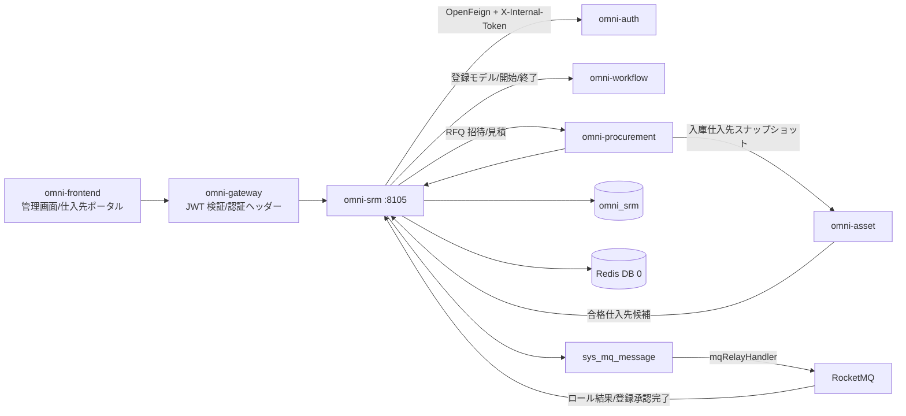
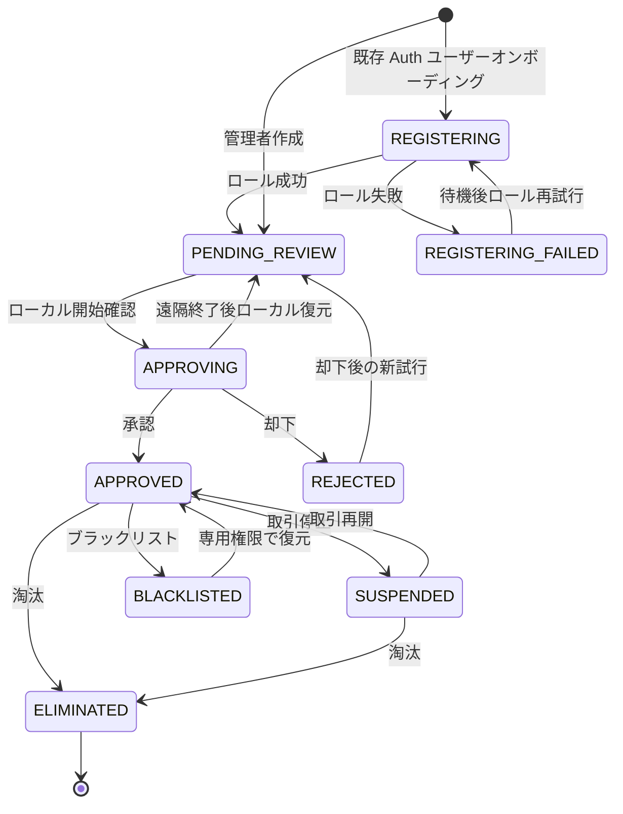
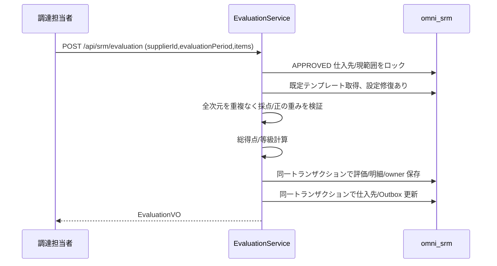
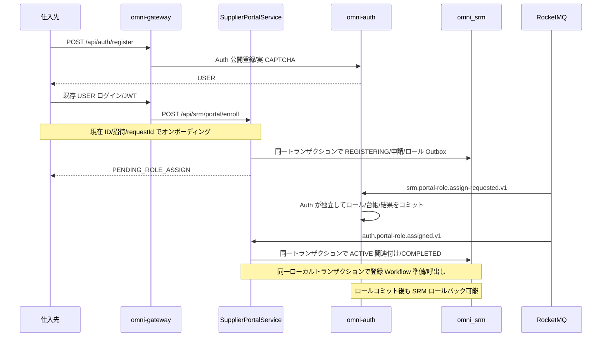

# SRM サプライヤー管理モジュール アーキテクチャと実装ベースライン

> 適用範囲：2026-07-27 の原設計日と第14–16節の重要な履歴を保持します。現在の事実は SRM ソース、Liquibase、画面、設定が基準です。過去の「結合強化完了」は今回の実行検収を意味しません。[ADR-0003](../adr/0003-authorized-ai-translation-review.md) に従い実際の `AI_REVIEW` を記録し、人によるレビューとは偽りません。
>
> プロジェクト：Omni-Stack
> 原設計日：2026-07-27
> 現在の役割：設計判断、実装済みベースラインのスナップショット、重要な履歴を保持します。現在の規則は SRM 事実文書で一元管理します。

現在の [SRM](../srm.jp.md)、[機能案内](../wiki/feature-tour.jp.md)、[ソース索引](../reference/source-map.jp.md)、[開発ガイド](../guides/scaffold-development.jp.md) を参照してください。前提、資格、手順、画面、復旧は Wiki の役割です。設計判断は保持し、要件や過去の計画を今回の検収証拠としません。関連資料：[主要フロー](../core-flows.jp.md)、[Workflow](../workflow.jp.md)、[調達設計](procurement-design.jp.md)、[資産設計](asset-design.jp.md)。

文書の責務：本ページの実装表、状態機械、権限、API の説明は、コミット `9b23ab972f1dcac4116ae95fb5cd56442e2961e4` でレビュー済みの設計ベースラインのスナップショットとして保持します。実装結果を原設計日にさかのぼって記録するものではありません。以後の現行契約は [SRM 事実文書](../srm.jp.md) のみで管理し、本ページを別個に変更できる事実源にはしません。長期的な設計判断が変わる場合は本ページを更新し、現行の事実や ADR との関係を明記します。操作手順と実行証拠は引き続き Wiki に置きます。

## 1. 設計結論

SRM は独立した Servlet マイクロサービスで、調達実行（`omni-procurement`）および資産管理（`omni-asset`）とはドメインの責務を分けています。現在の依存関係と連携は第3、8節を参照してください。

| 項目 | 決定 |
|---|---|
| Maven モジュール / サービス名 | `omni-srm` |
| ローカルポート / 管理ポート | `8105` / `19905` |
| XXL-JOB 実行体 | `omni-srm` / `9905`。`XXL_JOB_ENABLED` 等で制御し、定期評価や資格スキャンの存在を意味しません |
| データベース | `omni_srm` |
| Gateway | `/api/srm/**` → `lb://omni-srm`、`StripPrefix` は使用しない |
| Redis | DB 0、`xss:enabled:{tenantId}` / `xss:rules:{tenantId}` を共有。汎用 `srm:` 業務キャッシュ接頭辞は定義しません |
| フロントエンド | `views/srm/**`（管理）と `views/supplier-portal/index.vue`（ポータル） |

SRM MVP はサプライヤー全ライフサイクル管理の閉ループをカバーする：

> サプライヤー登録/登録承認 → 審査 → グレーディング分類 → 業績評価 → リスク管理 → 淘汰退出。

調達実行（購買申請、RFQ、注文、入庫）と資産処分（検収、移管、スクラップ）は SRM MVP に含めず、それぞれ `omni-procurement` と `omni-asset` で実装する。

SRM マスタは Auth の ID/共通セキュリティに依存し、登録承認は独立 Workflow、ポータル見積は Procurement 招待契約を使用します。Procurement は SRM 仕入先/見積を照会します。Asset は入庫仕入先スナップショットと SRM の APPROVED 候補検索を併用し、間接依存だけではありません。

## 2. 製品範囲

本節は製品目標と段階を保持します。現在の機能/入口/制限は後述します。Phase 2/3 は提供済み機能ではなく、全テナントが同じ seed/モデルを持つ証明でもありません。

### 2.1 ユーザーと目標

| ユーザー | コアニーズ |
|---|---|
| 調達マネージャー | サプライヤーライブラリの管理、サプライヤー業績の評価、供給リスクの管理 |
| 調達担当 | 日常のサプライヤー照会、評価の開始、リスク情報の閲覧 |
| SRM 管理者 | テナント内の全サプライヤーデータと設定の管理 |
| サプライヤー | ポータルでセルフ登録、企業情報の保守、自身の業績の閲覧；Procurement の招待範囲内で見積を提出 |
| 読み取り専用オブザーバー | 認可範囲内のサプライヤー統計と記録の閲覧 |

MVP は次に答えられるべきである：合格/凍結/淘汰サプライヤーがどれだけいるか；あるサプライヤーの資格はいつ期限切れになるか；前回の業績評価の得点はいくつか；どのサプライヤーのリスクレベルが赤か；誰がサプライヤーの重要情報を変更したか。

### 2.2 フェーズ分け

| フェーズ | 能力 |
|---|---|
| MVP | サプライヤー情報ライブラリ、登録承認審査、グレーディング分類、サプライヤーポータル、業績評価、リスクボード、サプライヤー 360 |
| MVP インクリメント（実装済み） | Procurement/RFQ 統合とサプライヤーセルフ見積 |
| Phase 2 | 評価テンプレート動的設定 UI、第三者信用調査接続、リスクイベントワークフロー、証明書添付管理 |
| Phase 3 | サプライヤーコラボレーション基盤（注文確認、出荷通知、照合）、インテリジェント警告（パブリックオピニオン監視） |

## 3. システム境界

| 構成要素 | 正式な責務 | 現在の SRM 利用 |
|---|---|---|
| `omni-auth` | ユーザー、組織、ロール、権限、範囲、XSS | 内部参照/範囲/表示一括照会、既存ユーザーのポータルロール要求 |
| `omni-srm` | 仕入先、評価、リスク、PortalUser、見積 | 本サービス業務の唯一の書込元。登録パスワードを扱わない |
| `omni-base` | 辞書、操作ログ、タスク/MQ 運用 | 辞書管理とログ集約。SRM は code と自業務データを保存 |
| `omni-workflow` | BPMN、インスタンス、タスク、Flowable | 公開登録承認モデルの解決、開始/終了、完了イベント。SRM はエンジンを内蔵しない |
| `omni-procurement` | RFQ、招待、選定、PO、入庫 | 内部仕入先/見積照会。SRM は見積前に招待と全明細を検証 |
| `omni-asset` | 資産 | 調達仕入先スナップショットを消費し、SRM 合格仕入先を直接検索 |
| RocketMQ | イベント転送 | 消費者は冪等必須。ローカル Outbox は配信成功を証明しない |
| Redis / XXL-JOB | 共通キャッシュ/実行基盤 | XSS 設定と設定可能な実行体。外部タスク配置は別証拠 |

現在の POM は `omni-common-core`, `omni-common`, `omni-common-mybatis`, `omni-common-redis`, `omni-common-operlog`, `omni-common-job`, `omni-common-mqlog`, `omni-common-service` と Web、Security、Validation、AspectJ、OpenFeign、LoadBalancer、Nacos、RocketMQ、Actuator、Lombok 等を明示的に使います。`omni-common-service` が ID、テナント、DataScope、永続化、XSS を組み立てます。依存の存在は全タスク有効化を意味しません。`omni-common-workflow` に依存せず、Flowable 実行時/表は独立 Workflow のみの責務です。

## 4. ドメインとデータ設計

### 4.1 アグリゲート

| アグリゲート | テーブル | 責務 |
|---|---|---|
| Supplier | `srm_supplier`、`srm_supplier_contact`、`srm_supplier_qualification`、`srm_supplier_bank_account` | サプライヤーマスタデータ、連絡先、資格、銀行口座 |
| Evaluation | `srm_evaluation_template`、`srm_evaluation_dimension`、`srm_evaluation`、`srm_evaluation_item` | 評価テンプレート、評価記録、採点明細 |
| Risk | `srm_risk_indicator`、`srm_risk_assessment`、`srm_risk_indicator_type`、`srm_risk_criterion`、`srm_risk_score_threshold` | 指標、評価履歴、テナント共有の型/基準/総得点閾値 |
| Portal | `srm_supplier_invite`、`srm_supplier_enrollment`、`srm_supplier_portal_user` | オンボーディング招待/Saga、ポータルアカウント関連付け |
| Quotation | `srm_quotation`、`srm_quotation_line`、`srm_quotation_request` | RFQ 見積スナップショット、見積行、リクエスト冪等履歴 |
| 消費 Inbox | `srm_event_inbox` | Workflow 完了登録、意図照合、処理状態 |

```mermaid
erDiagram
    SRM_SUPPLIER ||--o{ SRM_SUPPLIER_CONTACT : "連絡先"
    SRM_SUPPLIER ||--o{ SRM_SUPPLIER_QUALIFICATION : "資格"
    SRM_SUPPLIER ||--o{ SRM_SUPPLIER_BANK_ACCOUNT : "銀行口座"
    SRM_SUPPLIER ||--o{ SRM_EVALUATION : "評価記録"
    SRM_SUPPLIER ||--o{ SRM_RISK_ASSESSMENT : "リスク履歴"
    SRM_SUPPLIER ||--o{ SRM_SUPPLIER_ENROLLMENT : "オンボーディング申請"
    SRM_SUPPLIER ||--o{ SRM_QUOTATION : "見積"
    SRM_SUPPLIER ||--o{ SRM_SUPPLIER_PORTAL_USER : "認可ユーザー"
    SRM_SUPPLIER ||--o{ SRM_RISK_INDICATOR : "リスク指標"
    SRM_QUOTATION ||--|{ SRM_QUOTATION_LINE : "見積行"
    SRM_QUOTATION ||--o{ SRM_QUOTATION_REQUEST : "永久要求台帳"
    SRM_EVALUATION_TEMPLATE ||--o{ SRM_EVALUATION_DIMENSION : "次元"
    SRM_EVALUATION_TEMPLATE ||--o{ SRM_EVALUATION : "テンプレート"
    SRM_EVALUATION ||--o{ SRM_EVALUATION_ITEM : "採点明細"
    SRM_RISK_INDICATOR_TYPE ||--o{ SRM_RISK_CRITERION : "得点基準"
    SRM_EVENT_INBOX {
        bigint tenant_id
        varchar event_id
    }
    SRM_RISK_SCORE_THRESHOLD {
        int min_score
        int max_score
    }
```

### 4.2 共通フィールドとルール

- 20 の `srm_*` 表に `tenant_id` があります。Supplier/Evaluation が直接 owner 認可ルートで、他の業務子資源は明示した親連鎖を継承します。全認可表に owner 列を求めません。テンプレート/次元/リスク設定はテナント共有です。
- 版、論理削除、監査は実 DDL に従います。`srm_quotation_request` は `deleted/version` のない永久台帳、Inbox は独自処理状態を持ちます。`create_by/update_by` は監査ユーザー名で、SELF ユーザー ID ではありません。
- Auth がユーザー/組織を管理し、サーバーが担当者主組織を解決します。ポータルは `srm_supplier_portal_user` で関連付け、内部 owner 列を使いません。DB 間外部キーは作らず、図は DDL の代替ではありません。
- `supplier_no` はテナント内一意で既存 ID から生成し、`MAX+1` は使いません。通常 PUT は状態/owner を変更せず、移管/状態操作/削除は個別検証です。DataPermission は書込認可を代替しません。
- 日時は `yyyy-MM-dd HH:mm:ss`。見積単価/数量は `DECIMAL(19,6)`、金額は `DECIMAL(19,4)`、価格/返却金額は JSON 十進文字列です。得点/重みは専用 DTO 精度に従います。
- 永久 `tenant_id + request_id` 一意性と `tenant_id + quotation_id + target_version` が結果版に結合します。有効レコードの一意制約で同一仕入先/RFQ の未削除見積、同一見積行の並存重複を防ぎます。
- PII はエンドポイント/アセンブラーごとです。仕入先専用一覧は常時マスク、内部詳細/連絡先/銀行一覧は `srm:pii:view`、ポータル自身情報は別認可です。第9節を参照。

### 4.3 主要テーブル

`srm_supplier`

- `supplier_no/name/normalized_name/supplier_type/industry_code`。
- `credit_code（統一社会信用コード）/website/phone/email/region/address`。
- `category_code`：サプライヤーの所属品目（IT、原材料、総務、サービスなど）、辞書 code を使用。
- `level_code`：サプライヤー等級（STRATEGIC/PREFERRED/QUALIFIED/ELIMINATED）、評価により自動調整または手動設定。
- `status`：ライフサイクル状態（REGISTERING/REGISTERING_FAILED/PENDING_REVIEW/APPROVING/REJECTED/APPROVED/SUSPENDED/BLACKLISTED/ELIMINATED）。`REGISTERING*` はポータルのクロスサービス登録専用；管理者作成は PENDING_REVIEW に入り、登録承認 Workflow を自動的に準備する。
- `owner_user_id/owner_unit_id/assigned_time/last_evaluation_time`。
- `version/deleted` と監査フィールド。
- コアインデックス：tenant + owner/status、tenant + unit/status、tenant + category/status、tenant + name/credit_code。
- `workflow_request_id/workflow_business_key/workflow_model_version_id/approval_attempt/process_instance_id/workflow_start_status/workflow_completed_time/approved_time`：登録承認の試行/冪等状態。業務キーは `supplierId:attempt`、開始印は `NOT_STARTED/PENDING/FAILED/STARTED`。起案者は現在のリクエストから取り、Supplier の永続化起案者列ではありません。

`srm_supplier_contact`

- `supplier_id/name/department/job_title/mobile/phone/email/decision_role/primary_flag/status`。
- 現在のテーブルに内部 owner 列はなく、同テナント Supplier から範囲を継承します。移管時に同期する owner 権限スナップショットは保存しません。
- 主連絡先/版/削除制約は専用サービスと DDL に従い、完全連絡先は対応 PII 権限で返します。

`srm_supplier_qualification`

- `supplier_id/qualification_name/certificate_no/issuing_authority/issue_date/expiry_date/status`。
- `expiry_date` は資格期限警告に使用（30 日以内に期限なら黄色、期限切れなら赤）。
- MVP は添付を保存せず、テキスト情報のみ保存する。

`srm_supplier_bank_account`

- `supplier_id/account_name/account_no/bank_name/bank_branch/bank_code/status`。
- `account_no` は PII フィールドで、完全な値は `srm:pii:view` にのみ返す。
- 各サプライヤーは複数の銀行口座を保守でき、1 つをデフォルトとしてマークする。

`srm_supplier_portal_user`

- `supplier_id/user_id/status/last_login_time/version/deleted`。
- `tenant_id + user_id` はユニークで、1 つの Auth ユーザーが同一テナントで 1 つのサプライヤー主体にのみ関連付くことを保証する。
- `tenant_id + supplier_id + user_id` はポータルの行レベル認可に使用；ポータルユーザーはリクエスト中の supplierId を変更して企業を切替えられない。
- `owner_user_id` とポータル `user_id` は意味が厳密に分離：前者は内部調達担当者、後者はサプライヤーログインアカウント。

`srm_supplier_enrollment`

- `request_id/supplier_id/user_id/invite_id/status/retry_count/last_error_code/next_retry_time/version/deleted`。
- 状態は `PENDING_ROLE_ASSIGN/ROLE_ASSIGN_FAILED/COMPLETED/CANCELLED`、`tenant_id + request_id` が一意です。再送は申請者と正規化 credit_code を照合し、全要求の SHA ハッシュではありません。
- inviteId を保存し、元のトークン/パスワード/CAPTCHA は保存しません。`next_retry_time` はバックオフ推奨時刻で、自動実行の証明ではありません。ロール失敗と登録承認開始の再試行は別です。

`srm_supplier_invite`

- `invite_code_hash/status/expires_time/max_uses/used_count/version/deleted`。現在の実装に想定する credit_code、メールアドレスのダイジェスト、用途の列はありません。
- UUID 元のトークンを生成し作成応答で一度だけ返します。DB 保存は SHA-256 で HMAC ではありません。消費時は現在のテナント、ACTIVE、有効期間、残回数、版を確認し、オンボーディングのトランザクション内で使用回数を条件更新します。
- 一覧は期限切れ/枯渇を EXPIRED/USED と表示可能です。表示状態は永続化スキャンジョブの存在を意味しません。無効化後は消費不可です。

`srm_evaluation_template`

- `tenant_id/name/status/default_flag/version/deleted`。
- MVP はテナントごとに 1 組のデフォルトテンプレートで、動的設定 UI は提供しない。
- テナント初期化時に `SrmTenantInitializer` が冪等にデフォルトテンプレートを作成する。

`srm_evaluation_dimension`

- `tenant_id/template_id/indicator_name/weight/sort/status/deleted`。
- MVP は 4 つの次元をプリセット：品質（30%）、納期（30%）、価格（20%）、サービス（20%）。
- `weight` は `DECIMAL(5,2)`、同一テンプレート配下の全次元の weight の合計は 100 でなければならない。

`srm_evaluation`

- `supplier_id/template_id/evaluation_period/total_score/evaluator_user_id/evaluation_time/status/owner_user_id/owner_unit_id/version/deleted`。作成は `COMPLETED` で、当時の内部 owner を保存します。
- 要求は `supplierId/evaluationPeriod/items`。クライアントの仕入先版/総得点は受けません。APPROVED かつ owner 完備の可視仕入先だけを対象とし、行ロック後は DB 版を使います。
- `SUM(score / 5 × weight)` を HALF_UP で小数2桁にし、20–100。≥90 STRATEGIC、≥75 PREFERRED、≥60 QUALIFIED、その他 ELIMINATED。これは `level_code` で、仕入先ライフサイクルを直接淘汰終状態にしません。

`srm_evaluation_item`

- `evaluation_id/dimension_id/indicator_name/score/weight/remark`。
- `score` は 1-5 点、`DECIMAL(3,1)`。
- 追記のみで、評価提出時に一度だけ書き込み、後続の変更インターフェースは提供しない（修正が必要なら新しい評価記録を作成）。

`srm_risk_indicator`

- `supplier_id/indicator_type/indicator_value/criterion_id/score/risk_level/assessment_time/remark` と実際の版/削除/監査項目。
- 型は有効設定から取り、固定 Java 列挙ではありません。正式 seed の6型は既定テナント例です。
- 有効型が見つかり `autoCalc=1` の場合だけ手動編集を拒否し、欠落/無効型ではこの検証を省略します。criterionId は同テナント基準の得点/等級/ラベルを複製しますが、現在の実装に型との強一致保証はありません。

`srm_risk_assessment`

- `supplier_id/overall_level/assessment_time/assessor_user_id/remark/version/deleted`。
- 現在の総合等級は非 NULL `indicator.score` の総和で閾値を照合し、最高指標色を取りません。再計算は評価履歴を追加します。5.3参照。

`srm_quotation`

- `supplier_id/rfq_id/rfq_no/supplier_name_snapshot/request_id/quotation_time/valid_until/total_amount/currency_code/status/version/deleted`。
- `request_id` はその見積を最後に変更した成功クライアントリクエスト ID を記録し、現在スナップショットの監査に使用；完全なリクエスト冪等履歴は `srm_quotation_request` が保存する。
- `(tenant_id, rfq_id, active_supplier_guard)` ユニーク制約で、同一 RFQ・同一サプライヤーに未削除の見積が最大 1 件であることを保証；重複提出は元の見積を更新して `version` をインクリメントし、並行する有効見積を作成しない。
- `total_amount DECIMAL(19,4)`、`currency_code CHAR(3)` と RFQ/サプライヤースナップショットはすべてサーバー側が Procurement の招待詳細と見積行から計算し、ポータルが直接指定してはならない。

`srm_quotation_line`

- `quotation_id/rfq_line_id/material_code/material_name/unit/unit_price/quantity/line_amount/delivery_days/remark/version/deleted`。
- `rfq_line_id` は必須で、提出する行集合は Procurement が返す RFQ 行スナップショットと完全一致しなければならない；資材、単位、数量はサーバー側がコピーし、ポータルは単価、納期、備考のみ提出する。
- `unit_price/quantity` は `DECIMAL(19,6)` を使い 0 より大きくなければならず、`line_amount` は `DECIMAL(19,4)` を使い 0 より大きくなければならない；`delivery_days` は 0–3650。サーバー側が行ごとに計算して集計し、クライアント金額の信頼を禁止する。
- `(tenant_id, quotation_id, active_rfq_line_guard)` はユニークで、同一見積内の RFQ 行の重複を禁止する。

`srm_quotation_request`

- `request_id/quotation_id/rfq_id/supplier_id/request_hash/target_version/status`、状態は `RESERVED/COMPLETED` のみで、論理削除しない。
- `(tenant_id, request_id)` は永久にユニーク；`request_hash` は正規化されたリクエストボディの SHA-256 で、同一 requestId の異なる意図を拒否するのに使う。
- `(tenant_id, quotation_id, target_version)` はユニークで、各成功更新に対応する見積バージョンを保存する；したがって古い requestId が見積の更新継続後にリプレイされても識別でき、見積・明細・Outbox を重複書き込みしない。

`srm_risk_indicator_type` / `srm_risk_criterion` / `srm_risk_score_threshold`

- 型（有効/autoCalc）、得点基準、総得点区間を保存します。テナントと設定機能権限で管理し、内部 owner で制限しません。
- 照会順と端点を含む区間で照合します。全域被覆/非重複検証の保証はありません。

`srm_event_inbox`

- テナント/eventId で Workflow 完了消費を保護し、出典、型、集約キー、payload、状態を保存します。
- 再送判定前に同 ID の JSON 意味上の意図を照合します。Inbox/仕入先変更は同一トランザクションで、正当な早到完了は再試行し永久破棄しません。

## 5. 状態マシンとコアフロー

### 5.1 Supplier ライフサイクル

`REGISTERING/REGISTERING_FAILED` は既存 Auth ユーザーのポータルロール Saga 専用で、Auth 登録は先行します。管理者作成は PENDING_REVIEW とし、同一ローカルトランザクション中に Workflow を準備/同期呼出しし、開始確認で APPROVING になります。新規調達は APPROVED 必須、ELIMINATED は不可逆終状態、ブラックリスト復旧は専用権限です。

管理 `submit` とポータル `profile/submit` は REJECTED のみで新試行を開きます。PENDING_REVIEW/FAILED に汎用の同スナップショット開始再試行 API はありません。撤回/取消は先に一致遠隔インスタンスを終了し、版更新で PENDING_REVIEW/NOT_STARTED に戻します。遠隔成功とローカル更新の分散原子性は保証しません。

### 5.2 業績評価フロー

要求は `supplierId/evaluationPeriod/items[{dimensionId,score,remark}]`。既定テンプレートは品質/納期/価格/サービス30/30/20/20です。読取時もローカル設定を修復し得るため、副作用なしとは限りません。有効次元を完全かつ一意に採点し、1–5、`DECIMAL(3,1)`、正の重み合計100を要求します。

同一トランザクションで Evaluation/Items、仕入先等級/最終評価時刻、`srm.evaluation.completed.v1` Outbox を保存します。等級判定は4.3参照、Evaluation は owner スナップショットを持ちます。単独履歴は最大100、360は直近5件です。四半期頻度は原業務提案で、定期強制実行の証拠ではありません。

### 5.3 リスク評価フロー

現在のフロー：可視仕入先/命令範囲を検証 → 実基準で指標更新 → CERTIFICATE 再計算 → 非 NULL 得点合計 → 総得点閾値照合 → RiskAssessment 追加 → 初回/非赤から RED の場合だけ Outbox。

区間端点を含み、照会結果の最初の一致を採ります。閾値なしは GREEN。未一致ですべての区間の上限を超えた場合は最大の上限の等級、それ以外の区間の隙間は GREEN です。互換 `highest` は現在の総合評価経路ではありません。

資格期限なしは GREEN、今日から0–30日は YELLOW、期限超過は RED、得点1/2/3です。複数資格は最悪等級、同等級なら早い期限を選びます。手動評価/指標変更、APPROVED/SUSPENDED/BLACKLISTED の資格変更で再計算します。現在の SRM の main Java ソース に専用 `@XxlJob/@Scheduled` 資格リスク走査はなく、外部設定は別証拠です。イベントは通知配信成功を証明しません。

### 5.4 サプライヤーポータルの開設とオンボーディング

- Auth 公開 `POST /api/auth/register` がテナント、実 CAPTCHA、ユーザー名一意性、パスワードを扱います。既定 USER 付与の失敗境界は主要フロー1です。SRM はパスワード/CAPTCHA を受信しません。
- 認証後 `portal/enroll` は enroll 権限、元 requestId、有効テナント招待を要求します。tenant/user は信頼 ID から取り、REGISTERING、リスク初期値、PENDING_ROLE_ASSIGN、ロール要求 Outbox を作成します。
- 再送は申請者/正規化 credit_code を照合し、既存申請は招待を再消費せず返せます。Auth はロール/台帳/結果 Outbox を原子的に保存し、完了再送で決定的 eventId の結果を再発行し得ます。
- SRM 成功は ACTIVE PortalUser 作成/有効化、COMPLETED/PENDING_REVIEW 後、同一トランザクションで登録承認を試みます。Auth ロールはコミット済みでも SRM モデル解決失敗でローカルをロールバックし得ます。両側状態/メッセージを照合し、分散の「半成功なし」を保証しません。
- ロール失敗は Enrollment ROLE_ASSIGN_FAILED と Supplier REGISTERING_FAILED。`enrollment/retry` は失敗/バックオフ期限後に元 requestId のロール Outbox を再発行し、招待を再消費しません。承認開始再試行ではありません。
- Saga COMPLETED は登録承認 APPROVED ではありません。ロール変更は既存 JWT を変えず、完了後に再ログインを促します。実 CAPTCHA/サービス間結合は独立実行証拠が必要です。

## 6. テナント、RBAC とデータ権限

### 6.1 信頼チェーン

Gateway の JWT/ブラックリスト検証と認証ヘッダー上書き → `GatewayPreAuthenticationFilter` → `ServiceIdentityFilter` のテナント/ユーザー確立 → Controller メソッド権限 → 同コード DataScope → MyBatis/書き込みガード。認証/ID 欠落は各境界で拒否し、内部 API は共通トークン Filter が別途検証し、失敗時はアクセスを拒否します。

`X-Gateway-Forwarded:true` だけでは暗号学的証明にならず、本番業務ポートはネットワーク保護が必要です。外側 finally がコンテキスト消去、入れ子範囲は元値を復元します。ThreadLocal は存在します。

### 6.2 権限ツリーとロール

現在のメニュー/権限/既定テナントロール seed は `scripts/sql/seed/auth.sql` が基準で、全新テナントの同一ロールを証明しません。7.3に権限対応を示します。

| ロール | seed 範囲 | 現在の境界 |
|---|---|---|
| `SRM_ADMIN` | TENANT | テナント管理。仕入先代理見積は不可 |
| `PROCUREMENT_MANAGER` | DEPT_AND_BELOW | 部門以下、評価/リスク |
| `PROCUREMENT_STAFF` | SELF | 担当業務。設定は機能権限でテナント共有 |
| `SUPPLIER` | SELF | ポータル権限と現在のテナント/ユーザー ACTIVE PortalUser が必要 |
| `SUPER_ADMIN` | ALL | 全機能、現在のテナントデータのみ。単独でポータルになりすませない |

USER は SRM enroll のみ。profile/evaluation/quotation は SUPPLIER、機能権限、ACTIVE 関連付けが必要です。内部管理とポータル ID を分離し、多ロールの管理入口は実権限集合で残します。バックエンドは再検証します。

### 6.3 Auth 内部データ範囲契約

実パスは `GET /internal/data-scopes/{userId}?tenantId={tenantId}&permissionCode=srm:supplier:list` で、`/api` を付けません。

Auth は有効ユーザー/テナントを検証し、完全権限コードを持つロールだけを統合します。拒否、不正応答、例外は対応403/503分岐で処理します。ID/範囲欠落で照会を広げません。

### 6.4 共通コンテキストと SRM SQL ポリシー

`omni-common-service` が ID、内部認証、XSS、永続化を組み立てます。順序は `TenantLineInnerInterceptor → DataPermissionInterceptor → OptimisticLockerInnerInterceptor → PaginationInnerInterceptor`。TenantLine は `srm_*` のみ、`sys_mq_message` は両権限インターセプター外です。

| 資源 | 認可 |
|---|---|
| Supplier / Evaluation | 直接 owner ルート。Evaluation は作成時スナップショット |
| Contact / Qualification / BankAccount / RiskIndicator / RiskAssessment / Quotation | 同テナント Supplier 親継承 |
| EvaluationItem | Evaluation を継承 |
| QuotationLine | Quotation から Supplier への二段継承 |
| Template / Dimension / リスク設定 | テナント共有/機能権限 |
| Portal | ロール/機能/ACTIVE 関連付けで supplierId 固定。内部 owner を使わない |
| Supplier 360 各ブロック | 連絡先/資格/銀行/評価/リスクごとに権限/範囲を解決し、未許可は照会しない |

owner ルート SELF は `owner_user_id=currentUserId`、DEPT は `owner_unit_id=primaryUnitId`、DEPT_AND_BELOW/CUSTOM は組織 ID の集合、TENANT/ALL は owner を省略してテナント維持です。SrmPermissionScopeExecutor/SrmPortalScope は元範囲を復元し、広い owner OR で親連鎖を代替しません。

### 6.5 書き込み操作の行レベル認可

既存変更は現在のテナント可視行を読み、状態/関係を検証し、命令別の版/削除/状態条件と更新行数を確認します。採番、連鎖、永久台帳、招待取消、共有設定は別経路で、全書込にクライアント版があるとはしません。DataPermission は `SrmRecordAccessGuard` の代替ではありません。

担当者作成/移管は Auth の同テナント有効ユーザー/主組織を検証し、他者指定には担当者移管権限/割当範囲も必要です。通常 PUT は owner 変更を拒否します。削除は状態、ポータル、評価、リスク履歴等で制限されます。

## 7. API 設計

### 7.1 共通契約

`R<T>`、ページ `R<PageResult<T>>`、page 起点/既定1、size 既定10/最大100です。version を定義する DTO は版必須ですが、評価作成にクライアント仕入先版はなく、招待取消も一律版命令にはできません。

日時は `yyyy-MM-dd HH:mm:ss`、見積精度/文字列 JSON は8.4参照。Controller/DTO が項目基準で、ログ、内部認証、ポータルID、owner Aspectは入口別に適用し、全メソッド同一アノテーションを保証しません。

### 7.2 エンドポイント

以下は別名込みの外部77/内部4メソッドの完全サービスパスです。Gateway は `/api/srm` を除去しません。Auth 登録は外部依存で SRM Controller 件数には含めません。

| 領域 | メソッドと完全パス |
|---|---|
| 銀行口座 | `GET /api/srm/supplier/{supplierId}/bank-account` `GET /api/srm/supplier/{supplierId}/bank-account/list` `GET /api/srm/supplier/{supplierId}/bank-account/{id}` `POST /api/srm/supplier/{supplierId}/bank-account` `PUT /api/srm/supplier/{supplierId}/bank-account/{id}` `DELETE /api/srm/supplier/{supplierId}/bank-account/{id}` |
| 連絡先 | `GET /api/srm/supplier/{supplierId}/contact` `GET /api/srm/supplier/{supplierId}/contact/list` `GET /api/srm/supplier/{supplierId}/contact/{id}` `POST /api/srm/supplier/{supplierId}/contact` `PUT /api/srm/supplier/{supplierId}/contact/{id}` `DELETE /api/srm/supplier/{supplierId}/contact/{id}` |
| 業績評価 | `GET /api/srm/evaluation/list` `GET /api/srm/evaluation/{id}` `GET /api/srm/evaluation/supplier/{supplierId}` `GET /api/srm/evaluation/template/default/dimensions` `POST /api/srm/evaluation` |
| 内部見積 | `GET /api/internal/quotation/batch` |
| 内部仕入先 | `GET /api/internal/supplier/{supplierId}` `GET /api/internal/supplier/search` `POST /api/internal/supplier/batch` |
| 担当者候補 | `GET /api/srm/options/owners` |
| 概要 | `GET /api/srm/overview/summary` `GET /api/srm/overview/risk-dashboard` |
| ポータルオンボーディング/プロフィール | `POST /api/srm/portal/enroll` `GET /api/srm/portal/enrollment` `POST /api/srm/portal/enrollment/retry` `GET /api/srm/portal/profile` `PUT /api/srm/portal/profile` `POST /api/srm/portal/profile/submit` |
| ポータル評価 | `GET /api/srm/portal/evaluations` `GET /api/srm/portal/evaluations/history` |
| 招待/別名 | `GET /api/srm/portal/invite` `GET /api/srm/portal/invite/list` `GET /api/srm/invite` `GET /api/srm/invite/list` `POST /api/srm/portal/invite` `POST /api/srm/invite` `POST /api/srm/portal/invite/{inviteId}/revoke` `POST /api/srm/invite/{inviteId}/revoke` |
| ポータル見積 | `GET /api/srm/portal/quotation/invitations` `GET /api/srm/portal/quotation/invitations/{rfqId}` `POST /api/srm/portal/quotation` |
| 資格 | `GET /api/srm/supplier/{supplierId}/qualification` `GET /api/srm/supplier/{supplierId}/qualification/list` `GET /api/srm/supplier/{supplierId}/qualification/{id}` `POST /api/srm/supplier/{supplierId}/qualification` `PUT /api/srm/supplier/{supplierId}/qualification/{id}` `DELETE /api/srm/supplier/{supplierId}/qualification/{id}` |
| リスク | `GET /api/srm/risk/list` `GET /api/srm/risk/indicators/{supplierId}` `PUT /api/srm/risk/indicator/{id}` `POST /api/srm/risk/assessment/{supplierId}` `GET /api/srm/risk/assessment/history/{supplierId}` |
| リスク設定 | `GET /api/srm/risk/config/types` `POST /api/srm/risk/config/types` `PUT /api/srm/risk/config/types/{id}` `DELETE /api/srm/risk/config/types/{id}` `POST /api/srm/risk/config/criteria` `PUT /api/srm/risk/config/criteria/{id}` `DELETE /api/srm/risk/config/criteria/{id}` `GET /api/srm/risk/config/thresholds` `PUT /api/srm/risk/config/thresholds` |
| 仕入先 | `GET /api/srm/supplier/list` `GET /api/srm/supplier/{id}` `GET /api/srm/supplier/{id}/overview` `POST /api/srm/supplier` `PUT /api/srm/supplier/{id}` `POST /api/srm/supplier/{id}/transfer` `DELETE /api/srm/supplier/{id}` `POST /api/srm/supplier/{id}/submit` `POST /api/srm/supplier/{id}/withdraw` `POST /api/srm/supplier/{id}/cancel` `POST /api/srm/supplier/{id}/suspend` `POST /api/srm/supplier/{id}/resume` `POST /api/srm/supplier/{id}/restore-from-blacklist` `POST /api/srm/supplier/{id}/restore` `POST /api/srm/supplier/{id}/blacklist` `POST /api/srm/supplier/{id}/eliminate` |
| 仕入先分析 | `GET /api/srm/supplier/{supplierId}/evaluation/history` `GET /api/srm/supplier/{supplierId}/risk` |

### 7.3 エンドポイントと DataScope permission のマッピング

| 操作 | 権限/追加条件 |
|---|---|
| 概要 | `srm:overview:list` |
| Supplier list/detail/360 | `srm:supplier:list`、360子ブロックは独立認可 |
| 作成/却下後 submit | `srm:supplier:create` |
| 更新/削除/担当者移管 | `srm:supplier:update`, `srm:supplier:delete`, `srm:supplier:transfer` |
| withdraw/cancel | `srm:supplier:withdraw`, `srm:supplier:cancel`、先に遠隔インスタンス照合 |
| suspend/resume/blacklist/restore/eliminate | `srm:supplier:suspend`, `srm:supplier:resume`, `srm:supplier:blacklist`, `srm:supplier:restore`, `srm:supplier:eliminate` |
| 連絡先/資格/銀行 | `srm:contact:list`, `srm:contact:create`, `srm:contact:update`, `srm:contact:delete`、`srm:qualification:list`, `srm:qualification:create`, `srm:qualification:update`, `srm:qualification:delete`、`srm:bank-account:list`, `srm:bank-account:create`, `srm:bank-account:update`, `srm:bank-account:delete` |
| 評価 | `srm:evaluation:list`, `srm:evaluation:create`, `srm:evaluation:view` |
| リスク/設定 | `srm:risk:list`, `srm:risk:update`, `srm:risk:assess`、`srm:risk:config:list`, `srm:risk:config:update` |
| 担当者/PII | `srm:owner:list`、`srm:pii:view` |
| 招待 | 対応 `srm:invite:list`, `srm:invite:create`, `srm:invite:revoke` または `srm:portal:invite` |
| enroll/オンボーディング状態・再試行 | `srm:portal:enroll`、状態/再試行は `srm:portal:enroll` または `srm:portal:profile` |
| ポータルプロフィール/評価/見積 | `srm:portal:profile`, `srm:portal:evaluation`, `srm:portal:quotation` と SUPPLIER/ACTIVE 関連付け |

認可には完全な権限コードと対応する行レベル検証を使用します。SRM にローカル approve/reject/approval-view メソッドはなく、承認タスクは Workflow で処理します。

## 8. サービス横断の一貫性

### 8.1 ユーザーと組織

OwnerResolver は作成/移管時に Auth ユーザー、主組織、割当範囲を検証し、ownerUnitId は正式値です。OwnerEnricher は重複排除後ユーザー/組織を一括照会し、例外時 ID/空名称を残せます。表示縮退は認可拡大や全 Feign のトランザクション外実行を意味しません。

ユーザー/組織 ID と必要な監査ユーザー名を保存し、パスワードを管理しません。Auth 台帳/結果 Outbox がポータルロールを扱い、SRM は PortalUser 関連付けを保存します。

### 8.2 辞書

Base が `srm_supplier_category` を管理します。正式既定テナント seed は ELECTRONICS/IT/RAW_MATERIAL/ADMIN/SERVICE。SRM は category_code と独自の評価テンプレート/基本リスクを管理します。例は全テナント同一辞書を証明せず、通常ローカル読取で常時 Base オンライン照会を要求しません。

### 8.3 Workflow

管理 create、REJECTED submit、ポータルロール成功はローカルトランザクション内で SupplierWorkflowCoordinator を同期呼出しします。現在のテナント公開 `SRM_SUPPLIER_ONBOARDING` の解決は開始例外捕捉より前で、欠落/未公開/照会失敗はローカル作成/Saga 結果をロールバックし得ます。

`requestId/businessKey=supplierId:attempt/modelVersionId/attempt/startStatus/instance` を保存し、起案者は現在 ID から取ります。成功は要求/業務キー/型/インスタンス一致が必要、応答フィールドは `replayed`。markStarted/markFailed は REQUIRED で、コミット後独立確認ではありません。開始/確認失敗は FAILED 記録を試みますが、失敗/未命中があり、FAILED は遠隔未作成を証明しません。PENDING_REVIEW/FAILED 汎用開始再試行はなく、ロール Saga retry で代替しません。

完了は `tenantId + eventId` Inbox で JSON 意図照合後、試行/業務キー/インスタンス/状態を検証します。正当な早到完了はメッセージ再試行、旧試行/重複/別インスタンスは隔離します。APPROVED/REJECTED は完了で進み、撤回/取消は遠隔終了後ローカル版更新です。

`RequiredWorkflowModelInitializer` は Workflow 側で、既定テナント1の必須4モデルを確認し、発見した有効一致モデルを校正/公開します。全テナントのモデルを新規作成せず、SRM 自身が全テナントで起動可能な保証でもありません。

### 8.4 Procurement と Asset の統合

内部4パスは7.2参照、`X-Internal-Token` / `X-Tenant-Id` と一致 query/body tenant が必要です。仕入先 get/batch は現未削除概要で APPROVED 固定ではなく、呼出側が資格を再検証します。search は status/category/keyword、limit1..100。batch は最大100一意正 ID を初出順に重複排除し、不在を省略、連絡先/銀行PIIなしです。Asset は合格 search、入庫は Procurement スナップショットです。

ポータル RFQ は Procurement `/api/internal/procurement/rfq/invitations` と `/api/internal/procurement/rfq/{rfqId}/invitation` を使い、supplierId は ACTIVE PortalUser から取得します。見積要求は `requestId/rfqId/version/validUntil/lines[{rfqLineId,unitPrice,deliveryDays,remark}]` のみです。

ID/DTO 検証後に永久台帳を先に確認します。同意図の古い requestId は現在見積を返して再書込/再発行せず、新要求の APPROVED/RFQ 開放再検査もしません。同じ requestId でも意図が異なる場合は 409 を返します。新要求は APPROVED 仕入先をロックし、RFQ SENT、招待 INVITED/QUOTED、未来締切、現在より後かつ締切以前でない validUntil を検証します。

1–200一意行で RFQ 全明細を被覆します。資材/単位/数量/通貨はサーバー招待から取得、正単価は JSON 十進文字列/DECIMAL(19,6)、納期0–3650日、備考最大500字です。行額は HALF_UP4桁、総額は行和で正 DECIMAL(19,4)。返却/イベント金額は文字列です。

tenant/requestId 永久台帳は SHA-256 正規化意図と quotationId/targetVersion を保存します。意図は rfqId/version/validUntil と行ID順の価格/納期/備考。初回は version 0 を要求し、保存時に 1 となります。更新には現在のバージョンが必要です。見積/行/COMPLETED台帳/提出Outboxは同一トランザクションです。Procurement はイベント/意図/版で招待を更新し、不変選定/PO スナップショットを保存します。後続見積で既存 PO は書換えません。内部見積 batch は SUBMITTED、有効期間内、仕入先 APPROVED のものだけです。

### 8.5 Outbox とイベント

`DomainEventEnvelope` は `eventId/eventType/occurredAt/tenantId/producer`、`aggregateType/aggregateId/aggregateVersion`、`actorUserId/correlationId/causationId/payload` を契約ごとに持ちます。トランザクションで明示 `ReliableMessageRelay.send("srm-domain-out-0", envelope, tenantId, eventId)`、最上位 eventId を msgKey とし Outbox msgId は別採番です。

SRM 出力は supplier registered/approved/rejected/suspended/blacklisted/eliminated の6種と、`srm.portal-role.assign-requested.v1`、`srm.quotation.submitted.v1`、`srm.evaluation.completed.v1`、`srm.risk.level-changed.v1`。Auth 入力 `auth.portal-role.assigned.v1` / `auth.portal-role.assign-failed.v1` と合計12種で、SRM 出力12種ではありません。

payload は ID/版/状態/得点/金額/必要スナップショットを含み、パスワード/CAPTCHA/inviteToken/完全口座/連絡先を渡しません。ロール要求/結果は個別 DTO に従い、すべてのエンベロープに要求/結果両項目があるとはしません。Outbox コミットは Broker 配信/消費/外部通知成功の証明ではありません。

| 方向 | イベント型 |
|---|---|
| SRM 出力 | `srm.supplier.registered.v1` |
| SRM 出力 | `srm.supplier.approved.v1` |
| SRM 出力 | `srm.supplier.rejected.v1` |
| SRM 出力 | `srm.supplier.suspended.v1` |
| SRM 出力 | `srm.supplier.blacklisted.v1` |
| SRM 出力 | `srm.supplier.eliminated.v1` |
| SRM 出力 | `srm.portal-role.assign-requested.v1` |
| SRM 出力 | `srm.quotation.submitted.v1` |
| SRM 出力 | `srm.evaluation.completed.v1` |
| SRM 出力 | `srm.risk.level-changed.v1` |
| Auth 入力 | `auth.portal-role.assigned.v1` |
| Auth 入力 | `auth.portal-role.assign-failed.v1` |

## 9. プライバシー、操作ログと XSS

### 9.1 OperLog マスキング

操作ログは明示項目/文字列規則で処理し、任意 PII 検出を保証しません。口座/連絡先/認証情報/自由文は実アノテーションと共通サニタイザーに従います。enroll はスナップショットを無効にし inviteToken/creditCode/phone/email を除外、元の招待トークンをログ保存しません。非同期汎用ログは業務状態/Inbox/承認事実の代わりではありません。

### 9.2 PII

仕入先専用一覧は常時マスク VO。詳細/360、連絡先/銀行の一覧/詳細は srm:pii:view に従って電話/メール/口座を返します。住所等まで汎用マスク保証にはなりません。ポータル profile は SUPPLIER/機能/ACTIVE 照合後の自身電話/メールで、SUPPLIER に暗黙の全域 pii:view はありません。現在のポータルに contacts/qualifications/bank-accounts API はありません。

SRM は企業/連絡先/銀行/自由文と BaseEntity 監査ユーザー名を保存し、userId/unitId だけではありません。Supplier に永続化 Workflow 起案者列はなく、現在の ID を開始要求で Workflow に渡します。証拠/画面/ログ/出力は項目認可で管理します。

### 9.3 XSS

SRM は common-service `CachedServiceXssConfigProvider` を再利用し、独自 SPI を重複しません。Redis DB0 の2XSSキーを読み、欠落/例外はまず Auth。enabled を含む有効正式設定はキャッシュ書込失敗でも使います。正式結果を得られない場合だけ既定 HTML_TAG/EVENT_HANDLER/DANGEROUS_PROTOCOL 基準を使用します。依存障害でフィルター迂回せず、備考は平文で v-html を使いません。

## 10. フロントエンド設計

管理画面は `views/srm/{overview,supplier,evaluation,risk,invite}/index.vue` と `views/srm/risk/config/index.vue`。ポータルは `views/supplier-portal/index.vue` で、原案の enrollment/profile/evaluation 分割ではありません。API は srm-overview/supplier/evaluation/risk/risk-config/portal.ts です。

実 `components/srm` は SupplierOverview、SupplierPicker、SupplierResourcesDrawer、EvaluationScorecard、RiskIndicator、RiskDashboard を保持します。360 は Drawer と独立バックエンド認可、リスクボードは等級フィルターです。

`ApiResponse/PageResult` は `src/types/api.ts` のみ、ボタンは同コード v-permission。管理権限なし SUPPLIER はポータルへ遷移、多ロールは実権限で管理入口を保持します。4言語/メニュー/router/layout は現在の入口で、実手順/画面は Wiki、本文はブラウザー検収の代替ではありません。

## 11. 実装箇所

### 11.1 現在のモジュール入口

入口は `omni-backend/omni-srm/src/main/java/com/omni/srm/SrmApplication.java` と client/config/controller/dto/entity/mapper/security/service/workflow/consumer/domain 等です。実リソースは application.yml/application-lite.yml。EnableDiscoveryClient、EnableFeignClients、MapperScan、領域 SecurityConfig と共通 common-service を組み合わせます。

原計画から既存モジュールを再作成しません。SQL/移行は現在の Mapper/Liquibase、開発操作は [開発ガイド](../guides/scaffold-development.jp.md) です。

### 11.2 現在の関連ファイル

現在の関連入口です。未作成予定一覧ではなく、契約変更時に移行/seed/検証を同期します。

| 範囲 | 現在のファイル/ディレクトリ |
|---|---|
| モジュール | `omni-backend/omni-srm/pom.xml` `omni-backend/pom.xml` |
| 実行設定 | `omni-backend/omni-srm/src/main/resources/application.yml` `omni-backend/omni-srm/src/main/resources/application-lite.yml` |
| 構造と seed | `database/changelog/srm/0001-srm-schema.yaml` `scripts/sql/seed/srm.sql` |
| 権限/摘要 | `scripts/sql/seed/auth.sql` `database/seed/manifest.yaml` |
| テナント初期化 | `omni-backend/omni-srm/src/main/java/com/omni/srm/service/impl/SrmTenantModuleProvisioner.java` `omni-backend/omni-srm/src/main/java/com/omni/srm/service/impl/SrmTenantInitializerImpl.java` |
| Gateway / Compose | `omni-backend/omni-gateway/src/main/resources/application.yml` `compose.yaml` |
| 画面 | `omni-frontend/src/views/srm` `omni-frontend/src/views/supplier-portal/index.vue` `omni-frontend/src/components/srm` |
| Workflow / Auth 契約 | `omni-backend/omni-srm/src/main/java/com/omni/srm/workflow` `omni-backend/omni-srm/src/main/java/com/omni/srm/client` `omni-backend/omni-auth/src/main/java/com/omni/auth/service/impl/PortalRoleAssignmentServiceImpl.java` |

既定入口8105、管理19905、RedisDB0、XXLappname omni-srm/9905。Compose設定でコンテナポートを割当、liteはNacos無効/静的発見です。実行/構築/テストはローカルDocker。USERに管理を一括付与せず、ポータルIDと内部管理を混合しません。

## 12. 非機能設計

- ページ最大100、履歴/360に個別上限があります。owner/status/category索引は実DDL、OwnerEnricher は一括照会で縮退も範囲を変えません。実測性能を証明しません。
- 状態操作は記録/版を検証、評価は仕入先ロックと一括書込、招待回数は条件更新、見積永久台帳/有効レコードのキーは限定範囲の冪等性です。実並行/分散原子性は別証拠が必要です。
- Auth範囲失敗は閉鎖、表示はIDを残せます。MQ停止はOutbox停止でも補完配信済み証明でもありません。Redis→Auth→基準の順です。Workflow/Saga部分コミットは前述どおり、エラー応答から遠隔未実行を推定しません。
- 評価テンプレート/リスク初期化はSRM、辞書はBase。既定テナントseed/必須モデル/ロールは全テナント/配置の可用性保証ではありません。

## 13. テストと検収

テスト入口は `omni-backend/omni-srm/src/test/java`。単体、構築、実行証拠を区別します。検収要件：

- 9状態/版/削除、create/submit/profile-submit のモデル欠落/失敗印/汎用承認retry欠如、遠隔終了後ローカル失敗。
- 完全4次元/1..5/20..100/HALF_UP2/60・75・90等級、ライフサイクル不変更、ownerスナップショットと独立評価認可。
- 現在の総得点閾値/含端点/首一致/区間の隙間、型有効/autoCalc/criterion実境界、期限再計算と赤イベント。
- 内部owner/親連鎖/共有設定/360個別権限、ポータルrole/機能/ACTIVE、PII/XSS/ログ境界。
- 招待SHA256/期限/並行回数、申請者/creditCode再送、ロール台帳/結果再送、AuthコミットとSRMロールバック、バックオフrole retry、JWT再ログイン。
- 見積文字列/精度/全行/RFQ資格/永久台帳/旧要求の現スナップショット返却とOutbox非重複、POスナップショット不変。
- 実結合はAuth実CAPTCHA登録→ログイン→オンボーディング/role結果→登録承認→評価/リスク→自身情報/見積の証拠が必要です。単体成功や本文では証明できません。Docker操作/復旧は既存Wikiに置き、ホストMaven/npm手順は残しません。

## 14. 実装順序

2026-07-27 の原実施分解/当時の完了条件を履歴として保持し、今回の実行証拠や再実行指示としません。現在の入口/契約は第3–13節です。

### Milestone 0：前提確認

- Auth DataScope 内部インターフェース、OperLog PII マスキング、XSS miss ポリシーが準備済みであることを確認（CRM が構築済み、直接再利用）。
- Gateway 内部パス遮断ルールが統一プレフィックス `/api/internal/**` を含むことを確認。

### Milestone 1：サービス構築 + セキュリティ基盤

- モジュール、設定、Gateway、Docker、DB を作成。
- TenantLine + DataPermission + Pagination。
- 権限ツリー、SRM ロール、SUPPLIER ロール、既存テナント移行。
- フロントエンド root メニュー（管理側 + ポータル）。

完了条件：登録、ルーティング、401/403、テナント分離、XSS、ヘルスチェックが通過。

### Milestone 2：サプライヤー管理 + 状態マシン

- サプライヤー CRUD、参入/審査/凍結/復元/ブラックリスト/淘汰。
- 連絡先、資格、銀行口座のサブテーブル。
- サプライヤー 360 ビュー。
- PII マスク。

完了条件：管理者がサプライヤーを作成 → 審査 → グレーディング/凍結/淘汰が通せる。

### Milestone 3：サプライヤーポータル

- サプライヤーのセルフ開設とオンボーディング（Auth 公開登録 + 認証済み SRM enroll + inviteToken + credit_code ユニーク + ロール割当 Saga）。
- ポータルログイン（SUPPLIER ロールルーティング）。
- 企業情報の保守。

完了条件：Auth 開設 → 認証済みオンボーディング → SUPPLIER ロール割当 → 審査 → ポータルで企業情報を保守、が通せる。

### Milestone 4：業績評価

- 評価テンプレートのプリセット（データベース seed data）。
- 評価採点 → 加重集計 → 自動調級。
- 評価履歴とトレンド。

完了条件：評価作成から自動調級までの閉ループ。

### Milestone 5：リスクボード + 本番強化

- リスク指標の入力と表示。
- 赤黄緑ランプ + 資格期限警告。
- オーバービュー統計（summary + risk-dashboard）。
- テスト、インデックス、セキュリティ検収。
- README、architecture、api-contract、AGENTS を更新。

完了条件：MVP、バックエンドビルド、フロントエンド Build/Lint、Docker とセキュリティ検収がすべて通過。

## 15. ADR 要約

元の重要な設計判断を保持します。段階的な提案と現在の実装が異なる場合は、前述の現在の事実を基準にしてください。既定設定や任意のスキャンに関する計画は、すべてのテナントでの機能やタスクの可用性を証明しません。

| 決定 | 選択 | 理由 |
|---|---|---|
| サービス | 独立 `omni-srm` | 調達、資産から分離、責務が明確 |
| 三サービス分割 | SRM/Procurement/Asset を独立 | 各自が独立したデータベースとセキュリティアーキテクチャを持つ |
| 構築順序 | SRM → Procurement → Asset | SRM は土台、後続サービスはサプライヤーデータに依存 |
| ユーザー体系 | Auth を共有 | サプライヤー = sys_user + SUPPLIER ロール、マルチテナント + RBAC を再利用 |
| デュアルポータル | 管理側 + サプライヤーポータルがフロントエンドを共用 | ロールルーティングで区別、独立フロントエンドプロジェクトは不要 |
| 参入承認 | 独立 Workflow サービス | SRM は Flowable を埋め込まず、冪等内部 API と信頼できる完了イベントで協調 |
| 評価テンプレート | データベースプリセット | MVP は動的設定 UI を作らない |
| 評価調級 | システム自動マッピング | 人手介入を減らし、一貫性を保証 |
| リスク指標 | 手動主体 + 資格自動警告 | MVP は第三者データに接続しない |
| ポータル開設/オンボーディング | Auth が公開開設を担当、SRM が認証済みオンボーディングとロール割当 Saga を担当 | 認証情報は SRM/MQ に入らず、tenant/user は信頼できる JWT 由来 |
| ポータル認可 | 独立した `srm_supplier_portal_user` 関連付け | 内部 owner と混用せず、ログインアカウントでサプライヤーを正確にバインド |
| PII | バックエンドが権限でマスク | CRM と一貫したセキュリティ戦略 |
| Workflow | 既に `omni-workflow` に接続済み | モデル分類は `SRM_SUPPLIER_ONBOARDING` に固定、サーバー側が現在の公開バージョンを自動解決 |

## 16. 主要リスク

元のリスク一覧と対策を保持します。SELF によるポータル認可の略記、定期スキャン、「部分的な成功は生じない」という表現は、現在のロールと関連付けの検証、メッセージ再送、実際の設定、サービス間トランザクションの限界と併せて解釈してください。

| 優先度 | リスク | 対処 |
|---|---|---|
| P0 | DataScope が Auth のみ、空コンテキストでフィルタを追加しない | 内部契約 + SRM フェイルクローズド |
| P0 | ポータル開設/オンボーディングの悪用やテナント偽造 | Auth tenantCode+認証コード；SRM JWT tenant/user + inviteToken + credit_code ユニーク + レート制限 |
| P0 | 銀行口座 PII の漏洩 | バックエンドマスク + OperLog マスキング |
| P0 | 書き込み操作がクエリデータ権限をバイパス | AccessGuard + 条件付き更新 |
| P1 | SUPPLIER ロールが権限を越えて管理側データを閲覧 | フロントエンドロールルーティング + バックエンド dataScope が SELF を強制 |
| P1 | 評価調級の並行競合 | supplier 行ロック + version 楽観ロック |
| P1 | 資格期限警告が間に合わない | Phase 2 で XXL-JOB 定期スキャンを有効化 |
| P0 | ポータルアカウントが権限を越えて他のサプライヤーにアクセス | 独立した PortalUser 関連付け + tenant/user/supplier の三要素検証 |
| P1 | SUPPLIER ロール割当が Auth/SRM をまたいで半成功 | requestId 冪等 + ローカルトランザクション + Outbox/Saga + リトライ可能な失敗状態 |
