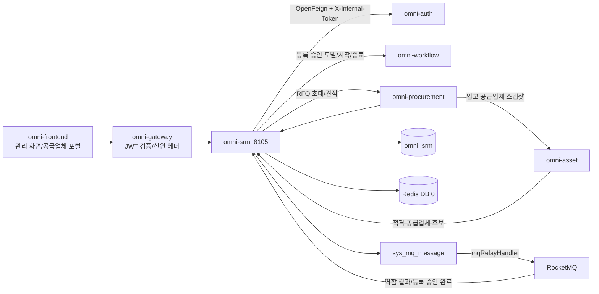
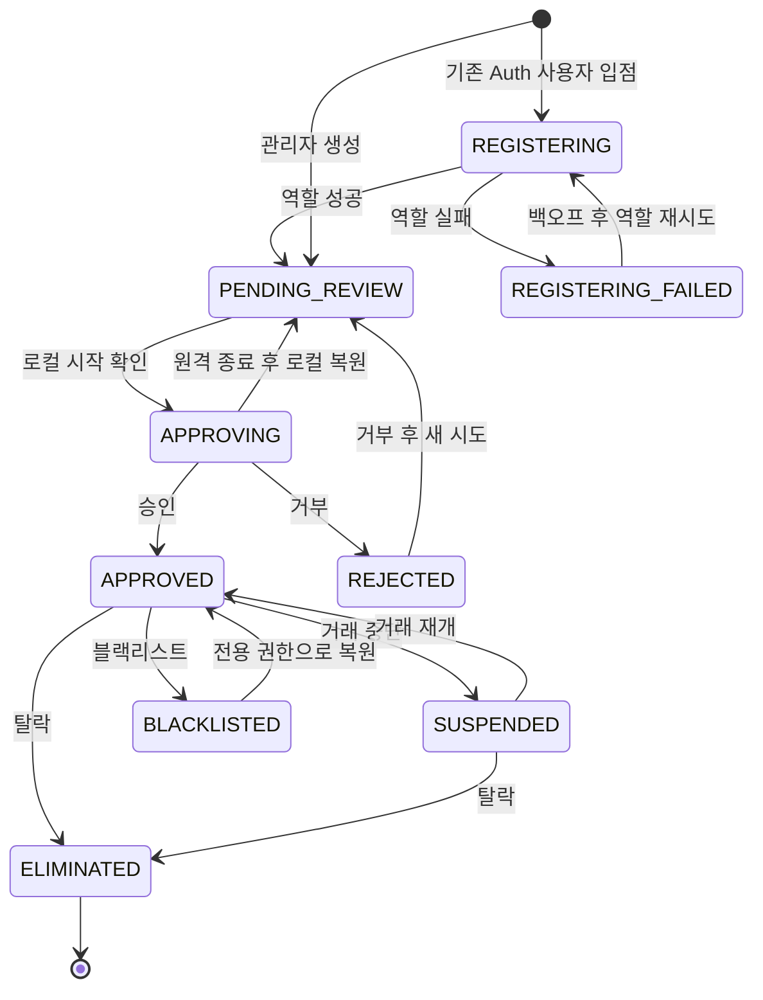
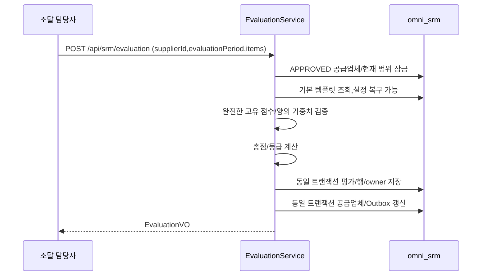
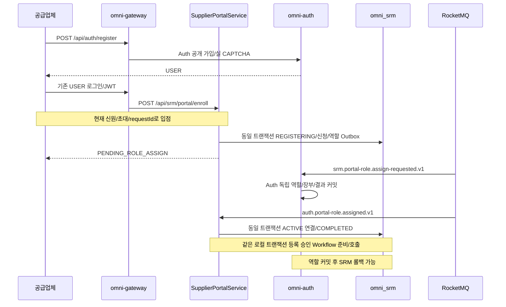

# SRM 공급업체 관리 모듈 아키텍처와 구현 기준선

> 적용 범위: 원 설계 날짜 2026-07-27과 14–16절의 중요한 이력을 유지합니다. 현재 사실은 SRM 소스, Liquibase, 화면과 설정을 따릅니다. 과거의 “종단간 강화 완료”는 이번 실제 검수를 뜻하지 않습니다. [ADR-0003](../adr/0003-authorized-ai-translation-review.md)에 따라 실제 `AI_REVIEW`를 기록하며 사람의 검토로 표시하지 않습니다.
>
> 프로젝트: Omni-Stack
> 원 설계 날짜: 2026-07-27
> 현재 역할: 설계 결정, 구현 기준선 스냅샷과 중요한 이력을 보존합니다. 현재 규칙은 SRM 사실 문서에서 일원화하여 관리합니다.

현재 [SRM 사실](../srm.kr.md), [기능 안내](../wiki/feature-tour.kr.md), [소스 색인](../reference/source-map.kr.md), [개발 안내](../guides/scaffold-development.kr.md)를 참조하세요. 사전 조건, 사용자 자격, 절차, 화면과 복구는 Wiki의 역할입니다. 설계 결정은 유지하되 요구 사항과 과거 계획을 이번 검수 증거로 보지 않습니다. 관련 사실은 [핵심 흐름](../core-flows.kr.md), [Workflow](../workflow.kr.md), [조달](procurement-design.kr.md), [자산](asset-design.kr.md)에 있습니다.

문서의 책임: 이 페이지의 구현 표, 상태 머신, 권한과 API 설명은 커밋 `9b23ab972f1dcac4116ae95fb5cd56442e2961e4`에서 검토한 설계 기준선의 스냅샷으로 보존합니다. 구현 결과를 원 설계 날짜로 소급하여 기록하는 것은 아닙니다. 이후의 현행 계약은 [SRM 사실 문서](../srm.kr.md)에서만 관리하며, 이 페이지를 별도로 수정할 수 있는 두 번째 사실 원본으로 사용하지 않습니다. 장기 설계 결정이 바뀌면 이 페이지를 갱신하고 현재 사실 및 ADR과의 관계를 명시합니다. 조작 절차와 실행 증거는 계속 Wiki에 둡니다.

## 1. 설계 결론

SRM은 독립 Servlet 마이크로서비스이며 조달 실행(`omni-procurement`) 및 자산 관리(`omni-asset`)와 도메인 책임을 분리합니다. 현재 서비스 간 의존성과 통합은 3절과 8절을 참조하세요.

| 항목 | 결정 |
|---|---|
| Maven 모듈 / 서비스명 | `omni-srm` |
| 로컬 포트 / 관리 포트 | `8105` / `19905` |
| XXL-JOB 실행자 | `omni-srm` / `9905`, `XXL_JOB_ENABLED` 등으로 제어하며 정기 평가/자격 스캔 존재를 뜻하지 않음 |
| 데이터베이스 | `omni_srm` |
| Gateway | `/api/srm/**` → `lb://omni-srm`, `StripPrefix`를 사용하지 않음 |
| Redis | DB 0, `xss:enabled:{tenantId}` / `xss:rules:{tenantId}` 공유. 일반 `srm:` 업무 캐시 접두사는 선언하지 않음 |
| 프런트엔드 | `views/srm/**`(관리), `views/supplier-portal/index.vue`(포털) |

SRM MVP는 공급업체 전체 라이프사이클 관리의 폐루프를 다룬다:

> 공급업체 등록/승인 → 심사 → 등급 분류 → 성과 평가 → 리스크 관리 → 탈락 퇴출.

조달 실행(구매요청, RFQ, 주문, 입고)과 자산 처분(검수, 이전, 스크랩)은 SRM MVP에 포함하지 않으며, 각각 `omni-procurement`과 `omni-asset`에서 구현한다.

SRM 마스터는 Auth 신원/공통 보안, 등록 승인은 독립 Workflow, 포털 견적은 Procurement 초대 계약에 의존합니다. Procurement는 SRM 공급업체/견적을 조회합니다. Asset은 입고 공급업체 스냅샷과 SRM APPROVED 후보 검색을 함께 사용하므로 간접 의존만으로 설명할 수 없습니다.

## 2. 제품 범위

제품 목표와 단계를 유지합니다. 현재 기능, 진입점과 제한은 아래에서 설명합니다. Phase 2/3은 제공이 완료된 기능이 아니며 모든 테넌트가 같은 시드와 모델을 가진다는 증거도 아닙니다.

### 2.1 사용자와 목표

| 사용자 | 핵심 요구 |
|---|---|
| 조달 매니저 | 공급업체 라이브러리 관리, 공급업체 성과 평가, 공급 리스크 관리 |
| 조달 담당 | 일상적 공급업체 조회, 평가 발의, 리스크 정보 열람 |
| SRM 관리자 | 테넌트 내 전체 공급업체 데이터와 설정 관리 |
| 공급업체 | 포털로 셀프 등록, 기업 정보 유지보수, 본인 성과 열람; Procurement 초대 범위 내에서 견적 제출 |
| 읽기 전용 관찰자 | 인가 범위 내 공급업체 통계와 기록 열람 |

MVP는 다음에 답할 수 있어야 한다: 적격/동결/탈락 공급업체가 얼마나 있는지; 어떤 공급업체의 자격이 언제 만료되는지; 지난 성과 평가 점수가 얼마인지; 어떤 공급업체의 리스크 등급이 적색인지; 누가 공급업체 핵심 정보를 수정했는지.

### 2.2 단계 구분

| 단계 | 역량 |
|---|---|
| MVP | 공급업체 정보 라이브러리, 등록 심사, 등급 분류, 공급업체 포털, 성과 평가, 리스크 보드, 공급업체 360 |
| MVP 증분(구현됨) | Procurement/RFQ 통합과 공급업체 셀프 견적 |
| Phase 2 | 평가 템플릿 동적 설정 UI, 제3자 신용조사 연동, 리스크 이벤트 워크플로우, 증명서 첨부 관리 |
| Phase 3 | 공급업체 협업 플랫폼(주문 확인, 발송 통지, 대사), 지능형 경고(여론 모니터링) |

## 3. 시스템 경계

| 구성 요소 | 공식 책임 | 현재 SRM 사용 |
|---|---|---|
| `omni-auth` | 사용자, 조직, 역할, 권한, 범위, XSS | 내부 참조/범위/일괄 표시 조회, 기존 사용자의 포털 역할 요청 |
| `omni-srm` | 공급업체, 평가, 리스크, PortalUser, 견적 | 본 서비스 업무의 유일 쓰기 주체, 가입 비밀번호 미처리 |
| `omni-base` | 사전, 작업 로그, 태스크/MQ 운영 | 사전 관리와 로그 집계, SRM은 code와 자체 업무 저장 |
| `omni-workflow` | BPMN, 인스턴스, 작업, Flowable | 게시 등록 승인 모델 선택/시작/종료/완료 이벤트, SRM은 엔진 미내장 |
| `omni-procurement` | RFQ, 초대, 선정, PO, 입고 | 내부 공급업체/견적 조회, SRM은 견적 전 초대/전체 행 검증 |
| `omni-asset` | 자산 | 조달 스냅샷 소비와 SRM 적격 공급업체 직접 검색 |
| RocketMQ | 이벤트 전송 | 소비 멱등 필수, 로컬 Outbox만으로 전달 성공 입증 불가 |
| Redis / XXL-JOB | 공통 캐시/실행 기반 | XSS 설정과 설정 가능한 실행자, 외부 작업 배포는 별도 증거 |

현 POM은 `omni-common-core`, `omni-common`, `omni-common-mybatis`, `omni-common-redis`, `omni-common-operlog`, `omni-common-job`, `omni-common-mqlog`, `omni-common-service` 및 Web, Security, Validation, AspectJ, OpenFeign, LoadBalancer, Nacos, RocketMQ, Actuator, Lombok 등을 명시합니다. `omni-common-service`가 신원, 테넌트, DataScope, 영속성과 XSS를 조립합니다. 의존성이 모든 작업 활성화를 뜻하지 않습니다. `omni-common-workflow`에 의존하지 않으며 Flowable 런타임/테이블은 독립 Workflow의 책임입니다.

## 4. 도메인과 데이터 설계

### 4.1 애그리거트

| 애그리거트 | 테이블 | 책임 |
|---|---|---|
| Supplier | `srm_supplier`, `srm_supplier_contact`, `srm_supplier_qualification`, `srm_supplier_bank_account` | 공급업체 마스터 데이터, 연락처, 자격, 은행 계좌 |
| Evaluation | `srm_evaluation_template`, `srm_evaluation_dimension`, `srm_evaluation`, `srm_evaluation_item` | 평가 템플릿, 평가 기록, 채점 명세 |
| Risk | `srm_risk_indicator`, `srm_risk_assessment`, `srm_risk_indicator_type`, `srm_risk_criterion`, `srm_risk_score_threshold` | 지표, 평가 이력, 테넌트 공유 유형/기준/총점 임계값 |
| Portal | `srm_supplier_invite`, `srm_supplier_enrollment`, `srm_supplier_portal_user` | 온보딩 초대/Saga, 포털 계정 연결 |
| Quotation | `srm_quotation`, `srm_quotation_line`, `srm_quotation_request` | RFQ 견적 스냅샷, 견적 행, 요청 멱등 이력 |
| 소비 Inbox | `srm_event_inbox` | Workflow 완료 등록, 의도 대조, 처리 상태 |

```mermaid
erDiagram
    SRM_SUPPLIER ||--o{ SRM_SUPPLIER_CONTACT : "연락처"
    SRM_SUPPLIER ||--o{ SRM_SUPPLIER_QUALIFICATION : "자격"
    SRM_SUPPLIER ||--o{ SRM_SUPPLIER_BANK_ACCOUNT : "은행 계좌"
    SRM_SUPPLIER ||--o{ SRM_EVALUATION : "평가 기록"
    SRM_SUPPLIER ||--o{ SRM_RISK_ASSESSMENT : "리스크 이력"
    SRM_SUPPLIER ||--o{ SRM_SUPPLIER_ENROLLMENT : "입점 신청"
    SRM_SUPPLIER ||--o{ SRM_QUOTATION : "견적"
    SRM_SUPPLIER ||--o{ SRM_SUPPLIER_PORTAL_USER : "인가 계정"
    SRM_SUPPLIER ||--o{ SRM_RISK_INDICATOR : "리스크 지표"
    SRM_QUOTATION ||--|{ SRM_QUOTATION_LINE : "견적 행"
    SRM_QUOTATION ||--o{ SRM_QUOTATION_REQUEST : "영구 요청 장부"
    SRM_EVALUATION_TEMPLATE ||--o{ SRM_EVALUATION_DIMENSION : "차원"
    SRM_EVALUATION_TEMPLATE ||--o{ SRM_EVALUATION : "템플릿"
    SRM_EVALUATION ||--o{ SRM_EVALUATION_ITEM : "점수 명세"
    SRM_RISK_INDICATOR_TYPE ||--o{ SRM_RISK_CRITERION : "점수 기준"
    SRM_EVENT_INBOX {
        bigint tenant_id
        varchar event_id
    }
    SRM_RISK_SCORE_THRESHOLD {
        int min_score
        int max_score
    }
```

### 4.2 공통 필드와 규칙

- 20개 `srm_*` 테이블은 `tenant_id`를 포함합니다. Supplier/Evaluation만 직접 owner 인가 루트이며 다른 업무 하위 자원은 명시한 부모 경로를 상속합니다. 모든 인가 테이블에 owner 열을 요구하지 않습니다. 템플릿/차원/리스크 설정은 테넌트 공유입니다.
- 버전/논리 삭제/감사는 실제 DDL을 따릅니다. `srm_quotation_request`는 `deleted/version` 없는 영구 장부, Inbox는 별도 처리 상태입니다. `create_by/update_by`는 감사 사용자명이며 SELF 사용자 ID가 아닙니다.
- Auth가 사용자/조직을 관리하고 서버가 담당자의 주 조직을 결정합니다. 포털은 `srm_supplier_portal_user` 연결을 사용하며 내부 owner 열을 재사용하지 않습니다. DB 간 외래 키를 만들지 않고 도식이 DDL을 대신하지 않습니다.
- `supplier_no`는 테넌트 내 고유하고 생성된 ID로 파생하며 `MAX+1`을 쓰지 않습니다. 일반 PUT은 상태/owner를 바꾸지 않고 이전/상태명령/삭제에 개별 검증이 있습니다. DataPermission이 쓰기 인가를 대신하지 않습니다.
- 날짜/시간은 `yyyy-MM-dd HH:mm:ss`. 견적 단가/수량은 `DECIMAL(19,6)`, 금액은 `DECIMAL(19,4)`이며 가격/반환 금액은 JSON 십진 문자열입니다. 점수/가중치는 자체 DTO 정밀도를 따릅니다.
- 영구 `tenant_id + request_id` 고유 키와 `tenant_id + quotation_id + target_version`이 결과 버전을 연결합니다. 활성 고유 제약으로 동일 공급업체/RFQ 견적과 동일 견적 행의 미삭제 중복을 막습니다.
- PII는 엔드포인트/변환기별입니다. 공급업체 전용 목록은 항상 마스킹, 내부 상세/연락처/은행 목록은 `srm:pii:view`, 포털 본인 프로필는 별도 인가이며 9절을 참조하세요.

### 4.3 주요 테이블

`srm_supplier`

- `supplier_no/name/normalized_name/supplier_type/industry_code`.
- `credit_code(통일 사회 신용 코드)/website/phone/email/region/address`.
- `category_code`: 공급업체 소속 품목(IT, 원자재, 총무, 서비스 등), 사전 code 사용.
- `level_code`: 공급업체 등급(STRATEGIC/PREFERRED/QUALIFIED/ELIMINATED), 평가로 자동 조정하거나 수동 설정.
- `status`: 라이프사이클 상태(REGISTERING/REGISTERING_FAILED/PENDING_REVIEW/APPROVING/REJECTED/APPROVED/SUSPENDED/BLACKLISTED/ELIMINATED). `REGISTERING*`은 포털 크로스 서비스 등록 전용; 관리자 생성은 PENDING_REVIEW로 진입하고 등록 승인 Workflow를 자동 준비한다.
- `owner_user_id/owner_unit_id/assigned_time/last_evaluation_time`.
- `version/deleted`와 감사 필드.
- 핵심 인덱스: tenant + owner/status, tenant + unit/status, tenant + category/status, tenant + name/credit_code.
- `workflow_request_id/workflow_business_key/workflow_model_version_id/approval_attempt/process_instance_id/workflow_start_status/workflow_completed_time/approved_time`는 등록 승인 시도와 멱등 상태를 저장합니다. 업무 키는 `supplierId:attempt`, 시작 표시는 `NOT_STARTED/PENDING/FAILED/STARTED`입니다. 기안자는 현재 요청에서 얻으며 Supplier의 저장된 기안자 열이 아닙니다.

`srm_supplier_contact`

- `supplier_id/name/department/job_title/mobile/phone/email/decision_role/primary_flag/status`.
- 현재 테이블에는 내부 owner 열이 없으며 같은 테넌트의 Supplier를 통해 범위를 상속합니다. 담당자 이전 시 동기화할 owner 권한 스냅샷은 저장하지 않습니다.
- 주 연락처, 버전과 삭제 제약은 전용 서비스와 DDL을 따릅니다. 전체 연락처는 해당 PII 권한으로 반환합니다.

`srm_supplier_qualification`

- `supplier_id/qualification_name/certificate_no/issuing_authority/issue_date/expiry_date/status`.
- `expiry_date`는 자격 만료 경고에 사용(30일 이내 만료는 노랑, 이미 만료는 빨강).
- MVP는 첨부를 저장하지 않고 텍스트 정보만 저장한다.

`srm_supplier_bank_account`

- `supplier_id/account_name/account_no/bank_name/bank_branch/bank_code/status`.
- `account_no`는 PII 필드로, 전체 값은 `srm:pii:view`에만 반환한다.
- 각 공급업체는 여러 은행 계좌를 유지보수할 수 있고, 하나를 기본으로 표시한다.

`srm_supplier_portal_user`

- `supplier_id/user_id/status/last_login_time/version/deleted`.
- `tenant_id + user_id`는 고유하여, 한 Auth 사용자가 동일 테넌트에서 하나의 공급업체 주체에만 연결되도록 보장한다.
- `tenant_id + supplier_id + user_id`는 포털 행 수준 인가에 사용; 포털 사용자는 요청 중 supplierId를 바꿔 기업을 전환할 수 없다.
- `owner_user_id`와 포털 `user_id`는 의미가 엄격히 분리된다: 전자는 내부 조달 담당자, 후자는 공급업체 로그인 계정.

`srm_supplier_enrollment`

- `request_id/supplier_id/user_id/invite_id/status/retry_count/last_error_code/next_retry_time/version/deleted`.
- 상태는 `PENDING_ROLE_ASSIGN/ROLE_ASSIGN_FAILED/COMPLETED/CANCELLED`이며 `tenant_id + request_id`는 고유합니다. 재전송은 신청자와 정규화된 credit_code를 대조하며 전체 요청의 SHA 해시를 사용하지 않습니다.
- inviteId를 저장하고 원 토큰, 비밀번호, CAPTCHA는 저장하지 않습니다. `next_retry_time`는 백오프 권장 시각이지 자동 실행의 증거가 아닙니다. 역할 실패 재시도와 등록 승인 시작 재시도는 다릅니다.

`srm_supplier_invite`

- `invite_code_hash/status/expires_time/max_uses/used_count/version/deleted`. 현재 구현은 예상 credit_code/이메일 다이제스트/용도 필드가 없습니다.
- UUID 원 토큰을 생성 응답에서 한 번 반환합니다. DB는 SHA-256이며 HMAC이 아닙니다. 소비는 현재 테넌트/ACTIVE/유효기간/잔여 횟수/버전을 검증하고 입점 트랜잭션 안에서 횟수를 조건 갱신합니다.
- 목록은 만료/소진을 EXPIRED/USED로 표시할 수 있습니다. 표시 상태가 저장 스캔 작업의 존재를 뜻하지 않으며 취소된 초대는 소비할 수 없습니다.

`srm_evaluation_template`

- `tenant_id/name/status/default_flag/version/deleted`.
- MVP는 테넌트별로 하나의 기본 템플릿 세트를 두고, 동적 설정 UI를 제공하지 않는다.
- 테넌트 초기화 시 `SrmTenantInitializer`가 멱등으로 기본 템플릿을 생성한다.

`srm_evaluation_dimension`

- `tenant_id/template_id/indicator_name/weight/sort/status/deleted`.
- MVP는 네 개 차원을 미리 설정한다: 품질(30%), 납기(30%), 가격(20%), 서비스(20%).
- `weight`는 `DECIMAL(5,2)`이며, 동일 템플릿 아래 모든 차원 weight의 합은 100이어야 한다.

`srm_evaluation`

- `supplier_id/template_id/evaluation_period/total_score/evaluator_user_id/evaluation_time/status/owner_user_id/owner_unit_id/version/deleted`. 생성 시 `COMPLETED`가 되며 당시 내부 owner 스냅샷을 저장합니다.
- 요청은 `supplierId/evaluationPeriod/items`이며 클라이언트의 공급업체 버전이나 총점은 받지 않습니다. APPROVED이고 owner가 완전한 가시 공급업체만 평가합니다. 잠금 후 DB 버전을 사용합니다.
- `SUM(score / 5 × weight)`를 HALF_UP으로 소수 두 자리까지 계산하며 범위는 20–100입니다. ≥90 STRATEGIC, ≥75 PREFERRED, ≥60 QUALIFIED, 나머지는 ELIMINATED입니다. 이는 `level_code`이며 공급업체 생명주기를 즉시 탈락 종료 상태로 바꾸지 않습니다.

`srm_evaluation_item`

- `evaluation_id/dimension_id/indicator_name/score/weight/remark`.
- `score`는 1-5점, `DECIMAL(3,1)`.
- 추가 전용으로, 평가 제출 시 한 번만 쓰고, 후속 수정 인터페이스를 제공하지 않는다(수정이 필요하면 새 평가 기록을 생성).

`srm_risk_indicator`

- `supplier_id/indicator_type/indicator_value/criterion_id/score/risk_level/assessment_time/remark` 및 실제 버전, 삭제, 감사 필드입니다.
- 유형은 활성 설정에서 가져오며 고정 Java 열거가 아닙니다. 정식 시드의 여섯 유형은 기본 테넌트의 예입니다.
- 활성 유형을 찾고 `autoCalc=1`일 때만 수동 편집을 거부합니다. 유형이 없거나 비활성 상태면 이 검사를 건너뜁니다. criterionId는 같은 테넌트 기준의 점수, 등급과 레이블을 복사하지만 현재 코드가 유형과의 일치를 강제하지는 않습니다.

`srm_risk_assessment`

- `supplier_id/overall_level/assessment_time/assessor_user_id/remark/version/deleted`.
- 현재 종합 등급은 null이 아닌 `indicator.score`의 합과 임계값으로 결정합니다. 지표 중 가장 높은 색을 택하지 않습니다. 재계산은 평가 이력을 추가합니다. 5.3을 참조하세요.

`srm_quotation`

- `supplier_id/rfq_id/rfq_no/supplier_name_snapshot/request_id/quotation_time/valid_until/total_amount/currency_code/status/version/deleted`.
- `request_id`는 해당 견적을 마지막으로 변경한 성공 클라이언트 요청 ID를 기록하여, 현재 스냅샷 감사에 사용; 완전한 요청 멱등 이력은 `srm_quotation_request`가 보존한다.
- `(tenant_id, rfq_id, active_supplier_guard)` 고유 제약으로 동일 RFQ·동일 공급업체에 미삭제 견적이 최대 하나임을 보장; 중복 제출은 원 견적을 업데이트하고 `version`을 증가시키며, 병행 유효 견적을 만들지 않는다.
- `total_amount DECIMAL(19,4)`, `currency_code CHAR(3)`와 RFQ/공급업체 스냅샷은 모두 서버 측이 Procurement 초대 상세와 견적 행으로부터 계산하며, 포털이 직접 지정해서는 안 된다.

`srm_quotation_line`

- `quotation_id/rfq_line_id/material_code/material_name/unit/unit_price/quantity/line_amount/delivery_days/remark/version/deleted`.
- `rfq_line_id`는 필수이며, 제출하는 행 집합은 Procurement이 반환하는 RFQ 행 스냅샷과 완전히 일치해야 한다; 자재, 단위, 수량은 서버 측이 복사하고, 포털은 단가, 납기, 비고만 제출한다.
- `unit_price/quantity`는 `DECIMAL(19,6)`을 쓰고 0보다 커야 하며, `line_amount`는 `DECIMAL(19,4)`를 쓰고 0보다 커야 한다; `delivery_days`는 0–3650. 서버 측이 행별로 계산하고 집계하며, 클라이언트 금액을 신뢰하는 것을 금지한다.
- `(tenant_id, quotation_id, active_rfq_line_guard)`는 고유하며, 동일 견적 내 RFQ 행 중복을 금지한다.

`srm_quotation_request`

- `request_id/quotation_id/rfq_id/supplier_id/request_hash/target_version/status`, 상태는 `RESERVED/COMPLETED`뿐이며 논리 삭제하지 않는다.
- `(tenant_id, request_id)`는 영구 고유; `request_hash`는 정규화된 요청 본문의 SHA-256로, 동일 requestId의 다른 의도를 거부하는 데 쓴다.
- `(tenant_id, quotation_id, target_version)`은 고유하며, 각 성공 업데이트에 대응하는 견적 버전을 보존한다; 따라서 오래된 requestId가 견적 업데이트 지속 후 재생되어도 식별할 수 있고, 견적·명세·Outbox를 중복 쓰지 않는다.

`srm_risk_indicator_type` / `srm_risk_criterion` / `srm_risk_score_threshold`

- 유형의 활성 상태와 autoCalc, 점수 기준, 총점 구간을 저장합니다. 테넌트 및 설정 기능 권한으로 관리하며 내부 owner로 제한하지 않습니다.
- 조회 순서와 끝점을 포함한 구간으로 대조합니다. 전체 범위의 누락이나 겹침을 검증한다는 보장은 없습니다.

`srm_event_inbox`

- 테넌트/eventId로 Workflow 완료 소비를 보호하고 출처, 유형, 애그리거트 키, payload와 상태를 저장합니다.
- 재전송 판단 전에 같은 ID의 JSON 의미상 의도를 검증합니다. Inbox와 공급업체 변경은 같은 트랜잭션이며 정상적인 조기 완료는 재시도하고 영구 폐기하지 않습니다.

## 5. 상태 머신과 핵심 플로우

### 5.1 Supplier 라이프사이클

`REGISTERING/REGISTERING_FAILED`는 기존 Auth 사용자의 포털 역할 Saga에만 해당합니다. Auth 가입은 먼저 완료합니다. 관리자 생성은 PENDING_REVIEW로 시작하고 같은 로컬 트랜잭션에서 Workflow를 준비해 동기 호출합니다. 시작 확인 후 APPROVING이 됩니다. 새 조달 업무는 APPROVED가 필요하며 ELIMINATED는 비가역 종료 상태입니다. 블랙리스트 복원은 전용 권한을 요구합니다.

관리 `submit`과 포털 `profile/submit`은 REJECTED에서만 새 시도를 엽니다. PENDING_REVIEW/FAILED에는 동일 스냅샷으로 시작을 재시도하는 일반 API가 없습니다. 철회와 취소는 먼저 일치하는 원격 인스턴스를 종료하고 로컬 버전을 갱신하여 PENDING_REVIEW/NOT_STARTED를 복구합니다. 원격 성공과 로컬 변경의 분산 원자성은 보장하지 않습니다.

### 5.2 성과 평가 플로우

요청은 `supplierId/evaluationPeriod/items[{dimensionId,score,remark}]`입니다. 기본 템플릿은 품질/납기/가격/서비스의 가중치 30/30/20/20입니다. 읽기도 로컬 설정을 복구할 수 있으므로 부작용 없는 조회라고 보지 않습니다. 모든 활성 차원을 완전하고 고유하게 채점하며 점수 1–5, `DECIMAL(3,1)`, 양의 가중치 합 100을 요구합니다.

같은 트랜잭션에 Evaluation/Items, 공급업체 등급과 최근 평가 시각, `srm.evaluation.completed.v1` Outbox를 저장합니다. 등급 계산은 4.3을 참조하세요. Evaluation은 owner 스냅샷을 보존합니다. 개별 이력은 최대 100건, 360은 최근 5건입니다. 분기 주기는 원래의 업무 제안이지 강제 정기 실행의 증거가 아닙니다.

### 5.3 리스크 평가 플로우

현재 흐름은 가시 공급업체와 명령 범위 검증 → 실제 기준에 따른 지표 갱신 → CERTIFICATE 재계산 → null이 아닌 점수의 합 → 총점 임계값 대조 → RiskAssessment 추가입니다. 최초 또는 비적색에서 RED로 바뀔 때만 Outbox를 기록합니다.

구간 끝점을 포함하며 조회 결과의 첫 일치를 사용합니다. 임계값이 없으면 GREEN입니다. 일치하지 않은 점수가 모든 최대 상한을 넘으면 가장 큰 상한의 등급을 사용하고, 다른 공백은 GREEN입니다. 호환 메서드 `highest`는 현재 종합 평가 경로가 아닙니다.

만료일이 없으면 GREEN, 오늘부터 0–30일이면 YELLOW, 만료되었으면 RED이며 점수는 1/2/3입니다. 복수 자격은 가장 나쁜 등급, 동률이면 이른 날짜를 선택합니다. 수동 평가, 지표 변경과 APPROVED/SUSPENDED/BLACKLISTED 공급업체의 자격 변경이 재계산을 수행합니다. 현재 SRM main Java 소스에는 전용 `@XxlJob/@Scheduled` 자격 리스크 스캔이 없으며 외부 설정은 별도 증거가 필요합니다. 이벤트가 외부 통지 전달 성공을 입증하지는 않습니다.

### 5.4 공급업체 포털 계정 개설과 온보딩

- Auth 공개 `POST /api/auth/register`가 테넌트, 실제 CAPTCHA, 사용자명 고유성과 비밀번호를 처리합니다. 기본 USER 할당의 실패 경계는 핵심 흐름 1을 따릅니다. SRM은 비밀번호나 CAPTCHA를 받지 않습니다.
- 인증 후 `portal/enroll`은 enroll 권한, 원 requestId와 유효한 테넌트 초대를 요구합니다. tenant/user는 신뢰 신원에서 가져오며 REGISTERING, 기초 리스크, PENDING_ROLE_ASSIGN과 역할 요청 Outbox를 만듭니다.
- 재전송은 신청자와 정규화된 credit_code를 대조합니다. 기존 신청은 초대를 다시 소비하지 않고 반환할 수 있습니다. Auth는 역할, 장부와 결과 Outbox를 원자적으로 저장합니다. 완료 재전송은 결정적 eventId의 결과를 재발행할 수 있습니다.
- SRM 성공은 ACTIVE PortalUser 생성/활성화와 COMPLETED/PENDING_REVIEW 이후 같은 트랜잭션에서 등록 승인을 시도합니다. Auth 역할이 커밋되었어도 SRM 모델 조회 실패는 로컬을 롤백할 수 있습니다. 양측 상태와 메시지를 대조해야 하며 “반쪽 성공이 없다”는 분산 보장은 없습니다.
- 역할 실패는 Enrollment ROLE_ASSIGN_FAILED와 Supplier REGISTERING_FAILED입니다. `enrollment/retry`는 실패 및 백오프 만료 뒤 원 requestId의 역할 Outbox를 보내며 초대를 다시 소비하지 않습니다. 승인 시작 재시도가 아닙니다.
- Saga COMPLETED는 등록 승인 APPROVED가 아닙니다. 역할 변화는 기존 JWT를 갱신하지 않으므로 완료 후 재로그인을 안내합니다. 실제 CAPTCHA 및 서비스 간 종단간 실행은 별도 증거가 필요합니다.

## 6. 테넌트, RBAC과 데이터 권한

### 6.1 신뢰 체인

Gateway의 JWT/블랙리스트 검증 및 신원 헤더 덮어쓰기 → `GatewayPreAuthenticationFilter` → `ServiceIdentityFilter`의 테넌트/사용자 확립 → Controller 메서드 권한 → 같은 코드의 DataScope → MyBatis와 쓰기 가드 순서입니다. 인증/신원 누락은 각 경계에서 거부하고 내부 API는 공통 토큰 Filter로 별도 차단합니다.

`X-Gateway-Forwarded:true` 자체는 암호학적 증명이 아니며 운영 업무 포트는 네트워크 경계가 필요합니다. 바깥 finally는 컨텍스트를 제거하고 중첩 범위는 원래 값을 복원합니다. ThreadLocal은 존재합니다.

### 6.2 권한 트리와 역할

현재 메뉴, 권한과 기본 테넌트 역할 시드는 `scripts/sql/seed/auth.sql`을 따릅니다. 모든 새 테넌트의 동일 역할을 증명하지 않습니다. 권한 대응은 7.3을 참조하세요.

| 역할 | 시드 범위 | 현재 경계 |
|---|---|---|
| `SRM_ADMIN` | TENANT | 테넌트 관리, 공급업체 대리 견적 불가 |
| `PROCUREMENT_MANAGER` | DEPT_AND_BELOW | 부서 및 하위, 평가와 리스크 |
| `PROCUREMENT_STAFF` | SELF | 본인 업무, 설정은 기능 권한별 테넌트 공유 |
| `SUPPLIER` | SELF | 포털 권한과 현재 테넌트/사용자의 ACTIVE PortalUser 필수 |
| `SUPER_ADMIN` | ALL | 전체 기능, 현재 테넌트 데이터, 단독 포털 사칭 불가 |

USER는 SRM enroll만 얻습니다. profile/evaluation/quotation은 SUPPLIER, 기능 권한과 ACTIVE 연결도 필요합니다. 내부 관리와 포털 신원은 분리하며 여러 역할을 가진 계정의 관리 진입점은 실제 권한 집합을 따릅니다. 백엔드는 재검증합니다.

### 6.3 Auth 내부 데이터 범위 계약

실제 경로는 `GET /internal/data-scopes/{userId}?tenantId={tenantId}&permissionCode=srm:supplier:list`이며 `/api`를 붙이지 않습니다.

Auth는 활성 사용자와 테넌트를 검증하고 완전한 권한 코드를 가진 역할만 합칩니다. 거부, 잘못된 응답과 예외는 해당 403/503 분기를 따릅니다. 신원/범위가 없다고 조회 범위를 넓히지 않습니다.

### 6.4 공통 컨텍스트와 SRM SQL 정책

`omni-common-service`가 신원, 내부 인증, XSS와 영속성을 조립합니다. 순서는 `TenantLineInnerInterceptor → DataPermissionInterceptor → OptimisticLockerInnerInterceptor → PaginationInnerInterceptor`입니다. TenantLine은 `srm_*`만 처리하며 `sys_mq_message`는 두 권한 인터셉터 밖입니다.

| 자원 | 인가 |
|---|---|
| Supplier / Evaluation | 직접 owner 루트, Evaluation은 생성 시 스냅샷 |
| Contact / Qualification / BankAccount / RiskIndicator / RiskAssessment / Quotation | 같은 테넌트 Supplier 부모 상속 |
| EvaluationItem | Evaluation 상속 |
| QuotationLine | Quotation에서 Supplier로 두 단계 상속 |
| Template / Dimension / 리스크 설정 | 테넌트 공유와 기능 권한 |
| Portal | 역할/기능/ACTIVE 연결로 supplierId 고정, 내부 owner 미사용 |
| Supplier 360 블록 | 연락처/자격/은행/평가/리스크별 권한과 범위, 권한이 없으면 조회하지 않음 |

owner 루트 SELF는 `owner_user_id=currentUserId`, DEPT는 `owner_unit_id=primaryUnitId`, DEPT_AND_BELOW/CUSTOM은 조직 집합입니다. TENANT/ALL은 owner를 생략하고 테넌트 조건을 유지합니다. SrmPermissionScopeExecutor/SrmPortalScope는 원래 범위를 복원합니다. 넓은 owner OR로 부모 경로를 대신하지 않습니다.

### 6.5 쓰기 조작의 행 수준 인가

기존 변경은 현재 테넌트의 가시 행을 읽고 상태/관계를 검증한 뒤 명령별 버전, 삭제, 상태 조건과 영향 행 수를 확인합니다. 번호 생성, 연쇄 처리, 영구 장부, 초대 취소와 공유 설정은 별도 경로이며 모든 쓰기에 클라이언트 version이 있다고 하지 않습니다. DataPermission은 `SrmRecordAccessGuard`를 대신하지 않습니다.

담당자 생성/이전은 Auth의 같은 테넌트 활성 사용자와 주 조직을 검증합니다. 다른 사용자 선택에는 이전 권한 및 할당 범위도 필요합니다. 일반 PUT은 owner 변경을 거부합니다. 삭제는 생명주기, 포털, 평가와 리스크 이력 등으로 제한됩니다.

## 7. API 설계

### 7.1 공통 계약

응답은 `R<T>`, 페이지는 `R<PageResult<T>>`입니다. page는 시작/기본 1, size는 기본 10/최대 100입니다. version 필드가 있는 DTO는 버전이 필요하지만 평가 생성에는 클라이언트 공급업체 version이 없습니다. 초대 취소도 동일 버전 명령으로 일반화하지 않습니다.

시간은 `yyyy-MM-dd HH:mm:ss`, 견적 정밀도와 JSON 문자열은 8.4를 따릅니다. Controller/DTO가 필드 기준입니다. 로그, 내부 인증, 포털 신원과 owner Aspect은 진입점별로 적용하며 모든 메서드에 동일 애너테이션을 보장하지 않습니다.

### 7.2 엔드포인트

현재 별칭을 포함한 외부 77개와 내부 4개의 완전한 메서드/서비스 경로입니다. Gateway는 `/api/srm`을 제거하지 않습니다. Auth 가입은 외부 의존이며 SRM Controller 수에 포함하지 않습니다.

| 영역 | 메서드와 전체 경로 |
|---|---|
| 은행 계좌 | `GET /api/srm/supplier/{supplierId}/bank-account` `GET /api/srm/supplier/{supplierId}/bank-account/list` `GET /api/srm/supplier/{supplierId}/bank-account/{id}` `POST /api/srm/supplier/{supplierId}/bank-account` `PUT /api/srm/supplier/{supplierId}/bank-account/{id}` `DELETE /api/srm/supplier/{supplierId}/bank-account/{id}` |
| 연락처 | `GET /api/srm/supplier/{supplierId}/contact` `GET /api/srm/supplier/{supplierId}/contact/list` `GET /api/srm/supplier/{supplierId}/contact/{id}` `POST /api/srm/supplier/{supplierId}/contact` `PUT /api/srm/supplier/{supplierId}/contact/{id}` `DELETE /api/srm/supplier/{supplierId}/contact/{id}` |
| 성과 평가 | `GET /api/srm/evaluation/list` `GET /api/srm/evaluation/{id}` `GET /api/srm/evaluation/supplier/{supplierId}` `GET /api/srm/evaluation/template/default/dimensions` `POST /api/srm/evaluation` |
| 내부 견적 | `GET /api/internal/quotation/batch` |
| 내부 공급업체 | `GET /api/internal/supplier/{supplierId}` `GET /api/internal/supplier/search` `POST /api/internal/supplier/batch` |
| 담당자 후보 | `GET /api/srm/options/owners` |
| 개요 | `GET /api/srm/overview/summary` `GET /api/srm/overview/risk-dashboard` |
| 포털 입점/자료 | `POST /api/srm/portal/enroll` `GET /api/srm/portal/enrollment` `POST /api/srm/portal/enrollment/retry` `GET /api/srm/portal/profile` `PUT /api/srm/portal/profile` `POST /api/srm/portal/profile/submit` |
| 포털 평가 | `GET /api/srm/portal/evaluations` `GET /api/srm/portal/evaluations/history` |
| 초대/별칭 | `GET /api/srm/portal/invite` `GET /api/srm/portal/invite/list` `GET /api/srm/invite` `GET /api/srm/invite/list` `POST /api/srm/portal/invite` `POST /api/srm/invite` `POST /api/srm/portal/invite/{inviteId}/revoke` `POST /api/srm/invite/{inviteId}/revoke` |
| 포털 견적 | `GET /api/srm/portal/quotation/invitations` `GET /api/srm/portal/quotation/invitations/{rfqId}` `POST /api/srm/portal/quotation` |
| 자격 | `GET /api/srm/supplier/{supplierId}/qualification` `GET /api/srm/supplier/{supplierId}/qualification/list` `GET /api/srm/supplier/{supplierId}/qualification/{id}` `POST /api/srm/supplier/{supplierId}/qualification` `PUT /api/srm/supplier/{supplierId}/qualification/{id}` `DELETE /api/srm/supplier/{supplierId}/qualification/{id}` |
| 리스크 | `GET /api/srm/risk/list` `GET /api/srm/risk/indicators/{supplierId}` `PUT /api/srm/risk/indicator/{id}` `POST /api/srm/risk/assessment/{supplierId}` `GET /api/srm/risk/assessment/history/{supplierId}` |
| 리스크 설정 | `GET /api/srm/risk/config/types` `POST /api/srm/risk/config/types` `PUT /api/srm/risk/config/types/{id}` `DELETE /api/srm/risk/config/types/{id}` `POST /api/srm/risk/config/criteria` `PUT /api/srm/risk/config/criteria/{id}` `DELETE /api/srm/risk/config/criteria/{id}` `GET /api/srm/risk/config/thresholds` `PUT /api/srm/risk/config/thresholds` |
| 공급업체 | `GET /api/srm/supplier/list` `GET /api/srm/supplier/{id}` `GET /api/srm/supplier/{id}/overview` `POST /api/srm/supplier` `PUT /api/srm/supplier/{id}` `POST /api/srm/supplier/{id}/transfer` `DELETE /api/srm/supplier/{id}` `POST /api/srm/supplier/{id}/submit` `POST /api/srm/supplier/{id}/withdraw` `POST /api/srm/supplier/{id}/cancel` `POST /api/srm/supplier/{id}/suspend` `POST /api/srm/supplier/{id}/resume` `POST /api/srm/supplier/{id}/restore-from-blacklist` `POST /api/srm/supplier/{id}/restore` `POST /api/srm/supplier/{id}/blacklist` `POST /api/srm/supplier/{id}/eliminate` |
| 공급업체 분석 | `GET /api/srm/supplier/{supplierId}/evaluation/history` `GET /api/srm/supplier/{supplierId}/risk` |

### 7.3 엔드포인트와 DataScope permission 매핑

| 작업 | 권한 및 추가 조건 |
|---|---|
| 개요 | `srm:overview:list` |
| Supplier list/detail/360 | `srm:supplier:list`, 360 하위 블록은 독립 인가 |
| 생성/거부 후 submit | `srm:supplier:create` |
| 갱신/삭제/담당자 이전 | `srm:supplier:update`, `srm:supplier:delete`, `srm:supplier:transfer` |
| withdraw/cancel | `srm:supplier:withdraw`, `srm:supplier:cancel`, 원격 인스턴스 먼저 대조 |
| suspend/resume/blacklist/restore/eliminate | `srm:supplier:suspend`, `srm:supplier:resume`, `srm:supplier:blacklist`, `srm:supplier:restore`, `srm:supplier:eliminate` |
| 연락처/자격/은행 | `srm:contact:list`, `srm:contact:create`, `srm:contact:update`, `srm:contact:delete`, `srm:qualification:list`, `srm:qualification:create`, `srm:qualification:update`, `srm:qualification:delete`, `srm:bank-account:list`, `srm:bank-account:create`, `srm:bank-account:update`, `srm:bank-account:delete` |
| 평가 | `srm:evaluation:list`, `srm:evaluation:create`, `srm:evaluation:view` |
| 리스크/설정 | `srm:risk:list`, `srm:risk:update`, `srm:risk:assess`, `srm:risk:config:list`, `srm:risk:config:update` |
| 담당자/PII | `srm:owner:list`, `srm:pii:view` |
| 초대 | 해당 `srm:invite:list`, `srm:invite:create`, `srm:invite:revoke` 또는 `srm:portal:invite` |
| enroll/입점 상태/재시도 | `srm:portal:enroll`, 상태/재시도는 `srm:portal:enroll` 또는 `srm:portal:profile` |
| 포털 프로필/평가/견적 | `srm:portal:profile`, `srm:portal:evaluation`, `srm:portal:quotation` 및 SUPPLIER/ACTIVE 연결 |

인가는 완전한 권한 코드와 해당 행 수준 검증을 함께 사용합니다. SRM에 로컬 approve/reject/approval-view 메서드는 없으며 승인 작업은 Workflow가 처리합니다.

## 8. 서비스 간 일관성

### 8.1 사용자와 조직

OwnerResolver는 생성/이전 시 Auth 사용자, 주 조직과 할당 범위를 검증하며 ownerUnitId는 공식 값입니다. OwnerEnricher는 중복 제거 후 사용자/조직을 일괄 조회하고 예외 시 ID/빈 이름을 남길 수 있습니다. 표시 저하는 인가 확대나 모든 Feign의 트랜잭션 밖 실행을 뜻하지 않습니다.

사용자/조직 ID와 필요한 감사 사용자명을 저장하며 비밀번호는 관리하지 않습니다. Auth 장부와 결과 Outbox가 포털 역할을 처리하고 SRM은 PortalUser 연결을 저장합니다.

### 8.2 사전

Base가 `srm_supplier_category`를 관리합니다. 정식 기본 테넌트 시드는 ELECTRONICS/IT/RAW_MATERIAL/ADMIN/SERVICE입니다. SRM은 category_code와 자체 평가 템플릿/기초 리스크를 초기화합니다. 이 예는 모든 테넌트의 동일 사전을 증명하거나 일반 로컬 읽기에 항상 Base 온라인 조회를 요구하지 않습니다.

### 8.3 Workflow

관리 create, REJECTED submit과 포털 역할 성공은 로컬 트랜잭션 안에서 SupplierWorkflowCoordinator를 동기 호출합니다. 현재 테넌트의 게시 `SRM_SUPPLIER_ONBOARDING` 선택은 시작 예외 catch보다 앞입니다. 모델 누락, 미게시 또는 조회 실패는 로컬 생성/Saga 결과를 롤백할 수 있습니다.

`requestId/businessKey=supplierId:attempt/modelVersionId/attempt/startStatus/instance`를 저장하고 기안자는 현재 신원에서 얻습니다. 성공은 요청/업무 키/유형/인스턴스가 일치해야 하며 응답 필드는 `replayed`입니다. markStarted/markFailed는 REQUIRED이며 커밋 후 독립 확인이 아닙니다. 시작/확인 실패는 FAILED 기록을 시도하지만 실패하거나 영향 행 수가 0일 수 있습니다. FAILED는 원격 인스턴스 미생성을 증명하지 않습니다. PENDING_REVIEW/FAILED의 일반 시작 retry는 없으며 역할 Saga 재시도로 대체하지 않습니다.

완료는 `tenantId + eventId` Inbox에서 JSON 의도를 먼저 검증하고 시도, 업무 키, 인스턴스와 상태를 대조합니다. 정상 조기 완료는 메시지 재시도를 요구하며 오래된 시도/중복/다른 인스턴스는 격리합니다. APPROVED/REJECTED는 완료 이벤트가 전이하고 철회/취소는 원격 종료 후 로컬 버전 갱신입니다.

`RequiredWorkflowModelInitializer`는 Workflow 서비스에 있습니다. 기본 테넌트 1의 필수 네 모델을 확인하고 찾은 활성 일치 모델을 수정/게시합니다. 모든 테넌트 모델을 생성하거나 SRM 자체의 전체 테넌트 시작을 보장하지 않습니다.

### 8.4 Procurement과 Asset 통합

내부 네 경로는 7.2를 참조하세요. `X-Internal-Token`, `X-Tenant-Id` 및 일치하는 query/body 테넌트가 필요합니다. 공급업체 get/batch는 현재 미삭제 요약으로 APPROVED 고정이 아니며 호출자가 자격을 재검증합니다. search는 status/category/keyword와 limit 1..100입니다. batch는 최대 100개 고유한 양수 ID를 첫 순서대로 중복 제거하고 없는 ID는 제외하며 연락처/은행 PII를 담지 않습니다. Asset은 적격 search를, 입고는 Procurement 스냅샷을 사용합니다.

포털 RFQ는 Procurement `/api/internal/procurement/rfq/invitations`와 `/api/internal/procurement/rfq/{rfqId}/invitation`를 사용하고 supplierId는 ACTIVE PortalUser에서 가져옵니다. 견적 요청은 `requestId/rfqId/version/validUntil/lines[{rfqLineId,unitPrice,deliveryDays,remark}]`만 바인딩합니다.

신원/DTO 검증 후 영구 장부를 먼저 확인합니다. 동일 의도의 과거 requestId는 현재 견적을 반환하고 재쓰기/재발행 없이 신규 요청의 APPROVED/RFQ 개방도 재검증하지 않습니다. 다른 의도는 409입니다. 신규 요청은 APPROVED 공급업체 잠금, RFQ SENT, 초대 INVITED/QUOTED, 미래 마감과 현재보다 늦고 마감보다 이르지 않은 validUntil을 요구합니다.

1–200개 고유 행으로 RFQ 전체 스냅샷을 덮습니다. 자재/단위/수량/통화는 서버 초대에서 가져옵니다. 양수 단가는 JSON 십진 문자열/DECIMAL(19,6), 납기는 0–3650일, 비고는 최대 500자입니다. 행 금액은 HALF_UP 네 자리, 총액은 행의 합으로 양수 DECIMAL(19,4)이며 반환/이벤트 금액은 문자열입니다.

tenant/requestId 영구 장부는 SHA-256 정규화 의도와 quotationId/targetVersion을 저장합니다. 의도는 rfqId/version/validUntil과 행 ID순 단가/납기/비고입니다. 최초 version 0→저장 1, 갱신은 현재 버전이 필요합니다. 견적/행/COMPLETED 장부/제출 Outbox는 같은 트랜잭션입니다. Procurement는 이벤트/의도/버전으로 초대를 갱신하고 불변 선정/PO 스냅샷을 저장하며 후속 견적은 기존 PO를 바꾸지 않습니다. 내부 견적 batch는 SUBMITTED이고 유효기간 내이며 공급업체가 APPROVED인 견적만 반환합니다.

### 8.5 Outbox와 이벤트

`DomainEventEnvelope`는 `eventId/eventType/occurredAt/tenantId/producer`, `aggregateType/aggregateId/aggregateVersion`, `actorUserId/correlationId/causationId/payload`를 각 계약에 따라 포함합니다. 트랜잭션에 명시적 `ReliableMessageRelay.send("srm-domain-out-0", envelope, tenantId, eventId)`를 호출합니다. 최상위 eventId는 msgKey이고 Outbox msgId는 별도 생성합니다.

SRM 출력은 supplier registered/approved/rejected/suspended/blacklisted/eliminated 여섯 유형과 `srm.portal-role.assign-requested.v1`, `srm.quotation.submitted.v1`, `srm.evaluation.completed.v1`, `srm.risk.level-changed.v1`입니다. Auth 입력 `auth.portal-role.assigned.v1` / `auth.portal-role.assign-failed.v1`를 포함해 총 12개이며 SRM 출력 12개가 아닙니다.

payload는 ID, 버전, 상태, 점수/금액과 필요한 스냅샷을 포함하되 비밀번호, CAPTCHA, inviteToken, 전체 계좌나 연락처는 전달하지 않습니다. 역할 요청/결과는 각 DTO를 따르며 모든 이벤트 엔벌로프에 요청/결과 필드가 함께 있지 않습니다. Outbox 커밋은 Broker 전달, 소비 또는 외부 통지 성공을 증명하지 않습니다.

| 방향 | 이벤트 유형 |
|---|---|
| SRM 출력 | `srm.supplier.registered.v1` |
| SRM 출력 | `srm.supplier.approved.v1` |
| SRM 출력 | `srm.supplier.rejected.v1` |
| SRM 출력 | `srm.supplier.suspended.v1` |
| SRM 출력 | `srm.supplier.blacklisted.v1` |
| SRM 출력 | `srm.supplier.eliminated.v1` |
| SRM 출력 | `srm.portal-role.assign-requested.v1` |
| SRM 출력 | `srm.quotation.submitted.v1` |
| SRM 출력 | `srm.evaluation.completed.v1` |
| SRM 출력 | `srm.risk.level-changed.v1` |
| Auth 입력 | `auth.portal-role.assigned.v1` |
| Auth 입력 | `auth.portal-role.assign-failed.v1` |

## 9. 프라이버시, 조작 로그와 XSS

### 9.1 OperLog 마스킹

작업 로그는 명시적 필드/텍스트 규칙을 처리하며 임의 PII 탐지를 보장하지 않습니다. 계좌, 연락처, 인증 정보와 자유문은 실제 애너테이션과 공통 정제기를 따릅니다. enroll은 스냅샷을 끄고 inviteToken/creditCode/phone/email을 제외하며 원 초대 토큰을 로그에 쓰지 않습니다. 일반 비동기 로그는 업무 상태, Inbox와 승인 사실을 대신하지 않습니다.

### 9.2 PII

공급업체 전용 목록은 항상 마스킹 VO를 사용합니다. 상세/360과 연락처/은행 목록·상세는 srm:pii:view에 따라 전화, 이메일과 계좌를 반환합니다. 주소 등의 일반 마스킹 보장은 아닙니다. 포털 profile은 SUPPLIER/기능/ACTIVE 검증 후 본인 전화/이메일을 반환하며 SUPPLIER가 전역 pii:view를 암묵적으로 보유하지 않습니다. 현재 포털 contacts/qualifications/bank-accounts API는 없습니다.

SRM은 기업, 연락처, 은행, 자유문과 BaseEntity 감사 사용자명을 저장하므로 userId/unitId뿐이라고 하지 않습니다. Supplier에 저장된 Workflow 기안자 열은 없고 현재 신원을 시작 요청으로 Workflow에 전달합니다. 증거, 화면, 로그와 출력은 필드 권한에 따라 관리합니다.

### 9.3 XSS

SRM은 common-service `CachedServiceXssConfigProvider`를 재사용하며 별도 SPI를 중복하지 않습니다. Redis DB 0의 두 XSS 키를 읽고 누락/예외 시 먼저 Auth를 조회합니다. enabled를 포함한 유효 공식 설정은 캐시 쓰기가 실패해도 사용합니다. 공식 결과가 없을 때만 기본 HTML_TAG/EVENT_HANDLER/DANGEROUS_PROTOCOL 방어를 선택합니다. 의존성 장애로 필터를 우회하지 않으며 비고는 평문이고 v-html을 사용하지 않습니다.

## 10. 프런트엔드 설계

관리 페이지는 `views/srm/{overview,supplier,evaluation,risk,invite}/index.vue` 및 `views/srm/risk/config/index.vue`입니다. 포털은 `views/supplier-portal/index.vue`이며 원안의 enrollment/profile/evaluation 분할 구조가 아닙니다. API는 srm-overview/supplier/evaluation/risk/risk-config/portal.ts입니다.

실제 `components/srm`의 SupplierOverview, SupplierPicker, SupplierResourcesDrawer, EvaluationScorecard, RiskIndicator와 RiskDashboard를 유지합니다. 360은 Drawer와 독립 백엔드 인가를 사용하며 리스크 보드는 등급으로 필터링합니다.

`ApiResponse/PageResult`는 `src/types/api.ts`만 사용하고 버튼은 같은 코드의 v-permission을 적용합니다. 관리 권한이 없는 SUPPLIER는 포털로 이동하며 복수 역할은 실제 권한에 따라 관리 진입점을 유지합니다. 네 언어 문구/메뉴/router/layout은 현재 진입점입니다. 실제 절차/화면은 Wiki에 있으며 본문이 브라우저 검수를 대신하지 않습니다.

## 11. 구현 위치

### 11.1 현재 모듈 진입점

진입점은 `omni-backend/omni-srm/src/main/java/com/omni/srm/SrmApplication.java`와 client/config/controller/dto/entity/mapper/security/service/workflow/consumer/domain입니다. 실제 리소스는 application.yml/application-lite.yml입니다. EnableDiscoveryClient, EnableFeignClients, MapperScan과 영역 SecurityConfig/common-service를 조합합니다.

원래 계획으로 기존 모듈을 재전송성하지 않습니다. SQL/마이그레이션은 현 Mapper/Liquibase, 개발 작업은 [개발 안내](../guides/scaffold-development.kr.md)를 따릅니다.

### 11.2 현재 관련 파일

현재 연관 진입점이며 아직 생성할 파일 목록이 아닙니다. 계약 변경 시 마이그레이션, 시드와 검증을 동기화합니다.

| 범위 | 현재 파일/디렉터리 |
|---|---|
| 모듈 | `omni-backend/omni-srm/pom.xml` `omni-backend/pom.xml` |
| 실행 설정 | `omni-backend/omni-srm/src/main/resources/application.yml` `omni-backend/omni-srm/src/main/resources/application-lite.yml` |
| 구조/시드 | `database/changelog/srm/0001-srm-schema.yaml` `scripts/sql/seed/srm.sql` |
| 권한/요약 | `scripts/sql/seed/auth.sql` `database/seed/manifest.yaml` |
| 테넌트 초기화 | `omni-backend/omni-srm/src/main/java/com/omni/srm/service/impl/SrmTenantModuleProvisioner.java` `omni-backend/omni-srm/src/main/java/com/omni/srm/service/impl/SrmTenantInitializerImpl.java` |
| Gateway / Compose | `omni-backend/omni-gateway/src/main/resources/application.yml` `compose.yaml` |
| 화면 | `omni-frontend/src/views/srm` `omni-frontend/src/views/supplier-portal/index.vue` `omni-frontend/src/components/srm` |
| Workflow / Auth 계약 | `omni-backend/omni-srm/src/main/java/com/omni/srm/workflow` `omni-backend/omni-srm/src/main/java/com/omni/srm/client` `omni-backend/omni-auth/src/main/java/com/omni/auth/service/impl/PortalRoleAssignmentServiceImpl.java` |

기본 진입점은 8105, 관리는 19905, Redis는 DB 0, XXL appname은 omni-srm/9905입니다. Compose 설정으로 컨테이너 포트를 매핑하며 lite는 Nacos 비활성화와 정적 탐색입니다. 실행/빌드/테스트는 로컬 Docker를 사용합니다. USER에 관리 권한을 일괄 부여하거나 포털 신원을 내부 관리와 합치지 않습니다.

## 12. 비기능 설계

- 페이지는 최대 100이며 이력/360은 별도 상한을 가집니다. owner/status/category 인덱스는 실제 DDL을 따릅니다. OwnerEnricher는 일괄 조회하며 표시가 저하되어도 범위를 바꾸지 않습니다. 실측 성능을 증명하지 않습니다.
- 상태 명령은 행/버전 검증, 평가는 공급업체 잠금과 일괄 쓰기, 초대 횟수는 조건 갱신입니다. 견적 영구 장부/활성 키는 제한된 멱등성을 제공합니다. 실제 동시성과 분산 원자성은 별도 증거가 필요합니다.
- Auth 범위 조회가 실패하면 차단하고 표시에서는 ID를 유지할 수 있습니다. MQ 중단은 Outbox 중단이나 후속 전달 완료의 증거가 아닙니다. Redis→Auth→기준선 순서입니다. Workflow/Saga의 부분 커밋은 앞의 경계를 따르며 오류 응답으로 원격 미실행을 추정하지 않습니다.
- 평가 템플릿/리스크 초기화는 SRM, 사전은 Base의 책임입니다. 기본 테넌트 시드/필수 모델/역할은 모든 테넌트와 배포의 가용성을 보장하지 않습니다.

## 13. 테스트와 검수

테스트 진입점은 `omni-backend/omni-srm/src/test/java`입니다. 단위 결과, 빌드와 실행 증거는 별도로 기록합니다. 검수 요구 사항은 다음과 같습니다.

- 아홉 상태/버전/삭제, create/submit/profile-submit의 모델 누락과 실패 표시, 일반 승인 retry의 부재 및 원격 종료 후 로컬 실패.
- 전체 네 차원, 1..5/20..100/HALF_UP2/60·75·90 등급과 생명주기 미변경, owner 스냅샷과 독립 평가 인가.
- 현 총점 임계값, 끝점 포함/첫 일치/공백, 활성 유형/autoCalc/criterion의 실제 경계, 만료 재계산과 적색 이벤트.
- 내부 owner/부모 경로/공유 설정/360 독립 권한, 포털 role/기능/ACTIVE와 PII/XSS/로그 경계.
- 초대 SHA256/기간/횟수 경쟁, 신청자/creditCode 재전송, 역할 장부/결과 재전송, Auth 커밋·SRM 롤백, 백오프 role retry와 JWT 재로그인.
- 견적 문자열/정밀도/전체 행/RFQ 자격/영구 장부, 과거 요청의 현 스냅샷 반환과 Outbox 미중복 및 PO 불변 스냅샷.
- 실제 종단간은 Auth 실 CAPTCHA 가입 → 로그인 → 입점/role 결과 → 등록 승인 → 평가/리스크 → 본인 프로필/견적의 증거가 필요합니다. 단위 통과나 본문만으로 증명하지 않습니다. Docker 작업/복구는 기존 Wiki에 두고 호스트 Maven/npm 절차는 남기지 않습니다.

## 14. 구현 순서

2026-07-27 원 구현 분해와 당시 완료 조건을 이력으로 유지합니다. 이번 실행 증거나 재실행 지시가 아닙니다. 현재 진입점과 계약은 3–13절입니다.

### Milestone 0: 선행 확인

- Auth DataScope 내부 인터페이스, OperLog PII 마스킹, XSS miss 전략이 준비되었음을 확인(CRM이 이미 구축, 직접 재사용).
- Gateway 내부 경로 차단 규칙이 통일 접두사 `/api/internal/**`를 포함함을 확인.

### Milestone 1: 서비스 구축 + 보안 기반

- 모듈, 설정, Gateway, Docker, DB 생성.
- TenantLine + DataPermission + Pagination.
- 권한 트리, SRM 역할, SUPPLIER 역할, 기존 테넌트 마이그레이션.
- 프런트엔드 root 메뉴(관리 측 + 포털).

완료 조건: 등록, 라우팅, 401/403, 테넌트 격리, XSS, 헬스체크 통과.

### Milestone 2: 공급업체 관리 + 상태 머신

- 공급업체 CRUD, 진입/심사/동결/복원/블랙리스트/탈락.
- 연락처, 자격, 은행 계좌 하위 테이블.
- 공급업체 360 뷰.
- PII 마스크.

완료 조건: 관리자가 공급업체 생성 → 심사 → 등급/동결/탈락이 통과됨.

### Milestone 3: 공급업체 포털

- 공급업체 셀프 계정 개설과 온보딩(Auth 공개 등록 + 인증된 SRM enroll + inviteToken + credit_code 고유 + 역할 할당 Saga).
- 포털 로그인(SUPPLIER 역할 라우팅).
- 기업 정보 유지보수.

완료 조건: Auth 계정 개설 → 인증된 온보딩 → SUPPLIER 역할 할당 → 심사 → 포털에서 기업 정보 유지보수가 통과됨.

### Milestone 4: 성과 평가

- 평가 템플릿 미리 설정(데이터베이스 seed data).
- 평가 채점 → 가중 집계 → 자동 등급 조정.
- 평가 이력과 추세.

완료 조건: 평가 생성부터 자동 등급 조정까지 폐루프.

### Milestone 5: 리스크 보드 + 운영 강화

- 리스크 지표 입력과 표시.
- 적황녹 등 + 자격 만료 경고.
- 개요 통계(summary + risk-dashboard).
- 테스트, 인덱스, 보안 검수.
- README, architecture, api-contract, AGENTS 업데이트.

완료 조건: MVP, 백엔드 빌드, 프런트엔드 Build/Lint, Docker와 보안 검수가 모두 통과.

## 15. ADR 요약

중요한 원 설계 결정을 유지합니다. 단계 제안과의 차이는 앞의 현재 사실을 따릅니다. 기본값과 선택 스캔 계획이 전체 테넌트/작업의 가용성을 입증하지 않습니다.

| 결정 | 선택 | 이유 |
|---|---|---|
| 서비스 | 독립 `omni-srm` | 조달, 자산에서 분리, 책임이 명확 |
| 세 서비스 분할 | SRM/Procurement/Asset 독립 | 각자 독립 데이터베이스와 보안 아키텍처를 가짐 |
| 구축 순서 | SRM → Procurement → Asset | SRM은 기반, 후속 서비스는 공급업체 데이터에 의존 |
| 사용자 체계 | Auth 공유 | 공급업체 = sys_user + SUPPLIER 역할, 멀티테넌트 + RBAC 재사용 |
| 이중 포털 | 관리 측 + 공급업체 포털이 프런트엔드를 공용 | 역할 라우팅으로 구분, 독립 프런트엔드 프로젝트 불필요 |
| 진입 승인 | 독립 Workflow 서비스 | SRM은 Flowable을 내장하지 않고, 멱등 내부 API와 신뢰 가능한 완료 이벤트로 협동 |
| 평가 템플릿 | 데이터베이스 미리 설정 | MVP는 동적 설정 UI를 하지 않음 |
| 평가 등급 조정 | 시스템 자동 매핑 | 수동 개입을 줄이고 일관성을 보장 |
| 리스크 지표 | 수동 위주 + 자격 자동 경고 | MVP는 제3자 데이터에 연결하지 않음 |
| 포털 계정 개설/온보딩 | Auth가 공개 계정 개설을 담당, SRM이 인증된 온보딩과 역할 할당 Saga를 담당 | 자격 증명이 SRM/MQ에 들어가지 않고, tenant/user는 신뢰 가능한 JWT에서 옴 |
| 포털 인가 | 독립 `srm_supplier_portal_user` 연결 | 내부 owner와 혼용하지 않고, 로그인 계정으로 공급업체를 정확히 바인딩 |
| PII | 백엔드가 권한으로 마스크 | CRM과 일관된 보안 전략 |
| Workflow | 이미 `omni-workflow`에 연결됨 | 모델 분류는 `SRM_SUPPLIER_ONBOARDING`으로 고정, 서버 측이 현재 게시 버전을 자동 해석 |

## 16. 주요 리스크

원래의 위험 목록과 대책을 유지합니다. SELF 포털 인가의 축약 표현, 정기 스캔과 “부분 성공 없음”은 현재 역할 및 연결 검증, 메시지 재전송, 실제 설정과 서비스 간 트랜잭션의 한계를 함께 고려해야 합니다.

| 우선순위 | 리스크 | 대응 |
|---|---|---|
| P0 | DataScope가 Auth에만 있고, 빈 컨텍스트에서 필터를 추가하지 않음 | 내부 계약 + SRM 실패 차단 |
| P0 | 포털 계정 개설/온보딩 남용이나 테넌트 위조 | Auth tenantCode+인증코드; SRM JWT tenant/user + inviteToken + credit_code 고유 + 속도 제한 |
| P0 | 은행 계좌 PII 유출 | 백엔드 마스크 + OperLog 마스킹 |
| P0 | 쓰기 조작이 조회 데이터 권한을 우회 | AccessGuard + 조건부 업데이트 |
| P1 | SUPPLIER 역할이 월권하여 관리 측 데이터를 열람 | 프런트엔드 역할 라우팅 + 백엔드 dataScope가 SELF 강제 |
| P1 | 평가 등급 조정 동시성 충돌 | supplier 행 락 + version 낙관적 락 |
| P1 | 자격 만료 경고가 제때 되지 않음 | Phase 2에서 XXL-JOB 정기 스캔 활성화 |
| P0 | 포털 계정이 월권하여 다른 공급업체에 접근 | 독립 PortalUser 연결 + tenant/user/supplier 3요소 검증 |
| P1 | SUPPLIER 역할 할당이 Auth/SRM을 걸쳐 반쪽 성공 | requestId 멱등 + 로컬 트랜잭션 + Outbox/Saga + 재시도 가능 실패 상태 |
