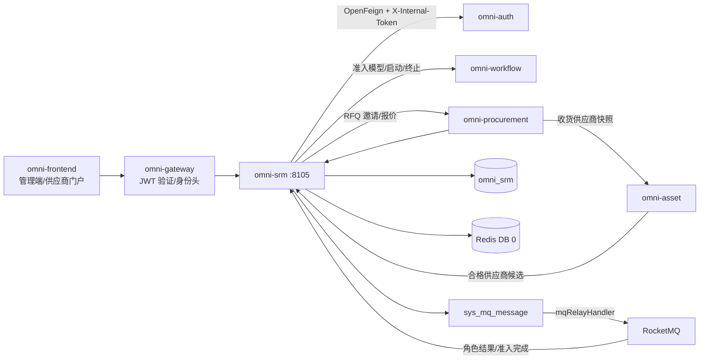
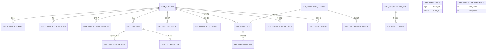
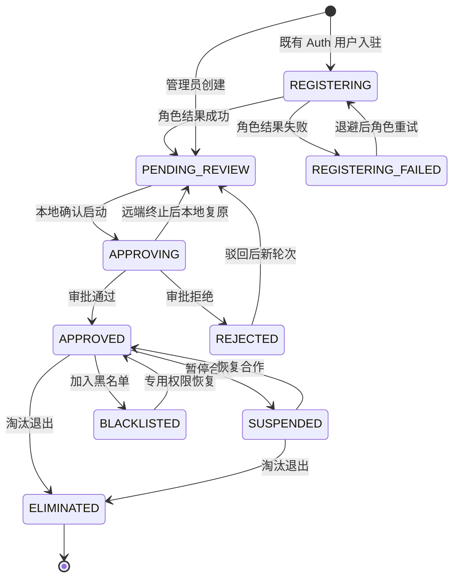
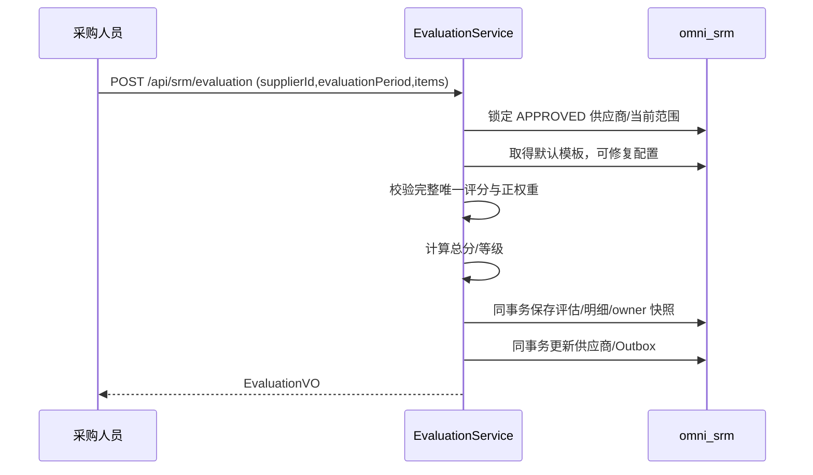
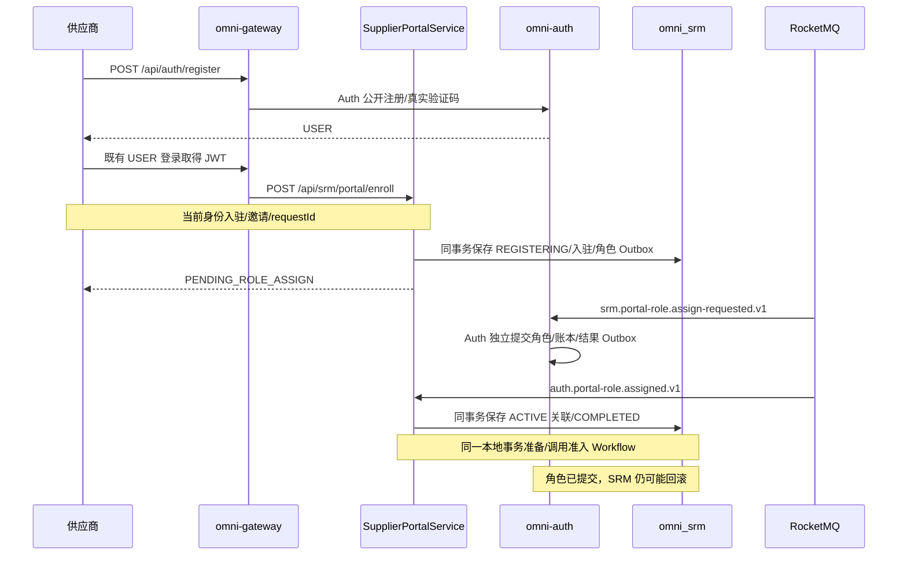

# SRM 供应商管理模块架构与实现基线

> 适用性：保留 2026-07-27 的原设计日期及第 14–16 节重要历史。当前事实以 SRM 源码、Liquibase、前端和配置为准；原“已完成端到端加固”不代表本轮真实运行验收。翻译按 [ADR-0003](../adr/0003-authorized-ai-translation-review.md) 记录实际 `AI_REVIEW`，不冒称人工复核。
>
> 项目：Omni-Stack
> 原设计日期：2026-07-27
> 当前职责：保留设计决策、已实现基线快照和重要历史；当前规则由 SRM 事实文档统一维护。

当前模块事实见 [SRM](../srm.md)，操作入口见 [功能导览](../wiki/feature-tour.md)，开发入口见 [源码索引](../reference/source-map.md) 与 [开发指南](../guides/scaffold-development.md)。运行前提、身份、步骤、截图和恢复属于 Wiki。本页保留设计决策，不把测试要求或历史计划当作本轮验收证据。相关事实见 [核心流程](../core-flows.md)、[Workflow](../workflow.md)、[采购设计](procurement-design.md) 和 [资产设计](asset-design.md)。

职责边界：本页的实现表、状态机、权限和 API 描述保留为提交 `9b23ab972f1dcac4116ae95fb5cd56442e2961e4` 中已复核的设计基线快照；这不是把实现结果追记到原设计日期。后续当前契约只在 [SRM 事实](../srm.md) 维护，本页不作为第二份可独立修改的事实源。长期设计决定变化时更新本页，并说明与当前事实及 ADR 的关系；操作和运行证据仍属于 Wiki。

## 1. 设计结论

SRM 是独立 Servlet 微服务，与采购执行（`omni-procurement`）及资产管理（`omni-asset`）保持领域边界。当前跨服务依赖和集成见第 3、8 节。

| 项目 | 决策 |
|---|---|
| Maven 模块 / 服务名 | `omni-srm` |
| 本地端口 / 管理端口 | `8105` / `19905` |
| XXL-JOB 执行器 | `omni-srm` / `9905`，由 `XXL_JOB_ENABLED` 等配置控制；不表示当前已有定时评估或资质扫描任务 |
| 数据库 | `omni_srm` |
| Gateway | `/api/srm/**` → `lb://omni-srm`，不使用 `StripPrefix` |
| Redis | DB 0，共享 `xss:enabled:{tenantId}` / `xss:rules:{tenantId}`；不声明通用 `srm:` 业务缓存前缀 |
| 前端 | `views/srm/**`（管理）与 `views/supplier-portal/index.vue`（门户） |

SRM MVP 覆盖供应商全生命周期管理闭环：

> 供应商注册/准入 → 审核 → 分级分类 → 绩效评估 → 风险管控 → 淘汰退出。

采购执行（请购、询价、订单、收货）和资产处置（验收、调拨、报废）不进入 SRM MVP，分别在 `omni-procurement` 和 `omni-asset` 中实现。

SRM 主数据依赖 Auth 身份与共享安全能力；准入调用独立 Workflow，门户报价调用 Procurement 邀请契约。Procurement 查询 SRM 供应商/报价，Asset 同时使用采购收货供应商快照和 SRM 的 APPROVED 供应商候选搜索，不能概括为只间接依赖。

## 2. 产品范围

本节保留产品目标和分期。当前存在的功能、入口和限制见后文；Phase 2/3 不是已交付功能，也不证明每个租户已有相同种子或流程模型。

### 2.1 用户与目标

| 用户 | 核心诉求 |
|---|---|
| 采购经理 | 管理供应商库、评估供应商绩效、管控供应风险 |
| 采购员 | 日常供应商查询、发起评估、查看风险信息 |
| SRM 管理员 | 管理租户内全部供应商数据和配置 |
| 供应商 | 通过门户自助注册、维护企业信息、查看自身绩效；在 Procurement 邀请范围内提交报价 |
| 只读观察者 | 查看授权范围内的供应商统计与记录 |

MVP 应能回答：有多少合格/冻结/淘汰供应商；某个供应商的资质什么时候到期；上次绩效评估得分多少；哪些供应商风险等级为红色；谁修改了供应商关键信息。

### 2.2 分期

| 阶段 | 能力 |
|---|---|
| MVP | 供应商信息库、准入审核、分级分类、供应商门户、绩效评估、风险看板、供应商 360 |
| MVP 增量（已实现） | Procurement/RFQ 集成与供应商自助报价 |
| Phase 2 | 评估模板动态配置 UI、第三方征信接入、风险事件工作流、证书附件管理 |
| Phase 3 | 供应商协同平台（订单确认、发货通知、对账）、智能预警（舆情监控） |

## 3. 系统边界

| 组件 | 权威职责 | 当前 SRM 使用边界 |
|---|---|---|
| `omni-auth` | 用户、组织、角色、权限、数据范围、XSS | 内部引用/范围/批量展示查询；为既有用户处理门户角色请求 |
| `omni-srm` | 供应商、评估、风险、PortalUser、报价 | 本服务业务唯一写入方；不处理开户密码 |
| `omni-base` | 字典、操作日志、任务/MQ 运维 | 字典权威与日志汇聚，SRM 保存 code 和自己的业务数据 |
| `omni-workflow` | BPMN、实例、任务、Flowable | 解析已发布准入模型、启动/终止流程，消费完成事件；SRM 不内嵌引擎 |
| `omni-procurement` | RFQ、邀请、定点、PO、收货 | 内部供应商/报价查询；SRM 报价前验证其邀请和完整行快照 |
| `omni-asset` | 资产 | 消费采购供应商快照，并直接使用 SRM 合格供应商搜索 |
| RocketMQ | 事件运输 | 消费者必须幂等；本地 Outbox 不证明实际投递成功 |
| Redis / XXL-JOB | 共享缓存 / 执行基础 | XSS 配置与可配置执行器；外部任务部署另行取证 |

当前 POM 显式依赖 `omni-common-core`, `omni-common`, `omni-common-mybatis`, `omni-common-redis`, `omni-common-operlog`, `omni-common-job`, `omni-common-mqlog`, `omni-common-service`，以及 Web、Security、Validation、AspectJ、OpenFeign、LoadBalancer、Nacos、RocketMQ、Actuator、Lombok 等。`omni-common-service` 提供身份、租户、DataScope、持久化与 XSS 组合；依赖存在不表示所有任务已启用。SRM 不依赖 `omni-common-workflow`，Flowable 运行时和表只属于独立 Workflow。

## 4. 领域与数据设计

### 4.1 聚合

| 聚合 | 表 | 职责 |
|---|---|---|
| Supplier | `srm_supplier`、`srm_supplier_contact`、`srm_supplier_qualification`、`srm_supplier_bank_account` | 供应商主数据、联系人、资质、银行账户 |
| Evaluation | `srm_evaluation_template`、`srm_evaluation_dimension`、`srm_evaluation`、`srm_evaluation_item` | 评估模板、评估记录、评分明细 |
| Risk | `srm_risk_indicator`、`srm_risk_assessment`、`srm_risk_indicator_type`、`srm_risk_criterion`、`srm_risk_score_threshold` | 指标、评估历史及租户共享类型/评分标准/总分阈值 |
| Portal | `srm_supplier_invite`、`srm_supplier_enrollment`、`srm_supplier_portal_user` | 入驻邀请/Saga、门户账号关联 |
| Quotation | `srm_quotation`、`srm_quotation_line`、`srm_quotation_request` | RFQ 报价快照、报价行、请求幂等历史 |
| 消费 Inbox | `srm_event_inbox` | Workflow 完成事件登记、意图核对与处理状态 |

### 4.2 通用字段与规则

- 20 张 `srm_*` 表包含 `tenant_id`。Supplier 与 Evaluation 是直接 owner 授权根；其他业务子资源按明确父链继承，不能要求每张可授权表都有 owner 列。模板、维度、风险配置按租户共享。
- 业务实体按实际 DDL 使用版本、逻辑删除和审计字段；`srm_quotation_request` 是不含 `deleted/version` 的永久幂等账本，Inbox 有独立处理状态。`create_by/update_by` 是用户名审计字段，不能充当 SELF 用户 ID。
- 用户/组织由 Auth 管理，负责人主组织由服务端解析；门户账号通过 `srm_supplier_portal_user` 关联，禁止写入内部 owner 列。引用不建立跨库外键；图示不代替实际 DDL。
- `supplier_no` 在租户内唯一，从已生成的 ID 派生，不使用 `MAX+1`。普通 PUT 不改生命周期或 owner；负责人转移、状态命令和删除各有校验，不将 DataPermission 当作写授权。
- 日期时间使用 `yyyy-MM-dd HH:mm:ss`。报价单价/数量为 `DECIMAL(19,6)`、金额为 `DECIMAL(19,4)`，价格和返回金额采用 JSON 十进制字符串；评分与权重按其 DTO/精度处理。
- `srm_quotation_request` 的 `tenant_id + request_id` 永久唯一，另以 `tenant_id + quotation_id + target_version` 绑定结果轮次；报价头/行的活动唯一约束防止同 RFQ/供应商或同报价行并存重复。
- 完整 PII 返回由具体端点和组装器决定：供应商专用列表恒脱敏，内部详情、联系人/银行列表按 `srm:pii:view`，门户自身资料走独立授权边界，见第 9 节。

### 4.3 主要表

`srm_supplier`

- `supplier_no/name/normalized_name/supplier_type/industry_code`。
- `credit_code（统一社会信用代码）/website/phone/email/region/address`。
- `category_code`：供应商所属品类（IT、原材料、行政、服务等），使用字典 code。
- `level_code`：供应商等级（STRATEGIC/PREFERRED/QUALIFIED/ELIMINATED），由评估自动调整或手动设置。
- `status`：生命周期状态（REGISTERING/REGISTERING_FAILED/PENDING_REVIEW/APPROVING/REJECTED/APPROVED/SUSPENDED/BLACKLISTED/ELIMINATED）。`REGISTERING*` 仅用于门户跨服务注册；管理员创建进入 PENDING_REVIEW 并自动准备准入 Workflow。
- `owner_user_id/owner_unit_id/assigned_time/last_evaluation_time`。
- `version/deleted` 和审计字段。
- 核心索引：tenant + owner/status、tenant + unit/status、tenant + category/status、tenant + name/credit_code。
- `workflow_request_id/workflow_business_key/workflow_model_version_id/approval_attempt/process_instance_id/workflow_start_status/workflow_completed_time/approved_time`：准入轮次与幂等快照，业务键为 `supplierId:attempt`。启动标记为 `NOT_STARTED/PENDING/FAILED/STARTED`；起案身份来自当前请求，不是 Supplier 中的持久化起案人列。

`srm_supplier_contact`

- `supplier_id/name/department/job_title/mobile/phone/email/decision_role/primary_flag/status`。
- 当前表没有内部 owner 列，按同租户 Supplier 关系继承范围，不保存随转移同步的 owner 权限快照。
- 主要联系人和版本/删除约束以专用服务与 DDL 为准；完整联系方式按 PII 权限返回。

`srm_supplier_qualification`

- `supplier_id/qualification_name/certificate_no/issuing_authority/issue_date/expiry_date/status`。
- `expiry_date` 用于资质到期预警（30 天内到期标黄，已过期标红）。
- MVP 不存储附件，仅保存文本信息。

`srm_supplier_bank_account`

- `supplier_id/account_name/account_no/bank_name/bank_branch/bank_code/status`。
- `account_no` 是 PII 字段，完整值只返回给 `srm:pii:view`。
- 每个供应商可维护多个银行账户，标记一个为默认。

`srm_supplier_portal_user`

- `supplier_id/user_id/status/last_login_time/version/deleted`。
- `tenant_id + user_id` 唯一，确保一个 Auth 用户在同一租户只关联一个供应商主体。
- `tenant_id + supplier_id + user_id` 用于门户行级授权；门户用户不能通过修改请求中的 supplierId 切换企业。
- `owner_user_id` 与门户 `user_id` 语义严格分离：前者是内部采购负责人，后者是供应商登录账号。

`srm_supplier_enrollment`

- `request_id/supplier_id/user_id/invite_id/status/retry_count/last_error_code/next_retry_time/version/deleted`。
- 状态为 `PENDING_ROLE_ASSIGN/ROLE_ASSIGN_FAILED/COMPLETED/CANCELLED`；`tenant_id + request_id` 唯一，原请求重放核对申请人和规范化 credit_code，不是整个申请包的 SHA 哈希。
- 保存 inviteId，不保存原令牌、密码或验证码。`next_retry_time` 是退避建议时间，不证明后台自动调度存在；角色失败重试与准入启动重试不同。

`srm_supplier_invite`

- `invite_code_hash/status/expires_time/max_uses/used_count/version/deleted`。当前实现没有预期 credit_code、邮箱摘要或用途字段。
- 创建生成 UUID 原令牌，仅创建响应返回一次；数据库保存 SHA-256，不是 HMAC。消费验证当前租户、ACTIVE、未过期、剩余次数和版本，条件更新次数在入驻事务内完成。
- 列表可把已过期/耗尽条目显示为 EXPIRED/USED；不能把展示状态等同额外的持久化扫描任务。作废后不可消费。

`srm_evaluation_template`

- `tenant_id/name/status/default_flag/version/deleted`。
- MVP 每个租户一套默认模板，不提供动态配置 UI。
- 租户初始化时 `SrmTenantInitializer` 幂等创建默认模板。

`srm_evaluation_dimension`

- `tenant_id/template_id/indicator_name/weight/sort/status/deleted`。
- MVP 预设四个维度：质量（30%）、交期（30%）、价格（20%）、服务（20%）。
- `weight` 为 `DECIMAL(5,2)`，同一模板下所有维度 weight 之和必须等于 100。

`srm_evaluation`

- `supplier_id/template_id/evaluation_period/total_score/evaluator_user_id/evaluation_time/status/owner_user_id/owner_unit_id/version/deleted`；创建完成为 `COMPLETED`，记录当时的内部 owner 快照。
- 请求为 `supplierId/evaluationPeriod/items`，不携带客户端供应商版本或总分。仅 APPROVED 且 owner 完整的可见供应商可创建；锁行后使用数据库版本更新。
- `SUM(score / 5 × weight)` 按 HALF_UP 保留两位，范围 20–100；≥90 STRATEGIC、≥75 PREFERRED、≥60 QUALIFIED、其余 ELIMINATED。这是 `level_code`，不会直接把供应商生命周期变为淘汰终态。

`srm_evaluation_item`

- `evaluation_id/dimension_id/indicator_name/score/weight/remark`。
- `score` 为 1-5 分，`DECIMAL(3,1)`。
- 只追加，评估提交时一次性写入，不提供后续修改接口（如需修正，创建新的评估记录）。

`srm_risk_indicator`

- `supplier_id/indicator_type/indicator_value/criterion_id/score/risk_level/assessment_time/remark`，另有实际版本/删除/审计字段。
- 类型来自启用配置，不是固定 Java 枚举；六种正式种子类型只是默认租户示例。
- 手工更新仅在查到启用类型且 `autoCalc=1` 时拒绝编辑；类型缺失/停用会跳过该检查。criterionId 分支复制当前租户标准的分数/等级/标签，当前不保证标准与指标类型强一致。

`srm_risk_assessment`

- `supplier_id/overall_level/assessment_time/assessor_user_id/remark/version/deleted`。
- 当前综合等级由所有非空 `indicator.score` 求和后匹配阈值产生，非“最高指标颜色”；每次重算追加评估历史，见 5.3。

`srm_quotation`

- `supplier_id/rfq_id/rfq_no/supplier_name_snapshot/request_id/quotation_time/valid_until/total_amount/currency_code/status/version/deleted`。
- `request_id` 记录最后一次成功变更该报价的客户端请求 ID，用于当前快照审计；完整请求幂等历史由 `srm_quotation_request` 保存。
- 通过 `(tenant_id, rfq_id, active_supplier_guard)` 唯一约束保证同一 RFQ、同一供应商最多一条未删除报价；重复提交更新原报价并递增 `version`，不创建并行有效报价。
- `total_amount DECIMAL(19,4)`、`currency_code CHAR(3)` 和 RFQ/供应商快照均由服务端根据 Procurement 邀请详情与报价行计算，门户不得直接指定。

`srm_quotation_line`

- `quotation_id/rfq_line_id/material_code/material_name/unit/unit_price/quantity/line_amount/delivery_days/remark/version/deleted`。
- `rfq_line_id` 必填，且提交行集合必须与 Procurement 返回的 RFQ 行快照完全匹配；物料、单位、数量由服务端复制，门户只提交单价、交期和备注。
- `unit_price/quantity` 使用 `DECIMAL(19,6)` 且必须大于 0，`line_amount` 使用 `DECIMAL(19,4)` 且必须大于 0；`delivery_days` 为 0–3650。服务端逐行计算并汇总，禁止信任客户端金额。
- `(tenant_id, quotation_id, active_rfq_line_guard)` 唯一，禁止同一报价重复 RFQ 行。

`srm_quotation_request`

- `request_id/quotation_id/rfq_id/supplier_id/request_hash/target_version/status`，状态仅为 `RESERVED/COMPLETED`，不做逻辑删除。
- `(tenant_id, request_id)` 永久唯一；`request_hash` 是规范化请求体的 SHA-256，用于拒绝同 requestId 的不同意图。
- `(tenant_id, quotation_id, target_version)` 唯一，保存每次成功更新对应的报价版本；因此旧 requestId 在报价继续更新后重放，仍可识别并且不会重复写报价、明细或 Outbox。

`srm_risk_indicator_type` / `srm_risk_criterion` / `srm_risk_score_threshold`

- 三张表分别保存类型（含启用和 autoCalc）、评分标准、总分区间。按租户及配置功能权限管理，不按内部 owner 限制。
- 服务使用当前查询顺序与含端点阈值；不能宣称已实现完整覆盖/不重叠校验。

`srm_event_inbox`

- 以租户/eventId 保护 Workflow 完成消费，保存来源、类型、聚合键、payload 与处理状态。
- 同 ID 先核对 JSON 语义意图再判断重复；处理状态与供应商变更同事务，早到有效完成需要重试，不能永久吞掉。

## 5. 状态机与核心流程

### 5.1 Supplier 生命周期

`REGISTERING/REGISTERING_FAILED` 只属于既有 Auth 用户的门户角色 Saga，Auth 开户在此前完成。管理员创建先设 PENDING_REVIEW，在同一本地事务同步准备/调用 Workflow；确认启动才进入 APPROVING。APPROVED 才能供采购新业务引用，ELIMINATED 为不可恢复的生命周期终态，黑名单恢复有专用权限。

管理 `submit` 与门户 `profile/submit` 只允许 REJECTED 并开新审批轮次；当前没有针对 PENDING_REVIEW/FAILED 的通用同快照启动重试接口。撤回/取消需先远端终止匹配实例，再按版本复原为 PENDING_REVIEW/NOT_STARTED；远端成功与本地更新不保证分布式原子回滚。

### 5.2 绩效评估流程

创建字段为 `supplierId/evaluationPeriod/items[{dimensionId,score,remark}]`。默认模板保持质量/交期/价格/服务 30/30/20/20；读取模板也可能修复本地配置，不应当作无副作用查询。每个启用维度必须完整且唯一，评分 1–5、存储 `DECIMAL(3,1)`，正权重总和为 100。

同事务保存 Evaluation/Items、供应商等级/最近评估时间和 `srm.evaluation.completed.v1` Outbox。等级计算见 4.3；评估行保留 owner 快照。独立历史最多 100 条，360 只取最近 5 条。季度周期是原业务建议，没有由文档证明的强制定时执行。

### 5.3 风险评估流程

当前流程：校验可见供应商/命令范围 → 按实际标准更新指标 → 重算 CERTIFICATE → 非空 score 求和 → 匹配总分阈值 → 追加 RiskAssessment → 首次或非红转 RED 时写风险 Outbox。

区间端点包含，按查询结果首匹配；无阈值为 GREEN，未命中且高于所有最大上界时取最大上界对应等级，其他空档回 GREEN。兼容方法 `highest` 不是当前综合评估路径。

证书到期日缺失为 GREEN；今天起 0–30 天为 YELLOW、已过期为 RED，分数分别 1/2/3；多份资质取最严重且同等级更早日期。手动风险评估、指标更新，以及 APPROVED/SUSPENDED/BLACKLISTED 供应商的资质增改删触发重算。当前 SRM 主 Java 没有专用 `@XxlJob/@Scheduled` 资格风险扫描，外部任务配置须另证。事件存在不代表外部通知送达。

### 5.4 供应商门户开户与入驻

- Auth 公开 `POST /api/auth/register` 负责租户、真实验证码、用户名唯一及密码处理；默认 USER 分配的失败边界见核心流程 1。SRM 不接收密码/验证码。
- 登录后的 `portal/enroll` 要求 enroll 权限、原 requestId 和有效租户邀请。tenant/user 取可信身份；新建 REGISTERING、风险基础数据、PENDING_ROLE_ASSIGN 和角色请求 Outbox。
- 入驻重放核对申请人及规范化 credit_code；已有申请可能直接返回原结果，不再消耗邀请。Auth 原子增加角色、账本与结果 Outbox，完成重放可再发确定 eventId 的结果。
- SRM 成功结果创建/激活 ACTIVE PortalUser，置 COMPLETED/PENDING_REVIEW 后，在同一本地事务尝试准入。Auth 角色可能已提交而 SRM 模型解析失败回滚；应核对两侧状态和消息重投，不能声称跨服务无“半成功”。
- 角色失败分别为 Enrollment ROLE_ASSIGN_FAILED 与 Supplier REGISTERING_FAILED；`enrollment/retry` 在失败且退避到期后复用原 requestId 发角色 Outbox，不再次消耗邀请，不是审批启动重试。
- Saga COMPLETED 不等于准入 APPROVED。角色变化不会更新既有 JWT，客户端完成后提示重新登录。真实验证码注册和跨服务端到端仍需独立运行证据。

## 6. 租户、RBAC 与数据权限

### 6.1 信任链

Gateway 校验 JWT/黑名单并覆盖身份头 → `GatewayPreAuthenticationFilter` 构建认证 → `ServiceIdentityFilter` 建立当前租户/用户身份 → Controller 方法权限 → 同码 DataScope 切面 → MyBatis 策略与写守卫。身份/认证不完整按实际边界拒绝；内部 API 另外由共享内部令牌 Filter 失败关闭。

`X-Gateway-Forwarded:true` 本身不是密码学证明；生产业务端口需网络边界保护。共享上下文在外层 finally 清理，嵌套范围在 finally 恢复，不宣称没有 ThreadLocal。

### 6.2 权限树与角色

当前权限、菜单及默认租户角色种子以 `scripts/sql/seed/auth.sql` 为准，不证明所有新租户都已具有相同角色。常用权限映射见 7.3。

| 角色 | 种子范围 | 当前边界 |
|---|---|---|
| `SRM_ADMIN` | TENANT | 租户内管理，不能代供应商报价 |
| `PROCUREMENT_MANAGER` | DEPT_AND_BELOW | 部门及下级、绩效和风险管理 |
| `PROCUREMENT_STAFF` | SELF | 自身业务；配置按功能权限租户共享 |
| `SUPPLIER` | SELF | 仍需对应门户权限及当前租户/用户 ACTIVE PortalUser |
| `SUPER_ADMIN` | ALL | 功能树完整，数据仍限当前租户；单独不能冒充门户身份 |

USER 仅获 SRM enroll；profile/evaluation/quotation 还要求 SUPPLIER、功能权限和 ACTIVE 关联。内部管理与门户身份分开，前端按实际角色/权限集合保留多角色管理入口，后端始终重验。

### 6.3 Auth 内部数据范围契约

实际内部路径是 `GET /internal/data-scopes/{userId}?tenantId={tenantId}&permissionCode=srm:supplier:list`，不加 `/api`。

Auth 校验启用用户和租户，只合并授予该完整权限码的角色范围。共享组件对拒绝、响应不一致、异常等按具体分支返回 403/503；缺身份、缺范围不能放宽查询。

### 6.4 公共上下文与 SRM SQL 策略

`omni-common-service` 组合身份、内部认证、XSS 与持久化。顺序为 `TenantLineInnerInterceptor → DataPermissionInterceptor → OptimisticLockerInnerInterceptor → PaginationInnerInterceptor`；TenantLine 仅处理 `srm_*`，`sys_mq_message` 留在两个权限拦截器外。

| 资源 | 授权方式 |
|---|---|
| Supplier / Evaluation | 直接 owner 根；Evaluation 保留创建时快照 |
| Contact / Qualification / BankAccount / RiskIndicator / RiskAssessment / Quotation | 同租户 Supplier 父链继承 |
| EvaluationItem | 从 Evaluation 继承 |
| QuotationLine | 从 Quotation 再到 Supplier 的双层继承 |
| Template / Dimension / 风险配置 | 租户共享与功能权限 |
| Portal | 角色/功能权限/当前 ACTIVE PortalUser 固定 supplierId；不复用内部 owner |
| Supplier 360 各块 | 联系人、资质、银行、评估、风险分别授权/解析范围，没有权限不查询 |

owner 根的 SELF 为 `owner_user_id=currentUserId`，DEPT 为 `owner_unit_id=primaryUnitId`，DEPT_AND_BELOW/CUSTOM 为单位集合，TENANT/ALL 省略 owner 但保留租户。SrmPermissionScopeExecutor/SrmPortalScope 临时执行后恢复原范围，不以宽泛 owner OR 代替父链。

### 6.5 写操作行级授权

已有记录的变更先读取当前租户可见行，再校验状态/关系，并按具体命令进行版本/删除/状态条件更新及影响行数检查。创建编号、级联、永久账本、邀请作废和租户配置各有路径，不声称所有写入都携带客户端 version。DataPermission 不替代 `SrmRecordAccessGuard`。

负责人创建/转移通过 Auth 校验同租户启用用户及权威主组织；指定他人还需相应转移权限/可分配范围。普通 PUT 拒绝 owner 修改。删除受生命周期、门户、评估和风险历史等限制。

## 7. API 设计

### 7.1 通用契约

响应为 `R<T>`、分页 `R<PageResult<T>>`，page 默认/起点 1、size 默认 10、最大 100。存在 version 字段的 DTO 必须带版本；创建评估没有客户端供应商 version，邀请作废等也不能套通用版本请求。

日期时间统一 `yyyy-MM-dd HH:mm:ss`；报价价格/数量/金额的精度及 JSON 字符串见 8.4。具体字段以 Controller/DTO 为准，写日志、内部认证、门户身份和 owner 切面按入口分别应用，不对所有方法作同一注解承诺。

### 7.2 端点

以下 77 个外部、4 个内部方法/路径包含当前别名，完整显示服务路径；Gateway 不剥离 `/api/srm`。Auth 注册是外部依赖接口，不计入 SRM 控制器路径。

| 领域 | 方法与完整路径 |
|---|---|
| 银行账户 | `GET /api/srm/supplier/{supplierId}/bank-account` `GET /api/srm/supplier/{supplierId}/bank-account/list` `GET /api/srm/supplier/{supplierId}/bank-account/{id}` `POST /api/srm/supplier/{supplierId}/bank-account` `PUT /api/srm/supplier/{supplierId}/bank-account/{id}` `DELETE /api/srm/supplier/{supplierId}/bank-account/{id}` |
| 联系人 | `GET /api/srm/supplier/{supplierId}/contact` `GET /api/srm/supplier/{supplierId}/contact/list` `GET /api/srm/supplier/{supplierId}/contact/{id}` `POST /api/srm/supplier/{supplierId}/contact` `PUT /api/srm/supplier/{supplierId}/contact/{id}` `DELETE /api/srm/supplier/{supplierId}/contact/{id}` |
| 绩效评估 | `GET /api/srm/evaluation/list` `GET /api/srm/evaluation/{id}` `GET /api/srm/evaluation/supplier/{supplierId}` `GET /api/srm/evaluation/template/default/dimensions` `POST /api/srm/evaluation` |
| 内部报价 | `GET /api/internal/quotation/batch` |
| 内部供应商 | `GET /api/internal/supplier/{supplierId}` `GET /api/internal/supplier/search` `POST /api/internal/supplier/batch` |
| 负责人候选 | `GET /api/srm/options/owners` |
| 概览 | `GET /api/srm/overview/summary` `GET /api/srm/overview/risk-dashboard` |
| 门户入驻/资料 | `POST /api/srm/portal/enroll` `GET /api/srm/portal/enrollment` `POST /api/srm/portal/enrollment/retry` `GET /api/srm/portal/profile` `PUT /api/srm/portal/profile` `POST /api/srm/portal/profile/submit` |
| 门户绩效 | `GET /api/srm/portal/evaluations` `GET /api/srm/portal/evaluations/history` |
| 邀请（含别名） | `GET /api/srm/portal/invite` `GET /api/srm/portal/invite/list` `GET /api/srm/invite` `GET /api/srm/invite/list` `POST /api/srm/portal/invite` `POST /api/srm/invite` `POST /api/srm/portal/invite/{inviteId}/revoke` `POST /api/srm/invite/{inviteId}/revoke` |
| 门户报价 | `GET /api/srm/portal/quotation/invitations` `GET /api/srm/portal/quotation/invitations/{rfqId}` `POST /api/srm/portal/quotation` |
| 资质 | `GET /api/srm/supplier/{supplierId}/qualification` `GET /api/srm/supplier/{supplierId}/qualification/list` `GET /api/srm/supplier/{supplierId}/qualification/{id}` `POST /api/srm/supplier/{supplierId}/qualification` `PUT /api/srm/supplier/{supplierId}/qualification/{id}` `DELETE /api/srm/supplier/{supplierId}/qualification/{id}` |
| 风险 | `GET /api/srm/risk/list` `GET /api/srm/risk/indicators/{supplierId}` `PUT /api/srm/risk/indicator/{id}` `POST /api/srm/risk/assessment/{supplierId}` `GET /api/srm/risk/assessment/history/{supplierId}` |
| 风险配置 | `GET /api/srm/risk/config/types` `POST /api/srm/risk/config/types` `PUT /api/srm/risk/config/types/{id}` `DELETE /api/srm/risk/config/types/{id}` `POST /api/srm/risk/config/criteria` `PUT /api/srm/risk/config/criteria/{id}` `DELETE /api/srm/risk/config/criteria/{id}` `GET /api/srm/risk/config/thresholds` `PUT /api/srm/risk/config/thresholds` |
| 供应商 | `GET /api/srm/supplier/list` `GET /api/srm/supplier/{id}` `GET /api/srm/supplier/{id}/overview` `POST /api/srm/supplier` `PUT /api/srm/supplier/{id}` `POST /api/srm/supplier/{id}/transfer` `DELETE /api/srm/supplier/{id}` `POST /api/srm/supplier/{id}/submit` `POST /api/srm/supplier/{id}/withdraw` `POST /api/srm/supplier/{id}/cancel` `POST /api/srm/supplier/{id}/suspend` `POST /api/srm/supplier/{id}/resume` `POST /api/srm/supplier/{id}/restore-from-blacklist` `POST /api/srm/supplier/{id}/restore` `POST /api/srm/supplier/{id}/blacklist` `POST /api/srm/supplier/{id}/eliminate` |
| 供应商洞察 | `GET /api/srm/supplier/{supplierId}/evaluation/history` `GET /api/srm/supplier/{supplierId}/risk` |

### 7.3 端点与 DataScope permission 映射

| 操作 | 权限 / 附加条件 |
|---|---|
| 概览 | `srm:overview:list` |
| 供应商 list/detail/360 | `srm:supplier:list`；360 块分别校验子资源权限 |
| 创建 / 驳回后 submit | `srm:supplier:create` |
| 更新 / 删除 / 转移 | `srm:supplier:update`, `srm:supplier:delete`, `srm:supplier:transfer` |
| withdraw / cancel | `srm:supplier:withdraw`, `srm:supplier:cancel`，先匹配远端实例 |
| suspend / resume / blacklist / restore / eliminate | `srm:supplier:suspend`, `srm:supplier:resume`, `srm:supplier:blacklist`, `srm:supplier:restore`, `srm:supplier:eliminate` |
| 联系人 / 资质 / 银行账户 | `srm:contact:list`, `srm:contact:create`, `srm:contact:update`, `srm:contact:delete`、`srm:qualification:list`, `srm:qualification:create`, `srm:qualification:update`, `srm:qualification:delete`、`srm:bank-account:list`, `srm:bank-account:create`, `srm:bank-account:update`, `srm:bank-account:delete` |
| 评估 | `srm:evaluation:list`, `srm:evaluation:create`, `srm:evaluation:view` |
| 风险 / 配置 | `srm:risk:list`, `srm:risk:update`, `srm:risk:assess`、`srm:risk:config:list`, `srm:risk:config:update` |
| 负责人 / PII | `srm:owner:list`、`srm:pii:view` |
| 邀请 | 对应 `srm:invite:list`, `srm:invite:create`, `srm:invite:revoke` 或 `srm:portal:invite` |
| enroll / 入驻状态或重试 | `srm:portal:enroll`；状态/重试接受 `srm:portal:enroll` 或 `srm:portal:profile` |
| 门户资料 / 绩效 / 报价 | `srm:portal:profile`, `srm:portal:evaluation`, `srm:portal:quotation`，并要求 SUPPLIER 与 ACTIVE 关联 |

权限判定使用完整 code，并继续执行对应行级授权。当前 SRM 没有本地 approve/reject/approval-view 方法，审批任务在 Workflow 完成。

## 8. 跨服务一致性

### 8.1 用户与组织

OwnerResolver 创建/转移时校验 Auth 用户、主组织与可分配范围，ownerUnitId 取权威值。OwnerEnricher 去重后分别批量查询用户/组织，异常可保留 ID/空名称；展示回退不扩大授权，也不保证所有 Feign 都在事务外。

本地保存用户/组织 ID 以及审计用户名等必要事实，不维护密码。门户角色通过 Auth 的请求账本和结果 Outbox 管理，SRM 保存 PortalUser 关联。

### 8.2 字典

Base 管理 `srm_supplier_category`；正式默认租户种子含 ELECTRONICS、IT、RAW_MATERIAL、ADMIN、SERVICE。SRM 保存 category_code，自己的初始化器处理默认评估模板与风险基础数据；这些示例不证明每个租户都有相同目录，也不要求普通本地读每次在线查询 Base。

### 8.3 Workflow

管理员 create、REJECTED submit 和门户角色成功处理在本地事务中同步调用 SupplierWorkflowCoordinator。解析本租户已发布且分类 `SRM_SUPPLIER_ONBOARDING` 的模型发生在启动异常捕获前；缺失/未发布/查询失败可能回滚本地创建或 Saga 结果。

启动保存 `requestId/businessKey=supplierId:attempt/modelVersionId/attempt/startStatus/instance`。起案 user 来自当前身份；成功响应须匹配请求/业务键/类型/实例，字段名为 `replayed`。markStarted/markFailed 使用 REQUIRED，不是提交后独立确认。启动或确认失败会尝试标记 FAILED，该标记可能失败/未命中；FAILED 不证明远端未创建实例。当前没有 PENDING_REVIEW/FAILED 的通用启动重试 API，不把角色 Saga retry 当作替代。

完成事件通过 `tenantId + eventId` Inbox 先校验 JSON 语义意图，再匹配审批轮次、业务键、实例与状态。有效早到完成要求消息重试；旧轮次/重复/无效实例隔离，APPROVED/REJECTED 才由完成事件推进。撤回/取消先远端终止后本地版本更新，边界见 5.1。

`RequiredWorkflowModelInitializer` 属于 Workflow 服务，检查默认租户 1 的四个必需模型，并校正/发布查到的启用匹配模型；它不为全部租户自动创建模型，也不等于 SRM 自身对所有租户的启动保障。

### 8.4 Procurement 和 Asset 集成

内部 4 路径见 7.2，使用 `X-Internal-Token`、`X-Tenant-Id`，查询/请求体租户必须一致。供应商 get/batch 返回当前未删除摘要，不自动限定 APPROVED；业务调用方再验证资格。search 可筛 status/category/keyword、limit 1..100；batch 最多 100 个唯一正 ID，按首次顺序去重、缺失省略，无联系人/银行 PII。Asset 当前只使用合格供应商 search；收货仍用 Procurement 快照。

门户 RFQ 调用 Procurement 的 `/api/internal/procurement/rfq/invitations` 与 `/api/internal/procurement/rfq/{rfqId}/invitation`，supplierId 取 ACTIVE PortalUser，不接受前端主体指定。报价请求只绑定 `requestId/rfqId/version/validUntil/lines[{rfqLineId,unitPrice,deliveryDays,remark}]`。

先验证身份/DTO并查永久请求账本；同意图旧 requestId 返回当前报价快照，不重写或重发，不重新走新请求的 APPROVED/RFQ 开放校验。异意图 409。新请求再锁定 APPROVED 供应商，校验 RFQ SENT、邀请 INVITED/QUOTED、截止晚于现在，validUntil 晚于现在且不早于截止。

1–200 行必须唯一、完整覆盖 RFQ 快照；物料/单位/数量/币种来自服务端邀请，单价为正 JSON 十进制字符串且满足 DECIMAL(19,6)，交期 0–3650、备注最多 500 字。行金额 HALF_UP 到 4 位，总额逐行相加，均满足正 DECIMAL(19,4)；返回金额与事件金额使用字符串。

永久账本按 tenant/requestId 保存 SHA-256 规范化意图及 quotationId/targetVersion，意图含 rfqId、version、validUntil 和按行 ID 排序的单价/交期/备注。首建 version=0、存储首版 1，更新要求当前版；报价、行、账本 COMPLETED 和 srm.quotation.submitted.v1 Outbox 同事务。Procurement 以事件/意图/版本更新邀请，定点保存不可变报价/PO 快照；后续报价更新不回写既有 PO。内部报价 batch 只返回 SUBMITTED、有效期内且供应商 APPROVED 的报价。

### 8.5 Outbox 与事件

`DomainEventEnvelope` 包含 `eventId/eventType/occurredAt/tenantId/producer`、`aggregateType/aggregateId/aggregateVersion`、`actorUserId/correlationId/causationId/payload`，按事件契约填充。事务显式调用 `ReliableMessageRelay.send("srm-domain-out-0", envelope, tenantId, eventId)`；事件顶层 eventId 作为 msgKey，Outbox msgId 独立。

当前 SRM 输出为 supplier registered/approved/rejected/suspended/blacklisted/eliminated 六种事件，以及 `srm.portal-role.assign-requested.v1`、`srm.quotation.submitted.v1`、`srm.evaluation.completed.v1`、`srm.risk.level-changed.v1`。Auth 输入为 `auth.portal-role.assigned.v1` / `auth.portal-role.assign-failed.v1`，合计 12 类，不混称为 12 种 SRM 输出。

payload 可含明确 ID、版本、状态、评分/金额及必要快照；不传密码、验证码、inviteToken、完整银行账户或联系方式。角色请求/结果遵循各自 DTO，不声称每个信封同时包含请求与结果字段。Outbox 提交不证明 Broker 投递、消费或外部通知成功。

| 方向 | 事件类型 |
|---|---|
| SRM 输出 | `srm.supplier.registered.v1` |
| SRM 输出 | `srm.supplier.approved.v1` |
| SRM 输出 | `srm.supplier.rejected.v1` |
| SRM 输出 | `srm.supplier.suspended.v1` |
| SRM 输出 | `srm.supplier.blacklisted.v1` |
| SRM 输出 | `srm.supplier.eliminated.v1` |
| SRM 输出 | `srm.portal-role.assign-requested.v1` |
| SRM 输出 | `srm.quotation.submitted.v1` |
| SRM 输出 | `srm.evaluation.completed.v1` |
| SRM 输出 | `srm.risk.level-changed.v1` |
| Auth 输入 | `auth.portal-role.assigned.v1` |
| Auth 输入 | `auth.portal-role.assign-failed.v1` |

## 9. 隐私、操作日志与 XSS

### 9.1 OperLog 脱敏

操作日志按显式字段/文本规则脱敏，不保证任意 PII 识别。银行账号、联系方式、凭证和自由文本按具体注解及共享清洗器处理；enroll 关闭快照并排除 inviteToken/creditCode/phone/email，邀请原令牌不写日志。通用异步日志不能替代业务状态、Inbox 与审批事实。

### 9.2 PII

供应商专用列表恒用脱敏 VO；详情/360、联系人与银行列表/详情按 srm:pii:view 返回电话、邮箱和账号。地址等不因此获得通用掩码保证。门户 profile 在 SUPPLIER/功能权限/ACTIVE 关联后返回自身电话和邮箱，不是 SUPPLIER 隐含全局 pii:view；当前没有门户 contacts/qualifications/bank-accounts API。

SRM 保存企业、联系人、银行、自由文本及 BaseEntity 审计用户名，不可称仅有 userId/unitId。Supplier 没有持久化 Workflow 起案人列，启动请求取当前身份传给 Workflow；取证、截图、日志和导出仍需按字段与授权控制。

### 9.3 XSS

SRM 复用 common-service 的 `CachedServiceXssConfigProvider`，没有第二套独立 SPI。读取 Redis DB0 两个 XSS 键；缺失/异常先向 Auth 回源，有效权威设置（含 enabled）继续使用，缓存写失败也不丢弃它。回源无有效结果时才使用默认 HTML_TAG/EVENT_HANDLER/DANGEROUS_PROTOCOL 安全基线。依赖故障不能绕过过滤；备注按纯文本用途，不用 v-html。

## 10. 前端设计

当前管理页面为 `views/srm/{overview,supplier,evaluation,risk,invite}/index.vue` 和 `views/srm/risk/config/index.vue`；门户是 `views/supplier-portal/index.vue`，没有原方案的 enrollment/profile/evaluation 三个页面目录。API 包括 srm-overview/supplier/evaluation/risk/risk-config/portal.ts。

真实 `components/srm` 保留 SupplierOverview、SupplierPicker、SupplierResourcesDrawer、EvaluationScorecard、RiskIndicator、RiskDashboard。360 使用 Drawer，各块仍有后端独立权限；风险看板支持等级筛选。

`ApiResponse/PageResult` 仅来自 `src/types/api.ts`，按钮用同码 v-permission。SUPPLIER 且无管理权限时管理路由跳门户；多角色按实际权限保留管理入口。四语文案、菜单、router/layout 是当前入口，真实步骤/截图在 Wiki，本文不代替浏览器验收。

## 11. 工程落点

### 11.1 当前模块入口

入口为 `omni-backend/omni-srm/src/main/java/com/omni/srm/SrmApplication.java`，配套 client/config/controller/dto/entity/mapper/security/service/workflow/consumer/domain 等；真实资源为 application.yml/application-lite.yml。启动类声明 EnableDiscoveryClient、EnableFeignClients、MapperScan，领域 SecurityConfig 与共享 common-service 组合。

不要按原计划重建已有模块。SQL/迁移以当前 Mapper 和 Liquibase 为准，开发操作见 [开发指南](../guides/scaffold-development.md)。

### 11.2 当前关联文件

以下是当前关联入口，不是待新建文件；修改契约时同步对应迁移、种子与校验。

| 范围 | 当前文件/目录 |
|---|---|
| 模块 | `omni-backend/omni-srm/pom.xml` `omni-backend/pom.xml` |
| 运行配置 | `omni-backend/omni-srm/src/main/resources/application.yml` `omni-backend/omni-srm/src/main/resources/application-lite.yml` |
| 结构与种子 | `database/changelog/srm/0001-srm-schema.yaml` `scripts/sql/seed/srm.sql` |
| 权限及摘要 | `scripts/sql/seed/auth.sql` `database/seed/manifest.yaml` |
| 租户初始化 | `omni-backend/omni-srm/src/main/java/com/omni/srm/service/impl/SrmTenantModuleProvisioner.java` `omni-backend/omni-srm/src/main/java/com/omni/srm/service/impl/SrmTenantInitializerImpl.java` |
| Gateway / Compose | `omni-backend/omni-gateway/src/main/resources/application.yml` `compose.yaml` |
| 界面 | `omni-frontend/src/views/srm` `omni-frontend/src/views/supplier-portal/index.vue` `omni-frontend/src/components/srm` |
| Workflow / Auth 契约 | `omni-backend/omni-srm/src/main/java/com/omni/srm/workflow` `omni-backend/omni-srm/src/main/java/com/omni/srm/client` `omni-backend/omni-auth/src/main/java/com/omni/auth/service/impl/PortalRoleAssignmentServiceImpl.java` |

默认入口8105、管理19905、Redis DB0、XXL appname omni-srm/9905，Compose按当前配置映射容器端口。轻量配置关闭Nacos并使用静态发现。所有运行、构建和测试均在本机Docker；角色种子不整体授予USER，门户身份不能混同内部管理。

## 12. 非功能设计

- 分页最大 100，部分历史/360 使用自身数量上限。owner/status/category 索引以实际 DDL 为准；OwnerEnricher 批量查用户/组织，展示回退不改变查询范围。没有此文档即可证明的性能实测。
- 状态命令按记录/版本校验，评估锁供应商并一次性写入；邀请次数条件更新，报价永久账本/活动唯一键保证其限定范围的幂等。真实并发与跨服务原子性另行取证。
- Auth 范围查询失败关闭，展示补全可保留 ID。MQ 不可用不等于本地 Outbox 停写，也不保证最终已经补发；Redis失败先Auth再基线。Workflow解析/启动/确认和PortalSaga的部分提交边界按前文，不以错误响应推定远端未执行。
- 默认评估模板与风险配置初始化是当前 SRM 事实，Base负责字典；默认租户种子、Workflow必需模型及角色不构成全部租户/部署均已可用的保证。

## 13. 测试与验收

测试入口为 `omni-backend/omni-srm/src/test/java`。当前单元结果、构建与真实运行证据分开记录；以下是验收要求：

- 九状态与版本/删除限制；create/submit/profile-submit 的模型缺失、启动失败标记及当前无通用审批重试边界；远端终止后本地失败。
- 四维完整评分、1..5/20..100、HALF_UP2和60/75/90等级，不误改生命周期；owner快照和独立评估权限。
- 当前总分阈值、含端点/首匹配/空档规则，类型启用/autoCalc/criterion实际边界，资质到期重算与红色通知事件。
- 内部owner/子父链/租户共享配置、360独立块权限、门户角色/功能/ACTIVE关联、PII与XSS/日志边界。
- 邀请SHA256/有效期/次数并发、申请人/creditCode重放、角色账本/事件重投、Auth已提交而SRM回滚、退避角色retry、JWT重新登录。
- 报价JSON字符串/金额精度、完整行集合、RFQ资格、永久request账本/旧请求返回当前快照及不重复Outbox；采购PO快照不可变。
- 真实端到端仍需 Auth真实验证码注册 → 登录 → 入驻/角色结果 → 准入审批 → 绩效/风险 → 门户自身数据与报价的实际证据。单元通过和本文存在不代替该链；Docker验证命令与操作恢复放在既有Wiki，不保留宿主Maven/npm流程。

## 14. 实施顺序

保留2026-07-27原实施分解与当时完成条件作为历史；它们不是本轮已执行证据或重复运行指令。当前入口和契约见第3–13节。

### Milestone 0：前置确认

- 确认 Auth DataScope 内部接口、OperLog PII 脱敏、XSS miss 策略已就绪（CRM 已建设，直接复用）。
- 确认 Gateway 内部路径阻断规则包含统一前缀 `/api/internal/**`。

### Milestone 1：服务搭建 + 安全底座

- 创建模块、配置、Gateway、Docker、DB。
- TenantLine + DataPermission + Pagination。
- 权限树、SRM 角色、SUPPLIER 角色、已有租户迁移。
- 前端 root 菜单（管理端 + 门户）。

完成条件：注册、路由、401/403、租户隔离、XSS、健康检查通过。

### Milestone 2：供应商管理 + 状态机

- 供应商 CRUD、准入/审核/冻结/恢复/黑名单/淘汰。
- 联系人、资质、银行账户子表。
- 供应商 360 视图。
- PII 掩码。

完成条件：管理员创建供应商 → 审核 → 分级/冻结/淘汰可走通。

### Milestone 3：供应商门户

- 供应商自助开户与入驻（Auth 公开注册 + 已认证 SRM enroll + inviteToken + credit_code 唯一 + 角色分配 Saga）。
- 门户登录（SUPPLIER 角色路由）。
- 企业信息维护。

完成条件：Auth 开户 → 已认证入驻 → SUPPLIER 角色分配 → 审核 → 门户维护企业信息可走通。

### Milestone 4：绩效评估

- 评估模板预设（数据库 seed data）。
- 评估打分 → 加权汇总 → 自动调级。
- 评估历史和趋势。

完成条件：评估创建到自动调级闭环。

### Milestone 5：风险看板 + 生产加固

- 风险指标录入和展示。
- 红黄绿灯 + 资质到期预警。
- 概览统计（summary + risk-dashboard）。
- 测试、索引、安全验收。
- 更新 README、architecture、api-contract、AGENTS。

完成条件：MVP、后端构建、前端 Build/Lint、Docker 和安全验收全部通过。

## 15. ADR 摘要

保留原重要设计取舍。阶段建议与当前实现不同处以前文事实为准；原预设/可选扫描方案不证明当前所有租户或任务已可用。

| 决策 | 选择 | 原因 |
|---|---|---|
| 服务 | 独立 `omni-srm` | 与采购、资产分离，职责清晰 |
| 三服务拆分 | SRM/Procurement/Asset 独立 | 各自有独立数据库和安全架构 |
| 建设顺序 | SRM → Procurement → Asset | SRM 是地基，后续服务依赖供应商数据 |
| 用户体系 | 共享 Auth | 供应商 = sys_user + SUPPLIER 角色，复用多租户 + RBAC |
| 双门户 | 管理端 + 供应商门户共用前端 | 角色路由区分，无需独立前端项目 |
| 准入审批 | 独立 Workflow 服务 | SRM 不嵌入 Flowable，通过幂等内部 API 与可靠完成事件协作 |
| 评估模板 | 数据库预设 | MVP 不做动态配置 UI |
| 评估调级 | 系统自动映射 | 减少人工干预，保证一致性 |
| 风险指标 | 手动为主 + 资质自动预警 | MVP 不接第三方数据 |
| 门户开户/入驻 | Auth 负责公开开户，SRM 负责已认证入驻和角色分配 Saga | 凭证不进入 SRM/MQ，tenant/user 来自可信 JWT |
| 门户授权 | 独立 `srm_supplier_portal_user` 关联 | 不混用内部 owner，按登录账号精确绑定供应商 |
| PII | 后端按权限掩码 | 与 CRM 保持一致的安全策略 |
| Workflow | 已接入 `omni-workflow` | 模型分类固定为 `SRM_SUPPLIER_ONBOARDING`，服务端自动解析当前发布版本 |

## 16. 主要风险

保留原风险登记和对策；其中SELF门户简述、定时扫描及“无半成功”等必须结合当前角色/关联、消息重投、真实配置与跨服务事务限制理解。

| 优先级 | 风险 | 处理 |
|---|---|---|
| P0 | DataScope 只在 Auth，空上下文不加过滤 | 内部契约 + SRM fail closed |
| P0 | 门户开户/入驻被滥用或伪造租户 | Auth tenantCode+验证码；SRM JWT tenant/user + inviteToken + credit_code 唯一 + 限流 |
| P0 | 银行账户 PII 泄露 | 后端掩码 + OperLog 脱敏 |
| P0 | 写操作绕过查询数据权限 | AccessGuard + 条件更新 |
| P1 | SUPPLIER 角色越权查看管理端数据 | 前端角色路由 + 后端 dataScope 强制 SELF |
| P1 | 评估调级并发冲突 | supplier 行锁 + version 乐观锁 |
| P1 | 资质到期预警不及时 | Phase 2 启用 XXL-JOB 定时扫描 |
| P0 | 门户账号越权访问其他供应商 | 独立 PortalUser 关联 + tenant/user/supplier 三元校验 |
| P1 | SUPPLIER 角色分配跨 Auth/SRM 出现半成功 | requestId 幂等 + 本地事务 + Outbox/Saga + 可重试失败态 |
