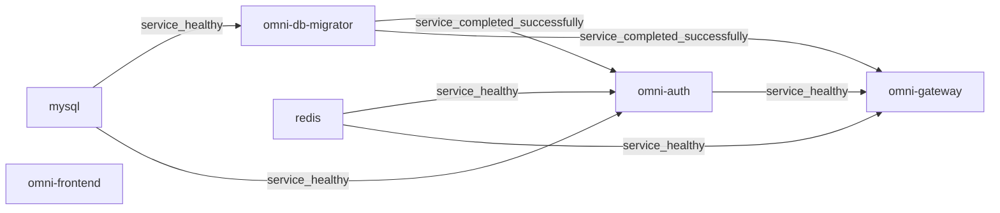

# Docker Deployment Technical Reference

This page explains the current behavior of the formal Compose files, Dockerfiles, migrator and reverse proxy. The main repository’s full baseline is a reference; generated projects use their own preset scope, Compose model, catalog and seed manifest, without inheriting the main repository’s service counts or previous approval. See [Quick Start](guides/quick-start.en.md) for first startup and the [Wiki](wiki/index.en.md) and [Troubleshooting Guide](guides/troubleshooting.en.md) for operations, expected results and recovery. Under the [current authorization policy](adr/0003-authorized-ai-translation-review.md), actual AI_REVIEW suffices without mandatory human review of four-language documents.

## Table of Contents

- [1. Architecture Overview](#1-architecture-overview)
- [2. Container Network Topology](#2-container-network-topology)
- [3. Startup Chain & Health Checks](#3-startup-chain--health-checks)
- [4. Multi-Stage Build Principles](#4-multi-stage-build-principles)
- [5. compose.yaml Service-by-Service Breakdown](#5-composeyaml-service-by-service-breakdown)
- [6. Environment Variable Override Mechanism](#6-environment-variable-override-mechanism)
- [7. Nginx Reverse Proxy Configuration](#7-nginx-reverse-proxy-configuration)
- [8. Data Initialization & Persistence](#8-data-initialization--persistence)
- [9. Docker Registry Mirror Configuration](#9-docker-registry-mirror-configuration)
- [10. Windows Hyper-V/WSL2 Port Reservation Issues](#10-windows-hyper-vwsl2-port-reservation-issues)
- [11. Nacos v3.1.1 Health Check Endpoint Changes](#11-nacos-v311-health-check-endpoint-changes)
- [12. RocketMQ Broker Docker Network Configuration](#12-rocketmq-broker-docker-network-configuration)
- [13. Scaling Guide](#13-scaling-guide)
- [14. Operations Manual](#14-operations-manual)
- [15. Troubleshooting Guide](#15-troubleshooting-guide)
- [16. Configuration Reference](#16-configuration-reference)

## 1. Architecture Overview

The main repository’s full profile declares 15 persistent services and one one-shot migrator: one frontend, eight backend services and six infrastructure services. These are model counts, not proof that containers are running, healthy or accepted for business use. Optional observability and the independent documentation site are enabled separately and excluded from this baseline.

Source: [compose.yaml](../compose.yaml), [compose.apps.yaml](../compose.apps.yaml), [compose.infra.yaml](../compose.infra.yaml).

## 2. Container Network Topology

The standard project is `omni-stack` with default network `omni-stack_default`. Containers use Compose service names and container ports; host mappings are different addresses. Frontend/Gateway mappings do not specify a host IP, while other business diagnostics and middleware mappings bind to `127.0.0.1`. Management ports are not published. Check Docker state for actual exposure; local orchestration does not establish production HTTPS, isolation or high availability.

Source: [compose.apps.yaml](../compose.apps.yaml), [compose.infra.yaml](../compose.infra.yaml).

## 3. Startup Chain & Health Checks

Each service’s `depends_on` and probes define its startup conditions. Running containers, successful probes, completed migration and usable business functions are different states. The current Compose and image configuration own the complete fields.

### 3.1 Layered Startup Order

The migrator starts after MySQL is healthy. Nacos, XXL-JOB and backend migration gates require `service_completed_successfully`. Gateway explicitly waits for the migrator, Redis and Auth, not every downstream service. Frontend has no Compose `depends_on`; its dynamic DNS proxy can start before Gateway is ready, with requests failing in the meantime. The following excerpt shows actual Gateway and Frontend dependencies.



Source: [compose.apps.yaml](../compose.apps.yaml), [compose.infra.yaml](../compose.infra.yaml).

### 3.2 Health Check Configuration Overview

Backend probes use `MANAGEMENT_SERVER_PORT`. Formal Compose sets `19900`–`19907` for the eight services without publishing those ports. The Dockerfile’s `8080` probe fallback does not read application YAML management ports; standalone image runs must explicitly keep them consistent. Startup grace is a probe setting, not a cold-start duration guarantee. The repository adds no separate Frontend health probe.

| Service | Probe | Interval / timeout / retries / startup grace |
| --- | --- | --- |
| `mysql` | `CMD-SHELL` / `mysqladmin ping` | `10s / 5s / 5 / 30s` |
| `redis` | `CMD-SHELL` / `REDISCLI_AUTH / redis-cli ping` | `10s / 5s / 5 / 10s` |
| `nacos` | `CMD` / `http://localhost:8848/nacos/` | `15s / 5s / 5 / 60s` |

<!-- omni:modules:rocketmq -->
| Service | Probe | Interval / timeout / retries / startup grace |
| --- | --- | --- |
| `rocketmq-namesrv` | `CMD-SHELL` / `/dev/tcp/127.0.0.1/9876` | `10s / 5s / 5 / 30s` |
| `rocketmq-broker` | `CMD-SHELL` / `/dev/tcp/127.0.0.1/10911` | `15s / 5s / 5 / 60s` |
<!-- omni:modules:end -->

<!-- omni:modules:xxl-job -->
| Service | Probe | Interval / timeout / retries / startup grace |
| --- | --- | --- |
| `xxl-job-admin` | `CMD-SHELL` / `/dev/tcp/localhost/8080` | `15s / 5s / 5 / 60s` |
<!-- omni:modules:end -->

Source: [Dockerfile](../docker/backend/Dockerfile), [compose.apps.yaml](../compose.apps.yaml), [compose.infra.yaml](../compose.infra.yaml).

## 4. Multi-Stage Build Principles

Business services, the migrator, frontend and Broker have their own formal Dockerfiles. Validate builds separately from startup. Reuse existing artifacts only with exact source/input equivalence and identity evidence. Tags and unmeasured sizes cannot identify the verified image.

### 4.1 Backend Microservice Build

The backend builder supplies JDK 25 and invokes Maven Wrapper. `dependency:go-offline` is a best-effort warmup; its failure does not waive the actual `package -pl '!omni-db-migrator'` gate. `SERVICE_NAME` chooses the final JAR rather than trimming that stage’s reactor. A separate migrator image runs its module tests. The command does not set `-DskipTests`, but conditional tests can still skip, so inspect reports. The excerpt shows actual build and entrypoint instructions.

```dockerfile
FROM maven:3.9-eclipse-temurin-25-alpine AS build
RUN --mount=type=cache,id=omni-maven-repository,target=/root/.m2,sharing=locked \
    sh ./mvnw -s docker-settings.xml package -pl '!omni-db-migrator' -B -q -Dmaven.wagon.http.retryHandler.count=5
FROM eclipse-temurin:25-jre-alpine
ARG SERVICE_NAME
COPY --from=build /build/${SERVICE_NAME}/target/*.jar /app/app.jar
ENTRYPOINT ["/bin/bash", "-c", "exec java --enable-native-access=ALL-UNNAMED $JAVA_OPTS -jar /app/app.jar"]
```

Source: [Dockerfile](../docker/backend/Dockerfile), [Dockerfile](../docker/migrator/Dockerfile).

### 4.2 Frontend Build

The frontend builder uses `node:22-alpine`, runs locked `npm ci` with a BuildKit npm cache and retry settings, then produces the production build. The runtime is `nginx:1.28-alpine`, copying dist and formal Nginx configuration and listening on 3000. These Dockerfile steps alone do not establish lint, browser or business acceptance.

```dockerfile
FROM node:22-alpine AS build
RUN --mount=type=cache,id=omni-npm-cache,target=/root/.npm,sharing=locked \
    npm ci --prefer-offline --no-audit --fetch-retries=5 \
      --fetch-retry-mintimeout=10000 --fetch-retry-maxtimeout=60000
RUN npm run build
FROM nginx:1.28-alpine
COPY --from=build /app/dist /usr/share/nginx/html
COPY docker/frontend/nginx.conf /etc/nginx/conf.d/default.conf
EXPOSE 3000
```

Source: [Dockerfile](../docker/frontend/Dockerfile).

## 5. compose.yaml Service-by-Service Breakdown

`compose.yaml` includes `compose.infra.yaml`, `compose.apps.yaml` and `compose.observability.yaml`, combining services through profiles. Distinguish the standard business model from optional observability. A service has one formal definition. This reference explains boundaries; the Wiki owns complete startup operations.

Source: [compose.yaml](../compose.yaml), [compose.observability.yaml](../compose.observability.yaml).

### 5.1 MySQL 8.4

MySQL 8.4 uses an explicit named data volume, normally `omni-stack_omni-mysql-data`. Its entrypoint no longer mounts aggregate SQL. The migration administrator creates databases and migrates them; application account `omni_app` receives permissions only on seven application databases. Nacos/XXL-JOB currently use root for their vendor database connections, so least privilege cannot be claimed for all infrastructure. Existing business tables without Liquibase history cause direct migrate to fail.

Source: [compose.infra.yaml](../compose.infra.yaml), [LiquibaseMigrationService.java](../omni-backend/omni-db-migrator/src/main/java/com/omni/dbmigrator/migration/LiquibaseMigrationService.java).

### 5.2 Redis 7.4

Formal Redis 7.4 configuration declares a password and named volume, normally `omni-stack_omni-redis-data`, without explicitly enabling AOF. Check image/runtime configuration and actual persistence; retaining a volume does not mean every key reached disk or survives restart. The probe uses configured authentication, while TCP/running alone proves no session, cache or JWK behavior. Keep real passwords within private configuration/log boundaries.

Source: [compose.infra.yaml](../compose.infra.yaml).

### 5.3 Nacos v3.1.1

Nacos v3.1.1 runs standalone with a MySQL vendor database. Ports 8080, 8848 and 9848 serve the console, HTTP API and client gRPC; formal host mappings are loopback-only. `NACOS_AUTH_TOKEN` and node identity secrets differ from console credentials. Clients share `NACOS_USERNAME=nacos` and its private password. After migration, bootstrap conditionally updates only the public seed BCrypt hash, preserving modified accounts.

Source: [compose.infra.yaml](../compose.infra.yaml), [NacosAdminBootstrap.java](../omni-backend/omni-db-migrator/src/main/java/com/omni/dbmigrator/migration/NacosAdminBootstrap.java).

### 5.4 RocketMQ 5.3.2 (NameServer + Broker)

The project’s preset closure determines whether this capability is delivered. The implementation below applies only when that module is included.

<!-- omni:modules:rocketmq -->
NameServer uses container port 9876 and default host port 19876; this does not mean every Windows machine reserves the same range. Broker uses the repository image based on official 5.3.2, preparing the named-volume directory as uid 3000. Its standard volume is `omni-stack_omni-rocketmq-data`. Published ports are 10909, 10911 and 10912, excluding 10910. A TCP probe does not prove reliable-message delivery.

Source: [Dockerfile](../docker/rocketmq/Dockerfile), [broker-docker.conf](../docker/rocketmq/broker-docker.conf), [compose.infra.yaml](../compose.infra.yaml).
<!-- omni:modules:end -->

### 5.5 XXL-JOB Admin v3.3.1

The project’s preset closure determines whether this capability is delivered. The implementation below applies only when that module is included.

<!-- omni:modules:xxl-job -->
XXL-JOB Admin v3.3.1 PARAMS configure the database and a nonempty accessToken, not `xxl.job.login.username/password` login overrides. After migrate, bootstrap writes the private password’s SHA-256 only when the fixed admin account still matches the public seed hash; modified values remain unchanged. Executor accessToken values must match Admin. Changes to an existing Admin login password require coordinated database/private configuration updates. `.env.example` specifies 14–20 characters for this password.

Source: [compose.infra.yaml](../compose.infra.yaml), [XxlJobAdminBootstrap.java](../omni-backend/omni-db-migrator/src/main/java/com/omni/dbmigrator/migration/XxlJobAdminBootstrap.java).
<!-- omni:modules:end -->

### 5.6 Backend Microservices (8 services)

The main-repository reference includes Auth, Base, Workflow, CRM, SRM, Procurement, Asset and Gateway. Their business container port is 8080, management ports are separate, and application databases are module-specific. Generated projects use retained configuration and the preset scope at the top of the page. The eight-service section title describes the main baseline, not a generated project’s running count. The table projects formal application configuration.

| Service | `database` | Current source of truth |
| --- | --- | --- |
| `omni-auth` | `omni_auth` | [application.yml](../omni-backend/omni-auth/src/main/resources/application.yml) |
| `omni-base` | `omni_base` | [application.yml](../omni-backend/omni-base/src/main/resources/application.yml) |
| `omni-workflow` | `omni_workflow` | [application.yml](../omni-backend/omni-workflow/src/main/resources/application.yml) |
| `omni-crm` | `omni_crm` | [application.yml](../omni-backend/omni-crm/src/main/resources/application.yml) |
| `omni-srm` | `omni_srm` | [application.yml](../omni-backend/omni-srm/src/main/resources/application.yml) |
| `omni-procurement` | `omni_procurement` | [application.yml](../omni-backend/omni-procurement/src/main/resources/application.yml) |
| `omni-asset` | `omni_asset` | [application.yml](../omni-backend/omni-asset/src/main/resources/application.yml) |
| `omni-gateway` | `—` | [application.yml](../omni-backend/omni-gateway/src/main/resources/application.yml) |

### 5.7 Frontend

The frontend image listens on 3000, serving static resources and same-origin API/OAuth/OIDC proxies. It resolves Gateway dynamically through Docker DNS and has no Compose startup dependency on Gateway. A started page-serving process does not establish API, login or routing readiness. Quick Start and business Wikis own complete operations and browser expectations.

Source: [nginx.conf](../docker/frontend/nginx.conf), [compose.apps.yaml](../compose.apps.yaml).

## 6. Environment Variable Override Mechanism

Configuration combines Spring environment overrides and explicit YAML placeholders. Check Compose keys, each service’s YAML and the active profile; variable spelling alone does not prove an actual connection or registration.

### 6.1 Conversion Rules

For example, `SERVER_PORT` configures business ports, while `MANAGEMENT_SERVER_PORT` and `MANAGEMENT_PORT` participate in management configuration and probe conventions. Compose uses `SPRING_CLOUD_NACOS_*_SERVER_ADDR` for Auth/Base/Workflow and also declares `NACOS_SERVER_ADDR` for CRM/Gateway/SRM and other YAML placeholders. Inspect each service. This page does not maintain a universal rule that mechanically replaces every hyphen with an underscore.

Source: [compose.apps.yaml](../compose.apps.yaml), [application.yml](../omni-backend/omni-auth/src/main/resources/application.yml), [application.yml](../omni-backend/omni-gateway/src/main/resources/application.yml).

### 6.2 Priority (High to Low)

Command-line arguments, environment, profile files and imported configuration all participate in final values. Several current services declare `optional:nacos:...` imports; Nacos is not universally the lowest-priority source. Inspect active profiles, declared imports and key origins when diagnosing overrides. Publish only nonsecret key names and redacted conclusions.

Source: [application.yml](../omni-backend/omni-auth/src/main/resources/application.yml), [application.yml](../omni-backend/omni-gateway/src/main/resources/application.yml).

### 6.3 Typical Overrides in Docker Deployment

Inside Compose, databases, Redis, Nacos and NameServer use service names. Browser callbacks use browser-accessible entry points. Auth YAML falls back to OAuth port 8100, while formal Compose explicitly overrides `AUTH_OAUTH2_*_REDIRECT_URI` to Gateway 8102. The three paths appear in the actual configuration excerpt. Provider registration must match exactly; configuration does not prove successful external OAuth callbacks. Current Auth Compose also declares HTTP/HTTPS proxying through `host.docker.internal:7897` and internal NO_PROXY entries. These are source-configured addresses; external connectivity and proxy availability still need actual verification.

```yaml
AUTH_FRONTEND_BASE_URL: http://localhost:3000
AUTH_OAUTH2_GITHUB_REDIRECT_URI: http://localhost:8102/api/auth/oauth2/github/callback
AUTH_OAUTH2_GITEE_REDIRECT_URI: http://localhost:8102/api/auth/oauth2/gitee/callback
AUTH_OAUTH2_GOOGLE_REDIRECT_URI: http://localhost:8102/api/auth/oauth2/google/callback
HTTP_PROXY: http://host.docker.internal:7897
HTTPS_PROXY: http://host.docker.internal:7897
NO_PROXY: localhost,127.0.0.1,mysql,redis,nacos
```

Source: [compose.apps.yaml](../compose.apps.yaml), [.env.example](../.env.example).

## 7. Nginx Reverse Proxy Configuration

The formal file is `docker/frontend/nginx.conf`. Container proxies target Gateway 8080. Current rules also include Docker DNS, header buffers, security headers and caching, so a simplified static proxy_pass example is not the complete current configuration.

Source: [nginx.conf](../docker/frontend/nginx.conf).

### 7.1 Configuration Breakdown

`resolver 127.0.0.11 valid=10s ipv6=off` works with a variable upstream to avoid resolving an old container address only at startup. `/api/`, `/oauth2/` and `/.well-known/` proxy to Gateway; SPA routes fall back to index.html. HTML is not cached, while content-hashed assets use long caching. Locations redeclare required security headers to retain the baseline. The excerpt covers dynamic proxying only and cannot replace the entire file.

```nginx
resolver 127.0.0.11 valid=10s ipv6=off;
location /api/ {
    set $upstream_gateway http://omni-gateway:8080;
    proxy_pass $upstream_gateway;
    proxy_set_header Host $host;
    proxy_set_header X-Real-IP $remote_addr;
    proxy_set_header X-Forwarded-For $proxy_add_x_forwarded_for;
    proxy_set_header X-Forwarded-Proto $scheme;
}
```

Source: [nginx.conf](../docker/frontend/nginx.conf).

### 7.2 Common Mistake: proxy_pass Port

Use `omni-gateway:8080` inside Docker. Port 8102 is a host mapping, and container localhost refers to that container. A route through `host.docker.internal` is not the formal proxy path; do not assume reachability or assert unmeasured performance. Gateway’s management health port is 19902. An actuator 404 on its business port does not mean the service stopped.

## 8. Data Initialization & Persistence

`database/changelog/` owns schema, `scripts/sql/seed/` owns formal DML, and `database/seed/manifest.yaml` owns inputs and assertions. Old manual init/migrate scripts are no longer runtime entries. Migration, existing-database adoption and normal application startup have different side effects and verification scopes.

### 8.1 Database Initialization Chain

The main catalog declares nine database targets. Its current manifest has eight seed sources and 25 assertions; generated projects use their own manifest. Actual migrate order is schema/seed migration, conditional XXL-JOB/Nacos bootstrap, seed verification and successful exit. Business tables without Liquibase history reject direct migrate. adopt-current first verifies fingerprints, seeds and backup/restore evidence, then requires exact `ADOPT:<sha256>` confirmation for that report before syncing baseline history. Document AI review does not waive this high-risk confirmation. The migrator supports seed-accept-ids overrides, which formal Compose does not declare by default. With separately configured `DB_MIGRATOR_SEED_ACCEPT_IDS`, listed assertion mismatches can be accepted as WARN; SQL execution errors still fail. Acceptance must record acceptedOverrides rather than call an overridden exit 0 a pass of every original assertion. This page does not set that override.

Source: [MigrationTargetCatalog.java](../omni-backend/omni-db-migrator/src/main/java/com/omni/dbmigrator/migration/MigrationTargetCatalog.java), [MigrationCommandRunner.java](../omni-backend/omni-db-migrator/src/main/java/com/omni/dbmigrator/command/MigrationCommandRunner.java), [AdoptionService.java](../omni-backend/omni-db-migrator/src/main/java/com/omni/dbmigrator/adoption/AdoptionService.java), [BackupEvidenceService.java](../omni-backend/omni-db-migrator/src/main/java/com/omni/dbmigrator/adoption/BackupEvidenceService.java), [SeedVerificationService.java](../omni-backend/omni-db-migrator/src/main/java/com/omni/dbmigrator/seed/SeedVerificationService.java), [manifest.yaml](../database/seed/manifest.yaml).

### 8.2 Data Persistence Strategy

The standard MySQL, Redis and Broker business volumes survive container recreation; ordinary down is not a data-deletion operation. `down -v` can remove business data and is not routine failure recovery. Recovery checks backup digests, source/restore server identity, age and actual restoration. An existing backup file is not a verified restore. Production backups and high availability require separate design.

Source: [compose.infra.yaml](../compose.infra.yaml), [BackupEvidenceService.java](../omni-backend/omni-db-migrator/src/main/java/com/omni/dbmigrator/adoption/BackupEvidenceService.java).

## 9. Docker Registry Mirror Configuration

Image retrieval, Maven dependencies and npm installation have distinct network and cache paths. This page records repository configuration, without recommending unverified public mirrors or changing global host Docker, proxy or account settings.

### 9.1 Docker Registry Mirror

Formal Compose/Dockerfiles do not configure global Docker-daemon registry-mirrors. Separate image name/tag, permission, network and disk failures, retaining actual errors and image identity. Reuse valid images only with equivalent inputs and known identity. A historical daemon.json example cannot prove third-party mirror availability or trust.

### 9.2 Maven Dependency Acceleration

Backend and migrator Dockerfiles use `omni-backend/docker-settings.xml`, whose Aliyun mirror declares `mirrorOf=central` only. Warmup and package use Wrapper and formal settings. Tolerating warmup failures does not tolerate release-build failures. Cache/retry configuration does not guarantee current network downloads.

```xml
<mirror>
  <id>aliyun</id>
  <name>Aliyun Maven Mirror</name>
  <url>https://maven.aliyun.com/repository/public</url>
  <mirrorOf>central</mirrorOf>
</mirror>
```

Source: [docker-settings.xml](../omni-backend/docker-settings.xml), [Dockerfile](../docker/backend/Dockerfile).

### 9.3 npm Dependency Acceleration

The formal frontend Dockerfile uses a BuildKit npm cache, lockfile and fetch retries, without configuring `npm config set registry https://registry.npmmirror.com`. An optional mirror example is not current configuration. Separately validate registry/proxy changes and the lockfile rather than deleting every cache as diagnosis.

Source: [Dockerfile](../docker/frontend/Dockerfile).

## 10. Windows Hyper-V/WSL2 Port Reservation Issues

Standard ports are fixed. Windows listeners and excluded port ranges are different causes, and the target machine determines actual ranges. One observation cannot describe every Windows/WSL2 environment.

### 10.1 Problem Description

Binding errors can result from existing processes, other containers or system reservations. The error establishes binding failure, not its cause. Check the exact address, port and owner first.

### 10.2 Solutions

Read listener and reservation state first, then have an authorized operator resolve the identified conflict. The standard project does not automatically shift `OMNI_*_HOST_PORT` values or change system port policy through startup scripts.

### 10.3 Verify Reserved Ports

The following read-only Windows host commands are diagnostics, not build, application or business execution. They do not authorize terminating unknown processes or deleting system port reservations.

```powershell
Get-NetTCPConnection -State Listen
netsh interface ipv4 show excludedportrange protocol=tcp
```

## 11. Nacos v3.1.1 Health Check Endpoint Changes

For Nacos v3.1.1, this repository configures an HTTP `GET /nacos/` probe. This does not establish endpoint history for every Nacos version. Console/API responses do not prove all applications registered.

### 11.1 Change Description

Distinguish the server HTTP probe from client authentication, instance registration and configuration import. An old actuator path does not replace current Compose declarations. Diagnose actual registration with redacted server/client logs, account configuration and networking.

### 11.2 compose.yaml Configuration

The formal Nacos probe is curl -sf against container port 8848 at /nacos/, with interval 15s, timeout 5s, retries 5 and start_period 60s. These are settings, not a guarantee of startup within a measured number of seconds.

```yaml
healthcheck:
  test:
    - CMD
    - curl
    - -sf
    - http://localhost:8848/nacos/
  interval: 15s
  timeout: 5s
  retries: 5
  start_period: 60s
```

Source: [compose.infra.yaml](../compose.infra.yaml).

## 12. RocketMQ Broker Docker Network Configuration

The project’s preset closure determines whether this capability is delivered. The implementation below applies only when that module is included.

<!-- omni:modules:rocketmq -->
Broker and NameServer use service names on the same Docker network. Host mappings are diagnostic entries, not backend containers’ NameServer address.
<!-- omni:modules:end -->

### 12.1 Background

The project’s preset closure determines whether this capability is delivered. The implementation below applies only when that module is included.

<!-- omni:modules:rocketmq -->
The address Broker advertises must resolve and connect from the client’s network. A reachable NameServer alone proves neither a correct Broker address nor completed consumer processing.
<!-- omni:modules:end -->

### 12.2 Solution

The project’s preset closure determines whether this capability is delivered. The implementation below applies only when that module is included.

<!-- omni:modules:rocketmq -->
Formal `docker/rocketmq/broker-docker.conf` declares `brokerIP1=rocketmq-broker`, one Broker and ASYNC_MASTER/ASYNC_FLUSH. Compose mounts that configuration and a named data volume and starts with --enable-proxy. The main repository’s single-node setup does not verify clusters or access from other networks.

```properties
brokerClusterName = DefaultCluster
brokerName = broker-a
brokerId = 0
brokerRole = ASYNC_MASTER
flushDiskType = ASYNC_FLUSH
brokerIP1 = rocketmq-broker
```

Source: [broker-docker.conf](../docker/rocketmq/broker-docker.conf), [compose.infra.yaml](../compose.infra.yaml).
<!-- omni:modules:end -->

### 12.3 Backend Connection Configuration

The project’s preset closure determines whether this capability is delivered. The implementation below applies only when that module is included.

<!-- omni:modules:rocketmq -->
Current applications use container address `rocketmq-namesrv:9876`; check the precise environment key in each service. Outbox insertion, Relay jobs, Broker receipt and consumer business commit are separate stages. Configuration or TCP success cannot be combined into delivery success.

```yaml
ROCKETMQ_NAME_SERVER: rocketmq-namesrv:9876
```

Source: [compose.apps.yaml](../compose.apps.yaml).
<!-- omni:modules:end -->

## 13. Scaling Guide

The repository delivers a local single-instance topology without a formal `compose.scale.yaml`. Service-discovery code alone does not make the fixed-port model directly scalable or establish production capacity.

### 13.1 Horizontal Scaling of Backend Services

Main Compose defines no fixed container_name, but its fixed host mappings still prevent naive --scale multi-instance runs. Docker does not automatically increment those fixed mappings. Scaling needs separately designed controlled orchestration, entry points and discovery plus actual validation. This page provides no executable recipe referencing an absent override.

### 13.2 Database Connection Pool Considerations

Budget connections by actual pool limits and instance counts, including jobs, migration and administration. The arithmetic 20×3=60 is hypothetical, not current pool configuration or advice to SET GLOBAL to 200. Server capacity changes need independent assessment and authorization.

### 13.3 Stateful Service Considerations

Current Nacos is standalone, RocketMQ has one Broker and XXL-JOB one Admin. These local deployment shapes do not imply that upstream products cannot cluster. Production state, resilience and scaling require acceptance of the specific design.

## 14. Operations Manual

The Wiki and guides own full procedures, identities, expectations and recovery. This page retains configuration explanations and limited read-only diagnostics. Check project and data ownership before restarting, rebuilding, migrating or cleaning resources.

### 14.1 Common Commands

Read status from the target project root. start.sh/start.bat default to full, accept the five preset profiles and execute --build. This differs from CLI dev up runtime-switch overrides for lightweight combinations. stop.sh/stop.bat execute down for the standard project and all profiles, preserving business volumes.

```bash
docker compose -p omni-stack ps -a
docker compose -p omni-stack images
```

Source: [start.sh](../start.sh), [start.bat](../start.bat), [stop.sh](../stop.sh), [stop.bat](../stop.bat).

### 14.2 Log Investigation

Limit evidence logs by service/time, store originals outside the repository and redact public output. A started message does not replace health, registration or business results. Check successful unique business keys before repeating operations.

```bash
docker compose -p omni-stack logs --tail 100 omni-gateway
```

### 14.3 Enter Container for Debugging

Use tools present in the formal Dockerfile rather than assuming identical diagnostics in every image. Prefer management probes inside the corresponding backend container. Check addresses separately from credentials and never export full env into shared records.

```bash
docker compose -p omni-stack exec -T omni-gateway curl -sf http://localhost:19902/actuator/health
```

Source: [Dockerfile](../docker/backend/Dockerfile).

## 15. Troubleshooting Guide

Identify the failing stage: parsing, pulling, building, migration, startup, health, authentication, business or external services. The [Troubleshooting Guide](guides/troubleshooting.en.md) and [Source Debugging](wiki/source-debugging.en.md) own full operations. These entries explain interpretation boundaries.

### 15.1 502 Bad Gateway

A 502 means the proxy has no usable upstream response; it does not identify Nacos or Gateway as stopped. Check frontend/Gateway state and logs, Docker DNS and the business proxy address. Gateway’s own management health uses 19902, not an actuator request on 8080.

### 15.2 Image Pull Failure

Separate pull access denied, missing tags, connection timeouts and insufficient space. Record exact image identity/error and inspect declared names/networking. Do not default to unknown mirrors or another account. Read-only disk usage does not establish which images are safe to delete.

```bash
docker system df
```

### 15.3 Build Failure

Retain the first actual package/npm error and its failing stage. Reuse matching successful reports for unchanged source; verify affected scope after source, lock or configuration changes. Global builder/system prune can lose other tasks’ caches/assets and is not the default recovery command here.

### 15.4 Port Conflicts

Inspect the target port, listener, Docker mapping and Windows excluded ranges. Resolve an identified owned conflict and retain formal defaults. Do not automatically move business ports or stop unknown processes to obtain green checks.

### 15.5 Nacos Registration Failure

Check Nacos HTTP state, client switches, declared addresses, credential presence and instance state. Do not use env | grep NACOS, which can expose passwords and node secrets. Record only public addresses/key names and whether credentials are configured. Server probes do not prove registration.

Source: [doctor.ts](../tools/omni-cli/src/doctor.ts).

### 15.6 RocketMQ Connection Failure

Inspect NameServer, advertised Broker address/ports, Relay scheduling, bindings and consumer logs separately. Containers use internal 9876 rather than host 19876. Correct advertised configuration does not prove tenant isolation, idempotency or an actual message business flow.

### 15.7 Container Startup Order Anomalies

Running is not healthy, and migrator exit 0 can be normal completion. Preserve nonzero errors first. Diagnose declared partial dependencies instead of assuming a global barrier. Check completed migration/business effects before retrying.

Source: [compose.apps.yaml](../compose.apps.yaml), [compose.infra.yaml](../compose.infra.yaml).

## 16. Configuration Reference

Formal files are the sole execution source of truth. This section centralizes projections and source entries, which other documents reference. Tables cannot independently alter Compose, APIs or business contracts.

### 16.1 Service Port Mapping Table

This is a projection of the main repository’s formal default mappings, listing only explicitly published ports. The eight management ports 19900–19907 have no host mapping. Generated projects use retained local configuration; actual bindings and health require runtime inspection.

| Service | Formal default port mapping |
| --- | --- |
| `omni-auth` | `127.0.0.1:8100:8080` |
| `omni-base` | `127.0.0.1:8101:8080` |
| `omni-workflow` | `127.0.0.1:8103:8080` |
| `omni-crm` | `127.0.0.1:8104:8080` |
| `omni-srm` | `127.0.0.1:8105:8080` |
| `omni-procurement` | `127.0.0.1:8106:8080` |
| `omni-asset` | `127.0.0.1:8107:8080` |
| `omni-gateway` | `8102:8080` |
| `omni-frontend` | `3000:3000` |
| `mysql` | `127.0.0.1:3306:3306` |
| `redis` | `127.0.0.1:6379:6379` |
| `nacos` | `127.0.0.1:8080:8080`<br>`127.0.0.1:8848:8848`<br>`127.0.0.1:9848:9848` |

<!-- omni:modules:rocketmq -->
| Service | Formal default port mapping |
| --- | --- |
| `rocketmq-namesrv` | `127.0.0.1:19876:9876` |
| `rocketmq-broker` | `127.0.0.1:10909:10909`<br>`127.0.0.1:10911:10911`<br>`127.0.0.1:10912:10912` |
<!-- omni:modules:end -->

<!-- omni:modules:xxl-job -->
| Service | Formal default port mapping |
| --- | --- |
| `xxl-job-admin` | `127.0.0.1:18080:8080` |
<!-- omni:modules:end -->

### 16.2 Local Initialization Accounts and Secret Sources

Real secrets remain in private .env. `:?` rejects missing/empty values without proving placeholder replacement, strength or valid credentials. doctor treats replace-with and angle-bracket values as unconfigured and reports key names only; start scripts do not run doctor automatically. Current authentication/business facts and Wikis own application bootstrap accounts, tenants, Portal roles and password rules. Copying an admin string does not prove login success.

```bash
docker compose -p omni-stack-tools -f compose.tools.yaml run --rm cli npm run dev -- dev doctor
```

Source: [.env.example](../.env.example), [doctor.ts](../tools/omni-cli/src/doctor.ts).

### 16.3 Key File Paths

These entries own orchestration, builds, proxies, migration, seeds, presets, documentation and operations. Use relative paths inside the current project. Generated projects must not depend on absolute paths to the original workspace.

| File |
| --- |
| [compose.yaml](../compose.yaml) |
| [compose.apps.yaml](../compose.apps.yaml) |
| [compose.infra.yaml](../compose.infra.yaml) |
| [compose.observability.yaml](../compose.observability.yaml) |
| [Dockerfile](../docker/backend/Dockerfile) |
| [Dockerfile](../docker/frontend/Dockerfile) |
| [nginx.conf](../docker/frontend/nginx.conf) |
| [Dockerfile](../docker/migrator/Dockerfile) |
| [MigrationTargetCatalog.java](../omni-backend/omni-db-migrator/src/main/java/com/omni/dbmigrator/migration/MigrationTargetCatalog.java) |
| [MigrationCommandRunner.java](../omni-backend/omni-db-migrator/src/main/java/com/omni/dbmigrator/command/MigrationCommandRunner.java) |
| [AdoptionService.java](../omni-backend/omni-db-migrator/src/main/java/com/omni/dbmigrator/adoption/AdoptionService.java) |
| [BackupEvidenceService.java](../omni-backend/omni-db-migrator/src/main/java/com/omni/dbmigrator/adoption/BackupEvidenceService.java) |
| [db.changelog-root.yaml](../database/changelog/db.changelog-root.yaml) |
| [manifest.yaml](../database/seed/manifest.yaml) |
| [modules.yaml](../scaffold/catalog/modules.yaml) |
| [development.ts](../tools/omni-cli/src/development.ts) |
| [doctor.ts](../tools/omni-cli/src/doctor.ts) |
| [compose.tools.yaml](../compose.tools.yaml) |
| [compose.docs.yaml](../compose.docs.yaml) |
| [.env.example](../.env.example) |
| [start.sh](../start.sh) |
| [start.bat](../start.bat) |
| [stop.sh](../stop.sh) |
| [stop.bat](../stop.bat) |
| [repository-governance.md](repository-governance.md) |
| [source-map.md](reference/source-map.md) |

## Appendix: Build Artifact Size Reference

This page omits MB estimates lacking measurement time, image ID, platform and build scope. Image names use `OMNI_IMAGE_NAMESPACE`, default omni. Valid size evidence binds actual image identity; source tags alone do not prove local usage. Inventory and cleanup first establish ownership, references, backups and recoverability.

Source: [compose.apps.yaml](../compose.apps.yaml), [compose.infra.yaml](../compose.infra.yaml).
