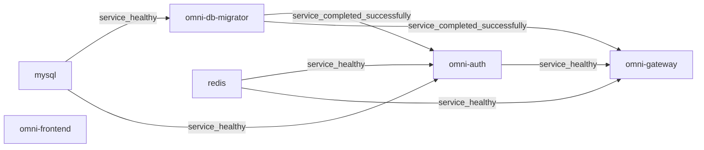

# Docker デプロイメント技術リファレンス

正式な Compose、Dockerfile、移行ツール、リバースプロキシの現在の動作を説明します。メインリポジトリの full 構成は比較用の基準です。生成プロジェクトはページ冒頭のプリセット範囲と自身の Compose、catalog、seed manifest を使い、元のサービス数やレビュー承認を継承しません。初回起動は[クイックスタート](guides/quick-start.jp.md)、操作・期待結果・復旧は [Wiki](wiki/index.jp.md)と[トラブルシューティング](guides/troubleshooting.jp.md)を参照してください。[現行承認方針](adr/0003-authorized-ai-translation-review.md)では実際の AI_REVIEW で足り、四言語文書の人手レビューは必須ではありません。

## 目次

- [1. アーキテクチャ概要](#1-アーキテクチャ概要)
- [2. コンテナネットワークトポロジ](#2-コンテナネットワークトポロジ)
- [3. 起動チェーンとヘルスチェック](#3-起動チェーンとヘルスチェック)
- [4. マルチステージビルドの原理](#4-マルチステージビルドの原理)
- [5. compose.yaml サービス別設定解説](#5-composeyaml-サービス別設定解説)
- [6. 環境変数オーバーライドメカニズム](#6-環境変数オーバーライドメカニズム)
- [7. Nginx リバースプロキシ設定](#7-nginx-リバースプロキシ設定)
- [8. データ初期化と永続化](#8-データ初期化と永続化)
- [9. Docker レジストリミラー設定](#9-docker-レジストリミラー設定)
- [10. Windows Hyper-V/WSL2 ポート予約問題](#10-windows-hyper-vwsl2-ポート予約問題)
- [11. Nacos v3.1.1 ヘルスチェックエンドポイント変更](#11-nacos-v311-ヘルスチェックエンドポイント変更)
- [12. RocketMQ Broker Docker ネットワーク設定](#12-rocketmq-broker-docker-ネットワーク設定)
- [13. スケーリングガイド](#13-スケーリングガイド)
- [14. 運用操作マニュアル](#14-運用操作マニュアル)
- [15. トラブルシューティングガイド](#15-トラブルシューティングガイド)
- [16. 設定リファレンス](#16-設定リファレンス)

## 1. アーキテクチャ概要

メインリポジトリの full profile は常駐サービス 15 個と一回限りの移行ツールを宣言します。内訳はフロントエンド 1、バックエンド 8、基盤 6 です。これは構成モデルの数であり、現在の稼働、正常性、業務検証の証明ではありません。任意の観測スタックと独立文書サイトは別に有効化し、この基準数に含めません。

ソース: [compose.yaml](../compose.yaml)、[compose.apps.yaml](../compose.apps.yaml)、[compose.infra.yaml](../compose.infra.yaml).

## 2. コンテナネットワークトポロジ

標準プロジェクトは `omni-stack`、既定ネットワークは `omni-stack_default` です。コンテナ間は Compose サービス名と内部ポートを使い、ホストのマッピングとは区別します。Frontend/Gateway はホスト IP を明示しないマッピングで、その他の業務診断・基盤ポートは `127.0.0.1` にバインドします。管理ポートはホストへ公開しません。実際の公開範囲は Docker の状態で確認し、ローカル構成を本番 HTTPS、隔離、高可用性の証明にはしません。

ソース: [compose.apps.yaml](../compose.apps.yaml)、[compose.infra.yaml](../compose.infra.yaml).

## 3. 起動チェーンとヘルスチェック

各サービスの `depends_on` とプローブが起動条件を決めます。running、正常プローブ、移行完了、業務機能の利用可能性は別の状態です。完全な項目は現在の Compose とイメージ設定が管理します。

### 3.1 レイヤー起動順序

MySQL の正常判定後に移行ツールが起動します。Nacos、XXL-JOB、バックエンドの移行ゲートは `service_completed_successfully` を要求します。Gateway が明示的に待つのは移行ツール、Redis、Auth であり、全下流サービスではありません。Frontend に Compose の `depends_on` はなく、動的 DNS プロキシは Gateway の準備前に起動でき、その間の要求は失敗する場合があります。以下は現在の Gateway/Frontend 依存関係の抜粋です。



ソース: [compose.apps.yaml](../compose.apps.yaml)、[compose.infra.yaml](../compose.infra.yaml).

### 3.2 ヘルスチェック設定一覧

バックエンドのプローブは `MANAGEMENT_SERVER_PORT` を使います。正式 Compose は 8 サービスに `19900`–`19907` を設定し、ホストへは公開しません。Dockerfile の `8080` フォールバックはアプリ YAML の管理ポートを読み取りません。単独イメージ実行では明示的に一致させます。起動猶予はプローブ設定であり、コールドスタート時間の保証ではありません。Frontend 専用のプローブはリポジトリで追加していません。

| サービス | プローブ | 間隔 / タイムアウト / 再試行 / 起動猶予 |
| --- | --- | --- |
| `mysql` | `CMD-SHELL` / `mysqladmin ping` | `10s / 5s / 5 / 30s` |
| `redis` | `CMD-SHELL` / `REDISCLI_AUTH / redis-cli ping` | `10s / 5s / 5 / 10s` |
| `nacos` | `CMD` / `http://localhost:8848/nacos/` | `15s / 5s / 5 / 60s` |

<!-- omni:modules:rocketmq -->
| サービス | プローブ | 間隔 / タイムアウト / 再試行 / 起動猶予 |
| --- | --- | --- |
| `rocketmq-namesrv` | `CMD-SHELL` / `/dev/tcp/127.0.0.1/9876` | `10s / 5s / 5 / 30s` |
| `rocketmq-broker` | `CMD-SHELL` / `/dev/tcp/127.0.0.1/10911` | `15s / 5s / 5 / 60s` |
<!-- omni:modules:end -->

<!-- omni:modules:xxl-job -->
| サービス | プローブ | 間隔 / タイムアウト / 再試行 / 起動猶予 |
| --- | --- | --- |
| `xxl-job-admin` | `CMD-SHELL` / `/dev/tcp/localhost/8080` | `15s / 5s / 5 / 60s` |
<!-- omni:modules:end -->

ソース: [Dockerfile](../docker/backend/Dockerfile)、[compose.apps.yaml](../compose.apps.yaml)、[compose.infra.yaml](../compose.infra.yaml).

## 4. マルチステージビルドの原理

業務サービス、移行ツール、フロントエンド、Broker はそれぞれ正式 Dockerfile を使います。ビルドと起動は個別に検証します。既存成果物の再利用には、正確なソース・入力の等価性と識別情報が必要です。タグや未測定のサイズでは検証済みイメージを識別できません。

### 4.1 バックエンドマイクロサービスビルド

バックエンドのビルダーは JDK 25 を提供し、Maven Wrapper を実行します。`dependency:go-offline` は失敗を許容する事前取得ですが、実際の `package -pl '!omni-db-migrator'` ゲートは省略できません。`SERVICE_NAME` は最終 JAR を選び、この段階の reactor のビルド対象を絞り込みません。移行ツールの別イメージでそのモジュールのテストを行います。`-DskipTests` は指定しませんが、条件付きテストはスキップされ得るため報告を確認します。以下は実際のビルドと入口の抜粋です。

```dockerfile
FROM maven:3.9-eclipse-temurin-25-alpine AS build
RUN --mount=type=cache,id=omni-maven-repository,target=/root/.m2,sharing=locked \
    sh ./mvnw -s docker-settings.xml package -pl '!omni-db-migrator' -B -q -Dmaven.wagon.http.retryHandler.count=5
FROM eclipse-temurin:25-jre-alpine
ARG SERVICE_NAME
COPY --from=build /build/${SERVICE_NAME}/target/*.jar /app/app.jar
ENTRYPOINT ["/bin/bash", "-c", "exec java --enable-native-access=ALL-UNNAMED $JAVA_OPTS -jar /app/app.jar"]
```

ソース: [Dockerfile](../docker/backend/Dockerfile)、[Dockerfile](../docker/migrator/Dockerfile).

### 4.2 フロントエンドビルド

フロントエンドは `node:22-alpine` で、ロックファイル、BuildKit npm cache、再試行設定を使って `npm ci` を実行し、production build を作成します。実行段階は `nginx:1.28-alpine` で dist と正式 Nginx 設定をコピーし、3000 で待ち受けます。この手順だけでは lint、ブラウザー、業務検証を証明しません。

```dockerfile
FROM node:22-alpine AS build
RUN --mount=type=cache,id=omni-npm-cache,target=/root/.npm,sharing=locked \
    npm ci --prefer-offline --no-audit --fetch-retries=5 \
      --fetch-retry-mintimeout=10000 --fetch-retry-maxtimeout=60000
RUN npm run build
FROM nginx:1.28-alpine
COPY --from=build /app/dist /usr/share/nginx/html
COPY docker/frontend/nginx.conf /etc/nginx/conf.d/default.conf
EXPOSE 3000
```

ソース: [Dockerfile](../docker/frontend/Dockerfile).

## 5. compose.yaml サービス別設定解説

`compose.yaml` は `compose.infra.yaml`、`compose.apps.yaml`、`compose.observability.yaml` を include し、profiles でサービスを組み合わせます。標準業務モデルと任意の観測モデルを区別し、同じサービスの正式定義は一か所に置きます。本書は境界を説明し、完全な起動操作は Wiki が管理します。

ソース: [compose.yaml](../compose.yaml)、[compose.observability.yaml](../compose.observability.yaml).

### 5.1 MySQL 8.4

MySQL 8.4 は明示的な名前付きデータボリュームを使い、標準名は `omni-stack_omni-mysql-data` です。entrypoint に集約 SQL はマウントしません。移行管理者が DB を作成・移行し、アプリ用 `omni_app` には七つのアプリ DB だけを許可します。Nacos/XXL-JOB の現在のベンダー DB 接続は root を使用するため、基盤全体が最小権限とは言えません。業務表があり Liquibase 履歴がない既存 DB は直接 migrate を拒否します。

ソース: [compose.infra.yaml](../compose.infra.yaml)、[LiquibaseMigrationService.java](../omni-backend/omni-db-migrator/src/main/java/com/omni/dbmigrator/migration/LiquibaseMigrationService.java).

### 5.2 Redis 7.4

Redis 7.4 の正式設定はパスワードと名前付きボリューム（標準 `omni-stack_omni-redis-data`）を宣言しますが、AOF を明示的に有効化していません。実際の永続化方式と保存状態はイメージ/実行設定と結果で確認します。ボリューム保持は全キーの保存や再起動後の復元を意味しません。プローブは設定認証を使い、TCP/running だけではセッション、キャッシュ、JWK を証明しません。実パスワードは非公開設定/ログの範囲で扱います。

ソース: [compose.infra.yaml](../compose.infra.yaml).

### 5.3 Nacos v3.1.1

Nacos v3.1.1 は standalone で MySQL のベンダー DB を使用します。8080、8848、9848 はコンソール、HTTP API、クライアント gRPC で、正式ホストマッピングはループバックです。`NACOS_AUTH_TOKEN` やノード identity はコンソール認証情報と異なります。クライアントは `NACOS_USERNAME=nacos` と非公開パスワードを共用します。移行後は公開 seed の BCrypt ハッシュに一致する場合だけ更新し、変更済みアカウントを保持します。

ソース: [compose.infra.yaml](../compose.infra.yaml)、[NacosAdminBootstrap.java](../omni-backend/omni-db-migrator/src/main/java/com/omni/dbmigrator/migration/NacosAdminBootstrap.java).

### 5.4 RocketMQ 5.3.2（NameServer + Broker）

この機能が含まれるかはプロジェクトのプリセット依存閉包で決まります。以下の実装説明は該当モジュールが含まれる場合だけ適用します。

<!-- omni:modules:rocketmq -->
NameServer の内部ポートは 9876、既定ホストポートは 19876 です。全 Windows 機が同じ範囲を予約する意味ではありません。Broker は公式 5.3.2 を基にしたリポジトリのイメージを使い、uid 3000 で名前付きボリュームのディレクトリを準備します。標準ボリュームは `omni-stack_omni-rocketmq-data` です。公開するのは 10909、10911、10912 で、10910 は含みません。TCP プローブはメッセージの確実な配信を証明しません。

ソース: [Dockerfile](../docker/rocketmq/Dockerfile)、[broker-docker.conf](../docker/rocketmq/broker-docker.conf)、[compose.infra.yaml](../compose.infra.yaml).
<!-- omni:modules:end -->

### 5.5 XXL-JOB Admin v3.3.1

この機能が含まれるかはプロジェクトのプリセット依存閉包で決まります。以下の実装説明は該当モジュールが含まれる場合だけ適用します。

<!-- omni:modules:xxl-job -->
XXL-JOB Admin v3.3.1 の PARAMS は DB と空でない accessToken を設定し、ログイン変更の `xxl.job.login.username/password` は使いません。migrate 後、固定 admin が公開 seed ハッシュに一致する場合だけ、非公開パスワードの SHA-256 を書き込み、変更済み値は保持します。executor の accessToken は Admin と一致させます。既存の Admin ログインパスワードを変更する場合は DB と非公開設定を同時に調整します。`.env.example` はこのパスワードを 14–20 文字と定めます。

ソース: [compose.infra.yaml](../compose.infra.yaml)、[XxlJobAdminBootstrap.java](../omni-backend/omni-db-migrator/src/main/java/com/omni/dbmigrator/migration/XxlJobAdminBootstrap.java).
<!-- omni:modules:end -->

### 5.6 バックエンドマイクロサービス（8 サービス）

メインリポジトリの対照は Auth、Base、Workflow、CRM、SRM、Procurement、Asset、Gateway です。業務内部ポートは 8080、管理ポートは別で、アプリ DB はモジュール別です。生成プロジェクトは保持した設定と冒頭のプリセット範囲を使います。見出しの八サービスはメイン基準で、生成プロジェクトの現在の稼働数ではありません。表は正式アプリ設定の投影です。

| サービス | `database` | 現在の正規情報源 |
| --- | --- | --- |
| `omni-auth` | `omni_auth` | [application.yml](../omni-backend/omni-auth/src/main/resources/application.yml) |
| `omni-base` | `omni_base` | [application.yml](../omni-backend/omni-base/src/main/resources/application.yml) |
| `omni-workflow` | `omni_workflow` | [application.yml](../omni-backend/omni-workflow/src/main/resources/application.yml) |
| `omni-crm` | `omni_crm` | [application.yml](../omni-backend/omni-crm/src/main/resources/application.yml) |
| `omni-srm` | `omni_srm` | [application.yml](../omni-backend/omni-srm/src/main/resources/application.yml) |
| `omni-procurement` | `omni_procurement` | [application.yml](../omni-backend/omni-procurement/src/main/resources/application.yml) |
| `omni-asset` | `omni_asset` | [application.yml](../omni-backend/omni-asset/src/main/resources/application.yml) |
| `omni-gateway` | `—` | [application.yml](../omni-backend/omni-gateway/src/main/resources/application.yml) |

### 5.7 フロントエンド

フロントエンドは 3000 で静的資源と同一オリジン API/OAuth/OIDC プロキシを提供します。Docker DNS で Gateway を動的に解決し、Compose の起動依存は宣言しません。ページ提供プロセスの起動は API、ログイン、ルーティングの準備完了を証明しません。完全な操作とブラウザーの期待結果はクイックスタートと業務 Wiki が管理します。

ソース: [nginx.conf](../docker/frontend/nginx.conf)、[compose.apps.yaml](../compose.apps.yaml).

## 6. 環境変数オーバーライドメカニズム

現在の設定は Spring の環境変数上書きと YAML の明示的プレースホルダーを併用します。Compose のキー、各サービスの YAML、有効な profile を照合し、変数の綴りだけで接続や登録成功を推測しません。

### 6.1 変換ルール

`SERVER_PORT` は業務ポート、`MANAGEMENT_SERVER_PORT` と `MANAGEMENT_PORT` は管理設定とプローブ規約に関わります。Auth/Base/Workflow の Compose は `SPRING_CLOUD_NACOS_*_SERVER_ADDR`、CRM/Gateway/SRM 等は YAML 用の `NACOS_SERVER_ADDR` も宣言します。サービスごとに確認し、すべてのハイフンを機械的にアンダースコアへ変える汎用規則は本書で管理しません。

ソース: [compose.apps.yaml](../compose.apps.yaml)、[application.yml](../omni-backend/omni-auth/src/main/resources/application.yml)、[application.yml](../omni-backend/omni-gateway/src/main/resources/application.yml).

### 6.2 優先順位（高→低）

コマンドライン、環境、profile ファイル、import が最終値に関わります。現在の複数サービスには `optional:nacos:...` import があり、Nacos を常に最低優先順位にはできません。実際の profile、import、キーの出所を確認し、公開するのは非秘密のキー名と秘匿化した結論だけです。

ソース: [application.yml](../omni-backend/omni-auth/src/main/resources/application.yml)、[application.yml](../omni-backend/omni-gateway/src/main/resources/application.yml).

### 6.3 Docker デプロイメントでの典型的なオーバーライド

Compose 内の DB、Redis、Nacos、NameServer はサービス名を使い、ブラウザーのコールバックはブラウザーから到達できる入口を使います。Auth YAML の OAuth フォールバックは 8100 ですが、正式 Compose の `AUTH_OAUTH2_*_REDIRECT_URI` は Gateway 8102 へ上書きします。三社の経路は実設定の抜粋に示します。外部登録は完全一致させますが、設定だけで外部 OAuth のコールバックの成功は証明しません。 現 Auth Compose は `host.docker.internal:7897` 経由の HTTP/HTTPS proxy と内部 NO_PROXY も宣言します。これはソース上のアドレスであり、外部接続や proxy の可用性は実際に確認する必要があります。

```yaml
AUTH_FRONTEND_BASE_URL: http://localhost:3000
AUTH_OAUTH2_GITHUB_REDIRECT_URI: http://localhost:8102/api/auth/oauth2/github/callback
AUTH_OAUTH2_GITEE_REDIRECT_URI: http://localhost:8102/api/auth/oauth2/gitee/callback
AUTH_OAUTH2_GOOGLE_REDIRECT_URI: http://localhost:8102/api/auth/oauth2/google/callback
HTTP_PROXY: http://host.docker.internal:7897
HTTPS_PROXY: http://host.docker.internal:7897
NO_PROXY: localhost,127.0.0.1,mysql,redis,nacos
```

ソース: [compose.apps.yaml](../compose.apps.yaml)、[.env.example](../.env.example).

## 7. Nginx リバースプロキシ設定

正式ファイルは `docker/frontend/nginx.conf` です。内部プロキシは Gateway 8080 を指します。現行規則には Docker DNS、ヘッダーバッファー、安全ヘッダー、キャッシュもあり、単純な静的 proxy_pass 例は完全な現行設定ではありません。

ソース: [nginx.conf](../docker/frontend/nginx.conf).

### 7.1 設定解説

`resolver 127.0.0.11 valid=10s ipv6=off` と変数 upstream を使い、起動時だけ古いコンテナ IP を解決する問題を避けます。`/api/`、`/oauth2/`、`/.well-known/` を Gateway に転送し、SPA は index.html にフォールバックします。HTML はキャッシュせず、内容ハッシュ付き assets は長期キャッシュします。location で必要な安全ヘッダーを再宣言して基準を保持します。抜粋は動的転送部分のみで、ファイル全体の置換には使えません。

```nginx
resolver 127.0.0.11 valid=10s ipv6=off;
location /api/ {
    set $upstream_gateway http://omni-gateway:8080;
    proxy_pass $upstream_gateway;
    proxy_set_header Host $host;
    proxy_set_header X-Real-IP $remote_addr;
    proxy_set_header X-Forwarded-For $proxy_add_x_forwarded_for;
    proxy_set_header X-Forwarded-Proto $scheme;
}
```

ソース: [nginx.conf](../docker/frontend/nginx.conf).

### 7.2 よくある間違い：proxy_pass ポート

Docker 内では `omni-gateway:8080` を使います。8102 はホストマッピングで、コンテナ localhost は自分自身です。`host.docker.internal` 経由は正式な転送経路ではなく、到達性や未測定の性能を仮定しません。Gateway の管理ヘルスポートは 19902 で、業務ポートの actuator 404 は停止を意味しません。

## 8. データ初期化と永続化

スキーマは `database/changelog/`、正式 DML は `scripts/sql/seed/`、入力と assertion は `database/seed/manifest.yaml` が管理します。旧手動 init/migrate スクリプトは実行入口ではありません。移行、既存 DB の引き受け、通常起動は副作用と検証範囲が異なります。

### 8.1 データベース初期化チェーン

メイン catalog は九つの DB 対象を宣言し、現在の manifest は八つの seed source と 25 assertion を持ちます。生成プロジェクトは自身の manifest を使います。実 migrate 順序は構造/seed 移行、XXL-JOB/Nacos 条件付き初期化、seed 検証、正常終了です。業務表があり Liquibase 履歴がなければ直接 migrate は拒否します。adopt-current は指紋、seed、バックアップ復元証拠を検証し、本報告と完全一致する `ADOPT:<sha256>` 二段階確認後に baseline 履歴を書きます。文書 AI レビューはこの高リスク確認を免除しません。 移行ツールは seed-accept-ids をサポートしますが、正式 Compose は既定で宣言しません。別に `DB_MIGRATOR_SEED_ACCEPT_IDS` を設定すると、列挙した不一致 assertion を WARN として受容できますが、SQL 実行エラーは失敗します。検証時は acceptedOverrides を記録し、上書き付き exit 0 を元 assertion の全成功とはしません。本書でこの上書きは設定しません。

ソース: [MigrationTargetCatalog.java](../omni-backend/omni-db-migrator/src/main/java/com/omni/dbmigrator/migration/MigrationTargetCatalog.java)、[MigrationCommandRunner.java](../omni-backend/omni-db-migrator/src/main/java/com/omni/dbmigrator/command/MigrationCommandRunner.java)、[AdoptionService.java](../omni-backend/omni-db-migrator/src/main/java/com/omni/dbmigrator/adoption/AdoptionService.java)、[BackupEvidenceService.java](../omni-backend/omni-db-migrator/src/main/java/com/omni/dbmigrator/adoption/BackupEvidenceService.java)、[SeedVerificationService.java](../omni-backend/omni-db-migrator/src/main/java/com/omni/dbmigrator/seed/SeedVerificationService.java)、[manifest.yaml](../database/seed/manifest.yaml).

### 8.2 データ永続化戦略

標準 MySQL、Redis、Broker の業務ボリュームはコンテナ再作成後も保持し、通常 down はデータ削除操作ではありません。`down -v` は業務データを削除し得るため通常復旧には使いません。バックアップハッシュ、元/復元サーバー ID、鮮度、実復元結果を照合します。ファイルの存在は復元検証ではなく、本番バックアップと高可用性は別途設計します。

ソース: [compose.infra.yaml](../compose.infra.yaml)、[BackupEvidenceService.java](../omni-backend/omni-db-migrator/src/main/java/com/omni/dbmigrator/adoption/BackupEvidenceService.java).

## 9. Docker レジストリミラー設定

イメージ取得、Maven 依存、npm 導入はネットワークとキャッシュ経路が異なります。本書はリポジトリ設定を記録し、未検証の公開ミラーを推奨したり、ホスト Docker・プロキシ・アカウントの全体設定を変更したりしません。

### 9.1 Docker レジストリミラー

正式 Compose/Dockerfile は Docker daemon の全体 registry-mirrors を設定しません。名前/タグ、権限、ネットワーク、ディスクを区別し、実エラーとイメージ ID を保存します。有効イメージの再利用は入力等価性と ID が明確な場合に限ります。過去 daemon.json 例は第三者ミラーの可用性や信頼の証明ではありません。

### 9.2 Maven 依存関係の高速化

バックエンドと移行 Dockerfile は `omni-backend/docker-settings.xml` を使い、Aliyun mirror は `mirrorOf=central` だけを宣言します。事前取得も package も Wrapper と正式 settings を使います。事前取得の失敗許容は本ビルドの失敗許容ではなく、cache/retry 設定は現在の取得成功を保証しません。

```xml
<mirror>
  <id>aliyun</id>
  <name>Aliyun Maven Mirror</name>
  <url>https://maven.aliyun.com/repository/public</url>
  <mirrorOf>central</mirrorOf>
</mirror>
```

ソース: [docker-settings.xml](../omni-backend/docker-settings.xml)、[Dockerfile](../docker/backend/Dockerfile).

### 9.3 npm 依存関係の高速化

正式フロントエンド Dockerfile は BuildKit npm cache、lockfile、fetch retry を使い、`npm config set registry https://registry.npmmirror.com` は組み込みません。任意ミラー例を現行設定にせず、registry/proxy 変更と lockfile を独立に検証します。全キャッシュ削除を診断の代わりにはしません。

ソース: [Dockerfile](../docker/frontend/Dockerfile).

## 10. Windows Hyper-V/WSL2 ポート予約問題

標準ポートは固定です。Windows の待ち受けと予約範囲は別原因で、実範囲は対象マシンで決まります。一度の観察を全 Windows/WSL2 環境へ一般化しません。

### 10.1 問題の説明

bind エラーの原因は既存プロセス、他コンテナ、システム予約などです。エラーは bind 失敗だけを示し、原因を断定しません。正確なアドレス、ポート、所有者を確認します。

### 10.2 解決策

まず待ち受けと予約を読み取り、権限を持つ操作者が特定した競合を解消します。標準プロジェクトは `OMNI_*_HOST_PORT` を自動変更せず、起動スクリプトでシステムのポート方針を変更しません。

### 10.3 予約ポートの確認

以下は Windows ホストの読取専用診断であり、ビルド、アプリ、業務の実行方法ではありません。不明なプロセスの終了やシステム予約の削除を許可するものでもありません。

```powershell
Get-NetTCPConnection -State Listen
netsh interface ipv4 show excludedportrange protocol=tcp
```

## 11. Nacos v3.1.1 ヘルスチェックエンドポイント変更

本リポジトリは Nacos v3.1.1 に HTTP `GET /nacos/` プローブを設定します。これで全 Nacos バージョンのエンドポイント履歴は推測しません。コンソール/API 応答は全アプリの登録を証明しません。

### 11.1 変更内容

サーバー HTTP プローブ、クライアント認証、インスタンス登録、設定 import を区別します。旧 actuator 経路で現在の Compose 宣言を代替せず、登録失敗は両側の秘匿化ログ、アカウント設定、ネットワークで診断します。

### 11.2 compose.yaml の設定

正式 Nacos プローブは内部 8848 の /nacos/ へ curl -sf を実行し、interval 15s、timeout 5s、retries 5、start_period 60s です。これは設定値で、指定秒数以内の起動を保証しません。

```yaml
healthcheck:
  test:
    - CMD
    - curl
    - -sf
    - http://localhost:8848/nacos/
  interval: 15s
  timeout: 5s
  retries: 5
  start_period: 60s
```

ソース: [compose.infra.yaml](../compose.infra.yaml).

## 12. RocketMQ Broker Docker ネットワーク設定

この機能が含まれるかはプロジェクトのプリセット依存閉包で決まります。以下の実装説明は該当モジュールが含まれる場合だけ適用します。

<!-- omni:modules:rocketmq -->
Broker と NameServer は同一 Docker ネットワークのサービス名を使います。ホストマッピングは診断入口であり、バックエンドの NameServer アドレスではありません。
<!-- omni:modules:end -->

### 12.1 背景

この機能が含まれるかはプロジェクトのプリセット依存閉包で決まります。以下の実装説明は該当モジュールが含まれる場合だけ適用します。

<!-- omni:modules:rocketmq -->
Broker が通知するアドレスはクライアントのネットワークから解決・接続できる必要があります。NameServer 到達だけでは通知アドレスの正しさやコンシューマー処理完了は証明しません。
<!-- omni:modules:end -->

### 12.2 解決策

この機能が含まれるかはプロジェクトのプリセット依存閉包で決まります。以下の実装説明は該当モジュールが含まれる場合だけ適用します。

<!-- omni:modules:rocketmq -->
正式 `docker/rocketmq/broker-docker.conf` は `brokerIP1=rocketmq-broker`、単一 Broker、ASYNC_MASTER/ASYNC_FLUSH を宣言します。Compose は設定と名前付きデータボリュームをマウントし、--enable-proxy で起動します。メインの単一ノード構成はクラスタや他ネットワークからの接続検証ではありません。

```properties
brokerClusterName = DefaultCluster
brokerName = broker-a
brokerId = 0
brokerRole = ASYNC_MASTER
flushDiskType = ASYNC_FLUSH
brokerIP1 = rocketmq-broker
```

ソース: [broker-docker.conf](../docker/rocketmq/broker-docker.conf)、[compose.infra.yaml](../compose.infra.yaml).
<!-- omni:modules:end -->

### 12.3 バックエンド接続設定

この機能が含まれるかはプロジェクトのプリセット依存閉包で決まります。以下の実装説明は該当モジュールが含まれる場合だけ適用します。

<!-- omni:modules:rocketmq -->
現在のアプリは内部 `rocketmq-namesrv:9876` を使用し、正確な環境キーはサービスごとに確認します。Outbox 挿入、Relay ジョブ、Broker 受信、業務コミットは別段階です。設定や TCP 成功を配信成功へまとめません。

```yaml
ROCKETMQ_NAME_SERVER: rocketmq-namesrv:9876
```

ソース: [compose.apps.yaml](../compose.apps.yaml).
<!-- omni:modules:end -->

## 13. スケーリングガイド

リポジトリはローカル単一インスタンス構成を配布し、正式 `compose.scale.yaml` はありません。サービス検出コードだけでは固定ポートモデルの直接拡張や本番容量を証明できません。

### 13.1 バックエンドサービスの水平スケーリング

メイン Compose に固定 container_name はありませんが、固定ホストマッピングは単純な --scale 複数実行を妨げます。Docker は固定マッピングを自動で連番にしません。拡張には管理された構成、入口、検出と実検証が必要です。存在しない override を使う実行例は提供しません。

### 13.2 データベース接続プールの考慮事項

実際の pool 上限とインスタンス数を合計し、ジョブ、移行、管理接続も予算に含めます。20×3=60 は仮定の算術で、現行設定や SET GLOBAL を 200 にする推奨ではありません。サーバー容量変更には独立した評価と承認が必要です。

### 13.3 ステートフルサービスの注意事項

現在 Nacos は standalone、RocketMQ は単 Broker、XXL-JOB は単 Admin です。ローカル配置の説明は上流製品がクラスタ化できないという断定ではありません。本番状態、耐障害性、拡張は具体的設計ごとに検証します。

## 14. 運用操作マニュアル

全操作順序、実行者の立場、期待結果、復旧は Wiki とガイドが管理します。本書は設定と限定した読取専用診断を扱います。再起動、再ビルド、移行、整理前に対象プロジェクトとデータ所有者を確認します。

### 14.1 常用コマンド

対象プロジェクトのルートで状態を読みます。start.sh/start.bat は既定 full、五つの preset profile を選択でき、--build を実行します。これは CLI dev up の軽量構成用実行スイッチ上書きと異なります。stop.sh/stop.bat は標準プロジェクトと全 profiles で down し、業務ボリュームを保持します。

```bash
docker compose -p omni-stack ps -a
docker compose -p omni-stack images
```

ソース: [start.sh](../start.sh)、[start.bat](../start.bat)、[stop.sh](../stop.sh)、[stop.bat](../stop.bat).

### 14.2 ログ調査

証拠ログはサービス・時刻を限定し、原本はリポジトリ外へ置き、公開前に秘匿化します。started は正常性、登録、業務結果の代わりになりません。再操作前に成功済みの一意業務キーを照会します。

```bash
docker compose -p omni-stack logs --tail 100 omni-gateway
```

### 14.3 コンテナ内デバッグ

正式 Dockerfile にあるツールを使い、全イメージに同じ診断機能があると仮定しません。管理プローブは対応するバックエンド内部で行います。アドレスと認証情報を分け、完全な env を共有記録へ出力しません。

```bash
docker compose -p omni-stack exec -T omni-gateway curl -sf http://localhost:19902/actuator/health
```

ソース: [Dockerfile](../docker/backend/Dockerfile).

## 15. トラブルシューティングガイド

解析、取得、ビルド、移行、起動、正常性、認証、業務、外部サービスのどの段階が失敗したかを特定します。完全な操作は[ガイド](guides/troubleshooting.jp.md)と[ソース調査](wiki/source-debugging.jp.md)が管理し、以下は判断の境界を説明します。

### 15.1 502 Bad Gateway

502 はプロキシに使用可能な上流応答がないことを示すだけで、Nacos/Gateway 停止を断定しません。フロントエンドと Gateway の状態・ログ、Docker DNS、業務転送アドレスを確認します。Gateway 自身の管理ヘルスは 19902 で、8080 に actuator を当てません。

### 15.2 イメージプル失敗

pull access denied、タグ欠落、接続タイムアウト、容量不足を分けます。正確なイメージ ID とエラーを保存し、宣言された名前とネットワークを確認します。不明なミラーや別アカウントへ自動変更しません。読取専用容量表示は削除してよいイメージの証明ではありません。

```bash
docker system df
```

### 15.3 ビルド失敗

実 package/npm の最初のエラーと段階を保持します。ソース不変の有効報告は等価性で再利用し、ソース・lock・設定変更時は影響範囲を検証します。全体 builder/system prune は他タスクの cache/資産を失うため、通常復旧コマンドにしません。

### 15.4 ポート競合

対象ポート、待ち受け、Docker マッピング、Windows 予約範囲を確認します。所有者が明確な競合を解消し、正式既定値を保ちます。合格のために業務ポートを自動移動したり、不明プロセスを停止したりしません。

### 15.5 Nacos 登録失敗

Nacos の HTTP、クライアントスイッチ、宣言アドレス、認証情報の存在、インスタンスを確認します。env | grep NACOS はパスワードやノード秘密を出すため使いません。公開できるアドレス/キー名と設定有無だけを記録します。サーバープローブは登録の証明ではありません。

ソース: [doctor.ts](../tools/omni-cli/src/doctor.ts).

### 15.6 RocketMQ 接続失敗

NameServer、Broker 通知アドレス/ポート、Relay、binding、コンシューマーログを個別に確認します。内部 9876 を使い、ホスト 19876 には接続しません。通知設定だけではテナント分離、冪等性、実業務のメッセージフローは証明しません。

### 15.7 コンテナ起動順序異常

running と healthy は異なり、移行ツールの exit 0 は正常完了の場合があります。非零エラーは先に保存します。全体障壁を仮定せず実際の部分依存を確認し、再試行前に完了済み移行と業務副作用を調べます。

ソース: [compose.apps.yaml](../compose.apps.yaml)、[compose.infra.yaml](../compose.infra.yaml).

## 16. 設定リファレンス

正式ファイルが唯一の実行事実源です。本節は投影とソース入口を集約し、他文書はリンクで参照します。表だけで Compose、API、業務契約を変更できません。

### 16.1 サービスポートマッピング一覧表

以下はメインリポジトリの正式既定マッピングの投影で、明示公開したポートだけを列挙します。19900–19907 の八管理ポートにホストマッピングはありません。生成プロジェクトは保持した自身の設定を使い、実バインドと正常性は実行時に確認します。

| サービス | 正式な既定ポートマッピング |
| --- | --- |
| `omni-auth` | `127.0.0.1:8100:8080` |
| `omni-base` | `127.0.0.1:8101:8080` |
| `omni-workflow` | `127.0.0.1:8103:8080` |
| `omni-crm` | `127.0.0.1:8104:8080` |
| `omni-srm` | `127.0.0.1:8105:8080` |
| `omni-procurement` | `127.0.0.1:8106:8080` |
| `omni-asset` | `127.0.0.1:8107:8080` |
| `omni-gateway` | `8102:8080` |
| `omni-frontend` | `3000:3000` |
| `mysql` | `127.0.0.1:3306:3306` |
| `redis` | `127.0.0.1:6379:6379` |
| `nacos` | `127.0.0.1:8080:8080`<br>`127.0.0.1:8848:8848`<br>`127.0.0.1:9848:9848` |

<!-- omni:modules:rocketmq -->
| サービス | 正式な既定ポートマッピング |
| --- | --- |
| `rocketmq-namesrv` | `127.0.0.1:19876:9876` |
| `rocketmq-broker` | `127.0.0.1:10909:10909`<br>`127.0.0.1:10911:10911`<br>`127.0.0.1:10912:10912` |
<!-- omni:modules:end -->

<!-- omni:modules:xxl-job -->
| サービス | 正式な既定ポートマッピング |
| --- | --- |
| `xxl-job-admin` | `127.0.0.1:18080:8080` |
<!-- omni:modules:end -->

### 16.2 ローカル初期化アカウントとシークレット供給源

実 Secret は非公開 .env に保持します。`:?` は欠落/空値を拒否するだけで、仮置き値の置換、強度、認証成功を証明しません。doctor は replace-with と山括弧の値を未設定とし、キー名だけを報告します。start は doctor を自動実行しません。アプリの初期アカウント、テナント、Portal ロール、パスワード規則は認証/業務の事実と Wiki が管理し、admin の文字列だけでログイン成功を仮定しません。

```bash
docker compose -p omni-stack-tools -f compose.tools.yaml run --rm cli npm run dev -- dev doctor
```

ソース: [.env.example](../.env.example)、[doctor.ts](../tools/omni-cli/src/doctor.ts).

### 16.3 主要ファイルパス

各入口は構成、ビルド、転送、移行、seed、preset、文書、操作の事実を管理します。現在のプロジェクト内の相対パスを使い、生成プロジェクトから元作業場所の絶対パスには依存しません。

| ファイル |
| --- |
| [compose.yaml](../compose.yaml) |
| [compose.apps.yaml](../compose.apps.yaml) |
| [compose.infra.yaml](../compose.infra.yaml) |
| [compose.observability.yaml](../compose.observability.yaml) |
| [Dockerfile](../docker/backend/Dockerfile) |
| [Dockerfile](../docker/frontend/Dockerfile) |
| [nginx.conf](../docker/frontend/nginx.conf) |
| [Dockerfile](../docker/migrator/Dockerfile) |
| [MigrationTargetCatalog.java](../omni-backend/omni-db-migrator/src/main/java/com/omni/dbmigrator/migration/MigrationTargetCatalog.java) |
| [MigrationCommandRunner.java](../omni-backend/omni-db-migrator/src/main/java/com/omni/dbmigrator/command/MigrationCommandRunner.java) |
| [AdoptionService.java](../omni-backend/omni-db-migrator/src/main/java/com/omni/dbmigrator/adoption/AdoptionService.java) |
| [BackupEvidenceService.java](../omni-backend/omni-db-migrator/src/main/java/com/omni/dbmigrator/adoption/BackupEvidenceService.java) |
| [db.changelog-root.yaml](../database/changelog/db.changelog-root.yaml) |
| [manifest.yaml](../database/seed/manifest.yaml) |
| [modules.yaml](../scaffold/catalog/modules.yaml) |
| [development.ts](../tools/omni-cli/src/development.ts) |
| [doctor.ts](../tools/omni-cli/src/doctor.ts) |
| [compose.tools.yaml](../compose.tools.yaml) |
| [compose.docs.yaml](../compose.docs.yaml) |
| [.env.example](../.env.example) |
| [start.sh](../start.sh) |
| [start.bat](../start.bat) |
| [stop.sh](../stop.sh) |
| [stop.bat](../stop.bat) |
| [repository-governance.md](repository-governance.md) |
| [source-map.md](reference/source-map.md) |

## 付録：ビルド成果物サイズ参考

測定時刻、イメージ ID、プラットフォーム、ビルド範囲がない MB 推定は掲載しません。イメージ名は `OMNI_IMAGE_NAMESPACE`（既定 omni）を使います。有効な容量証拠には実イメージ ID が必要で、ソースのタグだけではローカル使用量を証明できません。資産一覧と整理は所有者、参照、バックアップ、復元可能性を先に確認します。

ソース: [compose.apps.yaml](../compose.apps.yaml)、[compose.infra.yaml](../compose.infra.yaml).
