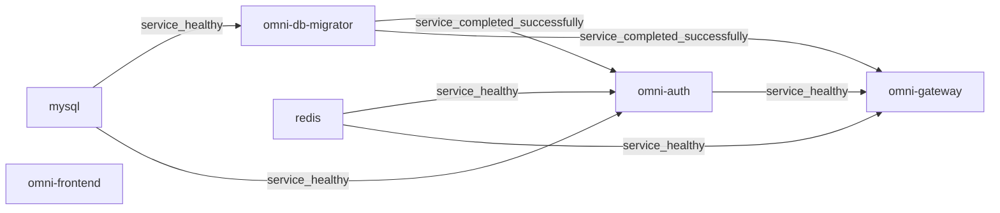

# Docker 배포 기술 레퍼런스

정식 Compose, Dockerfile, 마이그레이터와 리버스 프록시의 현재 동작을 설명합니다. 주 저장소의 full 기준은 비교용이며, 생성 프로젝트는 페이지 앞부분의 프리셋 범위와 자체 Compose, catalog, seed manifest를 사용합니다. 주 저장소의 서비스 수나 이전 검토 승인을 상속하지 않습니다. 첫 실행은 [빠른 시작](guides/quick-start.kr.md), 작업·예상 결과·복구는 [Wiki](wiki/index.kr.md)와 [문제 해결](guides/troubleshooting.kr.md)을 참조합니다. [현재 승인 정책](adr/0003-authorized-ai-translation-review.md)에 따라 실제 AI_REVIEW로 충분하며 네 언어 문서에 사람 검토를 요구하지 않습니다.

## 목차

- [1. 아키텍처 개요](#1-아키텍처-개요)
- [2. 컨테이너 네트워크 토폴로지](#2-컨테이너-네트워크-토폴로지)
- [3. 기동 체인과 헬스체크](#3-기동-체인과-헬스체크)
- [4. 멀티스테이지 빌드 원리](#4-멀티스테이지-빌드-원리)
- [5. compose.yaml 서비스별 설정 해설](#5-composeyaml-서비스별-설정-해설)
- [6. 환경 변수 오버라이드 메커니즘](#6-환경-변수-오버라이드-메커니즘)
- [7. Nginx 리버스 프록시 설정](#7-nginx-리버스-프록시-설정)
- [8. 데이터 초기화와 영속화](#8-데이터-초기화와-영속화)
- [9. Docker 레지스트리 미러 설정](#9-docker-레지스트리-미러-설정)
- [10. Windows Hyper-V/WSL2 포트 예약 문제](#10-windows-hyper-vwsl2-포트-예약-문제)
- [11. Nacos v3.1.1 헬스체크 엔드포인트 변경](#11-nacos-v311-헬스체크-엔드포인트-변경)
- [12. RocketMQ Broker Docker 네트워크 설정](#12-rocketmq-broker-docker-네트워크-설정)
- [13. 스케일링 가이드](#13-스케일링-가이드)
- [14. 운영 매뉴얼](#14-운영-매뉴얼)
- [15. 트러블슈팅 가이드](#15-트러블슈팅-가이드)
- [16. 설정 레퍼런스](#16-설정-레퍼런스)

## 1. 아키텍처 개요

주 저장소 full profile은 상시 서비스 15개와 일회성 마이그레이터 1개를 선언합니다. 프런트엔드 1개, 백엔드 8개, 인프라 6개입니다. 모델의 개수이며 현재 컨테이너 실행·정상 상태·업무 검증을 증명하지 않습니다. 선택적 관측 스택과 독립 문서 사이트는 별도로 켜며 이 기준에 포함하지 않습니다.

소스: [compose.yaml](../compose.yaml), [compose.apps.yaml](../compose.apps.yaml), [compose.infra.yaml](../compose.infra.yaml).

## 2. 컨테이너 네트워크 토폴로지

표준 프로젝트는 `omni-stack`, 기본 네트워크는 `omni-stack_default`입니다. 컨테이너는 Compose 서비스 이름과 내부 포트를 사용하며 호스트 매핑과 구분합니다. Frontend/Gateway 매핑은 호스트 IP를 명시하지 않고, 다른 업무 진단·미들웨어 포트는 `127.0.0.1`에 바인딩합니다. 관리 포트는 호스트에 공개하지 않습니다. 실제 노출은 Docker 상태로 확인하며 로컬 구성은 운영 HTTPS·격리·고가용성을 증명하지 않습니다.

소스: [compose.apps.yaml](../compose.apps.yaml), [compose.infra.yaml](../compose.infra.yaml).

## 3. 기동 체인과 헬스체크

각 서비스의 `depends_on`과 프로브가 시작 조건을 결정합니다. running, 프로브 성공, 마이그레이션 완료와 업무 기능 사용 가능은 서로 다른 상태입니다. 전체 필드는 현재 Compose와 이미지 설정이 기준입니다.

### 3.1 계층별 기동 순서

MySQL이 정상일 때 마이그레이터가 시작합니다. Nacos, XXL-JOB와 백엔드의 마이그레이션 게이트는 `service_completed_successfully`를 요구합니다. Gateway는 마이그레이터, Redis, Auth를 명시적으로 기다리며 모든 하위 서비스를 기다리지는 않습니다. Frontend에는 Compose `depends_on`이 없고 동적 DNS 프록시는 Gateway 준비 전에 시작할 수 있어 그동안 요청이 실패할 수 있습니다. 아래는 현재 Gateway/Frontend 의존 관계의 실제 발췌입니다.



소스: [compose.apps.yaml](../compose.apps.yaml), [compose.infra.yaml](../compose.infra.yaml).

### 3.2 헬스체크 설정 일람

백엔드 프로브는 `MANAGEMENT_SERVER_PORT`를 사용합니다. 정식 Compose는 여덟 서비스에 `19900`–`19907`을 설정하고 호스트에 공개하지 않습니다. Dockerfile의 `8080` 폴백은 애플리케이션 YAML 관리 포트를 읽지 않으므로 이미지를 단독 실행할 때 명시적으로 맞춰야 합니다. 시작 유예는 프로브 설정이며 콜드 스타트 시간 보장이 아닙니다. 저장소는 별도 Frontend 프로브를 추가하지 않습니다.

| 서비스 | 프로브 | 간격 / 시간 제한 / 재시도 / 시작 유예 |
| --- | --- | --- |
| `mysql` | `CMD-SHELL` / `mysqladmin ping` | `10s / 5s / 5 / 30s` |
| `redis` | `CMD-SHELL` / `REDISCLI_AUTH / redis-cli ping` | `10s / 5s / 5 / 10s` |
| `nacos` | `CMD` / `http://localhost:8848/nacos/` | `15s / 5s / 5 / 60s` |

<!-- omni:modules:rocketmq -->
| 서비스 | 프로브 | 간격 / 시간 제한 / 재시도 / 시작 유예 |
| --- | --- | --- |
| `rocketmq-namesrv` | `CMD-SHELL` / `/dev/tcp/127.0.0.1/9876` | `10s / 5s / 5 / 30s` |
| `rocketmq-broker` | `CMD-SHELL` / `/dev/tcp/127.0.0.1/10911` | `15s / 5s / 5 / 60s` |
<!-- omni:modules:end -->

<!-- omni:modules:xxl-job -->
| 서비스 | 프로브 | 간격 / 시간 제한 / 재시도 / 시작 유예 |
| --- | --- | --- |
| `xxl-job-admin` | `CMD-SHELL` / `/dev/tcp/localhost/8080` | `15s / 5s / 5 / 60s` |
<!-- omni:modules:end -->

소스: [Dockerfile](../docker/backend/Dockerfile), [compose.apps.yaml](../compose.apps.yaml), [compose.infra.yaml](../compose.infra.yaml).

## 4. 멀티스테이지 빌드 원리

업무 서비스, 마이그레이터, 프런트엔드와 Broker는 각각 정식 Dockerfile을 사용합니다. 빌드와 시작을 따로 검증합니다. 기존 산출물은 정확한 소스·입력 동등성과 식별 증거로만 재사용합니다. 태그나 측정하지 않은 크기는 검증한 이미지의 식별자가 아닙니다.

### 4.1 백엔드 마이크로서비스 빌드

백엔드 빌더는 JDK 25를 제공하고 Maven Wrapper를 실행합니다. `dependency:go-offline`은 실패를 허용하는 사전 준비이며 실제 `package -pl '!omni-db-migrator'` 게이트를 면제하지 않습니다. `SERVICE_NAME`은 최종 JAR만 선택하며 해당 단계 reactor의 빌드 대상 모듈을 줄이지 않습니다. 별도 마이그레이터 이미지가 그 모듈 테스트를 실행합니다. `-DskipTests`는 지정하지 않지만 조건부 테스트는 건너뛸 수 있으므로 보고서를 확인합니다. 아래는 실제 빌드와 진입점의 발췌입니다.

```dockerfile
FROM maven:3.9-eclipse-temurin-25-alpine AS build
RUN --mount=type=cache,id=omni-maven-repository,target=/root/.m2,sharing=locked \
    sh ./mvnw -s docker-settings.xml package -pl '!omni-db-migrator' -B -q -Dmaven.wagon.http.retryHandler.count=5
FROM eclipse-temurin:25-jre-alpine
ARG SERVICE_NAME
COPY --from=build /build/${SERVICE_NAME}/target/*.jar /app/app.jar
ENTRYPOINT ["/bin/bash", "-c", "exec java --enable-native-access=ALL-UNNAMED $JAVA_OPTS -jar /app/app.jar"]
```

소스: [Dockerfile](../docker/backend/Dockerfile), [Dockerfile](../docker/migrator/Dockerfile).

### 4.2 프론트엔드 빌드

프런트엔드는 `node:22-alpine`에서 lockfile, BuildKit npm cache와 재시도 설정으로 `npm ci`를 실행한 뒤 production build를 만듭니다. 런타임은 `nginx:1.28-alpine`이며 dist와 정식 Nginx 설정을 복사하고 3000에서 수신합니다. 이 단계만으로 lint, 브라우저나 업무 검증을 증명하지 않습니다.

```dockerfile
FROM node:22-alpine AS build
RUN --mount=type=cache,id=omni-npm-cache,target=/root/.npm,sharing=locked \
    npm ci --prefer-offline --no-audit --fetch-retries=5 \
      --fetch-retry-mintimeout=10000 --fetch-retry-maxtimeout=60000
RUN npm run build
FROM nginx:1.28-alpine
COPY --from=build /app/dist /usr/share/nginx/html
COPY docker/frontend/nginx.conf /etc/nginx/conf.d/default.conf
EXPOSE 3000
```

소스: [Dockerfile](../docker/frontend/Dockerfile).

## 5. compose.yaml 서비스별 설정 해설

`compose.yaml`은 `compose.infra.yaml`, `compose.apps.yaml`, `compose.observability.yaml`을 include하고 profiles로 서비스를 조합합니다. 표준 업무 모델과 선택적 관측 모델을 구분하며 같은 서비스는 한 곳에서 정식 정의합니다. 이 문서는 경계를 설명하고 전체 시작 절차는 Wiki가 관리합니다.

소스: [compose.yaml](../compose.yaml), [compose.observability.yaml](../compose.observability.yaml).

### 5.1 MySQL 8.4

MySQL 8.4는 명시적 이름 볼륨을 사용하며 표준 이름은 `omni-stack_omni-mysql-data`입니다. entrypoint에 통합 SQL을 마운트하지 않습니다. 마이그레이션 관리자가 DB를 생성·이전하고 애플리케이션 계정 `omni_app`은 일곱 앱 DB에만 권한을 받습니다. 현재 Nacos/XXL-JOB의 공급업체 DB 연결은 root를 사용하므로 모든 인프라가 최소 권한이라고 할 수 없습니다. 업무 테이블이 있는데 Liquibase 이력이 없는 기존 DB는 직접 migrate를 거부합니다.

소스: [compose.infra.yaml](../compose.infra.yaml), [LiquibaseMigrationService.java](../omni-backend/omni-db-migrator/src/main/java/com/omni/dbmigrator/migration/LiquibaseMigrationService.java).

### 5.2 Redis 7.4

정식 Redis 7.4 설정은 비밀번호와 이름 볼륨(표준 `omni-stack_omni-redis-data`)을 선언하지만 AOF를 명시적으로 켜지 않습니다. 실제 영속화 방식과 저장 상태는 이미지/실행 설정 및 결과로 확인합니다. 볼륨 보존이 모든 키의 디스크 저장이나 재시작 후 복구를 뜻하지 않습니다. 프로브는 설정 인증을 사용하며 TCP/running만으로 세션·캐시·JWK를 증명하지 않습니다. 실제 비밀번호는 비공개 설정/로그 범위에서 다룹니다.

소스: [compose.infra.yaml](../compose.infra.yaml).

### 5.3 Nacos v3.1.1

Nacos v3.1.1은 standalone이며 MySQL 공급업체 DB를 사용합니다. 8080, 8848, 9848은 콘솔, HTTP API, 클라이언트 gRPC이고 정식 호스트 매핑은 루프백입니다. `NACOS_AUTH_TOKEN`과 노드 identity 비밀값은 콘솔 자격 증명과 다릅니다. 클라이언트는 `NACOS_USERNAME=nacos`와 비공개 비밀번호를 공유합니다. 마이그레이션 뒤 공개 seed BCrypt 해시와 일치할 때만 갱신하고 변경된 계정은 보존합니다.

소스: [compose.infra.yaml](../compose.infra.yaml), [NacosAdminBootstrap.java](../omni-backend/omni-db-migrator/src/main/java/com/omni/dbmigrator/migration/NacosAdminBootstrap.java).

### 5.4 RocketMQ 5.3.2 (NameServer + Broker)

이 기능의 포함 여부는 프로젝트의 프리셋 의존 폐포가 결정합니다. 아래 구현 설명은 해당 모듈을 포함할 때만 적용됩니다.

<!-- omni:modules:rocketmq -->
NameServer 내부 포트는 9876, 기본 호스트 포트는 19876입니다. 모든 Windows가 같은 범위를 예약한다는 뜻은 아닙니다. Broker는 공식 5.3.2 기반 저장소 이미지를 쓰며 uid 3000으로 이름 볼륨 디렉터리를 준비합니다. 표준 볼륨은 `omni-stack_omni-rocketmq-data`입니다. 공개 포트는 10909, 10911, 10912이며 10910은 포함하지 않습니다. TCP 프로브는 신뢰성 메시지 전달을 증명하지 않습니다.

소스: [Dockerfile](../docker/rocketmq/Dockerfile), [broker-docker.conf](../docker/rocketmq/broker-docker.conf), [compose.infra.yaml](../compose.infra.yaml).
<!-- omni:modules:end -->

### 5.5 XXL-JOB Admin v3.3.1

이 기능의 포함 여부는 프로젝트의 프리셋 의존 폐포가 결정합니다. 아래 구현 설명은 해당 모듈을 포함할 때만 적용됩니다.

<!-- omni:modules:xxl-job -->
XXL-JOB Admin v3.3.1 PARAMS는 DB와 비어 있지 않은 accessToken을 설정하며 `xxl.job.login.username/password` 로그인 변경을 사용하지 않습니다. migrate 뒤 고정 admin 계정이 공개 seed 해시와 일치할 때만 비공개 비밀번호의 SHA-256을 기록하고 변경된 값은 유지합니다. executor의 accessToken은 Admin과 일치해야 합니다. 기존 Admin 로그인 비밀번호를 변경할 때는 DB·비공개 설정을 함께 조정합니다. `.env.example`은 이 비밀번호를 14–20자로 정합니다.

소스: [compose.infra.yaml](../compose.infra.yaml), [XxlJobAdminBootstrap.java](../omni-backend/omni-db-migrator/src/main/java/com/omni/dbmigrator/migration/XxlJobAdminBootstrap.java).
<!-- omni:modules:end -->

### 5.6 백엔드 마이크로서비스 (8개 서비스)

주 저장소 비교 대상은 Auth, Base, Workflow, CRM, SRM, Procurement, Asset, Gateway입니다. 업무 내부 포트는 8080, 관리 포트는 별도이며 앱 DB는 모듈별입니다. 생성 프로젝트는 보존된 설정과 페이지 앞부분의 프리셋 범위를 따릅니다. 제목의 여덟 서비스는 주 저장소 기준이지 생성 프로젝트의 현재 실행 수가 아닙니다. 표는 정식 앱 설정의 투영입니다.

| 서비스 | `database` | 현재 공식 소스 |
| --- | --- | --- |
| `omni-auth` | `omni_auth` | [application.yml](../omni-backend/omni-auth/src/main/resources/application.yml) |
| `omni-base` | `omni_base` | [application.yml](../omni-backend/omni-base/src/main/resources/application.yml) |
| `omni-workflow` | `omni_workflow` | [application.yml](../omni-backend/omni-workflow/src/main/resources/application.yml) |
| `omni-crm` | `omni_crm` | [application.yml](../omni-backend/omni-crm/src/main/resources/application.yml) |
| `omni-srm` | `omni_srm` | [application.yml](../omni-backend/omni-srm/src/main/resources/application.yml) |
| `omni-procurement` | `omni_procurement` | [application.yml](../omni-backend/omni-procurement/src/main/resources/application.yml) |
| `omni-asset` | `omni_asset` | [application.yml](../omni-backend/omni-asset/src/main/resources/application.yml) |
| `omni-gateway` | `—` | [application.yml](../omni-backend/omni-gateway/src/main/resources/application.yml) |

### 5.7 프론트엔드

프런트엔드 이미지는 3000에서 정적 리소스와 동일 출처 API/OAuth/OIDC 프록시를 제공합니다. Docker DNS로 Gateway를 동적 해석하며 Compose 시작 의존성을 선언하지 않습니다. 페이지 제공 프로세스 시작은 API·로그인·라우팅 준비 완료가 아닙니다. 전체 절차와 브라우저 예상 결과는 빠른 시작과 업무 Wiki가 관리합니다.

소스: [nginx.conf](../docker/frontend/nginx.conf), [compose.apps.yaml](../compose.apps.yaml).

## 6. 환경 변수 오버라이드 메커니즘

현재 설정은 Spring 환경 변수 덮어쓰기와 YAML 명시적 자리표시자를 함께 사용합니다. Compose 키, 각 서비스 YAML과 활성 profile을 대조하며 변수 철자만으로 실제 연결이나 등록 성공을 추정하지 않습니다.

### 6.1 변환 규칙

`SERVER_PORT`는 업무 포트, `MANAGEMENT_SERVER_PORT`와 `MANAGEMENT_PORT`는 관리 설정과 프로브 규약에 관여합니다. Auth/Base/Workflow Compose는 `SPRING_CLOUD_NACOS_*_SERVER_ADDR`를 사용하고 CRM/Gateway/SRM 등은 YAML용 `NACOS_SERVER_ADDR`도 선언합니다. 서비스별로 확인하며 모든 하이픈을 기계적으로 밑줄로 바꾸는 일반 바인딩 규칙은 이 문서에서 관리하지 않습니다.

소스: [compose.apps.yaml](../compose.apps.yaml), [application.yml](../omni-backend/omni-auth/src/main/resources/application.yml), [application.yml](../omni-backend/omni-gateway/src/main/resources/application.yml).

### 6.2 우선순위 (높은 → 낮은)

명령 인자, 환경, profile 파일과 import가 최종 값에 관여합니다. 여러 현재 서비스가 `optional:nacos:...`를 import하므로 Nacos를 항상 최하위 우선순위로 볼 수 없습니다. 실제 profile, import와 키 출처를 확인하고 비밀이 아닌 키 이름과 민감값을 가린 결론만 공개합니다.

소스: [application.yml](../omni-backend/omni-auth/src/main/resources/application.yml), [application.yml](../omni-backend/omni-gateway/src/main/resources/application.yml).

### 6.3 Docker 배포에서의 전형적인 오버라이드

Compose 안의 DB, Redis, Nacos와 NameServer는 서비스 이름을 사용하고 브라우저 콜백은 브라우저에서 접근할 수 있는 진입점을 사용합니다. Auth YAML의 OAuth 폴백은 8100이지만 정식 Compose의 `AUTH_OAUTH2_*_REDIRECT_URI`는 Gateway 8102로 명시적으로 덮어씁니다. 세 업체 경로는 실제 설정 발췌에 나옵니다. 외부 등록과 정확히 일치해야 하며 설정만으로 실제 외부 OAuth 성공 콜백을 증명하지 않습니다. 현재 Auth Compose는 `host.docker.internal:7897`을 통한 HTTP/HTTPS 프록시와 내부 NO_PROXY도 선언합니다. 소스 설정의 주소이며 외부 연결·프록시 가용성은 실제로 검증해야 합니다.

```yaml
AUTH_FRONTEND_BASE_URL: http://localhost:3000
AUTH_OAUTH2_GITHUB_REDIRECT_URI: http://localhost:8102/api/auth/oauth2/github/callback
AUTH_OAUTH2_GITEE_REDIRECT_URI: http://localhost:8102/api/auth/oauth2/gitee/callback
AUTH_OAUTH2_GOOGLE_REDIRECT_URI: http://localhost:8102/api/auth/oauth2/google/callback
HTTP_PROXY: http://host.docker.internal:7897
HTTPS_PROXY: http://host.docker.internal:7897
NO_PROXY: localhost,127.0.0.1,mysql,redis,nacos
```

소스: [compose.apps.yaml](../compose.apps.yaml), [.env.example](../.env.example).

## 7. Nginx 리버스 프록시 설정

정식 파일은 `docker/frontend/nginx.conf`입니다. 내부 프록시는 Gateway 8080을 가리킵니다. 현재 규칙에는 Docker DNS, 헤더 버퍼, 보안 헤더와 캐시도 있으므로 단순 정적 proxy_pass 예제가 전체 현재 설정은 아닙니다.

소스: [nginx.conf](../docker/frontend/nginx.conf).

### 7.1 설정 해설

`resolver 127.0.0.11 valid=10s ipv6=off`와 변수 upstream으로 시작 때만 오래된 컨테이너 주소를 해석하는 문제를 피합니다. `/api/`, `/oauth2/`, `/.well-known/`은 Gateway로 전송하고 SPA는 index.html로 폴백합니다. HTML은 캐시하지 않고 내용 해시가 있는 assets는 장기 캐시합니다. location이 필요한 보안 헤더를 다시 선언하여 기준을 유지합니다. 발췌는 동적 프록시 부분이며 전체 파일을 대체할 수 없습니다.

```nginx
resolver 127.0.0.11 valid=10s ipv6=off;
location /api/ {
    set $upstream_gateway http://omni-gateway:8080;
    proxy_pass $upstream_gateway;
    proxy_set_header Host $host;
    proxy_set_header X-Real-IP $remote_addr;
    proxy_set_header X-Forwarded-For $proxy_add_x_forwarded_for;
    proxy_set_header X-Forwarded-Proto $scheme;
}
```

소스: [nginx.conf](../docker/frontend/nginx.conf).

### 7.2 흔한 실수: proxy_pass 포트

Docker 안에서는 `omni-gateway:8080`을 사용합니다. 8102는 호스트 매핑이고 컨테이너 localhost는 자신입니다. `host.docker.internal` 우회는 정식 프록시 경로가 아니며 연결이나 측정하지 않은 성능을 가정하지 않습니다. Gateway 관리 상태 포트는 19902입니다. 업무 포트의 actuator 404가 서비스 중지를 뜻하지 않습니다.

## 8. 데이터 초기화와 영속화

`database/changelog/`이 스키마, `scripts/sql/seed/`가 공식 DML, `database/seed/manifest.yaml`이 입력과 assertion을 관리합니다. 이전 수동 init/migrate 스크립트는 실행 진입점이 아닙니다. 마이그레이션, 기존 DB 인수와 일반 시작의 부작용·검증 범위는 다릅니다.

### 8.1 DB 초기화 체인

주 catalog는 DB 대상 아홉 개를 선언하며 현재 manifest에는 seed source 여덟 개와 assertion 25개가 있습니다. 생성 프로젝트는 자체 manifest를 사용합니다. 실제 migrate 순서는 구조/seed 마이그레이션, 조건부 XXL-JOB/Nacos 초기화, seed 검증과 성공 종료입니다. 업무 테이블이 있고 Liquibase 이력이 없으면 직접 migrate를 거부합니다. adopt-current는 지문·seed·백업 복구 증거를 검증한 뒤 해당 보고와 정확히 맞는 `ADOPT:<sha256>` 두 단계 확인을 받아 baseline 이력을 기록합니다. 문서 AI 검토는 이 고위험 확인을 면제하지 않습니다. 마이그레이터는 seed-accept-ids를 지원하지만 정식 Compose는 기본으로 선언하지 않습니다. `DB_MIGRATOR_SEED_ACCEPT_IDS`를 별도 설정하면 나열한 assertion 불일치를 WARN으로 수용할 수 있으나 SQL 실행 오류는 실패합니다. 검증은 acceptedOverrides를 기록해야 하며 덮어쓰기가 있는 exit 0을 원래 assertion 전체 통과로 부를 수 없습니다. 이 문서는 해당 덮어쓰기를 설정하지 않습니다.

소스: [MigrationTargetCatalog.java](../omni-backend/omni-db-migrator/src/main/java/com/omni/dbmigrator/migration/MigrationTargetCatalog.java), [MigrationCommandRunner.java](../omni-backend/omni-db-migrator/src/main/java/com/omni/dbmigrator/command/MigrationCommandRunner.java), [AdoptionService.java](../omni-backend/omni-db-migrator/src/main/java/com/omni/dbmigrator/adoption/AdoptionService.java), [BackupEvidenceService.java](../omni-backend/omni-db-migrator/src/main/java/com/omni/dbmigrator/adoption/BackupEvidenceService.java), [SeedVerificationService.java](../omni-backend/omni-db-migrator/src/main/java/com/omni/dbmigrator/seed/SeedVerificationService.java), [manifest.yaml](../database/seed/manifest.yaml).

### 8.2 데이터 영속화 전략

표준 MySQL, Redis, Broker 업무 볼륨은 컨테이너 재생성 뒤에도 보존하며 일반 down은 데이터 삭제 작업이 아닙니다. `down -v`는 업무 데이터를 삭제할 수 있어 일반 복구에 쓰지 않습니다. 백업 해시, 원본/복구 서버 식별자, 유효 기간과 실제 복원 결과를 확인합니다. 파일 존재가 복구 검증은 아니며 운영 백업·고가용성은 별도 설계합니다.

소스: [compose.infra.yaml](../compose.infra.yaml), [BackupEvidenceService.java](../omni-backend/omni-db-migrator/src/main/java/com/omni/dbmigrator/adoption/BackupEvidenceService.java).

## 9. Docker 레지스트리 미러 설정

이미지 가져오기, Maven 의존성과 npm 설치는 네트워크·캐시 경로가 다릅니다. 이 문서는 저장소 설정을 기록하며 검증하지 않은 공개 미러를 추천하거나 호스트 Docker·프록시·계정 전역 설정을 바꾸지 않습니다.

### 9.1 Docker 레지스트리 미러

정식 Compose/Dockerfile은 Docker daemon 전역 registry-mirrors를 설정하지 않습니다. 이름/태그, 권한, 네트워크와 디스크 실패를 구분하고 실제 오류와 이미지 식별자를 보존합니다. 입력 동등성과 식별이 명확한 유효 이미지만 재사용합니다. 과거 daemon.json 예제는 제삼자 미러 가용성·신뢰의 증거가 아닙니다.

### 9.2 Maven 의존성 가속

백엔드와 마이그레이터 Dockerfile은 `omni-backend/docker-settings.xml`을 사용하며 Aliyun mirror는 `mirrorOf=central`만 선언합니다. 사전 준비와 package 모두 Wrapper와 정식 settings를 사용합니다. 준비 실패 허용이 실제 빌드 실패 허용은 아니며 cache/retry 설정이 현재 다운로드 성공을 보장하지 않습니다.

```xml
<mirror>
  <id>aliyun</id>
  <name>Aliyun Maven Mirror</name>
  <url>https://maven.aliyun.com/repository/public</url>
  <mirrorOf>central</mirrorOf>
</mirror>
```

소스: [docker-settings.xml](../omni-backend/docker-settings.xml), [Dockerfile](../docker/backend/Dockerfile).

### 9.3 npm 의존성 가속

정식 프런트엔드 Dockerfile은 BuildKit npm cache, lockfile, fetch retry를 사용하며 `npm config set registry https://registry.npmmirror.com`은 내장하지 않습니다. 선택적 미러 예제를 현재 설정으로 간주하지 않습니다. registry/proxy 변경과 lockfile은 따로 검증하며 모든 캐시 삭제를 진단 대신 쓰지 않습니다.

소스: [Dockerfile](../docker/frontend/Dockerfile).

## 10. Windows Hyper-V/WSL2 포트 예약 문제

표준 포트는 고정입니다. Windows 리스너와 제외 범위는 다른 원인이며 실제 범위는 대상 컴퓨터에서 결정됩니다. 한 번의 관찰을 모든 Windows/WSL2에 일반화하지 않습니다.

### 10.1 문제 설명

바인딩 오류는 기존 프로세스, 다른 컨테이너나 시스템 예약 때문일 수 있습니다. 오류는 바인딩 실패만 보여 주며 원인을 확정하지 않습니다. 정확한 주소, 포트와 소유자를 먼저 확인합니다.

### 10.2 해결책

리스너와 예약 상태를 읽은 뒤 권한 있는 작업자가 식별한 충돌을 해결합니다. 표준 프로젝트는 `OMNI_*_HOST_PORT`를 자동 변경하거나 시작 스크립트로 시스템 포트 정책을 수정하지 않습니다.

### 10.3 예약 포트 확인

아래 Windows 호스트 명령은 읽기 전용 진단이며 빌드·앱·업무 실행 방법이 아닙니다. 알 수 없는 프로세스 종료나 시스템 포트 예약 삭제를 허용하지도 않습니다.

```powershell
Get-NetTCPConnection -State Listen
netsh interface ipv4 show excludedportrange protocol=tcp
```

## 11. Nacos v3.1.1 헬스체크 엔드포인트 변경

이 저장소는 Nacos v3.1.1에 HTTP `GET /nacos/` 프로브를 설정합니다. 이를 모든 Nacos 버전의 엔드포인트 이력으로 추정하지 않습니다. 콘솔/API 응답은 모든 앱의 등록을 증명하지 않습니다.

### 11.1 변경 내용

서버 HTTP 프로브, 클라이언트 인증, 인스턴스 등록과 설정 import를 구분합니다. 이전 actuator 경로로 현재 Compose 선언을 대체하지 않으며 실제 등록 실패는 양쪽의 민감값을 가린 로그, 계정 설정과 네트워크로 진단합니다.

### 11.2 compose.yaml 설정

정식 Nacos 프로브는 내부 8848의 /nacos/에 curl -sf를 실행하며 interval 15s, timeout 5s, retries 5, start_period 60s입니다. 이 값은 설정이며 해당 시간 안의 시작 성공을 보장하지 않습니다.

```yaml
healthcheck:
  test:
    - CMD
    - curl
    - -sf
    - http://localhost:8848/nacos/
  interval: 15s
  timeout: 5s
  retries: 5
  start_period: 60s
```

소스: [compose.infra.yaml](../compose.infra.yaml).

## 12. RocketMQ Broker Docker 네트워크 설정

이 기능의 포함 여부는 프로젝트의 프리셋 의존 폐포가 결정합니다. 아래 구현 설명은 해당 모듈을 포함할 때만 적용됩니다.

<!-- omni:modules:rocketmq -->
Broker와 NameServer는 같은 Docker 네트워크의 서비스 이름을 사용합니다. 호스트 매핑은 진단 진입점이며 백엔드 컨테이너의 NameServer 주소가 아닙니다.
<!-- omni:modules:end -->

### 12.1 배경

이 기능의 포함 여부는 프로젝트의 프리셋 의존 폐포가 결정합니다. 아래 구현 설명은 해당 모듈을 포함할 때만 적용됩니다.

<!-- omni:modules:rocketmq -->
Broker가 알리는 주소는 클라이언트 네트워크에서 해석·연결할 수 있어야 합니다. NameServer 연결만으로 올바른 Broker 주소나 소비자 처리 완료를 증명하지 않습니다.
<!-- omni:modules:end -->

### 12.2 해결책

이 기능의 포함 여부는 프로젝트의 프리셋 의존 폐포가 결정합니다. 아래 구현 설명은 해당 모듈을 포함할 때만 적용됩니다.

<!-- omni:modules:rocketmq -->
정식 `docker/rocketmq/broker-docker.conf`는 `brokerIP1=rocketmq-broker`, 단일 Broker와 ASYNC_MASTER/ASYNC_FLUSH를 선언합니다. Compose는 설정과 이름 데이터 볼륨을 마운트하고 --enable-proxy로 시작합니다. 주 저장소 단일 노드 구성은 클러스터나 다른 네트워크 접근 검증이 아닙니다.

```properties
brokerClusterName = DefaultCluster
brokerName = broker-a
brokerId = 0
brokerRole = ASYNC_MASTER
flushDiskType = ASYNC_FLUSH
brokerIP1 = rocketmq-broker
```

소스: [broker-docker.conf](../docker/rocketmq/broker-docker.conf), [compose.infra.yaml](../compose.infra.yaml).
<!-- omni:modules:end -->

### 12.3 백엔드 연결 설정

이 기능의 포함 여부는 프로젝트의 프리셋 의존 폐포가 결정합니다. 아래 구현 설명은 해당 모듈을 포함할 때만 적용됩니다.

<!-- omni:modules:rocketmq -->
현재 앱은 내부 `rocketmq-namesrv:9876`을 사용하며 정확한 환경 키는 서비스별로 확인합니다. Outbox 삽입, Relay 작업, Broker 수신과 소비자 업무 커밋은 별도 단계입니다. 설정이나 TCP 성공을 전달 성공으로 합치지 않습니다.

```yaml
ROCKETMQ_NAME_SERVER: rocketmq-namesrv:9876
```

소스: [compose.apps.yaml](../compose.apps.yaml).
<!-- omni:modules:end -->

## 13. 스케일링 가이드

저장소는 로컬 단일 인스턴스 구성을 제공하며 정식 `compose.scale.yaml`은 없습니다. 서비스 발견 코드만으로 고정 포트 모델의 직접 확장이나 운영 용량을 증명할 수 없습니다.

### 13.1 백엔드 서비스 수평 스케일링

주 Compose에는 고정 container_name이 없지만 고정 호스트 매핑은 단순 --scale 다중 실행을 막습니다. Docker는 고정 매핑 포트를 자동 증가시키지 않습니다. 확장에는 통제된 구성, 진입점과 발견을 별도 설계하고 실제 검증해야 합니다. 없는 override 파일을 참조하는 실행 예제는 제공하지 않습니다.

### 13.2 DB 연결 풀 고려사항

실제 pool 상한과 인스턴스 수를 합하고 작업·마이그레이션·관리 연결도 예산에 포함합니다. 20×3=60은 가정한 산술이며 현재 pool 설정이나 SET GLOBAL을 200으로 바꾸라는 제안이 아닙니다. 서버 용량 변경은 독립 평가와 승인이 필요합니다.

### 13.3 유상태 서비스 주의사항

현재 Nacos는 standalone, RocketMQ는 단일 Broker, XXL-JOB는 단일 Admin입니다. 로컬 배포 형태가 상위 제품의 클러스터화 불가능을 뜻하지 않습니다. 운영 상태·내결함성·확장은 구체적인 설계별로 검증합니다.

## 14. 운영 매뉴얼

전체 순서, 작업자 신원, 예상 결과와 복구는 Wiki·가이드가 관리합니다. 이 문서는 설정 설명과 제한된 읽기 전용 진단을 제공합니다. 재시작·재빌드·마이그레이션·정리 전 대상 프로젝트와 데이터 소유권을 확인합니다.

### 14.1 자주 사용하는 명령어

대상 프로젝트 루트에서 상태를 읽습니다. start.sh/start.bat는 기본 full, 다섯 preset profile 선택과 --build를 사용합니다. CLI dev up이 경량 조합에 적용하는 런타임 스위치 덮어쓰기와 다릅니다. stop.sh/stop.bat는 표준 프로젝트와 모든 profiles에 down을 실행하고 업무 볼륨을 보존합니다.

```bash
docker compose -p omni-stack ps -a
docker compose -p omni-stack images
```

소스: [start.sh](../start.sh), [start.bat](../start.bat), [stop.sh](../stop.sh), [stop.bat](../stop.bat).

### 14.2 로그 조사

증거 로그는 서비스·시간으로 제한하고 원본은 저장소 밖에 보관하며 공개본은 민감값을 가립니다. started 메시지는 정상 상태·등록·업무 결과를 대신하지 않습니다. 작업 반복 전에 성공한 고유 업무 키를 조회합니다.

```bash
docker compose -p omni-stack logs --tail 100 omni-gateway
```

### 14.3 컨테이너 내부 디버깅

정식 Dockerfile에 있는 도구를 사용하며 모든 이미지의 진단 도구가 같다고 가정하지 않습니다. 관리 프로브는 해당 백엔드 컨테이너 안에서 실행합니다. 주소와 자격 증명을 분리해서 확인하고 전체 env를 공유 기록에 내보내지 않습니다.

```bash
docker compose -p omni-stack exec -T omni-gateway curl -sf http://localhost:19902/actuator/health
```

소스: [Dockerfile](../docker/backend/Dockerfile).

## 15. 트러블슈팅 가이드

파싱, 가져오기, 빌드, 마이그레이션, 시작, 정상 상태, 인증, 업무, 외부 서비스 중 실패 단계를 식별합니다. 전체 절차는 [가이드](guides/troubleshooting.kr.md)와 [소스 디버깅](wiki/source-debugging.kr.md)이 관리하며 아래는 결과 해석의 경계입니다.

### 15.1 502 Bad Gateway

502는 프록시에 사용 가능한 상위 응답이 없다는 뜻이며 Nacos/Gateway 중지를 확정하지 않습니다. 프런트엔드와 Gateway의 상태·로그, Docker DNS와 업무 프록시 주소를 확인합니다. Gateway 자체 관리 상태는 19902이며 8080에 actuator를 적용하지 않습니다.

### 15.2 이미지 풀 실패

pull access denied, 태그 없음, 연결 시간 초과와 공간 부족을 구분합니다. 정확한 이미지 식별자·오류를 보존하고 선언한 이름과 네트워크를 확인합니다. 알 수 없는 미러나 다른 계정으로 자동 변경하지 않습니다. 읽기 전용 공간 표시는 삭제해도 되는 이미지의 증거가 아닙니다.

```bash
docker system df
```

### 15.3 빌드 실패

실제 package/npm의 첫 오류와 단계를 보존합니다. 소스가 같으면 동등한 유효 보고서를 재사용하고 소스·lock·설정 변경 시 영향 범위를 검증합니다. 전역 builder/system prune은 다른 작업의 cache·자산을 잃게 하므로 기본 복구 명령으로 삼지 않습니다.

### 15.4 포트 충돌

대상 포트, 리스너, Docker 매핑과 Windows 제외 범위를 확인합니다. 소유권이 명확한 충돌을 해결하고 정식 기본값을 유지합니다. 통과를 위해 업무 포트를 자동 이동하거나 알 수 없는 프로세스를 중지하지 않습니다.

### 15.5 Nacos 등록 실패

Nacos HTTP 상태, 클라이언트 스위치, 선언 주소, 자격 증명 존재와 인스턴스를 확인합니다. env | grep NACOS는 비밀번호·노드 비밀값을 노출할 수 있어 사용하지 않습니다. 공개 가능한 주소/키 이름과 설정 여부만 기록합니다. 서버 프로브 성공이 등록 성공은 아닙니다.

소스: [doctor.ts](../tools/omni-cli/src/doctor.ts).

### 15.6 RocketMQ 연결 실패

NameServer, Broker 광고 주소/포트, Relay, binding과 소비자 로그를 각각 확인합니다. 내부 9876을 사용하며 호스트 19876을 사용하지 않습니다. 광고 설정만으로 테넌트 격리·멱등성·실제 업무 메시지 흐름을 증명하지 않습니다.

### 15.7 컨테이너 기동 순서 이상

running과 healthy는 다르고 마이그레이터 exit 0은 정상 완료일 수 있습니다. 비정상 종료 오류를 먼저 보존합니다. 전역 장벽을 가정하지 않고 실제 부분 의존성을 확인하며 재시도 전 완료된 마이그레이션·업무 부작용을 조사합니다.

소스: [compose.apps.yaml](../compose.apps.yaml), [compose.infra.yaml](../compose.infra.yaml).

## 16. 설정 레퍼런스

정식 파일이 유일한 실행 사실 소스입니다. 이 절은 투영과 소스 진입점을 모으고 다른 문서는 링크로 참조합니다. 표만으로 Compose·API·업무 계약을 바꿀 수 없습니다.

### 16.1 서비스 포트 매핑 총람

아래는 주 저장소 정식 기본 매핑의 투영이며 명시적으로 공개한 포트만 나열합니다. 19900–19907 관리 포트 여덟 개에는 호스트 매핑이 없습니다. 생성 프로젝트는 보존한 자체 설정을 사용하며 실제 바인딩·정상 상태는 실행 시 확인합니다.

| 서비스 | 정식 기본 포트 매핑 |
| --- | --- |
| `omni-auth` | `127.0.0.1:8100:8080` |
| `omni-base` | `127.0.0.1:8101:8080` |
| `omni-workflow` | `127.0.0.1:8103:8080` |
| `omni-crm` | `127.0.0.1:8104:8080` |
| `omni-srm` | `127.0.0.1:8105:8080` |
| `omni-procurement` | `127.0.0.1:8106:8080` |
| `omni-asset` | `127.0.0.1:8107:8080` |
| `omni-gateway` | `8102:8080` |
| `omni-frontend` | `3000:3000` |
| `mysql` | `127.0.0.1:3306:3306` |
| `redis` | `127.0.0.1:6379:6379` |
| `nacos` | `127.0.0.1:8080:8080`<br>`127.0.0.1:8848:8848`<br>`127.0.0.1:9848:9848` |

<!-- omni:modules:rocketmq -->
| 서비스 | 정식 기본 포트 매핑 |
| --- | --- |
| `rocketmq-namesrv` | `127.0.0.1:19876:9876` |
| `rocketmq-broker` | `127.0.0.1:10909:10909`<br>`127.0.0.1:10911:10911`<br>`127.0.0.1:10912:10912` |
<!-- omni:modules:end -->

<!-- omni:modules:xxl-job -->
| 서비스 | 정식 기본 포트 매핑 |
| --- | --- |
| `xxl-job-admin` | `127.0.0.1:18080:8080` |
<!-- omni:modules:end -->

### 16.2 로컬 초기화 계정과 비밀값 공급원

실제 Secret은 비공개 .env에 둡니다. `:?`는 누락/빈 값만 거부하며 자리표시자 교체·강도·유효 자격 증명을 증명하지 않습니다. doctor는 replace-with와 꺾쇠 값을 미설정으로 보고 키 이름만 출력하며 start 스크립트는 doctor를 자동 실행하지 않습니다. 앱 초기 계정, 테넌트, Portal 역할과 비밀번호 규칙은 현재 인증·업무 사실 및 Wiki가 관리하며 admin 문자열 복사만으로 로그인을 가정하지 않습니다.

```bash
docker compose -p omni-stack-tools -f compose.tools.yaml run --rm cli npm run dev -- dev doctor
```

소스: [.env.example](../.env.example), [doctor.ts](../tools/omni-cli/src/doctor.ts).

### 16.3 주요 파일 경로

각 진입점은 구성·빌드·프록시·마이그레이션·seed·preset·문서·작업 사실을 관리합니다. 현재 프로젝트 내부 상대 경로를 사용하며 생성 프로젝트는 원래 작업 공간의 절대 경로에 의존하지 않습니다.

| 파일 |
| --- |
| [compose.yaml](../compose.yaml) |
| [compose.apps.yaml](../compose.apps.yaml) |
| [compose.infra.yaml](../compose.infra.yaml) |
| [compose.observability.yaml](../compose.observability.yaml) |
| [Dockerfile](../docker/backend/Dockerfile) |
| [Dockerfile](../docker/frontend/Dockerfile) |
| [nginx.conf](../docker/frontend/nginx.conf) |
| [Dockerfile](../docker/migrator/Dockerfile) |
| [MigrationTargetCatalog.java](../omni-backend/omni-db-migrator/src/main/java/com/omni/dbmigrator/migration/MigrationTargetCatalog.java) |
| [MigrationCommandRunner.java](../omni-backend/omni-db-migrator/src/main/java/com/omni/dbmigrator/command/MigrationCommandRunner.java) |
| [AdoptionService.java](../omni-backend/omni-db-migrator/src/main/java/com/omni/dbmigrator/adoption/AdoptionService.java) |
| [BackupEvidenceService.java](../omni-backend/omni-db-migrator/src/main/java/com/omni/dbmigrator/adoption/BackupEvidenceService.java) |
| [db.changelog-root.yaml](../database/changelog/db.changelog-root.yaml) |
| [manifest.yaml](../database/seed/manifest.yaml) |
| [modules.yaml](../scaffold/catalog/modules.yaml) |
| [development.ts](../tools/omni-cli/src/development.ts) |
| [doctor.ts](../tools/omni-cli/src/doctor.ts) |
| [compose.tools.yaml](../compose.tools.yaml) |
| [compose.docs.yaml](../compose.docs.yaml) |
| [.env.example](../.env.example) |
| [start.sh](../start.sh) |
| [start.bat](../start.bat) |
| [stop.sh](../stop.sh) |
| [stop.bat](../stop.bat) |
| [repository-governance.md](repository-governance.md) |
| [source-map.md](reference/source-map.md) |

## 부록: 빌드 산출물 크기 참고

측정 시각, 이미지 ID, 플랫폼과 빌드 범위가 없는 MB 추정은 제공하지 않습니다. 이미지 이름은 `OMNI_IMAGE_NAMESPACE`(기본 omni)를 사용합니다. 유효 용량 증거는 실제 이미지 식별자와 연결하며 소스 태그만으로 로컬 사용량을 증명할 수 없습니다. 자산 목록·정리는 소유권, 참조, 백업과 복구 가능성을 먼저 확인합니다.

소스: [compose.apps.yaml](../compose.apps.yaml), [compose.infra.yaml](../compose.infra.yaml).
