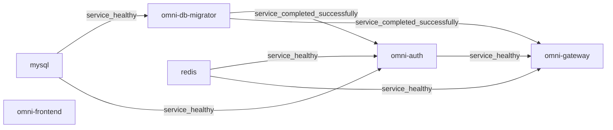

# Docker 部署技术参考

本文解释正式 Compose、Dockerfile、迁移器与反代配置的当前行为。主仓库 full 基线用于对照；生成工程以页首预设范围及自身 Compose、catalog 和种子清单为准，不继承主仓库的服务计数或旧复核。首次运行见[快速开始](guides/quick-start.md)，操作、预期和恢复见 [Wiki](wiki/index.md)与[故障排查](guides/troubleshooting.md)。文档审校遵循[现行授权策略](adr/0003-authorized-ai-translation-review.md)，实际 AI_REVIEW 足够，无需人工复核四语文档。

## 目录

- [1. 架构概览](#1-架构概览)
- [2. 容器网络拓扑](#2-容器网络拓扑)
- [3. 启动链与健康检查](#3-启动链与健康检查)
- [4. 多阶段构建原理](#4-多阶段构建原理)
- [5. Compose 分层配置解读](#5-compose-分层配置解读)
- [6. 环境变量覆盖机制](#6-环境变量覆盖机制)
- [7. Nginx 反代配置要点](#7-nginx-反代配置要点)
- [8. 数据初始化与持久化](#8-数据初始化与持久化)
- [9. Docker 镜像加速配置](#9-docker-镜像加速配置)
- [10. Windows Hyper-V/WSL2 端口保留问题](#10-windows-hyper-vwsl2-端口保留问题)
- [11. Nacos v3.1.1 健康检查端点变更](#11-nacos-v311-健康检查端点变更)
- [12. RocketMQ Broker Docker 网络配置](#12-rocketmq-broker-docker-网络配置)
- [13. 扩缩容指南](#13-扩缩容指南)
- [14. 运维操作手册](#14-运维操作手册)
- [15. 故障排查指南](#15-故障排查指南)
- [16. 配置参考表](#16-配置参考表)

## 1. 架构概览

主仓库 full profile 声明 15 个常驻服务与 1 个一次性迁移器：前端 1、后端 8、基础设施 6。这里是编排模型的数量，不能据此断言当前已有容器运行、健康或业务验收通过。可选观测栈与独立文档站另行启用，不计入上述基线。

源码: [compose.yaml](../compose.yaml)、[compose.apps.yaml](../compose.apps.yaml)、[compose.infra.yaml](../compose.infra.yaml).

## 2. 容器网络拓扑

标准项目为 `omni-stack`，默认网络为 `omni-stack_default`。容器间使用 Compose 服务名和容器端口；宿主映射端口不能直接替代容器地址。Frontend/Gateway 的映射未显式限定宿主 IP，其余业务诊断与中间件端口绑定 `127.0.0.1`；管理端口不向宿主发布。实际公开面须结合 Docker 状态核对，本地编排不构成生产 HTTPS、网络隔离或高可用方案。

源码: [compose.apps.yaml](../compose.apps.yaml)、[compose.infra.yaml](../compose.infra.yaml).

## 3. 启动链与健康检查

启动条件由各服务的 `depends_on` 与探针分别决定。容器 running、健康探针通过、迁移成功和业务功能可用是不同状态。完整字段以当前 Compose 与镜像配置为准。

### 3.1 分层启动顺序

MySQL 健康后迁移器才运行；Nacos、XXL-JOB 与后端的迁移门要求 `service_completed_successfully`。Gateway 明确等待迁移器、Redis 与 Auth，不能改写为等待所有下游服务。Frontend 没有声明 Compose `depends_on`；其动态 DNS 反代可在网关就绪前启动，期间请求可能失败。以下是当前 Gateway 与 Frontend 的实际依赖摘录。



源码: [compose.apps.yaml](../compose.apps.yaml)、[compose.infra.yaml](../compose.infra.yaml).

### 3.2 健康检查配置一览

后端探针使用 `MANAGEMENT_SERVER_PORT`；正式 Compose 为八个服务设置 `19900`–`19907`，不发布这些端口。Dockerfile 的探针回退值 `8080` 不会读取应用 YAML 中的管理端口；独立运行镜像时须显式保持二者一致。启动宽限是探针参数，不是冷启动耗时保证。仓库没有为 Frontend 另配健康探针。

| 服务 | 探针 | 间隔 / 超时 / 重试 / 启动宽限 |
| --- | --- | --- |
| `mysql` | `CMD-SHELL` / `mysqladmin ping` | `10s / 5s / 5 / 30s` |
| `redis` | `CMD-SHELL` / `REDISCLI_AUTH / redis-cli ping` | `10s / 5s / 5 / 10s` |
| `nacos` | `CMD` / `http://localhost:8848/nacos/` | `15s / 5s / 5 / 60s` |

<!-- omni:modules:rocketmq -->
| 服务 | 探针 | 间隔 / 超时 / 重试 / 启动宽限 |
| --- | --- | --- |
| `rocketmq-namesrv` | `CMD-SHELL` / `/dev/tcp/127.0.0.1/9876` | `10s / 5s / 5 / 30s` |
| `rocketmq-broker` | `CMD-SHELL` / `/dev/tcp/127.0.0.1/10911` | `15s / 5s / 5 / 60s` |
<!-- omni:modules:end -->

<!-- omni:modules:xxl-job -->
| 服务 | 探针 | 间隔 / 超时 / 重试 / 启动宽限 |
| --- | --- | --- |
| `xxl-job-admin` | `CMD-SHELL` / `/dev/tcp/localhost/8080` | `15s / 5s / 5 / 60s` |
<!-- omni:modules:end -->

源码: [Dockerfile](../docker/backend/Dockerfile)、[compose.apps.yaml](../compose.apps.yaml)、[compose.infra.yaml](../compose.infra.yaml).

## 4. 多阶段构建原理

业务服务、迁移器、前端与 Broker 使用各自正式 Dockerfile。构建结果与实际启动分别验证；已有产物只有在源码和输入范围确切等价时才能复用。镜像标签和未经测量的大小不能替代镜像身份。

### 4.1 后端微服务构建

后端构建镜像提供 JDK 25，实际命令使用 Maven Wrapper。POM 预热的 `dependency:go-offline` 允许失败后继续，真正的 `package -pl '!omni-db-migrator'` 构建门不能因此跳过。`SERVICE_NAME` 只选择最终 JAR，不裁剪该构建阶段的 reactor。迁移器在独立镜像执行自己的模块测试。命令未设置 `-DskipTests`，条件测试仍可能跳过，须查看报告。以下为实际构建与入口的节选。

```dockerfile
FROM maven:3.9-eclipse-temurin-25-alpine AS build
RUN --mount=type=cache,id=omni-maven-repository,target=/root/.m2,sharing=locked \
    sh ./mvnw -s docker-settings.xml package -pl '!omni-db-migrator' -B -q -Dmaven.wagon.http.retryHandler.count=5
FROM eclipse-temurin:25-jre-alpine
ARG SERVICE_NAME
COPY --from=build /build/${SERVICE_NAME}/target/*.jar /app/app.jar
ENTRYPOINT ["/bin/bash", "-c", "exec java --enable-native-access=ALL-UNNAMED $JAVA_OPTS -jar /app/app.jar"]
```

源码: [Dockerfile](../docker/backend/Dockerfile)、[Dockerfile](../docker/migrator/Dockerfile).

### 4.2 前端构建

前端使用 `node:22-alpine` 构建，先以锁文件执行 `npm ci`，带 BuildKit npm 缓存和重试参数，再运行生产 build。运行阶段为 `nginx:1.28-alpine`，复制 dist 和正式 Nginx 配置并监听 3000。Dockerfile 的构建步骤不自动等同于 lint、浏览器或业务验收。

```dockerfile
FROM node:22-alpine AS build
RUN --mount=type=cache,id=omni-npm-cache,target=/root/.npm,sharing=locked \
    npm ci --prefer-offline --no-audit --fetch-retries=5 \
      --fetch-retry-mintimeout=10000 --fetch-retry-maxtimeout=60000
RUN npm run build
FROM nginx:1.28-alpine
COPY --from=build /app/dist /usr/share/nginx/html
COPY docker/frontend/nginx.conf /etc/nginx/conf.d/default.conf
EXPOSE 3000
```

源码: [Dockerfile](../docker/frontend/Dockerfile).

## 5. Compose 分层配置解读

`compose.yaml` include `compose.infra.yaml`、`compose.apps.yaml` 与 `compose.observability.yaml`，通过 profiles 组合服务。标准业务模型与可选观测模型须区分；同一服务只在正式位置定义一次。此处列当前边界，完整启动操作由 Wiki 维护。

源码: [compose.yaml](../compose.yaml)、[compose.observability.yaml](../compose.observability.yaml).

### 5.1 MySQL 8.4

MySQL 8.4 使用显式命名数据卷，标准名为 `omni-stack_omni-mysql-data`。entrypoint 不再挂载聚合 SQL。迁移管理员建库和迁移；应用账号 `omni_app` 只获得七个应用库权限。Nacos/XXL-JOB 的当前厂商数据库连接仍使用 root，不能据此声称全部基础设施都是最小权限连接。既有业务表且无 Liquibase 历史时，直接 migrate 会拒绝。

源码: [compose.infra.yaml](../compose.infra.yaml)、[LiquibaseMigrationService.java](../omni-backend/omni-db-migrator/src/main/java/com/omni/dbmigrator/migration/LiquibaseMigrationService.java).

### 5.2 Redis 7.4

Redis 7.4 的正式配置声明密码与命名卷，标准卷为 `omni-stack_omni-redis-data`，但没有显式启用 AOF。实际持久化方式与落盘状态须按镜像配置和运行结果核对；保留卷不等于每个键都已持久化或重启可恢复。探针按配置认证，TCP 或 running 仍不证明会话、缓存、JWK 等行为。真实口令保存在私有配置与日志边界内。

源码: [compose.infra.yaml](../compose.infra.yaml).

### 5.3 Nacos v3.1.1

Nacos v3.1.1 为 standalone，使用 MySQL 厂商库。8080、8848、9848 分别服务控制台、HTTP API 和客户端 gRPC，正式宿主映射均为回环。`NACOS_AUTH_TOKEN` 与节点 identity 秘密不同于控制台账号密码；客户端共享 `NACOS_USERNAME=nacos` 与私有口令。迁移后按公开种子 BCrypt 摘要做条件更新，已修改账号保持原值。

源码: [compose.infra.yaml](../compose.infra.yaml)、[NacosAdminBootstrap.java](../omni-backend/omni-db-migrator/src/main/java/com/omni/dbmigrator/migration/NacosAdminBootstrap.java).

### 5.4 RocketMQ 5.3.2（NameServer + Broker）

是否交付此能力由本项目的预设闭包决定；以下实现说明仅在包含该模块时适用。

<!-- omni:modules:rocketmq -->
NameServer 的容器端口为 9876，宿主默认 19876；这不意味着所有 Windows 机器都固定保留同一端口段。Broker 使用基于官方 5.3.2 的仓库镜像，以 uid 3000 准备命名卷目录，标准卷为 `omni-stack_omni-rocketmq-data`。实际发布的是 10909、10911、10912，不包含 10910。TCP 探针不证明可靠消息完成投递。

源码: [Dockerfile](../docker/rocketmq/Dockerfile)、[broker-docker.conf](../docker/rocketmq/broker-docker.conf)、[compose.infra.yaml](../compose.infra.yaml).
<!-- omni:modules:end -->

### 5.5 XXL-JOB Admin v3.3.1

是否交付此能力由本项目的预设闭包决定；以下实现说明仅在包含该模块时适用。

<!-- omni:modules:xxl-job -->
XXL-JOB Admin v3.3.1 当前 PARAMS 配置数据库与非空 accessToken，未使用 `xxl.job.login.username/password` 来改登录账号。迁移器在 migrate 后，对仍匹配公开引导摘要的固定 admin 账号写入私有密码的 SHA-256；已修改值不覆盖。执行器的 accessToken 须与 Admin 一致；已有 Admin 登录密码变更须协调数据库和私有配置。`.env.example` 对此密码约定 14–20 字符。

源码: [compose.infra.yaml](../compose.infra.yaml)、[XxlJobAdminBootstrap.java](../omni-backend/omni-db-migrator/src/main/java/com/omni/dbmigrator/migration/XxlJobAdminBootstrap.java).
<!-- omni:modules:end -->

### 5.6 后端微服务（8 个）

主仓库对照包含 Auth、Base、Workflow、CRM、SRM、Procurement、Asset、Gateway。各服务容器业务端口为 8080，管理端口单独设置，应用数据库按模块分开。裁剪工程以保留的配置和页首预设范围为准；此节标题中的八服务是主仓库基线，不是裁剪工程当前运行数量。下表从正式应用配置投影。

| 服务 | `database` | 当前事实源 |
| --- | --- | --- |
| `omni-auth` | `omni_auth` | [application.yml](../omni-backend/omni-auth/src/main/resources/application.yml) |
| `omni-base` | `omni_base` | [application.yml](../omni-backend/omni-base/src/main/resources/application.yml) |
| `omni-workflow` | `omni_workflow` | [application.yml](../omni-backend/omni-workflow/src/main/resources/application.yml) |
| `omni-crm` | `omni_crm` | [application.yml](../omni-backend/omni-crm/src/main/resources/application.yml) |
| `omni-srm` | `omni_srm` | [application.yml](../omni-backend/omni-srm/src/main/resources/application.yml) |
| `omni-procurement` | `omni_procurement` | [application.yml](../omni-backend/omni-procurement/src/main/resources/application.yml) |
| `omni-asset` | `omni_asset` | [application.yml](../omni-backend/omni-asset/src/main/resources/application.yml) |
| `omni-gateway` | `—` | [application.yml](../omni-backend/omni-gateway/src/main/resources/application.yml) |

### 5.7 前端

前端镜像监听 3000，提供静态资源和同源 API/OAuth/OIDC 反代。它使用 Docker DNS 动态解析 Gateway，Compose 未声明等待 Gateway 的启动依赖。页面进程启动不证明 API、登录或路由已可用；完整操作与浏览器预期由快速开始及业务 Wiki 管理。

源码: [nginx.conf](../docker/frontend/nginx.conf)、[compose.apps.yaml](../compose.apps.yaml).

## 6. 环境变量覆盖机制

当前配置同时使用 Spring 环境变量覆盖和 YAML 中显式占位符。事实应核对 Compose 传入的键、对应服务 YAML 与激活 profile，不能只按变量拼写推断实际连接或注册成功。

### 6.1 转换规则

例如 `SERVER_PORT` 覆盖业务端口，`MANAGEMENT_SERVER_PORT` 与 `MANAGEMENT_PORT` 分别参与管理配置和探针约定。Auth/Base/Workflow 的 Compose 使用 `SPRING_CLOUD_NACOS_*_SERVER_ADDR`，CRM/Gateway/SRM 等另声明 `NACOS_SERVER_ADDR` 对应 YAML 占位符；应逐服务核对实际配置。本文不维护一份把所有连字符机械改为下划线的通用绑定规则。

源码: [compose.apps.yaml](../compose.apps.yaml)、[application.yml](../omni-backend/omni-auth/src/main/resources/application.yml)、[application.yml](../omni-backend/omni-gateway/src/main/resources/application.yml).

### 6.2 优先级（从高到低）

命令行、环境、profile 配置与导入配置共同参与最终值解析。当前多个服务声明 `optional:nacos:...` 导入，不能把 Nacos 一概列为最低优先级。定位覆盖问题时检查实际激活 profile、声明的 import 和键来源；只公开非秘密键名及脱敏结论。

源码: [application.yml](../omni-backend/omni-auth/src/main/resources/application.yml)、[application.yml](../omni-backend/omni-gateway/src/main/resources/application.yml).

### 6.3 Docker 部署中的典型覆盖

Compose 内数据库、Redis、Nacos 与 NameServer 使用服务名，浏览器回调使用浏览器可访问的入口。Auth YAML 的 OAuth 回调回退值为 8100，而正式 Compose 的 `AUTH_OAUTH2_*_REDIRECT_URI` 明确覆盖为 Gateway 8102。三家回调路径见实际配置摘录；外部平台登记必须精确一致，这不证明外部 OAuth 正向回调已成功。 当前 Auth Compose 还声明经 `host.docker.internal:7897` 的 HTTP/HTTPS 代理及内部 NO_PROXY 范围；这些是源码中的地址，外网连通和代理可用性仍须实际核验。

```yaml
AUTH_FRONTEND_BASE_URL: http://localhost:3000
AUTH_OAUTH2_GITHUB_REDIRECT_URI: http://localhost:8102/api/auth/oauth2/github/callback
AUTH_OAUTH2_GITEE_REDIRECT_URI: http://localhost:8102/api/auth/oauth2/gitee/callback
AUTH_OAUTH2_GOOGLE_REDIRECT_URI: http://localhost:8102/api/auth/oauth2/google/callback
HTTP_PROXY: http://host.docker.internal:7897
HTTPS_PROXY: http://host.docker.internal:7897
NO_PROXY: localhost,127.0.0.1,mysql,redis,nacos
```

源码: [compose.apps.yaml](../compose.apps.yaml)、[.env.example](../.env.example).

## 7. Nginx 反代配置要点

正式配置为 `docker/frontend/nginx.conf`。容器内部反代目标是 Gateway 8080；当前规则还包含 Docker DNS、请求头缓冲、安全头与缓存策略，不能把简化的静态 proxy_pass 示例称为完整现行配置。

源码: [nginx.conf](../docker/frontend/nginx.conf).

### 7.1 配置文件解读

`resolver 127.0.0.11 valid=10s ipv6=off` 配合变量 upstream，避免仅在启动时解析旧容器地址。`/api/`、`/oauth2/`、`/.well-known/` 转发至 Gateway；SPA 路由回退 index.html。HTML 禁用缓存，带内容 hash 的 assets 长期缓存；location 中重复声明必要安全头以保留基线。以下只摘录动态反代，不是可替换整个文件的配置。

```nginx
resolver 127.0.0.11 valid=10s ipv6=off;
location /api/ {
    set $upstream_gateway http://omni-gateway:8080;
    proxy_pass $upstream_gateway;
    proxy_set_header Host $host;
    proxy_set_header X-Real-IP $remote_addr;
    proxy_set_header X-Forwarded-For $proxy_add_x_forwarded_for;
    proxy_set_header X-Forwarded-Proto $scheme;
}
```

源码: [nginx.conf](../docker/frontend/nginx.conf).

### 7.2 常见错误：proxy_pass 端口

Docker 网络内使用 `omni-gateway:8080`，8102 是宿主映射，容器 localhost 是自身。经 `host.docker.internal` 绕行并非仓库正式反代路径，不能假定其可达或给出未经测量的性能结论。Gateway 的管理健康端口为 19902，不应把业务端口上的 actuator 404 当成服务已停。

## 8. 数据初始化与持久化

结构由 `database/changelog/`、正式 DML 由 `scripts/sql/seed/`、输入和断言由 `database/seed/manifest.yaml` 维护。旧手工 init/migrate 脚本不再是运行入口。数据迁移、既有库接管与普通应用启动具有不同副作用和验证范围。

### 8.1 数据库初始化链

主仓库目录声明九个目标库；当前正式清单有 8 个 seed source、25 项断言，生成工程以自身清单为准。实际 migrate 顺序为结构/种子迁移、XXL-JOB/Nacos 条件引导、种子校验，再成功退出。已有业务表且没有 Liquibase 历史时会拒绝直接 migrate。adopt-current 先核对结构指纹、种子与备份恢复证据，再要求精确匹配本次报告的 `ADOPT:<sha256>` 二阶段确认后才同步 baseline；文档 AI 复核不免除这项高风险确认。 迁移器支持 seed-accept-ids 覆盖，正式 Compose 默认未声明该覆盖。另行配置 `DB_MIGRATOR_SEED_ACCEPT_IDS` 时，列出的不一致断言可按 WARN 接受，SQL 执行异常仍失败。验收须记录 acceptedOverrides，不能把有覆盖的退出 0 称作原断言全部通过；本页不设置该覆盖。

源码: [MigrationTargetCatalog.java](../omni-backend/omni-db-migrator/src/main/java/com/omni/dbmigrator/migration/MigrationTargetCatalog.java)、[MigrationCommandRunner.java](../omni-backend/omni-db-migrator/src/main/java/com/omni/dbmigrator/command/MigrationCommandRunner.java)、[AdoptionService.java](../omni-backend/omni-db-migrator/src/main/java/com/omni/dbmigrator/adoption/AdoptionService.java)、[BackupEvidenceService.java](../omni-backend/omni-db-migrator/src/main/java/com/omni/dbmigrator/adoption/BackupEvidenceService.java)、[SeedVerificationService.java](../omni-backend/omni-db-migrator/src/main/java/com/omni/dbmigrator/seed/SeedVerificationService.java)、[manifest.yaml](../database/seed/manifest.yaml).

### 8.2 数据持久化策略

标准 MySQL、Redis、Broker 三个业务命名卷跨容器重建保留，普通 down 不作为删数据操作。`down -v` 可能删除业务数据，不能用作日常故障恢复步骤。恢复须核对备份摘要、来源/恢复服务器身份、时效和实际恢复结果。仅备份文件存在不等于已恢复验证；生产备份与高可用另行设计。

源码: [compose.infra.yaml](../compose.infra.yaml)、[BackupEvidenceService.java](../omni-backend/omni-db-migrator/src/main/java/com/omni/dbmigrator/adoption/BackupEvidenceService.java).

## 9. Docker 镜像加速配置

镜像获取、Maven 依赖和 npm 安装使用不同网络与缓存路径。本文记录仓库已经声明的配置，不推荐未经当前验证的公共镜像站，也不修改宿主 Docker、代理或账号全局设置。

### 9.1 Docker Registry Mirror

正式 Compose/Dockerfile 不设置 Docker daemon 的全局 registry-mirrors。镜像失败先区分名称/标签、权限、网络与磁盘问题，记录实际错误和镜像身份；已有有效镜像只在输入等价且身份明确时复用。第三方镜像站的可用性和信任不能由历史 daemon.json 示例证明。

### 9.2 Maven 依赖加速

后端和迁移器 Dockerfile 使用 `omni-backend/docker-settings.xml`，其中 Aliyun mirror 只声明 `mirrorOf=central`。依赖预热与真正 package 都使用 Wrapper 和正式 settings；预热容错不使发布构建容错。源码显示缓存与重试配置，不能据此保证当前网络下载成功。

```xml
<mirror>
  <id>aliyun</id>
  <name>Aliyun Maven Mirror</name>
  <url>https://maven.aliyun.com/repository/public</url>
  <mirrorOf>central</mirrorOf>
</mirror>
```

源码: [docker-settings.xml](../omni-backend/docker-settings.xml)、[Dockerfile](../docker/backend/Dockerfile).

### 9.3 npm 依赖加速

前端正式 Dockerfile 使用 BuildKit npm cache、锁文件与 fetch 重试，未内置 `npm config set registry https://registry.npmmirror.com`。不要把可选镜像源示例当作现行配置；变更仓库源或代理应单独验证来源与锁文件，不以删全部缓存替代诊断。

源码: [Dockerfile](../docker/frontend/Dockerfile).

## 10. Windows Hyper-V/WSL2 端口保留问题

标准端口固定；Windows 监听占用与排除端口范围是不同原因。端口段由目标机器实际状态决定，不能把一次观察泛化为所有 Windows/WSL2 环境。

### 10.1 问题描述

绑定错误可能来自已有进程、其他容器或系统保留端口。错误文本只说明绑定失败，不证明具体原因；先核对准确地址、端口和拥有者。

### 10.2 解决方案

先只读核对监听与保留范围，再由有权限的操作者处理明确冲突。标准项目不自动改 `OMNI_*_HOST_PORT` 绕过冲突，也不由启动脚本修改系统端口策略。

### 10.3 验证端口是否被保留

下面是 Windows 宿主的只读诊断命令，不是构建、应用或业务运行方式；不得据此自动结束未知进程或删除系统端口保留。

```powershell
Get-NetTCPConnection -State Listen
netsh interface ipv4 show excludedportrange protocol=tcp
```

## 11. Nacos v3.1.1 健康检查端点变更

本仓库针对 Nacos v3.1.1 配置了 `GET /nacos/` HTTP 探针。本文不以该配置推断全部 Nacos 版本的端点历史；控制台/API 响应也不证明所有应用已注册。

### 11.1 变更说明

区分服务端 HTTP 探针、客户端认证、实例注册和配置导入。旧 actuator 路径不能替代当前 Compose 声明；实际注册失败须结合服务端与客户端脱敏日志、账号及网络核对。

### 11.2 Compose 中的配置

正式 Nacos 探针是 curl -sf 到容器内 8848 的 /nacos/，interval 15s、timeout 5s、retries 5、start_period 60s。这些数值是配置参数，不能保证在指定秒数内启动成功。

```yaml
healthcheck:
  test:
    - CMD
    - curl
    - -sf
    - http://localhost:8848/nacos/
  interval: 15s
  timeout: 5s
  retries: 5
  start_period: 60s
```

源码: [compose.infra.yaml](../compose.infra.yaml).

## 12. RocketMQ Broker Docker 网络配置

是否交付此能力由本项目的预设闭包决定；以下实现说明仅在包含该模块时适用。

<!-- omni:modules:rocketmq -->
Broker 与 NameServer 使用同一 Docker 网络中的服务名。宿主端口映射供诊断使用，不是后端容器的 NameServer 地址。
<!-- omni:modules:end -->

### 12.1 问题背景

是否交付此能力由本项目的预设闭包决定；以下实现说明仅在包含该模块时适用。

<!-- omni:modules:rocketmq -->
Broker 对客户端提供的地址必须可由客户端所在网络解析并连接。仅 NameServer 可达不证明 Broker 广播地址正确，也不证明消费者完成处理。
<!-- omni:modules:end -->

### 12.2 解决方案

是否交付此能力由本项目的预设闭包决定；以下实现说明仅在包含该模块时适用。

<!-- omni:modules:rocketmq -->
正式 `docker/rocketmq/broker-docker.conf` 声明 `brokerIP1=rocketmq-broker`、单 Broker 及 ASYNC_MASTER/ASYNC_FLUSH。正式 Compose 挂载配置与命名数据卷，并以 --enable-proxy 启动；主仓库单机配置不证明集群或跨网络访问已验证。

```properties
brokerClusterName = DefaultCluster
brokerName = broker-a
brokerId = 0
brokerRole = ASYNC_MASTER
flushDiskType = ASYNC_FLUSH
brokerIP1 = rocketmq-broker
```

源码: [broker-docker.conf](../docker/rocketmq/broker-docker.conf)、[compose.infra.yaml](../compose.infra.yaml).
<!-- omni:modules:end -->

### 12.3 后端连接配置

是否交付此能力由本项目的预设闭包决定；以下实现说明仅在包含该模块时适用。

<!-- omni:modules:rocketmq -->
当前应用使用容器内 `rocketmq-namesrv:9876`，具体环境键按各服务配置核对。Outbox 写入、Relay 任务、Broker 接收与消费者业务提交是不同阶段；配置正确或 TCP 探针通过不能合并为投递成功。

```yaml
ROCKETMQ_NAME_SERVER: rocketmq-namesrv:9876
```

源码: [compose.apps.yaml](../compose.apps.yaml).
<!-- omni:modules:end -->

## 13. 扩缩容指南

仓库交付单实例本地拓扑，没有正式 `compose.scale.yaml`。源码存在服务发现能力不等于当前固定端口模型可直接扩容，也不构成生产容量承诺。

### 13.1 水平扩展后端服务

主 Compose 没有固定 container_name，但固定宿主端口映射仍阻止直接 --scale 多实例；Docker 不会为这些固定映射自动递增端口。扩容需另行设计受控编排、入口和发现，并实际验证；本文不提供引用不存在 override 文件的可执行配方。

### 13.2 数据库连接池考量

连接预算依据实际连接池上限与实例数求和，并结合任务、迁移与管理连接。以 20×3=60 只能说明假设算术，不能宣称当前池配置或建议直接 SET GLOBAL 到 200；修改服务器容量参数需要独立容量评估与授权。

### 13.3 有状态服务注意事项

当前 Nacos 为 standalone、RocketMQ 为单 Broker、XXL-JOB 为单 Admin。描述本地部署形态不等于断言这些上游产品无法集群化；生产状态、容错与扩容须按具体方案另行验收。

## 14. 运维操作手册

完整操作顺序、身份、预期与恢复由 Wiki 和指南维护。这里保留配置解释及有限只读诊断入口；重启、重建、迁移和清理均应先核对目标项目及数据归属。

### 14.1 常用命令

从目标工程根目录读取项目状态。start.sh/start.bat 默认 full，也可选择五个预设 profile，并执行 --build；这不同于 CLI dev up 对轻量组合的运行开关覆盖。stop.sh/stop.bat 使用标准项目及全部 profiles 执行 down，保留业务卷。

```bash
docker compose -p omni-stack ps -a
docker compose -p omni-stack images
```

源码: [start.sh](../start.sh)、[start.bat](../start.bat)、[stop.sh](../stop.sh)、[stop.bat](../stop.bat).

### 14.2 日志排查

日志取证需限定服务与时间，原始日志保存仓库外，公开内容先脱敏。日志包含 started 不能代替健康、注册或业务结果；重复操作前先查已经成功的唯一业务键。

```bash
docker compose -p omni-stack logs --tail 100 omni-gateway
```

### 14.3 进入容器调试

镜像内工具以正式 Dockerfile 为准，不能假定任意镜像都有同一调试工具。管理探针优先在对应后端容器内访问其管理端口。客户端地址与凭据分开核对，禁止把完整 env 输出到共享记录。

```bash
docker compose -p omni-stack exec -T omni-gateway curl -sf http://localhost:19902/actuator/health
```

源码: [Dockerfile](../docker/backend/Dockerfile).

## 15. 故障排查指南

先确认实际失败阶段：解析、拉取、构建、迁移、启动、健康、认证、业务或外部服务。故障排查的完整操作由[指南](guides/troubleshooting.md)与[源码调试](wiki/source-debugging.md)拥有；下列条目说明判断边界。

### 15.1 502 Bad Gateway

502 说明反代尚未获得可用上游响应，不能仅凭状态认定 Nacos 或 Gateway 停止。核对前端/网关状态和日志、Docker DNS 与业务反代地址；Gateway 自身管理健康应访问 19902，不能在 8080 上套用 actuator 路径。

### 15.2 镜像拉取失败

区分 pull access denied、标签不存在、连接超时和空间不足。先记录准确镜像身份及错误，核对仓库已声明的名称与网络；不默认改用未知镜像站或切换账号。只读查看空间不能证明可安全删除哪些镜像。

```bash
docker system df
```

### 15.3 构建失败

保留真正 package/npm 构建的首个错误与失败阶段。已有源码等价的成功报告可复用；源码、锁或配置变更则验证受影响范围。全局 builder/system prune 会丢失其他任务缓存与资产，不作为这里的默认恢复命令。

### 15.4 端口冲突

核对目标端口、监听进程、Docker 映射与 Windows 排除范围，处理明确归属的冲突后使用正式默认值。不要自动移动业务端口，也不要停止未知进程来取得绿色结果。

### 15.5 Nacos 注册失败

检查 Nacos 自身 HTTP、客户端开关、声明的服务地址、认证配置存在性和实例状态。禁止使用 env | grep NACOS：它可能输出密码和节点秘密。只记录允许公开的地址/变量名及凭据是否已配置；服务端探针通过不证明实例注册。

源码: [doctor.ts](../tools/omni-cli/src/doctor.ts).

### 15.6 RocketMQ 连接失败

分别核对 NameServer、Broker 广播地址与端口、Relay 调度、绑定和消费者日志。容器应使用内部 9876，而非宿主 19876。广播配置正确仍不能证明跨租户、幂等或真实消息业务链路通过。

### 15.7 容器启动顺序异常

running 不等于 healthy，迁移器 exit 0 则可能是正常完成；非零退出要先保留错误。按实际 depends_on 排查部分依赖，不虚构全局启动屏障；重试前核对已完成迁移与业务副作用。

源码: [compose.apps.yaml](../compose.apps.yaml)、[compose.infra.yaml](../compose.infra.yaml).

## 16. 配置参考表

配置的唯一执行事实源是正式文件。本节集中给出当前投影和源码入口，其他文档通过链接引用；表格不能独立改变 Compose、API 或业务契约。

### 16.1 服务端口映射总表

以下为主仓库正式默认映射的配置投影。只有配置中明确发布的端口列入；八个 19900–19907 管理端口没有宿主映射。生成工程以自身保留的配置为准，实际绑定与健康仍需运行检查。

| 服务 | 正式默认端口映射 |
| --- | --- |
| `omni-auth` | `127.0.0.1:8100:8080` |
| `omni-base` | `127.0.0.1:8101:8080` |
| `omni-workflow` | `127.0.0.1:8103:8080` |
| `omni-crm` | `127.0.0.1:8104:8080` |
| `omni-srm` | `127.0.0.1:8105:8080` |
| `omni-procurement` | `127.0.0.1:8106:8080` |
| `omni-asset` | `127.0.0.1:8107:8080` |
| `omni-gateway` | `8102:8080` |
| `omni-frontend` | `3000:3000` |
| `mysql` | `127.0.0.1:3306:3306` |
| `redis` | `127.0.0.1:6379:6379` |
| `nacos` | `127.0.0.1:8080:8080`<br>`127.0.0.1:8848:8848`<br>`127.0.0.1:9848:9848` |

<!-- omni:modules:rocketmq -->
| 服务 | 正式默认端口映射 |
| --- | --- |
| `rocketmq-namesrv` | `127.0.0.1:19876:9876` |
| `rocketmq-broker` | `127.0.0.1:10909:10909`<br>`127.0.0.1:10911:10911`<br>`127.0.0.1:10912:10912` |
<!-- omni:modules:end -->

<!-- omni:modules:xxl-job -->
| 服务 | 正式默认端口映射 |
| --- | --- |
| `xxl-job-admin` | `127.0.0.1:18080:8080` |
<!-- omni:modules:end -->

### 16.2 本地初始化账号与密钥来源

真实 Secret 仅存私有 .env；`:?` 拒绝缺失/空值，并不证明占位符、强度或凭据正确。doctor 会把 replace-with 与尖括号占位值视作未配置，且只报告变量名；start 脚本不自动运行 doctor。应用引导账号、租户、Portal 角色与密码规则由当前认证/业务事实和 Wiki 管理，不能只复制一个 admin 字符串来假定登录成功。

```bash
docker compose -p omni-stack-tools -f compose.tools.yaml run --rm cli npm run dev -- dev doctor
```

源码: [.env.example](../.env.example)、[doctor.ts](../tools/omni-cli/src/doctor.ts).

### 16.3 关键文件路径

以下入口分别拥有编排、构建、反代、迁移、种子、预设、文档与操作事实。只使用当前工程内的相对路径；生成工程不得依赖原工作区的绝对路径。

| 文件 |
| --- |
| [compose.yaml](../compose.yaml) |
| [compose.apps.yaml](../compose.apps.yaml) |
| [compose.infra.yaml](../compose.infra.yaml) |
| [compose.observability.yaml](../compose.observability.yaml) |
| [Dockerfile](../docker/backend/Dockerfile) |
| [Dockerfile](../docker/frontend/Dockerfile) |
| [nginx.conf](../docker/frontend/nginx.conf) |
| [Dockerfile](../docker/migrator/Dockerfile) |
| [MigrationTargetCatalog.java](../omni-backend/omni-db-migrator/src/main/java/com/omni/dbmigrator/migration/MigrationTargetCatalog.java) |
| [MigrationCommandRunner.java](../omni-backend/omni-db-migrator/src/main/java/com/omni/dbmigrator/command/MigrationCommandRunner.java) |
| [AdoptionService.java](../omni-backend/omni-db-migrator/src/main/java/com/omni/dbmigrator/adoption/AdoptionService.java) |
| [BackupEvidenceService.java](../omni-backend/omni-db-migrator/src/main/java/com/omni/dbmigrator/adoption/BackupEvidenceService.java) |
| [db.changelog-root.yaml](../database/changelog/db.changelog-root.yaml) |
| [manifest.yaml](../database/seed/manifest.yaml) |
| [modules.yaml](../scaffold/catalog/modules.yaml) |
| [development.ts](../tools/omni-cli/src/development.ts) |
| [doctor.ts](../tools/omni-cli/src/doctor.ts) |
| [compose.tools.yaml](../compose.tools.yaml) |
| [compose.docs.yaml](../compose.docs.yaml) |
| [.env.example](../.env.example) |
| [start.sh](../start.sh) |
| [start.bat](../start.bat) |
| [stop.sh](../stop.sh) |
| [stop.bat](../stop.bat) |
| [repository-governance.md](repository-governance.md) |
| [source-map.md](reference/source-map.md) |

## 附录：构建产物体积参考

本页不保留缺少测量时间、镜像 ID、平台与构建范围的 MB 估算。镜像名称使用 `OMNI_IMAGE_NAMESPACE` 命名空间（默认 omni），有效容量证据应绑定实际镜像身份；源码标签本身不能证明本机占用。资源盘点与清理先核对归属、引用、备份和可恢复性。

源码: [compose.apps.yaml](../compose.apps.yaml)、[compose.infra.yaml](../compose.infra.yaml).
