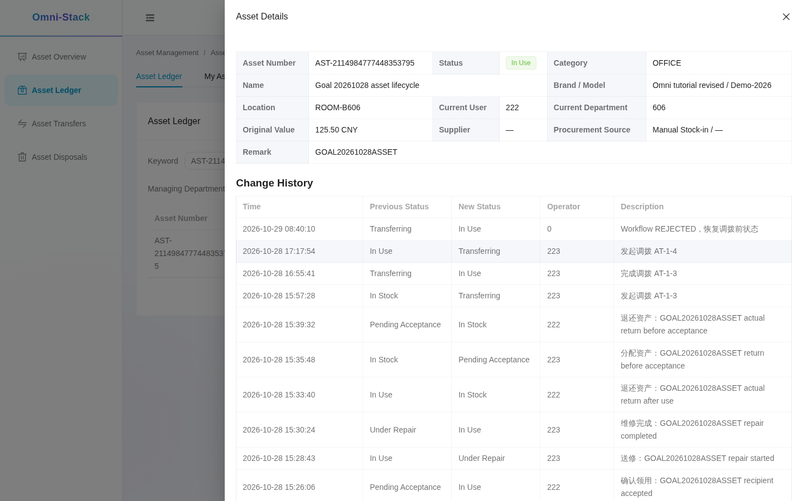
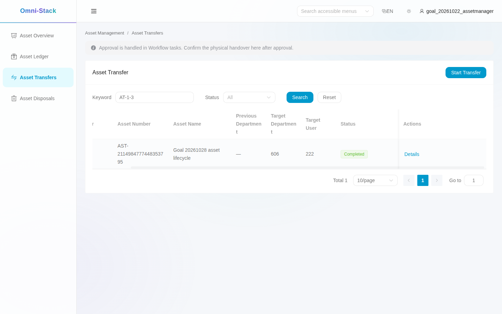
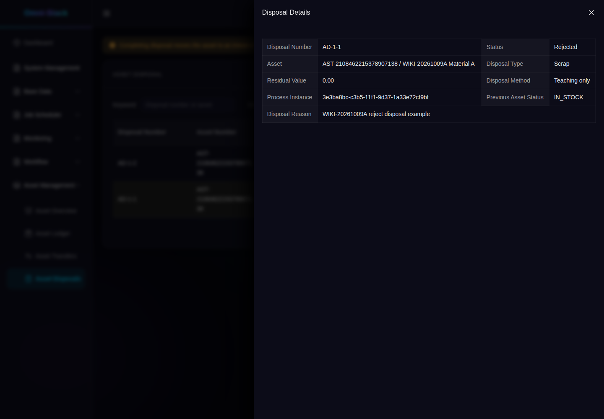
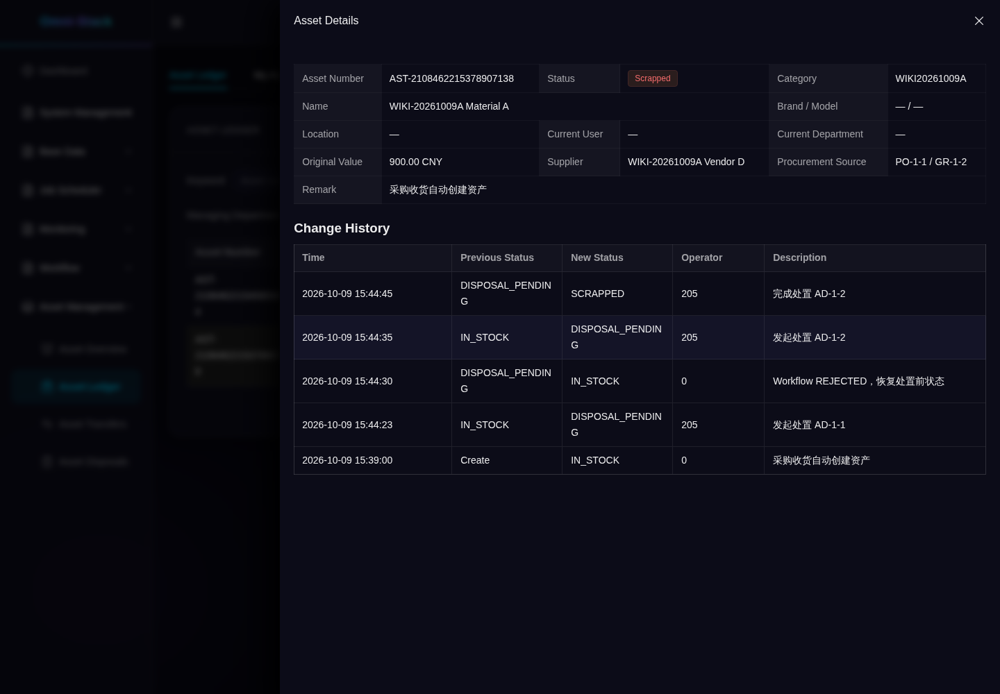
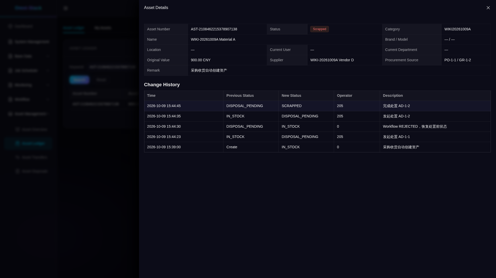
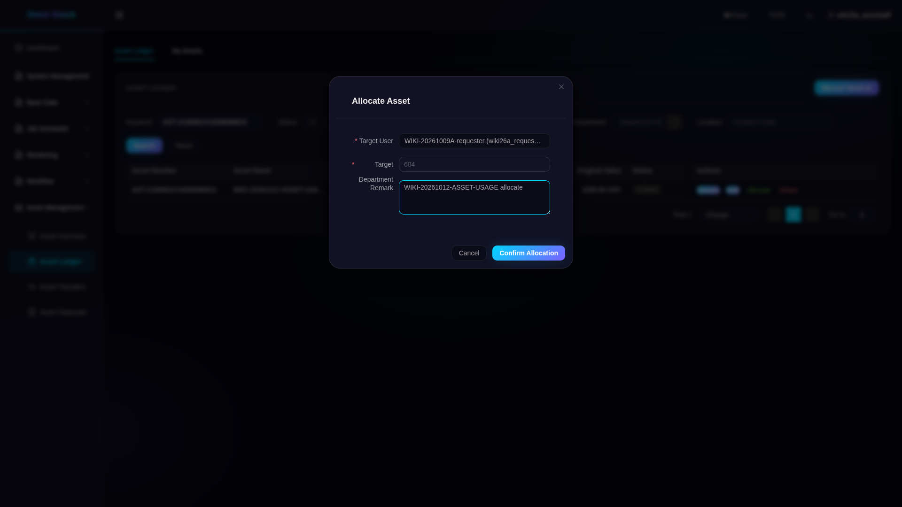
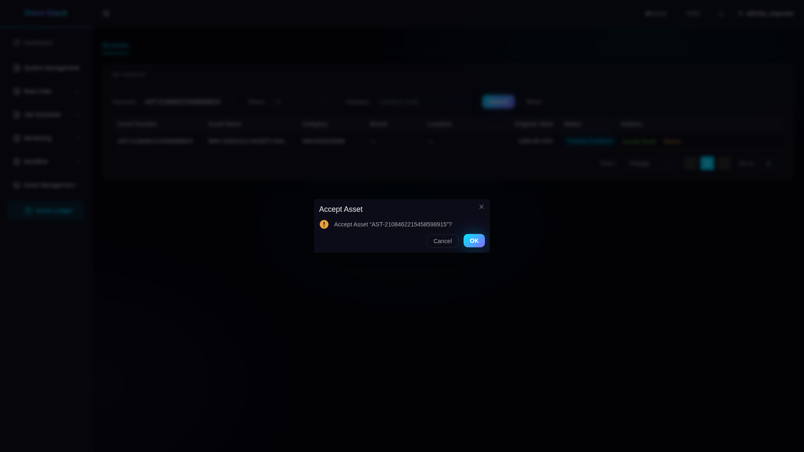
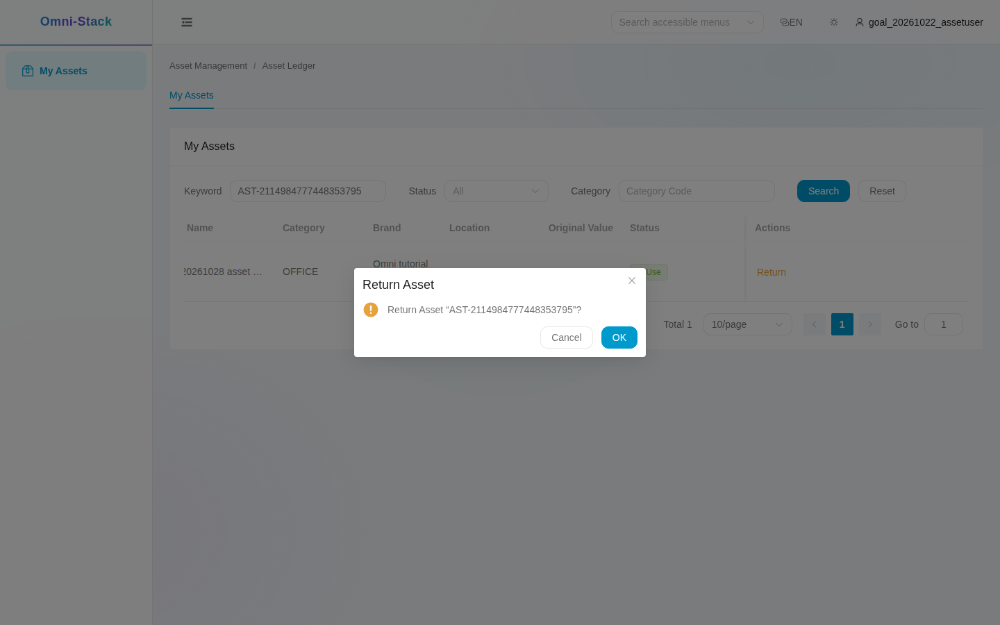
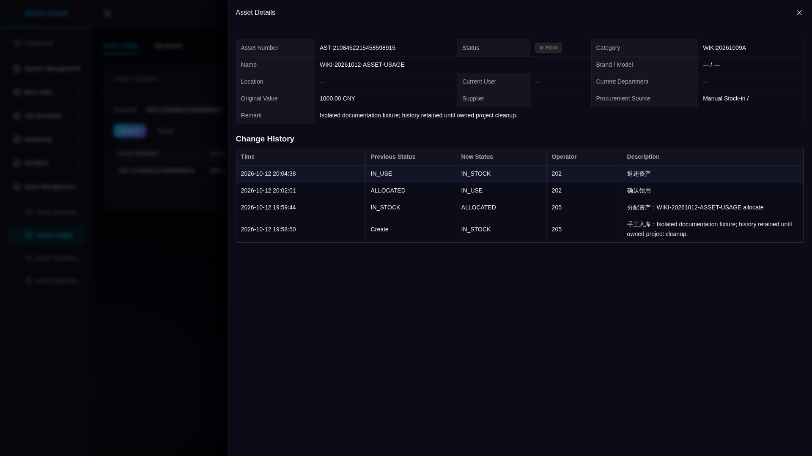
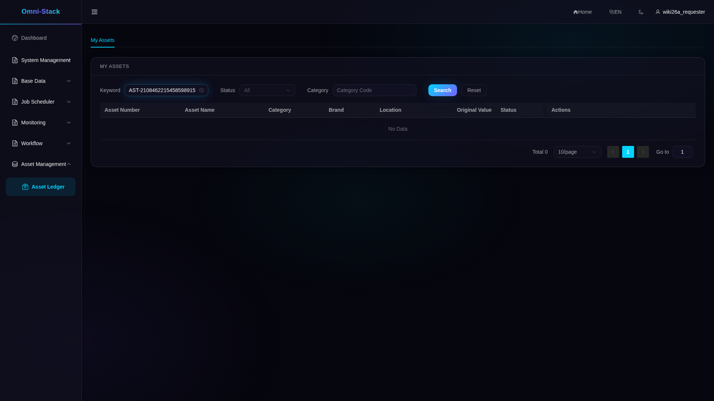

# Allocate, transfer and dispose of procurement asset cards

Use supply-chain or full. The main-flow records from 2026-10-09 use main fc165e3 as their baseline. A separate manually stocked practice card was used on 2026-10-12 to verify allocation, acceptance by its assigned user, return and three negative API cases. This review checks documentation, current source and existing evidence without rerunning those business actions or establishing integrated acceptance of current artifacts. Complete [receipts](procurement-flow.en.md) and [teaching data](../wiki/data-and-fixtures.en.md).

Under the [authorized AI review policy](../adr/0003-authorized-ai-translation-review.md), actual AI semantic approval is sufficient; human translation review is not required. The [current review scope](../reference/evidence/asset-guide-review-2026-10-17.json) separates originals, current source and historical images. The old main-flow run used cached base images after registry DNS/authentication failures; it did not prove the formal production base-image build.

## 1. Identities and provenance

Use ASSET_ADMIN for management, ASSET_USER for the recipient and ASSET_MANAGER for the approver, with matching organization scopes and approval-completion authority. Prepare another ASSET_USER in a different organization. All users need valid primary organizations; preview candidates before starting. Use one tenant throughout. Historical tenant 1 and user/unit numbers are examples; record your actual IDs and unique prefix. On this page, 404/409 are business codes; the historical negative checks used HTTP 200 with errors in response-body code.

Record the two actual string IDs, assetNo, sourcePoId/sourceGrId/sourceGrLineId/sourceUnitSequence, owner, current user, status and version. Monetary JSON uses decimal strings such as "900.00"; never convert long IDs to JavaScript floating-point numbers. Management uses owner_user_id/owner_unit_id; My Assets fixes current_user_id.

## 2. Receipt cards

1. Open Asset → Asset Ledger, search this run, and reconcile detail PO, GR and source lines.
2. Batch one A=1/FAIL and non-asset B=10/PASS create no cards; batch two A=2/PASS creates two. Do not compare whole-database counts.
3. PASS, assetManaged=true and exact positive integer quantities are all required. Event ID and source line/unit sequence provide dual idempotency; repeated delivery needs a separate controlled replay.

## 3. Allocate, accept, repair and return

1. Allocate the first IN_STOCK card to the teaching recipient and their primary organization. The request has user, organization and remark; location is not an allocation field.
2. As recipient, check ALLOCATED and assetNo in My Assets, then Accept; expect IN_USE.
3. Another user accepting this card receives 404 and cannot see it in their own list.
4. As administrator, send it for repair: MAINTENANCE. Completing repair always returns it to IN_USE.
5. As recipient, Return: IN_STOCK, currentUserId/currentUnitId/allocatedTime cleared, management owner retained.

Use the latest version each time. Returning with the pre-acceptance version produces 409. Refresh and inspect previous effects before proceeding.

## 4. Transfer needs approval and handover

1. Create a transfer for the first card with target user/organization/location and a unique reason. Check PENDING_APPROVAL, workflowStartStatus=STARTED and processInstanceId. The card becomes TRANSFER with activeOperationType/Id.
2. Disposal of the occupied card returns 409. Local cancellation of an already started workflow also returns 409.
3. Reject the first request as its actual candidate: REJECTED, previousAssetStatus restored and occupancy cleared in one transaction.
4. Create and approve a second request. APPROVED still holds the card; handover has not occurred.
5. Complete Handover with POST /api/asset/transfer/{id}/complete: request COMPLETED, card IN_USE, currentUserId/currentUnitId and location updated, occupancy cleared. ownerUserId/ownerUnitId remain unchanged.
6. Verify the exact assetNo in the destination user My Assets.

Local cancellation only permits status=START_FAILED with workflowStartStatus=FAILED. Neither an uncertain nor an already started workflow can be cancelled locally. retry-start permits that explicit failure pair or status=PENDING_APPROVAL with workflowStartStatus=PENDING when the outcome is unknown. Reconcile instances and prior side effects first, then retry the same request using its current version, original request/businessKey/model snapshot and retained asset occupancy. Do not conceal unknown outcomes with duplicate requests.

## 5. Disposal supports discard and scrap

Only DISCARD and SCRAP exist; sale and donation workflows are not implemented. Use the second IN_STOCK card:

1. Create SCRAP with unique reason, method and decimal-string residual "0.00"; check DISPOSAL_PENDING and occupancy.
2. Reject the first request as its candidate; check REJECTED, previousAssetStatus restored and occupancy cleared.
3. Create and approve a second request. APPROVED only finishes approval; the card remains DISPOSAL_PENDING.
4. Complete Disposal with POST /api/asset/disposal/{id}/complete: request COMPLETED; SCRAP produces SCRAPPED, DISCARD produces DISPOSED.
5. Allocating or transferring a terminal card returns 409. Approval runtime stays in omni-workflow; never skip completion through database edits.

## 6. Troubleshooting and cleanup

For missing cards trace GR → Outbox → Inbox: quality, asset flag, quantity and consumption. For visibility check tenant, owner management scope and current-user access. For failed recovery inspect previousAssetStatus, occupancy, instance and transaction logs together.

Retain both source cards, rejected/completed requests and history. Event-created cards with business activity are not deletion exercises. Full depreciation, financial ledger and advanced stocktaking are outside the current MVP. See [asset design](../design/asset-design.en.md) and [source debugging](../wiki/source-debugging.en.md).

## 7. Screenshots of this run

These are real historical screens of ordinary roles in the same isolated project on 2026-10-09. [Provenance](../reference/evidence/supply-chain-2026-10-09.json) records source, runtime images, roles and hashes. Its 48 images were inspected in 12 original-resolution four-locale contact sheets; this page uses 20 of them. That is not an individual opening of each original. Persisted history remarks originate in the backend and may remain Chinese in other locales; data was not rewritten to simulate localization.

The first transfer was rejected. Its previous state and target user/unit remain visible. Separate API assertions verify card restoration and cleared occupancy.

The second transfer completed a separate handover after approval. Check COMPLETED and the destination; an approval image alone does not establish handover.

The first scrap request was rejected, retaining its process instance and previous asset state.

The second scrap request completed disposal after approval, reaching COMPLETED.

Open the second procurement card in the ledger: Scrapped, CNY 900 original value, PO/GR source and rejection/restoration/new-disposal history are visible.

## 8. Step by step: allocate, accept and return

This section records the local Docker run on 2026-10-12. The [evidence receipt](../reference/evidence/asset-usage-2026-10-12.json) separates screenshots, actual submissions and API checks. All four languages show the same sample and pre-submit dialogs. Allocation, acceptance and return were each submitted once through the Chinese UI, then verified; changing language did not repeat business writes.

That capture prepared ordinary identity sessions with short-lived teaching tokens; it did not prove CAPTCHA or password login. The three Chinese native UI writes and API outcomes are evidenced separately from four-locale previews. Successful writes are not replayed, and the final procurement card is not reset.

### 8.1 Separate the procurement card from the practice card

As ASSET_ADMIN, open the procurement card in Asset Ledger. Check `900.00 CNY`, `PO-1-1 / GR-1-2` and its history. This card is already SCRAPPED and cannot be allocated. The image proves its source linkage and current final state, not its state immediately after receipt.

The usage exercise instead uses `WIKI-20261012-ASSET-USAGE`, manually stocked through the formal administrator API for the decimal string `"1000.00"`. It has no procurement source and does not prove receipt ingestion. To reproduce the exercise, prepare a new IN_STOCK card and record your own assetNo; do not reset the completed sample or its history in the database.

### 8.2 Allocate as administrator

1. As ASSET_ADMIN, find the practice card in Asset Ledger, confirm IN_STOCK and click Allocate.
2. Select the intended user and their valid primary department: user 202 and department 604 in this run. Enter an identifiable remark, check both selections and submit.
3. Refresh the details. Expect ALLOCATED with the selected currentUserId/currentUnitId. The management owner stays unchanged.

### 8.3 Accept as the assigned user

Sign in as the assigned ASSET_USER, open My Assets and find the same assetNo in ALLOCATED. Click Accept. The image shows the confirmation before submission; confirm and refresh to see IN_USE. User 202 submitted this action, without administrator impersonation.

### 8.4 Return as the same user

In My Assets, click Return, check the asset number and confirm using the current version. This image shows the pre-submit confirmation; verify the actual result in the next step.

### 8.5 Compare the ledger with My Assets

Reopen the card as administrator. Expect IN_STOCK and cleared current user, department and allocation time; ownerUserId=205 and ownerUnitId=604 remain. Four history entries record manual stock-in, allocation, acceptance and return. The last three transitions are `IN_STOCK → ALLOCATED → IN_USE → IN_STOCK`.

As the user, search the same assetNo in My Assets and expect an empty list. Read that result together with the ledger and API verification; an empty screen alone does not prove a successful return.

### 8.6 Check boundaries and retain history

An ASSET_USER from another department received business code 404 when attempting acceptance. Returning with an old version returned 409; deleting the card with history also returned 409. These are real API checks with HTTP 200 and errors in the response body's `code`, not HTTP 404/409. The practice card remains IN_STOCK with immutable history in the isolated teaching project until project-wide cleanup.

Images retain Chinese server-generated history, raw status enums and existing wrapped labels. In the English allocation form, the department label wraps close to Remark; target usernames are also truncated. These limits do not establish complete layout acceptance. This review individually inspected 20 key originals; the other 24 retain their existing inspection scope. Actual AI semantic approval satisfies the four-language policy above. Seven historical incomplete-paint or clipped-text originals remain excluded, without adding text through image editing.

