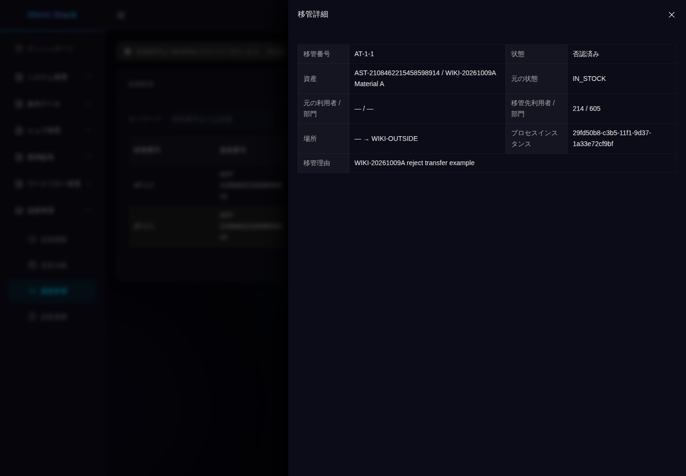
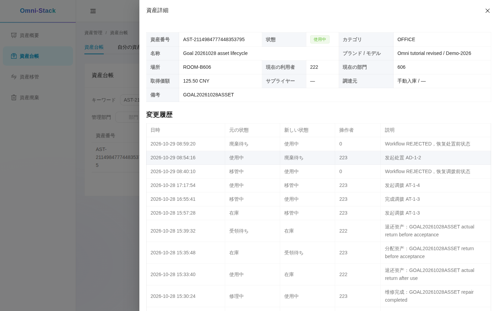
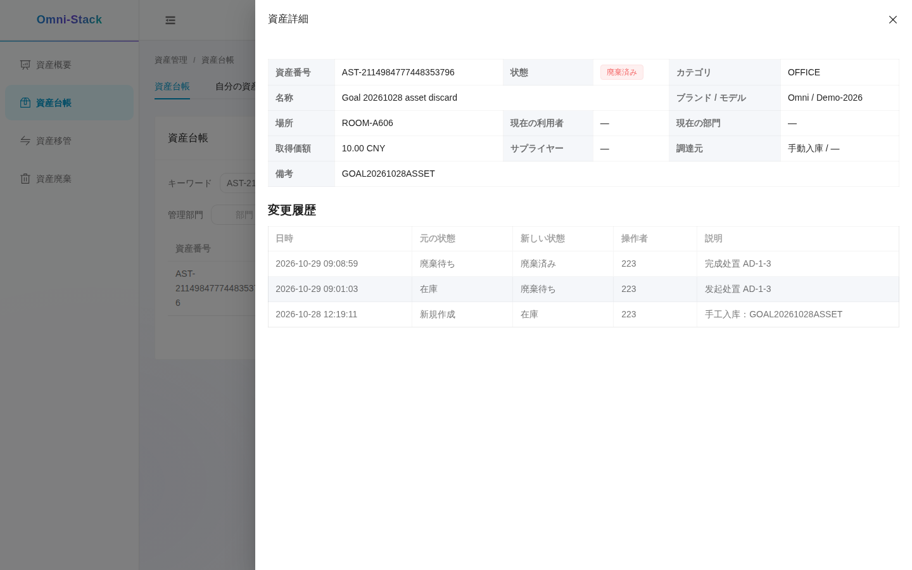
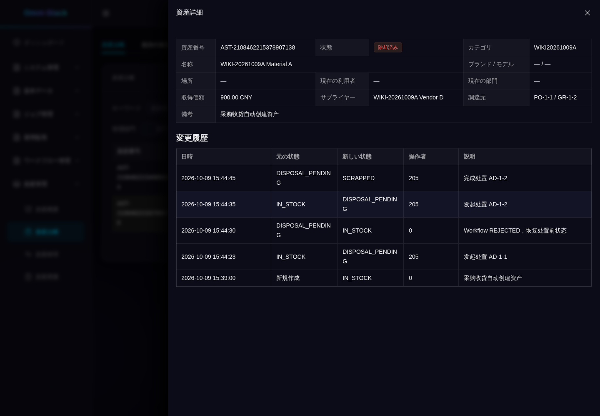
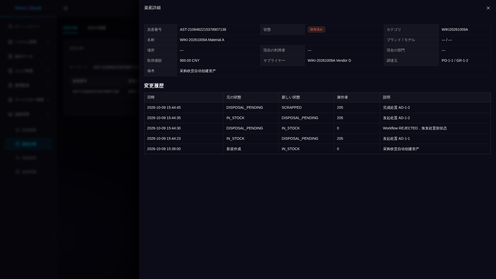
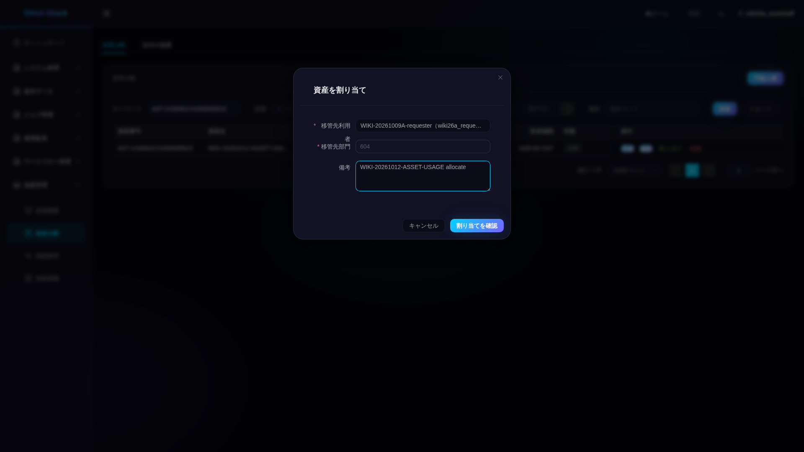
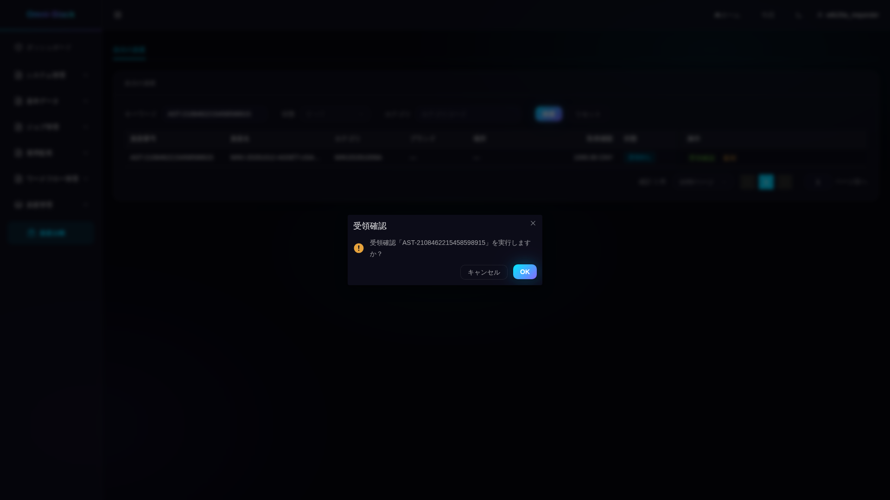
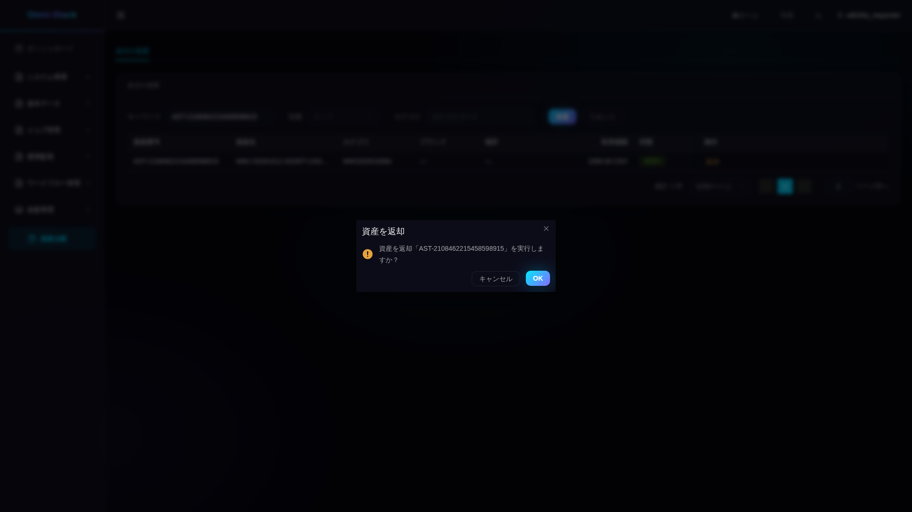
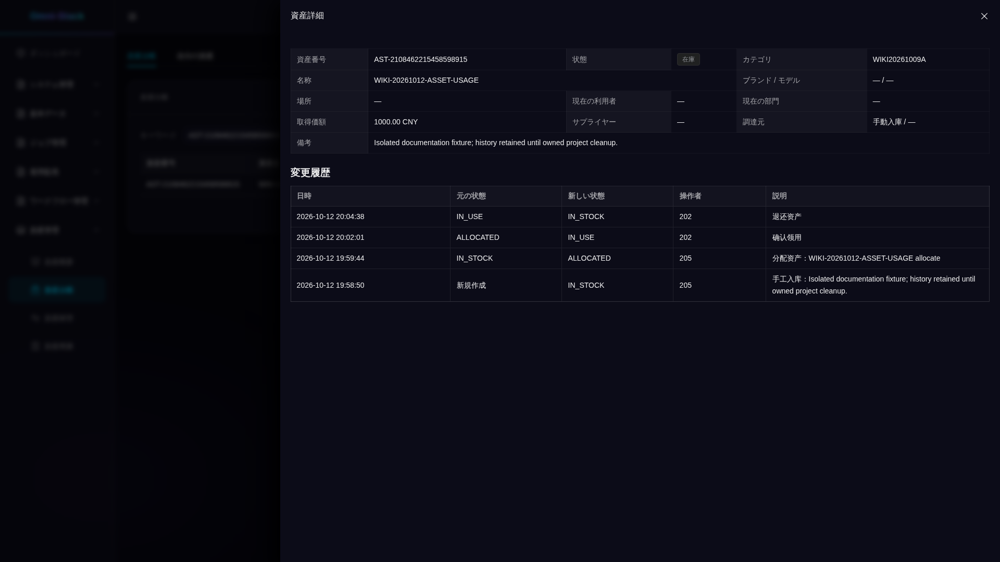
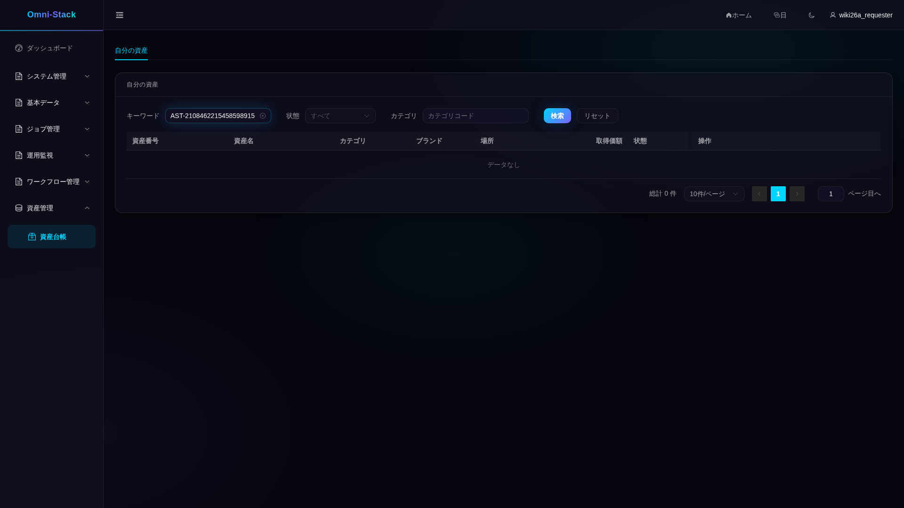

# 調達資産カードの割当、移管、廃棄を実行する

supply-chain または full を使用します。2026-10-09 の主手順記録は main fc165e3 が基準です。2026-10-12 は別の手動入庫練習カードで割当、本人受領、返却、三つの API 負例を検証しました。今回は文書・現在のソース・既存証拠をレビューし、業務を再実行していません。現在の成果物の統合受入れ完了も示しません。[入荷](procurement-flow.jp.md)と[教材データ](../wiki/data-and-fixtures.jp.md)を準備してください。

[承認済み AI レビュー方針](../adr/0003-authorized-ai-translation-review.md)に従い、実際の AI 意味レビュー合格で受け入れます。人による翻訳レビューは必須ではありません。[今回のレビュー範囲](../reference/evidence/asset-guide-review-2026-10-17.json)は原稿・現在のソース・過去画像を区別します。過去の主手順実行はレジストリの DNS/認証失敗後にキャッシュ済みベースイメージを使用しており、正式な本番ベースイメージのビルド成功は証明していません。

## 1. 利用者と出所

管理者は ASSET_ADMIN、受領者は ASSET_USER、承認者は ASSET_MANAGER を使い、実際の組織スコープと承認完了権限を確認します。別組織の ASSET_USER も用意します。全員に有効な主組織が必要で、開始前に候補者をプレビューします。 全手順で同じテナントを使用します。過去のテナント 1 やユーザー・組織番号は例なので、自分の実 ID と固有接頭辞を記録してください。本ページの 404/409 は業務コードで、過去の負例は HTTP 200 と応答本文の code で確認しています。

二枚の実際の文字列 ID、assetNo、sourcePoId/sourceGrId/sourceGrLineId/sourceUnitSequence、owner、current user、status、version を記録します。金額 JSON は "900.00" のような十進文字列です。長い ID を JavaScript 浮動小数へ変換しません。管理範囲は owner_user_id/owner_unit_id、自分の資産は current_user_id 固定です。

## 2. 入荷カード

1. 資産台帳で今回の名前を検索し、詳細の PO、GR、出所明細を照合します。
2. 一回目 A=1/FAIL と非資産 B=10/PASS は作成せず、二回目 A=2/PASS が二枚を作ります。全 DB 件数で判定しません。
3. PASS、assetManaged=true、正確な正整数が全て必要です。イベント ID と出所明細/単位番号で二重冪等を保証します。同一イベント再送は別途管理された実行で検証します。

## 3. 割当、受領、修理、返却

1. 一枚目 IN_STOCK を教材受領者と主組織へ割り当てます。要求は人、組織、備考で、場所は要求項目ではありません。
2. 本人の「自分の資産」で ALLOCATED と assetNo を確認し、受領して IN_USE を確認します。
3. 別ユーザーの受領は 404 で、本人一覧にも表示されません。
4. 管理者が使用中カードを修理へ送ると MAINTENANCE、修理完了は必ず IN_USE です。
5. 本人の返却で IN_STOCK、currentUserId/currentUnitId/allocatedTime は空になり、管理 owner は維持されます。

毎回現在の version を使います。受領前の版で返却すると 409 です。更新して前回の副作用を確認してから操作します。

## 4. 移管は承認後の引き継ぎも必要

1. 一枚目の移管を作り、移管先人/組織/場所と固有理由を設定します。PENDING_APPROVAL、workflowStartStatus=STARTED、processInstanceId を確認します。カードは TRANSFER と activeOperationType/Id を持ちます。
2. 占有中の廃棄は 409、開始済みフローのローカル取消も 409 です。
3. 最初の申請を候補者が拒否します。REJECTED、previousAssetStatus 復元、占有解除が同じトランザクションで実行されます。
4. 二件目を新規作成して承認します。APPROVED だけでは引き継ぎ未完了で、占有が残ります。
5. POST /api/asset/transfer/{id}/complete で引き継ぎを完了します。申請 COMPLETED、カード IN_USE、使用人/使用組織と場所が更新され、占有が解除されます。ownerUserId/ownerUnitId は変わりません。
6. 移管先本人の一覧で同じ assetNo を確認します。

ローカル取消は status=START_FAILED かつ workflowStartStatus=FAILED のみです。結果待ちや開始済みフローはローカル取消できません。retry-start はその明確な失敗状態、または status=PENDING_APPROVAL かつ workflowStartStatus=PENDING の結果未確定状態を受け付けます。インスタンスと既存の副作用を照合してから、同じ申請の最新 version で再試行してください。元のリクエスト・businessKey・モデルスナップショットと資産占有を維持します。不明な結果を重複申請で隠しません。

## 5. 廃棄は破棄と除却のみ

種類は DISCARD と SCRAP のみで、売却・寄付フローは未実装です。二枚目 IN_STOCK を使います。

1. 固有理由、方式、文字列残存価値 "0.00" で SCRAP を作り、DISPOSAL_PENDING と占有を確認します。
2. 最初は候補者が拒否し、REJECTED、previousAssetStatus 復元、占有解除を確認します。
3. 二件目を作成して承認します。APPROVED は承認のみで、カードは DISPOSAL_PENDING のままです。
4. POST /api/asset/disposal/{id}/complete で完了します。申請 COMPLETED、SCRAP は SCRAPPED、DISCARD は DISPOSED になります。
5. 終端カードの再割当・移管は 409 です。ランタイムは omni-workflow にあり、DB 編集で完了手順を省略しません。

## 6. 調査と後片付け

カードなしは GR → Outbox → Inbox の品質、資産属性、数量、処理結果を確認します。非表示はテナント、owner 管理範囲と current user 本人範囲を区別します。復元失敗は元状態、占有、インスタンス、トランザクションログを一緒に確認します。

二枚の出所カード、拒否/完了申請、履歴を残します。業務操作済みイベントカードは削除練習に使いません。完全な減価償却、会計元帳、高度な棚卸は MVP 外です。[資産設計](../design/asset-design.jp.md)と[ソースデバッグ](../wiki/source-debugging.jp.md)を参照してください。

## 7. 今回の結果画面

以下は 2026-10-09 に同じ独立環境の一般ロールで取得した実画面です。[出典](../reference/evidence/supply-chain-2026-10-09.json)にソース、実行イメージ、ロール、ハッシュを記録しています。全 48 枚は原解像度の四言語コンタクトシート 12 組で確認され、本ページでは 20 枚を使用します。原画像を一枚ずつ開いた方法とは異なります。保存済み履歴はバックエンド由来で、他言語でも中国語が残る場合があります。翻訳済みに見せるデータ変更はしていません。

最初の移管は却下されました。元の状態と移管先ユーザー・組織が表示されます。カード復元と占有解除は別途 API で確認しています。

2 回目は承認後に別操作で引渡しを完了しました。COMPLETED と移管先を確認します。承認画面だけでは引渡し完了を示せません。

最初の除却申請は却下され、インスタンスと元の資産状態が残っています。

2 回目の除却は承認後に処分を完了し、申請が COMPLETED となりました。

台帳で 2 枚目の購買由来カードを開きます。除却済み、取得価額 CNY 900、PO/GR、却下・復元・再処分の履歴が表示されます。

## 8. 操作手順：割当、受領確認、返却

本節は 2026-10-12 にローカル Docker で実施した検証です。[証跡](../reference/evidence/asset-usage-2026-10-12.json)は画像、実際の送信、API 検証を区別します。四言語の画像は同じデータと送信前のダイアログです。割当・受領・返却は中国語 UI で各一回だけ送信し、結果を検証しました。言語ごとの業務書込みは行っていません。

この採集は短期教材 token で一般利用者セッションを準備しており、CAPTCHA やパスワードログインの検証ではありません。中国語の三つの標準 UI 書込みと API 結果は、四言語プレビューと区別して記録しています。成功済み業務を再実行したり、調達カードの終端状態を戻したりしません。

### 8.1 調達元カードと練習用カードを区別する

ASSET_ADMIN で資産台帳から調達元カードを開き、`900.00 CNY`、`PO-1-1 / GR-1-2`、変更履歴を確認します。このカードは既に SCRAPPED のため割当できません。画像が示すのは調達元との関連と現在の終端状態で、入荷直後の状態ではありません。

利用の練習には、正式な管理者 API で手動入庫した `WIKI-20261012-ASSET-USAGE` を別途使用しました。取得価額は十進文字列 `"1000.00"` です。調達元を持たず、入荷による自動カード生成の証明にはなりません。再現時は新しい IN_STOCK カードを用意し、自分の assetNo を記録してください。完了済みカードや履歴を DB で初期化しないでください。

### 8.2 管理者が割り当てる

1. ASSET_ADMIN で台帳の練習用カードを検索し、IN_STOCK を確認して割当ボタンを押します。
2. 利用者と有効な主所属部門を選びます。本実行では利用者 202、部門 604 です。識別できる備考を入力し、両者を確認して送信します。
3. 詳細を更新し、ALLOCATED と選択した currentUserId/currentUnitId を確認します。管理上の owner は変わりません。

### 8.3 割当先の利用者が受領する

割当先の ASSET_USER でログインし、「マイ資産」で同じ assetNo と ALLOCATED を確認して受領操作を選びます。画像は送信前の確認です。確定して更新すると IN_USE になります。実際の送信者は利用者 202 で、管理者による代理受領ではありません。

### 8.4 同じ利用者が返却する

「マイ資産」で返却を選び、資産番号を確認して確定します。要求には現在の version を使います。画像は送信前の確認で、結果は次の手順で確認します。

### 8.5 台帳と本人一覧を照合する

管理者が詳細を開き直すと IN_STOCK です。現在の利用者・部門・割当日時は空になり、ownerUserId=205、ownerUnitId=604 は保持されます。手動入庫、割当、受領、返却の四件の履歴があり、後三件は `IN_STOCK → ALLOCATED → IN_USE → IN_STOCK` です。

利用者の「マイ資産」で同じ assetNo を検索すると空の一覧になります。空画面だけで成功と判断せず、台帳と API 検証を併せて確認してください。

### 8.6 境界を確認し履歴を保持する

別部門の ASSET_USER による受領は業務コード 404、古い version による返却は 409、履歴のあるカードの削除も 409 でした。API 実測の HTTP はいずれも 200 で、エラーは応答本文の `code` です。HTTP 404/409 と混同しないでください。練習用カードは IN_STOCK のまま独立した検証プロジェクトに履歴とともに保持し、プロジェクト全体の終了処理を待ちます。

画像には中国語のサーバー履歴、状態列挙値、既存のラベル折返しが残ります。英語の割当フォームでは部門ラベルの折返しが備考ラベルに近く、対象ユーザー名も省略されます。完全なレイアウト受入れを示すものではありません。今回は重要な原画像 20 枚を個別確認し、残り 24 枚は既存の確認範囲を維持します。四言語文書は前述の実際の AI 意味レビュー合格で受け入れます。過去の描画不足・文字切れの原画像七枚は引き続き除外し、画像編集で補完していません。

