# 구매 자산 카드의 배정, 이동, 처분 실행하기

supply-chain 또는 full을 사용합니다. 2026-10-09 주 흐름 기록의 기준은 main fc165e3입니다. 2026-10-12에는 별도 수동 입고 연습 카드로 배정, 본인 인수, 반환, API 거부 사례 세 가지를 검증했습니다. 이번에는 문서·현재 소스·기존 증거만 검토했으며 업무를 다시 실행하거나 현재 산출물의 통합 인수 완료를 증명하지 않았습니다. [입고](procurement-flow.kr.md)와 [학습 데이터](../wiki/data-and-fixtures.kr.md)를 먼저 준비하세요.

[승인된 AI 검토 정책](../adr/0003-authorized-ai-translation-review.md)에 따라 실제 AI 의미 검토 통과로 인수하며 사람의 번역 검토는 필수가 아닙니다. [이번 검토 범위](../reference/evidence/asset-guide-review-2026-10-17.json)는 원문·현재 소스·과거 이미지를 구분합니다. 과거 주 흐름 실행은 레지스트리 DNS/인증 실패 후 캐시된 기반 이미지를 사용했으며 정식 운영 기반 이미지 빌드 성공은 입증하지 않았습니다.

## 1. 계정과 출처

관리자는 ASSET_ADMIN, 수령자는 ASSET_USER, 승인자는 ASSET_MANAGER를 사용하며 실제 조직 범위와 승인 완료 권한을 확인합니다. 다른 조직의 ASSET_USER도 준비합니다. 모두 유효한 기본 조직이 있어야 하며 시작 전에 후보를 미리 봅니다. 모든 단계에서 같은 테넌트를 사용하세요. 과거 테넌트 1과 사용자·조직 번호는 예시이므로 실제 ID와 고유 접두사를 기록합니다. 이 페이지의 404/409는 업무 코드이며 과거 거부 검증은 HTTP 200과 응답 본문 code로 확인했습니다.

실제 문자열 ID 두 개, assetNo, sourcePoId/sourceGrId/sourceGrLineId/sourceUnitSequence, owner, current user, status, version을 기록합니다. 금액 JSON은 "900.00" 같은 십진 문자열입니다. 긴 ID를 JavaScript 부동소수로 바꾸지 마세요. 관리 범위는 owner_user_id/owner_unit_id, 내 자산은 current_user_id 고정입니다.

## 2. 입고 카드

1. 자산 원장에서 이번 이름을 검색하고 상세 PO, GR, 출처 행을 대조합니다.
2. 첫 입고 A=1/FAIL과 비자산 B=10/PASS는 카드를 만들지 않고 두 번째 A=2/PASS가 두 개를 만듭니다. 전체 DB 건수로 판단하지 않습니다.
3. PASS, assetManaged=true, 정확한 양의 정수가 모두 필요합니다. 이벤트 ID와 출처 행/단위 순번으로 이중 멱등을 적용합니다. 같은 이벤트 재전송은 별도 통제된 검증이 필요합니다.

## 3. 배정, 인수, 수리, 반환

1. 첫 IN_STOCK을 교육 수령자와 기본 조직에 배정합니다. 요청은 사람, 조직, 메모이며 위치 필드는 포함하지 않습니다.
2. 본인의 내 자산에서 ALLOCATED와 assetNo를 확인하고 인수하여 IN_USE를 확인합니다.
3. 다른 사용자의 인수는 404이며 그 사용자의 내 자산에도 없습니다.
4. 관리자가 사용 중 카드를 수리로 보내면 MAINTENANCE, 수리 완료는 항상 IN_USE입니다.
5. 본인 반환 후 IN_STOCK, currentUserId/currentUnitId/allocatedTime이 비워지고 관리 owner는 유지됩니다.

매번 최신 version을 사용합니다. 인수 전 버전으로 반환하면 409입니다. 새로 조회하고 이전 효과를 확인한 뒤 진행하세요.

## 4. 이동은 승인과 인계가 모두 필요

1. 첫 카드 이동을 만들고 대상 사람/조직/위치, 고유 사유를 입력합니다. PENDING_APPROVAL, workflowStartStatus=STARTED, processInstanceId를 확인합니다. 카드는 TRANSFER와 activeOperationType/Id를 가집니다.
2. 점유 중 처분은 409, 이미 시작한 흐름의 로컬 취소도 409입니다.
3. 첫 요청은 후보자가 거절합니다. REJECTED, previousAssetStatus 복원, 점유 해제가 같은 트랜잭션에서 이뤄집니다.
4. 두 번째 요청을 새로 만들고 승인합니다. APPROVED만으로 인계되지 않아 점유가 남습니다.
5. POST /api/asset/transfer/{id}/complete로 인계합니다. 요청 COMPLETED, 카드 IN_USE, 사용자/사용 조직과 위치가 바뀌고 점유가 해제됩니다. ownerUserId/ownerUnitId는 바뀌지 않습니다.
6. 대상 사용자의 내 자산에서 같은 assetNo를 확인합니다.

로컬 취소는 status=START_FAILED 및 workflowStartStatus=FAILED일 때만 허용합니다. 결과 대기 중이거나 이미 시작한 흐름은 로컬 취소할 수 없습니다. retry-start는 이 명시적 실패 상태 또는 status=PENDING_APPROVAL 및 workflowStartStatus=PENDING인 결과 미확정 상태를 허용합니다. 인스턴스와 기존 부수 효과를 대조한 뒤 동일 요청의 최신 version으로 재시도하세요. 원래 요청·businessKey·모델 스냅샷과 자산 점유를 유지하며 불확실한 결과를 중복 요청으로 감추지 않습니다.

## 5. 처분은 버리기와 폐기만 지원

현재 유형은 DISCARD와 SCRAP뿐이며 매각/기부 흐름은 없습니다. 두 번째 IN_STOCK을 사용합니다.

1. 고유 사유, 방식, 문자열 잔존 가치 "0.00"로 SCRAP을 만들고 DISPOSAL_PENDING과 점유를 확인합니다.
2. 첫 요청은 후보자가 거절하고 REJECTED, previousAssetStatus 복원, 점유 해제를 확인합니다.
3. 두 번째 요청을 만들고 승인합니다. APPROVED는 승인만 끝나며 카드는 DISPOSAL_PENDING입니다.
4. POST /api/asset/disposal/{id}/complete로 완료합니다. 요청 COMPLETED, SCRAP은 SCRAPPED, DISCARD는 DISPOSED입니다.
5. 종단 카드 재배정/이동은 409입니다. 런타임은 omni-workflow에 있으며 DB 수정으로 완료를 건너뛰지 않습니다.

## 6. 진단과 정리

카드 없음은 GR → Outbox → Inbox의 품질, 자산 표시, 수량, 처리 결과를 확인합니다. 보이지 않음은 테넌트, owner 관리 범위와 current user 본인 범위를 구분합니다. 복원 실패는 이전 상태, 점유, 인스턴스, 트랜잭션 로그를 함께 확인합니다.

두 출처 카드, 거절/완료 요청, 이력을 보존합니다. 업무 동작이 발생한 이벤트 카드를 삭제 연습에 쓰지 마세요. 전체 감가상각, 회계 원장, 복잡한 실사는 현재 MVP 밖입니다. [자산 설계](../design/asset-design.kr.md)와 [소스 디버깅](../wiki/source-debugging.kr.md)을 참고하세요.

## 7. 이번 실행 결과 화면

다음은 2026-10-09 같은 독립 환경의 일반 역할로 얻은 실제 과거 화면입니다. [출처](../reference/evidence/supply-chain-2026-10-09.json)는 소스, 실행 이미지, 역할, 해시를 기록합니다. 전체 48장은 원본 해상도의 네 언어 콘택트 시트 12묶음으로 확인했으며 이 페이지는 그중 20장을 사용합니다. 원본을 한 장씩 연 방식과는 다릅니다. 저장된 이력은 백엔드에서 생성되어 다른 언어에서도 중국어로 남을 수 있으며 번역된 것처럼 데이터를 고치지 않았습니다.

첫 이동은 거절됐습니다. 기존 상태와 대상 사용자·조직이 보입니다. 카드 복원과 점유 해제는 별도 API로 확인했습니다.

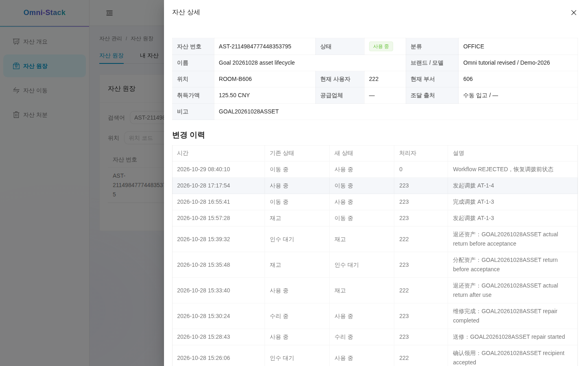

두 번째 이동은 승인 후 별도 인계를 완료했습니다. COMPLETED와 대상을 확인합니다. 승인 화면만으로 인계 완료를 증명할 수 없습니다.

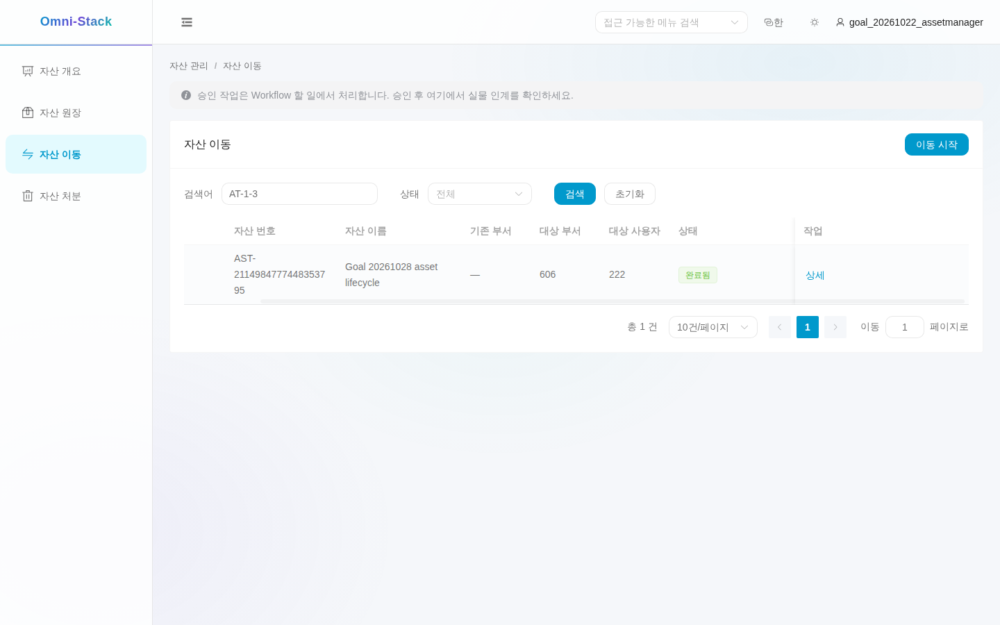

첫 폐기 신청은 거절됐으며 인스턴스와 이전 자산 상태가 보존됩니다.

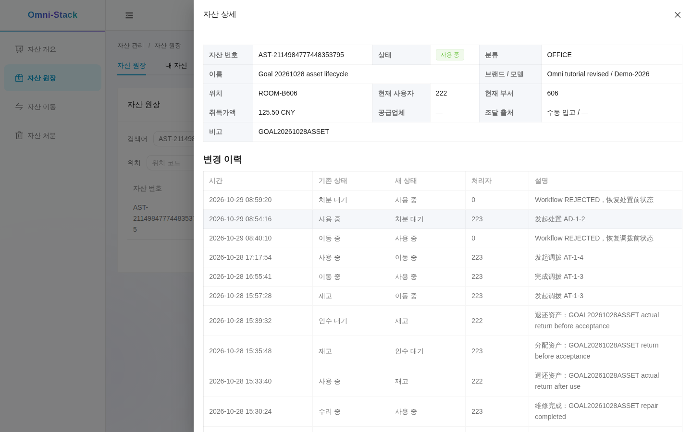

두 번째 폐기는 승인 후 처분 완료를 실행해 신청이 COMPLETED가 됐습니다.

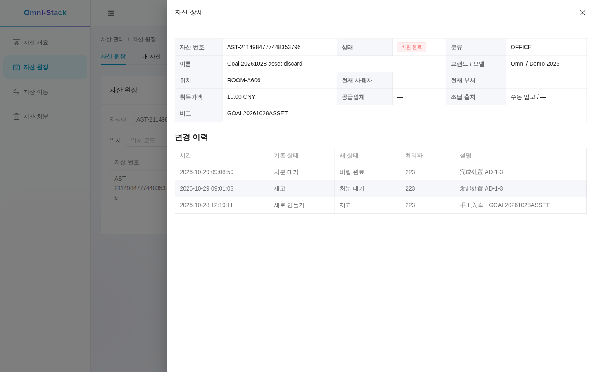

대장에서 두 번째 구매 출처 카드를 엽니다. 폐기됨, 취득가 CNY 900, PO/GR 출처, 거절·복원·재처분 이력이 보입니다.

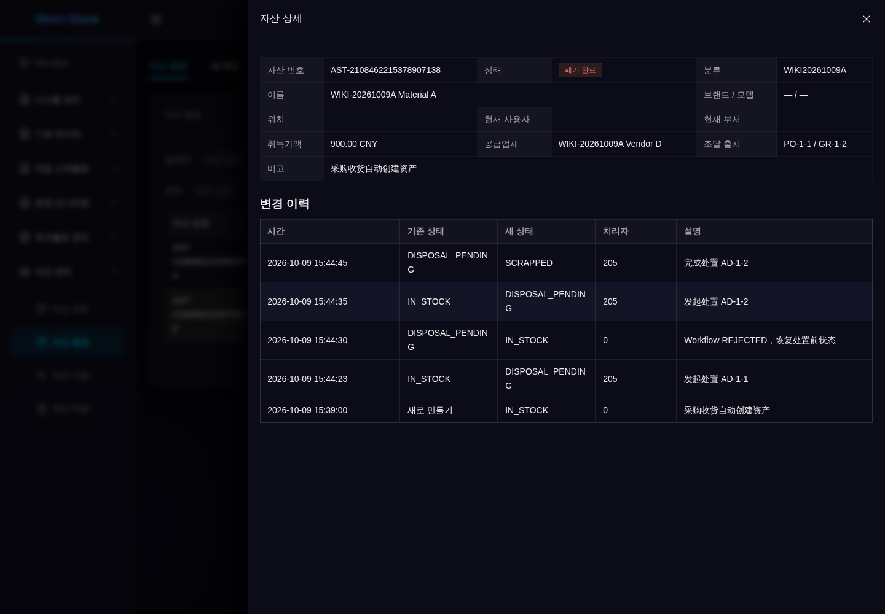

## 8. 단계별 실행: 할당, 수령 확인, 반납

이 절은 2026-10-12 로컬 Docker 검증을 기록합니다. [증거 기록](../reference/evidence/asset-usage-2026-10-12.json)은 스크린샷, 실제 제출, API 검증을 구분합니다. 네 언어의 이미지는 동일한 데이터와 제출 전 대화상자입니다. 할당·수령·반납은 중국어 UI에서 각각 한 번 제출한 뒤 실제 결과를 검증했으며, 언어별로 업무 쓰기를 반복하지 않았습니다.

해당 캡처는 짧은 수명의 학습 token으로 일반 사용자 세션을 준비했으며 CAPTCHA나 비밀번호 로그인을 검증하지 않았습니다. 중국어 기본 UI 쓰기 세 번과 API 결과는 네 언어 미리보기와 구분해 기록했습니다. 성공한 업무 쓰기를 재실행하거나 조달 카드의 최종 상태를 초기화하지 않습니다.

### 8.1 조달 출처 카드와 연습용 카드를 구분하기

ASSET_ADMIN으로 자산 대장에서 조달 출처 카드를 열고 `900.00 CNY`, `PO-1-1 / GR-1-2`, 변경 이력을 확인합니다. 이 카드는 이미 SCRAPPED 상태이므로 할당할 수 없습니다. 이미지는 출처 연결과 현재 최종 상태를 보여 주며, 입고 직후의 상태를 보여 주지 않습니다.

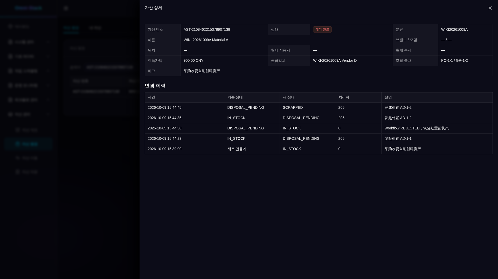

사용 연습에는 공식 관리자 API로 수동 입고한 별도 카드 `WIKI-20261012-ASSET-USAGE`를 사용했습니다. 취득금액은 십진 문자열 `"1000.00"`입니다. 조달 출처가 없으므로 입고 이벤트의 자동 카드 생성을 증명하지 않습니다. 재현할 때는 새 IN_STOCK 카드를 준비하고 자신의 assetNo를 기록하세요. 완료된 카드나 이력을 DB에서 초기화하지 마세요.

### 8.2 관리자가 할당하기

1. ASSET_ADMIN으로 대장에서 연습용 카드를 검색하고 IN_STOCK을 확인한 후 할당을 누릅니다.
2. 사용자와 유효한 기본 부서를 선택합니다. 이번 검증은 사용자 202, 부서 604입니다. 식별 가능한 비고를 입력하고 두 대상을 확인한 후 제출합니다.
3. 상세 정보를 새로 고칩니다. ALLOCATED와 선택한 currentUserId/currentUnitId를 확인합니다. 관리 owner는 변경되지 않습니다.

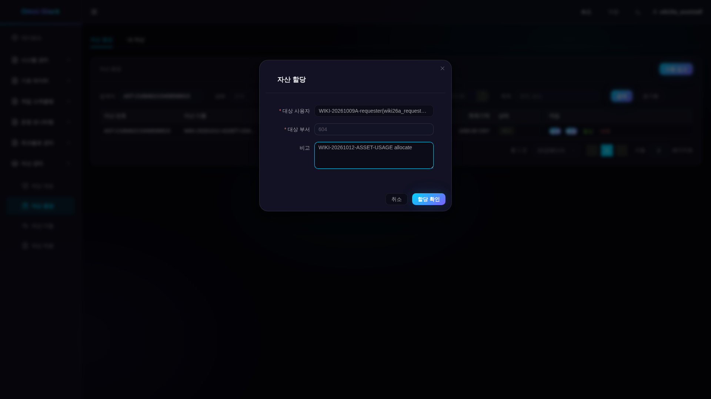

### 8.3 할당받은 사용자가 수령 확인하기

할당받은 ASSET_USER로 로그인하여 「내 자산」에서 같은 assetNo와 ALLOCATED를 확인한 후 수령을 선택합니다. 이미지는 제출 전 확인창입니다. 확인하고 새로 고치면 IN_USE가 됩니다. 실제 제출자는 사용자 202이며 관리자가 대신 수령하지 않았습니다.

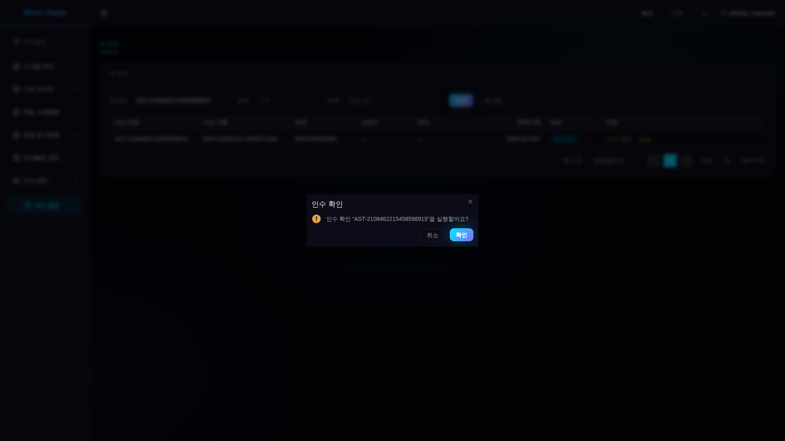

### 8.4 같은 사용자가 반납하기

「내 자산」에서 반납을 누르고 자산 번호를 확인한 후 확정합니다. 요청에는 현재 version을 사용합니다. 이미지는 제출 전 확인창이며, 실제 결과는 다음 단계에서 확인합니다.

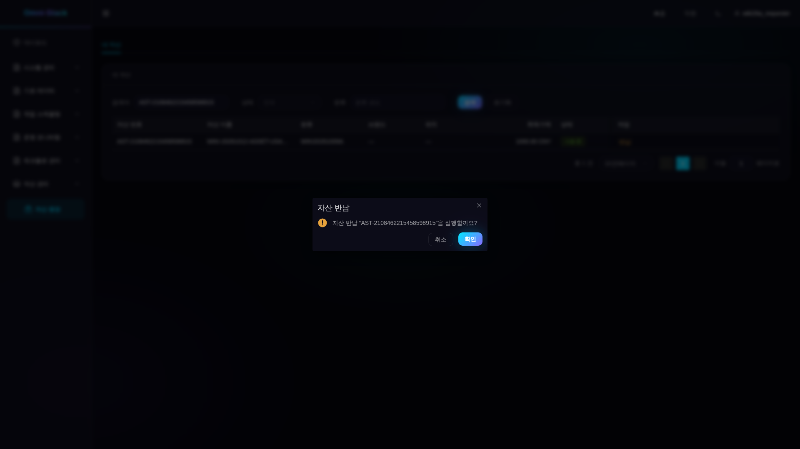

### 8.5 대장과 본인 목록 대조하기

관리자로 상세 정보를 다시 열면 IN_STOCK입니다. 현재 사용자·부서·할당 시간은 비워지고 ownerUserId=205, ownerUnitId=604는 유지됩니다. 수동 입고, 할당, 수령, 반납의 네 이력이 남으며 마지막 세 전이는 `IN_STOCK → ALLOCATED → IN_USE → IN_STOCK`입니다.

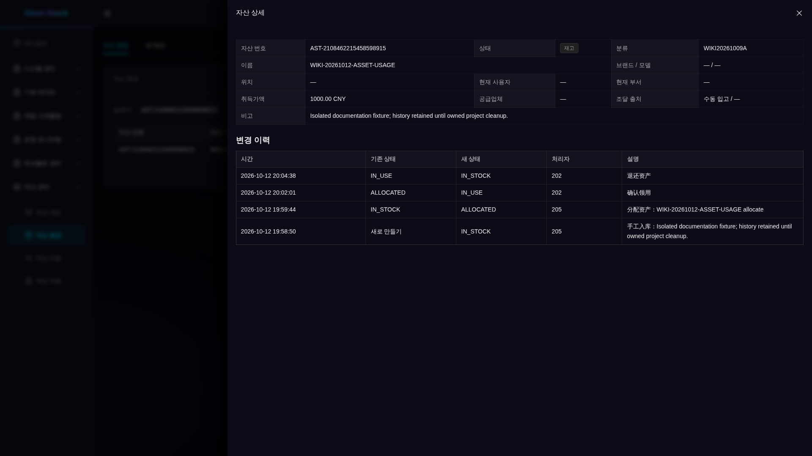

사용자가 「내 자산」에서 같은 assetNo를 검색하면 빈 목록이 나옵니다. 빈 화면만으로 성공을 판단하지 말고 대장과 API 검증 결과를 함께 확인하세요.

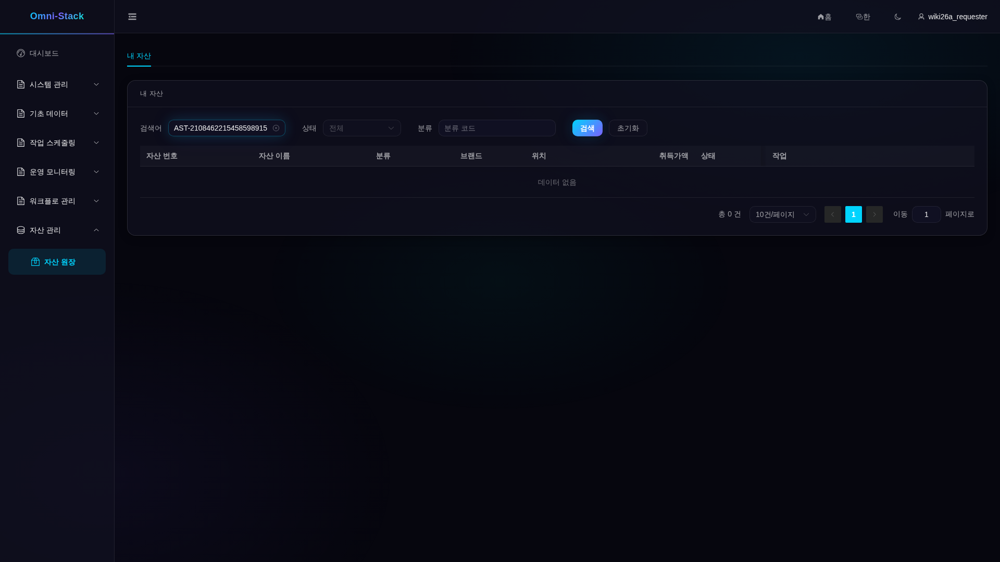

### 8.6 경계 검증과 이력 보존

다른 부서의 ASSET_USER가 수령을 시도하면 업무 코드 404, 이전 version으로 반납하면 409, 이력이 있는 카드 삭제도 409였습니다. 실제 API 검증에서 HTTP는 모두 200이며 오류는 응답 본문의 `code`입니다. HTTP 404/409로 표기하지 마세요. 연습용 카드는 IN_STOCK과 이력을 독립 검증 프로젝트에 유지하며 프로젝트 전체 정리를 기다립니다.

이미지에는 중국어 서버 이력, 원시 상태 열거값, 기존 레이블 줄바꿈이 남습니다. 영어 배정 양식의 부서 레이블이 줄바꿈되어 비고 레이블과 가까우며 대상 사용자 이름도 생략됩니다. 완전한 레이아웃 인수 통과로 볼 수 없습니다. 이번에는 주요 원본 20장을 개별 확인했고 나머지 24장은 기존 확인 범위를 유지합니다. 네 언어 문서는 앞서 승인된 실제 AI 의미 검토 통과로 인수합니다. 과거 렌더링 불완전·글자 잘림 원본 7장은 계속 제외하며 이미지 편집으로 보완하지 않았습니다.

