# 从采购卡片完成资产领用、调拨与处置

适用场景：supply-chain 或 full。2026-10-09 的主链记录以主干 fc165e3 为基线；2026-10-12 另以手工入库练习卡验证分配、本人接受、归还及三个 API 负例。本轮只复核文档、当前源码和既有证据，没有重新执行这些业务，也不据此宣称当前产物综合验收完成。先完成[采购收货](procurement-flow.md)和[教学数据](../wiki/data-and-fixtures.md)。

按[已授权 AI 复核政策](../adr/0003-authorized-ai-translation-review.md)，实际 AI 语义复核通过即可，不要求人工翻译复核。[本轮复核范围](../reference/evidence/asset-guide-review-2026-10-17.json)区分原稿、当前源码与历史截图。旧主链因镜像仓库 DNS/认证失败使用缓存基础镜像验证，未证明正式生产基础镜像构建通过。

## 1. 身份和来源

资产管理员使用 ASSET_ADMIN；使用人使用 ASSET_USER；审批人使用 ASSET_MANAGER，并具备实际匹配的组织作用域与完成审批权限。另准备不同组织的 ASSET_USER 验证本人边界。各账号均有有效主组织，候选人预览先于发起流程。 各步骤须使用同一租户；历史租户 1、用户和组织编号只是样例，复现时记录自己的实际 ID 和唯一前缀。本页 404/409 指业务码；历史负例 HTTP 为 200，错误取响应体 code。

记录本次两张卡的字符串 ID、assetNo、sourcePoId/sourceGrId/sourceGrLineId/sourceUnitSequence、owner、current user、status、version。金额 JSON 使用十进制字符串，如 "900.00"；长 ID 不转成 JavaScript 浮点数。管理台账按 owner_user_id/owner_unit_id 过滤，「我的资产」固定按 current_user_id，二者职责不同。

## 2. 收货建卡

1. 管理员进入「资产管理 → 资产台账」，按本次物料名称搜索，打开详情核对 PO、GR 和来源行。
2. 首批 A=1/FAIL 与非资产化 B=10/PASS 均不建卡；第二批 A=2/PASS 产生两张来源卡。不要用全库数量判断。
3. PASS、assetManaged=true、精确正整数共同决定建卡；事件 ID 与来源行/单位序号双重幂等。重复投递须单独通过受控消息重放验证。

## 3. 分配、接受、维修与归还

1. 管理员对第一张 IN_STOCK 执行「分配」，选择教学使用人及其主组织。请求包含人、组织、备注，位置不是分配请求字段。
2. 使用人在「我的资产」核对 ALLOCATED 和 assetNo，执行「接受」，预期 IN_USE。
3. 其他用户代为接受应为 404，其本人列表不含此卡。
4. 管理员对使用中卡执行「送修」：MAINTENANCE；「维修完成」固定恢复 IN_USE。
5. 使用人「归还」后为 IN_STOCK，currentUserId/currentUnitId/allocatedTime 清空，管理 owner 保留。

每步使用最新 version。以接受前的旧版本归还应冲突 409；先刷新并确认副作用，再执行下一步。

## 4. 调拨：批准与实物交接分开

1. 管理员创建调拨，选择第一张卡、目标人/组织/位置与唯一原因。核对 PENDING_APPROVAL、workflowStartStatus=STARTED、processInstanceId；卡为 TRANSFER，有 activeOperationType/Id。
2. 同卡发起处置应 409，已启动流程的本地取消也应 409。
3. 第一笔由真实候选人拒绝：申请 REJECTED，卡恢复 previousAssetStatus，占用在同一事务清空。
4. 新建第二笔并由候选人批准：APPROVED 时仍占用，尚未完成交接。
5. 管理员「完成交接」，即 POST /api/asset/transfer/{id}/complete：申请 COMPLETED、卡 IN_USE，currentUserId/currentUnitId 和位置更新，占用清空。ownerUserId/ownerUnitId 不随调拨改变。
6. 目标人在「我的资产」核对同一 assetNo。

本地取消只接受 status=START_FAILED 且 workflowStartStatus=FAILED；启动结果待确认或已经启动时均不能本地取消。retry-start 则允许上述明确失败状态，或 status=PENDING_APPROVAL 且 workflowStartStatus=PENDING 的结果待确认状态。先核对实例和既有副作用，再用同一申请的当前 version 重试，复用原请求、businessKey 和模型快照，并保留资产占用；不要创建重复申请掩盖未知结果。

## 5. 处置：丢弃与报废

当前仅支持 DISCARD（丢弃）和 SCRAP（报废），没有出售或捐赠流程。使用第二张 IN_STOCK：

1. 创建 SCRAP，填唯一原因、方式和字符串残值 "0.00"，核对 DISPOSAL_PENDING 与占用。
2. 第一笔由候选人拒绝，核对 REJECTED、previousAssetStatus 恢复与占用清空。
3. 新建第二笔并批准。APPROVED 只完成审批，卡仍 DISPOSAL_PENDING。
4. 管理员「完成处置」，即 POST /api/asset/disposal/{id}/complete：申请 COMPLETED；SCRAP 对应 SCRAPPED，DISCARD 对应 DISPOSED。
5. 终态再分配或调拨应为 409。审批运行时在 omni-workflow，不改库跳过完成动作。

## 6. 排错与收尾

无卡片沿 GR → Outbox → Inbox 核对质量、资产属性、数量和消费结果。不可见时检查租户、owner 管理范围与 current user 本人范围。审批后未恢复时同时检查 previousAssetStatus、占用、实例和事务日志。

保留两张采购来源卡、拒绝/完成申请及变更历史；发生业务动作的事件卡不用于删除练习。完整折旧、财务总账、复杂盘点属于当前 MVP 之外。参见[资产设计](../design/asset-design.md)和[源码调试](../wiki/source-debugging.md)。

## 7. 本次业务结果截图

以下为 2026-10-09 同一隔离项目中普通角色的真实历史画面；[来源记录](../reference/evidence/supply-chain-2026-10-09.json)保留源码、镜像、角色和校验摘要。其 48 张图曾按 12 组四语原分辨率联系表检查，本页使用其中 20 张，不是当时将每张原图单独打开。持久化历史说明由后端生成，外语界面可能保留中文；未改写数据伪造本地化。

第一笔调拨被拒绝。画面保留申请的原状态和目标人/组织；卡片恢复与占用清空另由 API 校验。

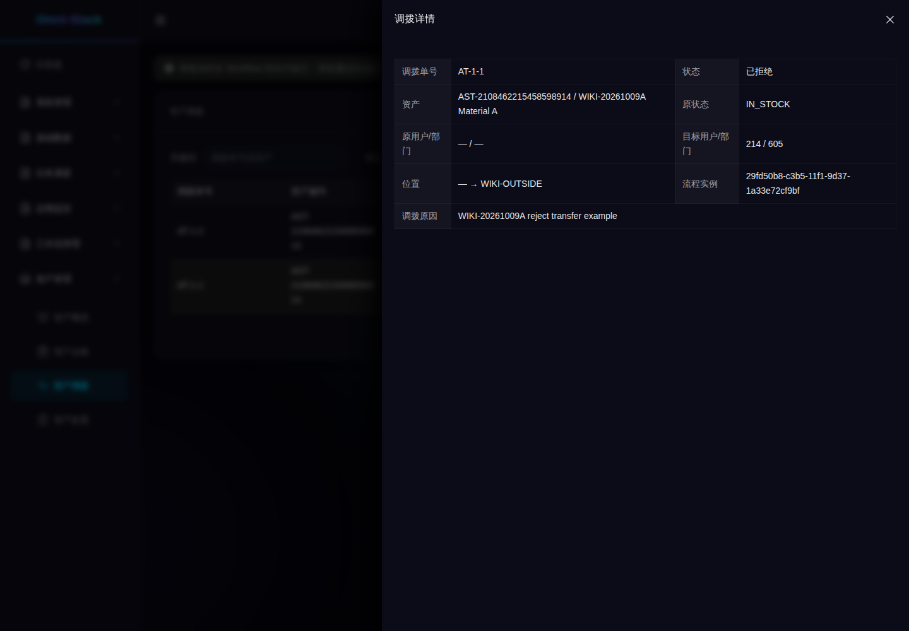

第二笔调拨在批准后完成独立交接。核对 COMPLETED 和目标人/组织，不能把批准截图当作交接完成。

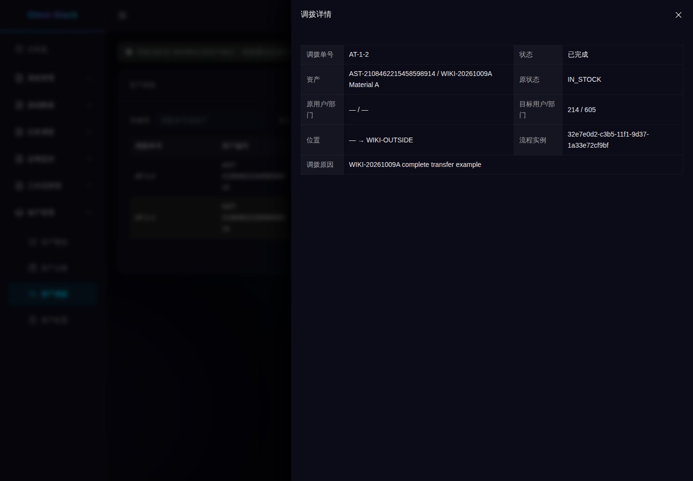

第一笔报废申请被拒绝，保留流程实例和原资产状态。

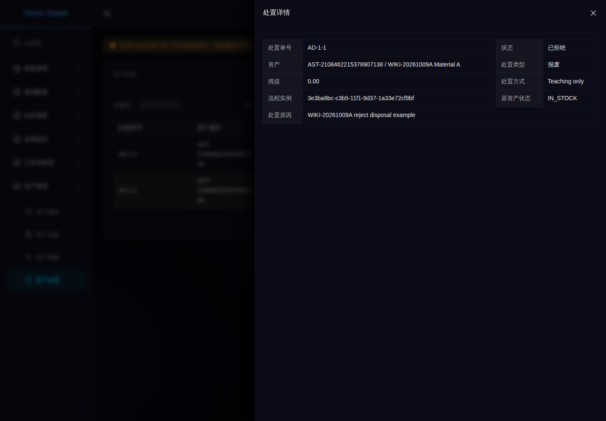

第二笔报废在批准后执行完成处置，申请为 COMPLETED。

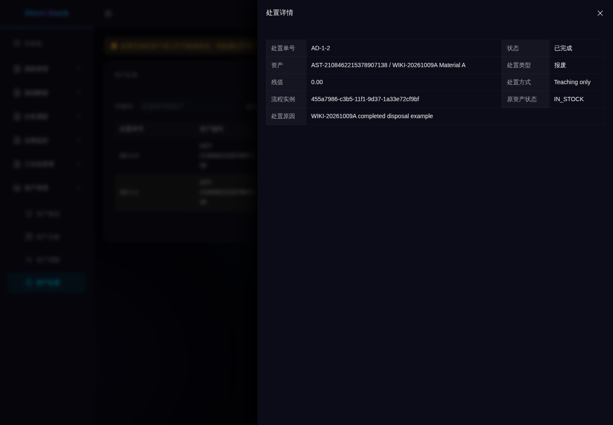

从台账打开第二张采购来源卡：已报废、原值 900 CNY、来源 PO/GR 和拒绝恢复/再次处置历史均可见。

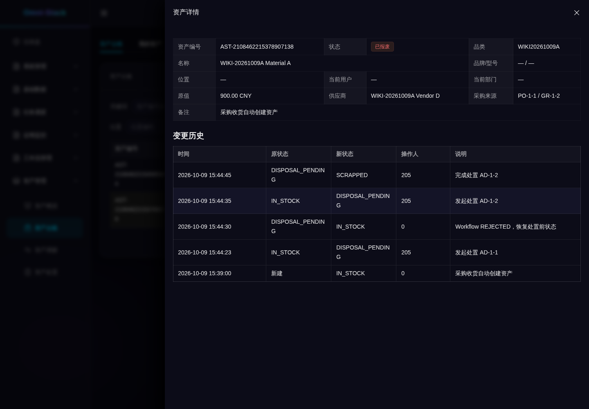

## 8. 逐步操作：分配、确认领用、归还

本节来自 2026-10-12 的本机 Docker 验证。[证据记录](../reference/evidence/asset-usage-2026-10-12.json)区分截图、实际提交和 API 校验。四语图片展示同一份数据和提交前的对话框；分配、接受、归还各由中文界面提交一次，随后校验真实结果，没有按语言重复业务写入。

该次采集用短期教学 token 准备普通身份会话，不证明验证码或密码登录链路；三条中文原生 UI 写入及 API 结果与四语预览分别留证。业务成功记录不重放，图中的采购卡终态也不重置。

### 8.1 先区分采购来源卡和练习卡

以 ASSET_ADMIN 打开「资产台账」中的采购来源卡，核对原值 `900.00 CNY`、`PO-1-1 / GR-1-2` 和变更历史。图中的卡已经 SCRAPPED，不能再分配；它证明来源关联和当前终态，不是刚收货的状态。

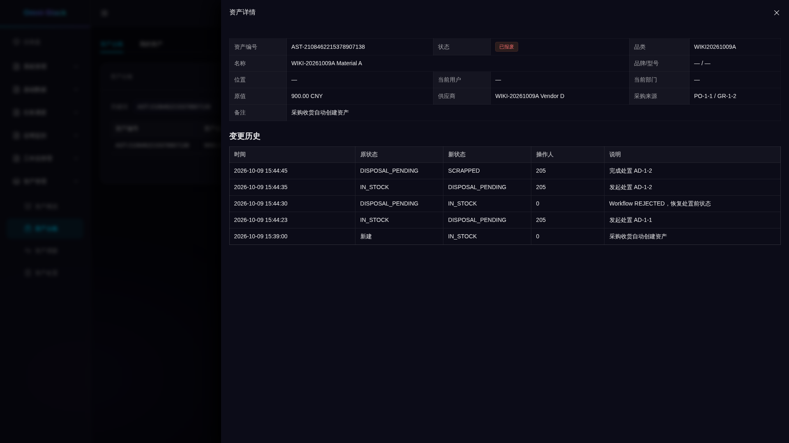

领用练习另用正式管理员 API 手工入库的 `WIKI-20261012-ASSET-USAGE`，原值为字符串 `"1000.00"`。它没有采购来源，不能拿来证明收货建卡。自行复现时准备一张新的 IN_STOCK 卡，记录自己的 assetNo，不复用图中已完成操作的卡，也不改库重置历史。

### 8.2 管理员分配

1. 以 ASSET_ADMIN 在台账搜索练习卡，确认 IN_STOCK，再点「分配」。
2. 选择教学使用人和其有效主组织；本次用户为 202、组织为 604。填写可辨认的备注，核对人和组织后提交。
3. 刷新详情，预期 ALLOCATED，currentUserId/currentUnitId 指向所选对象。原管理 owner 不变。

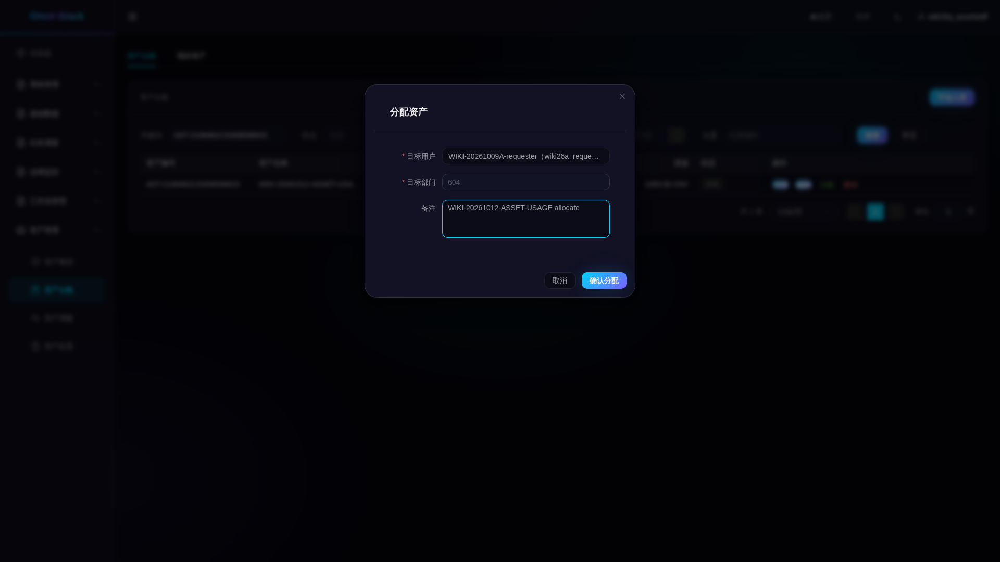

### 8.3 使用人确认领用

使用被分配的 ASSET_USER 登录，进入「我的资产」，按同一 assetNo 核对 ALLOCATED，点击「接受」。下图是确认前的提示；确认后刷新，预期 IN_USE。本次提交人是 202，不是管理员代签。

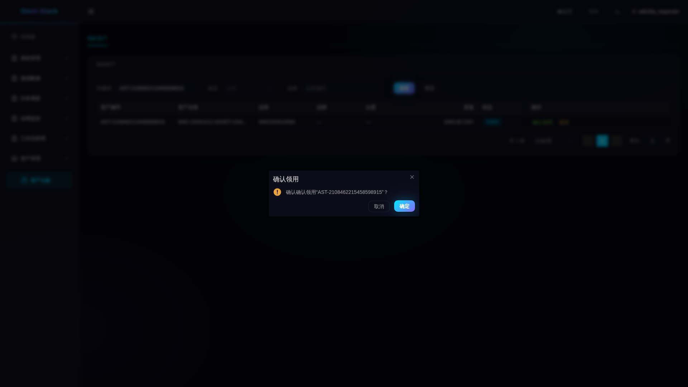

### 8.4 使用人归还

仍由同一使用人在「我的资产」点击「归还」，核对编号后确认。请求使用当前 version。下图展示提交前的确认提示，最终结果见下一步。

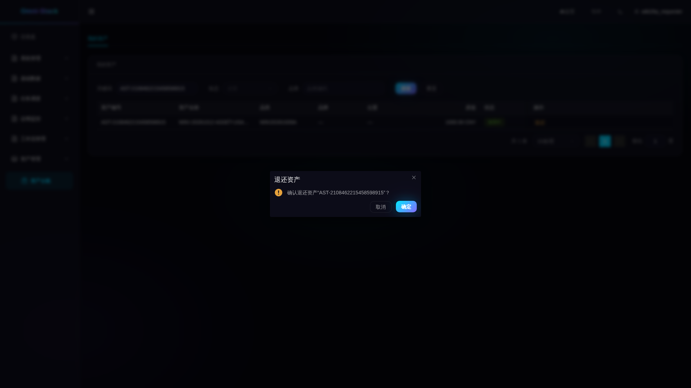

### 8.5 对照台账和本人列表

管理员重新打开详情：卡回到 IN_STOCK，当前人、当前组织和分配时间清空，ownerUserId=205、ownerUnitId=604 保留。历史应有手工入库、分配、确认领用、归还四条，后三条依次为 `IN_STOCK → ALLOCATED → IN_USE → IN_STOCK`。

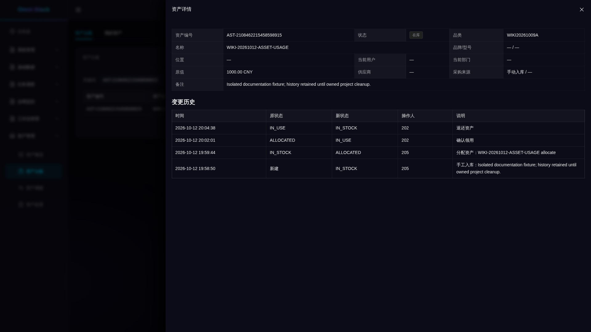

使用人回到「我的资产」按同一 assetNo 查询，预期空列表。空列表须与上一张的台账和 API 结果一起看，不能单凭空白断定归还成功。

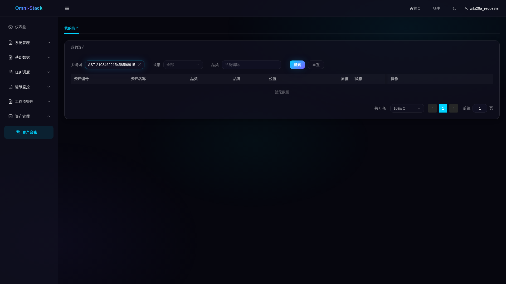

### 8.6 验证边界并保留历史

另一组织的 ASSET_USER 代为接受得到业务码 404，旧 version 归还得到 409，有变更历史的卡尝试删除也得到 409；这些负例由 API 实测，HTTP 均为 200，错误在响应体 `code` 中，不能写成 HTTP 404/409。练习卡现为 IN_STOCK，历史保留在独立教学项目，等待项目级收尾。

图片保留后端生成的中文历史、原始状态枚举及既有标签折行。英文分配表单的部门标签折行挤近备注标签，目标用户名也有省略显示；这些限制不应写成完整布局验收通过。本轮逐张查看 20 张关键原图，其余 24 张保留既有检查范围。四语文档按前述政策完成实际 AI 语义复核即可；历史采集中绘制不完整或文字被截的 7 张原图仍被排除，未通过改图补字。
