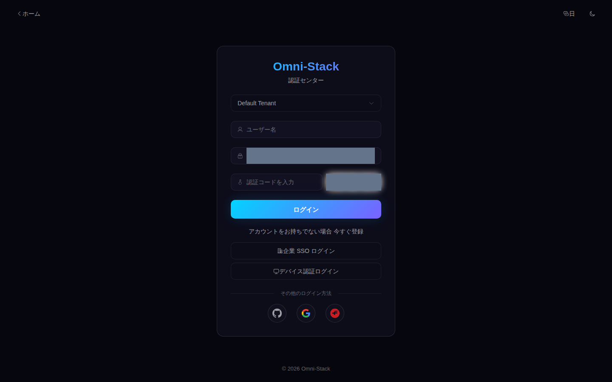
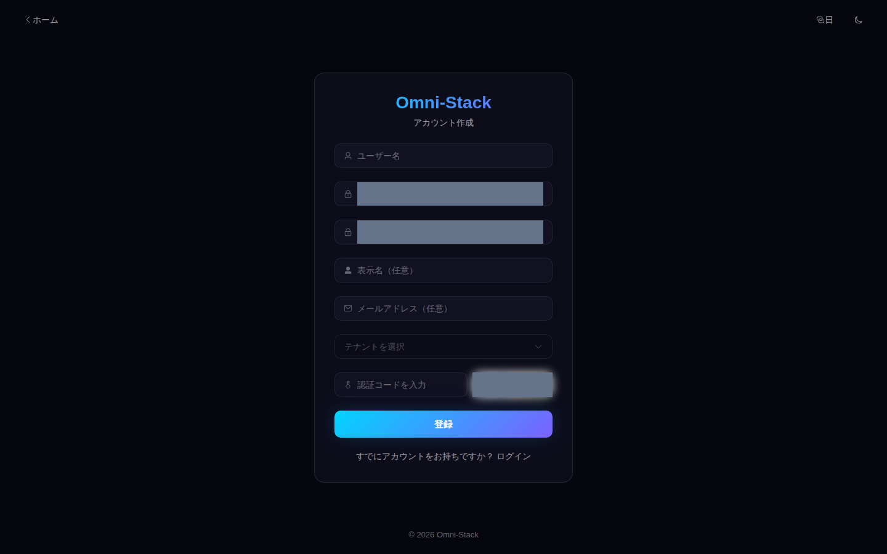
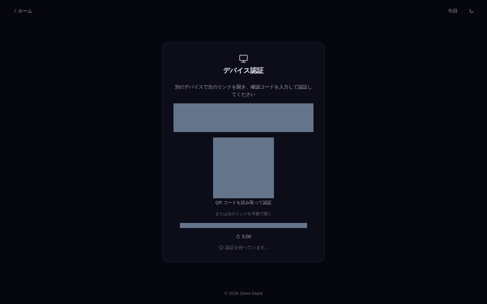
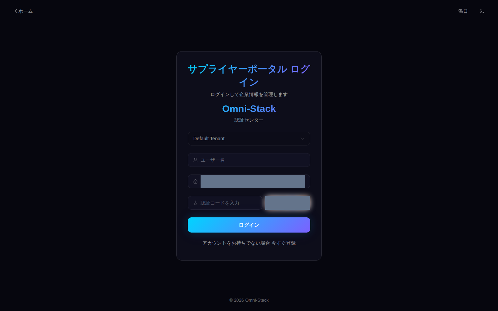
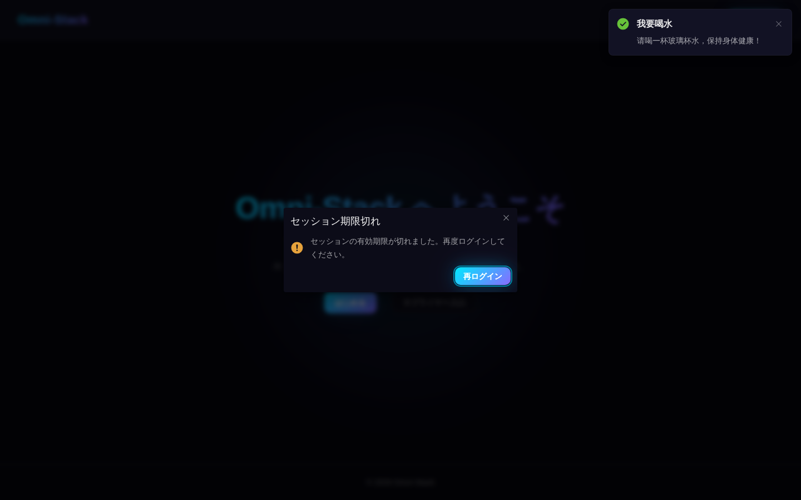

# ログイン、CAPTCHA、ソーシャルログイン、テナント選択

原画像は[2026-10-12 の基本検証](../reference/evidence/basic-2026-10-12.json)を参照してください。44 の独立検査と個別に確認した原画像 44 枚に、各撮影時点のソースとイメージ識別情報を記録しました。ページの表示は章内の全業務操作の検証を意味しません。日/韓の一部 Status、Phone、Email、Retry は実際に英語へ戻り、データ名は教材の値です。

対象：エンドユーザー、テナント管理者、認証基盤の保守担当者。

## 1. 入口とテナント

管理者と一般ユーザーは `/login`、サプライヤーは `/portal-login` を利用できます。ユーザー名はテナント内でのみ一意なため、パスワードログインでは先にテナントを選択します。バックエンドはテナント ID、ユーザー名、ログイン方式を組み合わせて認証コンテキストを作ります。

公開テナント API はログインに必要な最小情報のみ返します。ログイン後のテナントは発行トークンと Gateway の信頼済みヘッダーで決まり、クライアントが任意に範囲を拡張することはできません。

## 2. パスワードと CAPTCHA

1. `GET /api/auth/captcha` を呼び出します。
2. `captchaImage` を表示し、対応する `captchaKey` をメモリに保持します。
3. テナント、ユーザー名、パスワード、`captchaCode` を入力します。
4. `POST /api/auth/login` を呼び出します。
5. 成功後、パスワード、CAPTCHA 回答、Key を直ちに破棄します。

CAPTCHA は一回限りで、回答のキャッシュや Key の再利用は禁止です。ログ、スクリーンショット、テストレポートにパスワード、回答、アクセストークンを残しません。自動化は信頼済み環境の短期トークンまたは人が処理する実 CAPTCHA を使用し、本番 CAPTCHA を解除・解析・迂回しません。ログイン失敗時には操作可能な業務情報だけを表示し、「アカウントは存在するがパスワード誤り」などアカウント存在の有無を列挙できる詳細は区別しません。

## 3. セルフ登録

公開 `POST /api/auth/register` はテナント、CAPTCHA、テナント内ユーザー名一意性、パスワード規則を検証します。すべての作成経路で既定 `USER` ロールを割り当てようとし、割り当ての異常は警告として記録するだけでアカウント作成を中断しませんが、ログインできない不完全なユーザー状態を残しません。

サプライヤー登録は認証アカウントのみ作成します。その後、招待による Portal 登録、`SUPPLIER` ロール、有効な関連付けが必要です。これらが揃ってから企業情報、評価、見積機能を利用できます。

## 4. ソーシャルログイン

GitHub、Google、Gitee の外部ログインと、Omni-Stack を認可サーバー、SPA を公開クライアントとするローカル OAuth2 認可コード + PKCE は別の経路です。

**外部ソーシャルログイン（バックエンド主導）：**

1. バックエンドの `SocialLoginController` がテナント情報を含む HMAC 署名済み `state` を生成し、外部プロバイダーの認可ページへ 302 リダイレクトします。
2. プロバイダーは `/api/auth/oauth2/{provider}/callback` へ戻ります。`state` を検証した後、`SocialLoginServiceImpl` がサーバー側でコードをアクセストークンに交換し、ユーザー情報を取得します。フロントエンドはプロバイダーの `client_secret` にアクセスせず、PKCE も生成しません。
3. 初回は `gh_`、`go_`、`ge_` 接頭辞のローカル名を作成し、重複時には代替名を使います。
4. 元の保護されたページまたはロールに対応するワークスペースへ戻ります。

**ローカル OAuth2 PKCE：** フロントエンドの `buildAuthorizeUrl` が `code_verifier` と `code_challenge` を生成して `/oauth2/authorize` へ移動し、コールバック後に `code_verifier` を使って `/oauth2/token` でトークンを取得します。この PKCE と `state` はローカル認可サーバーと SPA の実装に属します。

コールバック URL、クライアントのシークレット、許可する Origin は環境設定で提供し、本番で開発用クライアントを再利用しません。

### ローカルアプリ設定とツールによる検証

次の変数を Git 対象外の `.env` またはリポジトリ外の非公開環境ファイルに設定します。自分のアプリ認証情報を使い、実際の値を Wiki に書きません。

| プロバイダー | Client ID | Client Secret |
|---|---|---|
| GitHub | `GITHUB_CLIENT_ID` | `GITHUB_CLIENT_SECRET` |
| Google | `GOOGLE_CLIENT_ID` | `GOOGLE_CLIENT_SECRET` |
| Gitee | `GITEE_CLIENT_ID` | `GITEE_CLIENT_SECRET` |

現在の Compose は三つの `AUTH_OAUTH2_*_REDIRECT_URI` を localhost:8102 の Gateway コールバックに直接設定します。同名のキーを `.env` に追加するだけでは、この固定環境値を上書きできません。ドメインの変更や 127.0.0.1 の使用には、非公開の Compose override で `omni-auth.environment` を上書きし、プロバイダー側にも完全に一致する URI を登録します。`AUTH_OAUTH2_FRONTEND_CALLBACK_URL` はブラウザーで使うフロントエンドのアドレスに合わせます。例は `http://localhost:3000/callback` です。アプリの Client Secret をプラットフォームのアカウントのログインパスワードとして使いません。

現在の `OAuth2StateUtils` は HMAC と 10 分の時間範囲を検証し、一回限りの nonce を保存・原子的に消費しません。今回も有効な state の再使用はプロバイダーのコード交換まで到達したため、この負例は state の一回限りの使用を証明しません。

[2026-10-13 のローカル検証記録](../reference/evidence/oauth-local-2026-10-13.json)は実際の認可ページ、設定値の反映、拒否されたコールバックを記録します。ログインページの HTTP 200 や無効コードの拒否だけでは、ユーザーの認可、トークン取得、ローカルのソーシャルログイン完了を証明できません。

### 外部 OAuth のスクリーンショットは後日追加

GitHub、Google、Gitee の追加ログイン確認はアカウント所有者による操作が必要です。今回の成果物ではプロジェクト所有者の決定により撮影を延期し、以下の三つの領域を確保します。三社とも、実際のユーザー認可後の成功コールバック、コード交換、ローカルログインは未検証です。この領域の存在は検証合格を意味しません。

#### GitHub

> **スクリーンショットは後日追加**：GitHub の追加ログイン確認、認可の確認、本システムへ戻った後のログイン結果。

#### Google

> **スクリーンショットは後日追加**：Google の追加ログイン確認、認可の確認、本システムへ戻った後のログイン結果。

#### Gitee

> **スクリーンショットは後日追加**：Gitee の追加ログイン確認、認可の確認、本システムへ戻った後のログイン結果。

後日、ローカル Docker のブラウザーで実際に確認と認可を完了してから、機密情報を隠した原画像で各領域を置き換え、スクリーンショット一覧に言語、ロール、テナント、ソースのバージョン、実際の検証範囲を登録します。パスワード、確認コード、トークン、Cookie、個人のアカウント情報を画像に含めません。今回の延期はこの三社の外部フローの画像のみが対象です。パスワードと CAPTCHA、ローカル PKCE、デバイス認可、SRM 登録は、それぞれの範囲で検証します。

## 5. デバイス認可

`/device` がデバイスコード、ユーザーコード、QR コードを表示し、ユーザーは `/device/verify` でログインして許可します。デバイスはトークンエンドポイントのみをポーリングし、パスワードを扱いません。期限切れ・拒否・使用済みコードは再発行します。デバイスコードフローはキーボード制約のあるデバイス向けであり、CAPTCHA を迂回する汎用ログイン入口として扱いません。

### スクリーンショット

#### 図 1 `auth-login-ja-JP`：ログイン入口

- 前提条件：ログイン不要、公開アクセス
- 操作者：任意のユーザー
- 操作：`/login` を開く
- 期待結果：テナント、ユーザー名、パスワード、認証コード（マスク済み）、ログイン方法が表示される

#### 図 2 `auth-register-ja-JP`：セルフ登録

- 前提条件：公開
- 操作者：新規ユーザー
- 操作：ログイン画面から登録画面へ
- 期待結果：ユーザー名、パスワード、確認パスワード、認証コード入力が表示される

#### 図 3 `auth-device-code-ja-JP`：デバイス認可

- 前提条件：ヘッドレスデバイスが OAuth2 デバイスフローを開始
- 操作者：デバイス利用者
- 操作：`/device` でユーザーコードを取得し `/device/verify` で入力
- 期待結果：実際のデバイス認可リクエストの成功後、ユーザーコード、QR コード、サーバーの有効期間に対応する残り時間と確認入口が表示される。公開画像では有効なコードとリンクをマスクする

#### 図 4 `supplier-portal-login-ja-JP`：サプライヤーポータルログイン

- 前提条件：公開
- 操作者：サプライヤーユーザー
- 操作：ポータルログイン画面を開く
- 期待結果：ポータルログインフォームと登録入口が表示される

#### 図 5 `session-expired-dialog-ja-JP`：セッション失効ダイアログ

- 前提条件：ログイン済み。テストプロセス内で業務 API に確定的な 401 障害を注入する（実際の利用では Token の失効）
- 操作者：ログイン済みユーザー
- 操作：業務 API が 401 を返したとき、アプリが失効ダイアログを表示する
- 期待結果：「セッションが失効しました」ダイアログ（ローカライズされたタイトル + 再ログインボタン）が表示される。確認後に検証済みの `redirect` パラメーターを付けてログインページへ遷移する。内部例外は漏えいしない

## 6. セッション失効

トークン失効または権限変更時、クライアントは認証状態を消去してログインへ戻り、安全検証済みのアプリ内リダイレクトだけを保持します。`javascript:`、外部 URL、プロトコル相対 URL は拒否します。メニュー障害は再試行可能なエラー画面を表示し、リクエストを無限に繰り返しません。

## 7. 確認順序

1. 正しいテナントが選択されていることを確認します。
2. CAPTCHA を更新してから再入力します。
3. Auth ログイン記録を確認します。`omni-auth` では操作ログをログイン記録の代わりに使用しません。
4. ソーシャルログインでは、コールバック URI、バックエンド HMAC 署名の `state`、プロバイダのクライアント設定を確認します（外部ソーシャルログインはフロントエンド PKCE を含まない）。フロントエンド PKCE（`code_verifier`/`code_challenge`）はローカル `/oauth2/authorize` SPA フローに属し、個別に調査します。
5. Portal ユーザーでは、`SUPPLIER` ロールと `srm_supplier_portal_user` の関連付けを確認します。

[API 契約](../api-contract.jp.md)と[コアフロー](../core-flows.jp.md)も参照してください。

## 8. Docker コールバックと実際の検証範囲

1. 外部 OAuth の許可コールバックを `compose.apps.yaml` の `AUTH_OAUTH2_GITHUB_REDIRECT_URI`、`AUTH_OAUTH2_GOOGLE_REDIRECT_URI`、`AUTH_OAUTH2_GITEE_REDIRECT_URI` と一致させます。ローカル既定は Gateway の `http://localhost:8102/api/auth/oauth2/{provider}/callback`、本番はブラウザーから到達可能な HTTPS ドメインです。内部の `omni-auth:8080` は外部コールバックに使えません。
2. 成功結果は `/callback` で Vue Router が受け取り、失敗はログインへ戻ります。Nginx は SPA ルートを `index.html` に戻し、`/api/*` と `/oauth2/*` を Gateway 経由で Auth に転送します。トークン断片、Cookie、client secret、有効 CAPTCHA を公開ログや画像に含めません。
3. CAPTCHA が表示されなければ Auth と Redis の接続を確認します。失敗・期限切れは再生成して人が入力し、旧コードを再利用しません。パスワード失敗はテナント、実際の 401 は Gateway から `/oauth2/jwks` への接続、署名、期限とセッションを確認します。アカウント制限とセッション失効は区別します。
4. `state` 失敗はサーバー署名設定とコールバック引数を確認します。外部タイムアウトはコンテナの外向き通信・プロキシ、名前競合は `gh_`/`go_`/`ge_` の代替命名を追います。外部 provider とローカル PKCE のコード交換設定は異なります。
5. [実ログイン記録](../reference/evidence/human-login-2026-10-09.json)は人による CAPTCHA・パスワードログイン 1 回を証明します。登録、デバイス初期化、Portal 入口と失効画像の範囲は別です。テスト ID、クライアント注入 401、未設定 provider、ページ閲覧では登録成功・デバイス承認完了・外部ログイン全体を証明できません。
