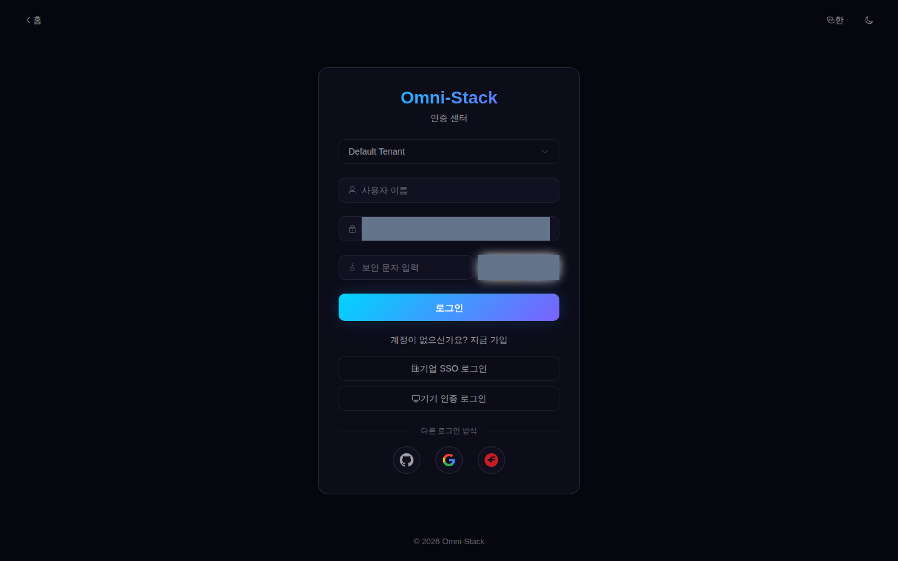
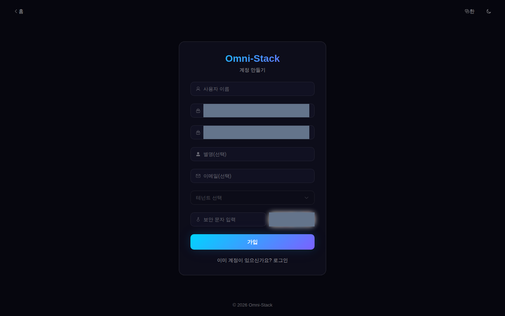
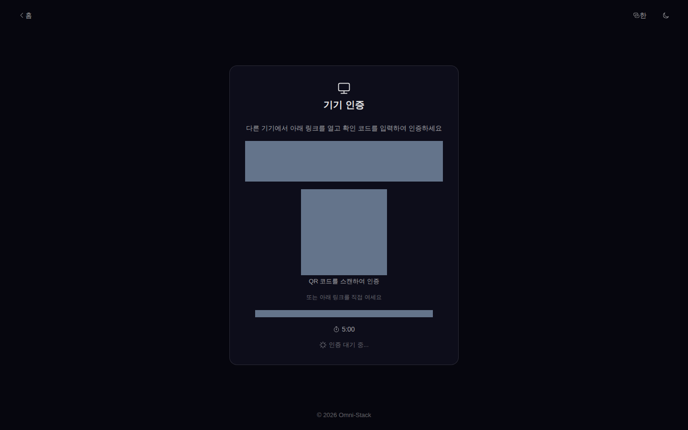
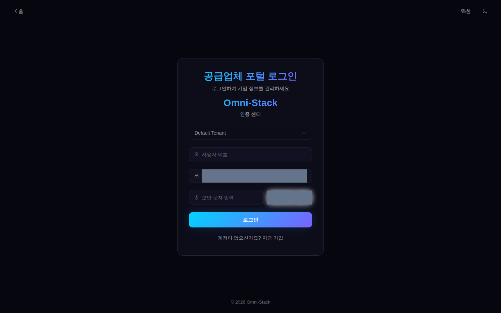
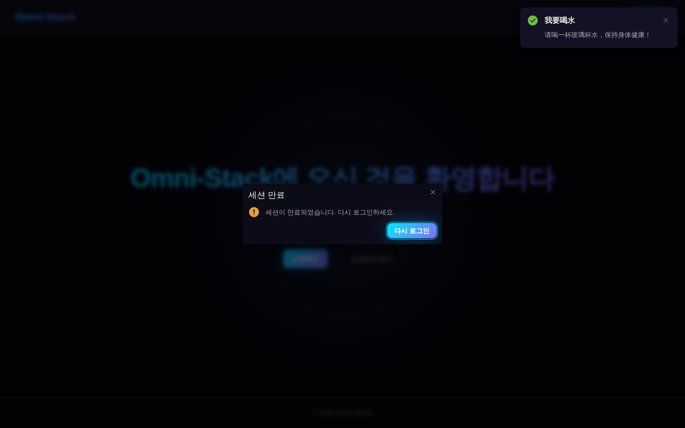

# 로그인, CAPTCHA, 소셜 로그인과 테넌트 선택

원본 출처는 [2026-10-12 기본 검증](../reference/evidence/basic-2026-10-12.json)을 참고하세요. 독립 검사 44개와 개별 검토한 원본 44장에 각 촬영 시점의 소스·이미지 식별 정보를 기록했습니다. 페이지 표시는 이 장의 모든 업무 작업 검증을 뜻하지 않습니다. 일/한 일부 Status, Phone, Email, Retry는 실제 영어 대체이며 데이터 이름은 교육 데이터 값입니다.

대상: 최종 사용자, 테넌트 관리자, 인증 시스템 유지보수자.

## 1. 진입점과 테넌트

관리자와 일반 사용자는 `/login`, 공급업체는 `/portal-login`을 사용할 수 있습니다. 사용자 이름은 테넌트 안에서만 고유하므로 비밀번호 로그인 전에 테넌트를 선택합니다. 백엔드는 테넌트 ID, 사용자 이름, 로그인 방식을 조합해 인증 문맥을 만듭니다.

공개 테넌트 API는 로그인에 필요한 최소 정보만 반환합니다. 로그인 후 테넌트는 발급 토큰과 Gateway 신뢰 헤더로 결정되며 클라이언트가 임의 헤더로 범위를 넓힐 수 없습니다.

## 2. 비밀번호와 CAPTCHA

1. `GET /api/auth/captcha`를 요청합니다.
2. `captchaImage`를 표시하고 대응하는 `captchaKey`를 메모리에 보관합니다.
3. 테넌트, 사용자 이름, 비밀번호, `captchaCode`를 입력합니다.
4. `POST /api/auth/login`을 호출합니다.
5. 성공 후 비밀번호, CAPTCHA 답, Key를 즉시 폐기합니다.

CAPTCHA는 일회용이며 답이나 Key를 재사용하지 않습니다. 로그, 스크린샷, 테스트 보고서에 비밀번호, 답, 액세스 토큰을 남기지 않습니다. 자동화는 신뢰 환경의 단기 토큰이나 사람이 처리한 실제 CAPTCHA를 사용하고 운영 CAPTCHA를 해제·분석·우회하지 않습니다. 로그인 실패 시에는 조작 가능한 업무 정보만 표시하며, '계정은 존재하지만 비밀번호가 오류'처럼 계정 존재 여부를 열거할 수 있게 하는 세부는 구분하지 않습니다.

## 3. 셀프 등록

공개 `POST /api/auth/register`는 테넌트, CAPTCHA, 테넌트 내 이름 고유성, 비밀번호 규칙을 검증합니다. 모든 사용자 생성 경로는 기본 `USER` 역할 할당을 시도하며, 할당 예외는 경고로 기록될 뿐 계정 생성을 차단하지 않지만, 로그인할 수 없는 불완전한 사용자 상태을 남겨서는 안 됩니다.

공급업체 등록은 인증 계정만 만듭니다. 이후 초대 기반 Portal 입점, `SUPPLIER` 역할, 활성 연결이 필요하며 이를 갖춘 뒤 기업 정보, 평가, 견적 기능에 접근할 수 있습니다.

## 4. 소셜 로그인

GitHub, Google, Gitee 외부 로그인과 Omni-Stack을 인가 서버, SPA를 공개 클라이언트로 사용하는 로컬 OAuth2 인가 코드 + PKCE는 서로 다른 경로입니다.

**외부 소셜 로그인(백엔드 주도):**

1. 백엔드 `SocialLoginController`가 테넌트 정보와 HMAC 서명이 담긴 `state`를 생성하고 외부 제공자의 인가 페이지로 302 리다이렉트합니다.
2. 제공자는 `/api/auth/oauth2/{provider}/callback`으로 돌아옵니다. `state`를 검증한 뒤 `SocialLoginServiceImpl`이 서버에서 코드를 액세스 토큰으로 교환하고 사용자 정보를 조회합니다. 프런트엔드는 제공자의 `client_secret`에 접근하거나 PKCE를 생성하지 않습니다.
3. 최초 로그인은 `gh_`, `go_`, `ge_` 접두사의 로컬 이름을 만들며 충돌하면 대체 이름을 사용합니다.
4. 원래 보호된 페이지 또는 역할에 맞는 작업 공간으로 돌아갑니다.

**로컬 OAuth2 PKCE:** 프런트엔드 `buildAuthorizeUrl`이 `code_verifier`와 `code_challenge`를 생성하여 `/oauth2/authorize`로 이동하고 콜백 후 `code_verifier`를 사용해 `/oauth2/token`에서 토큰을 받습니다. 이 PKCE와 `state`는 로컬 인가 서버와 SPA 구현에 속합니다.

콜백 URL, 클라이언트 시크릿, 허용 Origin은 환경 설정으로 제공하고 운영에서는 개발 클라이언트를 재사용하지 않습니다.

### 로컬 앱 설정과 도구 검증

다음 변수는 Git에서 제외한 `.env` 또는 저장소 밖의 비공개 환경 파일에 입력합니다. 자신의 앱 자격 정보를 사용하고 실제 값을 Wiki에 기록하지 않습니다.

| 제공자 | Client ID | Client Secret |
|---|---|---|
| GitHub | `GITHUB_CLIENT_ID` | `GITHUB_CLIENT_SECRET` |
| Google | `GOOGLE_CLIENT_ID` | `GOOGLE_CLIENT_SECRET` |
| Gitee | `GITEE_CLIENT_ID` | `GITEE_CLIENT_SECRET` |

현재 Compose는 세 `AUTH_OAUTH2_*_REDIRECT_URI`를 localhost:8102의 Gateway 콜백으로 직접 설정합니다. 같은 이름의 키를 `.env`에 추가하는 것만으로 이 고정 환경 값을 덮어쓰지는 못합니다. 도메인을 바꾸거나 127.0.0.1을 쓰려면 비공개 Compose override에서 `omni-auth.environment`를 덮어쓰고 제공자에도 정확히 같은 URI를 등록합니다. `AUTH_OAUTH2_FRONTEND_CALLBACK_URL`은 브라우저에서 쓰는 프런트엔드 주소와 일치해야 하며 예시는 `http://localhost:3000/callback`입니다. 앱 Client Secret은 플랫폼 계정의 로그인 비밀번호가 아닙니다.

현재 `OAuth2StateUtils`는 HMAC과 10분 시간 범위를 검증하며 일회용 nonce를 저장하거나 원자적으로 소비하지 않습니다. 이번에도 유효 state를 반복하면 제공자의 코드 교환까지 도달했으므로 이 실패 경로 테스트는 state의 일회성 소비를 입증하지 않습니다.

[2026-10-13 로컬 도구 검증](../reference/evidence/oauth-local-2026-10-13.json)은 실제 인가 페이지, 설정 반영, 거부된 콜백 분기를 기록합니다. 로그인 페이지 HTTP 200이나 무효 코드 거부는 사용자 인가, 성공한 토큰 교환, 로컬 소셜 로그인 완료를 입증하지 않습니다.

### 외부 OAuth 스크린샷 추가 예정

GitHub, Google, Gitee의 추가 로그인 확인은 계정 소유자가 직접 수행해야 합니다. 이번 결과물에서는 프로젝트 소유자의 결정에 따라 촬영을 미루고 아래 세 영역을 남겨 둡니다. 세 제공자 모두 실제 사용자 인가 후의 성공 콜백, 코드 교환, 로컬 로그인은 아직 검증하지 않았습니다. 이 영역은 검증 통과를 뜻하지 않습니다.

#### GitHub

> **스크린샷 추가 예정**: GitHub 추가 로그인 확인, 인가 확인, 이 시스템으로 돌아온 후의 로그인 결과.

#### Google

> **스크린샷 추가 예정**: Google 추가 로그인 확인, 인가 확인, 이 시스템으로 돌아온 후의 로그인 결과.

#### Gitee

> **스크린샷 추가 예정**: Gitee 추가 로그인 확인, 인가 확인, 이 시스템으로 돌아온 후의 로그인 결과.

나중에 로컬 Docker 브라우저에서 실제 확인과 인가를 완료한 후 민감 정보를 가린 원본으로 각 영역을 교체하고, 스크린샷 목록에 언어, 역할, 테넌트, 소스 버전, 실제 검증 범위를 등록합니다. 비밀번호, 확인 코드, 토큰, Cookie, 개인 계정 정보는 촬영하지 않습니다. 이번 유예는 이 세 외부 흐름의 스크린샷에만 적용합니다. 비밀번호와 CAPTCHA, 로컬 PKCE, 디바이스 인가, SRM 등록은 각각의 범위에 따라 검증합니다.

## 5. 디바이스 인가

`/device`가 디바이스 코드, 사용자 코드, QR 코드를 표시하고 사용자는 `/device/verify`에서 로그인해 승인합니다. 디바이스는 토큰 엔드포인트만 폴링하며 비밀번호를 처리하지 않습니다. 만료·거부·사용된 코드는 새로 발급합니다. 디바이스 코드 흐름은 키보드 없는 기기를 위한 것이며, CAPTCHA를 우회하는 범용 로그인 입구로 사용해서는 안 됩니다.

### 스크린숏

#### 그림 1 `auth-login-ko-KR`: 로그인 진입

- 전제 조건: 공개, 로그인 불필요
- 작업자: 모든 사용자
- 작업: `/login` 열기
- 예상 결과: 테넌트, 사용자 이름, 비밀번호, CAPTCHA(마스킹), 로그인 방식이 표시됨

#### 그림 2 `auth-register-ko-KR`: 셀프 등록

- 전제 조건: 공개
- 작업자: 신규 사용자
- 작업: 로그인 화면에서 등록 화면으로 이동
- 예상 결과: 사용자 이름, 비밀번호, 비밀번호 확인, CAPTCHA 입력이 표시됨

#### 그림 3 `auth-device-code-ko-KR`: 디바이스 인가

- 전제 조건: 헤드리스 기기가 OAuth2 디바이스 플로 시작
- 작업자: 기기 사용자
- 작업: `/device`에서 사용자 코드를 받아 `/device/verify`에 입력
- 예상 결과: 실제 기기 인가 요청이 성공하면 사용자 코드, QR 코드, 서버 유효 기간에 따른 실시간 카운트다운과 확인 진입점이 표시됨. 공개 그림에서는 유효한 코드와 링크를 마스킹함

#### 그림 4 `supplier-portal-login-ko-KR`: 공급사 포털 로그인

- 전제 조건: 공개
- 작업자: 공급사 사용자
- 작업: 공급사 포털 로그인 화면 열기
- 예상 결과: 포털 로그인 폼과 등록 진입점이 표시됨

#### 그림 5 `session-expired-dialog-ko-KR`: 세션 만료 다이얼로그

- 전제 조건: 로그인됨. 테스트 프로세스 내에서 비즈니스 API에 결정론적 401 장애를 주입(실제 사용에서는 Token 만료)
- 작업자: 로그인된 사용자
- 작업: 비즈니스 API가 401을 반환하면 앱이 만료 다이얼로그를 표시
- 예상 결과: "세션이 만료되었습니다" 다이얼로그(현지화된 제목 + 재로그인 버튼)가 표시됨. 확인 후 검증된 `redirect` 파라미터와 함께 로그인 페이지로 이동. 내부 예외 노출 없음

## 6. 세션 만료

토큰 만료나 권한 변경 시 로컬 인증을 지우고 로그인으로 돌아가며 검증된 앱 내부 리다이렉트만 유지합니다. `javascript:`, 외부 URL, 프로토콜 상대 URL은 거부합니다. 메뉴 실패는 무한 요청 대신 재시도 화면을 표시합니다.

## 7. 점검 순서

1. 올바른 테넌트가 선택되었는지 확인합니다.
2. CAPTCHA를 새로 고친 후 다시 입력합니다.
3. Auth 로그인 기록을 확인합니다. `omni-auth`에서는 로그인 기록 대신 작업 로그를 사용하지 않습니다.
4. 소셜 로그인에서는 콜백 URI, 백엔드 HMAC 서명 `state`, 프로바이더 클라이언트 구성을 확인합니다(외부 소셜 로그인은 프론트엔드 PKCE 와 무관). 프론트엔드 PKCE(`code_verifier`/`code_challenge`) 는 로컬 `/oauth2/authorize` SPA 흐름에 속하며 별도 진단합니다.
5. Portal 사용자에게 `SUPPLIER` 역할과 `srm_supplier_portal_user` 연결이 있는지 확인합니다.

[API 계약](../api-contract.kr.md)과 [핵심 흐름](../core-flows.kr.md)을 참고하세요.

## 8. Docker 콜백과 실제 검증 범위

1. 외부 OAuth 허용 콜백은 `compose.apps.yaml`의 `AUTH_OAUTH2_GITHUB_REDIRECT_URI`, `AUTH_OAUTH2_GOOGLE_REDIRECT_URI`, `AUTH_OAUTH2_GITEE_REDIRECT_URI`와 정확히 일치해야 합니다. 로컬 기본값은 Gateway `http://localhost:8102/api/auth/oauth2/{provider}/callback`이며 운영은 브라우저에서 접근 가능한 HTTPS 도메인입니다. 내부 `omni-auth:8080`은 외부 콜백 주소가 아닙니다.
2. Vue Router는 `/callback`에서 결과를 처리하고 실패하면 로그인으로 돌아갑니다. Nginx는 SPA 경로를 `index.html`로 처리하고 `/api/*`, `/oauth2/*`를 Gateway와 서비스 검색을 거쳐 Auth로 전달합니다. 토큰 조각, Cookie, client secret, 유효 CAPTCHA를 공개 로그나 이미지에 넣지 않습니다.
3. CAPTCHA가 없으면 Auth와 Redis 연결을 확인합니다. 실패·만료 시 새로 고친 뒤 사람이 입력하며 이전 코드를 재사용하지 않습니다. 비밀번호 실패는 테넌트, 실제 401은 Gateway의 `/oauth2/jwks` 접근·서명·만료·세션을 확인합니다. 계정 제한과 세션 만료를 구분합니다.
4. `state` 실패는 서버 서명 설정과 콜백 인자를 확인합니다. 제공자 시간 초과는 컨테이너 외부 통신·프록시를, 이름 충돌은 `gh_`/`go_`/`ge_` 대체 이름을 추적합니다. 외부 provider와 로컬 PKCE의 코드 교환 설정은 다릅니다.
5. [실제 로그인 기록](../reference/evidence/human-login-2026-10-09.json)은 사람이 수행한 CAPTCHA·비밀번호 로그인 한 번을 입증합니다. 등록, 장치 초기화, Portal 진입, 만료 이미지는 범위가 다릅니다. 테스트 계정, 클라이언트 주입 401, 미설정 provider, 페이지 방문은 등록 성공·장치 승인 완료·외부 소셜 로그인 전체 성공을 입증하지 않습니다.
