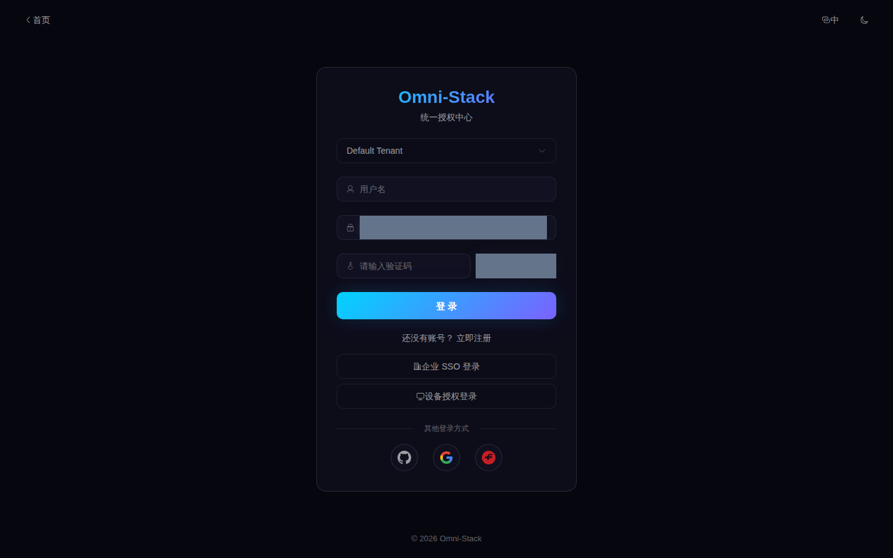
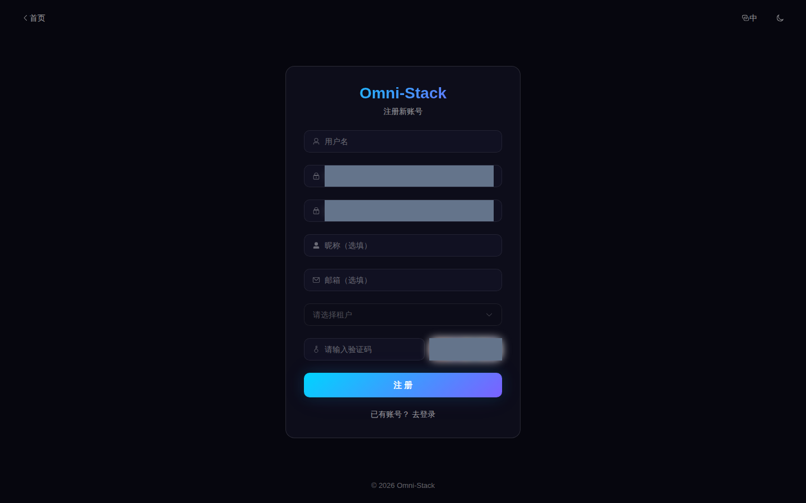
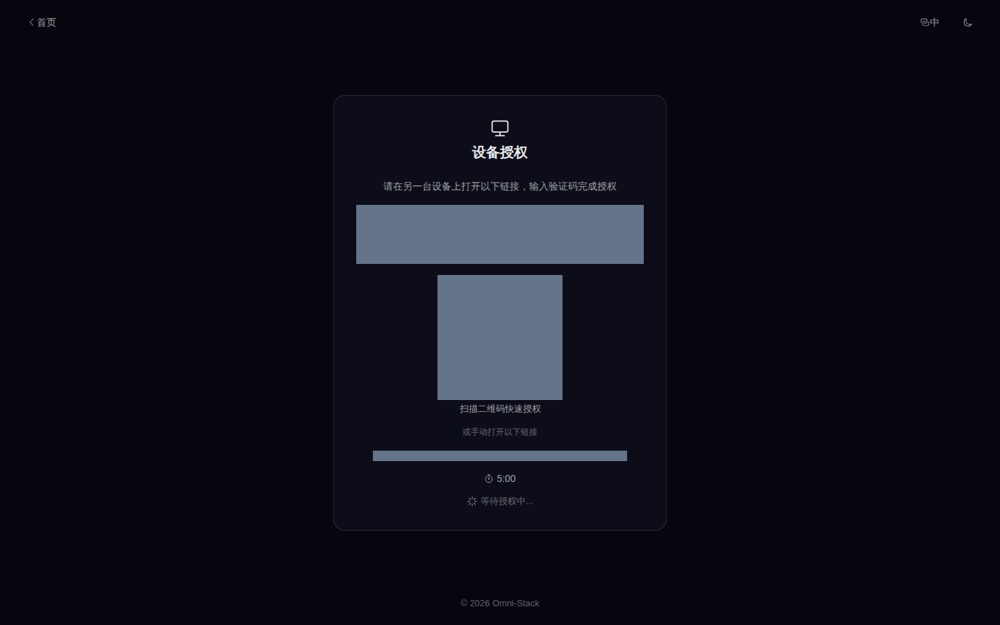
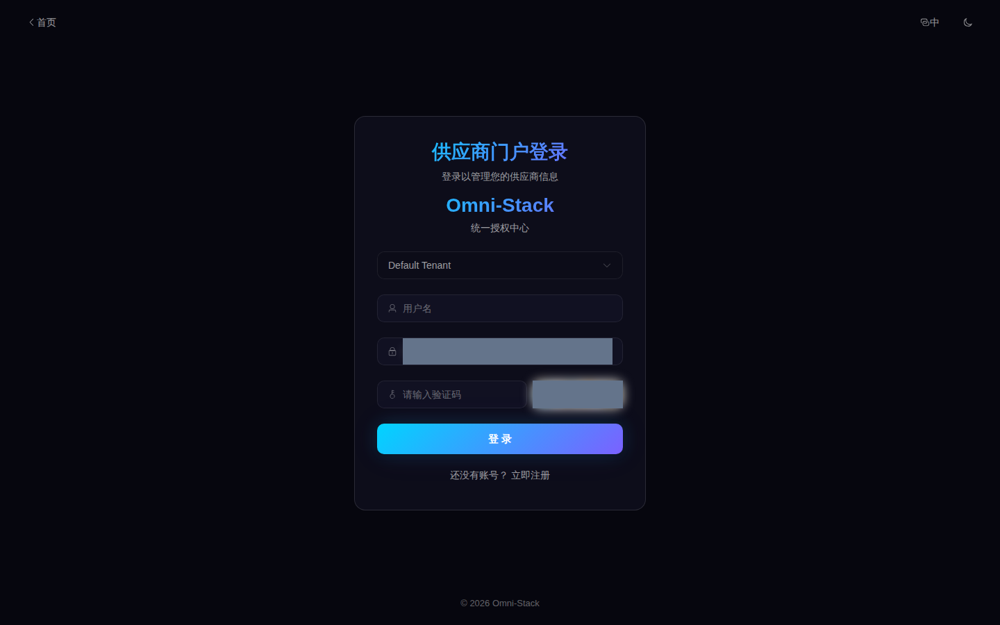
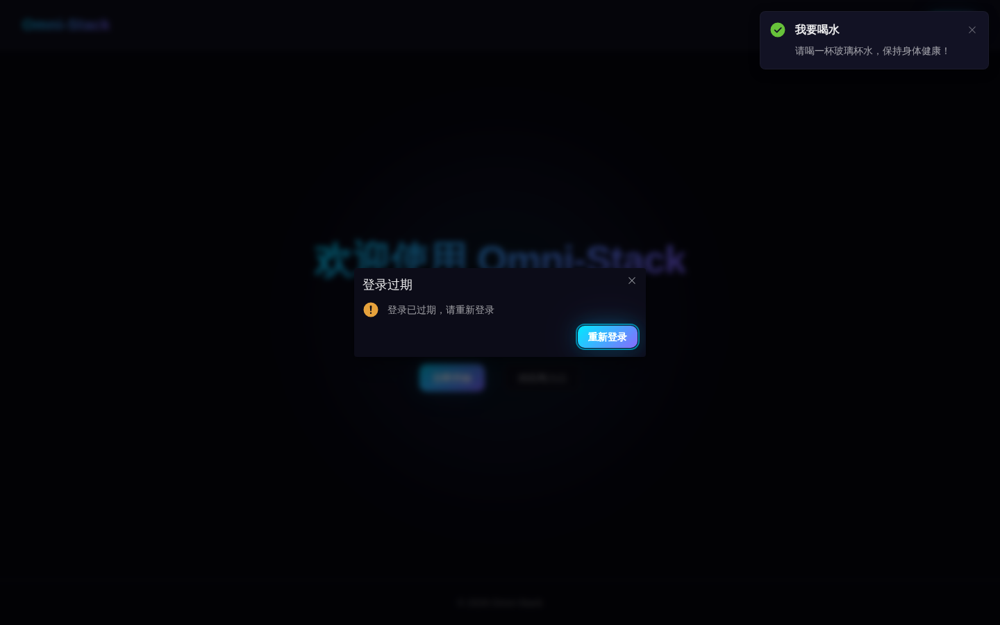

# 登录、验证码、社交登录与租户选择

本节原图来源见[2026-10-12 基础验收](../reference/evidence/basic-2026-10-12.json)：44 个独立检查与 44 张逐张复核原图，保留多次采集的准确源码和镜像身份。页面可读不等于本节所有业务操作已验收；日/韩部分 Status、Phone、Email、Retry 仍是实际英文回退，数据名称沿用教学数据。

适用角色：最终用户、租户管理员、身份系统维护者。

## 1. 登录入口与租户

管理端和普通用户使用 `/login`，供应商可以使用 `/portal-login`。账号名只在租户内唯一，因此密码登录必须先选择租户。后端以租户 ID、用户名和登录方式共同建立认证上下文。

租户列表来自公开只读接口；它只返回登录所需的最小信息。客户端不得自行构造或信任业务请求中的租户范围，登录后的租户身份以签发令牌和 Gateway 可信身份头为准。

## 2. 密码与 CAPTCHA

密码登录步骤：

1. 请求 `GET /api/auth/captcha`。
2. 展示 `captchaImage`，在内存中保留对应 `captchaKey`。
3. 用户输入租户、用户名、密码和 `captchaCode`。
4. 调用 `POST /api/auth/login`。
5. 登录成功后立即丢弃密码、验证码答案和验证码 Key。

安全约束：

- CAPTCHA 一次性使用，不能缓存答案或复用 Key。
- 前端、日志、截图和测试报告不得记录密码、验证码答案或访问令牌。
- 自动化登录使用受信任环境注入的短期令牌，或由测试人员处理真实验证码；不能破解、关闭或绕过生产 CAPTCHA。
- 登录失败只显示可操作的业务信息，不区分“账号存在但密码错误”等会帮助枚举账号的细节。

## 3. 自助注册

`POST /api/auth/register` 是公开接口，但必须同时校验租户、CAPTCHA、用户名租户内唯一性和密码规则。所有用户创建路径都会尝试分配默认 `USER` 角色；角色分配异常会记录告警，但不能留下无法登录的半成品事务。

供应商自助注册只创建认证账号。注册后还需要通过供应商邀请令牌完成 Portal 入驻，获得 `SUPPLIER` 角色和有效的 Portal 关联后，才能访问企业资料、评估与报价功能。

## 4. 社交登录

系统支持 GitHub、Google 和 Gitee 社交登录。它与“Omni-Stack 自身作为授权服务器、SPA 作为公开客户端”的本地 OAuth2 授权码 + PKCE 流程是**两条不同的链路，不可混淆**：

**外部社交登录（后端主导）：**

1. 后端 `SocialLoginController` 生成携带租户信息的 `state`（服务端 HMAC 签名）并 302 跳转到外部身份提供商授权页。
2. 提供商回调到 `/api/auth/oauth2/{provider}/callback`，后端校验 `state` 后由 `SocialLoginServiceImpl` **在服务端**用授权码向提供商交换访问令牌并拉取用户资料（前端不接触提供商 `client_secret`，也不生成 PKCE）。
3. 首次登录以提供商前缀生成本地用户名（`gh_`、`go_`、`ge_`），冲突时 fallback。
4. 用户回到原受保护页面或与角色匹配的工作台。

**本地 OAuth2 PKCE（另一套流程）：** 前端 `buildAuthorizeUrl` 生成 `code_verifier`/`code_challenge` 并重定向到 `/oauth2/authorize`，回调后用 `code_verifier` 向 `/oauth2/token` 交换令牌。该 PKCE/`state` 归属本地授权服务器与 SPA 客户端，与上述外部社交登录的 `state`/回调处理分属不同实现。

回调地址、客户端密钥和允许的来源必须通过环境配置提供。生产环境不得使用仓库中的开发客户端配置。

### 本地应用配置与工具验收

先在被 Git 忽略的 `.env` 或仓库外私有环境文件中填写下列变量；只填写自己的应用凭据，不将真实值写入 Wiki。

| 提供方 | Client ID | Client Secret |
|---|---|---|
| GitHub | `GITHUB_CLIENT_ID` | `GITHUB_CLIENT_SECRET` |
| Google | `GOOGLE_CLIENT_ID` | `GOOGLE_CLIENT_SECRET` |
| Gitee | `GITEE_CLIENT_ID` | `GITEE_CLIENT_SECRET` |

Compose 当前直接设置三个 `AUTH_OAUTH2_*_REDIRECT_URI` 为 localhost:8102 的网关回调。仅在 `.env` 增加同名键不会覆盖这三个固定环境值；更换域名或改用 127.0.0.1 时，应使用仓库外的 Compose override 覆盖 `omni-auth.environment`，并在提供方登记完全一致的 URI。`AUTH_OAUTH2_FRONTEND_CALLBACK_URL` 应与浏览器访问的前端地址一致，例如 `http://localhost:3000/callback`。不要将应用 Client Secret 填入平台账号的登录表单。

当前 `OAuth2StateUtils` 校验 HMAC 和 10 分钟时间窗口，没有保存或原子消费一次性 nonce。本轮重复有效 state 仍进入提供方换码分支，因此这些负例不能证明 state 单次消费。

[2026-10-13 本地工具验收](../reference/evidence/oauth-local-2026-10-13.json)记录三家真实授权页、配置绑定和回调拒绝分支。官方登录页 HTTP 200、无效授权码被拒绝，均不等于用户授权、成功换码或本地社交账号登录已完成。

### 外部 OAuth 截图待补充

GitHub、Google、Gitee 的二次登录校验需要账号持有人操作。本轮按项目所有者决定暂缓采集，分别保留下列待补充区域。当前尚未验证这三家真实用户授权后的成功回调、换码和本地登录；截图占位不代表验证通过。

#### GitHub

> **待补充截图**：GitHub 二次登录校验、授权确认，以及返回本系统后的登录结果。

#### Google

> **待补充截图**：Google 二次登录校验、授权确认，以及返回本系统后的登录结果。

#### Gitee

> **待补充截图**：Gitee 二次登录校验、授权确认，以及返回本系统后的登录结果。

后续在本机 Docker 浏览器中真实完成校验与授权后，以脱敏原图替换对应区域，并在截图清单中登记语言、角色、租户、来源版本和实际验证范围。不要截入密码、验证码、令牌、Cookie 或个人账号信息。本次仅暂缓上述三家外部流程的截图；密码 CAPTCHA、本地 PKCE、设备码和 SRM 注册仍按各自范围验收。

## 5. 设备码授权

设备端通过 `/device` 申请设备码并展示用户码与二维码；用户在 `/device/verify` 登录并确认授权。设备端只轮询令牌端点，不处理用户密码。用户码过期、拒绝或已消费后，设备必须重新发起流程。

设备码流程适合无键盘设备，不应被当作绕过 CAPTCHA 的通用登录入口。

### 操作截图

#### 图 1 `auth-login-zh-CN`：登录入口

- 前置条件：无需登录，公开访问
- 操作者：任意用户
- 操作：打开 `/login`
- 预期结果：显示租户、用户名、密码、验证码（已遮罩）和登录方式

#### 图 2 `auth-register-zh-CN`：自助注册

- 前置条件：无需登录
- 操作者：新用户
- 操作：从登录页进入注册页
- 预期结果：显示用户名、密码、确认密码与验证码输入

#### 图 3 `auth-device-code-zh-CN`：设备码授权

- 前置条件：无浏览器的设备发起 OAuth2 设备授权流程
- 操作者：设备使用者
- 操作：打开 `/device` 获取用户码后到 `/device/verify` 输入
- 预期结果：真实设备授权接口成功后显示用户码、二维码、服务端有效期对应的实时倒计时与确认入口；公开截图遮罩当前有效的码和链接

#### 图 4 `supplier-portal-login-zh-CN`：供应商门户登录

- 前置条件：无需登录，公开访问
- 操作者：供应商用户
- 操作：打开供应商门户登录页
- 预期结果：显示门户登录表单与注册入口

#### 图 5 `session-expired-dialog-zh-CN`：会话过期对话框

- 前置条件：已登录；测试进程内对业务接口注入确定性 401 故障（真实使用中为 Token 过期）
- 操作者：已登录用户
- 操作：业务接口返回 401 时，应用弹出过期对话框
- 预期结果：弹出「登录过期」对话框（本地化标题 + 重新登录按钮），确认后携带 redirect 参数跳转登录页；不泄露内部异常

## 6. 登录状态失效

访问令牌失效或权限变化时：

- API 客户端清理本地认证状态。
- 管理端返回登录页，并保留经过安全校验的站内重定向地址。
- 不允许 `javascript:`、跨域 URL 或协议相对地址作为登录后跳转目标。
- 菜单重新加载失败时显示可重试错误页，不持续无限请求。

## 7. 排查顺序

1. 确认选择了正确租户。
2. 刷新 CAPTCHA 后重新输入。
3. 查看 Auth 登录日志，不在 `omni-auth` 使用操作日志代替登录日志。
4. 外部社交登录检查回调 URI、服务端 HMAC 签名的 `state` 和 provider 客户端配置（`client_id`/`client_secret`/允许的来源）；该链路不生成也不校验 PKCE。前端 PKCE（`code_verifier`/`code_challenge`）属于本地 `/oauth2/authorize` + `/oauth2/token` 的 SPA 流程，需单独排查。
5. Portal 用户检查 `SUPPLIER` 角色及 `srm_supplier_portal_user` 关联。

完整协议和错误格式见 [API 契约](../api-contract.md)，端到端认证流见 [核心流程](../core-flows.md)。

## 8. Docker 回调与实际验收边界

1. 第三方 OAuth 应用的允许回调应与 `compose.apps.yaml` 的 `AUTH_OAUTH2_GITHUB_REDIRECT_URI`、`AUTH_OAUTH2_GOOGLE_REDIRECT_URI`、`AUTH_OAUTH2_GITEE_REDIRECT_URI` 完全一致。本地默认进入 Gateway `http://localhost:8102/api/auth/oauth2/{provider}/callback`；生产换为浏览器可达的 HTTPS 域名。容器内部的 `omni-auth:8080` 不能作为外部回调。
2. 成功回到前端 `/callback` 后由 Vue Router 消费认证结果；失败回到登录页。Nginx 对站内路由回退到 `index.html`，`/api/*` 和 `/oauth2/*` 转发 Gateway，再通过服务发现到 Auth。令牌片段、Cookie、客户端秘密和有效验证码不能进入截图或公开日志。
3. 验证码不显示先看 Auth 到 Redis 的连接；失败或过期应刷新后请人重新输入，不能重放旧码。密码失败时核对租户；真实 401 则核对 Gateway 到 `/oauth2/jwks`、签名、有效期和当前会话。账户限流与会话失效分别排查。
4. `state` 失败核对服务端签名秘密与回调参数；提供方超时核对容器出站网络和配置代理；自动建号冲突跟进 `gh_`/`go_`/`ge_` 的备用命名。外部 provider 换码与本地 PKCE 换码使用不同配置。
5. [真实登录记录](../reference/evidence/human-login-2026-10-09.json)证明一次人工 CAPTCHA 密码登录。注册页、设备码初始化、Portal 入口和会话错误截图各有独立范围；测试身份、客户端注入 401、未配置的外部提供方和页面访问均不能证明注册成功、设备授权完成或外部社交登录完整成功。
