# CRM: From Your First Lead to Closing and Reopening

This guide applies to the current delivery tree, with backend version `1.0.0-SNAPSHOT` and presets `crm` or `full`. Images and business results date from 2026-10-10. Use ordinary sales roles in one tenant.

This stage checks current source, the four documents, and historical originals. It does not repeat business creation, conversion, follow-up, win/loss, reopening, or deletion. Readers must perform the tutorial's login step themselves; the historical browser tests use short-lived ordinary-sales identity fixtures and do not prove real CAPTCHA login.

## 1. Prepare the Environment, Accounts, and Data

Complete [clone and startup](quick-start.en.md), start the preset in local Docker, and sign in with the real CAPTCHA. A super administrator's unrestricted results do not validate salesperson permissions.

| Account | Role and data scope | Purpose |
| --- | --- | --- |
| Sales A | `USER + SALES_REP`, `SELF` | Create and advance owned records |
| Sales manager | `USER + SALES_MANAGER`, `DEPT_AND_BELOW` | Read the department and its descendants |
| Sales B | `USER + SALES_REP`, `SELF`, a different owner from A | Verify functional access without record visibility |

An administrator creates the accounts and organizations and assigns roles in an isolated practice environment. `USER` alone has no CRM permissions. See [data initialization](../wiki/data-and-fixtures.en.md) for seed locations and supported initialization. Do not directly insert business rows to bypass state rules.

Choose a unique prefix such as `CRM-20261010-A` for names, companies, activity subjects, and opportunities; use `example.com` email addresses. Record actual lead, customer, contact, and opportunity IDs. Business numbers are not necessarily database IDs. Inspect the record's API response in the browser network panel for its ID or `version`; do not copy or publish tokens.

The step images use `WIKI-20261009A-UI-locale`, with a separate record set per locale. The 360, reopen, and out-of-scope images use the preceding `WIKI-20261009A` scenario. Do not mix IDs between these runs. Choose your own unique prefix when practicing.

```text
NEW lead → Create planned activity → Complete activity → FOLLOWING
→ Qualify: QUALIFIED → Convert: CONVERTED
→ Customer + Contact + optional OPEN Opportunity → Advance stage → WON / LOST
```

## 2. Create a Lead and Complete a Follow-up

1. Sign in as Sales A, open CRM → Lead Management, and create a lead.
2. Enter a unique contact name and company, adding a source, phone, and sample email as needed. Check duplicate candidates, save, and verify `NEW`.
3. Create an activity in Activity Management. Select root `LEAD`, enter the actual lead ID, choose a dictionary type such as a call, enter a unique subject, select `PLANNED`, and set its planned time.
4. Save and refresh the lead. Planning alone leaves it `NEW`; qualification or conversion now is rejected.
5. Complete this activity, entering its actual completion time and an optional next-action time. Verify `COMPLETED`, refresh the lead, and verify `FOLLOWING`.
6. Qualify through the lead action menu. Verify `QUALIFIED` before conversion. Reread the latest `version` after each command.

Activity timestamps use `yyyy-MM-dd HH:mm:ss`. Roots are `LEAD`, `CUSTOMER`, and `OPPORTUNITY`; a contact is an optional association, not a `CONTACT` root.

Check these five interaction points in order. The planned-result image shows the activity's planned state; the lead remaining `NEW` is a live API assertion at that point. Enter the actual completion time rather than copying the screenshot date.

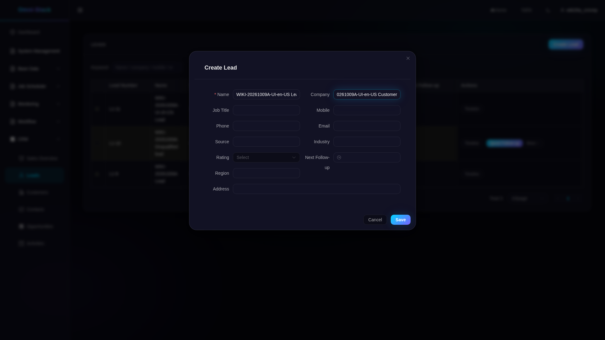

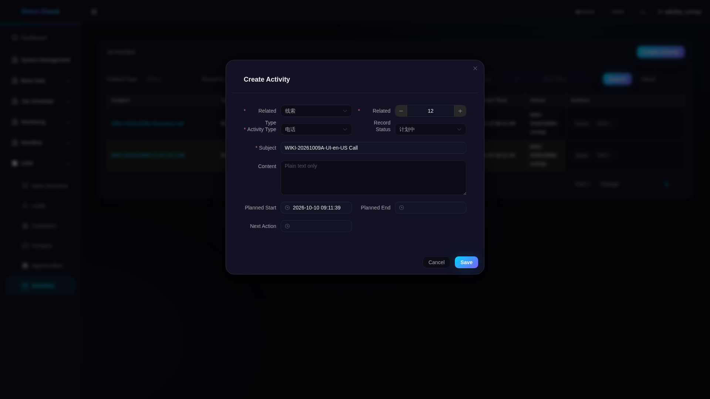

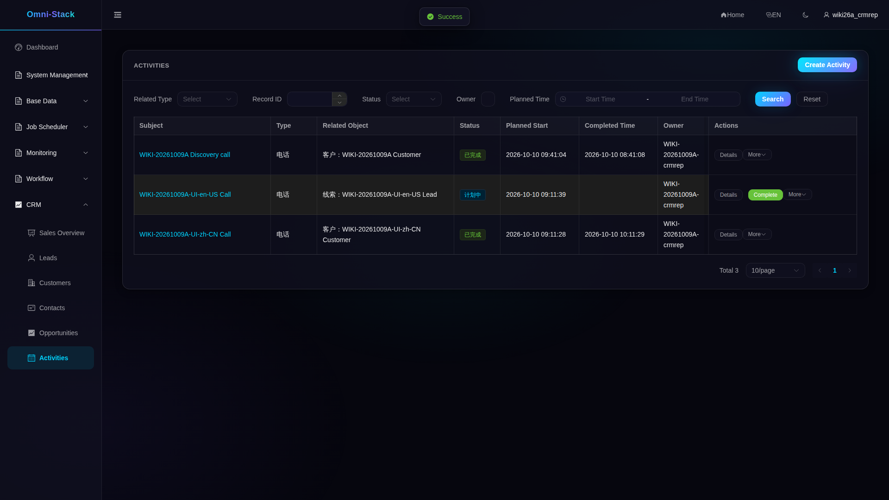

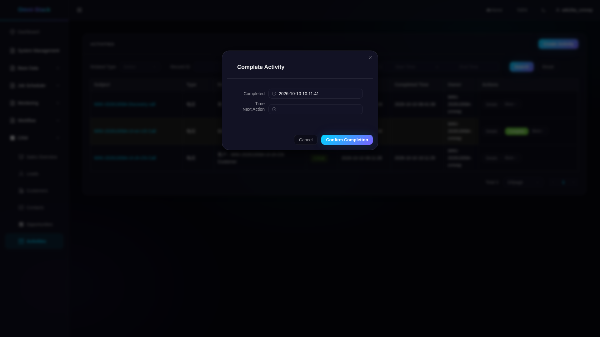

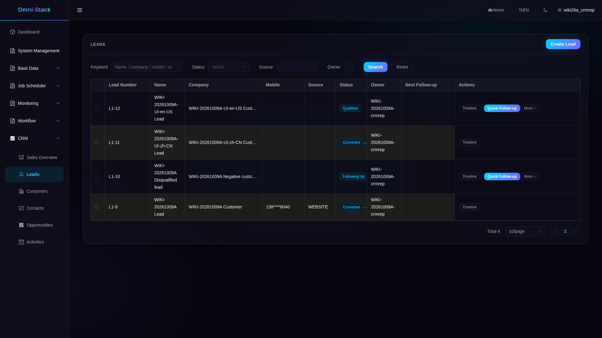

The historical result below is from after conversion, when the completed activity's root has moved to `CUSTOMER`.

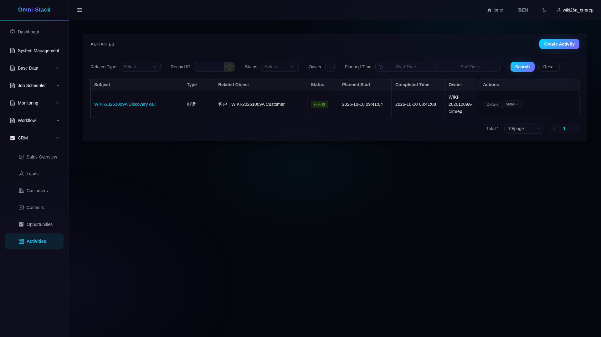

## 3. Convert with the Customer, Contact, and Opportunity Wizard

1. Select Convert on the `QUALIFIED` lead. Choose Create Customer in step one and enter a name with the prefix.
2. Choose Create Contact in step two and check its name and details. It belongs to this customer and becomes its primary contact.
3. Enable opportunity creation in step three. Enter a unique name, amount `12500`, and expected close date. This field is a date, not a timestamp.
4. Check all choices on the confirmation step and submit. Verify `CONVERTED` and retain the returned IDs.
5. Check the actual relationships in the customer and contact lists. The customer starts `POTENTIAL`; the opportunity starts `OPEN` at `DISCOVERY`.

A linked customer must be visible to the current account; a linked contact must belong to that customer. An editable ID does not authorize cross-customer associations.

Conversion creates or links records, migrates activities, and writes a reliable message in one local transaction. Repeating conversion for the same converted lead returns the same IDs with `idempotentReplay=true`, without another customer set. After a timeout, inspect the lead and existing conversion before repeating a creation request.

Create the customer in step one and contact in step two. Enable the opportunity and check its amount/date in step three, then verify relationships in step four. An unsubmitted form alone does not prove creation; the following success message and state correspond to live API responses.

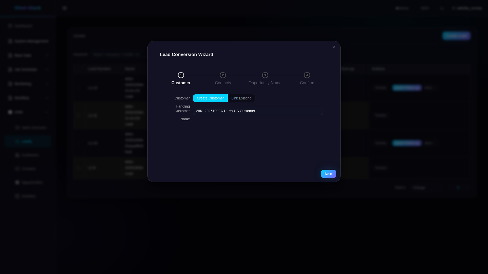

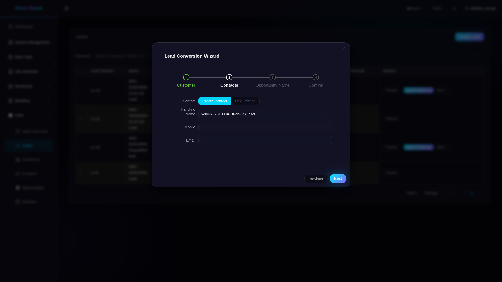

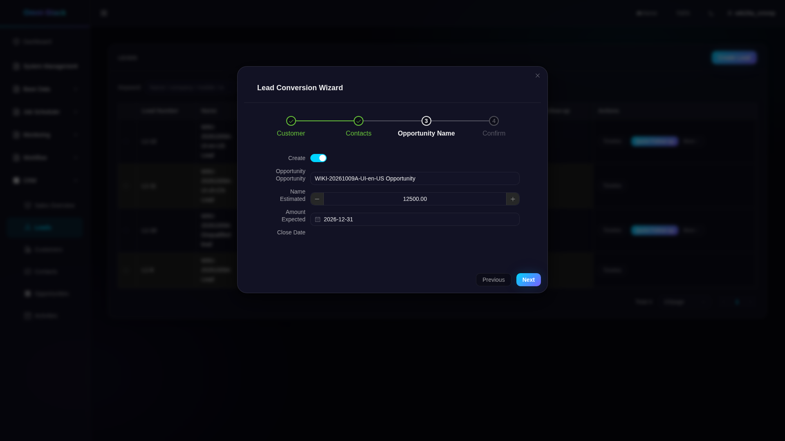

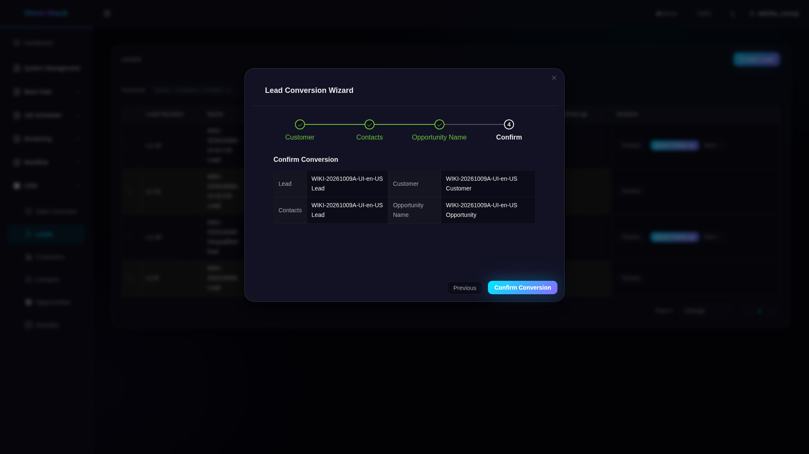

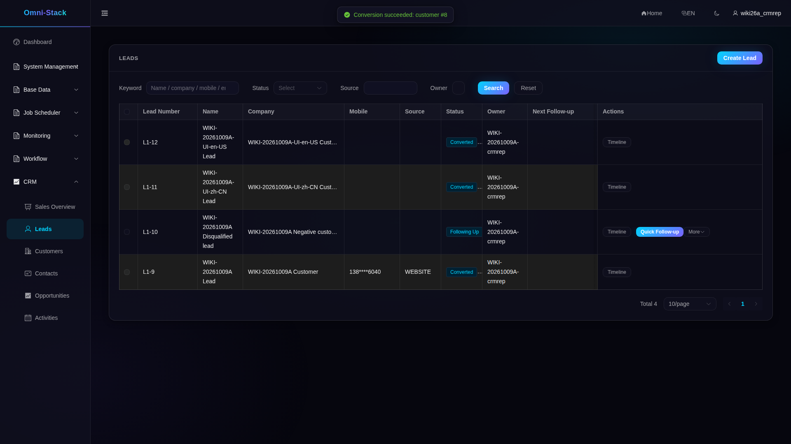

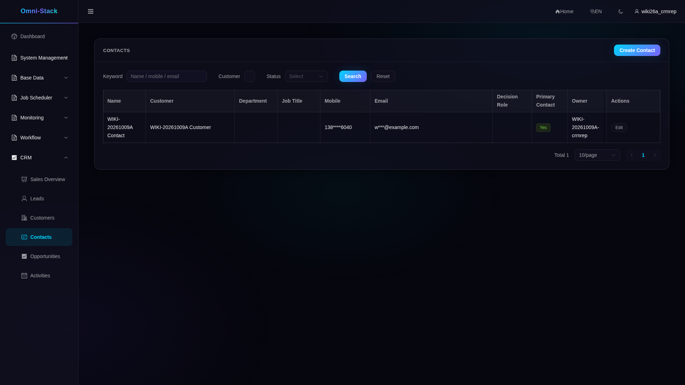

## 4. Customer 360 and Winning

1. Open the new customer's 360 view; check its profile, contacts, opportunities, and recent activities.
2. Verify migrated lead activities and the link to the source lead.
3. Find the `12500` opportunity and move its open stage from `DISCOVERY` to `PROPOSAL`. Moving backward requires a reason.
4. Win it and refresh to verify `WON`; the customer changes from `POTENTIAL` to `ACTIVE`.
5. Reopen Customer 360. Its open-opportunity block requests `status=OPEN`: the won record disappears and a later reopened opportunity appears.

Each block checks its own list permission and data scope. Customer detail access does not grant every contact, opportunity, or activity. Phone, email, and activity content may be masked by sensitive-data permissions.

Choose `PROPOSAL`, displayed as “方案报价”, in the stage form. Stage names come from the server dictionary. Submit it before winning; opening a form does not update the state.

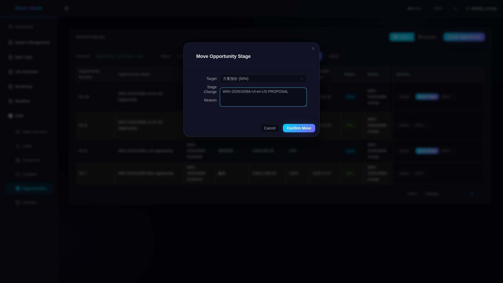

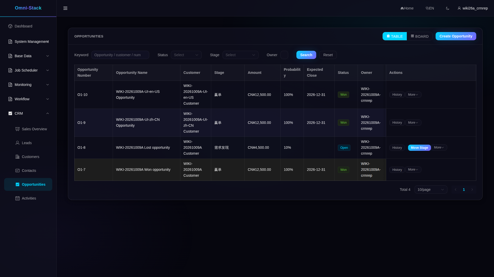

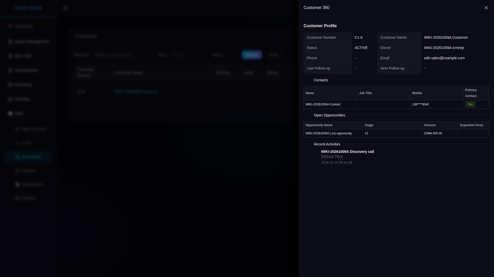

`Lost opportunity` is the second opportunity's historical name; its current state is reopened `OPEN`. The stage uses fallback `#1` and activity content is masked. This image does not prove resolved stage names or unmasked sensitive data.

## 5. Losing, Reopening, and Disqualified Leads

Create a second unique opportunity for the same customer, amount `4500`, at `DISCOVERY`. Try losing without a reason: validation must reject it without a change. Supply a clear reason, lose, and verify `LOST`.

Use the dedicated Reopen action. Verify `OPEN` and the last open stage before closure, `DISCOVERY` in this run. Check history `CREATE → LOST → REOPEN`. `WON` and `LOST` are closed states; ordinary editing cannot set them back to open.

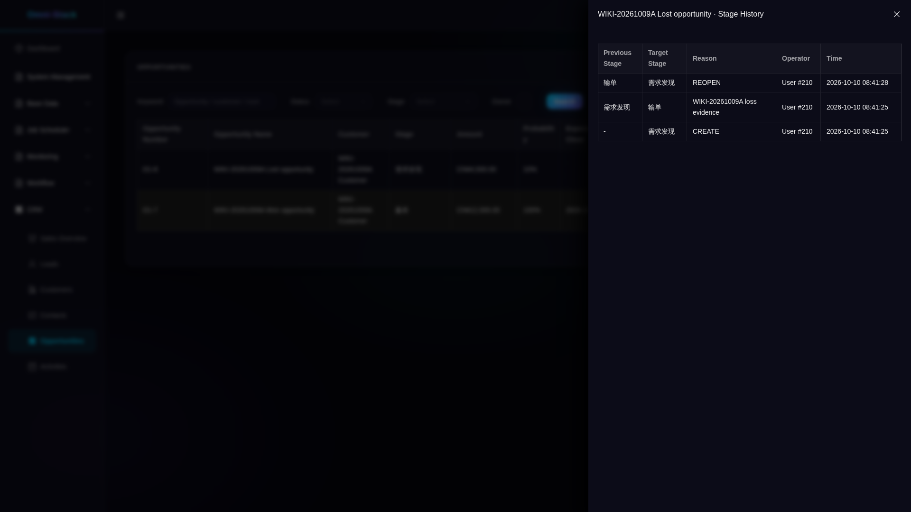

Create another unconverted lead, disqualify with a reason, then reopen it. Expect `DISQUALIFIED → FOLLOWING`, not `NEW`; do not use a converted lead for this branch.

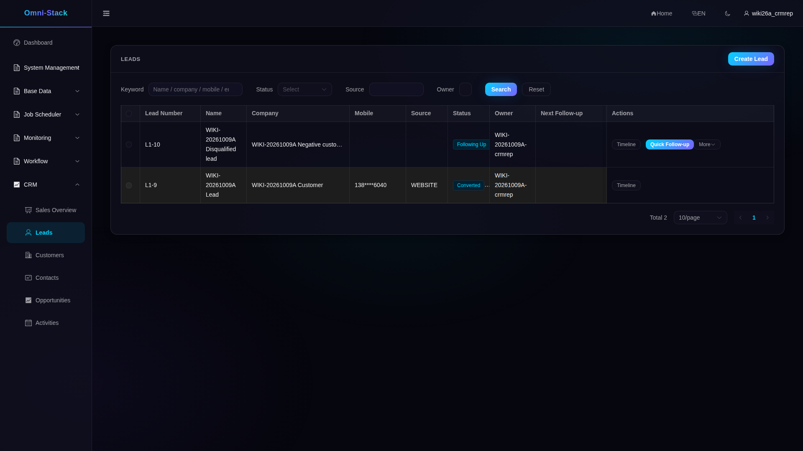

## 6. Access, Failure Recovery, and Cleanup

Sales A can read/write owned records. The manager can read A's records when organizational scope includes them. Sales B has the same functional rights but an empty list for the practice prefix; direct reads/writes to A's records return business `R.code=404`. Also test an account without CRM functional rights: denial differs from an authorized account with no visible records.

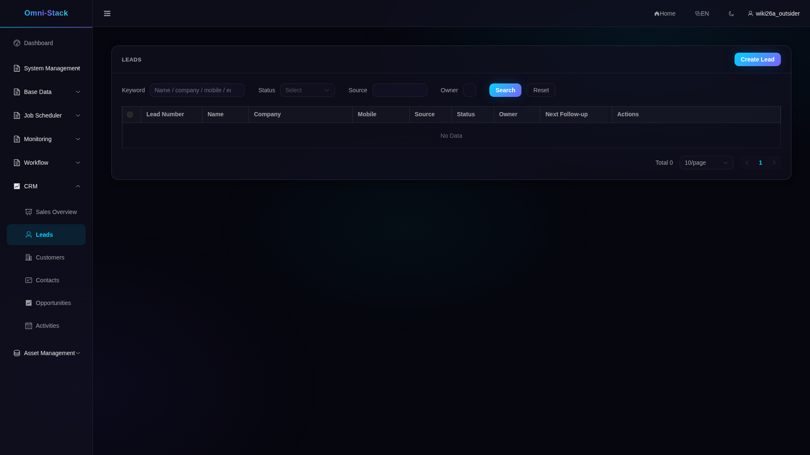

APIs return `R<T>`. Record HTTP status, `R.code`, path, and trace ID; HTTP 200 alone does not mean business success.

| Business code | Meaning | Recovery |
| --- | --- | --- |
| `401` | Unauthenticated or missing tenant context | Sign in and check trusted gateway context |
| `403` | Missing functional permission | Have an administrator check role permissions; refresh the session |
| `404` | Missing record or outside data scope | Check tenant, owner, and organization; do not bypass scope |
| `409` | Stale version or forbidden state | Reread details/version and use the right command |
| `400` | Missing reason or invalid association | Supply the reason or correct the relationship |
| `503` | Permission dependency unavailable; access fails closed | Restore it before retrying; never use an unrestricted fallback |

The 2026-10-10 run also verified rejection of customer deletion with an open opportunity and deletion of closed opportunities. Cancel planned activities through supported commands. Keep converted/closed records under the prefix as audit history; do not force-delete with SQL. Resetting everything requires a separately created environment confirmed safe to destroy.

## 7. Source Breakpoints and Reproduction

Set breakpoints in a Docker debugging environment and observe one command using recorded IDs. Do not replay successful creations.

| Unit | Inspect |
| --- | --- |
| [ActivityServiceImpl.touchCompletedRoot](../../omni-backend/omni-crm/src/main/java/com/omni/crm/service/impl/ActivityServiceImpl.java) | `rootType/rootId`, completion, and NEW → FOLLOWING conditions |
| [LeadServiceImpl.qualify / convert](../../omni-backend/omni-crm/src/main/java/com/omni/crm/service/impl/LeadServiceImpl.java) | Row lock, existing conversion, state/`version`, relationships, activity migration, rollback |
| [OpportunityServiceImpl](../../omni-backend/omni-crm/src/main/java/com/omni/crm/service/impl/OpportunityServiceImpl.java) | Close/reopen, last open stage, reasons, history |
| [CrmRecordAccessGuard](../../omni-backend/omni-crm/src/main/java/com/omni/crm/service/support/CrmRecordAccessGuard.java) | Tenant, user, scope, and rejection of invisible records before access |
| [CustomerOverview.vue](../../omni-frontend/src/components/crm/CustomerOverview.vue) | Block permissions, `status: 'OPEN'`, response mapping |

The four-step wizard is in the [lead page](../../omni-frontend/src/views/crm/lead/index.vue). Follow `submitConversion` to backend `convert`. Replay checks an existing result first, so a successful conversion replay is an exception to the general stale-version `409` rule.

Read [LeadServiceImplTest](../../omni-backend/omni-crm/src/test/java/com/omni/crm/service/impl/LeadServiceImplTest.java), [ActivityServiceImplTest](../../omni-backend/omni-crm/src/test/java/com/omni/crm/service/impl/ActivityServiceImplTest.java), and [OpportunityServiceImplTest](../../omni-backend/omni-crm/src/test/java/com/omni/crm/service/impl/OpportunityServiceImplTest.java) for individual conditions. Run apps/tests in Docker; see [scaffold development](scaffold-development.en.md) for debugging and ports.

## 8. Evidence Boundaries

The real API scenario on 2026-10-10 covered completed follow-up, qualification, conversion/replay, win/loss/reopen, version conflicts, and owner scope. All 32 subsequent four-locale read-only browser tests passed with no skips. A separate UI journey had 4 passes, 0 failures, and 0 skips: each locale created a lead, planned/completed an activity, qualified, converted through four steps, advanced, and won, producing 48 step images. Historical visual inspection of both batches, 80 images, used 8 read-only and 12 UI four-locale contact sheets, 20 original-resolution sheets in total.

The current [document and image audit](../reference/evidence/crm-guide-review-2026-10-17.json) matches paths, locales, and hashes for the 72 images used in this guide and individually views 20 selected raw originals. The other 52 retain historical visual records; this stage did not individually re-view or recapture every image.

See [CRM UI acceptance](../../omni-frontend/e2e-docs/flows/crm-teaching-ui.flows.spec.ts) and [CRM read-only acceptance](../../omni-frontend/e2e-docs/flows/crm-teaching.flows.spec.ts). The UI test permits only its owned isolated Docker project. Successful records remain as business history; inspect the mutation journal after interruption instead of blindly replaying writes.

Images preserve actual text: some dictionaries, stages, and stored remarks remain Chinese; some labels clip or wrap over several lines and operators use fallback `User#210`. Lists contain earlier practice records; identify the current row by its prefix. The won image shows state, amount, and probability; separate API assertions verify customer `ACTIVE` and activity migration. See [CRM evidence](../reference/evidence/crm-2026-10-10.json) for images, runtime IDs, source digests, and per-image limits.

Historical evidence used a documented cached Nginx build after registry DNS/authentication failure for the formal base image. It does not prove a successful formal production-image build. Keep original runtime versions and failures; do not replace them with current source hashes or treat domain results as proof of CAPTCHA, external OAuth, concurrency, or completed message consumption.

Four-language documents follow the [authorized AI review policy](../adr/0003-authorized-ai-translation-review.md): actual `AI_REVIEW` suffices, without mandatory human review or a false `HUMAN_REVIEW` label. See the [review queue](../i18n-review-queue.md) for current valid hashes and status.

The [CRM facts](../crm.en.md) and [design](../design/crm-design.en.md) define state machines, security, and extension constraints.
