# CRM：最初のリードから受注・再開まで

現在の成果物ツリーを対象とし、後端バージョンは `1.0.0-SNAPSHOT`、プリセットは `crm` または `full` です。画像と業務結果は2026-10-10の記録です。同一テナントの一般営業ロールを使います。

今回は現在のソース、四言語文書、過去の原画像を確認し、作成・変換・フォロー・受注/失注・再開・削除を再実行していません。教材のログインは読者が実際に行います。過去のブラウザーテストは一般営業の短期識別フィクスチャを使い、実CAPTCHAログインを証明しません。

## 1. 環境・アカウント・データの準備

[取得と起動](quick-start.jp.md)を完了し、ローカル Docker でプリセットを起動して、実際の CAPTCHA でログインします。スーパー管理者の全件表示では営業担当者の権限を検証できません。

| アカウント | ロールとデータ範囲 | 用途 |
| --- | --- | --- |
| 営業 A | `USER + SALES_REP`、`SELF` | 自分のレコードを作成・処理 |
| 営業マネージャー | `USER + SALES_MANAGER`、`DEPT_AND_BELOW` | 自部署と配下部署を参照 |
| 営業 B | `USER + SALES_REP`、`SELF`、A とは別の担当者 | 機能権限があっても対象レコードは見えないことを確認 |

管理者が隔離した練習環境でアカウントと組織を作成し、ロールを割り当てます。`USER` だけでは CRM 権限はありません。シードの場所と正式な初期化方法は[データ初期化](../wiki/data-and-fixtures.jp.md)を参照してください。状態遷移を迂回する業務行の直接挿入は行いません。

`CRM-20261010-A` のような一意の接頭辞を氏名、会社名、活動件名、商談名に使い、メールには `example.com` を使います。リード、顧客、連絡先、商談の実際の ID を記録します。業務番号が DB の ID と同じとは限りません。ID や `version` はブラウザーのネットワーク画面で対象 API の応答から確認し、トークンはコピー・公開しません。

手順画像は `WIKI-20261009A-UI-言語` を使用し、言語ごとに別のレコードを作成しています。360、再開、範囲外の画像は先行する `WIKI-20261009A` シナリオです。別の実行の ID を混用せず、練習では自分の一意の接頭辞を使います。

```text
NEW リード → 予定活動を作成 → 活動完了 → FOLLOWING
→ 適格判定 QUALIFIED → 変換 CONVERTED
→ 顧客 + 連絡先 + 任意の OPEN 商談 → ステージ変更 → WON / LOST
```

## 2. リードを作成してフォローを完了する

1. 営業 A でログインし、CRM のリード管理から新規作成します。
2. 一意の連絡先氏名と会社名を入力し、必要に応じて流入元、電話、サンプルメールを設定します。重複候補を確認して保存し、`NEW` を確認します。
3. 活動管理で新規活動を作ります。ルートを `LEAD`、関連 ID を実際のリード ID とし、電話などの辞書項目、一意の件名、`PLANNED`、予定時刻を設定します。
4. 保存してリードを更新します。予定作成だけでは `NEW` のままで、適格判定や変換は拒否されます。
5. 活動の完了操作で実際の完了時刻を入力し、必要なら次回アクション時刻を設定します。`COMPLETED` を確認し、リードを再取得して `FOLLOWING` を確認します。
6. リードの操作メニューで適格判定を行い、`QUALIFIED` を確認してから変換します。各コマンド後に最新の `version` を読み直します。

活動時刻は `yyyy-MM-dd HH:mm:ss` 形式です。活動ルートは `LEAD`、`CUSTOMER`、`OPPORTUNITY` のみです。連絡先は任意の関連項目であり、`CONTACT` ルートではありません。

次の五つの操作箇所を順番に確認します。予定結果画像で見えるのは活動の予定状態で、リードが `NEW` のままであることは同時点の API 検証です。完了時刻は画像の日付をコピーせず、実際の操作時刻を入力します。

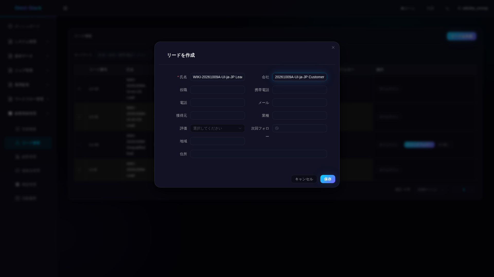

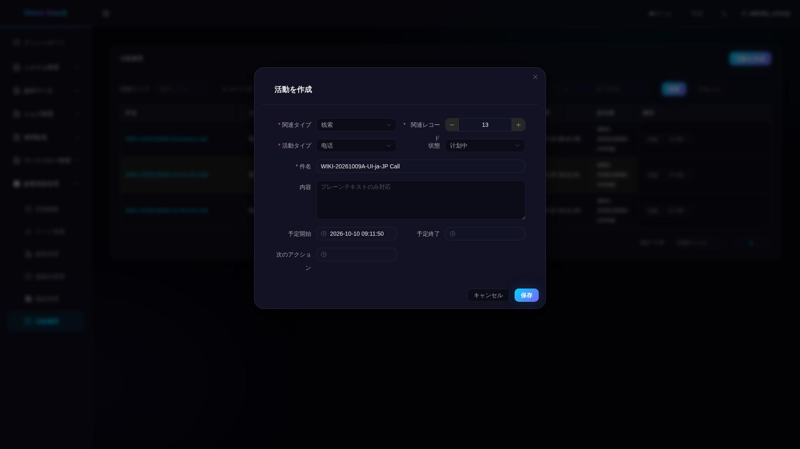

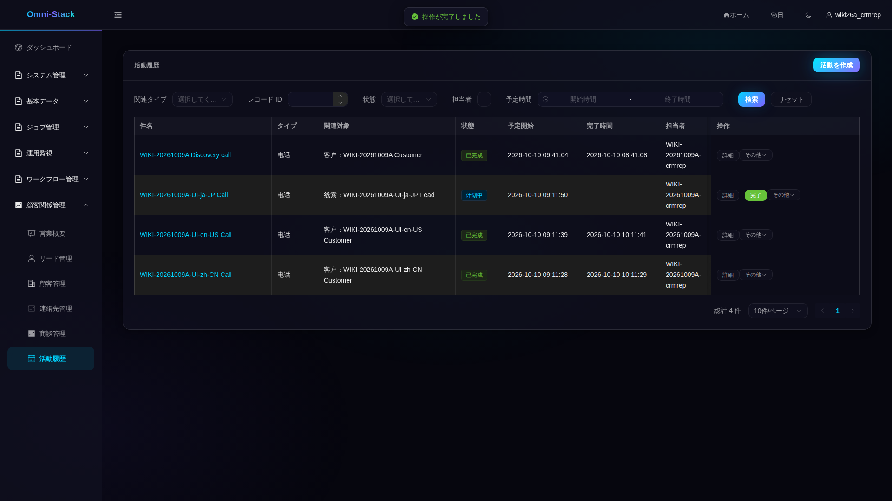

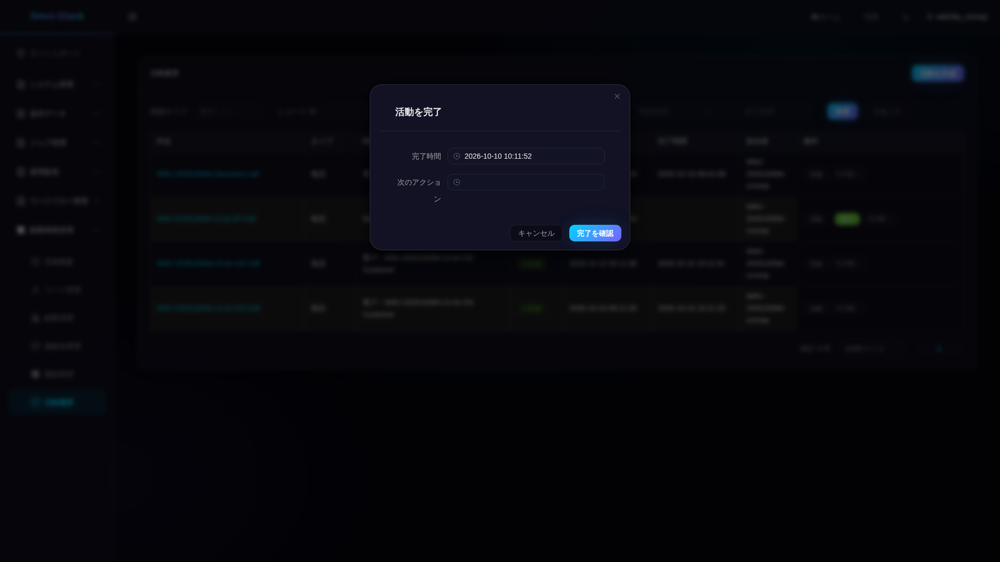

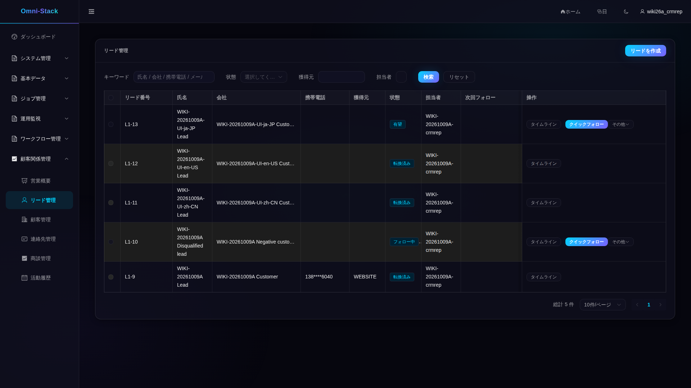

以下の過去の結果画像は変換後で、完了活動のルートは既に `CUSTOMER` に移動しています。

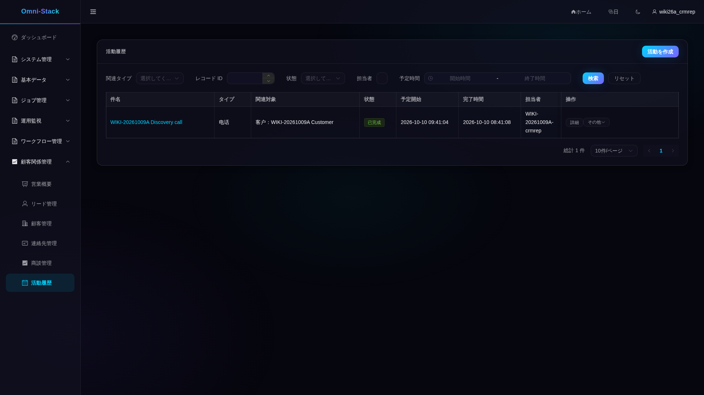

## 3. ウィザードで顧客・連絡先・商談に変換する

1. `QUALIFIED` リードの変換を選び、最初のステップで顧客新規作成と接頭辞付きの顧客名を指定します。
2. 二番目で連絡先新規作成を選び、氏名と連絡情報を確認します。新しい連絡先はこの顧客に属し、主要連絡先になります。
3. 三番目で商談作成を有効にし、一意の名前、金額 `12500`、成約予定日を入力します。この項目は日付であり、時刻は含めません。
4. 確認画面で全選択を確認して送信し、`CONVERTED` と返却された ID を記録します。
5. 顧客・連絡先一覧で実際の関連を確認します。顧客は `POTENTIAL`、商談は `OPEN`、ステージは `DISCOVERY` です。

既存顧客への関連付けには現在のアカウントから見える顧客が必要です。既存連絡先はその顧客に属していなければなりません。ID を入力できても別顧客への関連付けが許可されるわけではありません。

変換は一つのローカルトランザクションでレコードの作成・関連付け、活動移動、信頼性メッセージ書込みを行います。変換済みリードへの再要求は同じ ID と `idempotentReplay=true` を返し、顧客を重複作成しません。タイムアウト時はリードと既存結果を確認してから再要求を判断します。

最初に顧客、次に連絡先を作成し、三番目で商談の金額と予定日を確認して、最後に関係を確認します。未送信フォームだけでは作成成功を証明できません。その後の成功表示と状態は実際の API 応答に対応します。

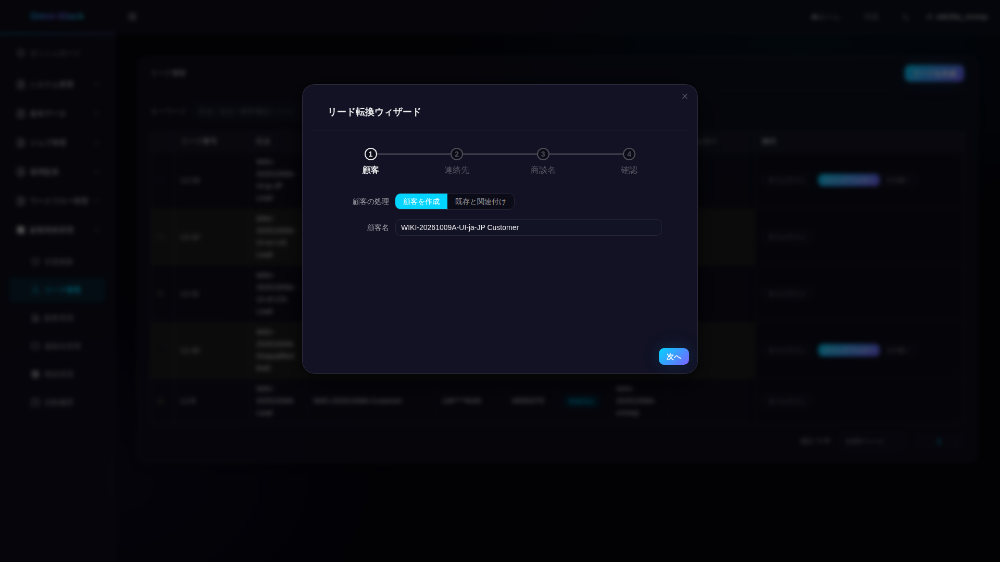

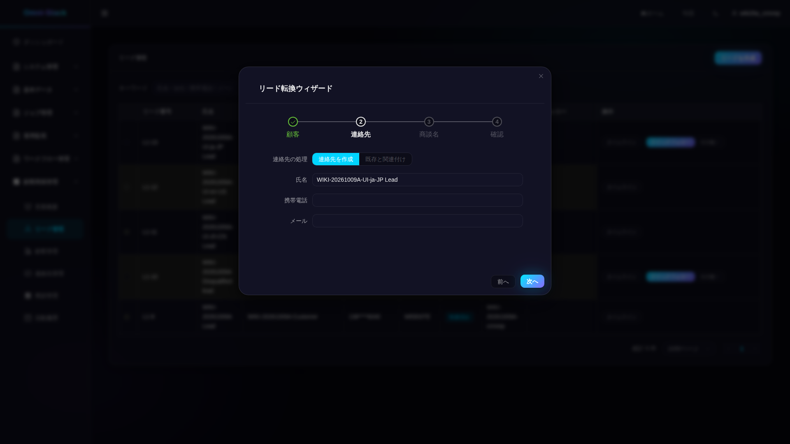

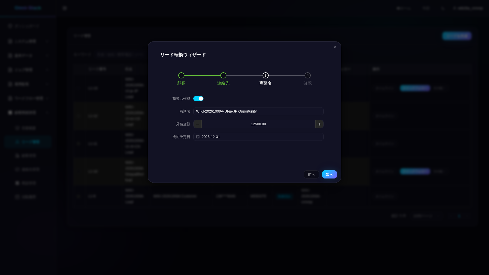

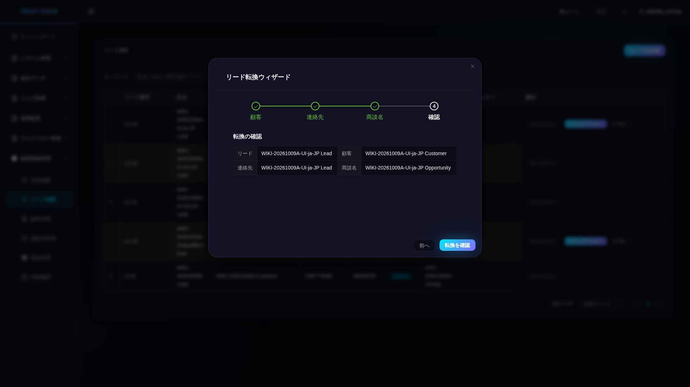

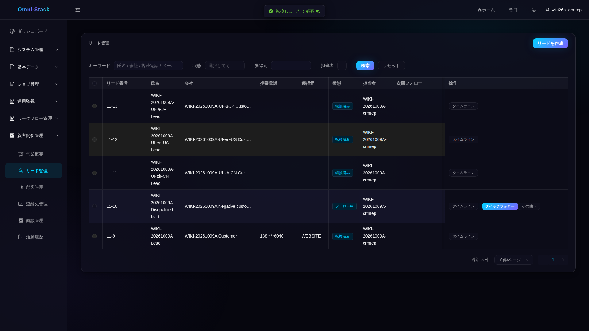

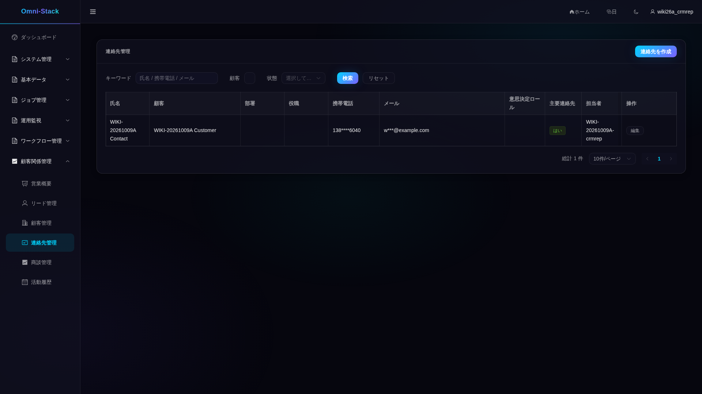

## 4. 顧客 360 と受注

1. 新規顧客の 360 画面で基本情報、連絡先、商談、最近の活動を確認します。
2. リード活動の移動と変換元リードへの追跡を確認します。
3. 金額 `12500` の商談を見つけ、開いているステージを `DISCOVERY` から `PROPOSAL` に進めます。前のステージへ戻す場合は理由が必要です。
4. 受注操作後に再取得して `WON` を確認します。顧客は `POTENTIAL` から `ACTIVE` に変わります。
5. 顧客 360 を再表示します。進行中商談欄は `status=OPEN` のみを取得するため、受注済み商談は消え、後から再開した商談は表示されます。

各欄はそれぞれの一覧権限とデータ範囲を確認します。顧客詳細を見られても、全連絡先・商談・活動を見られるとは限りません。電話、メール、活動内容は機密情報権限に応じてマスクされます。

ステージ画面で `PROPOSAL` に対応する「方案报价」を選びます。名称はサーバーの辞書から取得します。送信後に受注を実行します。フォームを開くだけでは状態は変わりません。

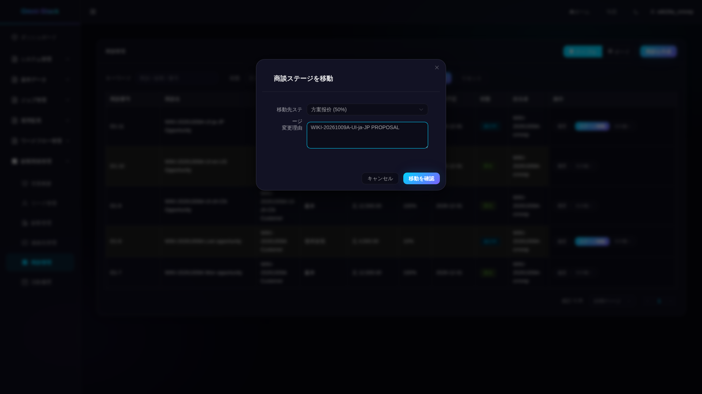

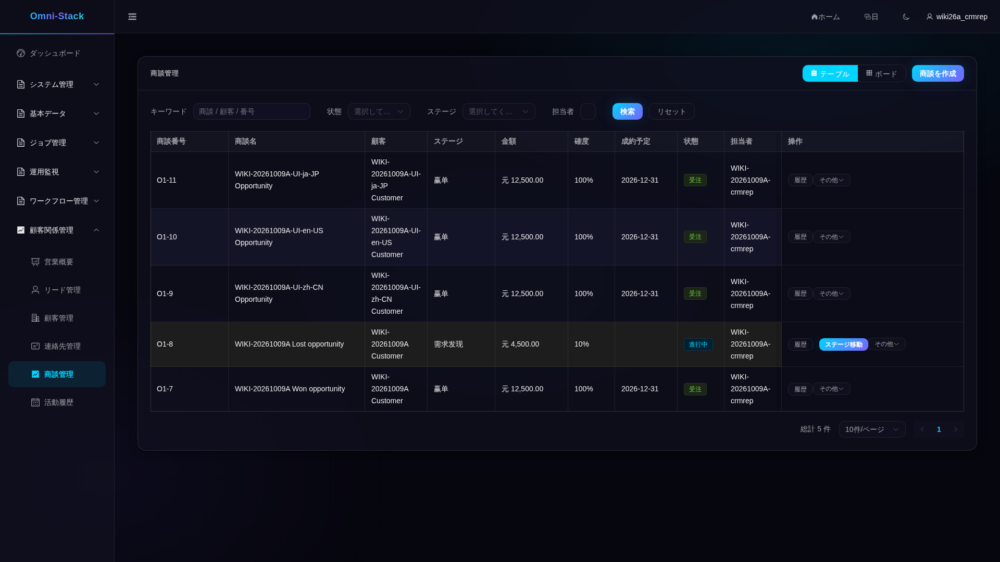

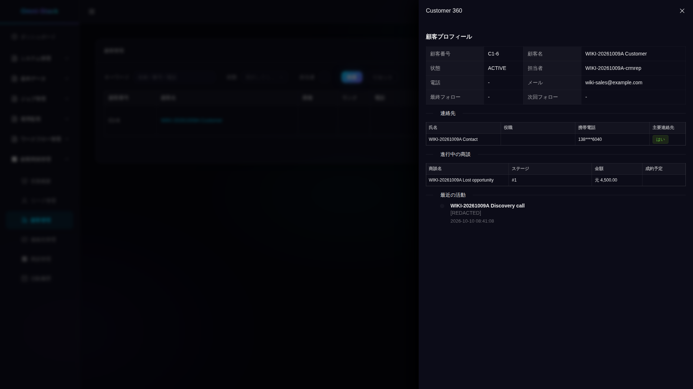

`Lost opportunity` は二番目の商談の過去の名前で、現在は再開して `OPEN` です。ステージは代替値 `#1`、活動内容はマスク表示です。この画像はステージ名の解決や機密情報の非マスク表示を証明しません。

## 5. 失注・再開・無効リード

同じ顧客に二番目の一意な商談を金額 `4500`、`DISCOVERY` で作ります。理由なしで失注を試し、データを変えずに拒否されることを確認します。明確な理由を入力して失注し、`LOST` を確認します。

専用の再開操作で `OPEN` と終了前の最後の開放ステージを確認します。本実行では `DISCOVERY` です。履歴 `CREATE → LOST → REOPEN` を確認します。`WON` と `LOST` は終了状態で、通常編集では直接開放できません。

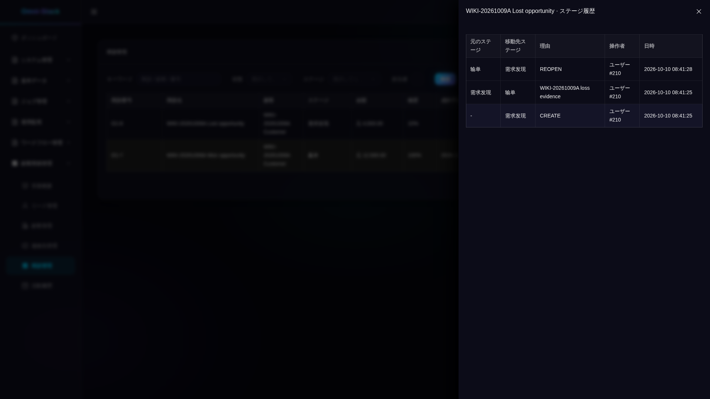

別の未変換リードを作り、理由を指定して無効化してから再開します。結果は `DISQUALIFIED → FOLLOWING` であり `NEW` ではありません。変換済みリードでこの分岐を試さないでください。

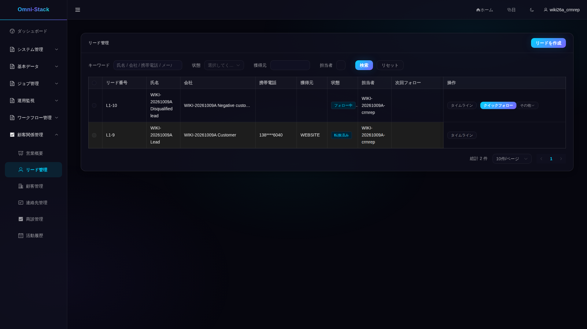

## 6. 権限・障害復旧・後片付け

営業 A は自分のレコードを読み書きでき、組織範囲に含まれるマネージャーは A のレコードを参照できます。営業 B は同じ機能権限でも接頭辞検索が空になり、A のレコードへの直接読書きは業務応答 `R.code=404` です。CRM 機能権限がないアカウントの拒否も別に確認します。権限はあるが可視行がない状態とは異なります。

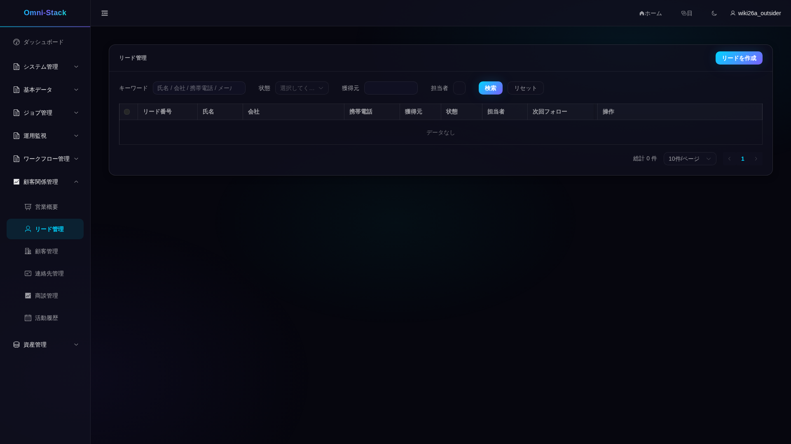

API は `R<T>` を返します。HTTP 状態、`R.code`、パス、trace ID を合わせて記録します。HTTP 200 だけでは業務成功を意味しません。

| 業務コード | 意味 | 対処 |
| --- | --- | --- |
| `401` | 未認証またはテナント情報不足 | 再ログインし、ゲートウェイの信頼済み情報を確認 |
| `403` | 機能権限不足 | 管理者がロール権限を確認し、セッションを更新 |
| `404` | 不存在またはデータ範囲外 | テナント・担当者・組織を確認し、範囲を迂回しない |
| `409` | 古いバージョンまたは禁止状態 | 詳細とバージョンを再取得し、正しいコマンドを選ぶ |
| `400` | 理由不足または不正な関連 | 理由を補い、関連を修正 |
| `503` | 権限依存先が利用不能で拒否 | 依存先を復旧し、無制限検索へ切り替えない |

2026-10-10には進行中商談がある顧客の削除と、終了商談の削除が拒否されることも検証しました。予定活動は正式なコマンドで取消します。変換済み・終了済みレコードは接頭辞付きの監査履歴として残し、SQLで強制削除しません。全体初期化には破棄可能と確認した専用環境を使います。

## 7. ソースのブレークポイントと再現

Docker のデバッグ環境で次の単位にブレークポイントを置き、記録した ID で一つのコマンドを観察します。成功済みの新規作成を再実行しません。

| 単位 | 確認対象 |
| --- | --- |
| [ActivityServiceImpl.touchCompletedRoot](../../omni-backend/omni-crm/src/main/java/com/omni/crm/service/impl/ActivityServiceImpl.java) | `rootType/rootId`、完了状態、NEW → FOLLOWING の条件 |
| [LeadServiceImpl.qualify / convert](../../omni-backend/omni-crm/src/main/java/com/omni/crm/service/impl/LeadServiceImpl.java) | 行ロック、既存変換、状態/`version`、関連、活動移動、ロールバック |
| [OpportunityServiceImpl](../../omni-backend/omni-crm/src/main/java/com/omni/crm/service/impl/OpportunityServiceImpl.java) | 終了/再開、最後の開放ステージ、理由、履歴 |
| [CrmRecordAccessGuard](../../omni-backend/omni-crm/src/main/java/com/omni/crm/service/support/CrmRecordAccessGuard.java) | テナント、ユーザー、範囲、アクセス前の不可視レコード拒否 |
| [CustomerOverview.vue](../../omni-frontend/src/components/crm/CustomerOverview.vue) | 各欄の権限、`status: 'OPEN'`、応答の対応付け |

四段階ウィザードは[リード画面](../../omni-frontend/src/views/crm/lead/index.vue)にあります。`submitConversion` から後端の `convert` を追います。再実行分岐は先に既存結果を確認するため、成功した変換の再要求は一般的な旧版 `409` ルールの例外です。

[LeadServiceImplTest](../../omni-backend/omni-crm/src/test/java/com/omni/crm/service/impl/LeadServiceImplTest.java)、[ActivityServiceImplTest](../../omni-backend/omni-crm/src/test/java/com/omni/crm/service/impl/ActivityServiceImplTest.java)、[OpportunityServiceImplTest](../../omni-backend/omni-crm/src/test/java/com/omni/crm/service/impl/OpportunityServiceImplTest.java) で個々の条件を読みます。実行・テストは Docker 内で行い、環境とポートは[開発ガイド](scaffold-development.jp.md)を参照します。

## 8. 証跡の範囲

2026-10-10の実APIシナリオでフォロー完了、適格判定、変換/再要求、受注/失注/再開、版競合、担当者範囲を検証しました。その後の四言語32件の読取り専用テストは全件成功、スキップなしです。別の画面操作は4件成功、失敗0、スキップ0で、各言語で作成、活動予定/完了、適格判定、四段階変換、ステージ変更、受注を行い48枚を取得しました。両実行の計80枚の過去の視覚確認には、読取り専用8枚と画面操作12枚、計20枚の原解像度四言語コンタクトシートを使用しました。

今回の[文書・原画像確認](../reference/evidence/crm-guide-review-2026-10-17.json)は教材の72枚のパス、言語、ハッシュを照合し、うち20枚の原画像を個別に確認します。他52枚は過去の視覚記録を保持し、全画像の個別再確認や再撮影を行ったとはしません。

[画面操作検証](../../omni-frontend/e2e-docs/flows/crm-teaching-ui.flows.spec.ts)と[読取り専用検証](../../omni-frontend/e2e-docs/flows/crm-teaching.flows.spec.ts)を参照してください。画面テストは所有する隔離 Docker プロジェクトだけを許可します。成功レコードは業務履歴として保持し、中断後は書込み記録を確認してから再実行を判断します。

画像は実際の文言を保持しています。一部辞書、ステージ、備考は中国語で、ラベルの切れや複数行への折返し、操作者の代替値 `User#210` があります。一覧には以前の練習行もあるため接頭辞で識別します。受注画像は状態・金額・確度を示し、顧客の `ACTIVE` 化と活動移動は別の API 検証です。画像、実行イメージ、ソース要約、個別制約は [CRM 証跡](../reference/evidence/crm-2026-10-10.json)を参照してください。

過去の取証では正式なベースイメージのレジストリDNS/認証失敗後、記録済みのキャッシュ済みNginxビルドを使いました。正式な本番イメージのビルド成功を証明しません。実行版と失敗を保持し、現在のソース要約で置換せず、業務結果をCAPTCHA・外部OAuth・同時実行・メッセージ消費完了の証明としません。

四言語文書は[許可済みAIレビュー方針](../adr/0003-authorized-ai-translation-review.md)に従い、実際の `AI_REVIEW` で受け入れます。人のレビューは必須ではなく、`HUMAN_REVIEW` と偽って表示しません。現在の有効ハッシュと状態は[レビュー一覧](../i18n-review-queue.md)を参照してください。

状態、安全性、拡張制約は [CRM 事実文書](../crm.jp.md)と[設計](../design/crm-design.jp.md)に従います。
