# CRM: 첫 리드부터 수주와 다시 열기까지

현재 작업 트리를 대상으로 하며 백엔드 버전은 `1.0.0-SNAPSHOT`, 프리셋은 `crm` 또는 `full`입니다. 이미지와 업무 결과는 2026-10-10 기록입니다. 같은 테넌트의 일반 영업 역할을 사용합니다.

이번에는 현재 소스, 네 언어 문서, 과거 원본을 확인했으며 생성/전환/후속/수주/실주/다시 열기/삭제를 반복하지 않았습니다. 실습의 로그인은 독자가 직접 수행해야 합니다. 과거 브라우저 테스트는 일반 영업용 단기 신원 픽스처를 사용하므로 실제 CAPTCHA 로그인을 증명하지 않습니다.

## 1. 환경, 계정, 데이터 준비

[코드 받기와 시작](quick-start.kr.md)을 완료하고 로컬 Docker에서 프리셋을 시작한 뒤 실제 CAPTCHA로 로그인합니다. 최고 관리자의 전체 조회 결과로 영업 담당자 권한을 검증할 수는 없습니다.

| 계정 | 역할과 데이터 범위 | 용도 |
| --- | --- | --- |
| 영업 A | `USER + SALES_REP`, `SELF` | 자신의 레코드 생성과 처리 |
| 영업 관리자 | `USER + SALES_MANAGER`, `DEPT_AND_BELOW` | 소속 부서와 하위 부서 조회 |
| 영업 B | `USER + SALES_REP`, `SELF`, A와 다른 담당자 | 기능 권한은 있지만 레코드는 보이지 않는 경우 확인 |

관리자가 격리된 연습 환경에서 계정과 조직을 만들고 역할을 배정합니다. `USER`만으로는 CRM 권한이 없습니다. 시드 위치와 정식 초기화는 [데이터 초기화](../wiki/data-and-fixtures.kr.md)를 참고하세요. 상태 규칙을 우회하는 업무 행을 직접 삽입하지 않습니다.

이름, 회사, 활동 제목, 영업 기회 이름에 `CRM-20261010-A` 같은 고유 접두사를 사용하고 이메일은 `example.com`을 사용합니다. 리드, 고객, 연락처, 기회의 실제 ID를 기록합니다. 업무 번호가 DB ID와 같다는 보장은 없습니다. ID나 `version`은 브라우저 네트워크 패널의 해당 API 응답에서 확인하며 토큰을 복사하거나 공개하지 않습니다.

단계 이미지는 언어별로 별도 레코드를 만든 `WIKI-20261009A-UI-언어` 실행입니다. 360, 다시 열기, 범위 밖 이미지는 이전 `WIKI-20261009A` 시나리오입니다. 두 실행의 ID를 섞지 말고 직접 연습할 때는 자신의 고유 접두사를 사용합니다.

```text
NEW 리드 → 예정 활동 생성 → 활동 완료 → FOLLOWING
→ 적격 판정 QUALIFIED → 전환 CONVERTED
→ 고객 + 연락처 + 선택적 OPEN 기회 → 단계 변경 → WON / LOST
```

## 2. 리드를 만들고 후속 활동 완료하기

1. 영업 A로 로그인하고 CRM 리드 관리에서 새 리드를 만듭니다.
2. 고유 연락처 이름과 회사를 입력하고 필요에 따라 유입 경로, 전화, 예시 이메일을 넣습니다. 중복 후보를 확인하고 저장한 뒤 `NEW`인지 확인합니다.
3. 활동 관리에서 활동을 만듭니다. 루트는 `LEAD`, 연결 ID는 실제 리드 ID, 유형은 전화 같은 사전 항목으로 정합니다. 고유 제목, `PLANNED`, 예정 시간을 입력합니다.
4. 저장하고 리드를 새로 조회합니다. 계획만 만들면 여전히 `NEW`이며, 이때 적격 판정이나 전환은 거부됩니다.
5. 활동 완료 작업에서 실제 완료 시각과 필요한 경우 다음 활동 시각을 입력합니다. `COMPLETED`를 확인하고 리드를 다시 조회해 `FOLLOWING`을 확인합니다.
6. 리드 작업 메뉴에서 적격 판정을 실행하고 `QUALIFIED`인 것을 확인한 뒤 전환합니다. 명령마다 최신 `version`을 다시 읽습니다.

활동 시각은 `yyyy-MM-dd HH:mm:ss` 형식입니다. 루트는 `LEAD`, `CUSTOMER`, `OPPORTUNITY`뿐입니다. 연락처는 선택적 연결 필드이며 `CONTACT` 루트가 아닙니다.

다음 다섯 작업 위치를 순서대로 확인합니다. 예정 결과 이미지는 활동의 예정 상태를 보여 주며 리드가 `NEW`인지는 같은 시점의 API 검증입니다. 완료 시각은 이미지 날짜 대신 실제 작업 시각을 입력합니다.

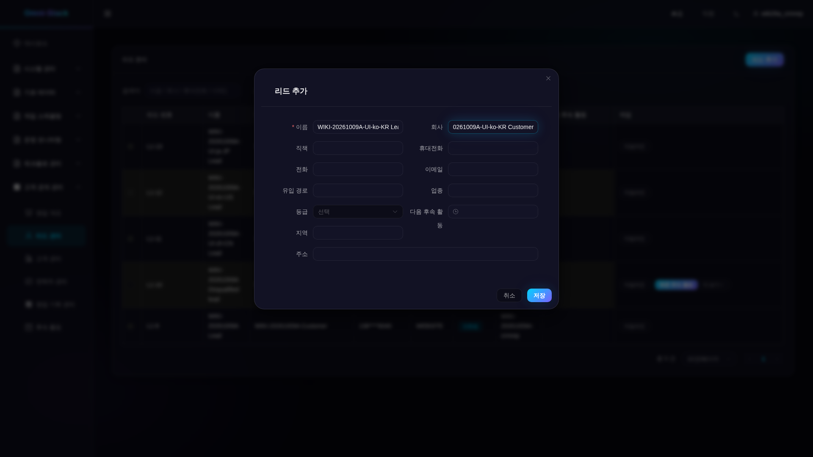

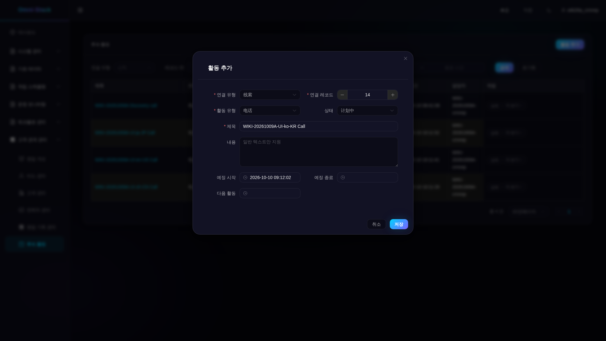

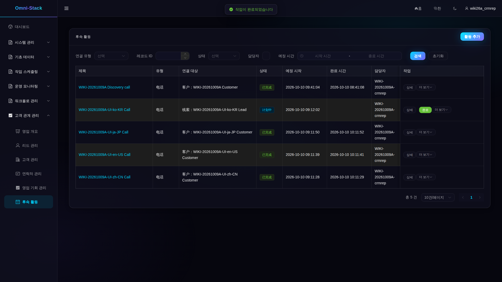

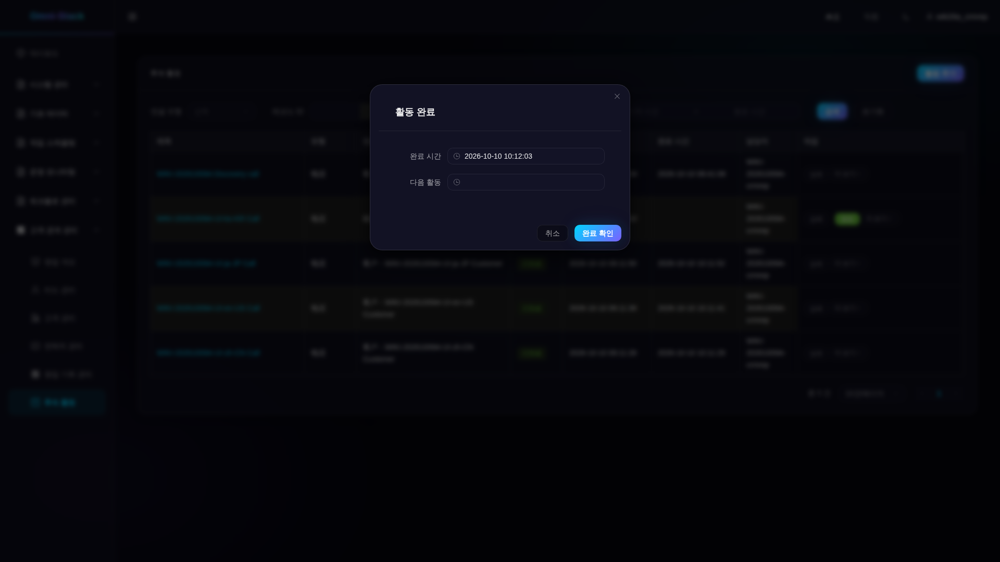

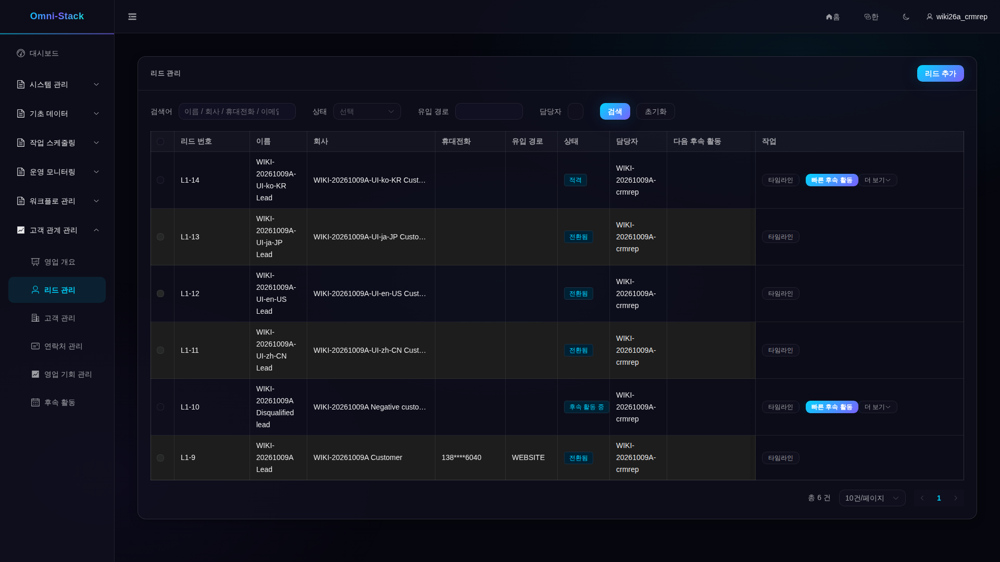

아래 이전 실행 결과는 전환 후 완료 활동의 루트가 `CUSTOMER`로 이동한 상태입니다.

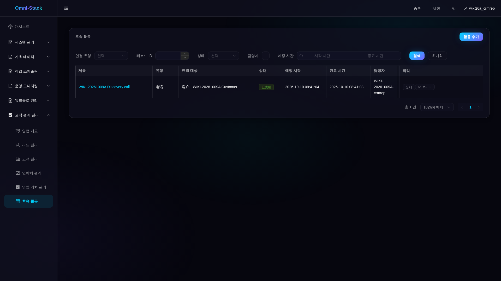

## 3. 마법사로 고객, 연락처, 기회 전환하기

1. `QUALIFIED` 리드에서 전환을 선택하고 첫 단계에서 새 고객과 접두사가 있는 고객 이름을 지정합니다.
2. 두 번째 단계에서 새 연락처를 선택하고 이름과 연락 정보를 확인합니다. 새 연락처는 이 고객에 속하며 기본 연락처가 됩니다.
3. 세 번째 단계에서 기회 생성을 켜고 고유 이름, 금액 `12500`, 예상 마감일을 입력합니다. 이 필드는 날짜이며 전체 시각이 아닙니다.
4. 확인 단계에서 모든 선택을 확인하고 제출합니다. `CONVERTED`와 반환된 ID를 기록합니다.
5. 고객과 연락처 목록에서 실제 연결을 확인합니다. 고객은 `POTENTIAL`, 기회는 `OPEN`, 단계는 `DISCOVERY`로 시작합니다.

기존 고객은 현재 계정에서 볼 수 있어야 하며 기존 연락처는 선택한 고객에 속해야 합니다. ID를 입력할 수 있다고 다른 고객의 연락처를 연결할 권한이 생기지는 않습니다.

전환은 하나의 로컬 트랜잭션에서 레코드 생성/연결, 활동 이동, 신뢰성 메시지 기록을 처리합니다. 이미 전환한 리드에 재요청하면 같은 ID와 `idempotentReplay=true`를 반환하며 고객 세트를 중복 생성하지 않습니다. 시간 초과 시 리드와 기존 전환 결과를 먼저 확인하고 생성 재요청을 판단합니다.

첫 단계에서 고객, 둘째에서 연락처를 만들고 셋째에서 기회의 금액과 예상 성사일, 마지막에서 관계를 확인합니다. 제출 전 양식만으로 생성 성공을 증명하지 않습니다. 다음 성공 메시지와 상태는 실제 API 응답에 대응합니다.

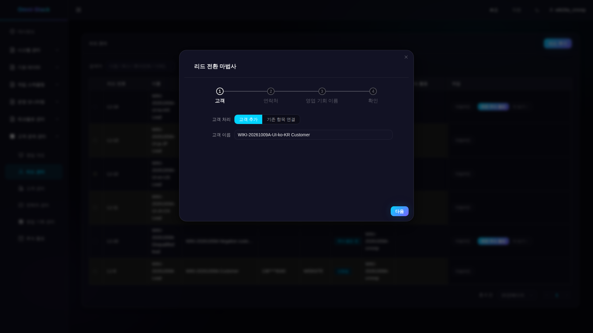

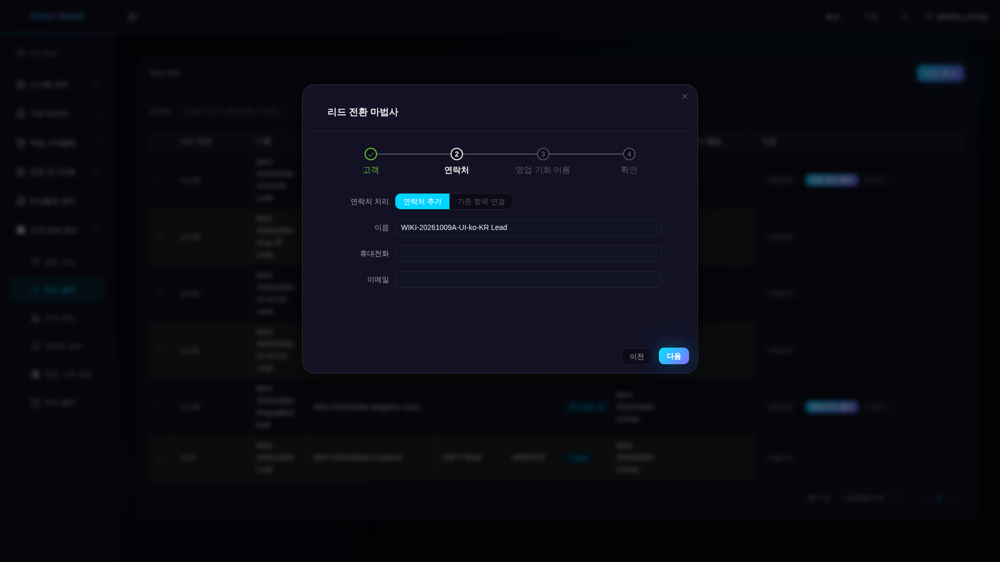

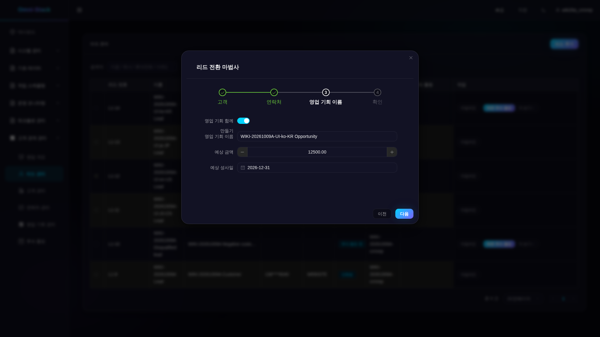

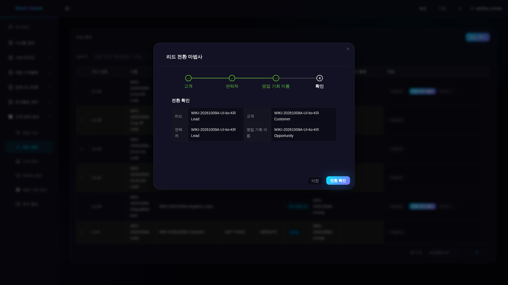

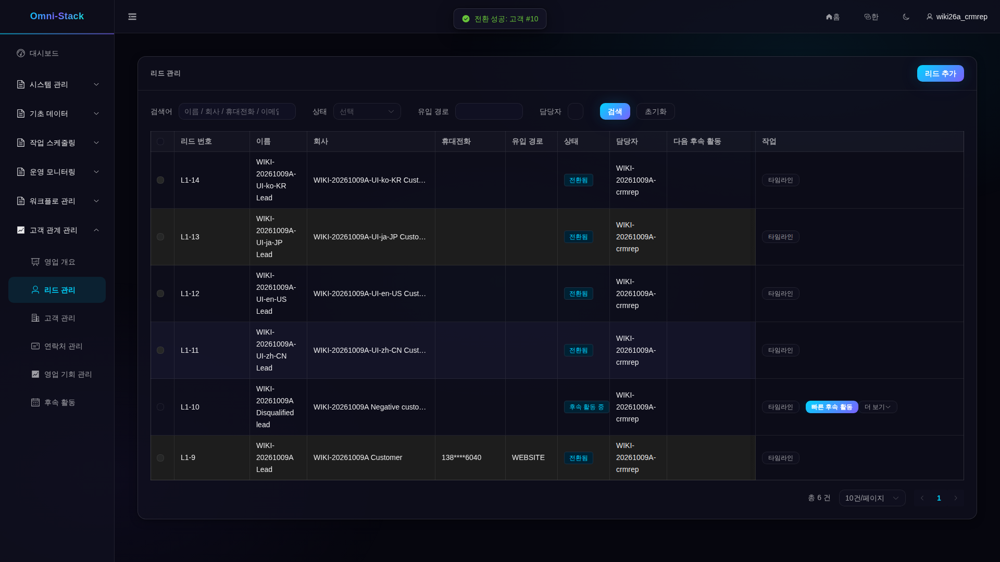

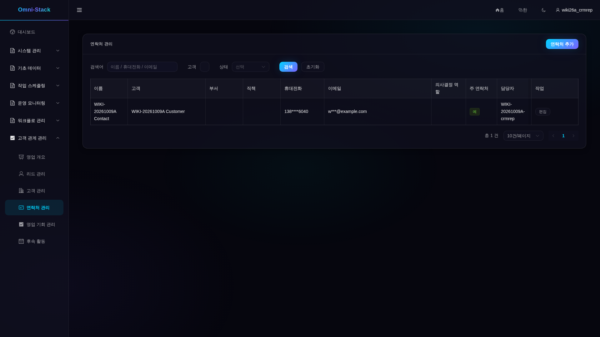

## 4. 고객 360과 수주

1. 새 고객의 360을 열어 기본 정보, 연락처, 기회, 최근 활동을 확인합니다.
2. 리드 활동 이동과 원본 리드까지의 전환 추적을 확인합니다.
3. 금액 `12500`인 기회의 열린 단계를 `DISCOVERY`에서 `PROPOSAL`로 옮깁니다. 이전 단계로 돌아가려면 이유가 필요합니다.
4. 수주 처리하고 다시 조회해 `WON`을 확인합니다. 고객은 `POTENTIAL`에서 `ACTIVE`로 바뀝니다.
5. 고객 360을 다시 엽니다. 열린 기회 영역은 `status=OPEN`만 요청하므로 수주한 기회는 빠지고 나중에 다시 연 기회는 나타납니다.

각 영역은 자체 목록 권한과 데이터 범위를 확인합니다. 고객 상세 권한이 모든 연락처, 기회, 활동 접근을 허용하지는 않습니다. 전화, 이메일, 활동 내용은 민감 정보 권한에 따라 마스킹될 수 있습니다.

단계 양식에서 `PROPOSAL`에 대응하는 “方案报价”를 선택합니다. 이름은 서버 사전에서 가져옵니다. 제출 후 수주를 실행하며 양식을 여는 것만으로 상태가 변경되지는 않습니다.

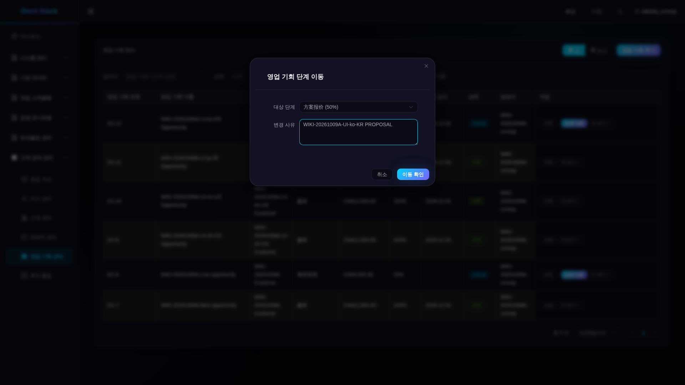

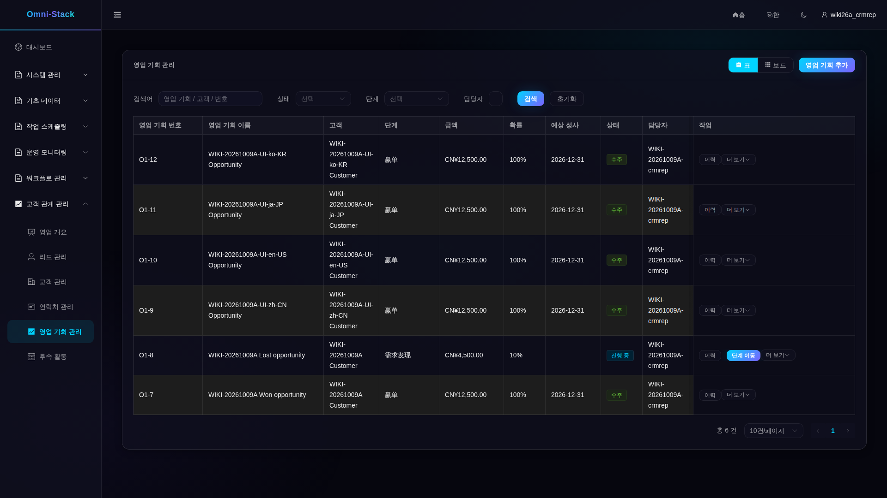

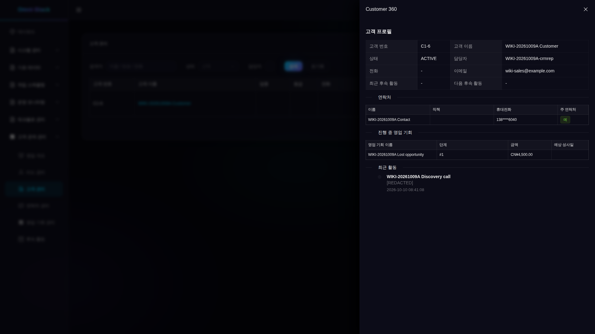

`Lost opportunity`는 두 번째 기회의 과거 이름이며 현재는 다시 열어 `OPEN`입니다. 단계는 대체 값 `#1`, 활동 내용은 마스킹 상태입니다. 이 이미지가 올바른 단계 이름이나 마스킹되지 않은 민감 정보 표시까지 증명하지는 않습니다.

## 5. 실주, 다시 열기, 무효 리드

같은 고객에 금액 `4500`, 단계 `DISCOVERY`인 두 번째 고유 기회를 만듭니다. 이유 없이 실주를 시도해 데이터 변경 없이 거부되는지 확인합니다. 명확한 이유를 넣어 실주하고 `LOST`를 확인합니다.

전용 다시 열기 작업으로 `OPEN`과 종료 전 마지막 열린 단계를 확인합니다. 이번 실행에서는 `DISCOVERY`입니다. 이력 `CREATE → LOST → REOPEN`을 확인합니다. `WON`과 `LOST`는 종료 상태이므로 일반 편집으로 바로 열 수 없습니다.

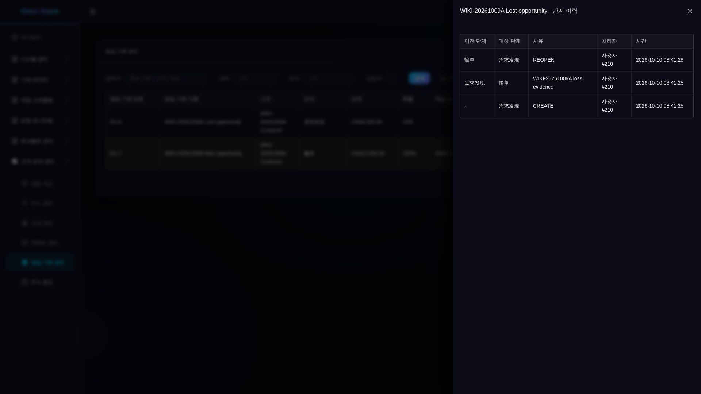

별도의 미전환 리드를 만들고 이유를 지정해 무효 처리한 뒤 다시 엽니다. 예상 결과는 `DISQUALIFIED → FOLLOWING`이며 `NEW`가 아닙니다. 이미 전환한 리드로 이 분기를 시연하지 않습니다.

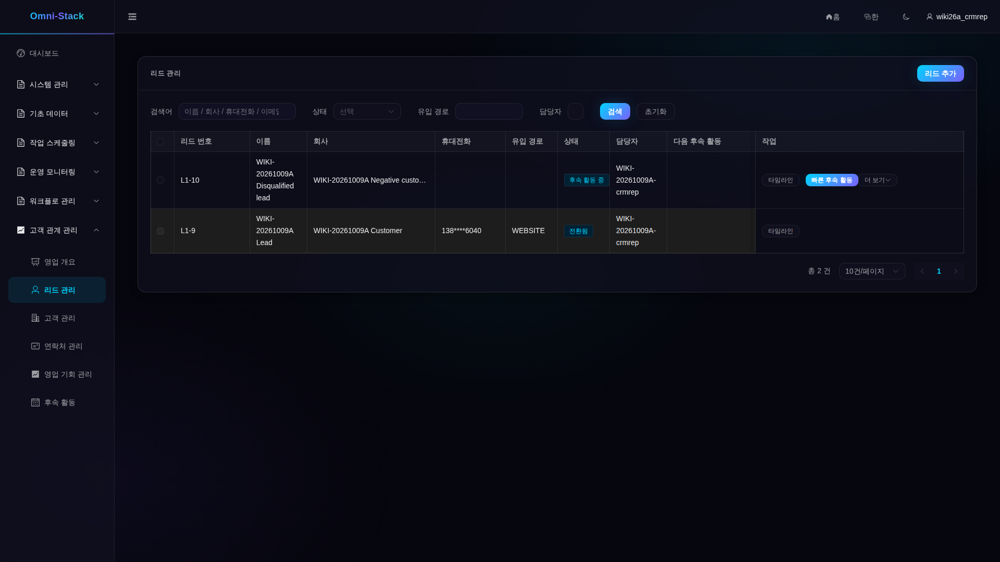

## 6. 권한, 실패 복구, 정리

영업 A는 자신의 레코드를 읽고 쓸 수 있고, 조직 범위에 포함되는 관리자는 A의 레코드를 볼 수 있습니다. 영업 B는 같은 기능 권한이어도 접두사 조회가 비어 있으며 A 레코드 직접 읽기/쓰기는 업무 응답 `R.code=404`입니다. CRM 기능 권한이 없는 계정의 거부도 별도로 확인합니다. 권한은 있지만 볼 행이 없는 상태와 다릅니다.

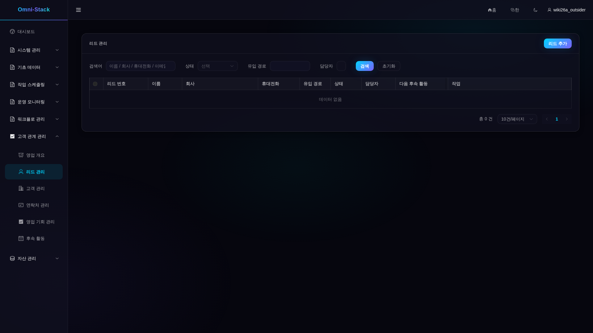

API는 `R<T>`를 반환합니다. HTTP 상태, `R.code`, 경로, trace ID를 함께 기록합니다. HTTP 200만으로 업무 성공을 판단하지 않습니다.

| 업무 코드 | 의미 | 처리 |
| --- | --- | --- |
| `401` | 미인증 또는 테넌트 문맥 누락 | 다시 로그인하고 게이트웨이의 신뢰 문맥 확인 |
| `403` | 기능 권한 없음 | 관리자가 역할 권한을 확인하고 세션 갱신 |
| `404` | 없거나 데이터 범위 밖 | 테넌트, 담당자, 조직을 확인하고 범위를 우회하지 않음 |
| `409` | 오래된 버전 또는 금지 상태 | 상세와 버전을 다시 읽고 올바른 명령 선택 |
| `400` | 필수 이유 누락 또는 잘못된 연결 | 이유를 채우거나 관계 수정 |
| `503` | 권한 의존 서비스 장애로 접근 차단 | 의존 서비스 복구 후 재시도하며 무제한 조회로 대체하지 않음 |

2026-10-10에는 열린 기회가 있는 고객 삭제와 종료 기회 삭제 거부도 검증했습니다. 예정 활동은 정식 명령으로 취소합니다. 전환/종료 레코드는 접두사를 유지한 감사 이력으로 남기고 SQL로 강제 삭제하지 않습니다. 전체 초기화는 별도로 만들고 폐기 가능하다고 확인한 환경에서 진행합니다.

## 7. 소스 중단점과 재현

Docker 디버깅 환경에서 다음 단위에 중단점을 두고 기록한 ID로 한 명령씩 관찰합니다. 성공한 생성 요청을 다시 실행하지 않습니다.

| 단위 | 관찰 항목 |
| --- | --- |
| [ActivityServiceImpl.touchCompletedRoot](../../omni-backend/omni-crm/src/main/java/com/omni/crm/service/impl/ActivityServiceImpl.java) | `rootType/rootId`, 완료 상태, NEW → FOLLOWING 조건 |
| [LeadServiceImpl.qualify / convert](../../omni-backend/omni-crm/src/main/java/com/omni/crm/service/impl/LeadServiceImpl.java) | 행 잠금, 기존 전환, 상태/`version`, 연결, 활동 이동, 롤백 |
| [OpportunityServiceImpl](../../omni-backend/omni-crm/src/main/java/com/omni/crm/service/impl/OpportunityServiceImpl.java) | 종료/다시 열기, 마지막 열린 단계, 이유, 이력 |
| [CrmRecordAccessGuard](../../omni-backend/omni-crm/src/main/java/com/omni/crm/service/support/CrmRecordAccessGuard.java) | 테넌트, 사용자, 범위, 접근 전 비가시 레코드 차단 |
| [CustomerOverview.vue](../../omni-frontend/src/components/crm/CustomerOverview.vue) | 영역 권한, `status: 'OPEN'`, 응답 매핑 |

네 단계 마법사는 [리드 페이지](../../omni-frontend/src/views/crm/lead/index.vue)에 있습니다. `submitConversion`에서 백엔드 `convert`까지 추적합니다. 재요청은 기존 결과를 먼저 확인하므로 성공 전환 재요청에는 일반적인 오래된 버전 `409` 규칙의 예외가 적용됩니다.

[LeadServiceImplTest](../../omni-backend/omni-crm/src/test/java/com/omni/crm/service/impl/LeadServiceImplTest.java), [ActivityServiceImplTest](../../omni-backend/omni-crm/src/test/java/com/omni/crm/service/impl/ActivityServiceImplTest.java), [OpportunityServiceImplTest](../../omni-backend/omni-crm/src/test/java/com/omni/crm/service/impl/OpportunityServiceImplTest.java)로 개별 조건을 읽습니다. 실행/테스트는 Docker에서 하며 환경과 포트는 [개발 안내](scaffold-development.kr.md)를 참고합니다.

## 8. 증거 범위

2026-10-10 실제 API 시나리오에서 후속 완료, 적격 판정, 전환/재요청, 수주/실주/다시 열기, 버전 충돌, 담당자 범위를 검증했습니다. 이후 네 언어 읽기 전용 테스트32개가 모두 통과했고 건너뛴 항목은 없습니다. 별도의 화면 작업은4개 통과, 실패0, 건너뜀0이며 언어마다 생성, 활동 예정/완료, 적격 판정, 네 단계 전환, 단계 이동, 수주에서 이미지48장을 얻었습니다. 두 실행의 이미지80개에 대한 과거 시각 검토는 읽기 전용8장과 화면 작업12장, 총20장의 원본 해상도4개 언어 모음 이미지를 사용했습니다.

이번[문서 및 원본 검사](../reference/evidence/crm-guide-review-2026-10-17.json)는 실습의 이미지72개 경로, 언어, 해시를 대조하고 그중20개 원본을 개별 확인합니다. 나머지52개는 과거 시각 기록을 유지하며 전체 개별 재검토나 재촬영을 주장하지 않습니다.

[화면 작업 검증](../../omni-frontend/e2e-docs/flows/crm-teaching-ui.flows.spec.ts)과 [읽기 전용 검증](../../omni-frontend/e2e-docs/flows/crm-teaching.flows.spec.ts)을 참고하세요. 화면 테스트는 소유한 격리 Docker 프로젝트만 허용합니다. 성공 레코드는 업무 이력으로 유지하며 중단 후 쓰기 기록을 확인하고 재실행을 판단합니다.

이미지는 실제 문구를 유지합니다. 일부 사전, 단계, 비고는 중국어이며 라벨이 잘리거나 여러 줄로 바뀌고 담당자는 대체 값 `User#210`입니다. 목록에 이전 연습 행도 있으므로 접두사로 식별합니다. 수주 이미지는 상태, 금액, 확률을 보여 주며 고객 `ACTIVE`와 활동 이동은 별도 API 검증입니다. 이미지, 실행 이미지 ID, 소스 해시, 개별 제한은 [CRM 증거](../reference/evidence/crm-2026-10-10.json)를 참고하세요.

과거 증거는 정식 기본 이미지의 레지스트리DNS/인증 실패 뒤 기록된 캐시Nginx빌드를 사용했습니다. 정식 운영 이미지 빌드 성공을 증명하지 않습니다. 실행 버전과 실패를 유지하고 현재 소스 해시로 바꾸지 않으며 업무 결과를CAPTCHA, 외부OAuth, 동시성, 메시지 소비 완료 증거로 삼지 않습니다.

네 언어 문서는[승인된AI검토 정책](../adr/0003-authorized-ai-translation-review.md)에 따라 실제 `AI_REVIEW`로 인수합니다. 사람 검토는 필수가 아니며 `HUMAN_REVIEW`로 허위 표시하지 않습니다. 현재 유효 해시와 상태는[검토 목록](../i18n-review-queue.md)을 참고하세요.

상태, 보안, 확장 제약은 [CRM 사실 문서](../crm.kr.md)와 [설계](../design/crm-design.kr.md)를 따릅니다.
