# CRM：从第一条线索到成交与重开

适用当前交付树，后端版本为 `1.0.0-SNAPSHOT`；预设：`crm` 或 `full`。图片和业务结果来自 2026-10-10；使用同一租户的普通销售角色。

本轮核对当前源码、四语正文和历史原图，没有重新创建、转换、跟进、赢输单、重开或删除业务记录。教程的登录步骤需读者实际完成；历史浏览器测试使用普通销售的短期身份夹具，不证明真实验证码登录。

## 1. 准备环境、账号和数据

完成[拉取与启动](quick-start.md)，使用本机 Docker 启动预设，再通过真实验证码登录。超级管理员的全量结果不能代表销售人员权限验证。

| 账号 | 角色与数据范围 | 用途 |
| --- | --- | --- |
| 销售 A | `USER + SALES_REP`，`SELF` | 创建和推进自己的记录 |
| 销售主管 | `USER + SALES_MANAGER`，`DEPT_AND_BELOW` | 查看本部门及下级部门数据 |
| 销售 B | `USER + SALES_REP`，`SELF`，与 A 不同负责人 | 验证有功能权限但无记录可见性 |

账号与组织由管理员在隔离演练环境创建并分配角色。普通 `USER` 本身没有 CRM 权限；种子位置及正式初始化见[数据初始化](../wiki/data-and-fixtures.md)。不要直接插入绕过状态机的业务数据。

选唯一前缀，如 `CRM-20261010-A`，用于线索姓名、公司、活动主题和商机名称；邮箱用 `example.com`。记下线索、客户、联系人、商机的真实 ID；业务编号不一定是数据库 ID。需要 ID 或 `version` 时，在浏览器网络面板查看该记录的接口响应，勿复制或公开令牌。

分步操作图使用 `WIKI-20261009A-UI-语言` 前缀，每种语言各自创建一套记录。360、重开和范围负例图来自此前 `WIKI-20261009A` 场景；两批记录不同，不能把图中 ID 混用。自行练习时换成自己的唯一前缀。

```text
NEW 线索 → 创建计划活动 → 完成活动 → FOLLOWING
→ 判定合格 QUALIFIED → 转换 CONVERTED
→ 客户 + 联系人 + 可选 OPEN 商机 → 推进阶段 → WON / LOST
```

## 2. 创建线索，完成一次跟进

1. 用销售 A 登录，进入“CRM → 线索管理”，点击新建。
2. 填唯一联系人姓名和公司，按需要填来源、电话和示例邮箱。检查查重候选后保存，确认 `NEW`。
3. 进入活动管理，新建活动：根类型选线索 `LEAD`，关联 ID 填真实线索 ID，类型选电话等字典项，填唯一主题，状态选计划 `PLANNED`，填计划时间。
4. 保存并刷新线索。仅计划活动时仍为 `NEW`，此时直接判定合格或转换会被拒绝。
5. 在活动列表完成该活动，填写实际完成时间，按需填写下次行动时间。确认 `COMPLETED`，再刷新线索，确认 `FOLLOWING`。
6. 在线索操作菜单判定合格，确认 `QUALIFIED` 后再转换。每次命令后重新读取最新 `version`。

活动时间使用 `yyyy-MM-dd HH:mm:ss`。活动根只有 `LEAD`、`CUSTOMER`、`OPPORTUNITY`；联系人是可选关联字段，不能把 `CONTACT` 当作根类型。

依次核对以下五个操作位置。计划结果图显示活动为计划态；线索仍为 `NEW` 是同一步的接口断言。完成时间由实际操作时刻填写，不要照抄图片日期。

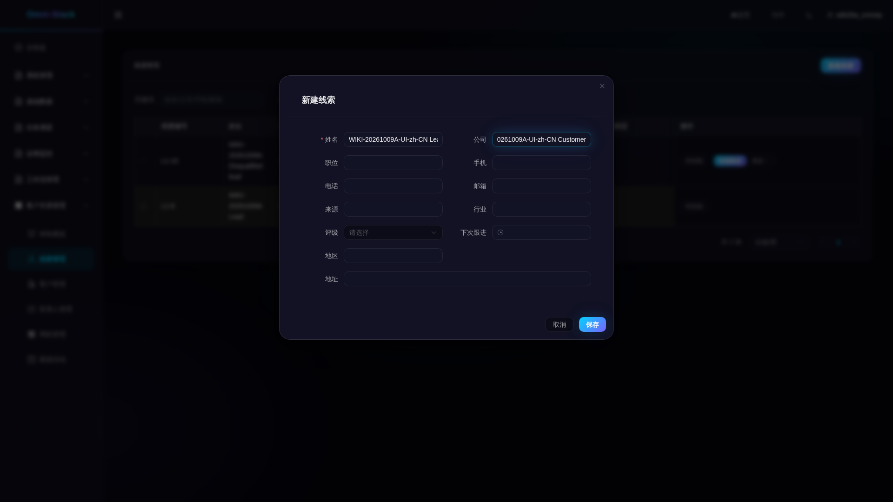

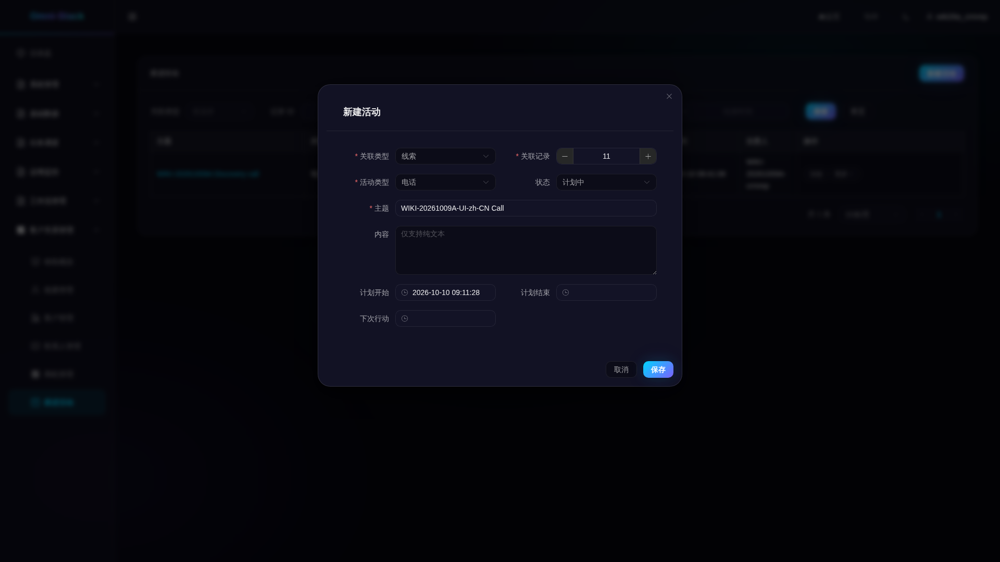

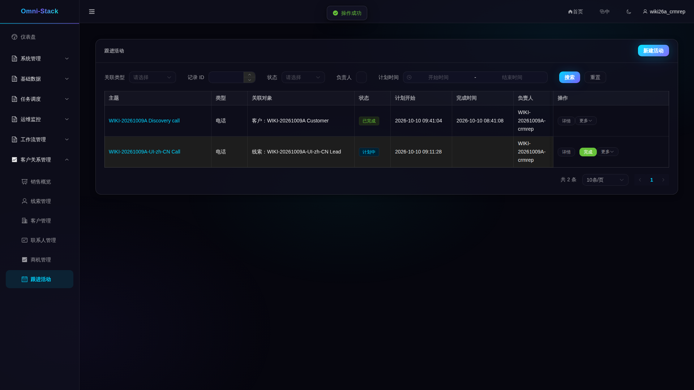

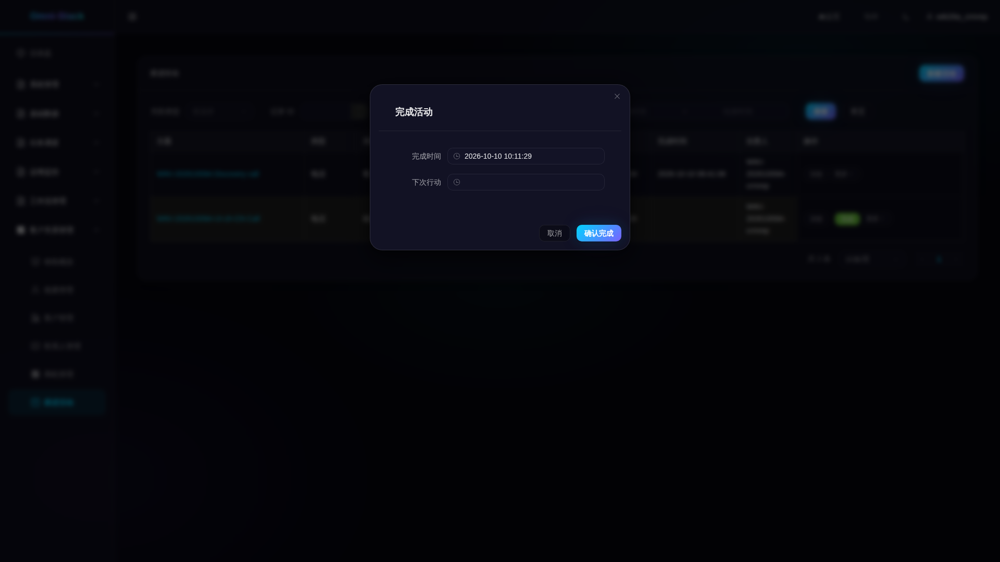

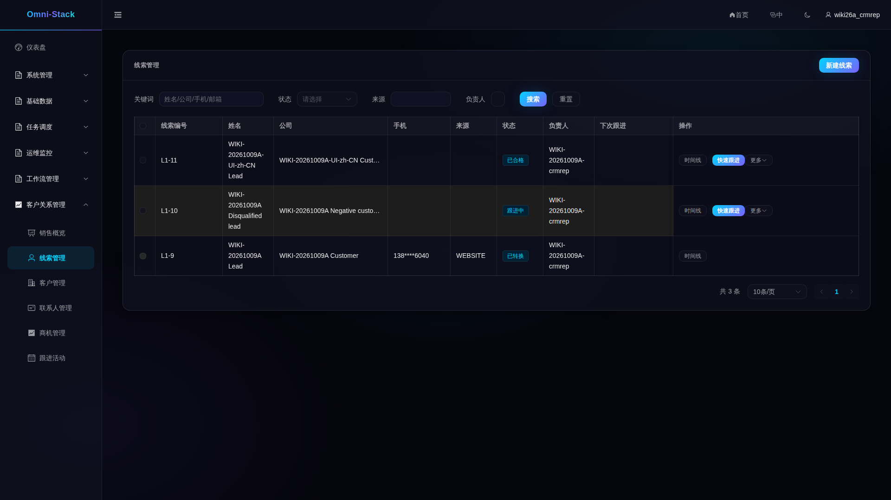

下面的历史结果图取自转换之后，已完成活动的根已迁移为 `CUSTOMER`。

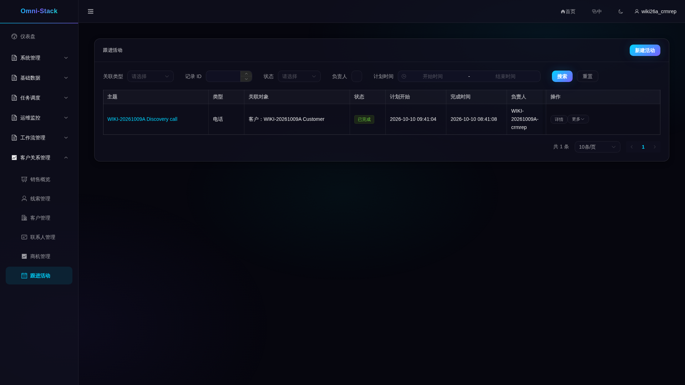

## 3. 按向导转换客户、联系人和商机

1. 在 `QUALIFIED` 线索上点击转换，第一步选新建客户，填带前缀的客户名称。
2. 第二步选新建联系人，核对姓名和联系方式。新联系人归属本次客户，并成为其主要联系人。
3. 第三步开启创建商机，填唯一名称、金额 `12500` 和预计成交日期。该字段是日期，不是完整时间。
4. 确认页核对全部选择后提交。确认线索为 `CONVERTED`，保存返回的各个 ID。
5. 打开客户和联系人列表核对关系。新客户为 `POTENTIAL`，新商机为 `OPEN`、阶段为 `DISCOVERY`。

关联已有客户时，必须选当前账号可见的客户；关联已有联系人时，该联系人必须属于所选客户。可以填写 ID 不代表有权跨客户关联。

转换在一个本地事务内创建或关联记录、迁移活动并写可靠消息。对已经转换的同一线索重复请求，返回同一组 ID 且 `idempotentReplay=true`，不会再造一套客户。请求超时先查线索和已有转换结果，不要盲目重复创建。

第一步新建客户，第二步新建联系人，第三步开启商机并核对金额和预计成交日，第四步确认关系。表单尚未提交时的图不能单独证明创建成功；紧随其后的成功提示和状态与真实接口响应对应。

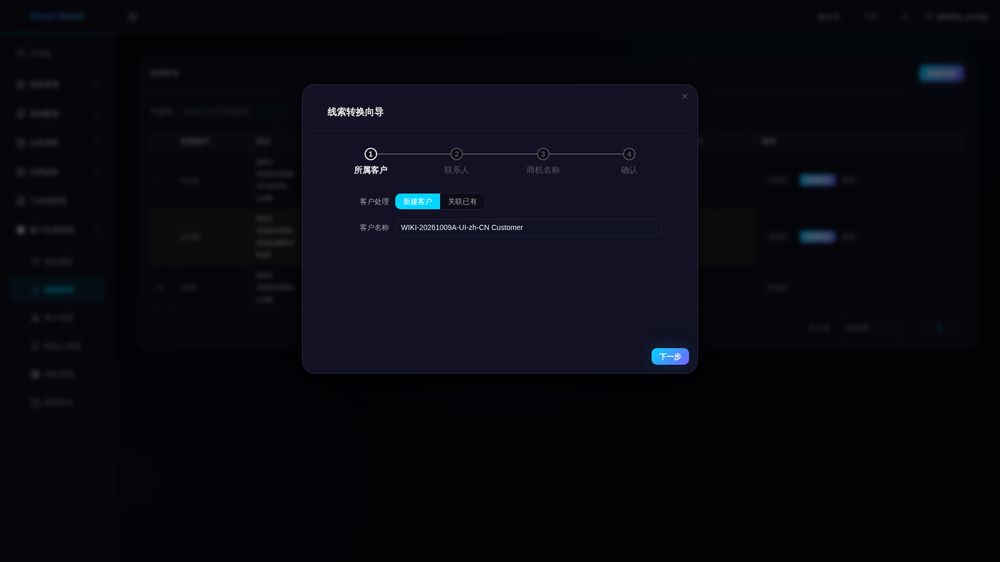

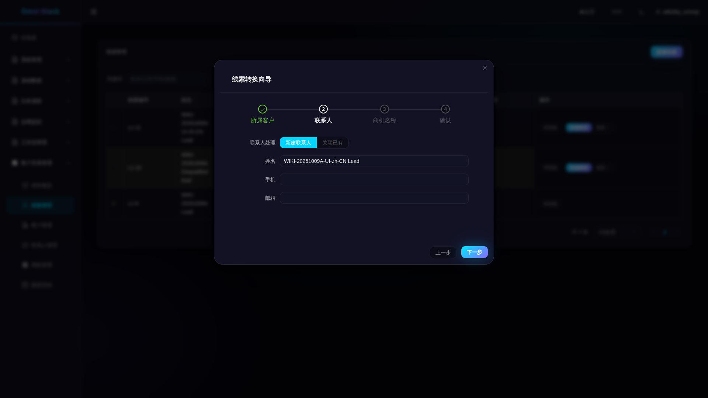

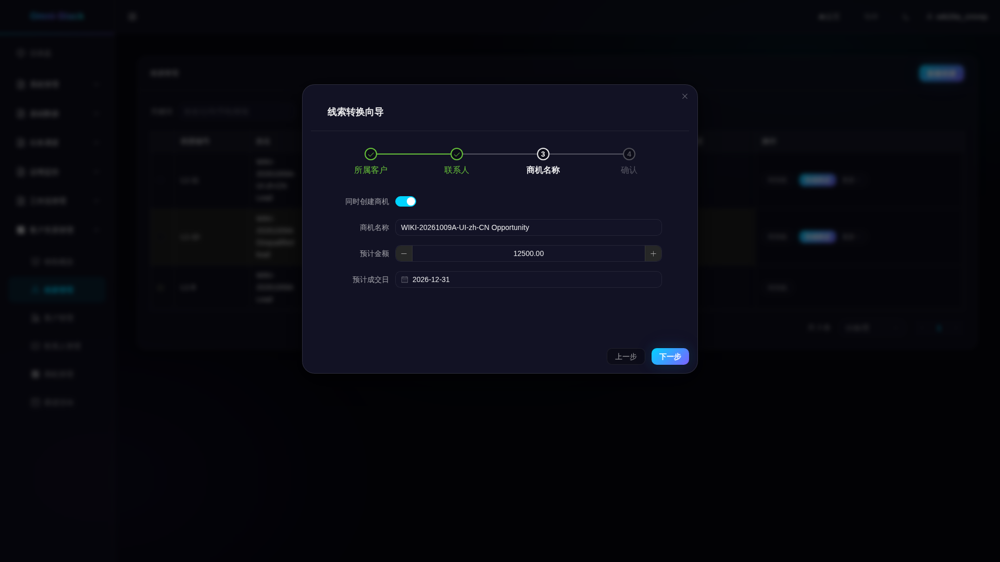

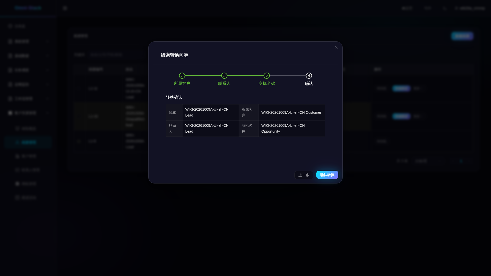

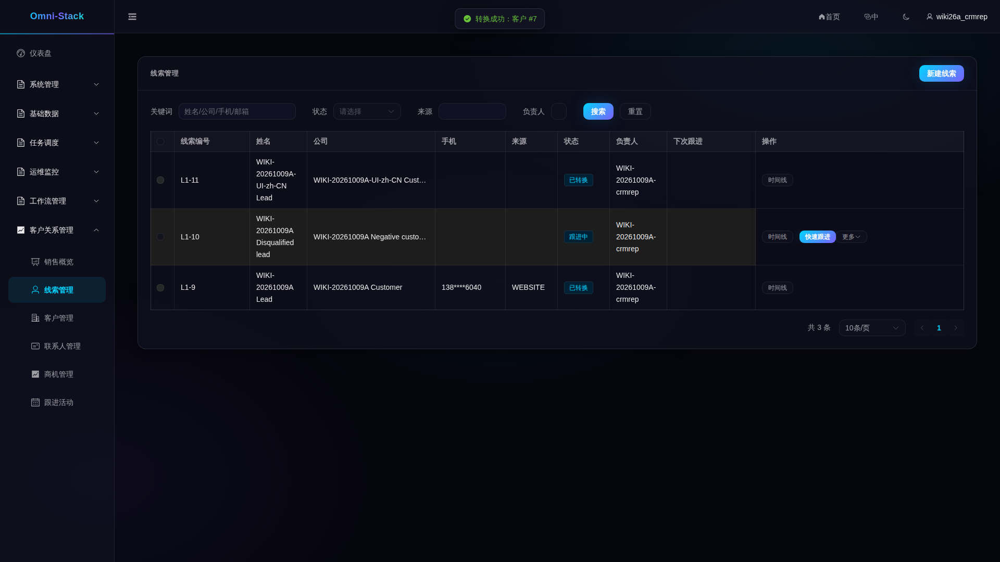

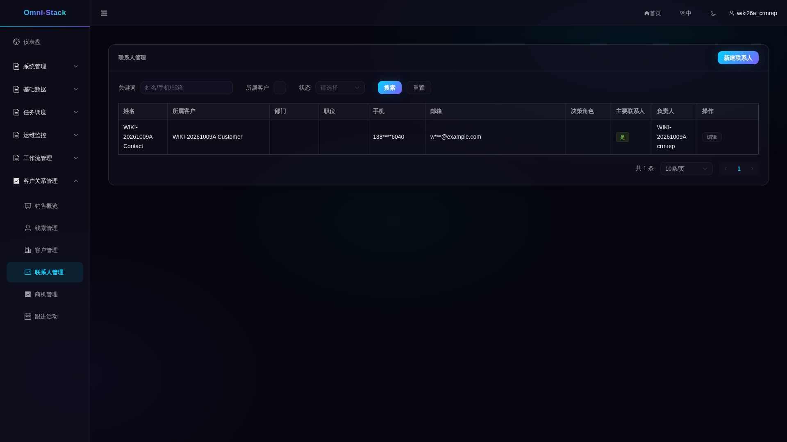

## 4. 客户 360 与赢单

1. 打开新客户 360，核对基本信息、联系人、商机和近期活动。
2. 确认线索活动已迁移到客户，转换来源能追溯到原线索。
3. 找金额 `12500` 的商机，把开放阶段从 `DISCOVERY` 推进到 `PROPOSAL`。向后调整阶段必须填原因。
4. 执行赢单，刷新确认 `WON`；客户由 `POTENTIAL` 变为 `ACTIVE`。
5. 再开客户 360。开放商机区只请求 `status=OPEN`，已赢单商机应退出，后续重开的商机应出现。

360 每个区块独立检查对应列表权限和数据范围。有客户详情权限，不等于能看全部联系人、商机和活动。电话、邮箱和活动内容可能按敏感信息权限脱敏。

阶段表单选 `PROPOSAL` 对应的“方案报价”；这些阶段名称来自服务端字典。提交后再执行赢单，不能把打开表单当作状态已更新。

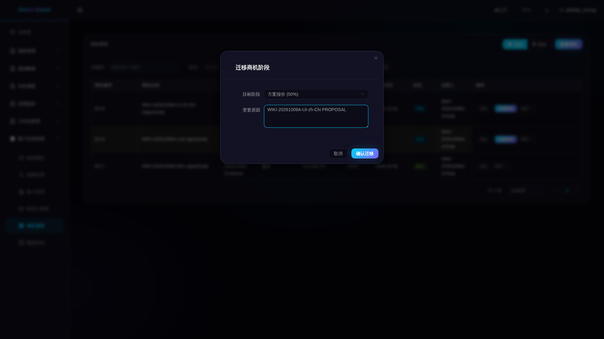

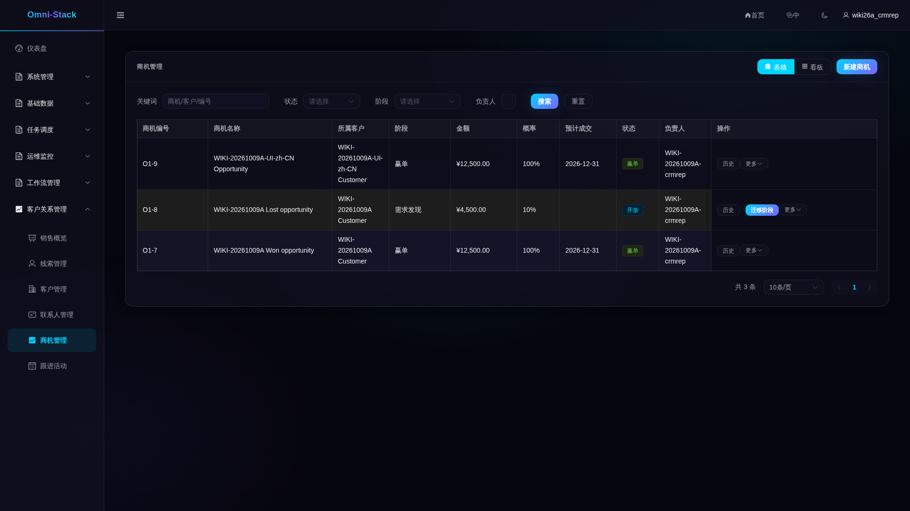

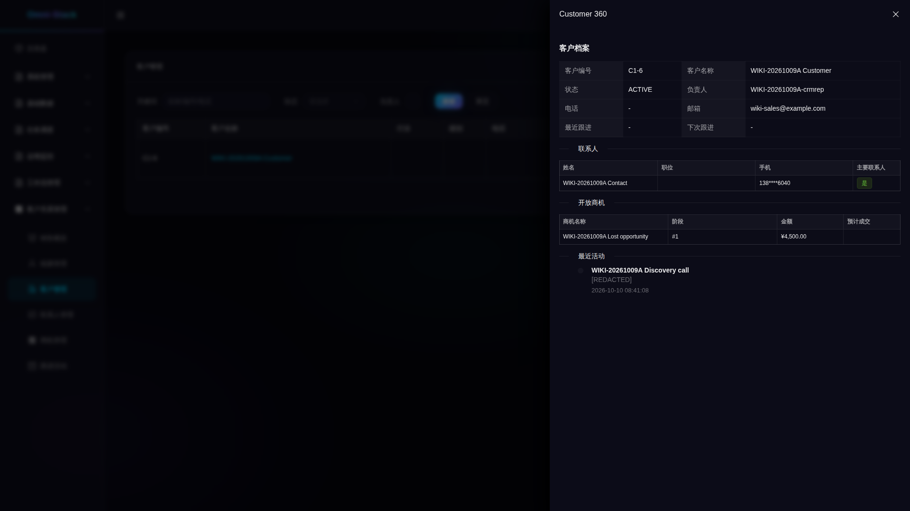

客户图中 `Lost opportunity` 是第二条商机的历史名称，当前已重开为 `OPEN`。阶段显示 `#1` 回退值，活动内容脱敏；此图不证明阶段名称完整呈现或敏感信息未脱敏。

## 5. 输单、重开与无效线索

同一客户下另建唯一商机，金额 `4500`，保持 `DISCOVERY`。先不填原因尝试输单，预期校验拒绝且数据不变；填明确原因后输单，确认 `LOST`。

使用专用重开操作，确认 `OPEN` 及关闭前最后一个开放阶段；本次恢复到 `DISCOVERY`。查看历史 `CREATE → LOST → REOPEN`。`WON`、`LOST` 是关闭状态，普通编辑不能直接改回开放。

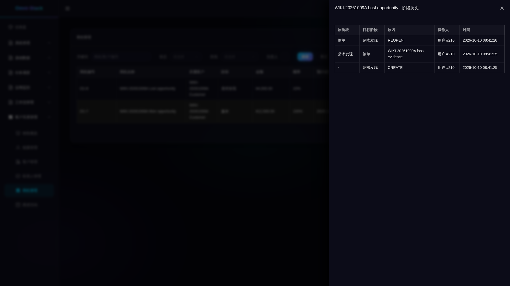

另建未转换线索，填原因判定无效后重开。预期 `DISQUALIFIED → FOLLOWING`，不会回到 `NEW`；不要用已转换线索演示。

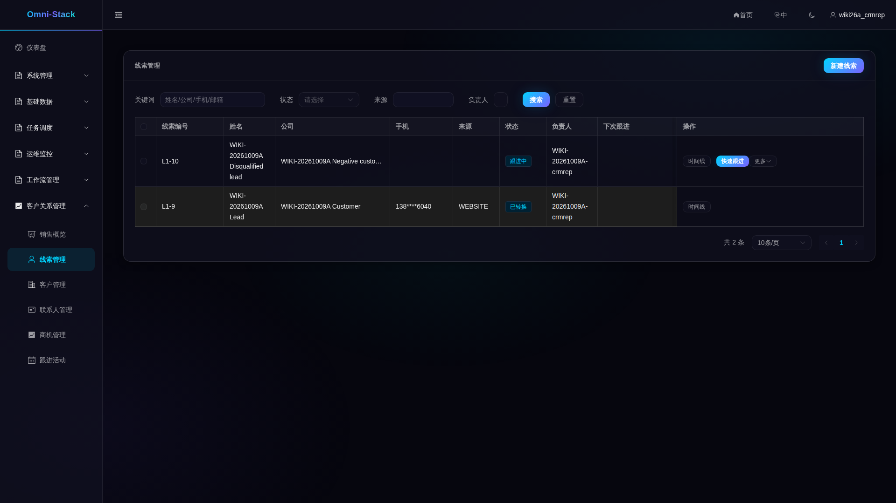

## 6. 权限、失败恢复与清理

销售 A 能读写自己的记录；销售主管在组织范围正确时能读 A 的记录。销售 B 虽有同样功能权限，按本轮前缀查询仍为空，直接读写 A 的记录返回业务 `R.code=404`。另检查无 CRM 功能权限账号的拒绝结果；它不同于“有权限但无可见记录”。

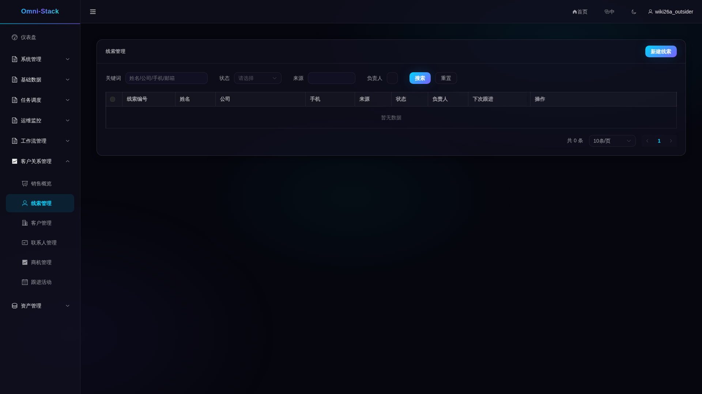

接口返回 `R<T>`。排障同时记 HTTP 状态、`R.code`、路径和 trace ID，HTTP 200 不代表业务成功。

| 业务码 | 含义 | 处理 |
| --- | --- | --- |
| `401` | 未认证或缺租户上下文 | 重新登录，检查网关可信上下文 |
| `403` | 缺功能权限 | 管理员核对角色权限，刷新会话 |
| `404` | 不存在或超出数据范围 | 核对租户、负责人、组织范围，不绕过范围 |
| `409` | 版本过期或状态不允许 | 重读详情和版本，选正确命令 |
| `400` | 缺必填原因或关联不合法 | 补原因、修正关系 |
| `503` | 权限依赖不可用，失败关闭 | 恢复依赖后重试，不退化为全量查询 |

2026-10-10 还验证了：存在开放商机时客户删除被拒绝；关闭商机不能直接删除。计划活动按正式命令取消；转换和关闭记录保留前缀作为审计历史，勿用 SQL 强删。整体清空应使用专门创建且确认可销毁的演练环境。

## 7. 源码断点与复现

在 Docker 调试环境给下列单元设断点，用本次 ID 观察单个命令；不要重放已成功的创建。

| 单元 | 观察内容 |
| --- | --- |
| [ActivityServiceImpl.touchCompletedRoot](../../omni-backend/omni-crm/src/main/java/com/omni/crm/service/impl/ActivityServiceImpl.java) | `rootType/rootId`、完成状态、NEW 更新为 FOLLOWING 的条件 |
| [LeadServiceImpl.qualify / convert](../../omni-backend/omni-crm/src/main/java/com/omni/crm/service/impl/LeadServiceImpl.java) | 行锁、已有转换结果、状态与 `version`、关联关系、活动迁移、回滚 |
| [OpportunityServiceImpl](../../omni-backend/omni-crm/src/main/java/com/omni/crm/service/impl/OpportunityServiceImpl.java) | 关闭/重开、最后开放阶段、原因和历史 |
| [CrmRecordAccessGuard](../../omni-backend/omni-crm/src/main/java/com/omni/crm/service/support/CrmRecordAccessGuard.java) | 租户、用户、范围，以及读写前拒绝不可见记录 |
| [CustomerOverview.vue](../../omni-frontend/src/components/crm/CustomerOverview.vue) | 区块权限、`status: 'OPEN'` 和响应映射 |

四步向导位于[线索页面](../../omni-frontend/src/views/crm/lead/index.vue)。从 `submitConversion` 跟到后端 `convert`。重放分支先检查已有结果，因此“旧版本一定 `409`”不适用于成功转换的重放。

结合 [LeadServiceImplTest](../../omni-backend/omni-crm/src/test/java/com/omni/crm/service/impl/LeadServiceImplTest.java)、[ActivityServiceImplTest](../../omni-backend/omni-crm/src/test/java/com/omni/crm/service/impl/ActivityServiceImplTest.java) 和 [OpportunityServiceImplTest](../../omni-backend/omni-crm/src/test/java/com/omni/crm/service/impl/OpportunityServiceImplTest.java) 阅读条件。运行与测试均在 Docker；调试环境及端口见[脚手架开发](scaffold-development.md)。

## 8. 证据边界

2026-10-10 的真实 API 场景覆盖完成跟进、判定、转换及重放、赢输单/重开、版本冲突与负责人范围。后续 32 个四语只读浏览器用例全通过、无跳过；另一次四语界面操作为 4 通过、0 失败、0 跳过，每语完成新建、计划/完成活动、合格、四步转换、推进和赢单，产生 48 张分步原图。两批共 80 张图的历史视觉检查实际使用 8 张只读场景和 12 张界面操作四语汇总图，共 20 张原分辨率汇总图。

本轮[文档与原图检查](../reference/evidence/crm-guide-review-2026-10-17.json)匹配教程所用 72 张图的路径、语言和哈希，并逐张抽查其中 20 张原图；其余 52 张沿用历史视觉记录，没有本轮重新逐张查看或重拍全部图片。

界面链路见 [CRM 操作验收](../../omni-frontend/e2e-docs/flows/crm-teaching-ui.flows.spec.ts)，结果读取见 [CRM 只读验收](../../omni-frontend/e2e-docs/flows/crm-teaching.flows.spec.ts)。界面测试只允许自有 Docker 隔离项目；成功记录保留为业务历史，中断后先核对写入日志，不能盲目重跑。

图片保留真实文案：部分活动字典、阶段和历史备注来自服务端中文值；部分标签截断或多行换行，操作者使用 `User#210` 回退值。列表含此前演练记录，要按前缀识别本次行。赢单图可见状态、金额和概率；客户变为 `ACTIVE`、活动迁移另由接口断言验证。镜像、源码摘要与逐图限制见[CRM 证据清单](../reference/evidence/crm-2026-10-10.json)。

历史取证因正式基础镜像的注册表 DNS/认证失败，使用已记录的缓存 Nginx 构建；不能据此宣称正式生产镜像构建已通过。原始运行版本和失败记录保留，不以当前源码摘要替换历史版本，也不将领域结果当作验证码、外部 OAuth、并发或消息消费完成的证明。

四语文档按[已授权 AI 复核政策](../adr/0003-authorized-ai-translation-review.md)采用真实 `AI_REVIEW` 验收，不要求人工复核，不冒称 `HUMAN_REVIEW`；当前有效哈希和状态见[复核队列](../i18n-review-queue.md)。

状态机、安全和扩展约束以 [CRM 事实](../crm.md)与[设计](../design/crm-design.md)为准。
