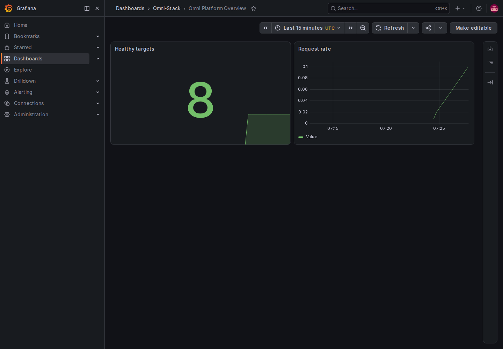
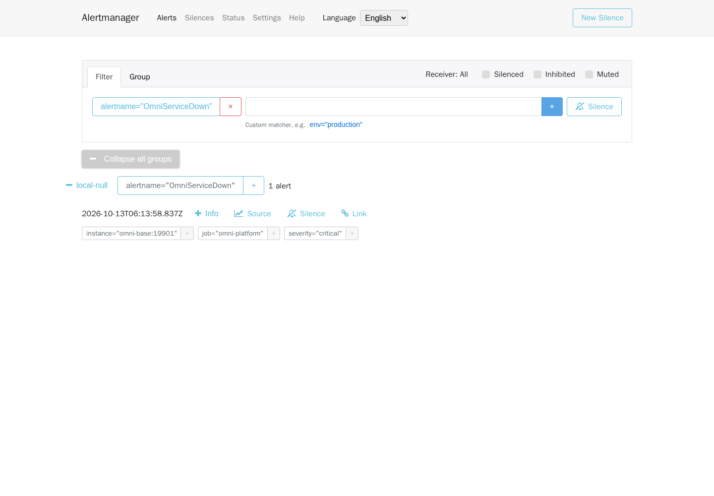

# Operations, Observability, Backup, Recovery, and Upgrade

This guide supports local template validation and production planning. Reconfigure the template for capacity, compliance, and ownership; never expose local Compose ports unchanged.

## 1. Startup Order

```text
MySQL / Redis / RocketMQ → Liquibase migrator → Nacos / XXL-JOB (both depend_on omni-db-migrator service_completed_successfully)
→ Auth / Base / Workflow / Domain Services → Gateway / Frontend
```

After `docker compose --profile full up -d`, rely on health checks, not container start state. The migrator must exit successfully before serving traffic.

## 2. Observability Profile

```bash
docker compose --profile full --profile observability up -d
```

The stack includes OpenTelemetry Collector, Prometheus, Alertmanager and its four-language UI, Tempo, Loki, Alloy, Grafana, Pushgateway, Node Exporter, and cAdvisor. Dashboards cover platform overview, RED, JVM, Feign, MQ, Workflow, and migrations.

Synchronous requests use W3C `traceparent`; `X-Trace-Id` reflects the actual trace. Messages preserve producer trace and consumer logs record both sides. Calibrate production sampling, retention, thresholds and recipients. When disabling observability, also restore `OTLP_EXPORT_ENABLED=false` and `TRACING_SAMPLING_PROBABILITY=0.0` in the private `.env` and update the affected application containers. Stopping the Collector or using `docker restart` does not update container environment variables.

### 2.1 Follow a Real Request Through Trace, Logs and Metrics

1. Use the `full` preset and a random private `GRAFANA_ADMIN_PASSWORD`. For the teaching exercise, set `OTLP_EXPORT_ENABLED=true` and `TRACING_SAMPLING_PROBABILITY=1.0`, retaining `http://otel-collector:4318/v1/traces`, then run the Compose command above. Export and sampling are disabled by default; starting observability containers alone produces no business traces.
2. Run `docker compose ps --all`: the migrator must exit successfully and selected applications must be healthy. Open local Grafana at `http://localhost:3001`, sign in with the private configuration and select **Omni Platform Overview**. Other provisioned dashboards cover RED, JVM, Feign, MQ, Workflow and migrations. Select a time range containing the request. An inactive workload can legitimately leave some panels empty.
3. Perform an authorized dictionary query through Gateway and record its response `X-Trace-Id`. In Grafana Explore, select Tempo and search that ID for Gateway and Base spans. Select Loki, filter the actual container labels, then find structured logs with the same `traceId`. Never copy complete tokens, personal information or SQL parameters into public evidence.
4. In Prometheus at `http://localhost:9090`, query `up{job="omni-platform"}` and check all eight application management ports, `19900`–`19907`. A working business endpoint does not prove metric scraping. Scraping/evaluation runs every 15 seconds; verify actual recovery instead of assuming it from elapsed time.

The 2026-10-12 [sanitized evidence](../reference/evidence/observability-2026-10-12.json) records 25 Gateway/Base spans, six log entries with the same trace and eight business targets UP. The uniquely created dictionary was deleted by its exact ID, leaving zero matching rows. This run started eight observability components and omitted host-access Node Exporter/cAdvisor: two of 13 targets remain DOWN. It does not prove every target healthy, suitable production sampling or asynchronous trace coverage.



The [tablet](../images/en-US/operations-dashboard-tablet.png) and [phone](../images/en-US/operations-dashboard-mobile.png) originals also show the actual UI. Mobile breadcrumbs truncate; provisioned dashboard/panel titles remain English. Reusable Docker entries are the [read-only verifier](../../scripts/fixtures/verify-observability.mjs) and [Playwright capture tool](../../scripts/fixtures/capture-observability.mjs). Pass the selected applications explicitly through `E2E_OBSERVABILITY_SERVICES`, so a trimmed project does not require all eight services. Capture takes `dashboard|alert` and a fresh private output directory; inject Grafana credentials through Docker `--env-file`.

## 3. Health and Alerts

Monitor application health, Prometheus targets, Gateway/Feign error rate and latency, pools/JVM/GC, Outbox/Inbox backlog, dead letters, XXL-JOB failures, Workflow retries, and migration failures.

### 3.1 Observe Alert Firing and Recovery in an Isolated Project

Local `alertmanager-ui` compiles Chinese, English, Japanese and Korean interfaces from the official v0.30.1 Elm source. The backend remains official Alertmanager. After updating UI source, run from the repository root:

```bash
docker compose --profile full --profile observability build alertmanager-ui
docker compose --profile full --profile observability up -d alertmanager-ui
```

1. The standard local entry is `http://localhost:9093/`, initially Chinese. Use **Language** or open `/zh-CN/`, `/en-US/`, `/ja-JP/`, `/ko-KR/` directly. Switching language preserves the current page and filters; the internal backend remains `alertmanager:9093`.
2. Rehearse faults only in a teaching project with verified dedicated networks/volumes and no Base host ports. Record Base's exact container ID, image and health, and confirm the actual receiver is `local-null` with no external notification channels. The standard `omni-stack` is not a disposable outage fixture.
3. Stop that Base container. Observe Prometheus keep `OmniServiceDown` pending for two minutes before firing, then check `instance=omni-base:19901` in Alertmanager. Capture only after the real alert arrives; an empty list, elapsed time or generated image does not prove arrival.
4. Click the **Muted** text label, verify the filter checkbox changes, then click again to restore it. These options filter the alert list by silenced, inhibited or muted state; toggling them changes neither fault status nor notification rules. View the version on Status. After changing the first weekday in Settings, reloading and switching language should preserve it.
5. After capture or any failure, start the same Base container. Wait for application health, Prometheus scraping UP and alert clearance. Reconcile the exact container and receipt before repeating a stop or creating a service.

[Current four-language evidence](../reference/evidence/alertmanager-i18n-2026-10-13.json) records a new real firing/recovery cycle, 12 originals across four languages and three viewports, and eight desktop/phone settings, routing and form scenarios. The browser permits GET/HEAD only; it creates no silence and injects no fake alert. `local-null` sends no external notification, so this does not prove email or chat delivery. Phone navigation is vertical; details and actions may require normal downward scrolling. None of the three viewports has horizontal page overflow. Alert labels, receiver names and protocol timestamps remain original data.

When a real `OmniServiceDown` alert is present, reproduce the [read-only capture](../../scripts/fixtures/capture-alertmanager-i18n.mjs) in PowerShell. Replace `<verified-training-network>` with the verified teaching network, obtained through `docker inspect <Base-container-ID> --format '{{json .NetworkSettings.Networks}}'`. Use a fresh output directory outside the repository, and restore Base even if capture fails.

```powershell
$outputPath = Join-Path $env:TEMP ('omni-alert-i18n-' + [guid]::NewGuid())
New-Item -ItemType Directory -Path $outputPath | Out-Null
docker run --rm --network '<verified-training-network>' --mount "type=bind,source=$((Get-Location).Path),target=/workspace,readonly" --mount "type=bind,source=$outputPath,target=/output" --mount 'type=volume,source=omni-docs-browser-modules,target=/browser/node_modules' -w /workspace mcr.microsoft.com/playwright:v1.61.1-noble sh -c 'npm install --prefix /browser --no-save --package-lock=false --ignore-scripts playwright@1.61.1 && node scripts/fixtures/capture-alertmanager-i18n.mjs /output'
```



The [tablet](../images/en-US/operations-alert-localized-tablet.png) and [phone](../images/en-US/operations-alert-localized-mobile.png) originals use the same real alert and matching UI language. The historical [English control receipt](../reference/evidence/alertmanager-controls-2026-10-13.json) proves only the old interface. See [ADR-0004](../adr/0004-native-alertmanager-localization.md) for the source digest, licensing and upgrade constraints.

## 4. Backup

Back up MySQL, persistent Nacos configuration, required external Secret inventory, custom Grafana/alert configuration, deployment version, image digests, `database/seed/manifest.yaml`, and `scaffold.lock`. Redis, MQ, Tempo, and Loki backup depends on explicit RPO/RTO.

## 5. Recovery Exercise

Restore into an isolated environment, disconnect production downstream systems, run migrations, start services, execute health/login/permission/business/async checks, reconcile key state and message records, and record actual recovery time. A backup without successful restore evidence is not considered usable.

### 5.1 Repeat a Logical Restore in Local Docker

Identify the teaching project's containers, network, volumes and images first; publish no host ports. The standard `omni-stack` is not a disposable fixture. The host only runs the Docker wrapper; MySQL export/import and the migrator run in containers. PowerShell 7.4+ preserves native SQL output bytes.

```powershell
$sourceProject = 'omni-e2e-training-20261012a'
$output = Join-Path $env:TEMP ('omni-backup-' + [guid]::NewGuid())
./scripts/fixtures/run-backup-rehearsal.ps1 -SourceProject $sourceProject -RunId 'training-20261012a' -OutputDirectory $output
```

Use a verified existing teaching project and a fresh run ID. The external output directory must not exist. Guards require one healthy MySQL, a successfully exited migrator, project-owned networks/volumes, no host ports and no existing restore target. The source migrator image is reused by default. After a source fix, build the new image and pass `-MigratorImage`; mounting a manifest does not replace the embedded JAR resource.

The 2026-10-12 [sanitized receipt](../reference/evidence/backup-2026-10-12.json) records nine databases, 181 tables, 60 migration-history rows and a 47,978,544-byte backup. Eight stable database digests match across restore. Dynamic XXL data is backed up but excluded from cross-time digests. Initial replay incorrectly counted nine user models as seeds. Filtering the five formal natural keys passes with unchanged expectations. Temporarily removing the restored `leave` key still fails with expected 5 / actual 4; restoring it recovers the same digest. No lowered expectation, accepted drift or edited historical migration is involved.

Success removes only this run's restore containers, network and volume, retaining the private backup. On failure, reconcile the receipt, exit code and live database before continuing unfinished steps; do not blindly import again. This proves logical database recovery. Redis sessions, Broker queues, external Secrets, application health and core flows require separate checks; it does not prove production disaster recovery or RPO/RTO compliance.

### 5.2 Verify Applications After Restoring Data

Use the recorded images in another isolated network with fresh volumes and no published ports. Restore the nine databases, replay the formal migrator, then start dependencies and applications. Restored XXL data may contain source executor addresses and enabled jobs. Quarantine those triggers and clear stale registrations in the restore copy before starting scheduling, so the exercise cannot send jobs to the source environment; leave the source database unchanged.

The same [receipt](../reference/evidence/backup-2026-10-12.json), under `application_restore`, records 21 actual checks: 15 running services and a successfully exited migrator, frontend availability, anonymous 401, ordinary-user 403/404, eight restored supply-chain/CRM states, and a new dictionary operation delivered through the formal Outbox/Broker to exactly one operation log before deletion. The copy retains 60 migration-history rows. All 16 restore containers, three volumes and the dedicated network were precisely removed; the source environment and private backup remain.

Short-lived identities issued from the test classpath verified restored authorization. Old Redis sessions were not restored and human CAPTCHA password login was not repeated. New Broker delivery does not prove old queue backup. Reusing images and restoring successfully do not prove rebuilding every production image from current source or a production failover exercise.

## 6. Upgrade

Use expand → migrate/backfill → contract:

1. Read release and preset differences.
2. Back up and prove recovery.
3. Test upgrade against a production-like copy.
4. Deploy backward-compatible Schema.
5. Deploy applications compatible with old and new structures and finish backfill.
6. Observe metrics and error budget.
7. Contract only after old consumers and versions are gone.

Liquibase changeSets are forward-only. Recovery uses backup restoration or a compensating changeSet, never edits an executed changeSet.

## 7. Security

Bind management endpoints internally or to localhost. Use TLS, reverse proxy/WAF, least privilege, and external Secret management. Do not place secrets in Git, image layers, screenshots, command history, or logs. See [Docker Deployment](../docker-deployment.en.md) and [Observability](../observability.en.md).
