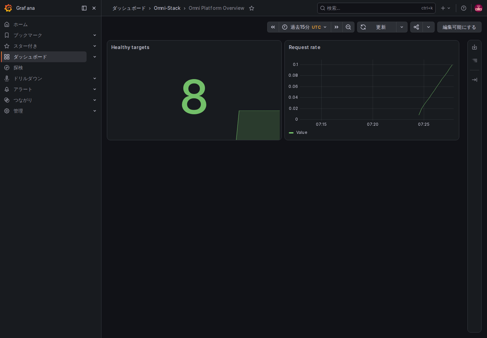
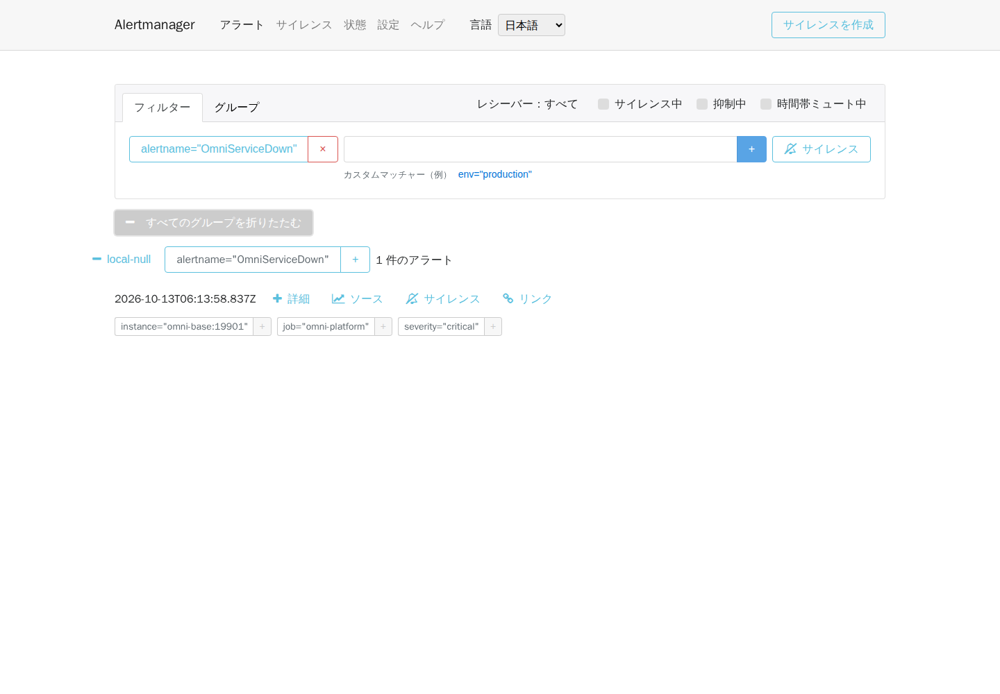

# 運用、可観測性、バックアップ、復旧、アップグレード

ローカル検証と本番計画のガイドです。本番では容量、法令、責任分界に合わせ、ローカル Compose ポートをそのまま公開しません。

## 1. 起動順序

```text
MySQL / Redis / RocketMQ → Liquibase migrator → Nacos / XXL-JOB（両者とも omni-db-migrator service_completed_successfully に依存）
→ Auth / Base / Workflow / 業務サービス → Gateway / Frontend
```

`docker compose --profile full up -d` 後はコンテナ起動ではなく health を確認し、migrator 成功後にトラフィックを受けます。

## 2. 可観測性 profile

```bash
docker compose --profile full --profile observability up -d
```

OpenTelemetry Collector、Prometheus、Alertmanager と4言語 UI、Tempo、Loki、Alloy、Grafana、Pushgateway、Node Exporter、cAdvisor と各種 Dashboard を起動します。同期は W3C `traceparent`、`X-Trace-Id` は実 trace、非同期は producer/consumer trace を関連付けます。

本番のサンプリング、保持、閾値、通知先は容量に合わせます。観測を停止するときは非公開 `.env` も `OTLP_EXPORT_ENABLED=false`、`TRACING_SAMPLING_PROBABILITY=0.0` に戻し、対象アプリのコンテナを更新します。Collector の停止や `docker restart` だけではコンテナの環境変数は更新されません。

### 2.1 実リクエストから Trace・ログ・メトリクスをたどる

1. `full` プリセットとランダムな非公開 `GRAFANA_ADMIN_PASSWORD` を使用します。教材では `OTLP_EXPORT_ENABLED=true`、`TRACING_SAMPLING_PROBABILITY=1.0` とし、送信先 `http://otel-collector:4318/v1/traces` を維持して上記 Compose を実行します。既定は出力無効・サンプリングゼロです。観測コンテナの起動だけでは業務 Trace は発生しません。
2. `docker compose ps --all` で migrator の正常終了と対象アプリの health を確認します。ローカル Grafana `http://localhost:3001` に非公開設定でログインし、**Omni Platform Overview** を選びます。RED、JVM、Feign、MQ、Workflow、移行の Dashboard もあります。時間範囲に実リクエストを含めます。処理がないパネルのデータなし表示だけでは障害と判断しません。
3. Gateway 経由で権限のある辞書検索を行い、応答の `X-Trace-Id` を記録します。Grafana Explore の Tempo で同じ ID を検索し、Gateway と Base の Span を確認します。Loki に切り替え、実際のコンテナラベルと同じ `traceId` で構造化ログを探します。完全なトークン、個人情報や SQL 引数を公開証拠へコピーしません。
4. Prometheus `http://localhost:9090` で `up{job="omni-platform"}` を検索し、8 アプリの管理ポート `19900`〜`19907` を確認します。業務 API の成功はメトリクス収集の成功とは別です。収集・評価は 15 秒間隔であり、時間経過から推測せず実際の復旧結果を確認します。

2026-10-12 の[匿名化した証拠](../reference/evidence/observability-2026-10-12.json)は実リクエストの Gateway/Base 25 Span、同一 Trace のログ 6 件と業務 target 8 件の UP を記録します。自作辞書は正確な ID で削除し残留ゼロです。今回は観測 8 コンポーネントのみ起動し、ホストアクセスが必要な Node Exporter/cAdvisor は起動していないため 13 target 中 2 件は DOWN です。全 target の正常、本番サンプリングの妥当性、非同期 Trace の網羅を意味しません。



[タブレット原図](../images/ja-JP/operations-dashboard-tablet.png)と[スマートフォン原図](../images/ja-JP/operations-dashboard-mobile.png)も実 UI です。小画面のパンくずは省略され、設定済み Dashboard・パネル名は英語です。再利用できる Docker 入口は[読取専用検証](../../scripts/fixtures/verify-observability.mjs)と[Playwright 原図採取](../../scripts/fixtures/capture-observability.mjs)です。`E2E_OBSERVABILITY_SERVICES` で選択アプリを明示し、削減したプロジェクトに 8 サービス全体を要求しないようにします。採取は `dashboard|alert` と新規の非公開出力先を受け取り、Grafana 資格情報は Docker `--env-file` から渡します。

## 3. ヘルスとアラート

アプリ health、Prometheus targets、Gateway/Feign のエラーと遅延、JVM/接続プール、Outbox/Inbox、デッドレター、XXL-JOB、Workflow、migration を監視します。

### 3.1 隔離教材プロジェクトで発火と復旧を確認する

ローカルの `alertmanager-ui` は公式 v0.30.1 の Elm ソースから中国語・英語・日本語・韓国語の UI を構築します。バックエンドは公式 Alertmanager のままです。UI ソースの更新後、リポジトリのルートで実行します。

```bash
docker compose --profile full --profile observability build alertmanager-ui
docker compose --profile full --profile observability up -d alertmanager-ui
```

1. 標準のローカル入口は `http://localhost:9093/` で、初期言語は中国語です。「言語」で切り替えるか、`/zh-CN/`、`/en-US/`、`/ja-JP/`、`/ko-KR/` を開きます。言語を切り替えても現在のページとフィルターを維持し、内部バックエンドは `alertmanager:9093` のままです。
2. 障害演習は、専用ネットワーク・ボリュームと Base のホストポート未公開を確認した教材プロジェクトだけで行います。Base の正確なコンテナ ID、イメージ、正常性を記録し、実際の通知先が外部チャネルを持たない `local-null` であることを確認します。標準の `omni-stack` を停止可能な使い捨て環境として扱いません。
3. その Base コンテナを停止し、Prometheus の `OmniServiceDown` が2分間 pending を維持して firing になることを観測します。Alertmanager で `instance=omni-base:19901` を確認します。実アラートの到着後に撮影します。空の一覧、経過時間や画像の生成だけでは到着を証明できません。
4. 「時間帯ミュート中」の文字ラベルをクリックし、フィルターのチェックが変わることを確認して、再クリックで戻します。これらはサイレンス・抑制・時間帯ミュートの状態でアラート一覧を絞り込む項目で、切替によって障害が復旧したり通知ルールが変更されたりすることはありません。状態ページでバージョンを確認できます。設定で週の開始曜日を変えた後、再読込や言語切替でも設定を維持することを確認します。
5. 撮影後または途中で失敗した場合も、同じ Base コンテナを起動します。アプリの正常性、Prometheus の収集 UP、アラート消失を待ちます。コンテナと記録を照合してから再操作し、停止の重複やサービス再作成を避けます。

[現在の4言語の証拠](../reference/evidence/alertmanager-i18n-2026-10-13.json)には新しい実アラートの発火と復旧、4言語・3画面幅の原図12枚、デスクトップ/スマートフォンの設定・ルート・フォーム検証8組を記録しています。ブラウザーは GET/HEAD のみ許可し、サイレンス作成や偽アラート注入は行いません。`local-null` は外部へ通知しないため、メールやチャットの到達は証明していません。スマートフォンのナビゲーションは縦並びで、詳細や操作には通常の下方向スクロールが必要な場合があります。3画面幅とも横方向のページはみ出しはありません。アラートのラベル、レシーバー名、プロトコルの時刻は原データを保持します。

実際の `OmniServiceDown` が存在する状態で、PowerShell から[読取専用の採取](../../scripts/fixtures/capture-alertmanager-i18n.mjs)を再現できます。`<verified-training-network>` を確認済みの教材ネットワーク名へ置き換えます。`docker inspect <Base-container-ID> --format '{{json .NetworkSettings.Networks}}'` で確認できます。リポジトリ外に新規出力先を用意し、採取失敗時も Base を復旧してください。

```powershell
$outputPath = Join-Path $env:TEMP ('omni-alert-i18n-' + [guid]::NewGuid())
New-Item -ItemType Directory -Path $outputPath | Out-Null
docker run --rm --network '<verified-training-network>' --mount "type=bind,source=$((Get-Location).Path),target=/workspace,readonly" --mount "type=bind,source=$outputPath,target=/output" --mount 'type=volume,source=omni-docs-browser-modules,target=/browser/node_modules' -w /workspace mcr.microsoft.com/playwright:v1.61.1-noble sh -c 'npm install --prefix /browser --no-save --package-lock=false --ignore-scripts playwright@1.61.1 && node scripts/fixtures/capture-alertmanager-i18n.mjs /output'
```



[タブレット原図](../images/ja-JP/operations-alert-localized-tablet.png)と[スマートフォン原図](../images/ja-JP/operations-alert-localized-mobile.png)も同じ実アラートと対応言語の UI を使用します。過去の[英語操作記録](../reference/evidence/alertmanager-controls-2026-10-13.json)は旧 UI の証拠に限定します。ソースの固定ハッシュ、ライセンス、更新時の制約は [ADR-0004](../adr/0004-native-alertmanager-localization.md)を参照してください。

## 4. バックアップ

MySQL、Nacos 永続設定、外部 Secret 一覧、Grafana/通知設定、デプロイ版、イメージ digest、`database/seed/manifest.yaml`、`scaffold.lock` を保護します。Redis、MQ、Tempo、Loki は RPO/RTO に基づき決定します。

## 5. 復旧演習

隔離環境へ復元し、本番下流を切断し、migration、起動、health、ログイン、権限、業務、非同期、件数照合を行い、実時間を記録します。復元成功証拠のないバックアップは利用可能とみなしません。

### 5.1 ローカル Docker で論理復元を再現する

教材プロジェクトのコンテナ、ネットワーク、ボリュームとイメージを記録し、ホストポートを公開しません。標準の `omni-stack` はリセット可能な fixture ではありません。ホストは Docker ラッパーのみを実行し、MySQL の出力・読込と migrator はコンテナ内で実行します。SQL の元バイトを保存するため PowerShell 7.4+ が必要です。

```powershell
$sourceProject = 'omni-e2e-training-20261012a'
$output = Join-Path $env:TEMP ('omni-backup-' + [guid]::NewGuid())
./scripts/fixtures/run-backup-rehearsal.ps1 -SourceProject $sourceProject -RunId 'training-20261012a' -OutputDirectory $output
```

確認済みの既存教材プロジェクトと新しい実行 ID に置換します。リポジトリ外の出力先は未作成である必要があります。唯一の正常な MySQL、正常終了した migrator、専用ネットワーク・ボリューム、ホストポートなしを確認し、既存の復元先を拒否します。既定では元の migrator イメージを再利用します。修正後は新イメージを構築して `-MigratorImage` を指定します。manifest のマウントだけでは JAR 内のリソースは置換されません。

2026-10-12 の[匿名化した記録](../reference/evidence/backup-2026-10-12.json)は 9 DB、181 テーブル、60 件の移行履歴、47,978,544 バイトのバックアップです。復元前後で安定した 8 DB の摘要が一致しました。XXL の実行データもバックアップしますが、異なる時点の摘要比較には含めません。初回はユーザーモデル 9 件も種子として数えて失敗しました。正式な 5 自然キーに限定すると期待値を変えず成功します。復元コピーの `leave` キーを一時的に外すと期待 5・実際 4 で失敗し、戻すと摘要も一致します。期待値の引下げ、ドリフトの承認、過去の移行変更はありません。

成功時は今回の復元コンテナ、ネットワーク、ボリュームのみ削除し、非公開バックアップを保持します。失敗時は記録、終了コードと実 DB を照合して未完了手順から再開し、盲目的に再読込しません。これは DB の論理復元です。Redis セッション、Broker キュー、外部 Secret、アプリ正常性と主要フローは個別に検証し、本番災害復旧や RPO/RTO 達成と混同しません。

### 5.2 データ復元後にアプリを検証する

記録したイメージを別の専用ネットワークと新規ボリュームで使用し、ホストポートを公開しません。9 DB を復元し正式 migrator を再実行してから依存とアプリを起動します。XXL の復元データには元の実行器アドレスや有効なジョブが残る場合があります。復元コピーで旧トリガーを隔離し登録アドレスを除去してからスケジューラーを起動し、元環境へジョブを送らないようにします。元 DB は変更しません。

同じ[記録](../reference/evidence/backup-2026-10-12.json)の `application_restore` は実際の 21 検査を記載します。15 サービスと正常終了した migrator、フロントエンド、匿名 401、一般ユーザー 403/404、サプライチェーン/CRM の復元状態 8 件、新規辞書操作が正式 Outbox/Broker を通り操作ログ 1 件になることと辞書削除です。移行履歴は 60 件です。復元用コンテナ 16 個、ボリューム 3 個、専用ネットワークを正確に削除し、元環境と非公開バックアップを保持しました。

テストクラスパスから発行した短期 ID で復元後の権限を確認しました。旧 Redis セッションの復元や人による CAPTCHA パスワードログインは再実施していません。新 Broker の配信成功は旧キューのバックアップを証明しません。イメージ再利用と復元成功を、現在のソースからの全本番イメージ再構築や本番切替の演習とみなしません。

## 6. アップグレード

expand → migrate/backfill → contract を使用します。説明確認、バックアップ復元、実データ相当での upgrade、互換 Schema、両構造対応アプリ、観測、旧利用者終了後の contract の順です。実行済み changeSet は変更せず、復旧または補償 changeSet を使います。

## 7. セキュリティ

管理ポートは内部または localhost に限定し、TLS、リバースプロキシ/WAF、最小権限、外部 Secret 管理を使用します。Secret を Git、イメージ層、画像、履歴、ログへ残しません。[Docker デプロイ](../docker-deployment.jp.md)と[可観測性](../observability.jp.md)を参照してください。
