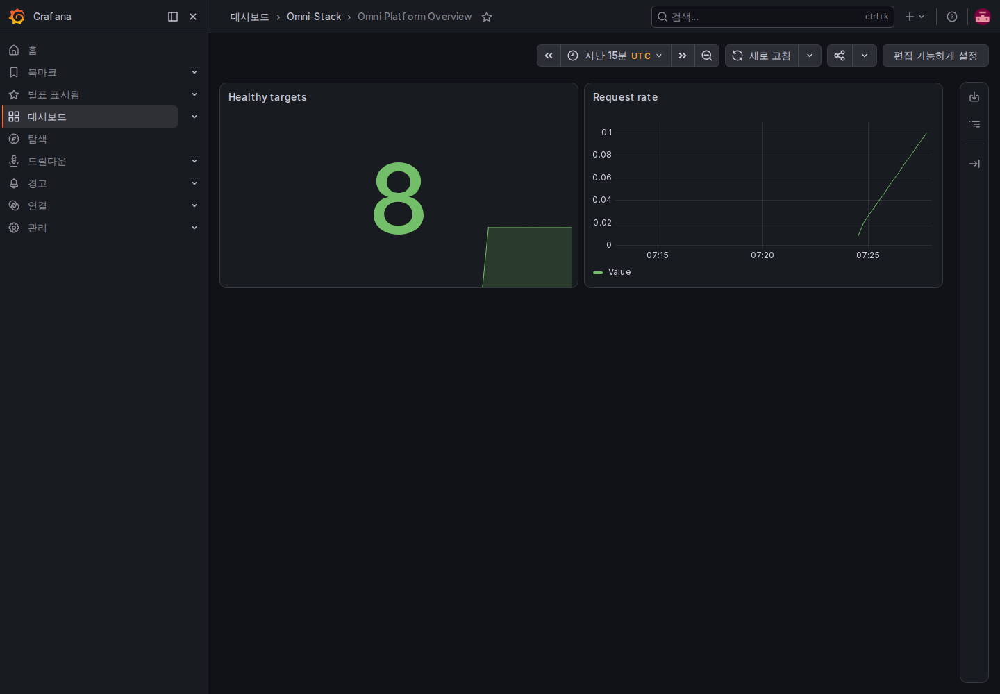
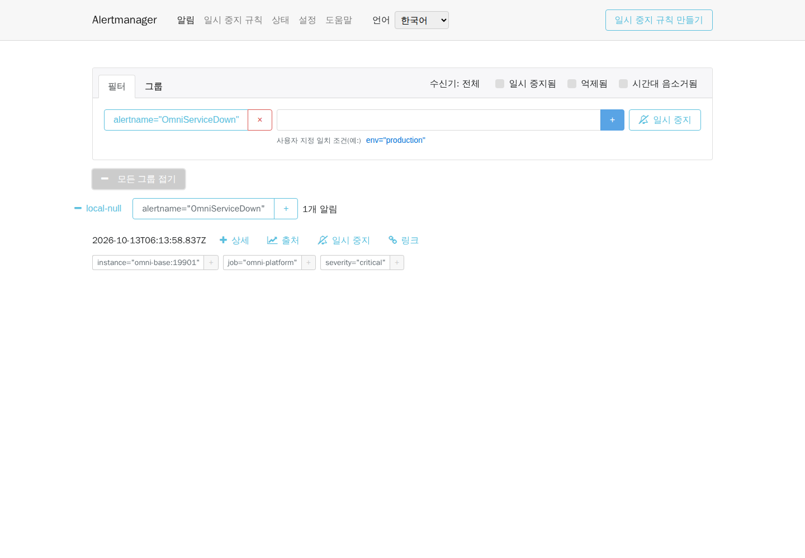

# 운영, 관측성, 백업, 복구와 업그레이드

로컬 검증과 운영 계획 안내입니다. 운영에서는 용량, 규정, 책임에 맞게 재구성하고 로컬 Compose 포트를 그대로 공개하지 않습니다.

## 1. 시작 순서

```text
MySQL / Redis / RocketMQ → Liquibase migrator → Nacos / XXL-JOB (둘 다 omni-db-migrator service_completed_successfully 에 의존)
→ Auth / Base / Workflow / 업무 서비스 → Gateway / Frontend
```

`docker compose --profile full up -d` 후 컨테이너 시작이 아니라 health를 확인하고 migrator 성공 후 트래픽을 받습니다.

## 2. 관측성 profile

```bash
docker compose --profile full --profile observability up -d
```

OpenTelemetry Collector, Prometheus, Alertmanager와 네 언어 UI, Tempo, Loki, Alloy, Grafana, Pushgateway, Node Exporter, cAdvisor와 대시보드를 시작합니다. 동기는 W3C `traceparent`, `X-Trace-Id`는 실제 trace, 비동기는 producer/consumer trace를 연결합니다.

운영 샘플링, 보존, 임계값, 수신자는 용량에 맞춥니다. 관측을 중지할 때 비공개 `.env`도 `OTLP_EXPORT_ENABLED=false`, `TRACING_SAMPLING_PROBABILITY=0.0`으로 되돌리고 관련 앱 컨테이너를 갱신합니다. Collector 중지나 `docker restart`만으로 컨테이너 환경 변수를 갱신할 수 없습니다.

### 2.1 실제 요청의 Trace·로그·메트릭 따라가기

1. `full` 프리셋과 무작위 비공개 `GRAFANA_ADMIN_PASSWORD`를 사용합니다. 교육 검증에서는 `OTLP_EXPORT_ENABLED=true`, `TRACING_SAMPLING_PROBABILITY=1.0`을 설정하고 `http://otel-collector:4318/v1/traces`를 유지한 뒤 위 Compose 명령을 실행합니다. 기본값은 내보내기 비활성·샘플링 0입니다. 관측 컨테이너만 시작해도 업무 Trace가 생기지는 않습니다.
2. `docker compose ps --all`에서 migrator 성공 종료와 선택한 앱 health를 확인합니다. 로컬 Grafana `http://localhost:3001`에 비공개 설정으로 로그인하고 **Omni Platform Overview**를 선택합니다. RED, JVM, Feign, MQ, Workflow, 마이그레이션 대시보드도 있습니다. 시간 범위에 실제 요청 시각을 포함합니다. 트래픽이 없어 일부 패널에 데이터가 없다는 사실만으로 장애라고 판단하지 않습니다.
3. Gateway를 통해 권한이 있는 사전 조회를 수행하고 응답 `X-Trace-Id`를 기록합니다. Grafana Explore에서 Tempo를 선택해 같은 ID의 Gateway와 Base Span을 확인합니다. Loki로 전환해 실제 컨테이너 레이블과 동일한 `traceId`의 구조화 로그를 찾습니다. 전체 토큰·개인정보·SQL 인자를 공개 증거로 복사하지 않습니다.
4. Prometheus `http://localhost:9090`에서 `up{job="omni-platform"}`를 조회하고 앱 8개의 관리 포트 `19900`~`19907`을 확인합니다. 업무 API 성공은 메트릭 수집 성공과 별개입니다. 수집·평가는 15초 주기이며 예상 시간이 아니라 실제 복구 결과를 확인합니다.

2026-10-12 [비식별 증거](../reference/evidence/observability-2026-10-12.json)는 실제 요청의 Gateway/Base Span 25개, 동일 Trace 로그 6개와 업무 target 8개의 UP을 기록합니다. 직접 만든 사전은 정확한 ID로 삭제해 잔여가 0입니다. 이번에는 관측 구성요소 8개만 시작하고 호스트 접근이 필요한 Node Exporter/cAdvisor는 제외하여 target 13개 중 2개가 DOWN입니다. 전체 target 정상, 운영 샘플링 적절성이나 비동기 Trace 전체 검증을 의미하지 않습니다.



[태블릿 원본](../images/ko-KR/operations-dashboard-tablet.png)과 [휴대폰 원본](../images/ko-KR/operations-dashboard-mobile.png)도 실제 UI입니다. 휴대폰 이동 경로는 축약되고 사전 구성한 Dashboard·패널 제목은 영어입니다. 재사용 Docker 진입점은 [읽기 전용 검증기](../../scripts/fixtures/verify-observability.mjs)와 [Playwright 원본 수집기](../../scripts/fixtures/capture-observability.mjs)입니다. `E2E_OBSERVABILITY_SERVICES`로 선택 앱을 명시하여 축소 프로젝트에 전체 8개 서비스를 요구하지 않도록 합니다. 수집기는 `dashboard|alert`와 새 비공개 출력 폴더를 받고 Grafana 자격증명은 Docker `--env-file`로 전달합니다.

## 3. 상태와 알림

앱 health, Prometheus targets, Gateway/Feign 오류와 지연, JVM/풀, Outbox/Inbox, 데드레터, XXL-JOB, Workflow, migration을 감시합니다.

### 3.1 격리 교육 프로젝트에서 알림 발생과 복구 확인

로컬 `alertmanager-ui`는 공식 v0.30.1 Elm 소스에서 중국어·영어·일본어·한국어 UI를 빌드합니다. 백엔드는 공식 Alertmanager를 유지합니다. UI 소스를 수정한 뒤 저장소 루트에서 실행합니다.

```bash
docker compose --profile full --profile observability build alertmanager-ui
docker compose --profile full --profile observability up -d alertmanager-ui
```

1. 표준 로컬 진입점은 `http://localhost:9093/`이며 초기 언어는 중국어입니다. **언어**에서 바꾸거나 `/zh-CN/`, `/en-US/`, `/ja-JP/`, `/ko-KR/`를 직접 엽니다. 언어를 바꿔도 현재 페이지와 필터를 유지하며 내부 백엔드는 `alertmanager:9093`입니다.
2. 장애 훈련은 전용 네트워크·볼륨과 Base의 호스트 포트 미공개를 확인한 교육 프로젝트에서만 수행합니다. Base의 정확한 컨테이너 ID·이미지·상태를 기록하고 실제 수신기가 외부 알림 채널이 없는 `local-null`인지 확인합니다. 표준 `omni-stack`을 임의로 중지해도 되는 일회용 환경으로 취급하지 않습니다.
3. 해당 Base 컨테이너를 중지합니다. Prometheus의 `OmniServiceDown`이 2분 동안 pending을 유지한 뒤 firing이 되는지 관찰하고 Alertmanager에서 `instance=omni-base:19901`을 확인합니다. 실제 알림이 도착한 뒤 촬영합니다. 빈 목록, 시간 경과 또는 이미지 생성만으로 도착을 증명할 수 없습니다.
4. **시간대 음소거됨** 글자 라벨을 클릭하여 필터 체크 상태가 바뀌는지 확인한 뒤 다시 클릭해 복원합니다. 이 옵션들은 일시 중지·억제·시간대 음소거 상태로 알림 목록을 필터링하며 장애를 복구하거나 알림 전송 규칙을 변경하지 않습니다. 상태 페이지에서 버전을 확인합니다. 설정에서 한 주의 시작 요일을 바꾼 뒤 새로고침과 언어 전환에서도 설정이 유지되는지 확인합니다.
5. 촬영 종료나 중간 실패 시에도 같은 Base 컨테이너를 시작합니다. 앱 정상 상태, Prometheus 수집 UP, 알림 해제를 기다립니다. 정확한 컨테이너와 기록을 대조한 뒤 다시 조작하며 중지를 반복하거나 서비스를 새로 만들지 않습니다.

[현재 네 언어 증거](../reference/evidence/alertmanager-i18n-2026-10-13.json)는 새 실제 알림 발생·복구, 네 언어와 세 화면 크기의 원본 12장, 데스크톱/휴대폰 설정·경로·폼 검증 8개를 기록합니다. 브라우저는 GET/HEAD만 허용하며 일시 중지 규칙이나 가짜 알림을 만들지 않습니다. `local-null`은 외부 알림을 보내지 않으므로 이메일·채팅 도착은 검증하지 않았습니다. 휴대폰 탐색 메뉴는 세로로 배치되며 상세·동작에는 일반적인 아래 방향 스크롤이 필요할 수 있습니다. 세 화면 크기 모두 페이지 가로 넘침이 없습니다. 알림 레이블, 수신기 이름, 프로토콜 시각은 원래 데이터를 유지합니다.

실제 `OmniServiceDown`이 있을 때 PowerShell에서 [읽기 전용 수집](../../scripts/fixtures/capture-alertmanager-i18n.mjs)을 재현할 수 있습니다. `<verified-training-network>`를 확인한 교육 네트워크 이름으로 바꿉니다. `docker inspect <Base-container-ID> --format '{{json .NetworkSettings.Networks}}'`로 확인합니다. 저장소 밖의 새 출력 폴더를 사용하고 수집 실패 시에도 Base를 복구합니다.

```powershell
$outputPath = Join-Path $env:TEMP ('omni-alert-i18n-' + [guid]::NewGuid())
New-Item -ItemType Directory -Path $outputPath | Out-Null
docker run --rm --network '<verified-training-network>' --mount "type=bind,source=$((Get-Location).Path),target=/workspace,readonly" --mount "type=bind,source=$outputPath,target=/output" --mount 'type=volume,source=omni-docs-browser-modules,target=/browser/node_modules' -w /workspace mcr.microsoft.com/playwright:v1.61.1-noble sh -c 'npm install --prefix /browser --no-save --package-lock=false --ignore-scripts playwright@1.61.1 && node scripts/fixtures/capture-alertmanager-i18n.mjs /output'
```



[태블릿 원본](../images/ko-KR/operations-alert-localized-tablet.png)과 [휴대폰 원본](../images/ko-KR/operations-alert-localized-mobile.png)도 같은 실제 알림과 해당 언어 UI를 사용합니다. 과거 [영어 조작 기록](../reference/evidence/alertmanager-controls-2026-10-13.json)은 이전 UI만 검증합니다. 소스 고정 해시, 라이선스, 업그레이드 제약은 [ADR-0004](../adr/0004-native-alertmanager-localization.md)를 참조합니다.

## 4. 백업

MySQL, Nacos 영속 설정, 외부 Secret 목록, Grafana/알림 설정, 배포 버전, 이미지 digest, `database/seed/manifest.yaml`, `scaffold.lock`을 보호합니다. Redis, MQ, Tempo, Loki는 RPO/RTO에 따라 결정합니다.

## 5. 복구 훈련

격리 환경에 복원하고 운영 하류를 차단한 뒤 migration, 시작, health, 로그인, 권한, 업무, 비동기, 데이터 수를 검증하고 실제 복구 시간을 기록합니다. 복구 성공 증거가 없는 백업은 사용 가능하지 않습니다.

### 5.1 로컬 Docker에서 논리 복원 재현

교육 프로젝트의 컨테이너, 네트워크, 볼륨, 이미지를 기록하고 호스트 포트를 공개하지 않습니다. 표준 `omni-stack`은 초기화할 fixture가 아닙니다. 호스트는 Docker 래퍼만 실행하며 MySQL 내보내기·가져오기와 migrator는 컨테이너에서 실행합니다. SQL 원본 바이트를 보존하려면 PowerShell 7.4+가 필요합니다.

```powershell
$sourceProject = 'omni-e2e-training-20261012a'
$output = Join-Path $env:TEMP ('omni-backup-' + [guid]::NewGuid())
./scripts/fixtures/run-backup-rehearsal.ps1 -SourceProject $sourceProject -RunId 'training-20261012a' -OutputDirectory $output
```

확인한 기존 교육 프로젝트와 새 실행 ID로 바꿉니다. 저장소 밖 출력 폴더는 없어야 합니다. 정상 MySQL 하나, 성공 종료한 migrator, 프로젝트 전용 네트워크·볼륨, 호스트 포트 없음과 새 복원 대상을 검사합니다. 기본값은 원본 migrator 이미지입니다. 소스 수정 후 새 이미지를 빌드하고 `-MigratorImage`로 지정합니다. manifest 마운트만으로 JAR 내 리소스를 바꿀 수 없습니다.

2026-10-12 [비식별 기록](../reference/evidence/backup-2026-10-12.json)은 DB 9개, 테이블 181개, 마이그레이션 이력 60개, 47,978,544바이트 백업을 기록합니다. 복원 전후 안정적인 DB 8개의 해시가 같습니다. XXL 실행 데이터도 백업하지만 서로 다른 시점의 해시 비교에서는 제외합니다. 처음에는 사용자 모델 9개도 시드로 계산하여 실패했습니다. 공식 자연 키 5개로 한정하면 기대값을 유지하며 통과합니다. 복원 사본의 `leave` 키를 임시로 제외하면 기대 5·실제 4로 실패하고, 키를 복구하면 해시가 일치합니다. 기대값 완화, 드리프트 승인, 과거 마이그레이션 수정은 없습니다.

성공 시 이번 복원 컨테이너·네트워크·볼륨만 삭제하고 비공개 백업을 보관합니다. 실패 시 기록·종료 코드·실제 DB를 대조한 뒤 미완료 단계부터 진행하며 무작정 다시 가져오지 않습니다. 이 단계는 DB 논리 복원을 검증합니다. Redis 세션, Broker 큐, 외부 Secret, 앱 상태와 핵심 흐름은 별도 검증하며 운영 재해 복구나 RPO/RTO 충족으로 간주하지 않습니다.

### 5.2 데이터 복원 후 애플리케이션 검증

기록한 이미지를 별도 전용 네트워크와 새 볼륨에서 사용하고 호스트 포트를 공개하지 않습니다. DB 9개를 복원하고 공식 migrator를 재실행한 뒤 의존 서비스와 앱을 시작합니다. 복원된 XXL 데이터에는 원본 실행기 주소와 활성 작업이 남아 있을 수 있습니다. 복원 사본에서 이전 트리거를 격리하고 등록 주소를 제거한 뒤 스케줄러를 시작하여 원본 환경으로 작업이 전달되지 않게 합니다. 원본 DB는 변경하지 않습니다.

같은 [기록](../reference/evidence/backup-2026-10-12.json)의 `application_restore`에는 실제 검사 21개가 있습니다. 실행 중 서비스 15개와 성공 종료한 migrator, 프런트엔드, 익명 401, 일반 사용자 403/404, 복원한 공급망/CRM 상태 8개, 새 사전 작업이 공식 Outbox/Broker를 거쳐 작업 로그 정확히 1개로 전달된 결과와 사전 삭제입니다. 마이그레이션 이력은 60개입니다. 복원 컨테이너 16개·볼륨 3개·전용 네트워크만 정확히 삭제하고 원본 환경과 비공개 백업은 보관했습니다.

테스트 클래스패스에서 발급한 단기 신원으로 복원 후 권한을 확인했습니다. 이전 Redis 세션 복원과 사람이 입력하는 CAPTCHA 비밀번호 로그인은 재실행하지 않았습니다. 새 Broker 전달은 이전 큐 백업을 증명하지 않습니다. 이미지 재사용과 복원 성공을 현재 소스의 모든 운영 이미지 재빌드나 운영 전환 훈련으로 간주하지 않습니다.

## 6. 업그레이드

expand → migrate/backfill → contract를 따릅니다. 릴리스 검토, 백업 복구, 운영 유사 데이터 upgrade, 호환 Schema, 양쪽 구조 지원 앱, 관측, 구버전 종료 후 contract 순서입니다. 실행한 changeSet을 바꾸지 않고 백업 복원이나 보상 changeSet을 사용합니다.

## 7. 보안

관리 포트는 내부 또는 localhost로 제한하고 TLS, reverse proxy/WAF, 최소 권한, 외부 Secret 관리를 사용합니다. Secret을 Git, 이미지 레이어, 스크린샷, 명령 기록, 로그에 남기지 않습니다. [Docker 배포](../docker-deployment.kr.md)와 [관측성](../observability.kr.md)을 참고하세요.
