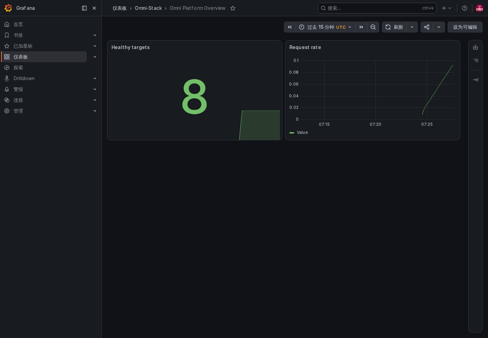
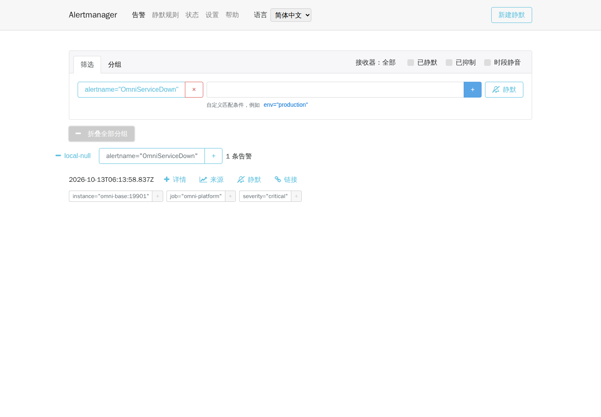

# 运维、可观测性、备份、恢复与升级指南

本指南面向本地模板验证和生产落地评审。生产环境需要根据容量、合规和组织职责重新配置，不应原样暴露本地 Compose 端口。

## 1. 启动与依赖顺序

```text
MySQL / Redis / RocketMQ
→ Liquibase migrator（必须成功退出）
→ Nacos / XXL-JOB（depends_on: omni-db-migrator service_completed_successfully）
→ Auth / Base / Workflow / 领域服务
→ Gateway / Frontend
```

使用 `docker compose --profile full up -d` 后以健康检查为准，不以容器“已启动”代替应用可用。迁移器必须成功退出，应用才可接受流量。

## 2. 可观测性 profile

```bash
docker compose --profile full --profile observability up -d
```

观测栈包含 OpenTelemetry Collector、Prometheus、Alertmanager 与四语界面、Tempo、Loki、Alloy、Grafana、Pushgateway、Node Exporter 和 cAdvisor。默认预置平台概览、服务 RED、JVM、Feign、MQ、Workflow 和数据库迁移 Dashboard。

同步请求使用 W3C `traceparent`，响应 `X-Trace-Id` 映射实际 traceId。异步消息保存生产 Trace，并在消费者日志中同时记录生产和消费 Trace。

生产采样率、保留期、告警阈值和接收人必须按容量校准。停用观测组件时，将 `OTLP_EXPORT_ENABLED=false`、`TRACING_SAMPLING_PROBABILITY=0.0` 同时写回私有 `.env` 并更新相关应用容器；只停止 Collector 或只执行 `docker restart` 不会更新容器环境。

### 2.1 从真实请求找到 Trace、日志和指标

1. 使用 `full` 预设，在私有 `.env` 设置随机 `GRAFANA_ADMIN_PASSWORD`。教学取证时设置 `OTLP_EXPORT_ENABLED=true`、`TRACING_SAMPLING_PROBABILITY=1.0`，端点保持 `http://otel-collector:4318/v1/traces`，再执行上面的 Compose 命令。默认导出关闭、采样为零，只有启动观测容器并不会自动产生业务 Trace。
2. 运行 `docker compose ps --all`：migrator 应成功退出，其余已选应用应健康。打开 Grafana 的本地入口 `http://localhost:3001`，用私有配置登录，选择 **Omni Platform Overview**；预置仪表盘还包括 RED、JVM、Feign、MQ、Workflow 和迁移。图表时间范围必须覆盖实际请求时间；无请求时部分面板无数据不等于故障。
3. 经 Gateway 执行一次已授权的字典查询，记录响应 `X-Trace-Id`。在 Grafana Explore 选择 Tempo，以该 Trace ID 查询，应能看到 Gateway 与 Base 的 Span。切换 Loki，先用实际容器标签过滤，再以同一 `traceId` 查找结构化日志；不要把完整令牌、用户信息或 SQL 参数复制进公开证据。
4. 在 Prometheus `http://localhost:9090` 查询 `up{job="omni-platform"}`，核对八个应用管理端口 `19900` 至 `19907`；业务端口能响应不能代替指标采集成功。默认每 15 秒采集/评估，恢复后先等待实际结果，不能仅凭预计时间判定成功。

2026-10-12 的[脱敏证据](../reference/evidence/observability-2026-10-12.json)记录一次真实请求的 Gateway/Base 25 个 Span、6 条相同 Trace 日志和八个业务采集目标 UP。自建字典已按确切 ID 删除、残留为零。本轮仅启动八个观测组件，未启动需访问宿主的 Node Exporter/cAdvisor，13 个目标中有两个 DOWN；它不证明全部观测目标健康、生产采样适当或异步链路也已覆盖。



[平板原图](../images/zh-CN/operations-dashboard-tablet.png)与[手机原图](../images/zh-CN/operations-dashboard-mobile.png)也来自实际界面；手机面包屑会截断，预置 Dashboard 和面板标题仍为英文。可复用的 Docker 取证入口为 [只读验证脚本](../../scripts/fixtures/verify-observability.mjs)和[Playwright 原图采集脚本](../../scripts/fixtures/capture-observability.mjs)。验证脚本要求通过 `E2E_OBSERVABILITY_SERVICES` 显式传入所选应用，避免对裁剪项目仍要求完整八服务；截图脚本接收 `dashboard|alert` 和新的私有输出目录，Grafana 凭据通过 Docker `--env-file` 注入。

## 3. 健康与告警

重点检查：

- Compose 服务和应用 Actuator 健康。
- Prometheus targets 全部 UP。
- Gateway、Feign 和业务接口错误率、P95/P99。
- MySQL 连接池、JVM、线程和 GC。
- Outbox/Inbox 堆积、死信和重试。
- XXL-JOB 执行失败。
- Workflow 启动失败和审批重试。
- Liquibase 迁移失败或耗时异常。

### 3.1 在隔离教学项目观察告警与恢复

本地 `alertmanager-ui` 从官方 v0.30.1 Elm 源码编译中、英、日、韩界面，后端仍为官方 Alertmanager。升级界面源码后，在仓库根目录执行：

```bash
docker compose --profile full --profile observability build alertmanager-ui
docker compose --profile full --profile observability up -d alertmanager-ui
```

1. 标准本地入口是 `http://localhost:9093/`，默认中文。通过“语言”切换四语，或直接打开 `/zh-CN/`、`/en-US/`、`/ja-JP/`、`/ko-KR/`。语言切换保留当前页面和筛选条件；容器内部后端仍使用 `alertmanager:9093`。
2. 故障演练只在已经核实独占网络、数据卷、Base 无宿主端口的教学项目进行。记录 Base 的确切容器 ID、镜像与健康状态，并确认实际接收器是无外部通知通道的 `local-null`。标准 `omni-stack` 不是可随意停机的教学夹具。
3. 停止该 Base 容器，观察 Prometheus 的 `OmniServiceDown` 持续两分钟 pending 后进入 firing，再在 Alertmanager 核对 `instance=omni-base:19901`。先确认真实告警到达，再截图；空列表、时间已到或图片已生成都不能替代到达证据。
4. 点击“时段静音”的文字标签，确认筛选勾选状态变化，再点击恢复。这些选项按告警的静默、抑制和时段静音状态筛选列表，切换它们不会修复故障或修改通知规则。状态页可查看版本；设置页切换每周起始日后，刷新和切换语言应保留设置。
5. 截图结束或任一步骤失败，都启动同一个 Base 容器，等待应用健康、Prometheus 采集 UP、告警消失。失败时先检查确切容器和回执，不重复停机或新建服务。

[当前四语证据](../reference/evidence/alertmanager-i18n-2026-10-13.json)记录一次新的真实告警触发与恢复、四语言三视口的12张原图，以及桌面/手机共8组设置、路由和表单检查。浏览器只允许 GET/HEAD，没有创建静默或注入假告警。`local-null` 没有发送外部通知，因此本次不能证明邮件或聊天送达。手机导航纵向排列，详情和操作可能需要向下滚动；三种视口均没有横向页面溢出。告警标签、接收器名称和协议时间是原始数据，保持原值。

已有真实 `OmniServiceDown` 到达时，可以在 PowerShell 中复现[只读采集](../../scripts/fixtures/capture-alertmanager-i18n.mjs)。先把 `<verified-training-network>` 替换为已核实的教学网络名；通过 `docker inspect <Base容器ID> --format '{{json .NetworkSettings.Networks}}'` 查询。输出必须是新的仓库外目录，采集失败也必须恢复 Base。

```powershell
$outputPath = Join-Path $env:TEMP ('omni-alert-i18n-' + [guid]::NewGuid())
New-Item -ItemType Directory -Path $outputPath | Out-Null
docker run --rm --network '<verified-training-network>' --mount "type=bind,source=$((Get-Location).Path),target=/workspace,readonly" --mount "type=bind,source=$outputPath,target=/output" --mount 'type=volume,source=omni-docs-browser-modules,target=/browser/node_modules' -w /workspace mcr.microsoft.com/playwright:v1.61.1-noble sh -c 'npm install --prefix /browser --no-save --package-lock=false --ignore-scripts playwright@1.61.1 && node scripts/fixtures/capture-alertmanager-i18n.mjs /output'
```



[平板原图](../images/zh-CN/operations-alert-localized-tablet.png)与[手机原图](../images/zh-CN/operations-alert-localized-mobile.png)使用同一真实告警及对应界面语言。历史[英文控件记录](../reference/evidence/alertmanager-controls-2026-10-13.json)只证明旧界面，不能替代当前四语验证。源码固定摘要、许可证与升级约束见 [ADR-0004](../adr/0004-native-alertmanager-localization.md)。

## 4. 备份

备份至少包含：

- MySQL 全库或按恢复单元的逻辑/物理备份。
- Nacos 持久化配置和服务所需外部 Secret 清单。
- Grafana 自定义配置、告警接收配置和必要的对象存储数据。
- 部署版本、镜像摘要、`database/seed/manifest.yaml` 和 `scaffold.lock`。

Redis、MQ、Tempo、Loki 是否备份取决于恢复目标和保留策略，必须形成书面 RPO/RTO。

## 5. 恢复演练

1. 建立隔离恢复环境。
2. 恢复数据库和配置，不连接生产下游。
3. 运行 migrator，确认 changeSet 状态一致。
4. 启动应用并执行健康、登录、权限、核心业务和异步消息检查。
5. 核对数据总量、关键业务状态、Outbox/Inbox 和 Workflow 实例。
6. 记录实际恢复时间和缺口。

没有成功恢复证据的备份不能算可用。

### 5.1 在本机 Docker 重复逻辑恢复

先记录教学项目的容器、网络、卷和镜像，所有宿主端口为空；不要把标准 `omni-stack` 当作可重置的夹具。宿主仅运行 Docker 包装器，MySQL 导出、导入与迁移器均在容器内执行。PowerShell 需要 7.4+，确保 SQL 重定向保留原始字节。

```powershell
$sourceProject = 'omni-e2e-training-20261012a'
$output = Join-Path $env:TEMP ('omni-backup-' + [guid]::NewGuid())
./scripts/fixtures/run-backup-rehearsal.ps1 -SourceProject $sourceProject -RunId 'training-20261012a' -OutputDirectory $output
```

替换为确实存在且已核实的教学项目名与新运行号；仓库外输出目录必须不存在。入口要求唯一健康 MySQL、成功退出的 migrator、项目独占网络/卷及零宿主端口，拒绝已有恢复目标。默认复用源 migrator 镜像；源码修复后先构建新镜像并显式传入 `-MigratorImage`，不能仅挂载 manifest 冒充替换 JAR 内资源。

2026-10-12 的[脱敏回执](../reference/evidence/backup-2026-10-12.json)记录九库、181 张表、60 条迁移历史和 47,978,544 字节备份。恢复前后八库稳定数据摘要相同，XXL 运行数据完整备份但不参加跨时间摘要。初次重放误把 9 个用户模型也算作种子；限定五个正式自然键后通过，期望值未变。临时移走恢复副本的 `leave` 自然键，仍按“期望 5、实际 4”失败；恢复该键后摘要一致。没有调低期望、接受漂移或重写历史迁移。

成功只删除本次恢复容器、网络和卷，保留私有备份。失败先核对回执、退出码和实际数据库状态，再接着未完成步骤，不能盲目重复导入。此步骤证明数据库逻辑恢复；Redis 会话、Broker 队列、外部 Secret、应用健康和核心链路仍须分别验证，不能据此宣称生产灾备或 RPO/RTO 达标。

### 5.2 数据恢复后再验证应用

在另一套独立网络和新卷中复用本次已记录镜像，不发布宿主端口。先恢复九库并重放正式 migrator，再启动依赖和应用。恢复的 XXL 数据可能仍含源执行器地址和启用任务：在恢复副本内隔离这些旧触发器、清理旧注册地址后才启动调度，不能让演练向原环境发任务；源库保持原样。

同一[回执](../reference/evidence/backup-2026-10-12.json)中的 `application_restore` 记录 21 项实际检查：15 个运行服务和成功退出的 migrator、前端、匿名 401、普通身份 403/404、八项供应链/CRM 恢复状态，以及新建字典经过正式 Outbox/Broker 产生唯一操作日志后删除。恢复副本保留 60 条迁移历史。16 个恢复容器、3 个卷和专用网络已精确清理，原环境与私有备份保留。

本轮通过测试类路径签发短期身份验证恢复后的权限，未恢复旧 Redis 会话，也没有再次执行人工验证码密码登录；新 Broker 验证新消息投递，不能证明旧队列备份。镜像复用与成功恢复不等于从当前源码重新构建所有生产镜像，更不等于生产切换演练。

## 6. 升级

升级遵循 expand → migrate/backfill → contract：

1. 阅读版本升级说明和预设差异。
2. 备份并验证可恢复。
3. 在生产样本副本执行 upgrade 测试。
4. 先发布向后兼容 Schema。
5. 发布兼容新旧结构的应用并完成回填。
6. 观察指标和错误预算。
7. 只在旧消费者和旧版本全部退出后收缩契约。

Liquibase changeSet forward-only。数据库回滚优先恢复备份或发布补偿 changeSet，不修改已经执行的历史 changeSet。

## 7. 安全

管理端口绑定内网或 localhost。外部入口通过 TLS、WAF/反向代理和最小权限访问。Secret 不进入 Git、镜像层、截图、命令行历史或日志。详细 Compose 配置见 [Docker 部署指南](../docker-deployment.md)，指标与 Trace 见 [可观测性文档](../observability.md)。
