# Menus, Roles, Functional Permissions, and Data Permissions

Start the required modules from the [Wiki](../wiki/index.en.md), then open `http://localhost:3000`. This guide uses tenant 1 in an isolated teaching environment. Prepare an administrator and an ordinary employee to check both allowed and denied access; do not experiment by deleting production users or broadening production roles.

There are four evidence batches: the [2026-10-17 user lists](../reference/evidence/permissions-users-2026-10-17.json) use current source artifacts and read-only requests; Figures 2–7 come from the [2026-10-12 basic acceptance](../reference/evidence/basic-2026-10-12.json); procurement images come from the [scope record](../reference/evidence/procurement-scope-2026-10-12.json). The basic batch selects 44 independent checks/images across several runs, including recaptures after failures. It is not one entirely green 44-case run. These captures use short-lived test-classpath tokens derived from actual database roles. They do not verify password/CAPTCHA login or every write operation described here.

The added [2026-10-18 core denial and recovery evidence](../reference/evidence/core-permissions-errors-2026-10-18.json) comes from an actually generated and moved core project. The following examples distinguish the temporary read-only role, real 403, and client fault injection.

## 1. Relationship Model

Functional authorization follows these table relationships:

```text
sys_user → sys_user_role → sys_role → sys_role_permission → sys_permission
```

| Layer | Purpose |
| --- | --- |
| User | A tenant account with a status and primary organization, `primary_unit_id`. |
| Role | Assigned through `sys_user_role`; combines functional permissions and a data-scope policy. |
| Permission | Actual node literals are `DIRECTORY`, `MENU`, and `API`. “Button/API” describes a use, not a `BUTTON` node type. |
| Data scope | Role `data_scope`, configured organizations, and the user's primary organization determine accessible data separately from functional authorization. |

`sys_user_role_scope` separately binds a user, role, and organization for workflow candidate/CC resolution. It does not replace `sys_user_role` in the chain above. An operation code looks like `procurement:requisition:create`. Directory/menu nodes provide navigation; `API` nodes authorize operations.

## 2. Dynamic Menus

The authenticated frontend calls `GET /api/auth/menus`. Auth returns a tree filtered by current permissions and tenant. Management routes register view-matched `MENU` nodes under `/admin`: for example, `system:user` becomes `/admin/system/user`. `DIRECTORY` nodes only group entries, and `srm:portal:` menus are excluded from management registration. The supplier portal has dedicated protected routes; this does not mean static routes generally bypass authorization.

If a menu is missing, check in order:

1. The selected preset and runtime include the module.
2. Enabled directory, menu, and operation nodes exist in `sys_permission`, with codes matching frontend views.
3. The current tenant's roles receive the required menu and operations through `sys_role_permission`.
4. The JWT `scope` is current. Sign out and sign in after changing roles or grants, then reload menus.
5. Buttons use the same operation code in `v-permission`, and the backend permits the operation.

A user without permissions may receive an empty menu. A failed request should produce the menu failure page and retry controls. Diagnose the request before retrying; a hard-coded management route does not repair missing authorization or an unavailable endpoint.

## 3. Functional Permissions

Backend writes normally check operation codes with `@PreAuthorize`; frontend buttons use matching `v-permission` codes. The directive switches `display:none` on mount/update to retain Vue's reactive structure. Hiding a button does not stop direct requests, so verify backend rejection separately.

`MyJobController` is an explicit exception: personal tasks check `createBy == currentUser` per row. Do not add endpoint-level RBAC to that ownership model.

The supplier portal does not require `SUPPLIER` for every endpoint. `POST /api/srm/portal/enroll` requires `srm:portal:enroll` and an enrollment body containing a valid `inviteToken` and client `requestId`. `GET /enrollment` and `POST /enrollment/retry` accept either `srm:portal:enroll` or `srm:portal:profile`. The default `USER` role can participate in enrollment; company-profile operations such as `/profile` additionally require `SUPPLIER`, the operation permission, and an active portal association. This is not evidence of completed CAPTCHA-based self-registration.

## 4. Data Permissions

DataScope restricts the data available after functional authorization. The role page exposes six actual options:

| Literal | Meaning |
| --- | --- |
| `ALL` | Full data scope; independent tenant and endpoint checks still apply. |
| `TENANT` | The current tenant. |
| `DEPT_AND_BELOW` | The primary organization and its descendants. |
| `DEPT` | The primary organization. |
| `CUSTOM` | Organizations configured for the role, including their descendants during resolution. |
| `SELF` | The current user's scope, using the domain-specific comparison column. |

Multiple enabled roles merge by the wider priority: `ALL > TENANT > DEPT_AND_BELOW > DEPT > CUSTOM > SELF`. A missing scope falls back to `SELF`. Default resolution merges the user's roles; permission-specific resolution considers only roles actually granting that permission code. Adding a `SELF` role to a user who already has a broader role does not narrow their effective scope. The display order of frontend options is not the merge order.

Servlet services establish context from trusted Gateway identity. MyBatis applies data permission before pagination, and a `finally` block must clear ThreadLocal context after the request. Tenant boundaries remain independent; selecting `ALL` does not justify removing tenant predicates.

Domains cannot share one assumed owner column. CRM, SRM, Procurement, and Asset define their aggregate visibility separately. Child records inherit through the aggregate root; do not append an owner column absent from a child table. Procurement requisitions use requester columns, while RFQs/orders/receipts use owner columns. Asset management views use owner columns; “my assets,” acceptance, and returns use the current user.

## 5. Role Maintenance

These steps describe the current UI/API. The screenshots verify reads and do not mean this run submitted the changes. Record existing roles, grants, and organizations first, and use a dedicated teaching user. Do not disable, delete, or revoke the administrator you are using.

1. With `system:role:list`, open System Management → Role Management (`/admin/system/role`). Creation also needs `system:role:create`; editing, permission assignment, and custom-department assignment need `system:role:update`.
2. For a new role, enter a code/name and deliberately select a data scope. The current create form defaults to `ALL`, which is not a least-privilege default. The code is disabled during editing. After saving, refresh and check the name/scope.
3. Open Assign Permissions for the role and explicitly select the required menu and operation nodes. A menu does not automatically grant all its APIs. Save, reopen, and verify the selected values.
4. For `CUSTOM`, use Assign Departments to select organizations and save. The button is disabled for other scopes. Choose valid organizations in the current tenant; repair an empty selection or incorrect primary organization instead of switching to `ALL` to hide an empty list.
5. Open User Management (`/admin/system/user`): `system:user:list` reads users, and `system:user:update` permits Assign Roles. This page has no primary-organization editor and does not maintain `sys_user_role_scope`. Set `primaryUnitId` through the profile-update API after checking tenant ownership. Workflow organization bindings are covered by the [controlled scope fixture](../wiki/data-and-fixtures.en.md).
6. Sign out and sign in as the target user. Check menus, buttons, allowed APIs, and visible data; do not test only as a super administrator. Requests and data must belong to the same tenant.
7. Check a real HTTP 403 for a missing operation permission, then a list/detail result outside the data scope while functional permission is present. On failure, retain the HTTP status, response-body `code`, Trace ID, and whether the object still exists. Repair and retry. Restore recorded settings when removing test grants; do not remove original roles or documents.

| Operation | Formal API and request |
| --- | --- |
| User roles | `GET /api/auth/user/{userId}/roles` reads role IDs; `POST` to the same path sends an array of role IDs and needs `system:user:update`. |
| Primary organization | Whitelisted `primaryUnitId` in `PUT /api/auth/user/{id}`; requires `system:user:update` and cannot change roles, status, or tenant through that payload. |
| Role permissions | `POST /api/auth/permission/role/{roleId}/assign` sends an array of permission IDs. |
| Custom organizations | `GET /api/auth/role/{roleId}/depts` reads current values; `POST` to the same path sends an array of organization IDs. |

Role, permission, and organization assignments replace the full set. Read existing IDs first and submit the complete intended set, not just additions; an empty array clears the corresponding assignments.

### Screenshot

Figure 1 uses 2026-10-17 artifacts; Figures 2–7 are dated historical cases. Some Status, Phone, Email, and Retry labels in the historical Japanese/Korean UI were actual English fallbacks. Teaching data names remain unchanged. Do not describe these historical images as captures of the current runtime.

#### core-A: Authenticated access to system configuration is denied

- Prerequisites: the actual generated `core` project was built in isolated Docker, with native `lite` configuration and its own database.
- Identity: tenant 1 zhangsan originally has `EMPLOYEE` and no management menu. This run temporarily adds the existing read-only `USER` through the formal role API and issues fresh short-lived tokens from database claims; `system:config:list` remains absent. This is not the unmodified employee seed or password/CAPTCHA login.
- Action: open `/admin/system/config` directly and check the localized 403, home/back recovery controls, and retained session.
- Expected result: a separate `GET /api/auth/system-config/login-policy` returns HTTP 403/business code 403 for this identity and HTTP 200/business code 200 for the administrator. After capture, the formal API restores the original role set; readback confirms user, role, and authorization-relation checks match the values before capture.

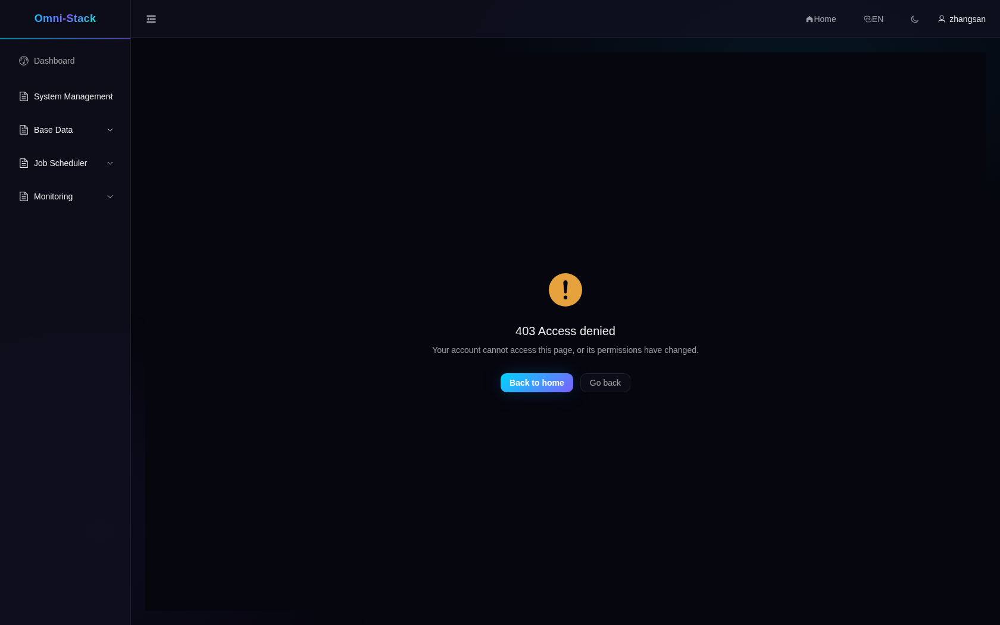

#### core-B: User-list API failure and recovery

- Prerequisites: the administrator test identity has `SUPER_ADMIN`; first open `/admin/system/user` normally and read the live user list.
- Action: inject a deterministic `500` response for `GET /api/auth/user/list` in the browser test process only. The native localized safe error appears and the session remains. This is client fault injection, not proof of a backend outage; the empty table below the error is not a successful empty result.
- Recovery: remove the injection and reload. All four locales return HTTP `200`, `code=200`, and 10 rows on the first page. For a real failure, investigate the actual response and diagnostic identifiers before retrying; test injection is not a normal repair method.

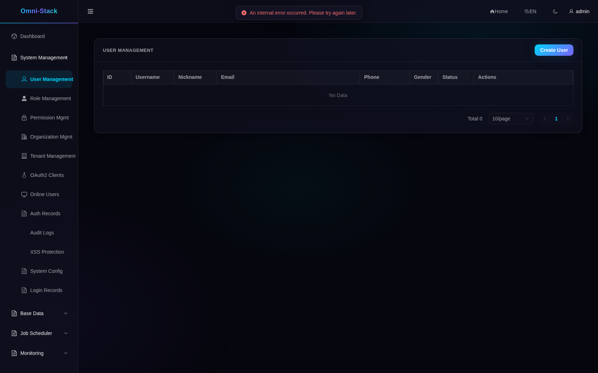

All eight desktop originals across four languages received individual AI review. Denial text, error messages, and recovery buttons are readable; existing long English/Japanese sidebar labels still clip. This covers these two scenarios, not every page or mobile layout. Temporary tokens were removed and the isolated runtime containers stopped; the original business environment was not used.

#### Figure 1 `system-users-en-US`: User management

- Prerequisites: healthy isolated Docker core lite services; tenant 1 admin with `SUPER_ADMIN` and actual user-read permission, using a short-lived test token.
- Actor: admin. No user creation, role assignment, status change, or deletion was submitted in this run.
- Action: open `/admin/system/user` and wait for the real list, fonts, and loading masks to settle.
- Expected: each locale shows 10 visible rows out of 29 and masked contact details. The administrator list returns HTTP 200/business code 200; the same endpoint returns HTTP 403 for the employee. This proves only that read boundary.

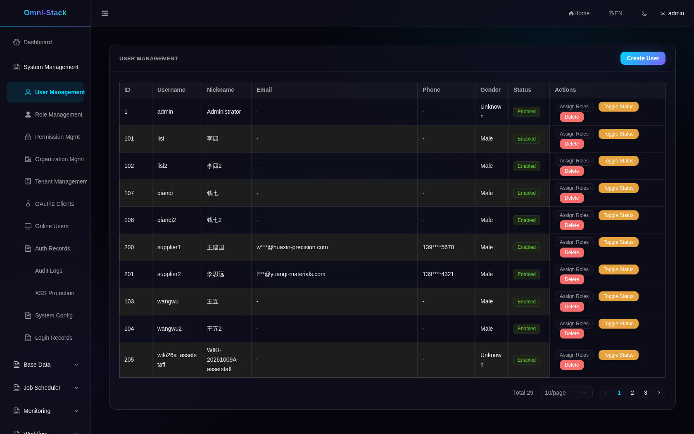

English Unknown and some action labels wrap; long English/Japanese sidebar labels still clip, and long account names wrap. These are unedited native captures with no DOM text replacement, not an entire-site responsive acceptance.

<!-- omni:modules:procurement -->
#### Figure 2 `employee-forbidden-403-en-US`: Employee denied access

- Prerequisites: on 2026-10-12, employee zhangsan has `EMPLOYEE` without `procurement:approval-route:list`.
- Actor: the employee test identity derived from database roles.
- Action: navigate directly to `/admin/procurement/approval-route`.
- Expected: the authenticated user sees 403 and a return control; the corresponding API check returns HTTP 403, without a login redirect. Have an administrator check the grant, then sign in again before retrying.

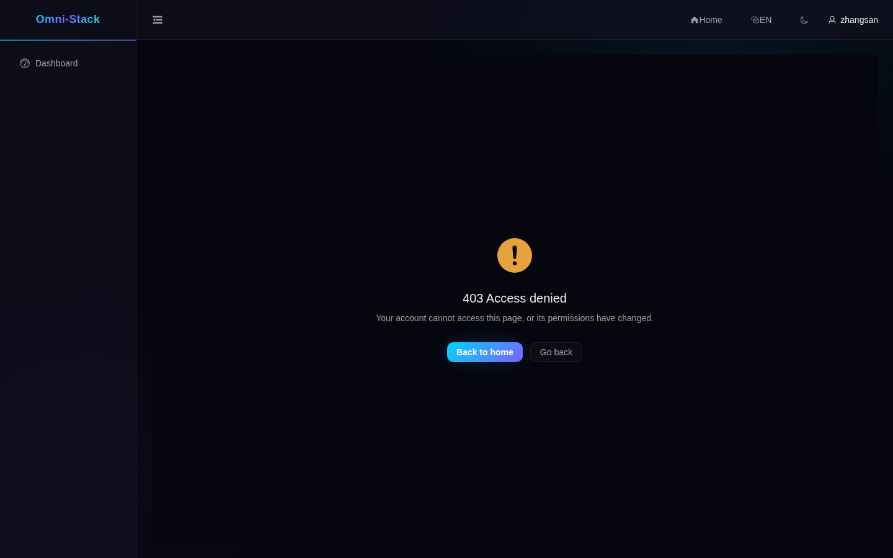

<!-- omni:modules:end -->

#### Figure 3 `employee-workspace-scope-en-US`: Employee workspace

- Prerequisites: the short-lived zhangsan employee identity on 2026-10-12.
- Actor: ordinary employee.
- Action: open the workspace home page.
- Expected: workspace entries and task areas visible to that identity. This is not a complete proof of every task, organizational boundary, or cross-tenant filter. If the identity is wrong, sign out and check the account/tenant.

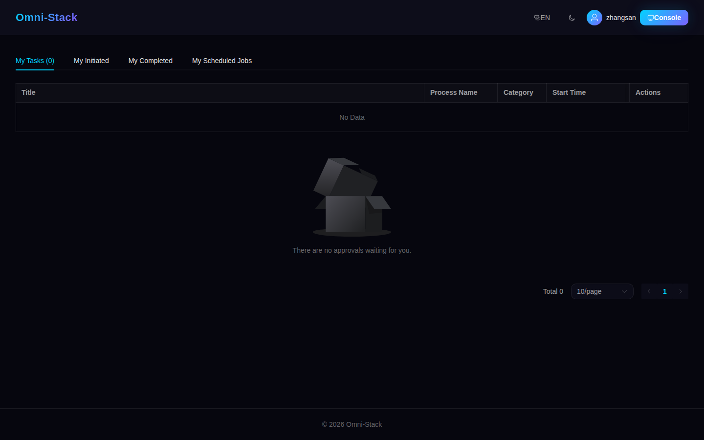

<!-- omni:modules:srm -->
#### Figure 4 `supplier-portal-scope-en-US`: Supplier portal

- Prerequisites: on 2026-10-12, seed account supplier1 has `SUPPLIER` and an active association.
- Actor: the short-lived supplier1 test identity.
- Action: open `/supplier-portal`.
- Expected: the portal and supplier1 identity are visible. This image does not prove new-user registration, enrollment writes, or all isolation between two suppliers. For missing company data, check the role, permission, and portal association.

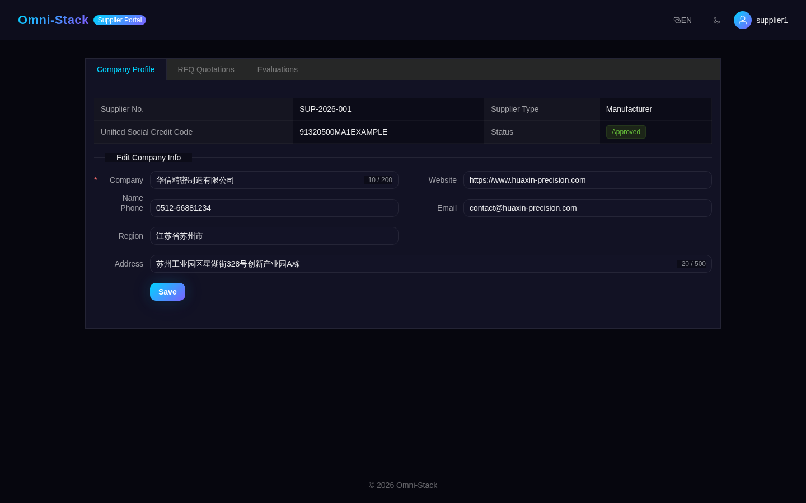

<!-- omni:modules:end -->

#### Figure 5 `resource-not-found-404-en-US`: Unknown-route 404

- Prerequisites: visit an undefined frontend route on 2026-10-12.
- Actor: administrator test identity.
- Action: enter the catch-all NotFound page.
- Expected: the product displays 404 and a return control. This frontend route message proves neither an API HTTP 404 nor data-scope hiding. Check the address and re-enter through valid navigation.

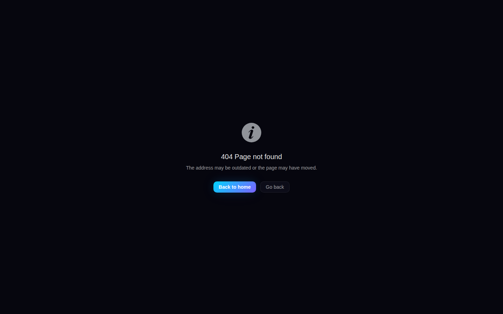

<!-- omni:modules:procurement -->
#### Figure 6 `approval-route-list-failure-en-US`: List request failure

- Prerequisites: the 2026-10-12 browser test intercepts the approval-route list request and injects a deterministic 500 response.
- Actor: administrator test identity.
- Action: open the requisition approval-route page and observe the failed list.
- Expected: the page frame and actual failure feedback remain. This is not a real backend-outage test, and an empty list is not a successful read. Remove injection to recover the test; investigate a real failure with its Trace ID before retrying.

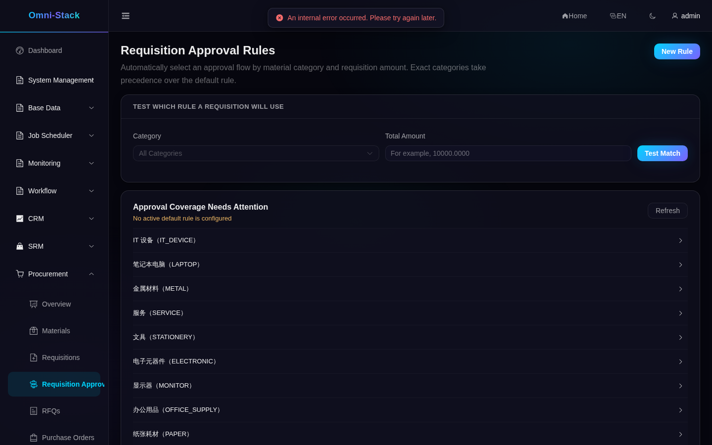

<!-- omni:modules:end -->

#### Figure 7 `admin-menu-load-failure-en-US`: Menu failure page

- Prerequisites: the 2026-10-12 browser test injects a deterministic 500 response for the menu request.
- Actor: administrator test identity.
- Action: enter a management page and trigger menu loading.
- Expected: a localized failure page offers Reload/Return Home, without a blank screen or invented successful menu. Remove test injection or resolve the real request failure before retrying.

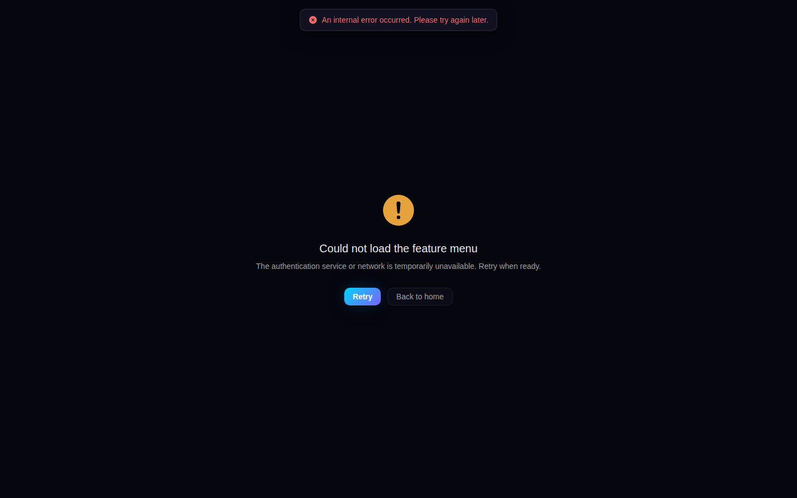

## 6. Adding a Permission

When adding a write capability, update together:

1. Controller `@PreAuthorize` and an explicit operation code, retaining established ownership exceptions such as personal tasks.
2. Permission nodes and required default-role relationships in `scripts/sql/seed/auth.sql`.
3. SHA-256 and assertions in `database/seed/manifest.yaml`, plus a forward migration when an existing database needs one.
4. Management menu codes, view mapping, and entry points; a static page address alone is insufficient.
5. Matching `v-permission` codes on action buttons.
6. Domain aggregate/child visibility mappings, data permission before pagination, and context cleanup.
7. Allowed/denied functional, data-scope, and cross-tenant regression checks, without treating deletion as denial evidence.
8. Module documentation, real captures, and an actual AI review record.

Implementation rules are in [backend patterns](../backend-patterns.en.md), [frontend patterns](../frontend-patterns.en.md), [core flows](../core-flows.en.md), and the [API contract](../api-contract.en.md).

<!-- omni:modules:procurement -->
## 7. Procurement manager: data scope within an authorized function

This is the completed 2026-10-12 historical experiment; do not recreate or delete its original objects. The ordinary `PROCUREMENT_MANAGER` in local Docker had effective `DEPT_AND_BELOW` scope. The [evidence](../reference/evidence/procurement-scope-2026-10-12.json) retains all actor roles, four passing cases across the four locales, and 12 original images. The account had no `SUPER_ADMIN` but did have other roles, so this is not a single-role experiment. The historical coverage ID `procurement-admin-scope` does not mean the actual role was `PROCUREMENT_ADMIN`.

### 7.1 Prepare visible and hidden requisitions

The historical setup checked primary organizations, roles, and effective scope against the [teaching data](../wiki/data-and-fixtures.en.md). The manager's primary organization was 604, containing approved `PR-1-1`. A dedicated `PROCUREMENT_STAFF` user in organization 605 created unsubmitted `PR-1-4`. Its creator first read it through the formal detail API with business code 200, establishing existence before comparing the manager's result. This describes historical preparation: the draft has already been cleaned up, so do not replay the old writes.

### 7.2 Open the manager's department requisition

The manager opened `/admin/procurement/requisition`, searched for `PR-1-1`, and opened its detail. The historical images show the visible requisition and approved state; its detail API returned business code 200. Identifiers/data may differ in a new environment. First identify an existing object in the same tenant and effective organization.

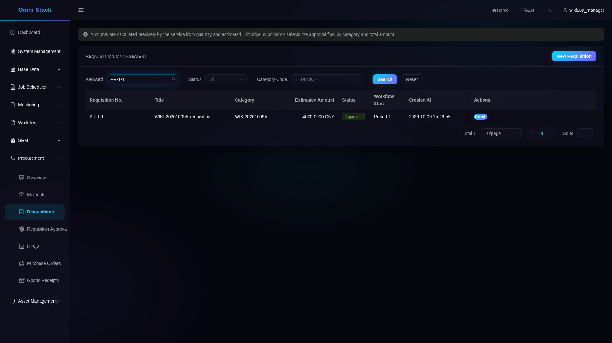

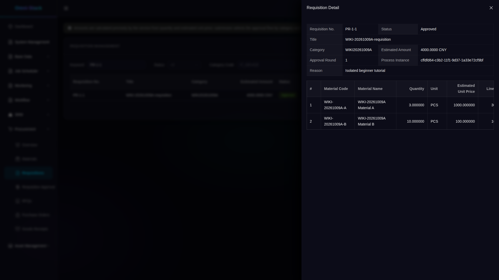

### 7.3 Search for the other department's requisition

In the historical experiment, the manager closed the detail and searched for `PR-1-4`, receiving no rows. These results were recorded in the same period, before deletion:

| Actor/request | Actual result |
| --- | --- |
| Creator reads `PR-1-4` detail | HTTP 200, response-body `code=200`. |
| Manager reads `PR-1-4` detail | HTTP 200, response-body `code=404`. |
| Manager searches for `PR-1-4` | HTTP 200, response-body `code=200`, empty collection. |

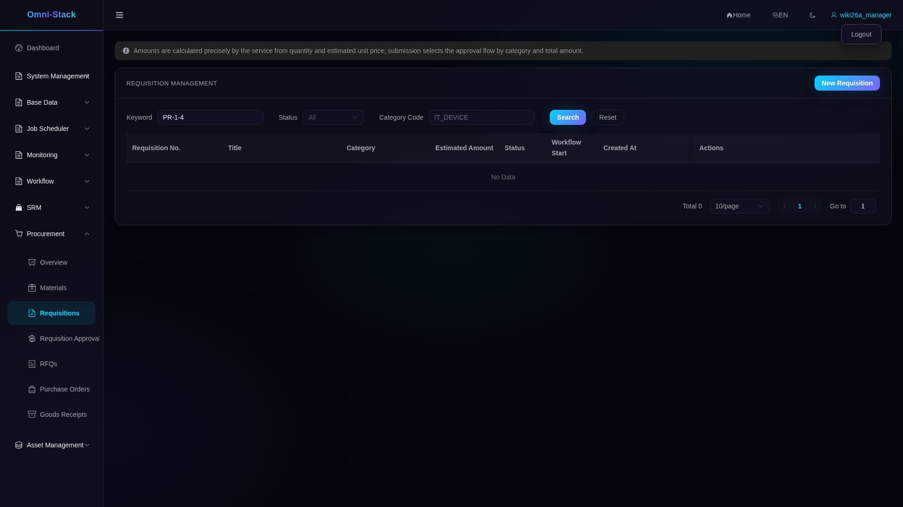

This proves scope-based hiding while the historical object existed, distinct from missing functional permission (HTTP 403) or a frontend unknown-route 404. After all four locales were captured, the creator deleted the dedicated draft through the formal API and a subsequent read returned business code 404. Post-deletion absence cannot be substituted for permission evidence. The original approved requisition/business chain was unchanged; the dedicated account remains until final isolated-project cleanup.

Historical English sidebar labels clip, and the detail table has horizontal overflow; requisition numbers, states, search conditions, and the empty list remain readable. Four-language documents follow the [authorized AI review policy](../adr/0003-authorized-ai-translation-review.md), without a separate mandatory human-review gate. Current review records and the queue determine valid approval. Never label AI_REVIEW as HUMAN_REVIEW.

<!-- omni:modules:end -->
