# メニュー、ロール、機能権限、データ権限

[Wiki](../wiki/index.jp.md) で必要なモジュールを起動し、`http://localhost:3000` を開きます。本節では分離した学習環境のテナント 1 を使用します。管理権限のあるアカウントと一般従業員を用意し、許可と拒否を確認してください。本番ユーザーの削除や本番ロールの権限拡大を試してはいけません。

証跡は 4 系統です。[2026-10-17 のユーザー一覧](../reference/evidence/permissions-users-2026-10-17.json)は現行ソースの成果物を使った読み取り専用の採取、図 2–7 は [2026-10-12 の基本検証](../reference/evidence/basic-2026-10-12.json)、調達の画像は[データ範囲の記録](../reference/evidence/procurement-scope-2026-10-12.json)に対応します。基本検証の独立した 44 件と原画像は、失敗後の再採取を含む複数回の結果から選ばれています。1 回で 44 件すべてが成功した記録ではありません。画像の認証には、テストクラスパスのツールが実際の DB ロールから生成した短期トークンを使用しています。パスワード/CAPTCHA ログインや、本節の全更新操作を検証した証拠ではありません。

追加した [2026-10-18 core の拒否と復旧の証跡](../reference/evidence/core-permissions-errors-2026-10-18.json)は、実際に生成して移動した core プロジェクトから採取しました。以下では一時的な読み取り専用ロール、実際の403、クライアント側の障害注入を区別します。

## 1. 4 層の関係

機能権限は次のテーブル関係で付与されます。

```text
sys_user → sys_user_role → sys_role → sys_role_permission → sys_permission
```

| 層 | 役割 |
| --- | --- |
| ユーザー | テナント内のアカウント。状態と主組織 `primary_unit_id` を持ちます。 |
| ロール | `sys_user_role` で割り当て、機能権限とデータ範囲の方針を組み合わせます。 |
| 権限 | ノードの実際の値は `DIRECTORY`、`MENU`、`API` です。「ボタン/API」は用途を表し、`BUTTON` 型を意味しません。 |
| データ範囲 | ロールの `data_scope`、設定した組織、ユーザーの主組織から参照可能なデータを求めます。機能権限とは別に解決します。 |

`sys_user_role_scope` は、ワークフローの候補者/CC 解決に使う「ユーザー・ロール・組織」の独立した関連です。上記の `sys_user_role` を置き換えません。操作コードの例は `procurement:requisition:create` です。ディレクトリとメニューは画面への導線、`API` ノードは操作の認可を担当します。

## 2. 動的メニュー

認証済みのフロントエンドは `GET /api/auth/menus` を呼び出します。Auth は現在の権限とテナントで絞ったツリーを返します。管理画面では、対応するビューがある `MENU` だけを `/admin` 配下の動的ルートとして登録します。例えば `system:user` は `/admin/system/user` になります。`DIRECTORY` はグループ表示のみで、`srm:portal:` メニューは管理画面に登録しません。サプライヤーポータルには専用の保護ルートがあります。静的ルートなら一般に権限を回避できる、という意味ではありません。

メニューが見つからない場合は、順に確認します。

1. 選択したプリセットと実行環境に対象モジュールが含まれるか。
2. `sys_permission` に有効なディレクトリ、メニュー、操作ノードがあり、コードがフロントエンドのビューに対応するか。
3. 現在のテナントのロールに、必要なメニューと操作が `sys_role_permission` で付与されているか。
4. JWT の `scope` が最新か。ロールや権限を変更したらログアウトして再ログインし、メニューを読み直すこと。
5. ボタンの `v-permission` が同じ操作コードを使い、バックエンドもその操作を許可するか。

権限がなければメニューが空になることがあります。通信に失敗した場合は、メニューのエラー画面と再試行手段を確認します。失敗したリクエストを調べてから再試行してください。管理ルートのハードコードは、認可設定や API 障害の解決にはなりません。

## 3. 機能権限

バックエンドの更新操作では通常 `@PreAuthorize` で操作コードを確認し、フロントエンドのボタンにも同じコードの `v-permission` を使います。このディレクティブはマウント/更新時に `display:none` を切り替え、Vue のリアクティブな構造を維持します。ボタンを隠しても直接リクエストは防げないため、バックエンドの拒否を別に確認します。

`MyJobController` は明示的な例外です。個人タスクは行ごとに `createBy == currentUser` を確認するため、エンドポイント単位の RBAC を追加しません。

サプライヤーポータルの全 API が `SUPPLIER` を必要とするわけではありません。`POST /api/srm/portal/enroll` は `srm:portal:enroll` と、有効な `inviteToken` およびクライアントの `requestId` を含むサプライヤー登録申請を必要とします。`GET /enrollment` と `POST /enrollment/retry` は `srm:portal:enroll` または `srm:portal:profile` を受け付けます。既定の `USER` でもサプライヤー登録手続きを行えますが、`/profile` などの企業情報 API には `SUPPLIER`、対応する操作権限、有効なポータル関連が必要です。実際の CAPTCHA を使う自己登録が完了した、という証拠ではありません。

## 4. データ権限

DataScope は、機能権限で許可された操作が扱えるデータを制限します。ロール画面には実際に次の 6 種類があります。

| 値 | 意味 |
| --- | --- |
| `ALL` | 全データ範囲。独立したテナント検証や API の認可を省略しません。 |
| `TENANT` | 現在のテナント。 |
| `DEPT_AND_BELOW` | 主組織とその配下。 |
| `DEPT` | 主組織。 |
| `CUSTOM` | ロールに設定した組織集合。解決時に対応する下位組織も含めます。 |
| `SELF` | 本人の範囲。比較する列は各業務領域の定義に従います。 |

複数の有効なロールは、広い方を優先する `ALL > TENANT > DEPT_AND_BELOW > DEPT > CUSTOM > SELF` の順で統合します。範囲未設定時は `SELF` に戻ります。通常の解決はユーザーのロールを統合し、特定の権限コードを指定した解決では、その権限を実際に付与するロールだけを対象にします。広いロールが既にあるユーザーに `SELF` を追加しても、実効範囲は狭まりません。画面の選択肢の表示順と統合の優先順位を混同しないでください。

Servlet サービスは信頼できる Gateway の識別情報からコンテキストを構築します。MyBatis のデータ権限処理はページングより前に適用し、リクエスト終了時に `finally` で ThreadLocal を解放します。テナント境界は別の制約です。`ALL` を選んだからといってテナント条件を削除してはいけません。

全領域に同じ owner 列を適用できるわけではありません。CRM、SRM、Procurement、Asset はそれぞれ集約ルートの可視性を定義します。子リソースは集約ルート経由で範囲を継承し、存在しない owner 列を子テーブルに追加して絞り込んではいけません。調達申請は申請者列、RFQ/注文/入庫は担当者列を使います。資産の管理画面は owner 列を使い、「自分の資産」、受領、返却は現在のユーザーで判定します。

## 5. ロール保守フロー

以下は現行 UI/API の操作手順です。画像で確認したのは読み取りであり、今回これらの変更を送信したわけではありません。まず元のロール、権限、組織を記録し、学習用の専用ユーザーを使います。操作中の管理者を無効化、削除、権限剥奪しないでください。

1. `system:role:list` を持つアカウントで「システム管理 → ロール管理」(`/admin/system/role`) を開きます。作成には `system:role:create`、編集・権限割り当て・カスタム組織の割り当てには `system:role:update` も必要です。
2. 新規作成ではコード、名前、明示的なデータ範囲を指定します。現行フォームの初期値は `ALL` なので、最小権限の既定値として使わないでください。編集時はコードを変更できません。保存後に一覧を更新し、名前と範囲を確認します。
3. 対象ロールの「権限を割り当てる」で、必要なメニューと操作ノードをそれぞれ選びます。メニューを選んだだけで全 API が許可されるわけではありません。保存後に開き直し、選択値を確認します。
4. `CUSTOM` なら「部門を割り当てる」で組織を選択して保存します。他の範囲ではボタンが無効です。現在のテナントの有効な組織を選び、空の設定や主組織の誤りを直してください。空一覧を隠すために `ALL` へ広げないでください。
5. 「ユーザー管理」(`/admin/system/user`) を開きます。閲覧は `system:user:list`、対象ユーザーのロール割り当ては `system:user:update` が必要です。このページには主組織の編集欄がなく、`sys_user_role_scope` も更新しません。主組織は所属テナントを確認してからユーザー情報更新 API の `primaryUnitId` で設定できます。ワークフロー用の組織関連は[制御された範囲フィクスチャ](../wiki/data-and-fixtures.jp.md)を参照してください。
6. 対象ユーザーとしてログアウト後に再ログインし、メニュー、ボタン、許可 API、見えるデータを確認します。特権管理者だけで検証しないでください。リクエストとデータのテナントも一致させます。
7. 操作権限がない場合の実際の HTTP 403 と、機能権限はあるがデータ範囲外の場合の一覧/詳細を確認します。失敗時は HTTP ステータス、本文の `code`、Trace ID、対象の存在を記録し、修正して再試行します。検証用の付与を解除するときは元の設定に戻し、既存のロールや伝票を誤って消さないでください。

| 操作 | 正式 API とリクエスト |
| --- | --- |
| ユーザーロール | `GET /api/auth/user/{userId}/roles` でロール ID を取得。同じパスへの `POST` に ID 配列を送り、`system:user:update` が必要です。 |
| 主組織 | `PUT /api/auth/user/{id}` の許可フィールド `primaryUnitId`。`system:user:update` が必要で、この本文からロール、状態、テナントは変更できません。 |
| ロールの権限 | `POST /api/auth/permission/role/{roleId}/assign` に権限 ID 配列を送ります。 |
| カスタム組織 | `GET /api/auth/role/{roleId}/depts` で現在値を取得し、同じパスへの `POST` に組織 ID 配列を送ります。 |

ロール・権限・組織の割り当て API は全件置換です。先に既存 ID を読み、追加分だけでなく残す対象を含む完全な集合を送ります。空配列は対応する関連をすべて解除します。

### 操作スクリーンショット

図 1 は 2026-10-17 の成果物、図 2–7 は日付を明記した過去の場面です。過去の日/韓 UI にある一部の Status、Phone、Email、Retry は、その時点の実際の英語フォールバックです。学習データの名称も変更していません。すべてを現行環境の画像として扱わないでください。

#### core-A：認証済みユーザーのシステム設定アクセス拒否

- 前提：実際に生成した `core` プロジェクトを分離した Docker 内でビルドし、標準の `lite` 設定と専用 DB を使用します。
- 身元：テナント1の zhangsan は元々 `EMPLOYEE` で、管理メニューがありません。本実行では正式なロール API で既存の読み取り専用 `USER` を一時追加し、DB の権限から短期トークンを再発行しました。`system:config:list` は付与されていません。変更前の従業員 seed の状態や、パスワード/CAPTCHA ログインの検証ではありません。
- 操作：`/admin/system/config` を直接開き、翻訳された403、ホーム/前画面への復旧ボタン、保持されたセッションを確認します。
- 期待結果：別途 `GET /api/auth/system-config/login-policy` を実行すると、この身元は HTTP403/業務コード403、管理者は HTTP200/業務コード200になります。採取後は正式 API で元のロール構成に戻し、再読み取りでユーザー、ロール、権限関連の検証値が採取前と一致することを確認しました。

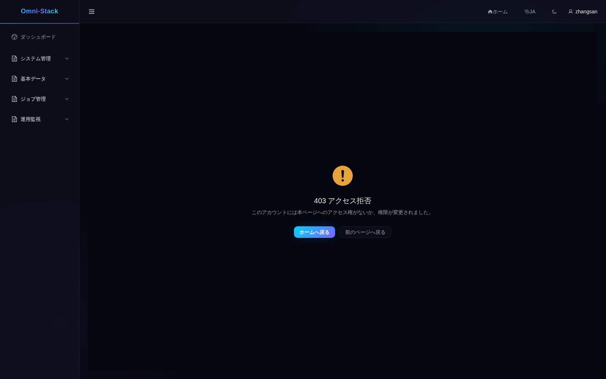

#### core-B：ユーザー一覧 API の失敗と復旧

- 前提：管理者のテスト用身元は `SUPER_ADMIN` を持ち、先に `/admin/system/user` を通常どおり開いて実際のユーザー一覧を読み取ります。
- 操作：ブラウザーのテストプロセス内だけで `GET /api/auth/user/list` に決定的な `500` 応答を注入します。標準の安全な翻訳済みエラーを表示し、セッションを維持します。これはクライアント側の障害注入であり、バックエンド停止の証拠ではありません。エラーの下の空テーブルは、正常に空の結果を取得した状態ではありません。
- 復旧：注入を解除して再読み込みすると、4言語とも HTTP `200`、`code=200` と先頭10行を再取得しました。実際の障害では実応答と診断情報を調べてから再試行し、テスト注入を通常の修復手段として扱わないでください。

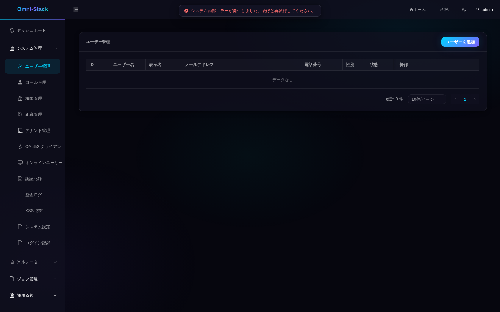

4言語のデスクトップ原画像8枚を個別に AI レビューしました。拒否文、エラー表示、復旧ボタンは読めますが、英語/日本語の長いサイドバー名には元の切れが残っています。対象はこの2場面であり、全画面やモバイル配置の検証ではありません。一時トークンは削除し、分離した実行コンテナーは停止済みです。元の業務環境は使用していません。

#### 図 1 `system-users-ja-JP`：ユーザー管理

- 前提：分離 Docker の core lite が正常。テナント 1 の admin に `SUPER_ADMIN` と実際のユーザー読み取り権限があり、短期テストトークンを使います。
- 操作者：admin。今回、ユーザー作成、ロール割り当て、状態変更、削除は送信していません。
- 操作：`/admin/system/user` を開き、実際の一覧、フォント、読み込みマスクの完了を待ちます。
- 期待結果：各言語の原画像に全 29 件中の先頭 10 行とマスク済み連絡先が表示されます。管理者の一覧は HTTP 200/業務コード 200、従業員の同じ API は HTTP 403。この読み取り境界だけを確認します。

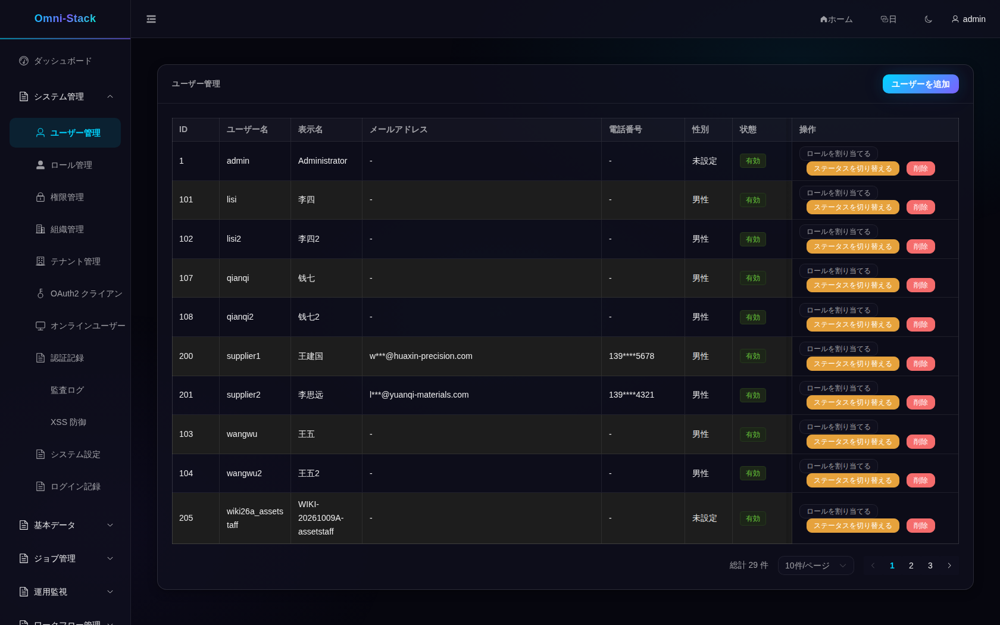

英語の Unknown と一部の操作ラベルは折り返され、英語/日本語の長いサイドバー項目は一部切れます。長いアカウント名も折り返されます。画像加工や DOM テキストの置換はしておらず、全サイトのレスポンシブ検証ではありません。

<!-- omni:modules:procurement -->
#### 図 2 `employee-forbidden-403-ja-JP`：従業員の権限外アクセス

- 前提：2026-10-12、一般従業員 zhangsan に `EMPLOYEE` があり、`procurement:approval-route:list` はありません。
- 操作者：DB ロールから生成した従業員のテスト識別情報。
- 操作：`/admin/procurement/approval-route` を直接開きます。
- 期待結果：ログイン済みでも 403 と戻る操作を表示し、同時期の API 検証も HTTP 403。ログイン画面へは戻しません。管理者が付与を確認し、再ログイン後に再試行します。

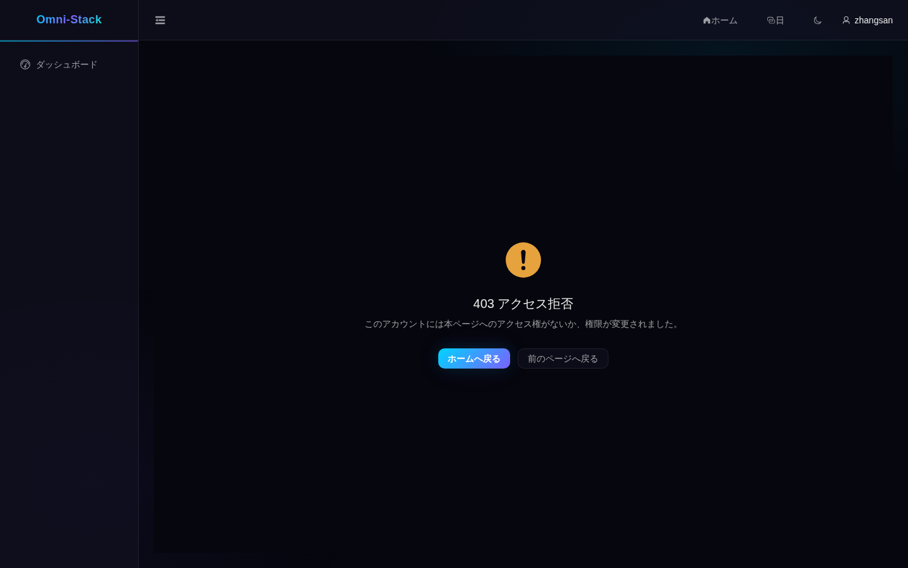

<!-- omni:modules:end -->

#### 図 3 `employee-workspace-scope-ja-JP`：従業員のワークスペース

- 前提：2026-10-12 の zhangsan の短期テスト識別情報。
- 操作者：一般従業員。
- 操作：ワークスペースのホームを開きます。
- 期待結果：そのユーザーに見える入口とタスク領域を表示します。全タスク、組織境界、テナント間の完全な分離を証明する画像ではありません。識別情報が違う場合はログアウトし、アカウントとテナントを確認します。

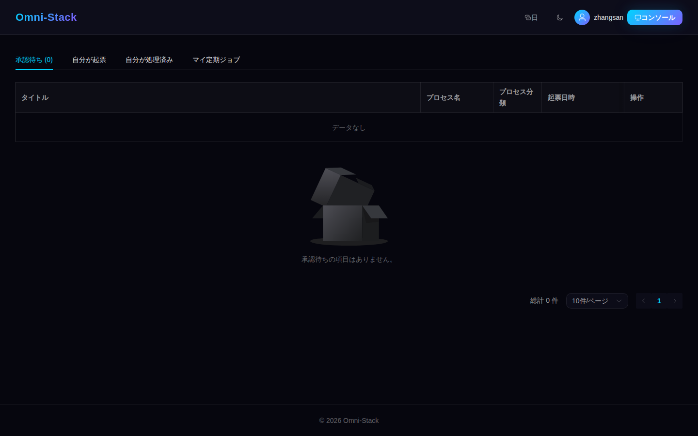

<!-- omni:modules:srm -->
#### 図 4 `supplier-portal-scope-ja-JP`：サプライヤーポータル

- 前提：2026-10-12、seed アカウント supplier1 に `SUPPLIER` と有効な関連があります。
- 操作者：supplier1 の短期テスト識別情報。
- 操作：`/supplier-portal` を開きます。
- 期待結果：ポータルと supplier1 の識別情報が見えます。新規自己登録、サプライヤー登録申請の更新、2 社間の全データ分離は証明しません。企業情報が見えない場合はロール、権限、ポータル関連を確認します。

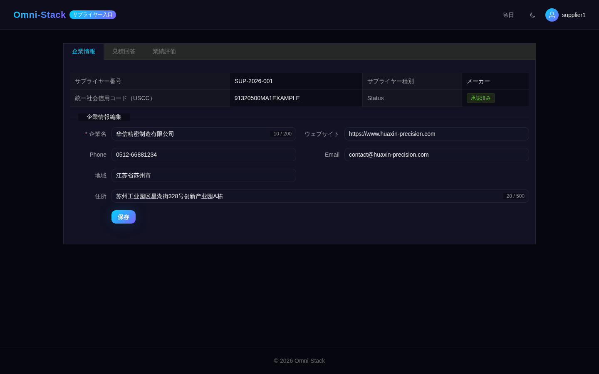

<!-- omni:modules:end -->

#### 図 5 `resource-not-found-404-ja-JP`：未定義ルートの 404

- 前提：2026-10-12、存在しないフロントエンドのルートへアクセスします。
- 操作者：管理者のテスト識別情報。
- 操作：catch-all の NotFound 画面を開きます。
- 期待結果：製品の 404 表示と戻る操作が見えます。フロントエンドの表示であり、API の HTTP 404 やデータ範囲による非表示を証明しません。アドレスを確認し、正規のナビゲーションから入り直します。

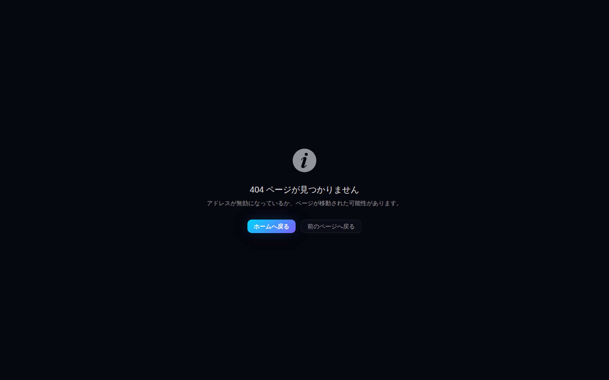

<!-- omni:modules:procurement -->
#### 図 6 `approval-route-list-failure-ja-JP`：一覧取得の失敗

- 前提：2026-10-12 のブラウザーテストで承認ルール一覧リクエストをインターセプトし、確定的な 500 応答を注入します。
- 操作者：管理者のテスト識別情報。
- 操作：調達申請の承認ルール画面で一覧取得失敗を確認します。
- 期待結果：画面枠と実際の失敗表示が残ります。バックエンド停止の実証ではなく、空一覧を成功扱いしません。テストでは注入を解除し、実障害では Trace ID で原因を調べてから再試行します。

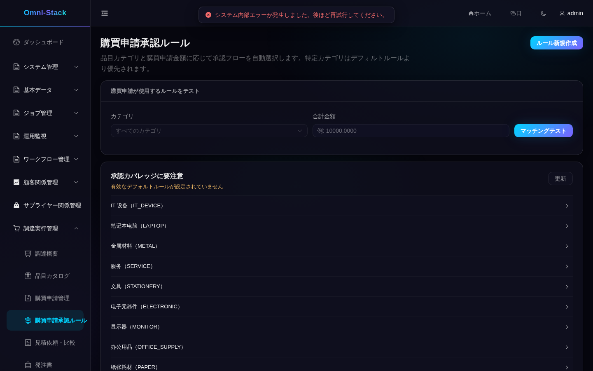

<!-- omni:modules:end -->

#### 図 7 `admin-menu-load-failure-ja-JP`：メニュー読み込み失敗

- 前提：2026-10-12 のブラウザーテストでメニューリクエストに確定的な 500 応答を注入します。
- 操作者：管理者のテスト識別情報。
- 操作：管理画面に入り、メニュー読み込みを失敗させます。
- 期待結果：ローカライズされたエラー画面と再読み込み/ホームへ戻る操作を表示します。白画面や架空の成功メニューにはしません。テストの注入を解除するか実際の通信障害を解決して、再試行します。

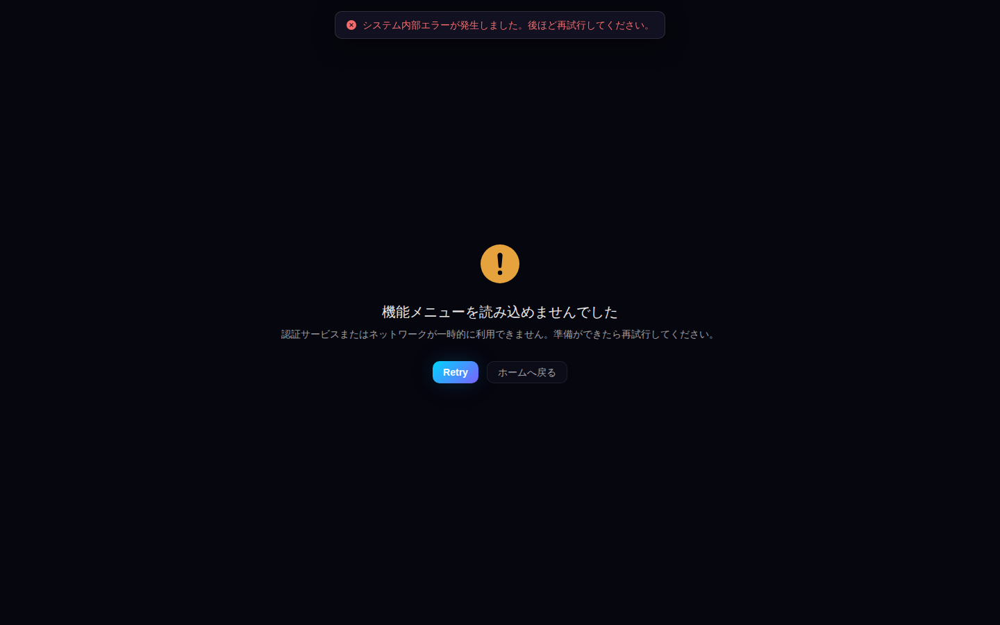

## 6. 新規権限のコードチェックリスト

更新機能を追加するときは、次を一緒に変更します。

1. Controller の `@PreAuthorize` と明確な操作コード。個人タスクなど既存の所有者検証の例外は維持します。
2. `scripts/sql/seed/auth.sql` の権限ノードと必要な既定ロールの関連。
3. `database/seed/manifest.yaml` の SHA-256 とアサーション。既存 DB に必要なら前進型のマイグレーション。
4. 管理画面のメニューコード、ビュー対応、入口。静的ページの URL を加えるだけでは不十分です。
5. 操作ボタンの同一コードの `v-permission`。
6. 各領域の集約ルート/子リソースの範囲定義、ページング前のデータ権限処理、コンテキスト解放。
7. 機能の許可/拒否、データ範囲、テナント間の回帰検証。削除済みの不存在を拒否の証拠にしません。
8. モジュール文書、実画像、実際の AI レビュー記録。

実装規則は[バックエンド規約](../backend-patterns.jp.md)、[フロントエンド規約](../frontend-patterns.jp.md)、[主要フロー](../core-flows.jp.md)、[API 契約](../api-contract.jp.md)を参照してください。

<!-- omni:modules:procurement -->
## 7. 調達マネージャー：機能権限とデータ範囲

2026-10-12 に完了した過去の実験です。元のオブジェクトを再作成/再削除しません。本機 Docker の一般 `PROCUREMENT_MANAGER` の実効範囲は `DEPT_AND_BELOW` でした。[証跡](../reference/evidence/procurement-scope-2026-10-12.json)には全ロール、4 言語を対象とする成功 4 ケース、原画像 12 枚を残しています。`SUPER_ADMIN` はありませんが他のロールもあり、単一ロールの実験ではありません。過去の対象 ID `procurement-admin-scope` は、実際のロールが `PROCUREMENT_ADMIN` だったことを意味しません。

### 7.1 見える申請と見えない申請を用意する

当時は[学習データ](../wiki/data-and-fixtures.jp.md)で主組織、ロール、実効範囲を確認しました。マネージャーの主組織は 604 で、その組織の承認済み `PR-1-1` が可視対象です。組織 605 の専用 `PROCUREMENT_STAFF` が未提出の `PR-1-4` を作成しました。作成者が正式な詳細 API で業務コード 200 を得て存在を確かめてから、マネージャーの結果と比較しています。これは過去の準備の説明です。下書きは既に削除されているため、古い更新処理をそのまま再実行しないでください。

### 7.2 マネージャーが同部門の申請を開く

マネージャーは `/admin/procurement/requisition` で `PR-1-1` を検索し、詳細を開きました。原画像は可視の申請と承認済み状態を示し、詳細 API は業務コード 200 です。新しい環境では番号やデータが異なり得ます。同じテナントと実効組織内にある現存オブジェクトを先に確認してください。

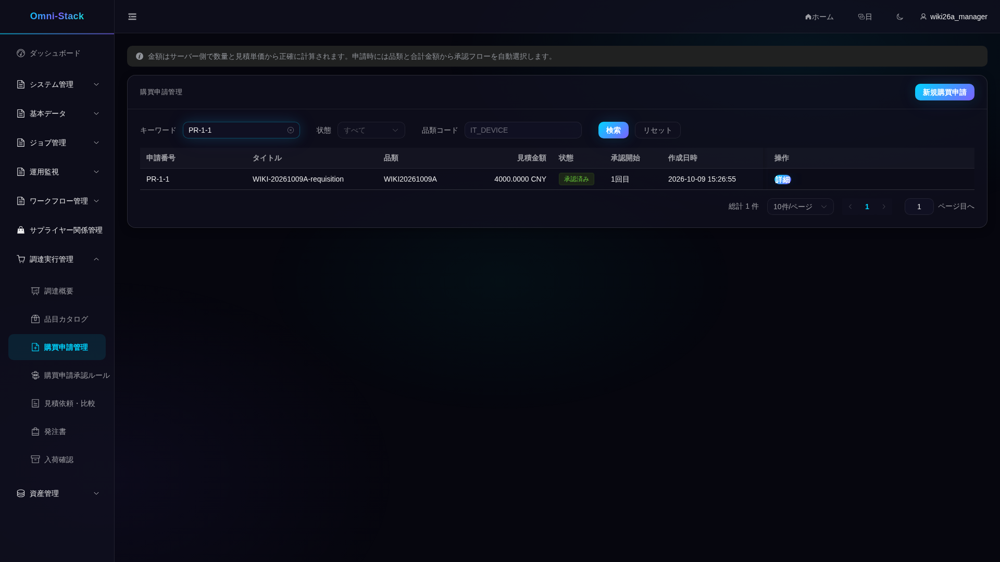

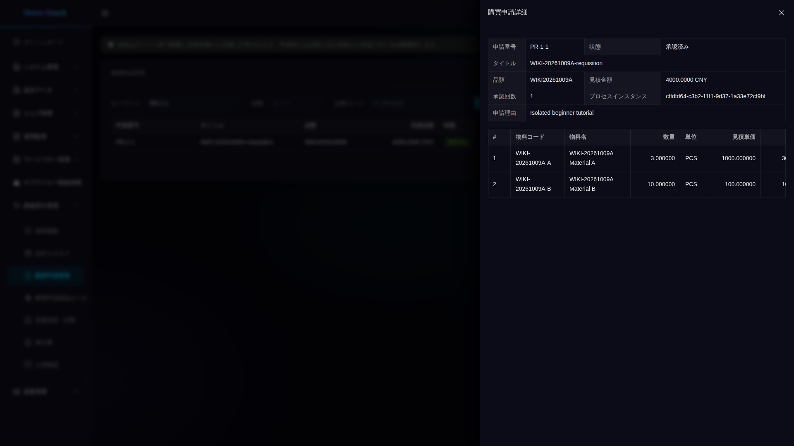

### 7.3 別部門の申請を検索する

当時の実験で詳細を閉じて `PR-1-4` を検索すると、マネージャーの一覧は 0 件でした。同時期かつ削除前に、次の結果を確認しています。

| 識別情報/リクエスト | 実際の結果 |
| --- | --- |
| 作成者が `PR-1-4` の詳細を取得 | HTTP 200、応答本文の `code=200`。 |
| マネージャーが `PR-1-4` の詳細を取得 | HTTP 200、応答本文の `code=404`。 |
| マネージャーが `PR-1-4` を一覧検索 | HTTP 200、応答本文の `code=200`、空集合。 |

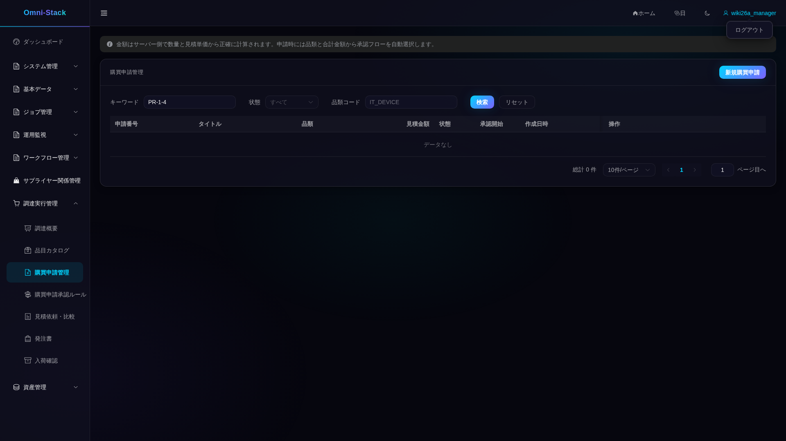

これは当時オブジェクトが存在した状態での範囲による非表示であり、機能権限不足の HTTP 403 や未定義フロントエンドルートの 404 とは異なります。4 言語の採取後、作成者が正式な削除 API で専用下書きを削除し、再取得は業務コード 404 になりました。削除後の不存在を権限の証拠に代用しません。元の承認済み申請と業務フローは変更せず、専用アカウントは分離プロジェクトの最終整理まで保持しています。

過去の英語サイドバーの長いラベルは一部切れ、詳細テーブルには横方向のはみ出しがあります。番号、状態、検索条件、空一覧は読めます。4 言語の文書は[承認された AI レビュー方針](../adr/0003-authorized-ai-translation-review.md)で検証し、人手レビューを別の必須条件にはしません。有効な承認は現在の記録とキューで判断し、AI_REVIEW を HUMAN_REVIEW と記載してはいけません。

<!-- omni:modules:end -->
