# 메뉴, 역할, 기능 권한과 데이터 권한

[Wiki](../wiki/index.kr.md)에서 필요한 모듈을 시작한 뒤 `http://localhost:3000`을 엽니다. 이 절은 격리된 교육 환경의 테넌트 1을 기준으로 합니다. 관리 권한이 있는 계정과 일반 직원 계정을 준비해 허용과 거부를 모두 확인하세요. 운영 사용자를 삭제하거나 운영 역할의 권한을 넓히면서 실험하면 안 됩니다.

증거는 네 묶음입니다. [2026-10-17 사용자 목록](../reference/evidence/permissions-users-2026-10-17.json)은 현재 소스 산출물을 사용한 읽기 전용 캡처이고, 그림 2–7은 [2026-10-12 기본 검증](../reference/evidence/basic-2026-10-12.json), 조달 이미지는 [범위 검증 기록](../reference/evidence/procurement-scope-2026-10-12.json)에 해당합니다. 기본 검증의 독립 검사/원본 44개는 실패 후 재캡처를 포함한 여러 실행에서 선택했습니다. 한 번에 44개가 모두 통과한 실행이 아닙니다. 캡처에는 테스트 클래스 경로 도구가 실제 DB 역할에서 발급한 단기 토큰을 사용했습니다. 비밀번호/CAPTCHA 로그인이나 이 절의 모든 변경 작업을 검증한 증거는 아닙니다.

추가된 [2026-10-18 core 거부 및 복구 증거](../reference/evidence/core-permissions-errors-2026-10-18.json)는 실제로 생성하고 이동한 core 프로젝트에서 수집했습니다. 아래에서는 임시 읽기 전용 역할, 실제403, 클라이언트 장애 주입의 범위를 구분합니다.

## 1. 네 계층 관계

기능 권한은 다음 테이블 관계를 통해 부여됩니다.

```text
sys_user → sys_user_role → sys_role → sys_role_permission → sys_permission
```

| 계층 | 역할 |
| --- | --- |
| 사용자 | 상태와 기본 조직 `primary_unit_id`를 가진 테넌트 내 계정입니다. |
| 역할 | `sys_user_role`로 할당하며 기능 권한과 데이터 범위 정책을 조합합니다. |
| 권한 | 실제 노드 값은 `DIRECTORY`, `MENU`, `API`입니다. “버튼/API”는 용도를 설명하며 `BUTTON` 유형을 뜻하지 않습니다. |
| 데이터 범위 | 역할의 `data_scope`, 설정된 조직, 사용자의 기본 조직으로 접근 가능한 데이터를 결정합니다. 기능 권한과 별도로 해석합니다. |

`sys_user_role_scope`는 워크플로 후보자/참조자 해석에 사용하는 별도의 사용자·역할·조직 연결입니다. 위 관계의 `sys_user_role`을 대체하지 않습니다. 작업 권한 코드의 예는 `procurement:requisition:create`입니다. 디렉터리와 메뉴는 탐색 경로를 제공하고, `API` 노드는 작업을 인가합니다.

## 2. 동적 메뉴

로그인한 프런트엔드는 `GET /api/auth/menus`를 호출합니다. Auth는 현재 권한과 테넌트로 필터링한 트리를 반환합니다. 관리 화면에서는 뷰가 매핑된 `MENU`만 `/admin` 아래 동적 하위 경로로 등록합니다. 예를 들어 `system:user`는 `/admin/system/user`가 됩니다. `DIRECTORY`는 그룹 표시만 하며 `srm:portal:` 메뉴는 관리 화면에 등록하지 않습니다. 공급업체 포털에는 보호된 전용 경로가 있습니다. 정적 경로가 일반적으로 권한을 우회한다는 뜻은 아닙니다.

메뉴가 없으면 다음 순서로 확인합니다.

1. 선택한 프리셋과 실행 환경에 대상 모듈이 포함되어 있는지 확인합니다.
2. `sys_permission`에 활성 디렉터리·메뉴·작업 노드가 있고 코드가 프런트엔드 뷰와 일치하는지 확인합니다.
3. 현재 테넌트 역할에 필요한 메뉴와 작업이 `sys_role_permission`으로 부여되었는지 확인합니다.
4. JWT의 `scope`가 최신인지 확인합니다. 역할이나 권한을 바꿨다면 로그아웃 후 다시 로그인하고 메뉴를 다시 불러옵니다.
5. 버튼의 `v-permission`이 같은 작업 코드를 사용하며 백엔드도 해당 작업을 허용하는지 확인합니다.

권한이 없으면 빈 메뉴가 정상일 수 있습니다. 요청 실패 시에는 메뉴 오류 페이지와 재시도 버튼이 표시되어야 합니다. 실패한 요청을 조사한 뒤 재시도하세요. 관리 경로를 하드코딩해도 누락된 인가 설정이나 API 장애가 해결되지는 않습니다.

## 3. 기능 권한

백엔드 변경 작업은 일반적으로 `@PreAuthorize`로 작업 코드를 검사하고, 프런트엔드 버튼은 같은 코드의 `v-permission`을 사용합니다. 이 지시자는 마운트/갱신 시 `display:none`을 전환하여 Vue 반응형 구조를 유지합니다. 버튼을 숨겨도 직접 요청은 막지 못하므로 백엔드의 거부를 별도로 검증해야 합니다.

`MyJobController`는 명시적인 예외입니다. 개인 작업은 행별로 `createBy == currentUser`를 확인하므로 엔드포인트 단위 RBAC를 추가하지 않습니다.

공급업체 포털의 모든 API가 `SUPPLIER`를 요구하는 것은 아닙니다. `POST /api/srm/portal/enroll`에는 `srm:portal:enroll`과 유효한 `inviteToken`, 클라이언트 `requestId`를 담은 입점 요청이 필요합니다. `GET /enrollment`와 `POST /enrollment/retry`는 `srm:portal:enroll` 또는 `srm:portal:profile`을 허용합니다. 기본 `USER` 역할도 입점 절차에 참여할 수 있지만 `/profile` 같은 기업 정보 API에는 `SUPPLIER`, 해당 작업 권한, 활성 포털 연결이 추가로 필요합니다. 실제 CAPTCHA를 거치는 계정 자체 등록을 완료했다는 증거는 아닙니다.

## 4. 데이터 권한

DataScope는 기능 권한으로 허용된 작업이 접근할 수 있는 데이터 집합을 제한합니다. 역할 화면에는 다음 여섯 가지 실제 선택지가 있습니다.

| 값 | 의미 |
| --- | --- |
| `ALL` | 전체 데이터 범위이며, 별도의 테넌트 검사나 API 인가를 생략하지 않습니다. |
| `TENANT` | 현재 테넌트 범위입니다. |
| `DEPT_AND_BELOW` | 기본 조직과 하위 조직입니다. |
| `DEPT` | 기본 조직입니다. |
| `CUSTOM` | 역할에 지정한 조직 집합이며 해석 시 해당 하위 조직도 포함합니다. |
| `SELF` | 본인 범위이며, 비교 열은 도메인별 매핑을 따릅니다. |

여러 활성 역할은 더 넓은 범위를 우선하는 `ALL > TENANT > DEPT_AND_BELOW > DEPT > CUSTOM > SELF` 순서로 합칩니다. 범위 설정이 없으면 `SELF`로 돌아갑니다. 기본 해석은 사용자의 역할을 합치지만, 특정 권한 코드로 해석할 때는 그 권한을 실제로 부여한 역할만 고려합니다. 이미 넓은 역할이 있는 사용자에게 `SELF`를 추가해도 유효 범위가 좁아지지 않습니다. 화면 선택지 순서를 병합 우선순위로 해석하지 마세요.

Servlet 서비스는 신뢰할 수 있는 Gateway 식별 정보로 컨텍스트를 구성합니다. MyBatis 데이터 권한 처리는 페이지 처리보다 먼저 적용하며, 요청 종료 시 `finally`에서 ThreadLocal을 정리해야 합니다. 테넌트 경계는 별도의 제약입니다. `ALL`을 선택했다는 이유로 테넌트 조건을 제거하면 안 됩니다.

모든 도메인에 같은 owner 열을 가정할 수 없습니다. CRM, SRM, Procurement, Asset은 각각 집계 루트의 가시성을 정의합니다. 하위 리소스는 집계 루트를 통해 범위를 상속하며, 없는 owner 열을 하위 테이블에 조건으로 추가하면 안 됩니다. 조달 요청은 요청자 열을, RFQ/주문/입고는 담당자 열을 사용합니다. 자산 관리 화면은 owner 열을 사용하고, “내 자산”, 인수, 반납은 현재 사용자를 기준으로 합니다.

## 5. 역할 유지보수 흐름

다음은 현재 UI/API의 조작 안내입니다. 이미지는 읽기만 검증했으며 이번 실행에서 이 변경들을 제출한 것은 아닙니다. 기존 역할·권한·조직을 먼저 기록하고 전용 교육 계정을 사용하세요. 사용 중인 관리자 계정을 비활성화하거나 삭제하거나 권한을 회수하면 안 됩니다.

1. `system:role:list` 권한으로 “시스템 관리 → 역할 관리”(`/admin/system/role`)를 엽니다. 생성에는 `system:role:create`, 편집·권한 할당·사용자 지정 조직 할당에는 `system:role:update`도 필요합니다.
2. 새 역할의 코드와 이름을 입력하고 데이터 범위를 명시적으로 선택합니다. 현재 생성 폼 기본값은 `ALL`이므로 최소 권한 기본값으로 간주하면 안 됩니다. 편집 시 코드는 바꿀 수 없습니다. 저장 후 목록을 새로 고쳐 이름과 범위를 확인합니다.
3. 해당 역할의 권한 할당을 열고 필요한 메뉴와 작업 노드를 각각 선택합니다. 메뉴를 선택했다고 모든 API가 자동 허용되는 것은 아닙니다. 저장 후 다시 열어 선택값을 확인합니다.
4. `CUSTOM`이면 부서 할당에서 조직을 선택하고 저장합니다. 다른 범위에서는 이 버튼이 비활성화됩니다. 현재 테넌트의 유효한 조직을 고르세요. 빈 선택이나 잘못된 기본 조직을 수정해야 하며, 빈 목록을 숨기려고 `ALL`로 확대하면 안 됩니다.
5. “사용자 관리”(`/admin/system/user`)를 엽니다. 조회는 `system:user:list`, 대상 사용자의 역할 할당은 `system:user:update`가 필요합니다. 이 페이지에는 기본 조직 편집 필드가 없으며 `sys_user_role_scope`도 관리하지 않습니다. 조직의 테넌트를 확인한 뒤 사용자 정보 갱신 API의 `primaryUnitId`로 설정할 수 있습니다. 워크플로 조직 연결은 [통제된 범위 픽스처](../wiki/data-and-fixtures.kr.md)를 참고하세요.
6. 대상 사용자로 로그아웃 후 다시 로그인하고 메뉴·버튼·허용 API·보이는 데이터를 확인합니다. 최고 관리자만으로 검증하면 안 됩니다. 요청과 데이터의 테넌트도 일치해야 합니다.
7. 작업 권한이 없는 실제 HTTP 403과, 기능 권한은 있지만 데이터 범위 밖인 목록/상세 결과를 각각 확인합니다. 실패하면 HTTP 상태, 응답 본문의 `code`, Trace ID, 객체가 여전히 존재하는지 기록하고 수정 후 재시도합니다. 테스트 권한을 회수할 때는 기록한 원래 설정으로 복원하고 기존 역할이나 문서를 잘못 지우지 마세요.

| 작업 | 정식 API와 요청 |
| --- | --- |
| 사용자 역할 | `GET /api/auth/user/{userId}/roles`로 역할 ID를 읽고 같은 경로에 `POST`로 ID 배열을 보냅니다. 변경에는 `system:user:update`가 필요합니다. |
| 기본 조직 | `PUT /api/auth/user/{id}`의 허용 필드 `primaryUnitId`를 사용합니다. `system:user:update`가 필요하며 이 본문으로 역할·상태·테넌트를 바꿀 수는 없습니다. |
| 역할 권한 | `POST /api/auth/permission/role/{roleId}/assign`에 권한 ID 배열을 보냅니다. |
| 사용자 지정 조직 | `GET /api/auth/role/{roleId}/depts`로 현재 값을 읽고 같은 경로에 `POST`로 조직 ID 배열을 보냅니다. |

역할·권한·조직 할당 API는 전체 집합을 교체합니다. 기존 ID를 먼저 읽고 추가분만 보내지 말고 유지할 항목까지 포함한 전체 집합을 제출하세요. 빈 배열은 해당 연결을 모두 해제합니다.

### 조작 스크린샷

그림 1은 2026-10-17 산출물이며 그림 2–7은 날짜를 명시한 과거 사례입니다. 과거 일본어/한국어 UI의 일부 Status, Phone, Email, Retry는 당시의 실제 영어 대체 표시입니다. 교육 데이터 이름도 그대로 유지합니다. 이 원본들을 모두 현재 실행 환경의 캡처라고 설명하면 안 됩니다.

#### core-A: 인증된 사용자의 시스템 설정 접근 거부

- 사전 조건: 실제로 생성한 `core` 프로젝트를 격리 Docker에서 빌드하고 기본 `lite` 설정과 전용 데이터베이스를 사용합니다.
- 신원: 테넌트 1의 zhangsan은 원래 `EMPLOYEE`만 가지며 관리 메뉴가 없습니다. 이번 실행에서는 정식 역할 API로 기존 읽기 전용 `USER`를 임시 추가한 뒤 DB 권한으로 단기 토큰을 새로 발급했습니다. `system:config:list` 권한은 없습니다. 변경 전 직원 seed 상태나 비밀번호/CAPTCHA 로그인 검증을 뜻하지 않습니다.
- 작업: `/admin/system/config`를 직접 열어 현지화된 403, 홈/이전 페이지 복구 버튼과 유지된 세션을 확인합니다.
- 예상 결과: 별도의 `GET /api/auth/system-config/login-policy` 요청에서 이 신원은 HTTP 403/업무 코드 403, 관리자는 HTTP 200/업무 코드 200을 받습니다. 캡처 후 정식 API로 원래 역할 구성을 복원하고 다시 읽어 사용자, 역할 및 권한 관계 검증값이 캡처 전과 일치함을 확인했습니다.

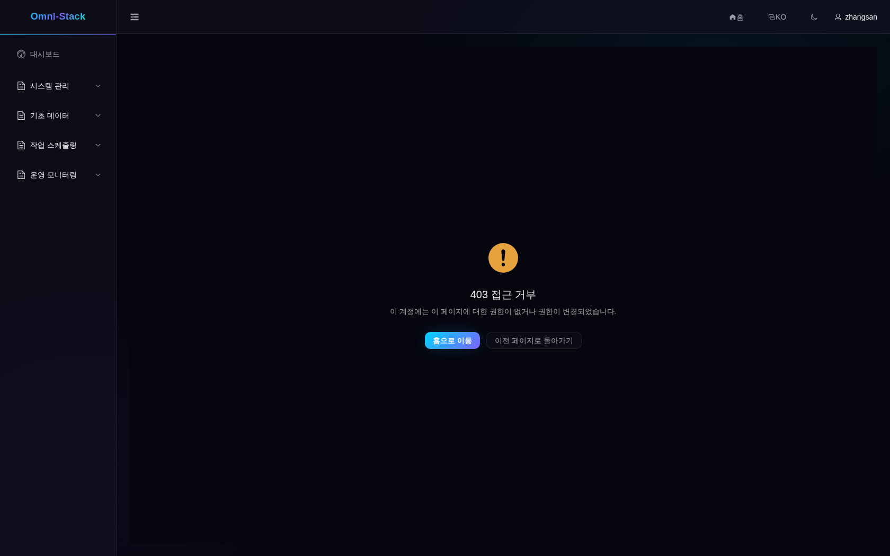

#### core-B: 사용자 목록 API 실패와 복구

- 사전 조건: 관리자 테스트 신원은 `SUPER_ADMIN`을 가지며 먼저 `/admin/system/user`를 정상적으로 열어 실제 사용자 목록을 읽습니다.
- 작업: 브라우저 테스트 프로세스에서만 `GET /api/auth/user/list`에 고정된 `500` 응답을 주입합니다. 기본 현지화된 안전한 오류를 표시하고 세션을 유지합니다. 이는 클라이언트 장애 주입이며 백엔드 중단 증거가 아닙니다. 오류 아래 빈 표는 정상적인 빈 조회 결과가 아닙니다.
- 복구: 주입을 제거하고 다시 로드하면 네 언어 모두 HTTP `200`, `code=200`과 첫 페이지 10행을 다시 받습니다. 실제 장애에서는 실제 응답과 진단 식별자를 조사한 뒤 재시도하며 테스트 주입을 일반적인 복구 방법으로 취급하면 안 됩니다.

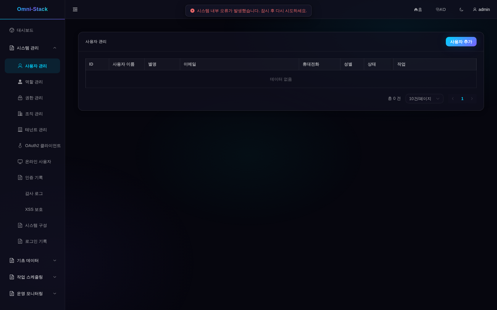

네 언어 데스크톱 원본 8장을 각각 AI 검토했습니다. 거부 문구, 오류 표시와 복구 버튼은 읽을 수 있지만 긴 영어/일본어 사이드바 이름에는 기존 잘림이 남아 있습니다. 검증 범위는 두 장면이며 모든 화면이나 모바일 배치를 뜻하지 않습니다. 임시 토큰을 제거하고 격리 실행 컨테이너를 중지했습니다. 원래 업무 환경은 사용하지 않았습니다.

#### 그림 1 `system-users-ko-KR`: 사용자 관리

- 사전 조건: 격리 Docker core lite 서비스가 정상이며 테넌트 1의 admin이 `SUPER_ADMIN`과 실제 사용자 조회 권한을 가집니다. 단기 테스트 토큰을 사용합니다.
- 작업자: admin. 이번에는 사용자 생성, 역할 할당, 상태 변경, 삭제를 제출하지 않았습니다.
- 조작: `/admin/system/user`를 열고 실제 목록·글꼴·로딩 마스크 처리가 끝날 때까지 기다립니다.
- 기대 결과: 각 언어 원본에 총 29개 중 첫 10행과 마스킹된 연락처가 표시됩니다. 관리자 목록은 HTTP 200/업무 코드 200, 직원의 같은 API는 HTTP 403입니다. 이 읽기 경계만 증명합니다.

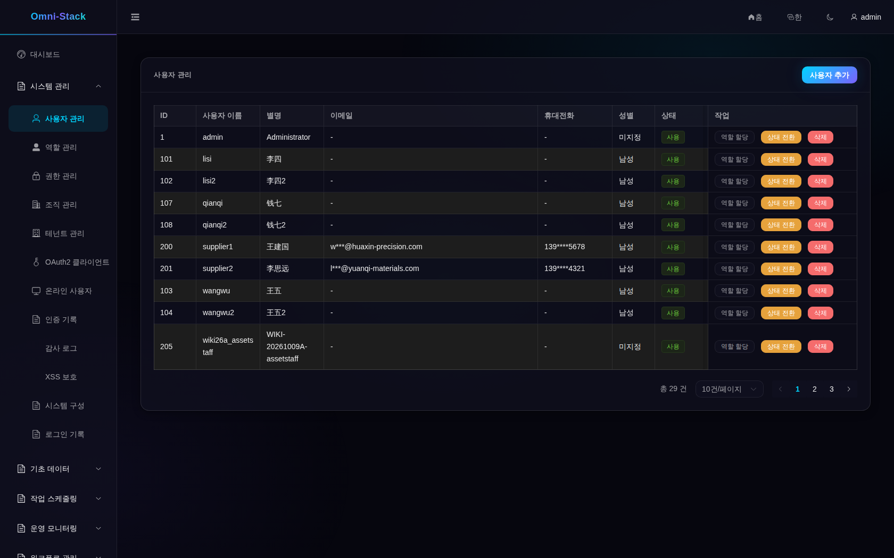

영어 Unknown과 일부 작업 문구는 줄바꿈되며 영어/일본어의 긴 사이드바 항목은 일부 잘립니다. 긴 계정 이름도 줄바꿈됩니다. 이미지 가공이나 DOM 텍스트 대체 없이 원래 화면을 보존했으며, 전체 사이트 반응형 검증은 아닙니다.

<!-- omni:modules:procurement -->
#### 그림 2 `employee-forbidden-403-ko-KR`: 직원의 권한 밖 접근

- 사전 조건: 2026-10-12 직원 zhangsan은 `EMPLOYEE`를 가지지만 `procurement:approval-route:list`는 없습니다.
- 작업자: DB 역할에서 파생한 직원 테스트 신원입니다.
- 조작: `/admin/procurement/approval-route`로 직접 이동합니다.
- 기대 결과: 로그인 상태에서 403과 돌아가기 수단이 표시되고 같은 시기 API 검증도 HTTP 403입니다. 로그인 화면으로 보내지 않습니다. 관리자가 권한을 확인한 뒤 다시 로그인하여 재시도합니다.

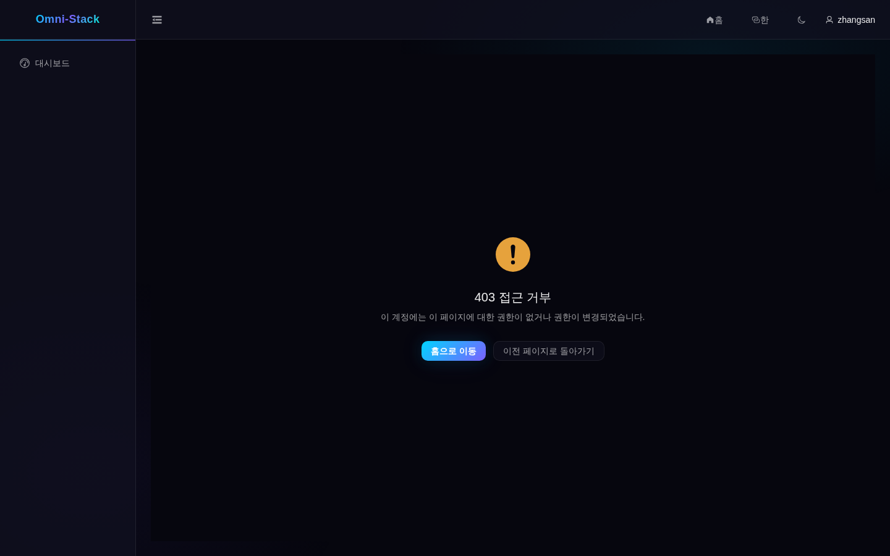

<!-- omni:modules:end -->

#### 그림 3 `employee-workspace-scope-ko-KR`: 직원 작업 공간

- 사전 조건: 2026-10-12 zhangsan의 단기 테스트 신원을 사용합니다.
- 작업자: 일반 직원입니다.
- 조작: 작업 공간 홈을 엽니다.
- 기대 결과: 해당 신원에 보이는 진입점과 작업 영역을 표시합니다. 모든 작업·조직·테넌트 간 격리를 완전히 증명하지는 않습니다. 신원이 다르면 로그아웃하고 계정과 테넌트를 확인합니다.

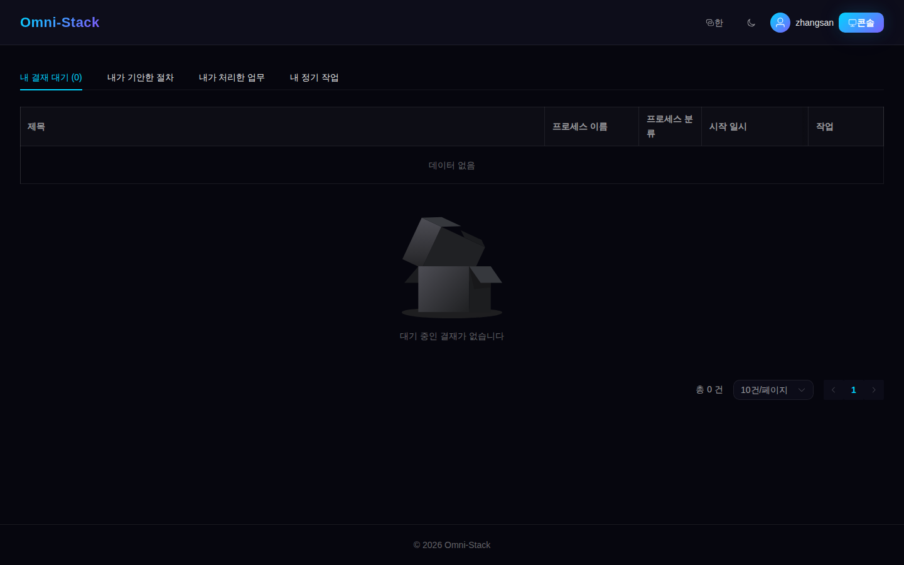

<!-- omni:modules:srm -->
#### 그림 4 `supplier-portal-scope-ko-KR`: 공급업체 포털

- 사전 조건: 2026-10-12 seed 계정 supplier1에 `SUPPLIER`와 활성 연결이 있습니다.
- 작업자: supplier1의 단기 테스트 신원입니다.
- 조작: `/supplier-portal`을 엽니다.
- 기대 결과: 포털과 supplier1 신원이 보입니다. 새 계정 자체 등록·입점 변경·두 공급업체 사이의 모든 격리를 증명하지 않습니다. 기업 정보가 보이지 않으면 역할·권한·포털 연결을 확인합니다.

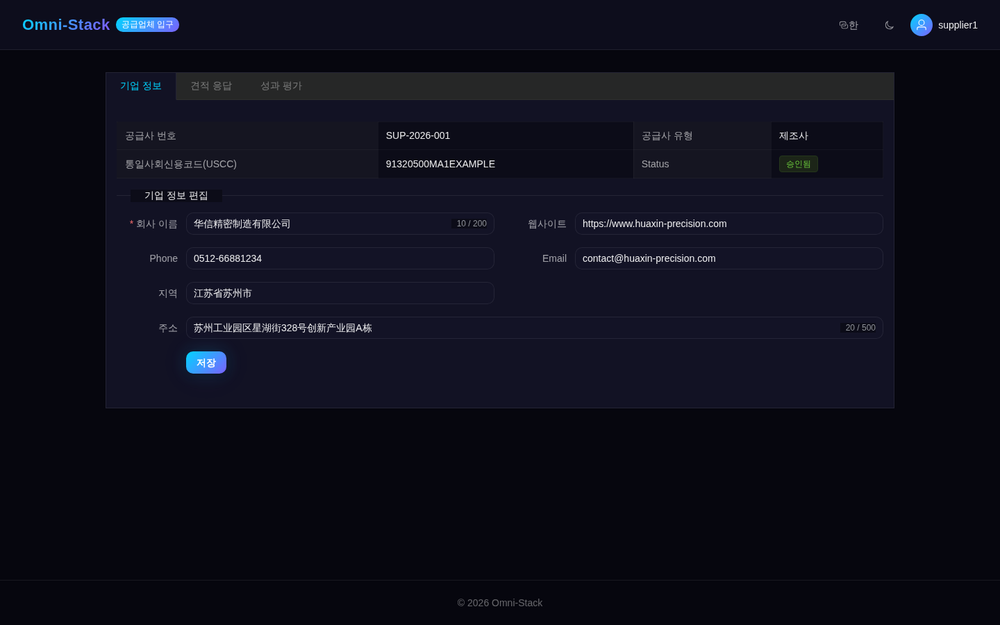

<!-- omni:modules:end -->

#### 그림 5 `resource-not-found-404-ko-KR`: 정의되지 않은 경로의 404

- 사전 조건: 2026-10-12 존재하지 않는 프런트엔드 경로에 접근합니다.
- 작업자: 관리자 테스트 신원입니다.
- 조작: catch-all NotFound 화면을 엽니다.
- 기대 결과: 제품의 404 표시와 돌아가기 수단이 보입니다. 프런트엔드 경로 안내이며 API의 HTTP 404나 데이터 범위 숨김을 증명하지 않습니다. 주소를 확인하고 정상 탐색 경로로 다시 들어갑니다.

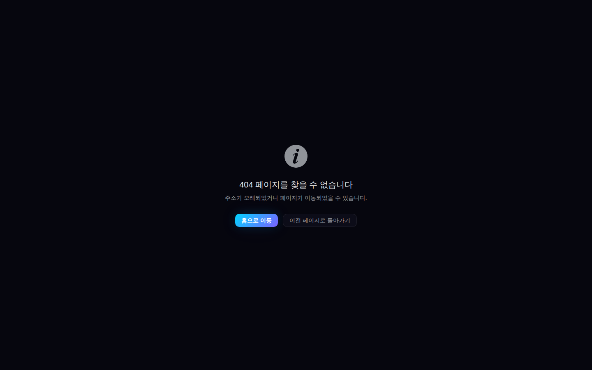

<!-- omni:modules:procurement -->
#### 그림 6 `approval-route-list-failure-ko-KR`: 목록 요청 실패

- 사전 조건: 2026-10-12 브라우저 테스트가 승인 규칙 목록 요청을 가로채고 결정적인 500 응답을 주입합니다.
- 작업자: 관리자 테스트 신원입니다.
- 조작: 조달 요청 승인 규칙 화면에서 목록 실패를 관찰합니다.
- 기대 결과: 페이지 틀과 실제 실패 안내가 유지됩니다. 백엔드가 실제로 중단됐다는 증거는 아니며 빈 목록을 성공으로 보지 않습니다. 테스트 복구 시 주입을 제거하고, 실제 장애는 Trace ID로 조사한 뒤 재시도합니다.

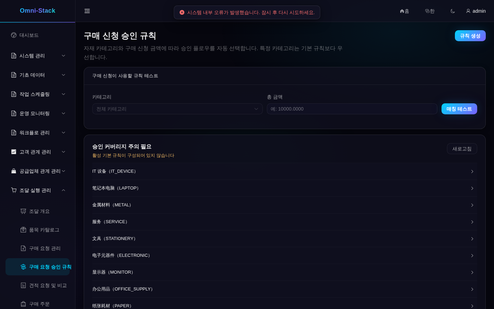

<!-- omni:modules:end -->

#### 그림 7 `admin-menu-load-failure-ko-KR`: 메뉴 로딩 실패

- 사전 조건: 2026-10-12 브라우저 테스트가 메뉴 요청에 결정적인 500 응답을 주입합니다.
- 작업자: 관리자 테스트 신원입니다.
- 조작: 관리 화면에 들어가 메뉴 로딩 실패를 발생시킵니다.
- 기대 결과: 현지화된 오류 페이지와 새로고침/홈으로 돌아가기 수단이 표시됩니다. 빈 화면이나 가짜 성공 메뉴를 만들지 않습니다. 테스트 주입을 제거하거나 실제 요청 장애를 해결한 뒤 재시도합니다.

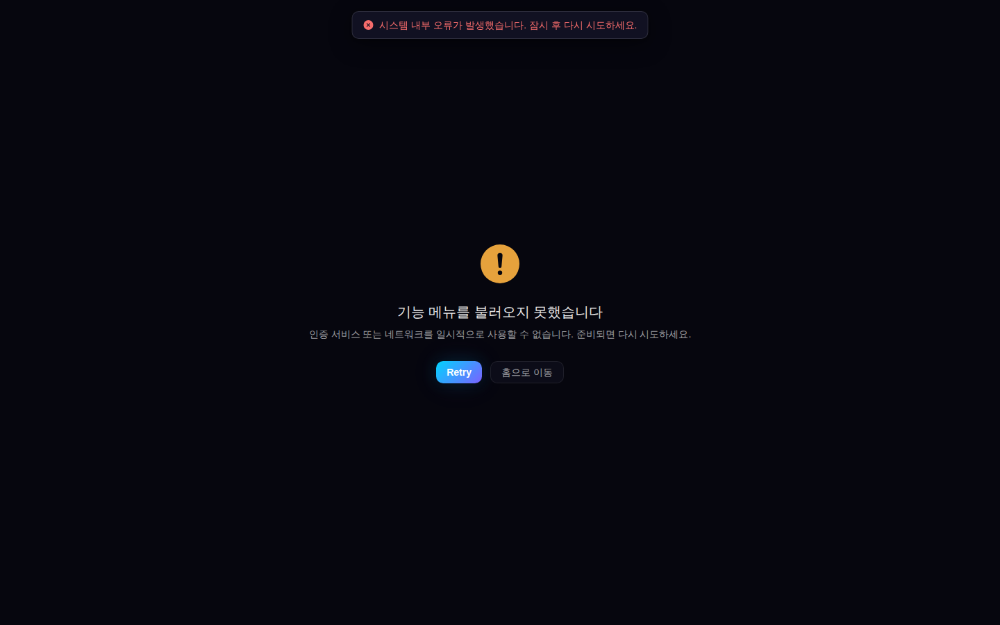

## 6. 새 권한 코드 체크리스트

변경 기능을 추가할 때는 다음을 함께 갱신합니다.

1. Controller의 `@PreAuthorize`와 명시적인 작업 코드. 개인 작업 같은 기존 소유자 검사 예외는 유지합니다.
2. `scripts/sql/seed/auth.sql`의 권한 노드와 필요한 기본 역할 연결입니다.
3. `database/seed/manifest.yaml`의 SHA-256과 검증 조건, 기존 DB에 필요하다면 순방향 마이그레이션입니다.
4. 관리 메뉴 코드·뷰 매핑·진입점입니다. 정적 페이지 주소만 추가해서는 안 됩니다.
5. 작업 버튼의 같은 코드 `v-permission`입니다.
6. 도메인 집계 루트/하위 리소스의 범위 매핑, 페이지 처리 전 데이터 권한 적용, 컨텍스트 정리입니다.
7. 기능 허용/거부·데이터 범위·테넌트 간 회귀 검증입니다. 삭제 후 부재를 거부 증거로 사용하지 않습니다.
8. 모듈 문서·실제 캡처·실제로 수행한 AI 검토 기록입니다.

구현 규칙은 [백엔드 규칙](../backend-patterns.kr.md), [프런트엔드 규칙](../frontend-patterns.kr.md), [핵심 흐름](../core-flows.kr.md), [API 계약](../api-contract.kr.md)을 참고하세요.

<!-- omni:modules:procurement -->
## 7. 조달 관리자 역할: 기능 권한 안의 데이터 범위

이 절은 2026-10-12 완료된 과거 실험이며 원래 객체를 다시 만들거나 삭제하지 않습니다. 로컬 Docker의 일반 `PROCUREMENT_MANAGER`는 유효 범위가 `DEPT_AND_BELOW`였습니다. [증거](../reference/evidence/procurement-scope-2026-10-12.json)에는 모든 역할, 네 언어에 걸친 통과 사례 4개, 원본 12장이 남아 있습니다. 계정에 `SUPER_ADMIN`은 없지만 다른 역할은 있었으므로 단일 역할 실험이라고 할 수 없습니다. 과거 검증 ID `procurement-admin-scope`가 실제 역할이 `PROCUREMENT_ADMIN`이었다는 뜻은 아닙니다.

### 7.1 보이는 요청과 숨겨지는 요청 준비하기

당시에는 [교육 데이터](../wiki/data-and-fixtures.kr.md)를 기준으로 기본 조직·역할·유효 범위를 확인했습니다. 관리자의 기본 조직은 604이며 그 조직의 승인된 `PR-1-1`이 보이는 대상이었습니다. 조직 605의 전용 `PROCUREMENT_STAFF`가 제출하지 않은 `PR-1-4`를 만들었습니다. 생성자가 정식 상세 API로 업무 코드 200을 받아 존재를 먼저 확인한 뒤 관리자 결과와 비교했습니다. 과거 준비 절차 설명이며 초안은 이미 정리되었습니다. 이전 변경 작업을 그대로 재실행하지 마세요.

### 7.2 같은 부서의 요청 열기

관리자는 `/admin/procurement/requisition`에서 `PR-1-1`을 검색하고 상세를 열었습니다. 과거 원본에는 보이는 요청과 승인 상태가 표시되며 상세 API 업무 코드는 200입니다. 새 환경에서는 번호와 데이터가 다를 수 있습니다. 같은 테넌트와 유효 조직 안에 실제로 존재하는 객체를 먼저 확인하세요.

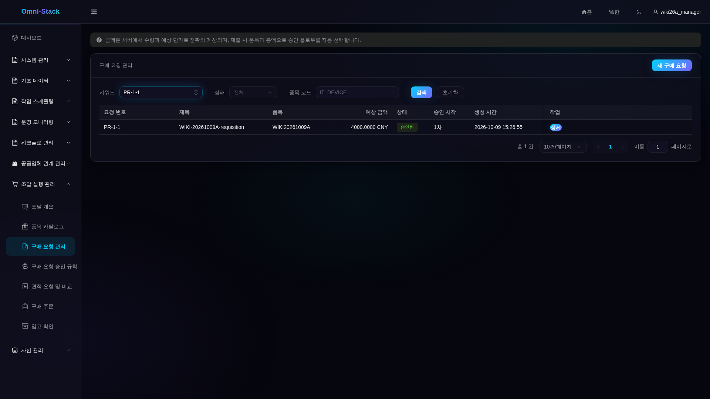

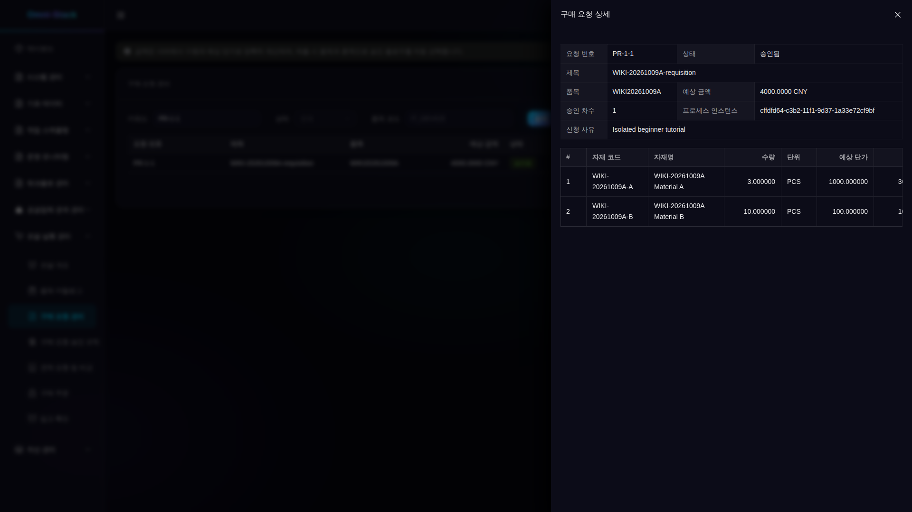

### 7.3 다른 부서 요청 검색하기

과거 실험에서 상세를 닫고 `PR-1-4`를 검색하자 관리자 목록은 0개였습니다. 같은 시기이면서 삭제하기 전에 다음 결과를 확인했습니다.

| 신원/요청 | 실제 결과 |
| --- | --- |
| 생성자가 `PR-1-4` 상세 조회 | HTTP 200, 응답 본문 `code=200`. |
| 관리자가 `PR-1-4` 상세 조회 | HTTP 200, 응답 본문 `code=404`. |
| 관리자가 `PR-1-4` 목록 검색 | HTTP 200, 응답 본문 `code=200`, 빈 집합. |

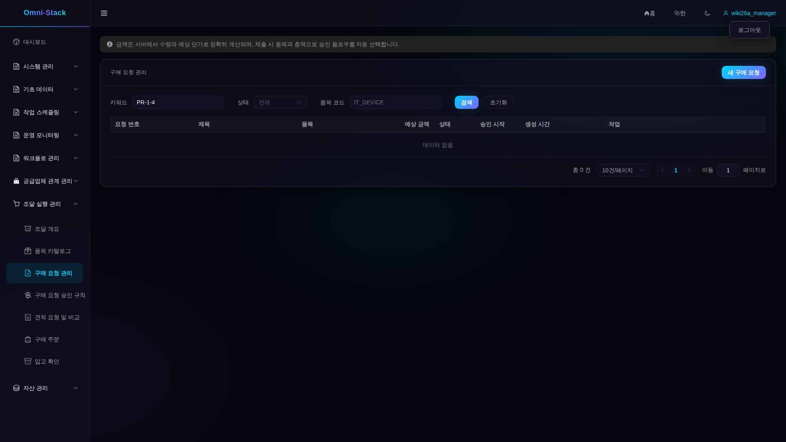

이는 당시 객체가 존재할 때의 범위 숨김이며, 기능 권한 부족의 HTTP 403이나 정의되지 않은 프런트엔드 경로의 404와 다릅니다. 네 언어를 캡처한 뒤 생성자가 정식 삭제 API로 전용 초안을 삭제했고 다시 읽었을 때 업무 코드 404가 반환되었습니다. 삭제 후 부재를 권한 증거로 대신하면 안 됩니다. 기존 승인 요청과 업무 흐름은 바꾸지 않았으며 전용 계정은 격리 프로젝트 최종 정리 때까지 유지합니다.

과거 영어 사이드바의 긴 항목은 일부 잘리고 상세 표는 가로로 넘칩니다. 번호·상태·검색 조건·빈 목록은 읽을 수 있습니다. 네 언어 문서는 [승인된 AI 검토 정책](../adr/0003-authorized-ai-translation-review.md)으로 검증하며 별도의 필수 사람 검토 조건을 두지 않습니다. 유효한 승인은 현재 검토 기록과 대기열로 판단하고 AI_REVIEW를 HUMAN_REVIEW로 표기하지 않습니다.

<!-- omni:modules:end -->
