# 菜单、角色、功能权限与数据权限

先从 [Wiki](../wiki/index.md) 启动所需模块，再打开 `http://localhost:3000`。本节以租户 1 的隔离教学环境说明权限配置；不要在生产账号上试删用户或扩大角色范围。准备一个有管理权限的账号和一个普通员工账号，分别验证允许和拒绝结果。

证据分为四批：[2026-10-17 用户列表](../reference/evidence/permissions-users-2026-10-17.json)是当前源码产物的四语只读取证；图 2–7 来自 [2026-10-12 基础验收](../reference/evidence/basic-2026-10-12.json)；采购范围图来自[采购范围记录](../reference/evidence/procurement-scope-2026-10-12.json)。基础验收的 44 个独立检查/原图由多轮结果选取，包含失败后补采，不能解读为一次 44 项全绿运行。这些截图使用测试类路径夹具从数据库真实角色派生的短期令牌，不是密码/验证码登录验收，也不证明本节所有写操作已执行。

新增的 [2026-10-18 core 拒绝与恢复](../reference/evidence/core-permissions-errors-2026-10-18.json)来自真正生成并移动后的 core 项目，下面单独说明临时只读角色、真实 403 和客户端故障的边界。

## 1. 四层关系

功能授权的表关系是：

```text
sys_user → sys_user_role → sys_role → sys_role_permission → sys_permission
```

| 层次 | 作用 |
| --- | --- |
| 用户 | 租户内账号，具有状态和主组织 `primary_unit_id`。 |
| 角色 | 通过 `sys_user_role` 分配，组合功能权限和数据范围策略。 |
| 权限 | 节点类型的实际字面量为 `DIRECTORY`、`MENU`、`API`；“按钮/API”描述用途，不是 `BUTTON` 类型。 |
| 数据范围 | 角色的 `data_scope`、自定义组织与用户主组织共同决定可访问数据，另于功能授权解析。 |

`sys_user_role_scope` 是独立的“用户—角色—组织”绑定，供工作流候选人/抄送人解析使用；它不是上述 `sys_user_role` 的替代品。操作权限码形如 `procurement:requisition:create`。目录和菜单负责导航，`API` 节点用于实际操作授权。

## 2. 动态菜单

已登录前端调用 `GET /api/auth/menus`，Auth 按当前权限和租户返回菜单树。管理端只把能匹配视图的 `MENU` 注册为 `/admin` 下的动态子路由，例如 `system:user` 对应 `/admin/system/user`；`DIRECTORY` 只分组，`srm:portal:` 菜单不注册到管理端。供应商门户有受保护的专用路由，不能据此认定所有静态路由都绕过权限。

菜单缺失时依次检查：

1. 当前预设和运行环境是否包含目标模块。
2. `sys_permission` 是否有启用的目录、菜单和操作节点，编码是否能匹配前端视图。
3. 当前租户角色是否通过 `sys_role_permission` 获得所需菜单与操作权限。
4. JWT 的 `scope` 是否更新；更改角色或授权后退出并重新登录，再重新加载菜单。
5. 按钮是否使用同一操作码的 `v-permission`，后端接口是否也允许该操作。

无权限时菜单可为空；加载失败时应看到菜单失败页及重试入口。先排查失败请求，再重试；不要用硬编码管理路由掩盖缺失的授权或接口故障。

## 3. 功能权限

后端写操作通常以 `@PreAuthorize` 校验操作码；前端按钮使用同一码的 `v-permission`。指令在挂载/更新时切换 `display:none`，保持 Vue 响应式结构。隐藏按钮不能阻止直接请求，必须单独验证后端拒绝越权。

`MyJobController` 是明确例外：个人任务按每行 `createBy == currentUser` 校验归属，不补加端点级 RBAC。

供应商 Portal 也不能简单写成“一律需要 `SUPPLIER`”：`POST /api/srm/portal/enroll` 需要 `srm:portal:enroll`，其入驻请求必须带有效 `inviteToken` 和客户端 `requestId`；`GET /enrollment`、`POST /enrollment/retry` 接受 `srm:portal:enroll` 或 `srm:portal:profile`。默认 `USER` 可参与入驻，但 `/profile` 等企业资料接口还要求 `SUPPLIER`、对应操作权限和有效 Portal 关联。这不是已完成真实验证码自注册的证明。

## 4. 数据权限

DataScope 约束已获功能授权后的数据集合。角色页面有以下六个实际选项：

| 字面量 | 含义 |
| --- | --- |
| `ALL` | 全部数据范围；不代表跳过独立的租户和接口校验。 |
| `TENANT` | 当前租户范围。 |
| `DEPT_AND_BELOW` | 主组织及下级组织。 |
| `DEPT` | 主组织。 |
| `CUSTOM` | 为角色配置的组织集合，解析时包含相应下级。 |
| `SELF` | 本人范围，具体比较列由领域映射决定。 |

多个有效角色按较宽优先级合并：`ALL > TENANT > DEPT_AND_BELOW > DEPT > CUSTOM > SELF`；缺少范围配置时回到 `SELF`。默认解析合并用户角色；按指定权限码解析时，只合并实际授予该权限的角色。因此给已有宽范围角色的用户再加一个 `SELF` 角色，不会自动收窄其有效范围。不要把前端选项排列顺序当成合并顺序。

Servlet 服务从可信 Gateway 身份建立上下文，MyBatis 数据权限在分页拦截器之前追加条件；请求结束必须在 `finally` 清理 ThreadLocal。租户边界独立于数据范围，不可因为选择 `ALL` 就手工去掉租户条件。

各领域不能套用同一个 owner 列：CRM、SRM、Procurement、Asset 分别维护聚合根可见性；子表经聚合根继承范围，不能给没有 owner 列的表追加该列。采购申请使用申请人列，RFQ/订单/收货使用负责人列；资产管理视图使用 owner 列，“我的资产”、接收和归还固定按当前用户。

## 5. 角色维护流程

以下是当前界面与 API 的操作指南，截图只验证读取，不代表本轮已提交这些修改。先记录原角色、授权和组织，使用专用教学账号；不要禁用、删除或撤销正在使用的管理员账号。

1. 用有 `system:role:list` 的账号打开「系统管理 → 角色管理」(`/admin/system/role`)。新增还需 `system:role:create`；编辑、分配权限和自定义部门需 `system:role:update`。
2. 新增时填写角色编码和名称，选择明确的数据范围；当前新增表单默认是 `ALL`，不能直接当作最小权限。编辑时角色编码不可改。保存成功后刷新列表核对名称和范围。
3. 点击该角色的「分配权限」，分别勾选需要的菜单和操作节点。菜单可见不等于已授予其全部 API。确认后重新打开对话框核对实际选择。
4. 若选择 `CUSTOM`，点击「分配部门」选择组织并保存；其他范围下该按钮禁用。选取当前租户的有效组织；为空或主组织不正确时，先修正配置，不用扩大到 `ALL` 掩盖空列表。
5. 打开「用户管理」(`/admin/system/user`)，以 `system:user:list` 查看用户，以 `system:user:update` 点击目标用户「分配角色」。该页面没有主组织编辑字段，也不会维护 `sys_user_role_scope`。主组织可经资料更新 API 的 `primaryUnitId` 配置，先确认组织属于当前租户；工作流组织绑定参见[受控范围夹具](../wiki/data-and-fixtures.md)。
6. 用目标用户退出并重新登录。分别检查菜单、按钮、允许的 API 和可见数据；不要只用超级管理员验证。请求和数据都应属于同一租户。
7. 验证一个缺少操作权限的真实 HTTP 403，再验证一个“有功能权限但超出数据范围”的列表/详情结果。失败时保留 HTTP 状态、响应体 `code`、Trace ID 和对象是否仍存在；修正后重试。撤销测试授权时恢复记录的原值，不误删原有角色或单据。

| 操作 | 正式 API 与请求要点 |
| --- | --- |
| 用户角色 | `GET /api/auth/user/{userId}/roles` 读角色 ID；`POST` 同一路径提交角色 ID 数组，需 `system:user:update`。 |
| 主组织资料 | `PUT /api/auth/user/{id}` 的白名单字段 `primaryUnitId`；需 `system:user:update`，不能借此改角色、状态或租户。 |
| 角色权限 | `POST /api/auth/permission/role/{roleId}/assign` 提交权限 ID 数组。 |
| 自定义组织 | `GET /api/auth/role/{roleId}/depts` 读现值；`POST` 同一路径提交组织 ID 数组。 |

这些角色、权限和组织分配接口都是全量替换：先读取现有 ID，再提交完整的保留集合，而非只发送新增项；空数组会清空对应关联。

### 操作截图

图 1 为 2026-10-17 当前产物；图 2–7 是注明日期的历史场景。历史日/韩界面部分 Status、Phone、Email、Retry 为当时实际英文回退，业务数据名称沿用教学数据，不把这些原图冒称全部来自当前运行。

#### core-A：已认证身份访问系统配置被拒

- 前置条件：实际生成的 `core` 项目已在隔离 Docker 中构建，使用原生 `lite` 配置和独立数据库。
- 身份：租户 1 的 zhangsan 原为 `EMPLOYEE`，没有管理菜单；本轮通过正式角色 API 临时追加现有只读 `USER` 并重新签发数据库派生短期令牌，仍缺少 `system:config:list`。这不是默认员工种子的原始权限，也不是密码/验证码登录。
- 操作：直接打开 `/admin/system/config`，核对本地化 403、返回首页/上一页入口和保留的登录态。
- 预期结果：另行请求 `GET /api/auth/system-config/login-policy`，该身份得到 HTTP 403/业务码 403，管理员同接口得到 HTTP 200/业务码 200。采集后通过正式 API 恢复原角色，并读回确认用户、角色及授权关系校验与采集前一致。

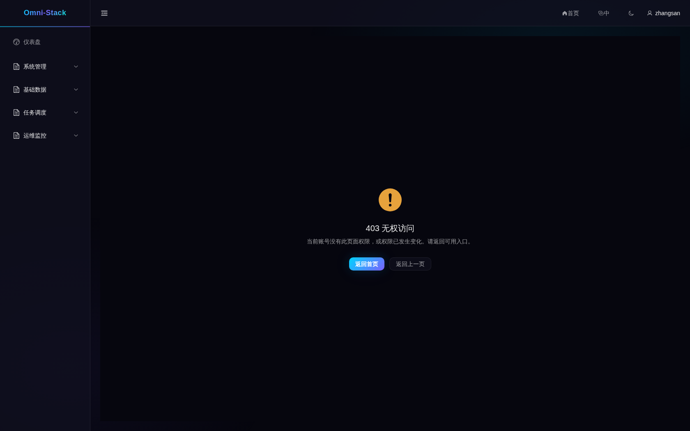

#### core-B：用户列表接口失败与恢复

- 前置条件：管理员测试身份有 `SUPER_ADMIN`，先正常打开 `/admin/system/user` 并读取真实用户列表。
- 操作：仅在浏览器测试进程对 `GET /api/auth/user/list` 注入确定性 `500` 响应，页面显示原生本地化安全提示并保留会话。这是客户端故障注入，不证明后端真实宕机；错误提示下的空表不能当作成功的空结果。
- 恢复：移除注入并重新加载，四语言均重新得到 HTTP `200`、`code=200` 和首屏 10 行。查真实环境故障时按实际响应与排障凭据处理后重试，不能把测试注入当成正常修复方法。

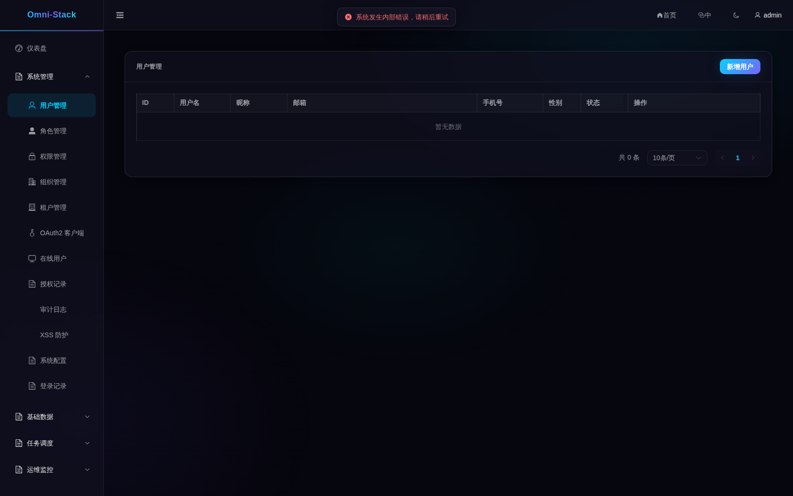

这 8 张四语桌面原图逐张完成 AI 复核，拒绝文案、错误提示和恢复按钮可读；英文/日文长侧栏标签仍有原生裁切。仅覆盖这两个场景，不代表所有页面或移动布局验收。临时令牌已清除，独立运行容器已停止；原业务环境没有参与。

#### 图 1 `system-users-zh-CN`：用户管理

- 前置条件：隔离 Docker core lite 服务健康；租户 1 的 admin 有 `SUPER_ADMIN` 与实际用户读取权限，使用短期测试令牌。
- 操作者：admin；本轮不提交新增、角色分配、状态或删除操作。
- 操作：打开 `/admin/system/user`，等待真实列表、字体与加载遮罩完成。
- 预期结果：四语原图各显示首屏 10 行、共 29 条及脱敏联系方式；管理员列表接口为 HTTP 200/业务码 200，普通员工同接口为 HTTP 403。仅证明此只读边界。

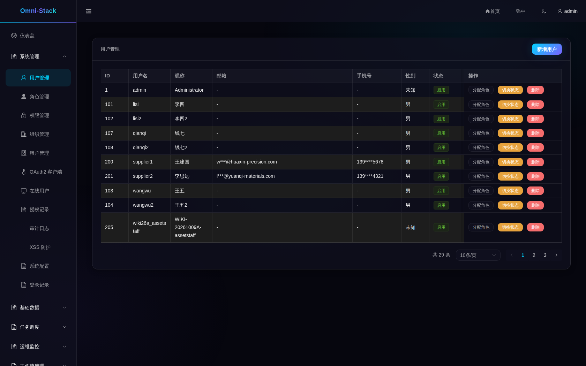

英文 Unknown 和部分操作文字换行，英文/日文长侧栏标签仍有裁切；长账号名称会换行。保留原生界面，不修图或替换 DOM 文本；这不是全站响应式验收。

<!-- omni:modules:procurement -->
#### 图 2 `employee-forbidden-403-zh-CN`：员工越权访问被拒

- 前置条件：2026-10-12，普通员工 zhangsan 具有 `EMPLOYEE`，没有 `procurement:approval-route:list`。
- 操作者：普通员工的数据库角色派生测试身份。
- 操作：直接进入 `/admin/procurement/approval-route`。
- 预期结果：已登录仍显示 403 与返回入口，同期接口验证为 HTTP 403；不应跳回登录页。由管理员核对授权后重新登录重试。

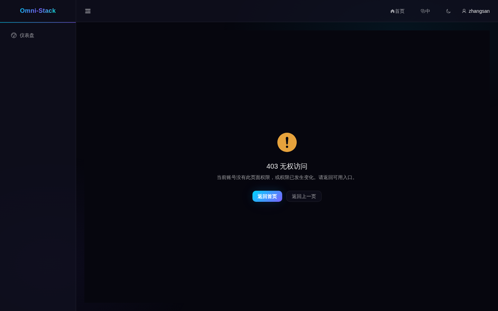

<!-- omni:modules:end -->

#### 图 3 `employee-workspace-scope-zh-CN`：员工可见范围

- 前置条件：2026-10-12，使用普通员工 zhangsan 的短期测试身份。
- 操作者：普通员工。
- 操作：打开工作台首页。
- 预期结果：显示该身份可见的工作台入口和任务区；此图不是所有任务、组织或跨租户数据隔离的完整证明。身份不符时退出并检查账号/租户。

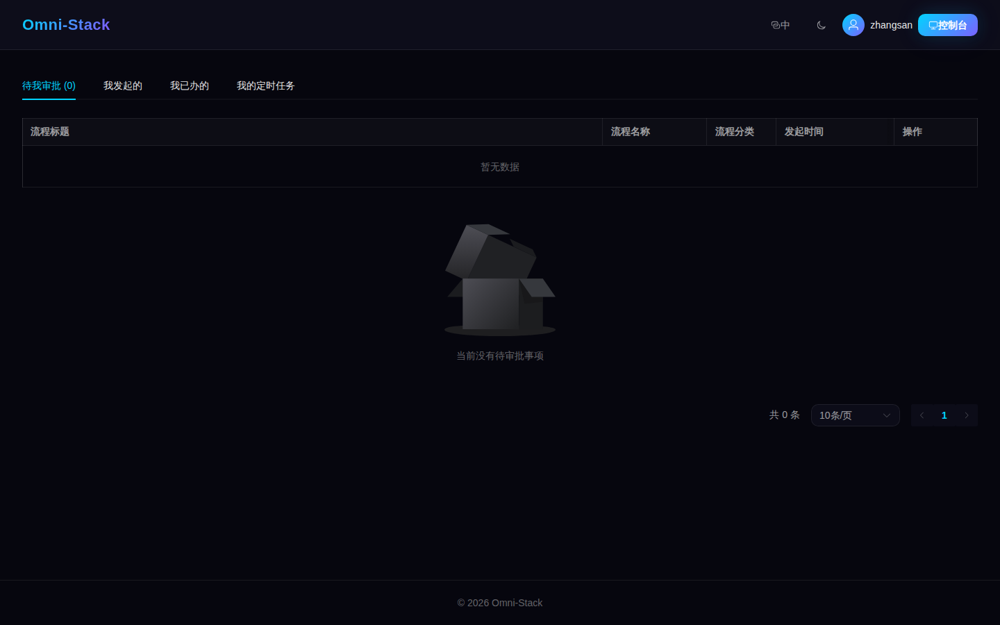

<!-- omni:modules:srm -->
#### 图 4 `supplier-portal-scope-zh-CN`：供应商门户范围

- 前置条件：2026-10-12，seed 账号 supplier1 有 `SUPPLIER` 和有效关联。
- 操作者：supplier1 的短期测试身份。
- 操作：打开 `/supplier-portal`。
- 预期结果：门户和 supplier1 身份可见；此图不证明新账号自注册、入驻写入或两个供应商之间的全部隔离。资料不可见时检查角色、权限与 Portal 关联。

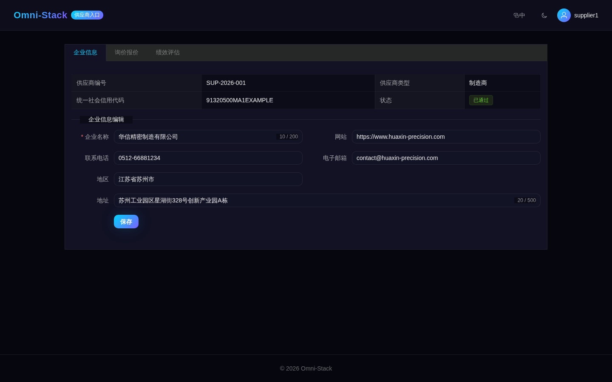

<!-- omni:modules:end -->

#### 图 5 `resource-not-found-404-zh-CN`：未知路由 404

- 前置条件：2026-10-12，访问不存在的前端路由。
- 操作者：管理员测试身份。
- 操作：进入 catch-all NotFound 页面。
- 预期结果：产品显示 404 及返回入口。它是前端路由提示，不证明 API 返回 HTTP 404，也不证明数据范围隐藏；检查地址并从合法导航重新进入。

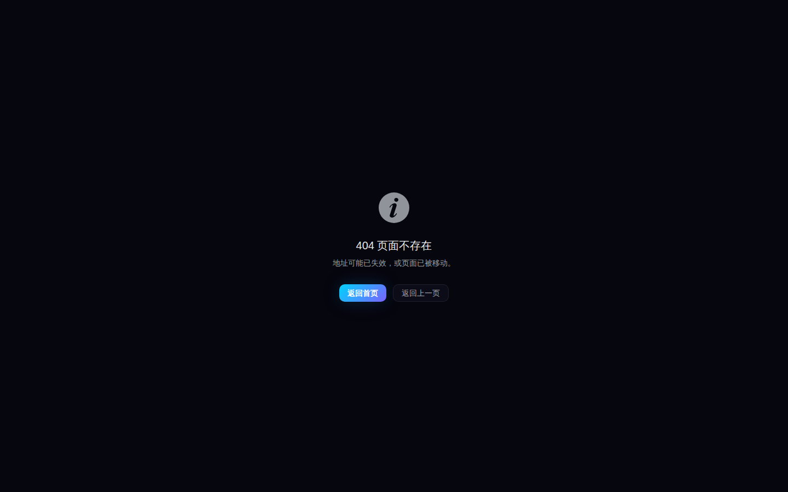

<!-- omni:modules:procurement -->
#### 图 6 `approval-route-list-failure-zh-CN`：列表接口失败表现

- 前置条件：2026-10-12，浏览器测试拦截审批规则列表请求并注入确定性 500 响应。
- 操作者：管理员测试身份。
- 操作：打开请购审批规则页面，观察列表失败表现。
- 预期结果：保留页面框架和实际失败提示；不是后端真实宕机证明，也不能把空列表当成功。测试恢复需移除注入；真实故障应凭 Trace ID 排查后重试。

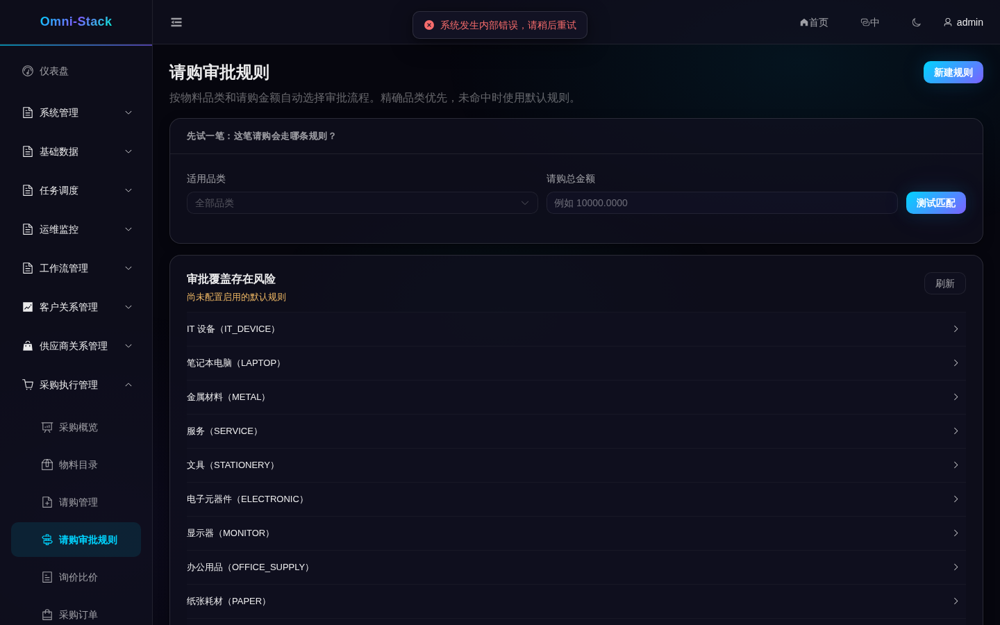

<!-- omni:modules:end -->

#### 图 7 `admin-menu-load-failure-zh-CN`：菜单加载失败降级页

- 前置条件：2026-10-12，浏览器测试对菜单请求注入确定性 500 响应。
- 操作者：管理员测试身份。
- 操作：访问管理页触发菜单加载失败。
- 预期结果：进入本地化失败页，提供重新加载/返回首页；不白屏或伪造成功菜单。移除测试注入或处理真实请求故障后再重试。

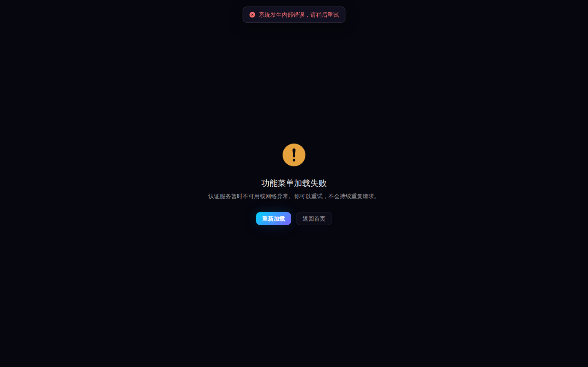

## 6. 新增权限的代码清单

新增写功能时同步完成：

1. Controller 的 `@PreAuthorize` 与明确的操作权限码；保留个人任务等已有归属校验例外。
2. `scripts/sql/seed/auth.sql` 中的权限节点和所需默认角色关系。
3. `database/seed/manifest.yaml` 的 SHA-256、断言，以及已有数据库所需的向前迁移。
4. 管理端菜单编码、视图映射和入口，不能仅新增静态页面地址。
5. 操作按钮的同码 `v-permission`。
6. 对应领域的聚合根/子资源范围映射，数据权限在分页之前及上下文清理。
7. 功能允许/拒绝、数据范围与跨租户回归验证，避免把资源删除误作拒绝证据。
8. 对应模块文档、真实截图与实际 AI 复核记录。

实现约束见[后端规范](../backend-patterns.md)、[前端规范](../frontend-patterns.md)、[核心流程](../core-flows.md)和 [API 合同](../api-contract.md)。

<!-- omni:modules:procurement -->
## 7. 采购经理：同一功能权限下的数据范围

本节是 2026-10-12 已完成的历史实验，不重新创建或删除原对象。本机 Docker 普通 `PROCUREMENT_MANAGER` 的有效范围为 `DEPT_AND_BELOW`。[证据记录](../reference/evidence/procurement-scope-2026-10-12.json)保留其全部角色、四语 4 个通过用例和 12 张原图。账号没有 `SUPER_ADMIN`，同时有其他角色；不能声称是仅有一个角色的实验。覆盖标识 `procurement-admin-scope` 为历史名称，实际角色不是 `PROCUREMENT_ADMIN`。

### 7.1 准备可见与不可见的两笔请购

实验按[教学数据](../wiki/data-and-fixtures.md)核对主组织、角色和有效范围：经理主组织为 604，可见对象为该组织已批准的 `PR-1-1`；组织 605 的专用 `PROCUREMENT_STAFF` 创建从未提交的 `PR-1-4`。创建人先经正式详情 API 读到该草稿（业务码 200），再比较经理结果，排除“资源本来不存在”的干扰。这是历史准备说明，现有草稿已经清理，不要直接重跑旧写入。

### 7.2 经理打开本部门请购

经理打开 `/admin/procurement/requisition`，用关键词 `PR-1-1` 搜索并打开详情。历史原图显示可见请购和批准状态，详情接口业务码为 200。新环境单号和数据可能不同，应先确认同租户、同有效组织内的现有对象。

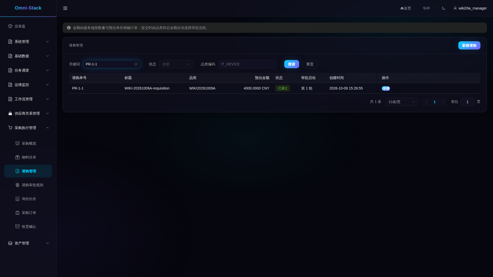

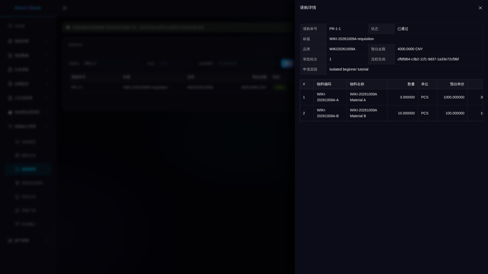

### 7.3 经理查询另一部门请购

在历史实验中关闭详情，改搜 `PR-1-4`，经理列表为零条。同一时段且删除前的结果如下：

| 身份/请求 | 实际结果 |
| --- | --- |
| 创建人读取 `PR-1-4` 详情 | HTTP 200，响应体 `code=200`。 |
| 经理读取 `PR-1-4` 详情 | HTTP 200，响应体 `code=404`。 |
| 经理按 `PR-1-4` 查列表 | HTTP 200，响应体 `code=200`，空集合。 |

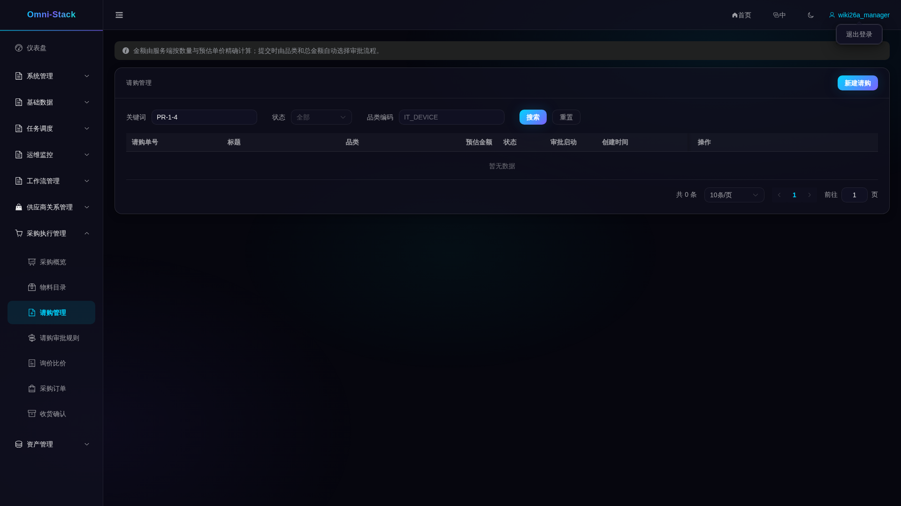

这证明历史对象存在时的范围隐藏，与缺少功能权限的 HTTP 403、前端未知路由 404 都不同。四语截图完成后，创建人通过正式删除接口删除专用草稿，再读为业务码 404；删除后不存在不能补作数据权限证据。原批准单和业务链未改，专用账号保留至隔离项目最终清理。

历史英文侧栏长标签有裁切，详情表存在横向溢出；单号、状态、查询条件与空列表可读。四语文档按[已授权 AI 复核政策](../adr/0003-authorized-ai-translation-review.md)验收，不另设人工复核前置条件；是否有效通过以当前复核记录和队列为准，不能把 AI_REVIEW 写成 HUMAN_REVIEW。

<!-- omni:modules:end -->
